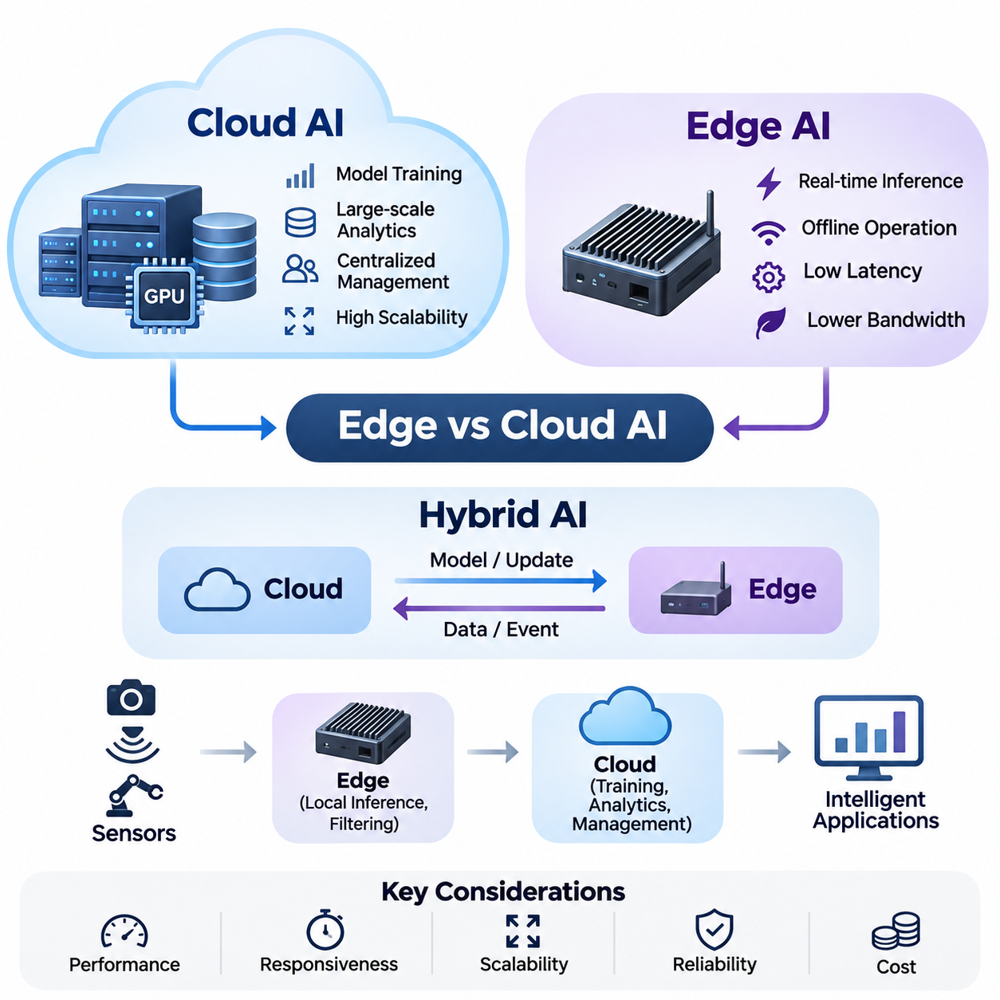
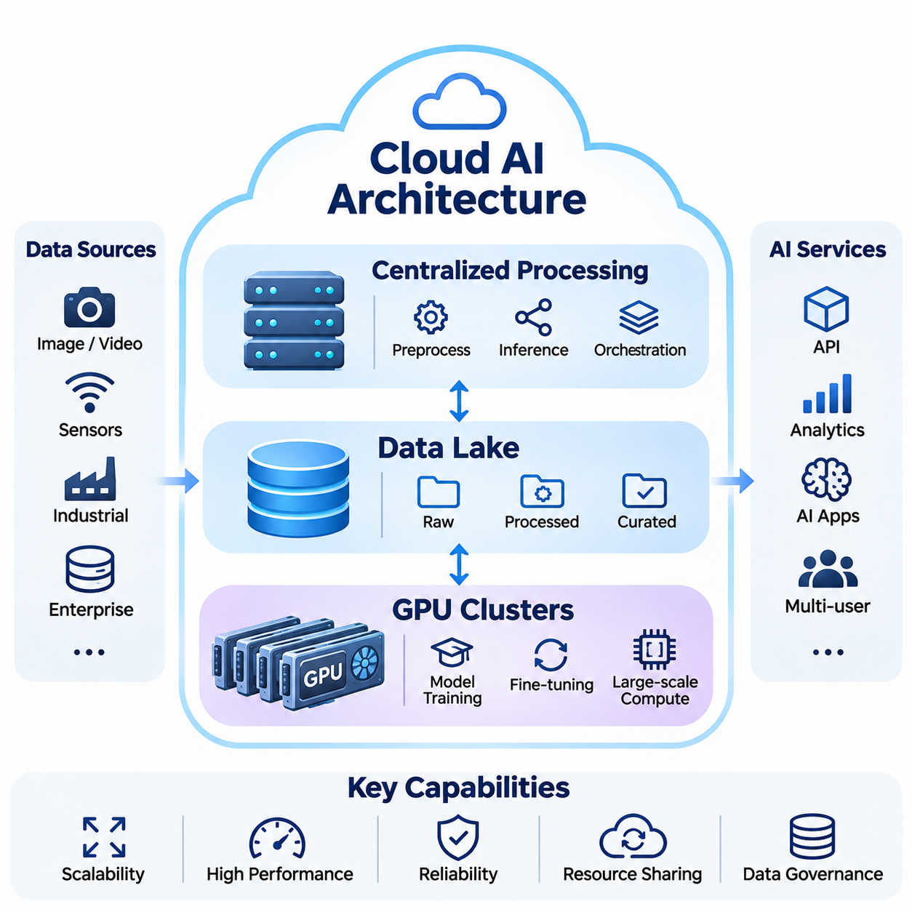
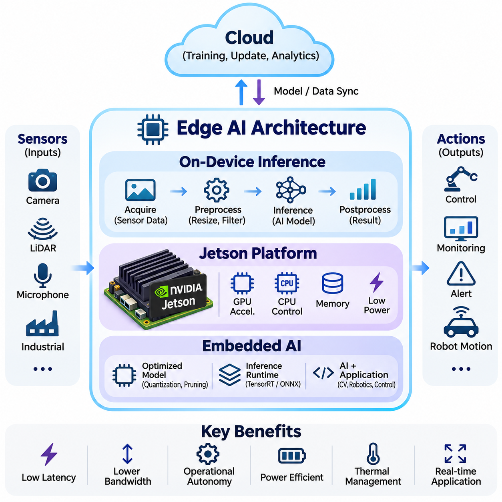
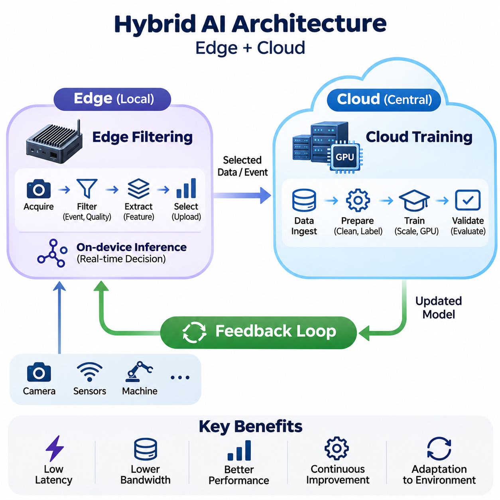
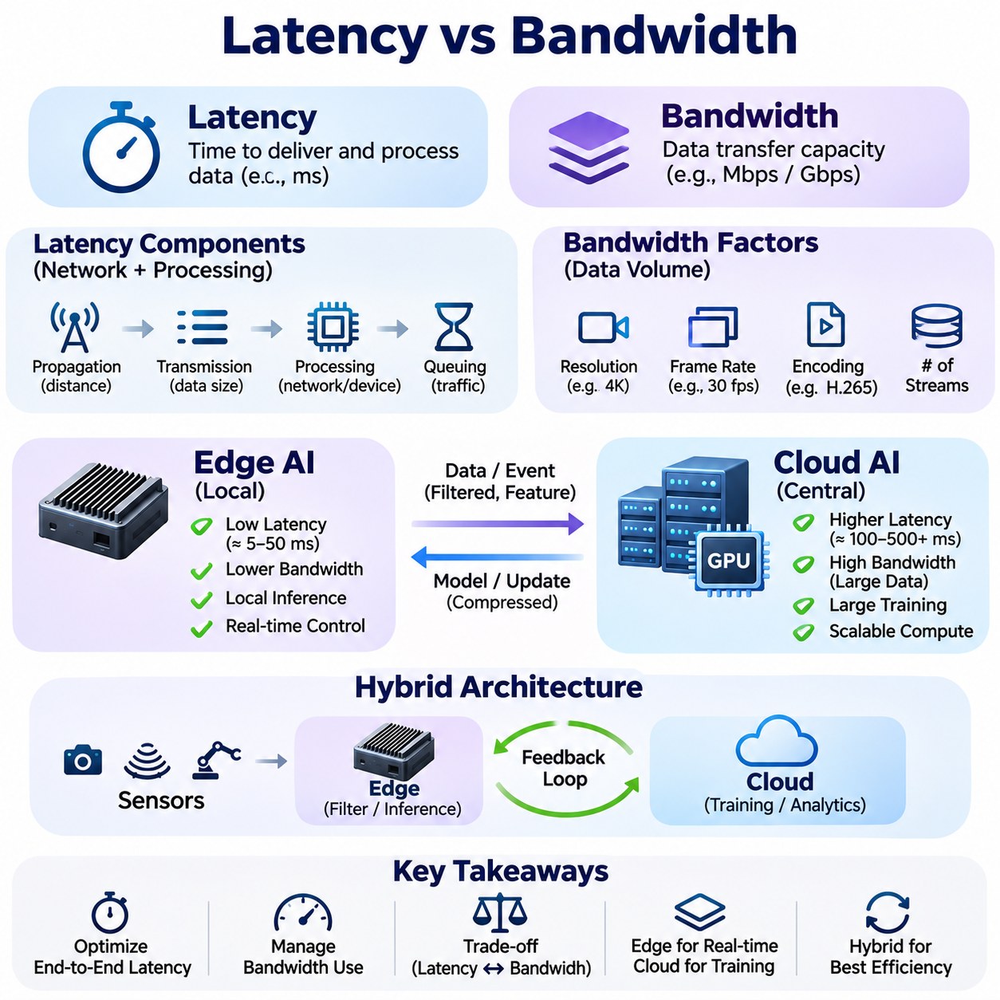
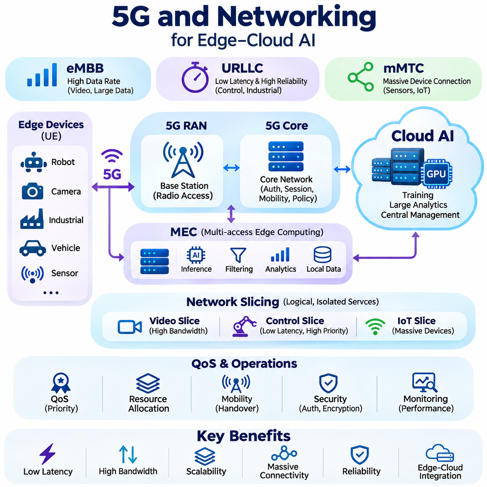
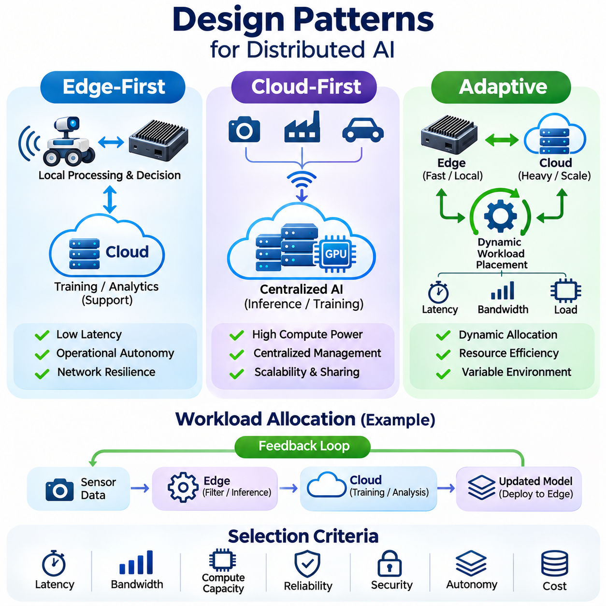
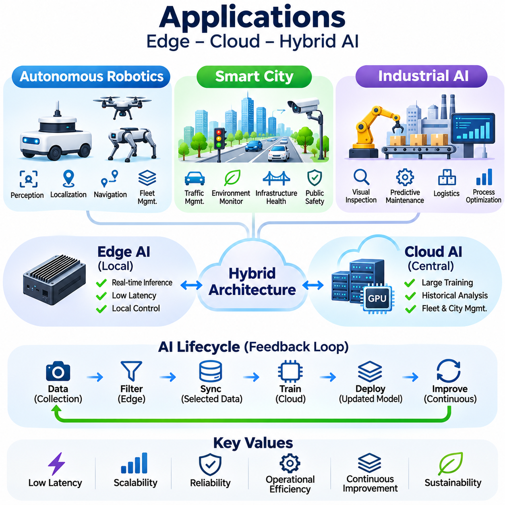

**Volume 38. AI Systems Architecture**

# 01. Edge vs Cloud AI

## 01.00 Overview

{width="7.268055555555556in" height="7.268055555555556in"}

Artificial intelligence systems increasingly operate across distributed computing environments where data collection, processing, inference, and decision-making occur at different locations. Edge AI and Cloud AI represent two fundamental architectural approaches to organizing these operations. Understanding their characteristics is essential for designing intelligent systems that balance computational performance, responsiveness, scalability, reliability, and operational cost.

Cloud AI refers to artificial intelligence architectures that execute computational workloads within centralized or geographically distributed data centers. These environments provide access to high-performance processors, GPU clusters, large-scale storage systems, and sophisticated orchestration platforms. Cloud infrastructure is particularly suitable for computationally intensive model training, large-scale analytics, centralized data management, and AI services supporting numerous users.

Edge AI moves artificial intelligence processing closer to the physical location where data originates. Instead of continuously transmitting raw information to remote servers, edge devices execute trained models locally using embedded processors, GPUs, neural processing units, or specialized accelerators. This architecture enables rapid responses, reduces communication requirements, and allows intelligent applications to continue operating when network connectivity becomes unreliable.

The fundamental distinction between Edge AI and Cloud AI concerns the placement of computational resources and the movement of information. Cloud architectures concentrate processing capabilities within shared infrastructure, whereas edge architectures distribute computation across devices near sensors and users. Neither approach is universally superior because architectural effectiveness depends on workload characteristics, response deadlines, available hardware, and communication conditions.

Cloud AI architectures typically employ centralized processing services connected to scalable storage platforms and GPU computing clusters. Data lakes collect structured and unstructured information from multiple sources, supporting large-scale training and analytical workloads. Distributed processing frameworks coordinate computational tasks across servers, while resource orchestration systems allocate processing capacity according to application demand and infrastructure availability.

Centralized computing provides important advantages when artificial intelligence applications require substantial memory, extensive datasets, or coordinated processing across many computational devices. Large language models, foundation models, and complex multimodal systems often benefit from powerful cloud infrastructure. Centralized environments also simplify certain aspects of model management, software updates, experiment tracking, and shared computational resource allocation.

However, cloud-dependent architectures introduce communication delays and network dependencies that may limit their suitability for time-sensitive applications. Transmitting high-resolution video, LiDAR measurements, or continuous industrial sensor streams can consume substantial bandwidth. Network congestion, packet loss, service interruptions, and variable communication latency may reduce system responsiveness and compromise the availability of applications requiring immediate decisions.

Edge AI architectures address these limitations by executing inference directly on devices or nearby computing platforms. On-device inference transforms incoming sensor measurements into predictions, classifications, detections, or control-related information without requiring continuous cloud interaction. Local processing is particularly valuable when intelligent systems must react within strict timing constraints or operate in environments where reliable network connectivity cannot be guaranteed.

Embedded AI platforms integrate computational hardware, memory, communication interfaces, and inference software within compact physical systems. Platforms such as NVIDIA Jetson provide GPU-accelerated computing capabilities for robotics, machine vision, and autonomous applications. Their deployment requires careful consideration of processing throughput, memory capacity, thermal constraints, power consumption, model complexity, and compatibility with connected sensors.

Edge hardware generally operates under more restrictive resource conditions than cloud infrastructure. Limited memory, computational capacity, and electrical power can constrain model selection and execution performance. Engineers therefore apply optimization techniques such as quantization, pruning, knowledge distillation, and hardware-specific inference acceleration. These methods help reduce computational requirements while preserving sufficient predictive accuracy for the intended application.

Hybrid AI architectures combine local intelligence with centralized computational capabilities. Edge devices perform immediate inference, preliminary filtering, and operational decision-making, while cloud systems support computationally expensive training, historical analysis, fleet-level coordination, and long-term data storage. This division enables intelligent applications to exploit the responsiveness of local processing without sacrificing the scalability and analytical capabilities of cloud infrastructure.

Edge filtering is an important component of hybrid architectures because continuously transmitting every sensor measurement may be unnecessary or economically inefficient. Local systems can identify significant events, extract relevant features, compress observations, and selectively upload information. For example, an autonomous robot may process camera and LiDAR data locally while transmitting detected hazards, diagnostic summaries, and selected event recordings to a centralized management platform.

Cloud training complements edge inference by providing computational resources for developing and improving machine learning models. Data collected from distributed devices can be aggregated, validated, annotated, and incorporated into training datasets. Updated models are subsequently evaluated and deployed to edge platforms. This process establishes a feedback loop connecting real-world observations, centralized learning, model validation, and operational improvement.

The effectiveness of distributed AI architectures depends heavily on latency and bandwidth characteristics. Latency describes the time required for information to travel through processing and communication stages, while bandwidth describes the capacity available for transferring data. An application may have sufficient bandwidth yet experience unacceptable response delays, particularly when network variability or remote processing queues introduce unpredictable execution times.

Real-time applications must consider end-to-end latency rather than inference execution time alone. Sensor acquisition, preprocessing, communication, scheduling, model execution, postprocessing, and actuator commands all contribute to total response time. Edge processing can eliminate certain network delays, but local hardware contention and inefficient software pipelines may still cause deadline violations. Consequently, performance evaluation must examine the complete operational workflow.

Modern communication technologies, including 5G, Wi-Fi, and high-speed Ethernet, enable increasingly sophisticated coordination between edge devices and cloud services. High-throughput connections support remote monitoring, data synchronization, and distributed analytics. Nevertheless, nominal network performance does not guarantee deterministic communication behavior. Effective system design must account for coverage limitations, congestion, mobility, security overhead, and temporary disconnections.

Network-aware architectures can dynamically adjust processing strategies according to connectivity and computational availability. When communication quality is high, selected workloads may be transferred to cloud infrastructure for additional processing. When connectivity deteriorates, essential functions remain on local devices. Such adaptive behavior requires explicit policies for workload placement, data consistency, service prioritization, and recovery following communication interruptions.

Edge-first design patterns prioritize local processing for operationally critical functions. These architectures are particularly appropriate for autonomous robotics, industrial control, and safety-related monitoring, where decisions must remain available without external communication. Cloud services provide supplementary capabilities rather than serving as mandatory components of immediate control loops. Local fallback behavior and independent safety mechanisms remain essential design considerations.

Cloud-first design patterns prioritize centralized processing when workloads benefit from shared computational resources, extensive datasets, and elastic scalability. Applications involving enterprise analytics, large-scale document processing, or complex generative AI services frequently adopt this approach. Lightweight edge components may handle data acquisition, authentication, caching, or preprocessing, while computationally demanding inference operations execute remotely.

Adaptive architectures extend these approaches by selecting processing locations according to changing operating conditions. Decisions may consider model size, device utilization, available bandwidth, response deadlines, energy consumption, and service cost. Workload partitioning can also divide an application into local and remote components, although transferring intermediate representations introduces additional communication and synchronization complexity.

Security and privacy requirements strongly influence the placement of artificial intelligence workloads. Local processing can reduce unnecessary transmission of sensitive raw information, while centralized infrastructure may provide consistent access controls, monitoring, and governance mechanisms. Both approaches require secure communication, authentication, encryption, software integrity verification, and lifecycle management. Architectural decisions must account for the sensitivity and regulatory requirements of processed information.

Reliability is another fundamental consideration because distributed AI systems operate across hardware, software, and communication components with different failure characteristics. Cloud services may experience regional outages, while edge devices may encounter thermal limitations, storage failures, or power interruptions. Resilient architectures incorporate health monitoring, fault detection, recovery procedures, redundant components where justified, and clearly defined operating modes during partial system failures.

Autonomous robotics illustrates the practical importance of Edge AI architecture. Mobile robots continuously process information from cameras, LiDAR, radar, inertial sensors, and positioning systems to estimate their surroundings and determine appropriate actions. Local inference supports perception, localization, obstacle detection, and motion-related decisions. Cloud infrastructure can complement these capabilities through fleet monitoring, map distribution, model updates, and operational analytics.

Smart city applications often require coordination between geographically distributed sensors, intelligent cameras, mobile platforms, and centralized management services. Edge processing can detect traffic events, infrastructure abnormalities, or environmental changes near their sources. Cloud platforms aggregate selected information across districts, support historical analysis, and provide broader operational visibility. Hybrid deployment enables local responsiveness alongside city-scale intelligence.

Industrial AI systems similarly benefit from combining localized inference with centralized analysis. Production equipment can use embedded intelligence for visual inspection, anomaly detection, and condition monitoring, while cloud platforms support cross-factory analytics, predictive maintenance modeling, and continuous model improvement. The appropriate distribution of responsibilities depends on production timing requirements, equipment interfaces, data sensitivity, and infrastructure reliability.

Economic considerations extend beyond the purchase price of computational hardware. Cloud environments introduce recurring costs associated with compute instances, storage, data transfer, and managed services. Edge deployments require investment in devices, installation, maintenance, software distribution, and hardware replacement. A meaningful comparison evaluates total cost of ownership over the expected operating lifetime, including utilization rates, energy consumption, network expenses, and administrative effort.

The design of an effective Edge AI or Cloud AI system therefore requires a comprehensive evaluation of technical and operational constraints. Engineers must consider inference accuracy, end-to-end latency, throughput, scalability, fault tolerance, cybersecurity, privacy, energy efficiency, and lifecycle cost. These characteristics interact, meaning that improving one dimension may introduce disadvantages elsewhere. Architectural selection is consequently a multidimensional engineering optimization problem.

As artificial intelligence expands into autonomous machines, connected infrastructure, and large-scale intelligent services, the boundary between edge and cloud computing becomes increasingly flexible. Future systems will rely on coordinated computation across embedded devices, local servers, regional infrastructure, and centralized GPU clusters. Understanding cloud architectures, edge deployment, hybrid processing, communication tradeoffs, and adaptive design patterns provides the foundation for building scalable, responsive, and dependable AI systems.

## 01.01 Cloud AI Architecture

{width="7.268055555555556in" height="7.268055555555556in"}

Cloud AI architecture provides a centralized computing environment for developing, training, deploying, and managing artificial intelligence models at scale. It integrates computational infrastructure, distributed storage, networking, and software orchestration into a unified platform. Its fundamental components include centralized processing systems, data lakes, and GPU clusters, which collectively support large-scale machine learning and intelligent services.

Centralized processing represents the architectural foundation of Cloud AI systems. Computational workloads are executed within managed data centers rather than being distributed across individual endpoint devices. This approach enables organizations to consolidate hardware resources, coordinate complex processing tasks, and maintain consistent operational policies while supporting numerous applications and users through shared infrastructure.

A centralized AI processing environment typically consists of application servers, compute nodes, storage services, network infrastructure, and management software. Incoming requests are routed through APIs, gateways, and load balancers before reaching appropriate processing services. These services execute data preprocessing, model inference, analytical computations, or workflow coordination according to application requirements and available computational resources.

Resource virtualization and containerization enable multiple AI applications to share physical infrastructure efficiently. Virtual machines provide isolated execution environments, while containers package applications with their software dependencies. Orchestration platforms such as Kubernetes coordinate deployment, scheduling, scaling, and recovery operations, allowing AI services to operate consistently across distributed computing nodes within a centralized management framework.

Centralized processing supports both synchronous and asynchronous AI workloads. Synchronous processing is commonly used for interactive inference services that require immediate responses, whereas asynchronous execution accommodates large-scale data transformation, batch inference, and model training. Message queues and workflow orchestration systems decouple processing stages, improve resource utilization, and prevent individual operations from unnecessarily blocking entire pipelines.

Scalability is a primary advantage of centralized Cloud AI architecture. Horizontal scaling increases processing capacity by adding compute instances, while vertical scaling enhances the resources available to individual machines. Elastic resource allocation adjusts infrastructure capacity according to changing workload demands. These mechanisms allow organizations to accommodate fluctuations in inference traffic, training requirements, and data processing volumes.

Despite these advantages, centralized processing introduces architectural challenges involving communication latency, infrastructure concentration, and service dependencies. Applications must account for network transmission delays, processing queues, and possible service interruptions. High availability requires redundant infrastructure, fault isolation, health monitoring, and recovery mechanisms that prevent individual component failures from disrupting critical AI services.

A data lake serves as a centralized repository for storing large quantities of structured, semi-structured, and unstructured information. Unlike traditional databases that typically enforce predefined schemas, data lakes can preserve information in its original form. This flexibility is particularly valuable for artificial intelligence applications that process images, video recordings, sensor measurements, documents, logs, and continuously generated operational data.

Data ingestion pipelines transfer information from enterprise systems, connected devices, industrial equipment, and external data sources into cloud storage. Streaming ingestion supports continuous data arrival, while batch ingestion handles periodic transfers and historical datasets. Reliable ingestion requires validation, metadata collection, timestamp management, and mechanisms for detecting incomplete or duplicated records before information enters downstream processing workflows.

Data lakes commonly organize information into raw, processed, and curated data layers. Raw layers preserve original observations, processed layers contain cleaned and transformed information, and curated layers provide validated datasets suitable for analytical applications and machine learning. This separation improves traceability and enables engineers to reproduce preprocessing procedures without permanently modifying the original source information.

Metadata management is essential for maintaining the usability of large-scale data lakes. Data catalogs describe dataset origins, formats, ownership, processing history, and access permissions. Data lineage mechanisms record transformations and dependencies between datasets, allowing engineers to identify how training information was produced. Effective governance reduces the risk of inconsistent datasets, unauthorized access, and unreliable experimental results.

AI training pipelines retrieve relevant information from data lakes and transform it into model-ready datasets. Preprocessing operations may include normalization, filtering, annotation, feature extraction, and data augmentation. Dataset versioning ensures that experiments reference consistent training and evaluation information. These capabilities support reproducibility, systematic model comparison, and controlled updates throughout the machine learning lifecycle.

Cloud object storage provides an economical foundation for large-scale data lakes because it supports durable storage and independent scaling of storage capacity. However, training performance depends on more than total storage capacity. Data access latency, request throughput, file organization, caching, and network bandwidth influence how quickly training systems receive information. Poorly designed data pipelines can leave expensive GPU resources underutilized.

GPU clusters provide the computational acceleration required for demanding artificial intelligence workloads. A GPU cluster consists of multiple computing nodes equipped with one or more graphics processing units, interconnected through high-speed networking infrastructure. These systems accelerate matrix operations, tensor computations, neural network training, and parallel inference workloads that would otherwise require substantially greater execution time on conventional processors.

Modern GPU computing nodes integrate CPUs, GPUs, system memory, accelerator memory, local storage, and high-bandwidth communication interfaces. CPUs coordinate application execution and data preparation, while GPUs perform massively parallel numerical computations. Efficient system design requires balancing processing capabilities across these components to prevent bottlenecks involving memory transfers, storage access, or inter-node communication.

Distributed training enables GPU clusters to process models and datasets that exceed the practical capabilities of individual accelerators. Data parallelism distributes training examples across multiple GPUs while coordinating model updates. Model parallelism partitions neural network parameters or computations across devices. Pipeline parallelism divides model execution into stages, enabling multiple accelerators to cooperate on computationally intensive training workloads.

High-speed networking is critical for efficient multi-node GPU training. Technologies such as InfiniBand and high-performance Ethernet support communication between computing nodes, while collective communication libraries coordinate operations including gradient synchronization. Network bandwidth and latency directly influence distributed training efficiency, particularly when models require frequent exchanges of parameters, activations, or intermediate computational results.

GPU memory capacity and communication topology strongly influence cluster architecture. Large models may require partitioning parameters, optimizer states, and intermediate activations across several accelerators. High-bandwidth GPU interconnects can reduce communication overhead within compatible systems, while network communication becomes necessary across separate nodes. Effective workload placement considers accelerator connectivity, memory requirements, and computational dependencies.

Cluster scheduling systems allocate GPU resources among training experiments, inference services, and data processing workloads. Scheduling policies may consider GPU availability, memory requirements, workload priority, and expected execution duration. Resource quotas and job queues help prevent uncontrolled contention, while monitoring systems collect utilization, memory consumption, temperature, communication throughput, and execution performance measurements.

GPU clusters also support large-scale inference by distributing model execution across multiple accelerators or serving replicas. Model parallelism can accommodate models that exceed individual GPU memory capacity, while replicated inference services improve aggregate request throughput. Dynamic batching combines compatible inference requests to increase accelerator utilization, although excessive batching may increase response latency for interactive applications.

The relationship between centralized processing, data lakes, and GPU clusters forms the operational foundation of Cloud AI. Data lakes provide persistent information storage, centralized processing coordinates application workflows, and GPU clusters execute computationally demanding learning and inference tasks. High-speed networks and orchestration services connect these components into integrated pipelines capable of supporting complex AI development and production operations.

A typical Cloud AI workflow begins with data ingestion from distributed sources into centralized storage. Processing services validate, transform, and organize the information before training jobs retrieve selected datasets. GPU clusters execute model optimization, while experiment tracking systems record configurations, performance metrics, and generated artifacts. Validated models are subsequently registered and deployed through managed inference services.

Production Cloud AI environments require continuous monitoring of model behavior and infrastructure performance. Operational metrics include request latency, throughput, GPU utilization, memory consumption, error rates, and service availability. Model monitoring additionally examines prediction quality, data drift, and changes in input distributions. Combining infrastructure observability with model evaluation enables engineers to identify performance degradation and determine appropriate corrective actions.

Security controls must extend across the complete cloud architecture. Identity and access management restrict interactions with storage, computing resources, and model services. Encryption protects information during transmission and storage, while network segmentation limits unnecessary communication between components. Audit logging, credential management, and software vulnerability assessment help maintain operational accountability and reduce exposure to unauthorized activity.

Cost optimization is particularly important because GPU clusters and large-scale storage environments can generate substantial operational expenses. Infrastructure efficiency depends on workload scheduling, accelerator utilization, storage lifecycle policies, and appropriate instance selection. Organizations must also consider data transfer charges, idle resources, and the tradeoffs between reserved and dynamically provisioned capacity when estimating total operating costs.

Cloud AI architecture ultimately provides the scalability, centralized management, and computational capacity required for modern artificial intelligence systems. Its effectiveness depends on coordinated design across processing services, data lakes, GPU clusters, and communication infrastructure. By balancing performance, reliability, security, and economic efficiency, organizations can establish robust foundations for large-scale training, distributed inference, and continuously evolving intelligent applications.

## 01.02 Edge AI Architecture

{width="7.268055555555556in" height="7.268055555555556in"}

Edge AI architecture enables artificial intelligence models to execute directly on devices located near the sources of data generation. Unlike centralized cloud computing, edge systems perform inference and selected processing tasks locally without requiring continuous communication with remote servers. This approach reduces communication latency, limits bandwidth consumption, improves operational autonomy, and supports intelligent applications operating under real-time and resource-constrained conditions.

The fundamental objective of Edge AI is to position computational intelligence close to sensors, machines, and physical environments. Edge devices receive information from cameras, LiDAR sensors, microphones, industrial controllers, and other interfaces before transforming observations into actionable predictions. Local execution allows applications to respond rapidly to changing conditions while reducing dependence on external communication infrastructure.

On-device inference represents the central computational function of Edge AI architecture. A previously trained machine learning model is deployed onto a local computing platform, where incoming data is processed to generate predictions, classifications, detections, or control-related outputs. Unlike model training, inference primarily executes forward computations using established parameters, making optimized models suitable for embedded deployment.

A typical on-device inference pipeline begins with sensor acquisition and data preprocessing. Input measurements are normalized, resized, filtered, or transformed into representations compatible with the deployed model. The inference runtime executes the neural network, and postprocessing converts model outputs into application-specific information. Efficient coordination across these stages is essential for achieving predictable response times and reliable operation.

Latency is a critical consideration in on-device inference because many edge applications interact directly with physical processes. Autonomous robots must detect obstacles and update motion decisions within operational deadlines, while industrial inspection systems must evaluate products before they leave inspection stations. Local inference eliminates remote network round trips, although sensor acquisition, preprocessing, execution, and actuator communication still contribute to end-to-end latency.

On-device inference must also operate within constrained computational and memory resources. Embedded processors generally provide less memory capacity and processing throughput than large cloud GPU clusters. Engineers therefore optimize models through quantization, pruning, knowledge distillation, and efficient neural network architectures. These techniques reduce computational requirements while attempting to preserve the predictive accuracy needed for the target application.

Inference runtimes provide an execution layer between trained models and underlying hardware accelerators. Frameworks such as TensorRT and ONNX Runtime can optimize supported computational graphs, manage memory allocation, and execute operations through compatible acceleration backends. Hardware-specific optimization may improve throughput and latency, but deployment requires verification of numerical accuracy, operator compatibility, and runtime stability.

NVIDIA Jetson platforms provide integrated computing environments for deploying accelerated artificial intelligence workloads at the edge. These platforms combine ARM-based processors, NVIDIA GPU acceleration, memory, and peripheral interfaces within compact modules. Their architecture supports applications requiring substantial parallel computation while operating under more restrictive power, thermal, and physical constraints than conventional data-center infrastructure.

Jetson-based systems commonly support computer vision, autonomous robotics, intelligent cameras, and industrial automation. Depending on the selected module, applications can execute object detection, image segmentation, pose estimation, depth processing, and neural network inference. The suitability of a particular Jetson platform depends on model complexity, memory requirements, concurrent workloads, sensor interfaces, and acceptable power consumption.

The Jetson software environment integrates operating system components, accelerator drivers, CUDA libraries, and AI inference frameworks. NVIDIA JetPack provides a platform-specific software foundation, while TensorRT supports optimized neural network execution. Applications may also integrate multimedia processing, camera interfaces, and robotics middleware to construct complete perception and decision-making pipelines.

Hardware acceleration is especially important when edge devices process multiple sensor streams simultaneously. GPU execution can accelerate image transformations, neural network operations, and selected parallel computations, while CPUs manage application logic, communication, and orchestration. Efficient workload partitioning prevents unnecessary resource contention and helps maintain stable execution when perception, navigation, and monitoring functions operate concurrently.

Memory architecture strongly influences Jetson deployment performance. Model parameters, intermediate activations, sensor buffers, and application processes compete for available memory resources. High-resolution cameras and multiple inference pipelines can substantially increase memory pressure. Engineers must therefore evaluate peak memory consumption, buffer allocation strategies, model precision, and data movement overhead rather than relying exclusively on nominal accelerator performance.

Power consumption and thermal management are fundamental constraints in edge computing. Embedded AI devices may operate inside mobile robots, compact industrial enclosures, or battery-powered systems with limited cooling capacity. Sustained computational workloads can generate heat that reduces operating frequency or causes performance throttling. Reliable deployment requires appropriate power budgets, cooling solutions, thermal monitoring, and validation under representative environmental conditions.

Embedded AI extends local intelligence beyond GPU-based computing platforms to microcontrollers, digital signal processors, neural processing units, and specialized system-on-chip architectures. These devices integrate sensing, computation, and communication within compact systems designed for specific operational requirements. Embedded intelligence may support continuous monitoring, event detection, predictive maintenance, and lightweight control-related decision support.

The architecture of an embedded AI system typically includes sensor interfaces, signal conditioning, local processing, inference execution, communication modules, and application logic. Data flows from physical sensors through preprocessing and inference stages before reaching decision-making components. Depending on the application, outputs may trigger notifications, update machine states, or provide information to independent control systems.

Resource-constrained embedded systems require careful coordination between model design and hardware capabilities. Available memory, processor frequency, accelerator support, storage capacity, and power consumption influence which neural networks can execute reliably. Lightweight convolutional networks, compact classifiers, and optimized signal-processing models are often selected when computational resources are limited.

Embedded inference may operate continuously or respond to specific events. Continuous inference supports applications such as environmental monitoring and machine condition assessment, while event-triggered inference reduces unnecessary computation by activating models only when predefined conditions occur. Duty cycling and intelligent scheduling can improve energy efficiency, particularly in battery-powered devices where operating lifetime is a major design requirement.

Real-time embedded applications must distinguish average processing speed from predictable execution behavior. A model may achieve high average throughput while occasionally exceeding required response deadlines. Engineers therefore evaluate worst-case execution time, scheduling interference, sensor synchronization, and system-level timing constraints. Safety-critical functions may require deterministic control mechanisms independent of probabilistic AI predictions.

Communication interfaces connect embedded AI devices with sensors, actuators, controllers, and supervisory systems. Common technologies include Ethernet, CAN, UART, SPI, I2C, and wireless networking, depending on device requirements. Interface selection influences bandwidth, timing reliability, electrical compatibility, and system integration complexity. Robust communication design also requires error detection, synchronization, and appropriate recovery procedures.

Edge AI architectures frequently separate computational responsibilities across multiple processing layers. A microcontroller may handle deterministic low-level control, an embedded accelerator may execute perception models, and a local industrial computer may coordinate higher-level planning. Cloud infrastructure can provide centralized training, historical analytics, and fleet management. This layered organization allows each computational component to operate according to its strengths and timing requirements.

Autonomous mobile robots illustrate the integration of on-device inference, Jetson platforms, and embedded AI. Cameras and LiDAR sensors provide environmental observations, while local neural networks support object recognition, obstacle detection, and scene understanding. Embedded controllers execute motor-related functions, and higher-level software coordinates navigation and task execution. Cloud connectivity may support monitoring and updates without becoming a mandatory dependency for immediate operation.

Industrial AI applications use similar architectures for visual quality inspection, anomaly detection, equipment monitoring, and automated material handling. Edge processors analyze incoming sensor information near production equipment, reducing unnecessary data transmission and supporting rapid operational responses. Centralized services can aggregate selected results across facilities, enabling performance analysis and model improvement without continuously transferring every raw observation.

Security is essential because edge devices operate outside tightly controlled data-center environments. Physical access, exposed interfaces, outdated software, and insecure communication channels can create vulnerabilities. Secure boot, signed software updates, device authentication, encrypted communication, and access control help protect deployed systems. Model integrity and configuration management are equally important for maintaining trustworthy inference behavior.

Operational reliability requires edge systems to tolerate intermittent connectivity, unexpected restarts, and hardware resource limitations. Local buffering can preserve selected observations during network interruptions, while watchdog mechanisms and health monitoring detect abnormal software behavior. Controlled recovery procedures and validated fallback modes help maintain essential functions when inference services or communication components become unavailable.

The engineering of Edge AI architecture involves balancing inference accuracy, computational performance, energy efficiency, memory utilization, thermal behavior, and deployment cost. Benchmarking should measure complete application pipelines under representative workloads rather than isolated model execution alone. Effective evaluation also considers sustained operation, concurrent sensor processing, software compatibility, and behavior during degraded operating conditions.

Edge AI ultimately transforms intelligent computing from a predominantly centralized service into a distributed capability embedded within physical systems. On-device inference provides immediate local predictions, Jetson platforms supply accelerated computing resources, and embedded AI integrates intelligence into compact operational devices. Together, these technologies establish the foundation for responsive, efficient, and reliable autonomous systems operating across industrial and real-world environments.

## 01.03 Hybrid Architecture

{width="7.268055555555556in" height="7.268055555555556in"}

Hybrid AI architecture combines edge computing and cloud infrastructure to distribute artificial intelligence workloads according to latency, computational demand, connectivity, and operational requirements. Edge devices execute time-sensitive inference and preliminary processing, while cloud systems provide scalable training and centralized analysis. This arrangement balances local responsiveness with the computational capacity needed for continuous model development.

The architectural foundation of hybrid AI is the separation of immediate operational decisions from computationally intensive learning processes. Local devices interact directly with sensors, machines, and physical environments, whereas cloud platforms coordinate data aggregation, model training, and long-term optimization. Reliable interfaces between these environments enable information exchange without making critical local functions dependent on uninterrupted network connectivity.

Edge filtering is a fundamental mechanism for reducing the volume of information transmitted from distributed devices to centralized infrastructure. Sensors frequently generate more data than cloud services need for training or monitoring. Edge processors therefore evaluate incoming observations, remove redundant information, identify relevant events, and extract meaningful features before transmission, improving communication efficiency and reducing storage requirements.

A typical edge filtering pipeline begins with sensor acquisition, signal conditioning, and preliminary validation. Incoming images, video streams, acoustic signals, or industrial measurements are examined for completeness and quality. Local algorithms may remove noise, normalize measurements, detect changes, or reject invalid samples. The resulting information is forwarded to subsequent inference stages or selected for cloud synchronization according to predefined policies.

Event-driven filtering allows edge systems to transmit information when meaningful operational conditions occur. For example, an industrial inspection device may upload images associated with suspected defects rather than continuously transmitting every captured frame. Similarly, a mobile robot may retain unusual navigation events or sensor anomalies for later analysis. Such selective transmission reduces network traffic while preserving observations valuable for model improvement.

Feature extraction provides another approach to efficient edge filtering. Instead of uploading complete raw observations, local models can generate embeddings, statistical summaries, detected object attributes, or compact representations. These outputs may be sufficient for monitoring and selected analytical tasks. However, compressed representations can discard information needed for future training, making retention policies and sampling strategies important architectural considerations.

Edge filtering must balance bandwidth reduction against information preservation. Excessively aggressive filtering can remove rare events, minority operating conditions, or difficult examples that are essential for improving model robustness. Engineers should therefore establish selection criteria based on uncertainty, novelty, operational relevance, and data quality. Periodic sampling of ordinary observations helps maintain representative datasets and reduces selection bias.

Local buffering and synchronization mechanisms support edge filtering when network connectivity becomes unreliable. Selected observations can be stored temporarily and transmitted after communication is restored. Priority queues may distinguish urgent alerts from routine training data, while compression and batching improve transmission efficiency. Storage limits, expiration policies, and retry mechanisms must be designed to prevent data loss or uncontrolled accumulation.

Cloud training provides the computational foundation for improving models deployed across distributed edge devices. Centralized GPU clusters process aggregated datasets using supervised learning, self-supervised learning, reinforcement learning, or other appropriate methods. Cloud infrastructure supports experiments requiring substantial memory, parallel computation, and large-scale storage, allowing model development to remain separate from resource-constrained operational devices.

The cloud training workflow begins with collecting selected observations from multiple edge systems. Data ingestion services validate formats, timestamps, metadata, and source identities before storing information in managed repositories. Dataset preparation pipelines perform cleaning, annotation, normalization, and quality assessment. Consistent data governance ensures that training information remains traceable and suitable for reproducible experimentation.

Training datasets should represent the diversity of conditions encountered by deployed devices. Differences in lighting, sensor calibration, operating environments, hardware configurations, and user behavior can affect model performance. Cloud pipelines can combine observations from multiple locations to improve generalization. Nevertheless, dataset balancing and validation are necessary to prevent frequently observed environments from dominating the learning process.

GPU clusters accelerate cloud training through parallel computation and distributed optimization. Data parallelism distributes training samples across accelerators, while model parallelism partitions large networks when memory requirements exceed individual devices. Experiment tracking records model configurations, dataset versions, optimization settings, and evaluation results. These capabilities support systematic comparison and reproducibility throughout iterative development.

Cloud training should not automatically produce models for immediate deployment. Candidate models require validation against accuracy, robustness, latency, memory, and power constraints specific to their target edge hardware. A model that performs well on cloud GPUs may exceed the capabilities of an embedded processor. Quantization, pruning, knowledge distillation, and runtime optimization can prepare trained networks for efficient local execution.

Model registries and deployment pipelines connect cloud training with operational edge systems. Approved models are assigned version identifiers, compatibility requirements, and deployment metadata. Secure distribution mechanisms deliver model artifacts to selected devices, while staged rollouts limit exposure to unexpected failures. Rollback capabilities allow systems to restore previously validated versions when performance or compatibility problems emerge.

The feedback loop connects real-world inference outcomes with centralized model improvement. Edge devices generate predictions and operational observations, selected information is transferred to cloud storage, and training pipelines use these records to refine models. Updated models undergo validation before returning to edge devices. This cycle transforms hybrid AI from a static deployment arrangement into a continuously improving operational architecture.

Feedback collection should capture more than model predictions alone. Useful records may include input quality, confidence estimates, inference latency, device configuration, environmental conditions, and downstream outcomes. Where reliable reference labels are available, prediction errors can be measured directly. Otherwise, uncertain or anomalous observations may be prioritized for expert review before inclusion in training datasets.

Active learning can improve feedback efficiency by selecting observations that provide substantial information for model refinement. Edge devices or cloud services may identify uncertain predictions, unfamiliar conditions, and representative examples from underexplored operating regions. Human annotation resources can then focus on these samples. Selection methods must still preserve dataset diversity to avoid reinforcing existing model biases.

Model drift monitoring is another important component of the feedback loop. Data drift occurs when incoming input distributions differ from those represented during training, while concept drift involves changes in the relationship between inputs and desired outputs. Monitoring systems examine statistical patterns, prediction behavior, and available performance indicators. Detected changes may trigger investigation, data collection, or controlled retraining.

Feedback loops require careful separation between observation, training, validation, and deployment. Automatically retraining models from unverified operational data can introduce labeling errors, reinforce incorrect predictions, or degrade previously reliable behavior. Quality gates should therefore evaluate dataset integrity, model performance, regression risks, and operational compatibility before any updated model becomes available for production inference.

Hybrid AI systems also require coordinated data and model version management. Each operational prediction should be traceable to the model version, relevant configuration, and available input metadata. Training records should identify the datasets and software environments used to produce a candidate model. Such traceability supports incident investigation, reproducibility, performance comparison, and reliable rollback across distributed deployments.

Communication security is essential because hybrid architectures transfer information and software artifacts between geographically distributed components. Device authentication, encrypted transport, access control, and signed model packages help prevent unauthorized access or manipulation. Data minimization and retention policies reduce unnecessary exposure of sensitive information, while audit records provide accountability for training, deployment, and operational changes.

Reliability depends on preserving essential edge functionality during cloud or network failures. Local inference should continue when connectivity is interrupted, provided the application and hardware remain operational. Buffered observations can be synchronized after recovery, while cloud-dependent services may enter degraded operating modes. Clear failure-handling policies prevent delayed communication or outdated model updates from compromising system behavior.

Operational monitoring must cover both edge and cloud components. Edge metrics include inference latency, memory utilization, temperature, power consumption, and communication status. Cloud metrics include training throughput, GPU utilization, storage performance, and deployment success rates. Correlating these measurements enables engineers to identify bottlenecks, evaluate system efficiency, and determine whether improvements belong in local processing or centralized infrastructure.

The economic value of hybrid AI depends on balancing edge hardware investment against cloud computation, data transmission, and storage expenses. Aggressive cloud offloading may increase network costs and latency, while excessive local processing may require expensive embedded accelerators. Workload placement should consider total lifecycle cost, expected utilization, maintenance requirements, and operational reliability rather than optimizing individual components independently.

Hybrid AI architecture ultimately establishes a coordinated relationship between edge filtering, cloud training, and continuous feedback. Edge filtering selects and prepares meaningful observations, cloud training transforms accumulated information into improved models, and feedback mechanisms connect deployed behavior with subsequent development. Together, these functions enable scalable, responsive, and adaptable intelligent systems across robotics, industrial automation, and distributed infrastructure.

## 01.04 Latency vs Bandwidth

{width="7.268055555555556in" height="7.268055555555556in"}

Latency and bandwidth are fundamental performance characteristics that influence the design of Edge AI, Cloud AI, and hybrid computing architectures. Latency describes the time required for information to travel through communication and processing stages, while bandwidth represents the capacity of a communication channel to transfer data. Understanding their relationship is essential for allocating AI workloads across distributed computing environments.

Although latency and bandwidth are related, they measure different properties of system performance. A network may provide high bandwidth while experiencing substantial delays in delivering individual messages. Conversely, a low-latency connection may have insufficient capacity for transmitting large datasets. AI system designers must evaluate both characteristics independently rather than assuming that faster data transfer capacity guarantees faster application responses.

Network latency consists of several contributing delays, including propagation, transmission, processing, and queuing. Propagation delay depends on physical distance and signal speed, while transmission delay depends on packet size and link capacity. Processing delay occurs within networking equipment, and queuing delay increases when traffic exceeds available resources. Their combined effects determine communication responsiveness.

Bandwidth is commonly expressed in bits per second and indicates the theoretical or configured capacity of a communication link. Actual throughput may be lower because of protocol overhead, competing traffic, retransmissions, and equipment limitations. Effective application performance therefore depends on achievable throughput rather than nominal bandwidth alone, particularly when AI systems continuously exchange images, sensor streams, or model data.

The distinction between latency and bandwidth becomes especially important in distributed AI inference. Cloud inference requires sensor observations or processed inputs to travel to remote computing infrastructure before predictions return to the requesting device. Even when remote GPUs execute models rapidly, network delays may dominate overall response time. Edge inference avoids this remote communication path but must operate within local computational constraints.

End-to-end inference latency includes sensor acquisition, preprocessing, data transfer, execution scheduling, neural network inference, postprocessing, and delivery of results. Optimizing model execution alone may produce limited benefits when other stages dominate the processing pipeline. Engineers should measure complete application response times and identify the largest contributors before selecting hardware upgrades or architectural modifications.

Real-time AI applications impose strict requirements on response predictability. Autonomous robots, industrial controllers, and safety-related monitoring systems must react within operational deadlines. Average latency is insufficient for evaluating these environments because occasional delays may disrupt physical processes. Tail latency, timing variability, and worst-case execution behavior are therefore important considerations alongside typical inference performance.

Bandwidth requirements depend strongly on sensor characteristics and data representation. High-resolution cameras, depth sensors, LiDAR systems, and multichannel industrial instruments can generate substantial data volumes. Resolution, frame rate, sampling frequency, encoding format, and compression ratio determine transmission demand. Multiple simultaneous streams may saturate available links even when individual sensors appear manageable.

Edge filtering reduces bandwidth requirements by processing information near its source. Local algorithms can remove redundant observations, extract features, identify important events, and transmit compact summaries instead of complete raw datasets. For example, an inspection system may upload defect images and associated metadata rather than every captured frame. This approach preserves useful information while reducing network traffic and cloud storage demand.

Compression introduces an additional tradeoff between bandwidth efficiency and computational cost. Lossless compression preserves original information but may achieve limited reduction for some sensor formats. Lossy compression can substantially decrease transmitted data while potentially affecting downstream model accuracy. Encoding and decoding also consume processing resources and introduce latency, making compression settings dependent on application requirements.

Cloud-based training generally has different communication priorities from real-time inference. Training workflows may transfer large datasets and model checkpoints without requiring immediate responses to individual messages. High sustained throughput is therefore often more important than minimal message latency. Nevertheless, distributed training can become latency-sensitive when accelerators repeatedly exchange gradients, parameters, or intermediate activations.

Communication efficiency within GPU clusters depends on network topology, interconnect bandwidth, and synchronization requirements. Data-parallel training frequently uses collective communication to coordinate parameter updates, while model-parallel execution may exchange intermediate tensors between accelerators. Insufficient communication capacity causes GPUs to wait for data, reducing utilization and limiting the benefits of adding computational resources.

Hybrid AI architectures distribute processing according to latency sensitivity and bandwidth availability. Time-critical inference remains near sensors, while computationally intensive training and historical analysis operate in cloud infrastructure. Selected observations, model updates, and operational summaries move between these environments. Effective workload placement considers both communication overhead and the computational capabilities of each processing location.

Network congestion introduces variability that complicates predictable AI operation. When multiple devices compete for shared capacity, packet queues grow and transmission delays become less stable. Wireless interference, routing changes, and retransmissions can further increase latency. Systems requiring consistent responsiveness should incorporate traffic prioritization, admission control, buffering strategies, and appropriate network capacity planning.

The bandwidth-delay product describes the amount of data that can be in transit across a communication path. High-bandwidth connections with substantial round-trip delays require sufficient outstanding data to utilize available capacity effectively. Transport protocols, congestion control, and receive-window configuration influence achievable throughput. This relationship becomes important when transferring large datasets between geographically separated AI facilities.

Latency optimization may involve reducing communication distance, eliminating unnecessary processing stages, and minimizing data serialization overhead. Edge deployment, local caching, efficient protocols, and asynchronous execution can reduce waiting time. However, aggressive optimization must preserve data integrity and operational correctness. Performance improvements should be validated under realistic network conditions rather than ideal laboratory environments.

Bandwidth optimization focuses on reducing transmitted data volume and improving communication efficiency. Techniques include event-driven transmission, adaptive sampling, batching, feature extraction, and selective synchronization. Data compression and efficient encoding can further reduce network demand. The appropriate combination depends on information requirements, available processing capacity, and the consequences of delayed or discarded observations.

Adaptive AI systems can modify communication and processing strategies as network conditions change. When connectivity is strong, devices may upload richer observations or delegate selected computations to cloud services. Under constrained bandwidth, systems may prioritize essential messages and retain noncritical data locally. Such adaptation requires monitoring network quality and defining policies that protect critical functions during degraded connectivity.

Reliability is closely connected to latency and bandwidth because network interruptions can prevent timely delivery regardless of nominal capacity. Edge systems may require local fallback processing, temporary storage, and delayed synchronization. Cloud services can use redundant communication paths and regional infrastructure to improve availability. These mechanisms help maintain operational continuity when communication performance becomes unpredictable.

Security mechanisms also affect communication performance. Encryption, authentication, secure tunneling, and traffic inspection introduce computational and protocol overhead. Although these costs may be small relative to other delays, they should be included in system-level measurements. Security must not be removed merely to improve performance; instead, efficient implementations and appropriate hardware acceleration should be selected.

Performance evaluation requires measuring latency distributions, throughput, packet loss, jitter, and application-level response times. Benchmarking should include normal operation, peak traffic, degraded connectivity, and recovery conditions. Measurements must distinguish network delays from model execution and data preparation costs. This separation allows engineers to determine whether improvements should target communication infrastructure or computational resources.

The economic implications of latency and bandwidth extend beyond technical performance. Higher-capacity networks, dedicated communication links, and geographically distributed infrastructure increase operational expenses. Conversely, excessive edge processing may require more expensive local hardware. Architectural decisions should balance communication costs, cloud computing charges, device investment, energy consumption, and the value of meeting response-time requirements.

Autonomous robotics illustrates the practical importance of these tradeoffs. Perception and motion-related decisions generally require local processing because unpredictable network delays can interfere with timely responses. Fleet analytics, historical mapping, and model training can tolerate longer communication intervals. By separating immediate control-related workloads from centralized services, robotic systems can preserve responsiveness while benefiting from shared computational infrastructure.

Industrial AI systems face similar requirements when processing production-line images, equipment measurements, and operational events. Local inference supports timely inspection and anomaly detection, while cloud platforms aggregate information across facilities. Network design must account for simultaneous sensor traffic, operational priorities, and temporary outages. Effective architectures maintain essential processing even when centralized connectivity is unavailable.

Ultimately, latency and bandwidth represent complementary constraints that shape distributed AI system architecture. Latency determines how quickly information can influence decisions, while bandwidth limits how much information can move between components. Their combined effects influence workload placement, sensor processing, model deployment, and infrastructure planning. Balanced optimization enables responsive, scalable, and reliable Edge AI, Cloud AI, and hybrid intelligent systems.

## 01.05 5G and Networking

{width="7.268055555555556in" height="7.268055555555556in"}

5G networking plays an important role in distributed AI architectures by providing wireless connectivity between edge devices, local infrastructure, and cloud services. Compared with earlier cellular generations, 5G introduces capabilities for higher data rates, improved network capacity, and reduced communication latency under suitable deployment conditions. These characteristics support mobile robotics, industrial monitoring, connected vehicles, and intelligent systems that exchange information across distributed environments.

The architectural significance of 5G extends beyond faster wireless transmission. It provides mechanisms for connecting large numbers of devices while supporting different communication requirements within shared infrastructure. Edge AI applications may require rapid command delivery, continuous sensor transmission, or periodic synchronization with centralized platforms. Network architecture must accommodate these distinct traffic patterns without assuming that every application requires identical bandwidth or latency.

5G systems are commonly described through enhanced Mobile Broadband, Ultra-Reliable Low-Latency Communications, and massive Machine-Type Communications. Enhanced Mobile Broadband supports high-capacity data transmission, while low-latency communication targets demanding industrial applications. Massive machine-type connectivity addresses large populations of sensors and connected devices. Actual performance depends on network configuration, radio conditions, device capabilities, and service availability.

The 5G radio access network connects user equipment to cellular infrastructure through base stations and associated control functions. User equipment may include industrial gateways, autonomous robots, cameras, and embedded communication modules. Radio scheduling, spectrum allocation, signal quality, and mobility management influence achievable performance. Consequently, nominal cellular specifications should not be treated as guaranteed application-level communication characteristics.

The 5G core network manages functions such as authentication, session establishment, mobility, policy enforcement, and traffic routing. Its service-based architecture enables flexible network management and integration with distributed computing resources. User-plane traffic can be routed toward local processing facilities or remote cloud platforms according to deployment configuration. This flexibility is valuable when AI workloads require different combinations of responsiveness and centralized processing.

Multi-access Edge Computing places application services and computing resources near network access points. By processing selected workloads at nearby edge servers, systems can reduce dependence on distant cloud infrastructure and potentially shorten communication paths. Applications include video analytics, collaborative robotics, and industrial event processing. However, proximity alone does not guarantee low latency because radio scheduling, transport networks, and processing queues remain significant factors.

Network slicing enables operators to create logically separated network services with different performance and management characteristics. A slice may be configured for high-throughput video traffic, while another supports operational messages requiring greater priority or reliability. Slicing can improve resource management and service differentiation, but its effectiveness depends on operator support, available capacity, and enforceable service policies.

Private 5G networks offer organizations greater control over wireless infrastructure within factories, warehouses, campuses, and industrial facilities. Dedicated radio resources, local core functions, and enterprise-managed policies can support predictable operational requirements. Nevertheless, private deployment introduces costs associated with spectrum access, equipment installation, maintenance, security, and integration with existing industrial communication systems.

Wireless bandwidth varies according to channel conditions, spectrum availability, interference, and the number of connected devices. High-resolution cameras and robotic sensor systems may produce sustained traffic that exceeds practical uplink capacity. Since cellular downlink and uplink performance can differ substantially, system designers must evaluate the actual direction and volume of data movement rather than relying on advertised peak download speeds.

Communication latency in 5G environments includes radio transmission, scheduling, transport, core-network processing, and application execution. Even networks designed for low-latency services may experience variability caused by congestion, mobility, retransmissions, or unfavorable radio conditions. Industrial AI systems should therefore measure end-to-end latency distributions and distinguish typical performance from worst-case behavior before assigning time-critical functions to wireless links.

Mobility introduces additional networking challenges for autonomous systems. Robots and vehicles may move between coverage areas, experience changing signal strength, or undergo handovers between base stations. These transitions can temporarily affect throughput, latency, and packet delivery. Reliable mobile AI operation requires coverage planning, communication monitoring, buffering, and application behavior that remains safe during temporary connectivity degradation.

Quality of Service mechanisms prioritize traffic according to operational requirements. Safety-related notifications, supervisory commands, video streams, and background data synchronization should not necessarily receive identical treatment. Traffic classification, scheduling policies, and resource allocation can reduce interference between competing workloads. However, network prioritization cannot replace local safety mechanisms when communication availability is uncertain.

Edge-first networking architectures keep immediate perception and control-related processing close to physical devices. Cloud connections provide monitoring, fleet coordination, historical analytics, and model distribution without becoming mandatory for every operational decision. This separation reduces sensitivity to wireless interruptions and allows autonomous equipment to maintain essential local functions when 5G coverage or backhaul connectivity deteriorates.

Efficient networking also depends on application protocols and data representation. MQTT supports lightweight publish-subscribe messaging, while HTTP-based interfaces provide broad compatibility with cloud services. DDS can support distributed real-time data exchange under appropriately engineered conditions. Protocol selection should consider message frequency, reliability requirements, serialization overhead, security, and interoperability with existing software systems.

Security is essential because wireless AI infrastructure connects physical equipment with enterprise and cloud resources. Cellular authentication provides part of the security foundation, but applications also require authorization, encrypted communication, device identity management, and secure software updates. Network segmentation and continuous monitoring help limit unauthorized access. Security design must address both communication infrastructure and the edge devices connected to it.

Ultimately, 5G networking enables flexible connectivity across Edge AI, Cloud AI, and hybrid architectures, but it does not eliminate fundamental communication constraints. Successful deployment requires realistic assessment of coverage, uplink throughput, latency variability, mobility, security, and operational costs. Combining capable wireless infrastructure with autonomous local inference and selective cloud synchronization creates resilient intelligent systems suited to industrial and mobile environments.

## 01.06 Design Patterns

{width="7.268055555555556in" height="7.268055555555556in"}

Design patterns in distributed AI systems define how computational responsibilities are allocated between edge devices and cloud infrastructure. Edge-first, cloud-first, and adaptive architectures represent different approaches to workload placement, communication, and operational control. Selecting an appropriate pattern requires evaluating latency, bandwidth, processing capacity, reliability, security, and the autonomy required by each application.

An edge-first architecture prioritizes local processing and decision-making near the source of data generation. Sensors deliver observations directly to embedded processors or nearby edge servers, where AI models perform inference without mandatory cloud communication. Cloud services provide supplementary functions such as model training, historical analysis, and fleet monitoring. This separation allows essential operations to continue during network interruptions.

Edge-first systems are particularly suitable for applications requiring predictable response times. Autonomous robots, industrial inspection equipment, and intelligent control platforms frequently need immediate interpretation of sensor information. Transmitting every observation to a remote cloud introduces communication delays and potential connectivity failures. Local inference reduces these dependencies, although processing performance remains constrained by available hardware resources.

The internal structure of an edge-first system typically separates sensing, preprocessing, inference, and control-related execution. Dedicated controllers may handle deterministic motor control, while embedded accelerators execute perception models and local computers coordinate higher-level decisions. Communication gateways exchange selected information with centralized services. Clear interfaces between these components improve modularity, fault isolation, and operational maintainability.

Data management in edge-first architectures emphasizes local filtering and selective synchronization. Raw sensor streams may be processed into events, predictions, statistical summaries, or compact feature representations before transmission. Important observations can be buffered when connectivity is unavailable and uploaded after recovery. Retention policies must preserve sufficient information for future model improvement without exhausting local storage.

Edge-first deployment introduces challenges involving hardware limitations, power consumption, and thermal management. Embedded accelerators may have restricted memory capacity compared with cloud GPUs, requiring quantization, pruning, or efficient neural network architectures. Engineers must evaluate sustained inference performance under realistic operating conditions. Local autonomy also requires health monitoring, secure updates, and validated fallback behavior.

A cloud-first architecture places primary computational intelligence within centralized or regional cloud infrastructure. Edge devices primarily acquire data, perform lightweight preprocessing, and communicate with remote services that execute AI inference or complex analytical workloads. This design centralizes model management and provides access to scalable computing resources. Its effectiveness depends on communication reliability and acceptable end-to-end response times.

Cloud-first processing is appropriate when applications require substantial computational resources but can tolerate network delays. Large-scale document analysis, centralized video processing, enterprise analytics, and computationally intensive recommendation systems may benefit from shared cloud infrastructure. Centralized execution simplifies access to updated models and allows multiple clients to use common services without maintaining powerful local accelerators.

The cloud-first processing pipeline generally begins with data acquisition and transmission from connected devices. Cloud gateways authenticate requests, route information to application services, and coordinate inference execution. Results return through network interfaces to requesting applications. The complete response time includes communication, queueing, model execution, and serialization, making performance dependent on both infrastructure capacity and network conditions.

Centralized resource management is a major advantage of cloud-first design. GPU clusters can dynamically allocate computing capacity across multiple applications, while orchestration platforms manage deployment, scaling, and service availability. Model registries and centralized monitoring support consistent version control. However, resource sharing can introduce contention, and rapid scaling may not eliminate latency associated with remote communication.

Cloud-first architectures require careful consideration of bandwidth consumption and data governance. Continuous transmission of high-resolution video or industrial sensor streams can create substantial networking and storage costs. Sensitive information may also require encryption, access restrictions, and jurisdiction-specific handling. Local preprocessing and data minimization can reduce these burdens without fundamentally changing the centralized execution model.

The main limitation of cloud-first processing is dependence on network availability for remote functions. Communication interruptions, congestion, or service outages may prevent timely inference results. Applications must define timeout policies, retry behavior, and degraded operating modes. Safety-critical physical control should not depend exclusively on an unpredictable remote connection when local deterministic safeguards are necessary.

Adaptive architectures dynamically distribute AI workloads between edge and cloud resources according to changing operating conditions. Instead of assigning every task permanently to one location, an adaptive system evaluates latency, bandwidth, computational load, energy availability, and service health. Processing decisions can then change during operation. This flexibility supports heterogeneous devices and environments with variable connectivity.

Adaptive workload placement requires monitoring mechanisms that estimate current system capabilities. Edge agents may measure inference latency, processor utilization, memory pressure, battery state, and network quality. Cloud services can report queue lengths, accelerator availability, and processing costs. A scheduling policy combines these observations with application priorities to determine whether tasks should execute locally, remotely, or through coordinated processing.

An adaptive system may execute lightweight models locally while using larger cloud models for complex or uncertain cases. Confidence estimates, input complexity, and operational deadlines can influence escalation decisions. For example, a robot may classify familiar objects on-device while requesting remote analysis for nonurgent ambiguous observations. Critical motion decisions must remain protected from unpredictable communication delays.

Adaptive architectures may also adjust data transmission rather than moving entire inference tasks. During favorable network conditions, devices can synchronize detailed observations and operational logs. When bandwidth decreases, they may transmit compressed features, urgent alerts, or selected events. Local buffers preserve deferred information for later transfer. These policies reduce network pressure while maintaining continuity of essential functions.

Reliable adaptation requires explicit rules for transitions between execution modes. Switching workloads can introduce initialization delays, inconsistent model versions, and temporary resource contention. Hysteresis, minimum operating intervals, and health checks help prevent repeated switching caused by small fluctuations. State synchronization and compatibility validation ensure that transitions do not produce contradictory predictions or interrupt important operations.

Adaptive scheduling can incorporate economic and energy considerations alongside technical performance. Cloud inference may reduce local computation but increase communication costs, while continuous edge execution can consume battery capacity and generate heat. Decision policies should account for total resource consumption and operational priorities. Optimization objectives must be evaluated across complete workflows rather than isolated inference operations.

Security and governance requirements apply to all three design patterns. Edge-first systems emphasize device protection and secure local execution, while cloud-first systems require strong service authentication and centralized access control. Adaptive architectures must additionally protect workload migration and distributed state exchange. Consistent identity management, encrypted communication, signed model artifacts, and audit records support trustworthy operation.

Architectural evaluation should compare edge-first, cloud-first, and adaptive designs under representative workloads. Measurements should include end-to-end latency, throughput, energy consumption, communication volume, inference accuracy, recovery time, and operational cost. Testing must include network congestion, hardware limitations, and partial service failures. These evaluations reveal whether architectural complexity produces measurable benefits.

In autonomous robotics, edge-first processing generally supports perception, navigation, and immediate control-related decisions, while cloud-first services can provide historical analytics and large-scale model training. Adaptive mechanisms may coordinate noncritical tasks, fleet information exchange, and selective remote analysis. Combining these patterns allows robotic systems to maintain local responsiveness while benefiting from centralized computational resources.

Industrial AI deployments similarly combine local inspection, centralized optimization, and adaptive communication. Production equipment can perform time-sensitive defect detection at the edge, while cloud infrastructure analyzes accumulated quality records across facilities. Adaptive synchronization adjusts data movement according to network capacity and operational priorities. The resulting architecture supports reliable production workflows and continuous model improvement.

Ultimately, edge-first, cloud-first, and adaptive design patterns provide complementary strategies for organizing distributed intelligence. Edge-first emphasizes responsiveness and autonomy, cloud-first emphasizes centralized scalability and resource sharing, and adaptive architectures coordinate both approaches dynamically. Effective system design selects workload placement according to measurable requirements and establishes clear boundaries between local execution, remote services, and operational safeguards.

## 01.07 Applications

{width="7.268055555555556in" height="7.268055555555556in"}

Edge AI, Cloud AI, and hybrid architectures enable intelligent applications across autonomous robotics, smart cities, and industrial environments. These domains share requirements for sensing, inference, communication, and operational reliability, but differ in latency constraints and computational demands. Effective deployment assigns time-critical decisions to suitable local resources while using centralized infrastructure for large-scale analysis, training, and coordination.

Autonomous robotics represents a demanding application of distributed AI because intelligent machines must perceive changing environments and act within physical time constraints. Mobile robots integrate cameras, LiDAR, inertial sensors, and other measurement devices to estimate their surroundings. Local computing platforms execute perception, localization, navigation, and planning algorithms, allowing robots to operate without continuous dependence on remote cloud services.

Robotic perception systems transform sensor observations into representations of objects, obstacles, free space, and environmental structure. Neural networks perform detection, segmentation, and semantic interpretation, while geometric algorithms support mapping and localization. Processing these workloads near the robot reduces communication delays and supports timely decisions. Cloud platforms may subsequently aggregate selected observations to improve perception models.

Navigation and motion planning illustrate the importance of edge-first architecture. Robots continuously update their estimated positions, evaluate nearby obstacles, and generate feasible trajectories. Delayed communication can make remote control decisions inconsistent with current environmental conditions. Consequently, immediate motion-related functions generally remain local, while cloud services handle noncritical optimization, fleet analytics, and historical route evaluation.

Fleet management systems extend individual robot intelligence through centralized coordination. Cloud or on-premises servers can assign tasks, monitor robot availability, analyze utilization, and coordinate traffic across shared operating areas. Edge devices retain responsibility for local obstacle avoidance and essential operational safeguards. This division supports scalable fleet operation while reducing the consequences of temporary communication interruptions.

Hybrid robotics architectures also support continuous model improvement. Robots collect selected observations involving unusual obstacles, localization failures, or difficult operating conditions. These records can be transferred to centralized training infrastructure for analysis, annotation, and model refinement. Updated models undergo validation before deployment to operational robots, establishing a feedback cycle between real-world experience and improved autonomy.

Smart city applications distribute intelligence across transportation networks, public infrastructure, environmental monitoring systems, and municipal services. Cameras, traffic sensors, air-quality instruments, and connected devices generate information throughout urban environments. Edge processing reduces the need to transmit every raw observation, while centralized platforms integrate selected information to support citywide monitoring, planning, and resource management.

Intelligent traffic management uses distributed sensing and analytics to estimate vehicle flow, congestion, and intersection conditions. Roadside edge processors may analyze camera feeds or sensor measurements locally, producing traffic counts and event summaries. Centralized systems combine information from multiple intersections to identify broader patterns and coordinate authorized control strategies. Operational safety and regulatory requirements remain essential considerations.

Urban environmental monitoring benefits from networks of distributed sensors measuring air quality, noise, temperature, and other conditions. Lightweight edge algorithms validate measurements, detect anomalies, and reduce unnecessary transmission. Cloud services aggregate historical observations, identify spatial trends, and support forecasting models. Calibration, sensor maintenance, and data quality management are necessary to prevent misleading conclusions from unreliable measurements.

Smart infrastructure management applies similar principles to bridges, roads, utilities, and public facilities. Sensors monitor vibration, temperature, electrical conditions, or structural behavior, while local processors identify abnormal patterns. Centralized analytics compare observations across assets and prioritize further inspection. AI-generated alerts support maintenance decisions but should not replace established engineering assessments or certified safety procedures.

Smart city platforms must address privacy, cybersecurity, and governance because urban sensing can involve sensitive information and essential public services. Edge processing may reduce exposure by extracting relevant measurements without continuously uploading identifiable raw data. Access controls, encryption, retention policies, and audit mechanisms protect distributed infrastructure. Transparent operational policies help ensure that collected information is used for authorized purposes.

Industrial AI applies distributed intelligence to manufacturing, inspection, predictive maintenance, logistics, and process optimization. Production equipment generates continuous streams of images, machine signals, and operational measurements. Edge systems perform time-sensitive analysis near production lines, while cloud or on-premises infrastructure supports model development and cross-facility analytics. This separation improves responsiveness without sacrificing centralized computational capabilities.

Automated visual inspection illustrates the value of local inference in manufacturing environments. Industrial cameras capture products moving through inspection stations, and edge accelerators execute defect detection or classification models. Results can be delivered to production control systems within required timing limits. Selected images and inspection metadata are retained for quality analysis, traceability, and future model improvement.

Predictive maintenance systems analyze vibration, acoustic signals, temperature, and electrical measurements to identify developing equipment problems. Edge algorithms can extract features and detect abnormal behavior without continuously transmitting high-frequency raw signals. Centralized platforms combine historical records with maintenance outcomes to improve diagnostic models. Reliable deployment requires validation against equipment conditions and careful management of false alarms.

Industrial robotics combines perception, planning, and deterministic control across multiple computing layers. AI accelerators may perform object recognition and pose estimation, while dedicated controllers execute motion commands and safety functions. Supervisory systems coordinate production tasks and monitor operational performance. Separating probabilistic AI inference from independently validated safety mechanisms supports more reliable integration into physical production environments.

Industrial AI deployments also depend on interoperability with existing automation infrastructure. Edge gateways may exchange information with programmable logic controllers, manufacturing execution systems, and supervisory control platforms. Communication protocols, timestamp consistency, and data models must support reliable integration. Network segmentation and access management help protect production equipment from unauthorized connections or unintended operational interference.

Across autonomous robotics, smart cities, and industrial AI, workload placement determines the balance between responsiveness, scalability, and operational cost. Edge-first processing supports immediate decisions, cloud-first services provide centralized computational capacity, and adaptive architectures adjust communication or execution strategies. Combining these approaches according to application requirements creates distributed intelligent systems that remain effective under changing conditions.
