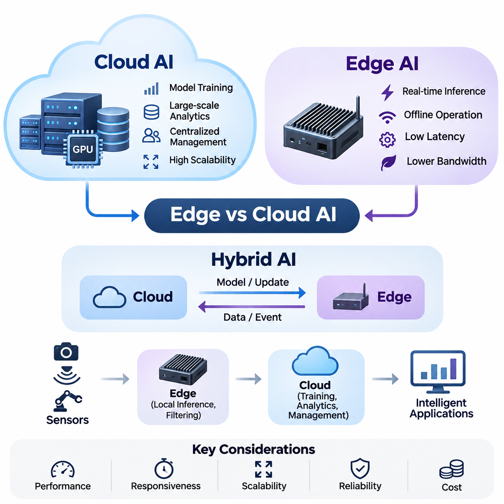
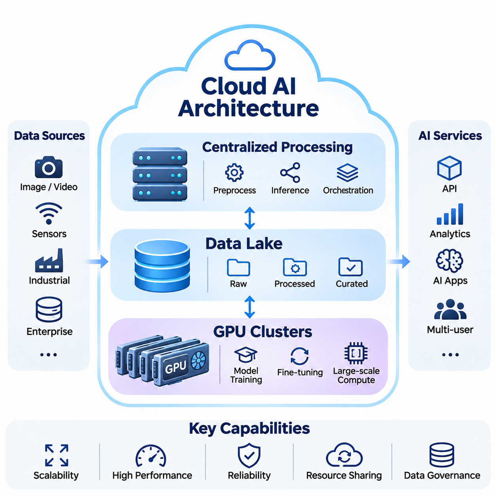
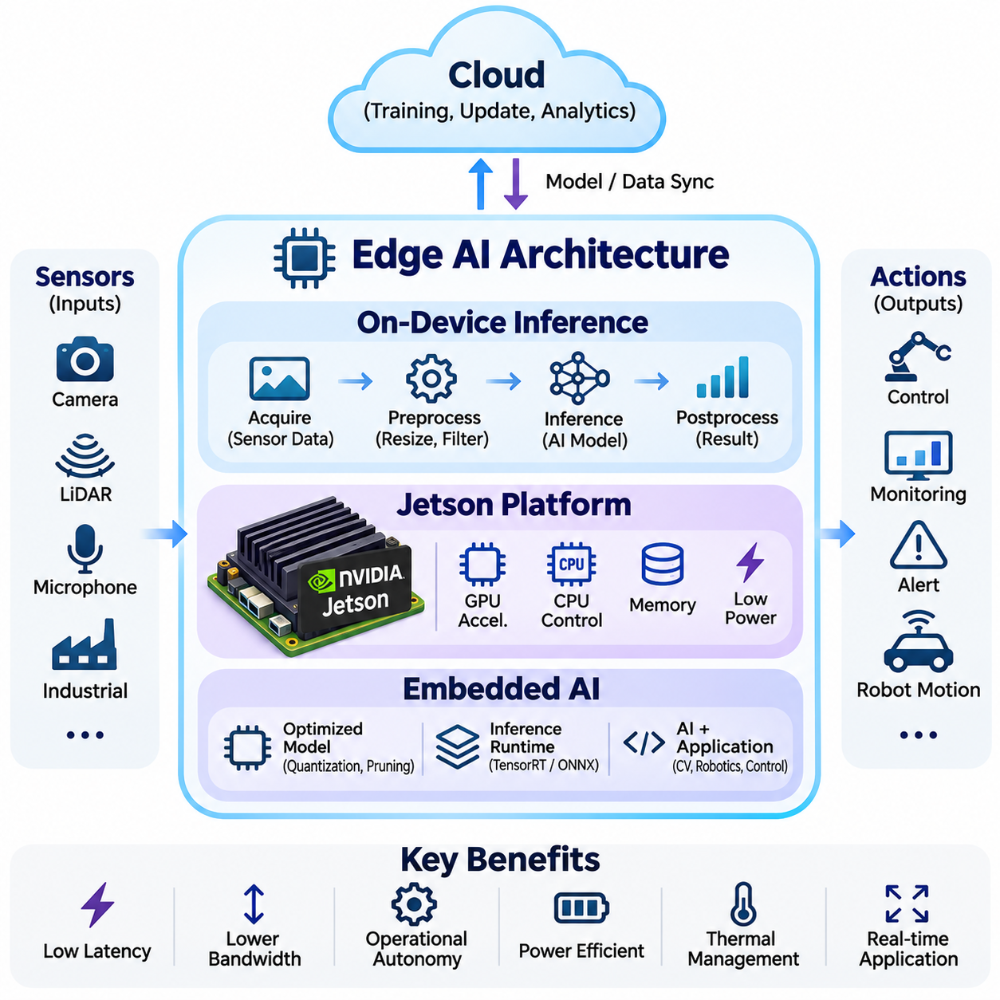
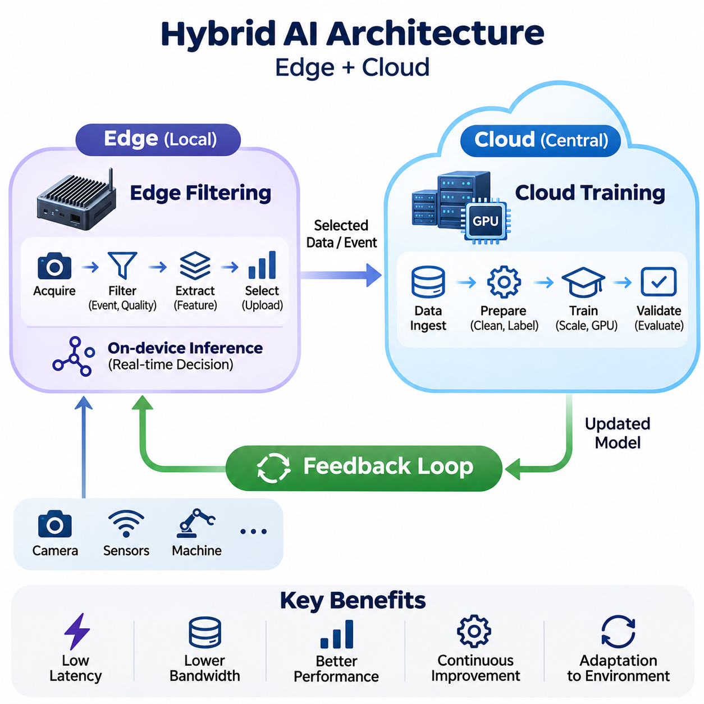
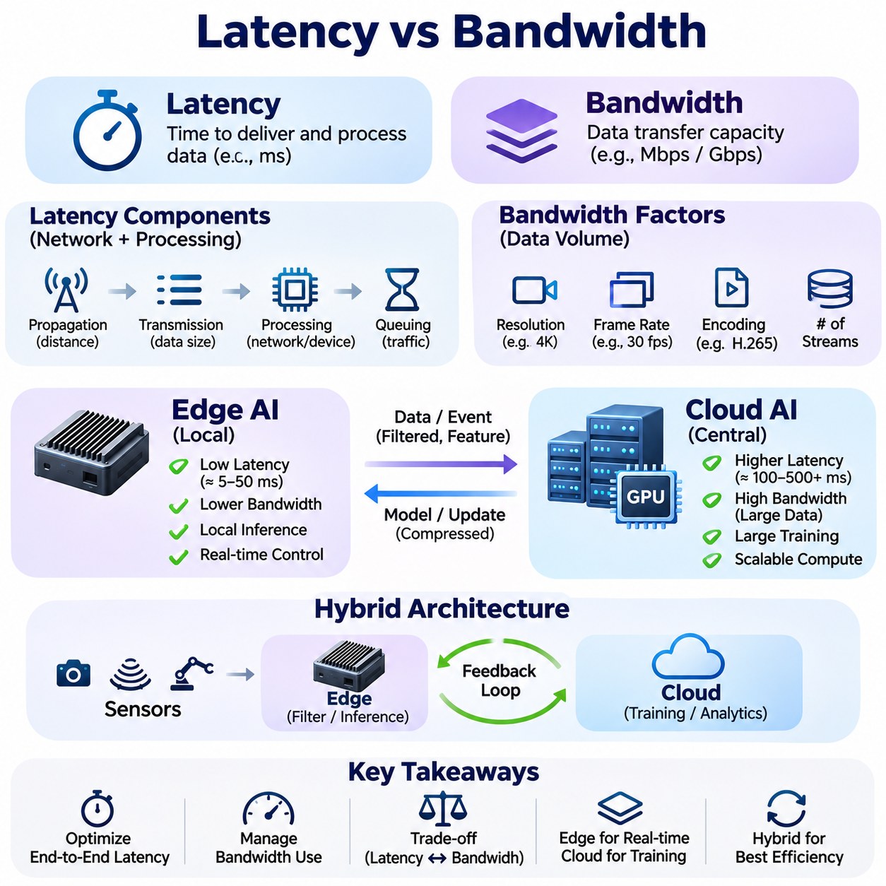
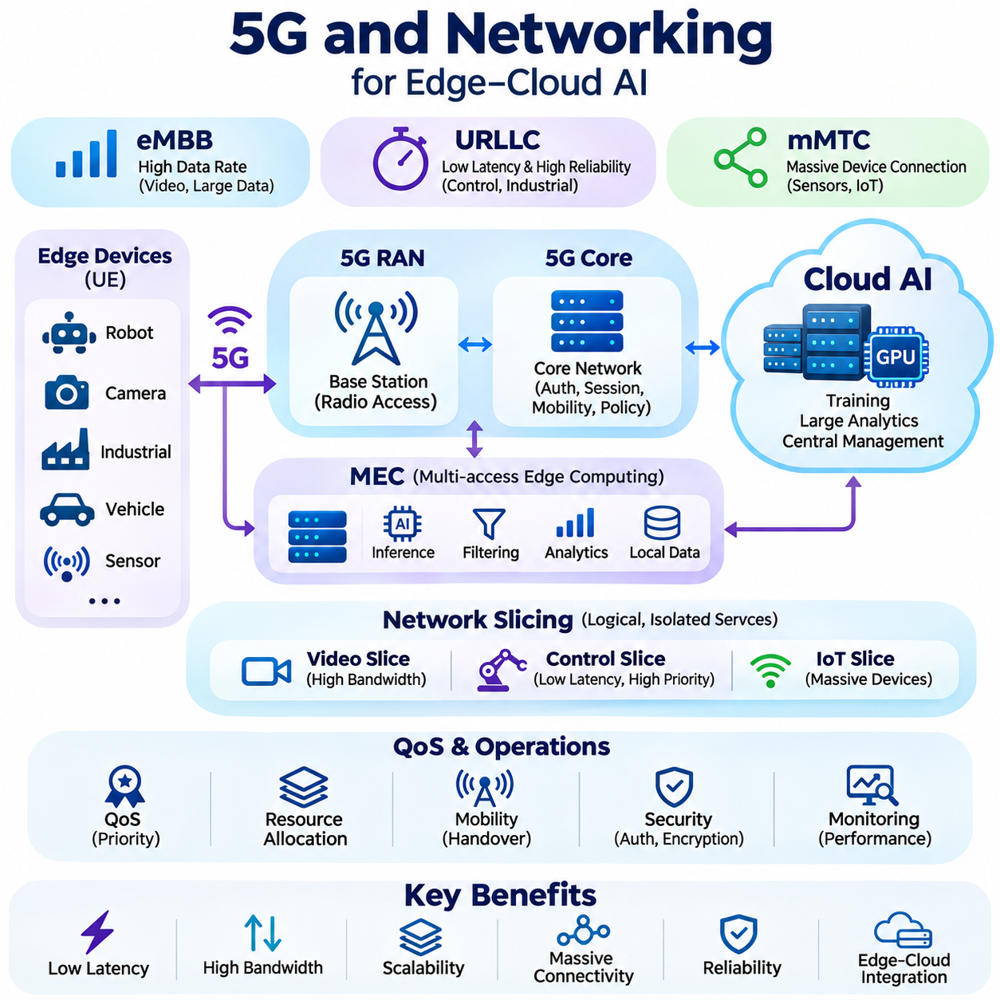
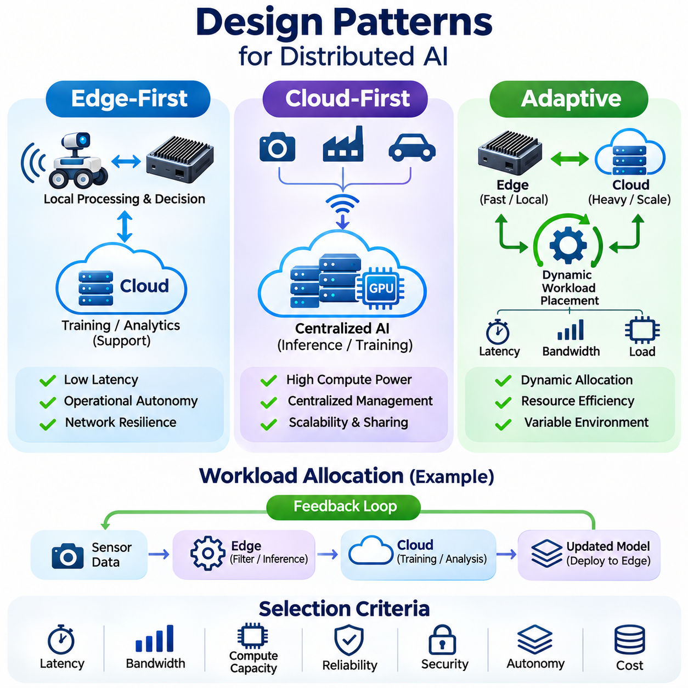
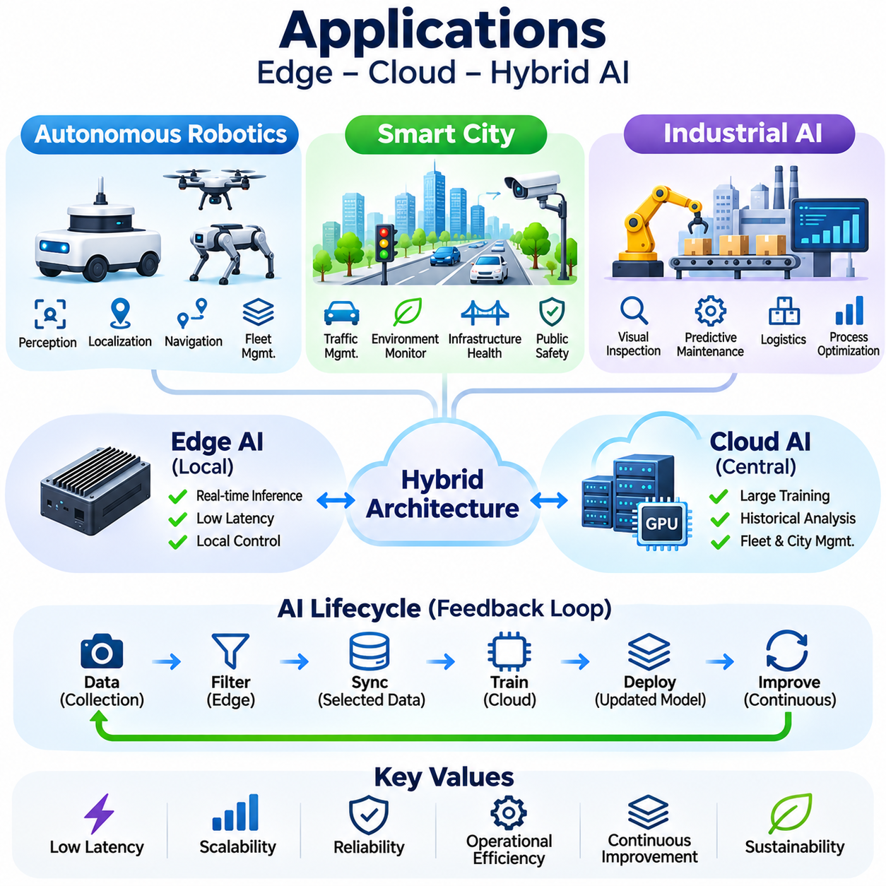

**Volume 38. AI Systems Architecture**

# 01. Edge vs Cloud AI

## 01.00 Overview

{width="7.268055555555556in" height="7.268055555555556in"}

인공지능 시스템(Artificial Intelligence Systems)은 데이터 수집(Data Collection), 처리(Processing), 추론(Inference), 의사결정(Decision-Making)이 서로 다른 위치에서 수행되는 분산 컴퓨팅 환경(Distributed Computing Environment)으로 발전하고 있다. 엣지 인공지능(Edge AI)과 클라우드 인공지능(Cloud AI)은 이러한 연산을 구성하는 두 가지 핵심 아키텍처(Architecture)이다. 두 방식의 특성을 이해하는 것은 연산 성능, 응답성, 확장성, 신뢰성, 운영 비용의 균형을 갖춘 지능형 시스템(Intelligent Systems)을 설계하는 데 필수적이다.

클라우드 인공지능(Cloud AI)은 중앙 집중형 또는 지리적으로 분산된 데이터 센터(Data Center)에서 인공지능 연산 작업을 실행하는 아키텍처를 의미한다. 이러한 환경에서는 고성능 프로세서(High-Performance Processor), GPU 클러스터(GPU Cluster), 대규모 저장 시스템(Large-Scale Storage System), 정교한 오케스트레이션 플랫폼(Orchestration Platform)을 활용할 수 있다. 클라우드 인프라(Cloud Infrastructure)는 연산 집약적인 모델 학습(Model Training), 대규모 분석, 중앙 집중형 데이터 관리, 다수의 사용자를 지원하는 인공지능 서비스에 특히 적합하다.

엣지 인공지능(Edge AI)은 데이터가 생성되는 물리적 위치에 인공지능 처리를 배치하는 방식이다. 원시 데이터(Raw Data)를 원격 서버로 지속적으로 전송하는 대신, 엣지 장치(Edge Device)는 임베디드 프로세서(Embedded Processor), GPU, 신경망 처리 장치(Neural Processing Unit), 전용 가속기(Specialized Accelerator)를 이용하여 학습된 모델을 로컬에서 실행한다. 이러한 아키텍처는 빠른 응답을 가능하게 하고 통신 요구량을 줄이며, 네트워크 연결이 불안정한 상황에서도 지능형 애플리케이션(Intelligent Application)의 지속적인 동작을 지원한다.

엣지 인공지능과 클라우드 인공지능의 근본적인 차이는 연산 자원(Computational Resources)의 배치 위치와 정보 이동 방식에 있다. 클라우드 아키텍처는 공유 인프라(Shared Infrastructure)에 처리 능력을 집중시키는 반면, 엣지 아키텍처는 센서와 사용자 가까이에 위치한 장치들로 연산을 분산한다. 어느 한 방식이 모든 상황에서 우월한 것은 아니며, 아키텍처의 효과는 작업 부하(Workload)의 특성, 응답 시간 제약, 사용 가능한 하드웨어, 통신 환경에 따라 달라진다.

클라우드 인공지능 아키텍처는 일반적으로 확장 가능한 저장 플랫폼(Scalable Storage Platform)과 GPU 컴퓨팅 클러스터(GPU Computing Cluster)에 연결된 중앙 집중형 처리 서비스(Centralized Processing Service)를 활용한다. 데이터 레이크(Data Lake)는 다양한 출처의 정형 및 비정형 데이터를 수집하여 대규모 학습과 분석을 지원한다. 분산 처리 프레임워크(Distributed Processing Framework)는 여러 서버의 연산 작업을 조정하며, 자원 오케스트레이션 시스템(Resource Orchestration System)은 애플리케이션 수요와 인프라 가용성에 따라 처리 용량을 할당한다.

중앙 집중형 컴퓨팅(Centralized Computing)은 인공지능 애플리케이션이 대용량 메모리, 방대한 데이터셋(Dataset), 여러 연산 장치 간의 협력 처리를 요구할 때 중요한 장점을 제공한다. 대규모 언어 모델(Large Language Model), 파운데이션 모델(Foundation Model), 복잡한 멀티모달 시스템(Multimodal System)은 강력한 클라우드 인프라의 이점을 활용할 수 있다. 또한 중앙 집중형 환경은 모델 관리(Model Management), 소프트웨어 업데이트(Software Update), 실험 추적(Experiment Tracking), 공유 연산 자원 할당의 일부 과정을 단순화한다.

그러나 클라우드 의존형 아키텍처(Cloud-Dependent Architecture)는 통신 지연(Communication Latency)과 네트워크 의존성(Network Dependency)을 발생시키므로 시간에 민감한 애플리케이션에 적합하지 않을 수 있다. 고해상도 영상, 라이다(LiDAR) 측정 데이터, 연속적인 산업용 센서 스트림(Sensor Stream)을 전송하면 상당한 대역폭(Bandwidth)이 소모된다. 네트워크 혼잡(Network Congestion), 패킷 손실(Packet Loss), 서비스 중단(Service Interruption), 가변적인 통신 지연은 즉각적인 판단이 필요한 시스템의 응답성과 가용성을 저하시킬 수 있다.

엣지 인공지능 아키텍처는 장치 자체 또는 인접한 컴퓨팅 플랫폼(Computing Platform)에서 추론을 실행함으로써 이러한 한계를 해결한다. 온디바이스 추론(On-Device Inference)은 지속적인 클라우드 통신 없이 센서 측정값을 예측(Prediction), 분류(Classification), 탐지(Detection), 제어 관련 정보로 변환한다. 로컬 처리(Local Processing)는 엄격한 시간 제약 내에서 반응해야 하거나 안정적인 네트워크 연결을 보장할 수 없는 환경에서 특히 중요한 가치를 가진다.

임베디드 인공지능 플랫폼(Embedded AI Platform)은 연산 하드웨어, 메모리, 통신 인터페이스(Communication Interface), 추론 소프트웨어(Inference Software)를 소형 물리 시스템에 통합한다. NVIDIA Jetson과 같은 플랫폼은 로보틱스(Robotics), 머신 비전(Machine Vision), 자율 시스템(Autonomous Systems)을 위한 GPU 가속 연산(GPU-Accelerated Computing)을 제공한다. 이러한 플랫폼을 배포할 때는 처리량(Throughput), 메모리 용량, 열 제약(Thermal Constraints), 전력 소비, 모델 복잡도, 연결된 센서와의 호환성을 신중하게 검토해야 한다.

엣지 하드웨어(Edge Hardware)는 일반적으로 클라우드 인프라보다 제한적인 자원 환경에서 동작한다. 제한된 메모리, 연산 능력, 전력은 모델 선택과 실행 성능에 제약을 준다. 따라서 엔지니어는 양자화(Quantization), 가지치기(Pruning), 지식 증류(Knowledge Distillation), 하드웨어 특화 추론 가속(Hardware-Specific Inference Acceleration)과 같은 최적화 기술을 적용한다. 이러한 방법은 목표 애플리케이션에 필요한 예측 정확도를 충분히 유지하면서 연산 요구량을 줄이는 데 기여한다.

하이브리드 인공지능 아키텍처(Hybrid AI Architecture)는 로컬 지능(Local Intelligence)과 중앙 집중형 연산 능력을 결합한다. 엣지 장치는 즉각적인 추론, 초기 필터링(Preliminary Filtering), 운영상 의사결정을 수행하며, 클라우드 시스템은 연산 비용이 높은 학습, 과거 데이터 분석, 플릿 수준의 조정(Fleet-Level Coordination), 장기 데이터 저장을 지원한다. 이러한 역할 분담은 클라우드 인프라의 확장성과 분석 능력을 유지하면서 로컬 처리의 높은 응답성을 활용하도록 한다.

엣지 필터링(Edge Filtering)은 모든 센서 측정값을 지속적으로 전송하는 것이 불필요하거나 경제적으로 비효율적일 수 있기 때문에 하이브리드 아키텍처의 중요한 구성 요소이다. 로컬 시스템은 주요 이벤트(Event)를 식별하고, 관련 특징(Feature)을 추출하며, 관측 데이터를 압축하고, 필요한 정보만 선택적으로 업로드할 수 있다. 예를 들어 자율주행 로봇(Autonomous Robot)은 카메라와 라이다 데이터를 로컬에서 처리하면서 탐지된 위험 요소, 진단 요약, 선택된 이벤트 영상을 중앙 관리 플랫폼으로 전송할 수 있다.

클라우드 학습(Cloud Training)은 머신러닝 모델(Machine Learning Model)의 개발과 개선에 필요한 연산 자원을 제공함으로써 엣지 추론(Edge Inference)을 보완한다. 분산된 장치에서 수집한 데이터는 통합, 검증, 주석 처리(Annotation)를 거쳐 학습 데이터셋(Training Dataset)에 반영된다. 이후 업데이트된 모델은 평가와 검증을 거쳐 엣지 플랫폼에 배포된다. 이러한 과정은 실제 환경의 관측, 중앙 집중형 학습, 모델 검증, 운영 개선을 연결하는 피드백 루프(Feedback Loop)를 형성한다.

분산 인공지능 아키텍처의 효과는 지연 시간(Latency)과 대역폭(Bandwidth)의 특성에 크게 좌우된다. 지연 시간은 정보가 처리 및 통신 단계를 통과하는 데 필요한 시간을 의미하며, 대역폭은 데이터를 전송할 수 있는 용량을 의미한다. 충분한 대역폭을 확보한 애플리케이션에서도 네트워크 변동이나 원격 처리 대기열(Processing Queue)로 인해 예측하기 어려운 실행 지연이 발생하면 허용할 수 없는 응답 시간이 나타날 수 있다.

실시간 애플리케이션(Real-Time Application)은 추론 실행 시간만이 아니라 종단 간 지연 시간(End-to-End Latency)을 고려해야 한다. 센서 데이터 획득(Sensor Acquisition), 전처리(Preprocessing), 통신, 스케줄링(Scheduling), 모델 실행, 후처리(Postprocessing), 액추에이터 명령(Actuator Command)이 모두 전체 응답 시간에 영향을 미친다. 엣지 처리는 일부 네트워크 지연을 제거할 수 있지만, 로컬 하드웨어의 자원 경합(Resource Contention)이나 비효율적인 소프트웨어 파이프라인(Software Pipeline)은 여전히 시간 제약 위반을 발생시킬 수 있다.

5G, 와이파이(Wi-Fi), 고속 이더넷(High-Speed Ethernet)을 포함한 현대 통신 기술은 엣지 장치와 클라우드 서비스 간의 정교한 협력을 가능하게 한다. 높은 처리량의 통신 연결은 원격 모니터링(Remote Monitoring), 데이터 동기화(Data Synchronization), 분산 분석(Distributed Analytics)을 지원한다. 그러나 명목상의 네트워크 성능이 결정론적 통신 동작(Deterministic Communication Behavior)을 보장하지는 않는다. 효과적인 시스템 설계에서는 통신 범위 제한, 혼잡, 이동성, 보안 처리 부담, 일시적인 연결 중단을 고려해야 한다.

네트워크 인지형 아키텍처(Network-Aware Architecture)는 연결 상태와 연산 자원의 가용성에 따라 처리 전략을 동적으로 조정할 수 있다. 통신 품질이 높을 때는 일부 작업을 클라우드 인프라로 이전하여 추가 처리를 수행할 수 있다. 반대로 연결 상태가 악화되면 필수 기능은 로컬 장치에서 유지된다. 이러한 적응형 동작(Adaptive Behavior)을 구현하려면 작업 배치(Workload Placement), 데이터 일관성(Data Consistency), 서비스 우선순위(Service Prioritization), 통신 복구 절차에 대한 명확한 정책이 필요하다.

엣지 우선 설계 패턴(Edge-First Design Pattern)은 운영상 중요한 기능에 대해 로컬 처리를 우선한다. 이러한 아키텍처는 외부 통신 없이도 의사결정이 유지되어야 하는 자율주행 로봇, 산업 제어(Industrial Control), 안전 관련 모니터링(Safety-Related Monitoring)에 특히 적합하다. 클라우드 서비스는 즉각적인 제어 루프(Control Loop)의 필수 구성 요소가 아니라 보조 기능을 제공한다. 로컬 대체 동작(Local Fallback Behavior)과 독립적인 안전 메커니즘(Independent Safety Mechanism)은 여전히 핵심적인 설계 고려사항이다.

클라우드 우선 설계 패턴(Cloud-First Design Pattern)은 공유 연산 자원, 방대한 데이터셋, 탄력적인 확장성(Elastic Scalability)의 이점이 큰 경우 중앙 집중형 처리를 우선한다. 기업 분석(Enterprise Analytics), 대규모 문서 처리, 복잡한 생성형 인공지능 서비스(Generative AI Service)는 이러한 접근 방식을 자주 채택한다. 경량 엣지 구성 요소(Lightweight Edge Component)는 데이터 획득, 인증(Authentication), 캐싱(Caching), 전처리를 담당하고, 연산 요구량이 높은 추론은 원격에서 실행할 수 있다.

적응형 아키텍처(Adaptive Architecture)는 변화하는 운영 조건에 따라 처리 위치를 선택함으로써 이러한 접근 방식을 확장한다. 의사결정에는 모델 크기, 장치 활용률(Device Utilization), 사용 가능한 대역폭, 응답 마감 시간(Response Deadline), 에너지 소비, 서비스 비용 등이 고려될 수 있다. 작업 분할(Workload Partitioning)을 통해 애플리케이션을 로컬 구성 요소와 원격 구성 요소로 나눌 수도 있지만, 중간 표현(Intermediate Representation)의 전송은 추가적인 통신 및 동기화 복잡성을 발생시킨다.

보안(Security)과 개인정보 보호(Privacy) 요구사항은 인공지능 작업의 배치 위치에 큰 영향을 미친다. 로컬 처리는 민감한 원시 정보의 불필요한 전송을 줄일 수 있으며, 중앙 집중형 인프라는 일관된 접근 제어(Access Control), 모니터링, 거버넌스(Governance) 체계를 제공할 수 있다. 두 접근 방식 모두 안전한 통신, 인증, 암호화(Encryption), 소프트웨어 무결성 검증(Software Integrity Verification), 수명주기 관리(Lifecycle Management)가 필요하다. 아키텍처 결정에는 처리 정보의 민감도와 규제 요구사항이 반영되어야 한다.

신뢰성(Reliability) 역시 중요한 고려사항이다. 분산 인공지능 시스템은 서로 다른 장애 특성을 가진 하드웨어, 소프트웨어, 통신 구성 요소에서 동작하기 때문이다. 클라우드 서비스에는 지역 단위 장애(Regional Outage)가 발생할 수 있고, 엣지 장치는 열적 제한, 저장 장치 고장, 전원 중단을 경험할 수 있다. 복원력 있는 아키텍처(Resilient Architecture)는 상태 모니터링(Health Monitoring), 장애 탐지(Fault Detection), 복구 절차(Recovery Procedure), 필요에 따른 이중화 구성(Redundancy), 부분 장애 상황의 명확한 운영 모드를 포함한다.

자율주행 로보틱스(Autonomous Robotics)는 엣지 인공지능 아키텍처의 실질적인 중요성을 보여준다. 이동 로봇(Mobile Robot)은 카메라, 라이다, 레이더(Radar), 관성 센서(Inertial Sensor), 위치 측정 시스템(Positioning System)의 정보를 지속적으로 처리하여 주변 환경을 추정하고 적절한 동작을 결정한다. 로컬 추론은 인지(Perception), 위치 추정(Localization), 장애물 탐지(Obstacle Detection), 이동 관련 의사결정을 지원한다. 클라우드 인프라는 플릿 모니터링(Fleet Monitoring), 지도 배포(Map Distribution), 모델 업데이트, 운영 분석을 통해 이러한 기능을 보완한다.

스마트 시티(Smart City) 애플리케이션은 지리적으로 분산된 센서, 지능형 카메라(Intelligent Camera), 이동 플랫폼(Mobile Platform), 중앙 관리 서비스 간의 협력이 필요한 경우가 많다. 엣지 처리는 교통 이벤트, 인프라 이상, 환경 변화를 발생 위치 가까이에서 탐지할 수 있다. 클라우드 플랫폼은 여러 지역에서 선택적으로 수집된 정보를 통합하고, 과거 데이터 분석과 광역 운영 가시성(Operational Visibility)을 제공한다. 하이브리드 배포(Hybrid Deployment)는 로컬 응답성과 도시 규모의 지능을 동시에 지원한다.

산업용 인공지능(Industrial AI) 시스템도 로컬 추론과 중앙 집중형 분석을 결합함으로써 이점을 얻는다. 생산 장비는 임베디드 지능(Embedded Intelligence)을 활용하여 비전 검사(Visual Inspection), 이상 탐지(Anomaly Detection), 상태 모니터링(Condition Monitoring)을 수행할 수 있다. 클라우드 플랫폼은 공장 간 분석(Cross-Factory Analytics), 예지 보전 모델링(Predictive Maintenance Modeling), 지속적인 모델 개선을 지원한다. 적절한 역할 분담은 생산 공정의 시간 제약, 장비 인터페이스, 데이터 민감도, 인프라 신뢰성에 따라 결정된다.

경제적 고려사항은 연산 하드웨어의 구매 가격을 넘어선다. 클라우드 환경에서는 컴퓨팅 인스턴스(Compute Instance), 저장 공간, 데이터 전송, 관리형 서비스(Managed Service)에 따른 반복 비용이 발생한다. 엣지 배포에는 장치 구매, 설치, 유지보수, 소프트웨어 배포, 하드웨어 교체 비용이 필요하다. 의미 있는 비교를 위해서는 예상 운영 수명 동안의 총소유비용(Total Cost of Ownership)을 평가해야 하며, 여기에는 자원 활용률, 에너지 소비, 네트워크 비용, 관리 부담이 포함된다.

효과적인 엣지 인공지능 또는 클라우드 인공지능 시스템을 설계하려면 기술적 제약과 운영상 제약을 종합적으로 평가해야 한다. 엔지니어는 추론 정확도(Inference Accuracy), 종단 간 지연 시간, 처리량, 확장성, 내결함성(Fault Tolerance), 사이버 보안(Cybersecurity), 개인정보 보호, 에너지 효율(Energy Efficiency), 수명주기 비용을 고려해야 한다. 이러한 특성은 서로 영향을 주기 때문에 한 영역을 개선하면 다른 영역에서 불리한 결과가 발생할 수 있다. 따라서 아키텍처 선택은 다차원 엔지니어링 최적화 문제(Multidimensional Engineering Optimization Problem)이다.

인공지능이 자율 기계(Autonomous Machine), 연결형 인프라(Connected Infrastructure), 대규모 지능형 서비스(Large-Scale Intelligent Service)로 확장되면서 엣지 컴퓨팅(Edge Computing)과 클라우드 컴퓨팅(Cloud Computing)의 경계는 점차 유연해지고 있다. 미래의 시스템은 임베디드 장치, 로컬 서버, 지역 인프라, 중앙 집중형 GPU 클러스터 간의 협력 연산(Coordinated Computing)에 더욱 의존하게 될 것이다. 클라우드 아키텍처, 엣지 배포, 하이브리드 처리, 통신상의 상충관계(Communication Tradeoffs), 적응형 설계 패턴을 이해하는 것은 확장 가능하고 응답성이 높으며 신뢰할 수 있는 인공지능 시스템을 구축하기 위한 기반이 된다.

## 01.01 Cloud AI Architecture

{width="7.268055555555556in" height="7.268055555555556in"}

클라우드 인공지능 아키텍처(Cloud AI Architecture)는 대규모 인공지능 모델의 개발, 학습, 배포, 관리를 위한 중앙 집중형 컴퓨팅 환경(Centralized Computing Environment)을 제공한다. 연산 인프라(Computational Infrastructure), 분산 저장소(Distributed Storage), 네트워킹(Networking), 소프트웨어 오케스트레이션(Software Orchestration)을 하나의 통합 플랫폼으로 구성한다. 핵심 구성 요소에는 중앙 집중형 처리 시스템(Centralized Processing System), 데이터 레이크(Data Lake), GPU 클러스터(GPU Cluster)가 포함되며, 이들은 대규모 머신러닝(Machine Learning)과 지능형 서비스(Intelligent Service)를 공동으로 지원한다.

중앙 집중형 처리(Centralized Processing)는 클라우드 인공지능 시스템의 아키텍처적 기반을 형성한다. 연산 작업 부하(Computational Workload)는 개별 단말 장치(Endpoint Device)에 분산되는 대신 관리형 데이터 센터(Managed Data Center)에서 실행된다. 이러한 접근 방식은 하드웨어 자원을 통합하고, 복잡한 처리 작업을 조정하며, 일관된 운영 정책을 유지할 수 있도록 한다. 동시에 공유 인프라(Shared Infrastructure)를 통해 다수의 애플리케이션과 사용자를 지원한다.

중앙 집중형 인공지능 처리 환경은 일반적으로 애플리케이션 서버(Application Server), 연산 노드(Compute Node), 저장 서비스(Storage Service), 네트워크 인프라(Network Infrastructure), 관리 소프트웨어(Management Software)로 구성된다. 입력 요청은 API, 게이트웨이(Gateway), 부하 분산기(Load Balancer)를 거쳐 적절한 처리 서비스로 전달된다. 이러한 서비스는 애플리케이션 요구사항과 사용 가능한 연산 자원에 따라 데이터 전처리(Data Preprocessing), 모델 추론(Model Inference), 분석 연산(Analytical Computation), 워크플로 조정(Workflow Coordination)을 수행한다.

자원 가상화(Resource Virtualization)와 컨테이너화(Containerization)는 여러 인공지능 애플리케이션이 물리적 인프라를 효율적으로 공유할 수 있도록 한다. 가상 머신(Virtual Machine)은 격리된 실행 환경을 제공하며, 컨테이너(Container)는 애플리케이션과 소프트웨어 의존성(Software Dependency)을 함께 패키징한다. 쿠버네티스(Kubernetes)와 같은 오케스트레이션 플랫폼(Orchestration Platform)은 배포, 스케줄링(Scheduling), 확장(Scaling), 복구(Recovery)를 조정하여 중앙 관리 체계 내의 분산 연산 노드에서 인공지능 서비스가 일관되게 동작하도록 한다.

중앙 집중형 처리는 동기식(Synchronous) 및 비동기식(Asynchronous) 인공지능 작업 부하를 모두 지원한다. 동기식 처리는 즉각적인 응답이 필요한 대화형 추론 서비스(Interactive Inference Service)에 주로 사용되며, 비동기식 실행은 대규모 데이터 변환, 배치 추론(Batch Inference), 모델 학습(Model Training)에 적합하다. 메시지 큐(Message Queue)와 워크플로 오케스트레이션 시스템(Workflow Orchestration System)은 처리 단계를 분리하고 자원 활용률을 개선하며, 개별 작업이 전체 파이프라인(Pipeline)을 불필요하게 차단하는 상황을 방지한다.

확장성(Scalability)은 중앙 집중형 클라우드 인공지능 아키텍처의 주요 장점이다. 수평 확장(Horizontal Scaling)은 연산 인스턴스(Compute Instance)를 추가하여 처리 용량을 늘리고, 수직 확장(Vertical Scaling)은 개별 시스템의 자원을 강화한다. 탄력적 자원 할당(Elastic Resource Allocation)은 변화하는 작업 부하 수요에 따라 인프라 용량을 조정한다. 이러한 메커니즘은 추론 요청량, 학습 요구사항, 데이터 처리량의 변동에 대응할 수 있도록 한다.

이러한 장점에도 불구하고 중앙 집중형 처리는 통신 지연(Communication Latency), 인프라 집중(Infrastructure Concentration), 서비스 의존성(Service Dependency)과 관련된 아키텍처적 문제를 발생시킨다. 애플리케이션은 네트워크 전송 지연(Network Transmission Delay), 처리 대기열(Processing Queue), 서비스 중단 가능성을 고려해야 한다. 고가용성(High Availability)을 확보하려면 이중화 인프라(Redundant Infrastructure), 장애 격리(Fault Isolation), 상태 모니터링(Health Monitoring), 복구 메커니즘(Recovery Mechanism)을 통해 개별 구성 요소의 장애가 핵심 인공지능 서비스로 확산되지 않도록 해야 한다.

데이터 레이크(Data Lake)는 대량의 정형 데이터(Structured Data), 반정형 데이터(Semi-Structured Data), 비정형 데이터(Unstructured Data)를 저장하기 위한 중앙 집중형 저장소(Centralized Repository)이다. 일반적으로 사전 정의된 스키마(Predefined Schema)를 적용하는 전통적인 데이터베이스(Database)와 달리, 데이터 레이크는 정보를 원래 형태로 보존할 수 있다. 이러한 유연성은 이미지, 영상, 센서 측정값, 문서, 로그(Log), 지속적으로 생성되는 운영 데이터를 처리하는 인공지능 애플리케이션에서 특히 중요하다.

데이터 수집 파이프라인(Data Ingestion Pipeline)은 기업 시스템(Enterprise System), 연결 장치(Connected Device), 산업 장비(Industrial Equipment), 외부 데이터 소스(External Data Source)의 정보를 클라우드 저장소로 전송한다. 스트리밍 수집(Streaming Ingestion)은 연속적인 데이터 유입을 지원하고, 배치 수집(Batch Ingestion)은 주기적인 전송과 과거 데이터셋을 처리한다. 신뢰할 수 있는 데이터 수집을 위해서는 검증(Validation), 메타데이터 수집(Metadata Collection), 타임스탬프 관리(Timestamp Management), 불완전하거나 중복된 레코드(Record)를 탐지하는 메커니즘이 필요하다.

데이터 레이크는 일반적으로 원시 데이터 계층(Raw Data Layer), 처리 데이터 계층(Processed Data Layer), 정제 데이터 계층(Curated Data Layer)으로 정보를 구성한다. 원시 계층은 최초 관측 데이터를 보존하고, 처리 계층은 정제 및 변환된 정보를 저장하며, 정제 데이터 계층은 분석과 머신러닝에 적합한 검증된 데이터셋을 제공한다. 이러한 분리는 추적 가능성(Traceability)을 높이고 원본 정보를 영구적으로 변경하지 않으면서 전처리 절차를 재현할 수 있도록 한다.

메타데이터 관리(Metadata Management)는 대규모 데이터 레이크의 활용성을 유지하는 데 필수적이다. 데이터 카탈로그(Data Catalog)는 데이터셋의 출처, 형식, 소유권, 처리 이력, 접근 권한을 설명한다. 데이터 계보(Data Lineage) 메커니즘은 데이터셋 간 변환 과정과 의존성을 기록하여 엔지니어가 학습 데이터의 생성 과정을 확인할 수 있도록 한다. 효과적인 데이터 거버넌스(Data Governance)는 데이터셋 불일치, 무단 접근, 신뢰할 수 없는 실험 결과의 위험을 줄인다.

인공지능 학습 파이프라인(AI Training Pipeline)은 데이터 레이크에서 관련 정보를 검색하고 이를 모델 학습에 적합한 데이터셋으로 변환한다. 전처리 작업에는 정규화(Normalization), 필터링(Filtering), 주석 처리(Annotation), 특징 추출(Feature Extraction), 데이터 증강(Data Augmentation)이 포함될 수 있다. 데이터셋 버전 관리(Dataset Versioning)는 실험에서 일관된 학습 및 평가 데이터를 참조하도록 보장한다. 이러한 기능은 재현성(Reproducibility), 체계적인 모델 비교(Model Comparison), 머신러닝 수명주기(Machine Learning Lifecycle) 전반의 통제된 업데이트를 지원한다.

클라우드 객체 저장소(Cloud Object Storage)는 내구성 있는 저장 기능과 저장 용량의 독립적인 확장을 지원하므로 대규모 데이터 레이크의 경제적인 기반이 된다. 그러나 학습 성능은 전체 저장 용량만으로 결정되지 않는다. 데이터 접근 지연(Data Access Latency), 요청 처리량(Request Throughput), 파일 구성(File Organization), 캐싱(Caching), 네트워크 대역폭(Network Bandwidth)은 학습 시스템에 데이터가 공급되는 속도에 영향을 미친다. 비효율적으로 설계된 데이터 파이프라인은 고가의 GPU 자원을 충분히 활용하지 못하게 할 수 있다.

GPU 클러스터(GPU Cluster)는 높은 연산 요구량을 가진 인공지능 작업에 필요한 연산 가속(Computational Acceleration)을 제공한다. GPU 클러스터는 하나 이상의 그래픽 처리 장치(Graphics Processing Unit)를 탑재한 여러 연산 노드가 고속 네트워크 인프라로 연결된 시스템이다. 이러한 시스템은 행렬 연산(Matrix Operation), 텐서 연산(Tensor Computation), 신경망 학습(Neural Network Training), 병렬 추론(Parallel Inference)을 가속하여 일반적인 프로세서에서 실행할 때보다 필요한 연산 시간을 크게 줄인다.

현대적인 GPU 연산 노드(GPU Computing Node)는 CPU, GPU, 시스템 메모리(System Memory), 가속기 메모리(Accelerator Memory), 로컬 저장소(Local Storage), 고대역폭 통신 인터페이스(High-Bandwidth Communication Interface)를 통합한다. CPU는 애플리케이션 실행과 데이터 준비를 조정하고, GPU는 대규모 병렬 수치 연산(Massively Parallel Numerical Computation)을 수행한다. 효율적인 시스템 설계를 위해서는 메모리 전송, 저장소 접근, 노드 간 통신에서 병목 현상(Bottleneck)이 발생하지 않도록 구성 요소 간 처리 능력의 균형을 맞추어야 한다.

분산 학습(Distributed Training)은 GPU 클러스터를 활용하여 개별 가속기의 실질적인 처리 능력을 초과하는 모델과 데이터셋을 처리한다. 데이터 병렬화(Data Parallelism)는 학습 샘플을 여러 GPU에 분배하면서 모델 업데이트를 동기화한다. 모델 병렬화(Model Parallelism)는 신경망 파라미터(Parameter) 또는 연산을 여러 장치에 분할한다. 파이프라인 병렬화(Pipeline Parallelism)는 모델 실행을 여러 단계로 나누어 다수의 가속기가 연산 집약적인 학습 작업을 공동으로 수행하도록 한다.

고속 네트워킹(High-Speed Networking)은 효율적인 다중 노드 GPU 학습(Multi-Node GPU Training)에 필수적이다. 인피니밴드(InfiniBand)와 고성능 이더넷(High-Performance Ethernet)은 연산 노드 간 통신을 지원하며, 집합 통신 라이브러리(Collective Communication Library)는 그래디언트 동기화(Gradient Synchronization)를 포함한 연산을 조정한다. 네트워크 대역폭과 지연 시간은 분산 학습 효율에 직접적인 영향을 미치며, 특히 파라미터, 활성화 값(Activation), 중간 연산 결과(Intermediate Computational Result)를 빈번하게 교환해야 하는 모델에서 중요하다.

GPU 메모리 용량(GPU Memory Capacity)과 통신 토폴로지(Communication Topology)는 클러스터 아키텍처에 큰 영향을 미친다. 대규모 모델은 파라미터, 옵티마이저 상태(Optimizer State), 중간 활성화 값(Intermediate Activation)을 여러 가속기에 분할해야 할 수 있다. 고대역폭 GPU 인터커넥트(High-Bandwidth GPU Interconnect)는 호환되는 시스템 내부의 통신 부담을 줄일 수 있지만, 별도의 노드 간에는 네트워크 통신이 필요하다. 효과적인 작업 배치(Workload Placement)는 가속기 연결 구조, 메모리 요구사항, 연산 의존성을 고려한다.

클러스터 스케줄링 시스템(Cluster Scheduling System)은 학습 실험, 추론 서비스, 데이터 처리 작업에 GPU 자원을 할당한다. 스케줄링 정책(Scheduling Policy)은 GPU 가용성, 메모리 요구사항, 작업 우선순위, 예상 실행 시간을 고려할 수 있다. 자원 할당량(Resource Quota)과 작업 대기열(Job Queue)은 통제되지 않은 자원 경합(Resource Contention)을 방지하며, 모니터링 시스템은 활용률(Utilization), 메모리 소비, 온도, 통신 처리량, 실행 성능을 수집한다.

GPU 클러스터는 여러 가속기 또는 서비스 복제본(Serving Replica)에 모델 실행을 분산함으로써 대규모 추론(Large-Scale Inference)도 지원한다. 모델 병렬화는 개별 GPU 메모리 용량을 초과하는 모델을 처리할 수 있도록 하며, 복제된 추론 서비스(Replicated Inference Service)는 전체 요청 처리량을 높인다. 동적 배칭(Dynamic Batching)은 호환되는 추론 요청을 결합하여 가속기 활용률을 높이지만, 지나치게 큰 배치는 대화형 애플리케이션의 응답 지연을 증가시킬 수 있다.

중앙 집중형 처리, 데이터 레이크, GPU 클러스터 간의 관계는 클라우드 인공지능의 운영 기반을 형성한다. 데이터 레이크는 영구적인 정보 저장(Persistent Information Storage)을 제공하고, 중앙 집중형 처리는 애플리케이션 워크플로를 조정하며, GPU 클러스터는 높은 연산 능력이 필요한 학습과 추론 작업을 실행한다. 고속 네트워크와 오케스트레이션 서비스는 이러한 구성 요소를 통합 파이프라인(Integrated Pipeline)으로 연결하여 복잡한 인공지능 개발 및 운영 환경을 지원한다.

일반적인 클라우드 인공지능 워크플로(Cloud AI Workflow)는 분산된 데이터 소스에서 중앙 저장소로 데이터를 수집하는 과정으로 시작된다. 처리 서비스는 정보를 검증, 변환, 구성한 후 학습 작업이 선택된 데이터셋을 가져오도록 한다. GPU 클러스터는 모델 최적화(Model Optimization)를 수행하며, 실험 추적 시스템(Experiment Tracking System)은 설정, 성능 지표(Performance Metric), 생성된 산출물(Artifact)을 기록한다. 검증된 모델은 이후 등록되어 관리형 추론 서비스(Managed Inference Service)를 통해 배포된다.

운영 환경의 클라우드 인공지능(Production Cloud AI)은 모델 동작과 인프라 성능을 지속적으로 모니터링해야 한다. 운영 지표(Operational Metric)에는 요청 지연 시간(Request Latency), 처리량, GPU 활용률, 메모리 소비, 오류율(Error Rate), 서비스 가용성(Service Availability)이 포함된다. 모델 모니터링(Model Monitoring)은 예측 품질(Prediction Quality), 데이터 드리프트(Data Drift), 입력 분포(Input Distribution)의 변화도 분석한다. 인프라 관측 가능성(Infrastructure Observability)과 모델 평가(Model Evaluation)를 결합하면 성능 저하를 식별하고 적절한 개선 조치를 결정할 수 있다.

보안 통제(Security Control)는 클라우드 아키텍처 전체에 적용되어야 한다. 신원 및 접근 관리(Identity and Access Management)는 저장소, 연산 자원, 모델 서비스에 대한 접근을 제한한다. 암호화(Encryption)는 전송 및 저장 과정의 정보를 보호하며, 네트워크 분할(Network Segmentation)은 구성 요소 간 불필요한 통신을 제한한다. 감사 로깅(Audit Logging), 자격 증명 관리(Credential Management), 소프트웨어 취약점 평가(Software Vulnerability Assessment)는 운영 책임성을 유지하고 무단 접근에 대한 노출 위험을 줄이는 데 기여한다.

GPU 클러스터와 대규모 저장 환경은 상당한 운영 비용을 발생시킬 수 있으므로 비용 최적화(Cost Optimization)가 특히 중요하다. 인프라 효율은 작업 스케줄링(Workload Scheduling), 가속기 활용률(Accelerator Utilization), 저장소 수명주기 정책(Storage Lifecycle Policy), 적절한 인스턴스 선택(Instance Selection)에 따라 달라진다. 조직은 총운영비용(Total Operating Cost)을 산정할 때 데이터 전송 요금(Data Transfer Charge), 유휴 자원(Idle Resource), 예약 용량(Reserved Capacity)과 동적 프로비저닝 용량(Dynamically Provisioned Capacity) 사이의 상충관계도 고려해야 한다.

클라우드 인공지능 아키텍처는 궁극적으로 현대 인공지능 시스템에 필요한 확장성, 중앙 집중형 관리, 연산 능력을 제공한다. 그 효과는 처리 서비스(Processing Service), 데이터 레이크, GPU 클러스터, 통신 인프라(Communication Infrastructure) 전반에 걸친 조정된 설계에 달려 있다. 성능(Performance), 신뢰성(Reliability), 보안(Security), 경제적 효율성(Economic Efficiency)의 균형을 유지함으로써 조직은 대규모 학습(Large-Scale Training), 분산 추론(Distributed Inference), 지속적으로 발전하는 지능형 애플리케이션(Intelligent Application)을 위한 견고한 기반을 구축할 수 있다.

## 01.02 Edge AI Architecture

{width="7.268055555555556in" height="7.268055555555556in"}

엣지 인공지능 아키텍처(Edge AI Architecture)는 데이터가 생성되는 위치와 가까운 장치에서 인공지능 모델(Artificial Intelligence Model)을 직접 실행할 수 있도록 한다. 중앙 집중형 클라우드 컴퓨팅(Centralized Cloud Computing)과 달리, 엣지 시스템(Edge System)은 원격 서버와 지속적으로 통신하지 않고 로컬에서 추론(Inference)과 일부 처리 작업을 수행한다. 이러한 접근 방식은 통신 지연(Communication Latency)을 줄이고, 대역폭 소비(Bandwidth Consumption)를 제한하며, 운영 자율성(Operational Autonomy)을 향상시켜 실시간 및 자원 제약 환경에서 동작하는 지능형 애플리케이션(Intelligent Application)을 지원한다.

엣지 인공지능(Edge AI)의 근본적인 목표는 연산 지능(Computational Intelligence)을 센서, 기계, 물리적 환경과 가까운 위치에 배치하는 것이다. 엣지 장치(Edge Device)는 카메라, 라이다(LiDAR) 센서, 마이크로폰(Microphone), 산업용 제어기(Industrial Controller), 기타 인터페이스(Interface)에서 정보를 수신한 후 관측 데이터를 실행 가능한 예측(Actionable Prediction)으로 변환한다. 로컬 실행(Local Execution)은 외부 통신 인프라(Communication Infrastructure)에 대한 의존성을 줄이면서 변화하는 환경에 신속하게 대응하도록 한다.

온디바이스 추론(On-Device Inference)은 엣지 인공지능 아키텍처의 핵심 연산 기능이다. 사전에 학습된 머신러닝 모델(Machine Learning Model)을 로컬 컴퓨팅 플랫폼(Local Computing Platform)에 배포하고, 입력 데이터를 처리하여 예측(Prediction), 분류(Classification), 탐지(Detection), 제어 관련 출력(Control-Related Output)을 생성한다. 모델 학습(Model Training)과 달리 추론은 주로 확정된 파라미터(Parameter)를 사용한 순전파 연산(Forward Computation)을 실행하므로, 최적화된 모델은 임베디드 배포(Embedded Deployment)에 적합하다.

일반적인 온디바이스 추론 파이프라인(On-Device Inference Pipeline)은 센서 데이터 획득(Sensor Acquisition)과 데이터 전처리(Data Preprocessing)로 시작된다. 입력 측정값은 배포된 모델과 호환되는 표현으로 정규화(Normalization), 크기 조정(Resizing), 필터링(Filtering), 변환(Transformation)된다. 추론 런타임(Inference Runtime)은 신경망(Neural Network)을 실행하고, 후처리(Postprocessing)는 모델 출력을 애플리케이션별 정보로 변환한다. 이러한 단계의 효율적인 조정은 예측 가능한 응답 시간(Response Time)과 안정적인 동작을 달성하는 데 필수적이다.

지연 시간(Latency)은 많은 엣지 애플리케이션이 물리적 프로세스(Physical Process)와 직접 상호작용하기 때문에 온디바이스 추론에서 중요한 고려사항이다. 자율주행 로봇(Autonomous Robot)은 운영상 요구되는 시간 내에 장애물을 탐지하고 이동 결정을 갱신해야 하며, 산업용 검사 시스템(Industrial Inspection System)은 제품이 검사 구역을 벗어나기 전에 평가를 완료해야 한다. 로컬 추론은 원격 네트워크 왕복 지연(Network Round-Trip Delay)을 제거하지만, 센서 데이터 획득, 전처리, 모델 실행, 액추에이터 통신(Actuator Communication)은 여전히 종단 간 지연 시간(End-to-End Latency)에 영향을 미친다.

온디바이스 추론은 제한된 연산 자원(Computational Resource)과 메모리 자원(Memory Resource) 내에서 동작해야 한다. 임베디드 프로세서(Embedded Processor)는 일반적으로 대규모 클라우드 GPU 클러스터(Cloud GPU Cluster)보다 적은 메모리 용량과 처리량(Throughput)을 제공한다. 따라서 엔지니어는 양자화(Quantization), 가지치기(Pruning), 지식 증류(Knowledge Distillation), 효율적인 신경망 아키텍처(Efficient Neural Network Architecture)를 통해 모델을 최적화한다. 이러한 기술은 목표 애플리케이션에 필요한 예측 정확도(Predictive Accuracy)를 유지하면서 연산 요구량을 줄이는 데 목적이 있다.

추론 런타임(Inference Runtime)은 학습된 모델과 하드웨어 가속기(Hardware Accelerator) 사이의 실행 계층(Execution Layer)을 제공한다. TensorRT와 ONNX Runtime 같은 프레임워크(Framework)는 지원되는 연산 그래프(Computational Graph)를 최적화하고, 메모리 할당(Memory Allocation)을 관리하며, 호환 가능한 가속 백엔드(Acceleration Backend)를 통해 연산을 실행할 수 있다. 하드웨어 특화 최적화(Hardware-Specific Optimization)는 처리량과 지연 시간을 개선할 수 있지만, 배포 과정에서는 수치 정확도(Numerical Accuracy), 연산자 호환성(Operator Compatibility), 런타임 안정성(Runtime Stability)을 검증해야 한다.

NVIDIA Jetson 플랫폼(Jetson Platform)은 엣지 환경에서 가속된 인공지능 작업을 배포하기 위한 통합 컴퓨팅 환경(Integrated Computing Environment)을 제공한다. 이 플랫폼은 ARM 기반 프로세서(ARM-Based Processor), NVIDIA GPU 가속(GPU Acceleration), 메모리, 주변장치 인터페이스(Peripheral Interface)를 소형 모듈(Compact Module)에 통합한다. 이러한 아키텍처는 기존 데이터 센터 인프라보다 엄격한 전력, 열, 물리적 제약 조건에서 상당한 병렬 연산(Parallel Computation)이 필요한 애플리케이션을 지원한다.

Jetson 기반 시스템(Jetson-Based System)은 일반적으로 컴퓨터 비전(Computer Vision), 자율주행 로보틱스(Autonomous Robotics), 지능형 카메라(Intelligent Camera), 산업 자동화(Industrial Automation)를 지원한다. 선택한 모듈에 따라 객체 탐지(Object Detection), 이미지 분할(Image Segmentation), 자세 추정(Pose Estimation), 깊이 처리(Depth Processing), 신경망 추론(Neural Network Inference)을 실행할 수 있다. 특정 Jetson 플랫폼의 적합성은 모델 복잡도(Model Complexity), 메모리 요구사항, 동시 작업 부하(Concurrent Workload), 센서 인터페이스, 허용 가능한 전력 소비에 따라 결정된다.

Jetson 소프트웨어 환경(Jetson Software Environment)은 운영체제 구성 요소(Operating System Component), 가속기 드라이버(Accelerator Driver), CUDA 라이브러리(CUDA Library), 인공지능 추론 프레임워크(AI Inference Framework)를 통합한다. NVIDIA JetPack은 플랫폼별 소프트웨어 기반(Platform-Specific Software Foundation)을 제공하며, TensorRT는 최적화된 신경망 실행을 지원한다. 애플리케이션은 멀티미디어 처리(Multimedia Processing), 카메라 인터페이스(Camera Interface), 로보틱스 미들웨어(Robotics Middleware)를 통합하여 완전한 인지 및 의사결정 파이프라인(Perception and Decision-Making Pipeline)을 구성할 수 있다.

하드웨어 가속(Hardware Acceleration)은 엣지 장치가 여러 센서 스트림(Sensor Stream)을 동시에 처리할 때 특히 중요하다. GPU 실행은 이미지 변환(Image Transformation), 신경망 연산, 일부 병렬 연산을 가속할 수 있으며, CPU는 애플리케이션 로직(Application Logic), 통신, 오케스트레이션(Orchestration)을 관리한다. 효율적인 작업 분할(Workload Partitioning)은 불필요한 자원 경합(Resource Contention)을 방지하고 인지, 내비게이션(Navigation), 모니터링 기능이 동시에 실행될 때 안정적인 동작을 유지하도록 한다.

메모리 아키텍처(Memory Architecture)는 Jetson 배포 성능에 큰 영향을 미친다. 모델 파라미터(Model Parameter), 중간 활성화 값(Intermediate Activation), 센서 버퍼(Sensor Buffer), 애플리케이션 프로세스(Application Process)는 사용 가능한 메모리 자원을 공유하며 경쟁한다. 고해상도 카메라(High-Resolution Camera)와 다중 추론 파이프라인(Multiple Inference Pipeline)은 메모리 압박(Memory Pressure)을 크게 증가시킬 수 있다. 따라서 엔지니어는 명목상의 가속기 성능에만 의존하지 않고 최대 메모리 사용량(Peak Memory Consumption), 버퍼 할당 전략(Buffer Allocation Strategy), 모델 정밀도(Model Precision), 데이터 이동 오버헤드(Data Movement Overhead)를 평가해야 한다.

전력 소비(Power Consumption)와 열 관리(Thermal Management)는 엣지 컴퓨팅(Edge Computing)의 근본적인 제약 조건이다. 임베디드 인공지능 장치(Embedded AI Device)는 냉각 용량(Cooling Capacity)이 제한된 이동 로봇(Mobile Robot), 소형 산업용 인클로저(Compact Industrial Enclosure), 배터리 구동 시스템(Battery-Powered System) 내부에서 동작할 수 있다. 지속적인 연산 작업은 열을 발생시켜 동작 주파수(Operating Frequency)를 낮추거나 성능 스로틀링(Performance Throttling)을 유발할 수 있다. 신뢰할 수 있는 배포를 위해서는 적절한 전력 예산(Power Budget), 냉각 솔루션(Cooling Solution), 열 모니터링(Thermal Monitoring), 실제 운영 환경을 반영한 검증이 필요하다.

임베디드 인공지능(Embedded AI)은 GPU 기반 컴퓨팅 플랫폼을 넘어 마이크로컨트롤러(Microcontroller), 디지털 신호 처리기(Digital Signal Processor), 신경망 처리 장치(Neural Processing Unit), 특수 목적 시스템 온 칩(System-on-Chip) 아키텍처까지 로컬 지능(Local Intelligence)을 확장한다. 이러한 장치는 특정 운영 요구사항에 맞게 설계된 소형 시스템에 센싱(Sensing), 연산(Computation), 통신(Communication)을 통합한다. 임베디드 지능(Embedded Intelligence)은 지속적인 모니터링, 이벤트 탐지(Event Detection), 예지 보전(Predictive Maintenance), 경량 제어 관련 의사결정 지원을 수행할 수 있다.

임베디드 인공지능 시스템의 아키텍처는 일반적으로 센서 인터페이스(Sensor Interface), 신호 조절(Signal Conditioning), 로컬 처리(Local Processing), 추론 실행(Inference Execution), 통신 모듈(Communication Module), 애플리케이션 로직(Application Logic)으로 구성된다. 데이터는 물리적 센서에서 전처리 및 추론 단계를 거쳐 의사결정 구성 요소(Decision-Making Component)로 전달된다. 애플리케이션에 따라 출력은 알림(Notification)을 발생시키거나 기계 상태(Machine State)를 갱신하고, 독립적인 제어 시스템(Independent Control System)에 정보를 제공할 수 있다.

자원 제약형 임베디드 시스템(Resource-Constrained Embedded System)은 모델 설계(Model Design)와 하드웨어 성능(Hardware Capability) 사이의 신중한 조정이 필요하다. 사용 가능한 메모리, 프로세서 주파수(Processor Frequency), 가속기 지원(Accelerator Support), 저장 용량(Storage Capacity), 전력 소비는 어떤 신경망을 안정적으로 실행할 수 있는지 결정한다. 연산 자원이 제한된 환경에서는 경량 합성곱 신경망(Lightweight Convolutional Neural Network), 소형 분류기(Compact Classifier), 최적화된 신호 처리 모델(Optimized Signal-Processing Model)이 자주 선택된다.

임베디드 추론(Embedded Inference)은 연속적으로 실행되거나 특정 이벤트에 반응하여 동작할 수 있다. 연속 추론(Continuous Inference)은 환경 모니터링(Environmental Monitoring)과 기계 상태 평가(Machine Condition Assessment)를 지원하며, 이벤트 기반 추론(Event-Triggered Inference)은 사전에 정의된 조건이 발생했을 때만 모델을 활성화하여 불필요한 연산을 줄인다. 듀티 사이클링(Duty Cycling)과 지능형 스케줄링(Intelligent Scheduling)은 특히 배터리 구동 장치에서 에너지 효율(Energy Efficiency)을 개선하고 동작 수명(Operating Lifetime)을 연장하는 데 기여한다.

실시간 임베디드 애플리케이션(Real-Time Embedded Application)은 평균 처리 속도(Average Processing Speed)와 예측 가능한 실행 동작(Predictable Execution Behavior)을 구분해야 한다. 모델이 높은 평균 처리량을 달성하더라도 때때로 요구되는 응답 마감 시간(Response Deadline)을 초과할 수 있다. 따라서 엔지니어는 최악 실행 시간(Worst-Case Execution Time), 스케줄링 간섭(Scheduling Interference), 센서 동기화(Sensor Synchronization), 시스템 수준의 시간 제약(System-Level Timing Constraint)을 평가한다. 안전 필수 기능(Safety-Critical Function)은 확률적 인공지능 예측(Probabilistic AI Prediction)과 독립적인 결정론적 제어 메커니즘(Deterministic Control Mechanism)을 요구할 수 있다.

통신 인터페이스(Communication Interface)는 임베디드 인공지능 장치를 센서, 액추에이터(Actuator), 제어기(Controller), 상위 관리 시스템(Supervisory System)에 연결한다. 일반적인 기술에는 이더넷(Ethernet), CAN, UART, SPI, I2C, 무선 네트워킹(Wireless Networking)이 포함되며, 장치 요구사항에 따라 선택된다. 인터페이스 선택은 대역폭, 시간적 신뢰성(Timing Reliability), 전기적 호환성(Electrical Compatibility), 시스템 통합 복잡도(System Integration Complexity)에 영향을 미친다. 견고한 통신 설계(Robust Communication Design)를 위해서는 오류 탐지(Error Detection), 동기화(Synchronization), 적절한 복구 절차도 필요하다.

엣지 인공지능 아키텍처는 여러 처리 계층(Processing Layer)에 연산 책임을 분리하는 경우가 많다. 마이크로컨트롤러는 결정론적 저수준 제어(Deterministic Low-Level Control)를 담당하고, 임베디드 가속기(Embedded Accelerator)는 인지 모델(Perception Model)을 실행하며, 로컬 산업용 컴퓨터(Local Industrial Computer)는 상위 수준의 계획(Higher-Level Planning)을 조정할 수 있다. 클라우드 인프라(Cloud Infrastructure)는 중앙 집중형 학습(Centralized Training), 과거 데이터 분석(Historical Analytics), 플릿 관리(Fleet Management)를 제공할 수 있다. 이러한 계층형 구성(Layered Organization)은 각 연산 구성 요소가 고유한 강점과 시간 요구사항에 맞게 동작하도록 한다.

자율주행 이동 로봇(Autonomous Mobile Robot)은 온디바이스 추론, Jetson 플랫폼, 임베디드 인공지능의 통합을 보여주는 대표적인 사례이다. 카메라와 라이다 센서는 환경 관측 정보(Environmental Observation)를 제공하고, 로컬 신경망(Local Neural Network)은 객체 인식(Object Recognition), 장애물 탐지(Obstacle Detection), 장면 이해(Scene Understanding)를 지원한다. 임베디드 제어기(Embedded Controller)는 모터 관련 기능을 실행하며, 상위 소프트웨어(Higher-Level Software)는 내비게이션과 작업 실행(Task Execution)을 조정한다. 클라우드 연결(Cloud Connectivity)은 즉각적인 동작에 필수적인 의존성을 만들지 않으면서 모니터링과 업데이트를 지원할 수 있다.

산업용 인공지능 애플리케이션(Industrial AI Application)도 비전 품질 검사(Visual Quality Inspection), 이상 탐지(Anomaly Detection), 장비 모니터링(Equipment Monitoring), 자동 자재 취급(Automated Material Handling)에 유사한 아키텍처를 활용한다. 엣지 프로세서(Edge Processor)는 생산 장비 가까이에서 입력 센서 정보를 분석하여 불필요한 데이터 전송을 줄이고 신속한 운영 대응을 지원한다. 중앙 집중형 서비스(Centralized Service)는 모든 원시 관측 데이터를 지속적으로 전송하지 않고도 여러 시설의 선택된 결과를 통합하여 성능 분석(Performance Analysis)과 모델 개선(Model Improvement)을 수행할 수 있다.

엣지 장치는 엄격하게 통제되는 데이터 센터 환경 외부에서 동작하므로 보안(Security)이 필수적이다. 물리적 접근(Physical Access), 노출된 인터페이스(Exposed Interface), 오래된 소프트웨어(Outdated Software), 안전하지 않은 통신 채널(Insecure Communication Channel)은 보안 취약점(Security Vulnerability)을 발생시킬 수 있다. 보안 부팅(Secure Boot), 서명된 소프트웨어 업데이트(Signed Software Update), 장치 인증(Device Authentication), 암호화 통신(Encrypted Communication), 접근 제어(Access Control)는 배포된 시스템을 보호하는 데 도움이 된다. 모델 무결성(Model Integrity)과 구성 관리(Configuration Management)도 신뢰할 수 있는 추론 동작을 유지하는 데 중요하다.

운영 신뢰성(Operational Reliability)을 확보하려면 엣지 시스템이 간헐적인 연결(Intermittent Connectivity), 예기치 않은 재시작(Unexpected Restart), 하드웨어 자원 제한(Hardware Resource Limitation)을 견딜 수 있어야 한다. 로컬 버퍼링(Local Buffering)은 네트워크 중단 중 선택된 관측 데이터를 보존할 수 있으며, 워치독 메커니즘(Watchdog Mechanism)과 상태 모니터링(Health Monitoring)은 비정상적인 소프트웨어 동작을 탐지한다. 통제된 복구 절차(Controlled Recovery Procedure)와 검증된 대체 동작 모드(Validated Fallback Mode)는 추론 서비스나 통신 구성 요소를 사용할 수 없는 상황에서도 필수 기능을 유지하도록 지원한다.

엣지 인공지능 아키텍처의 엔지니어링(Engineering)은 추론 정확도(Inference Accuracy), 연산 성능(Computational Performance), 에너지 효율(Energy Efficiency), 메모리 활용률(Memory Utilization), 열적 동작(Thermal Behavior), 배포 비용(Deployment Cost) 사이의 균형을 요구한다. 벤치마킹(Benchmarking)은 분리된 모델 실행만이 아니라 실제 작업 부하(Representative Workload)에서 전체 애플리케이션 파이프라인(Application Pipeline)을 측정해야 한다. 효과적인 평가는 지속적인 동작(Sustained Operation), 동시 센서 처리(Concurrent Sensor Processing), 소프트웨어 호환성(Software Compatibility), 성능 저하 상태(Degraded Operating Condition)에서의 동작도 고려한다.

엣지 인공지능은 궁극적으로 지능형 컴퓨팅(Intelligent Computing)을 주로 중앙 집중형 서비스(Centralized Service)로 제공하던 방식에서 물리적 시스템(Physical System)에 내장된 분산 기능(Distributed Capability)으로 전환한다. 온디바이스 추론은 즉각적인 로컬 예측(Local Prediction)을 제공하고, Jetson 플랫폼은 가속 연산 자원(Accelerated Computing Resource)을 공급하며, 임베디드 인공지능은 소형 운영 장치(Compact Operational Device)에 지능을 통합한다. 이러한 기술은 산업 및 실제 환경에서 동작하는 응답성이 높고 효율적이며 신뢰할 수 있는 자율 시스템(Autonomous System)의 기반을 형성한다.

## 01.03 Hybrid Architecture

{width="7.268055555555556in" height="7.268055555555556in"}

하이브리드 인공지능 아키텍처(Hybrid AI Architecture)는 지연 시간(Latency), 연산 요구량(Computational Demand), 연결성(Connectivity), 운영 요구사항(Operational Requirements)에 따라 인공지능 작업 부하(Artificial Intelligence Workload)를 분산하기 위해 엣지 컴퓨팅(Edge Computing)과 클라우드 인프라(Cloud Infrastructure)를 결합한다. 엣지 장치(Edge Device)는 시간에 민감한 추론(Inference)과 초기 처리를 수행하고, 클라우드 시스템(Cloud System)은 확장 가능한 학습(Scalable Training)과 중앙 집중형 분석(Centralized Analysis)을 제공한다. 이러한 구성은 로컬 응답성(Local Responsiveness)과 지속적인 모델 개발(Continuous Model Development)에 필요한 연산 능력 사이의 균형을 유지한다.

하이브리드 인공지능의 아키텍처적 기반은 즉각적인 운영 의사결정(Operational Decision-Making)과 연산 집약적인 학습 프로세스(Computationally Intensive Learning Process)를 분리하는 데 있다. 로컬 장치(Local Device)는 센서, 기계, 물리적 환경과 직접 상호작용하며, 클라우드 플랫폼(Cloud Platform)은 데이터 통합(Data Aggregation), 모델 학습(Model Training), 장기 최적화(Long-Term Optimization)를 조정한다. 두 환경 사이의 신뢰할 수 있는 인터페이스(Reliable Interface)는 핵심 로컬 기능이 중단 없는 네트워크 연결에 의존하지 않으면서 정보를 교환할 수 있도록 한다.

엣지 필터링(Edge Filtering)은 분산 장치(Distributed Device)에서 중앙 집중형 인프라(Centralized Infrastructure)로 전송되는 정보량을 줄이기 위한 핵심 메커니즘이다. 센서는 클라우드 서비스(Cloud Service)가 학습이나 모니터링에 필요로 하는 양보다 훨씬 많은 데이터를 생성하는 경우가 많다. 따라서 엣지 프로세서(Edge Processor)는 입력 관측 데이터(Incoming Observation)를 평가하고, 중복 정보를 제거하며, 관련 이벤트(Relevant Event)를 식별하고, 의미 있는 특징(Meaningful Feature)을 추출한 후 전송하여 통신 효율(Communication Efficiency)을 높이고 저장 요구량(Storage Requirement)을 줄인다.

일반적인 엣지 필터링 파이프라인(Edge Filtering Pipeline)은 센서 데이터 획득(Sensor Acquisition), 신호 조절(Signal Conditioning), 초기 검증(Preliminary Validation)으로 시작된다. 입력 이미지, 비디오 스트림(Video Stream), 음향 신호(Acoustic Signal), 산업용 측정값(Industrial Measurement)은 완전성과 품질을 기준으로 검사된다. 로컬 알고리즘(Local Algorithm)은 잡음을 제거하고, 측정값을 정규화(Normalization)하며, 변화를 탐지하거나 유효하지 않은 샘플(Invalid Sample)을 제외할 수 있다. 처리된 정보는 사전에 정의된 정책(Predefined Policy)에 따라 후속 추론 단계(Inference Stage)로 전달되거나 클라우드 동기화(Cloud Synchronization) 대상으로 선택된다.

이벤트 기반 필터링(Event-Driven Filtering)은 의미 있는 운영 조건이 발생했을 때 엣지 시스템이 정보를 전송하도록 한다. 예를 들어 산업용 검사 장치(Industrial Inspection Device)는 촬영된 모든 프레임(Frame)을 지속적으로 전송하는 대신 결함이 의심되는 이미지(Suspected Defect Image)만 업로드할 수 있다. 마찬가지로 이동 로봇(Mobile Robot)은 비정상적인 내비게이션 이벤트(Navigation Event)나 센서 이상(Sensor Anomaly)을 이후 분석을 위해 보존할 수 있다. 이러한 선택적 전송(Selective Transmission)은 모델 개선(Model Improvement)에 유용한 관측 정보를 유지하면서 네트워크 트래픽(Network Traffic)을 줄인다.

특징 추출(Feature Extraction)은 효율적인 엣지 필터링을 구현하는 또 다른 접근 방식이다. 로컬 모델(Local Model)은 완전한 원시 관측 데이터(Raw Observation)를 업로드하는 대신 임베딩(Embedding), 통계적 요약(Statistical Summary), 탐지된 객체 속성(Detected Object Attribute), 압축 표현(Compact Representation)을 생성할 수 있다. 이러한 출력은 모니터링과 일부 분석 작업에 충분할 수 있다. 그러나 압축된 표현(Compressed Representation)은 향후 학습에 필요한 정보를 제거할 수 있으므로 데이터 보존 정책(Retention Policy)과 샘플링 전략(Sampling Strategy)이 중요한 아키텍처적 고려사항이 된다.

엣지 필터링은 대역폭 감소(Bandwidth Reduction)와 정보 보존(Information Preservation) 사이의 균형을 유지해야 한다. 지나치게 공격적인 필터링(Aggressive Filtering)은 모델의 강건성(Model Robustness)을 개선하는 데 필수적인 희귀 이벤트(Rare Event), 소수의 운영 조건(Minority Operating Condition), 어려운 학습 사례(Difficult Example)를 제거할 수 있다. 따라서 엔지니어는 불확실성(Uncertainty), 신규성(Novelty), 운영 관련성(Operational Relevance), 데이터 품질(Data Quality)에 기반한 선택 기준(Selection Criteria)을 수립해야 한다. 일반적인 관측 데이터를 주기적으로 샘플링하면 대표성 있는 데이터셋(Representative Dataset)을 유지하고 선택 편향(Selection Bias)을 줄이는 데 도움이 된다.

로컬 버퍼링(Local Buffering)과 동기화 메커니즘(Synchronization Mechanism)은 네트워크 연결이 불안정할 때 엣지 필터링을 지원한다. 선택된 관측 데이터는 임시로 저장한 후 통신이 복구되면 전송할 수 있다. 우선순위 큐(Priority Queue)는 긴급 경고(Urgent Alert)와 일반 학습 데이터(Routine Training Data)를 구분할 수 있으며, 압축(Compression)과 배칭(Batching)은 전송 효율을 높인다. 데이터 손실(Data Loss)이나 통제되지 않은 데이터 누적(Uncontrolled Accumulation)을 방지하려면 저장 용량 제한(Storage Limit), 만료 정책(Expiration Policy), 재시도 메커니즘(Retry Mechanism)을 설계해야 한다.

클라우드 학습(Cloud Training)은 분산된 엣지 장치에 배포된 모델을 개선하기 위한 연산 기반(Computational Foundation)을 제공한다. 중앙 집중형 GPU 클러스터(Centralized GPU Cluster)는 지도학습(Supervised Learning), 자기지도학습(Self-Supervised Learning), 강화학습(Reinforcement Learning), 기타 적절한 학습 방법을 사용하여 통합 데이터셋(Aggregated Dataset)을 처리한다. 클라우드 인프라는 상당한 메모리, 병렬 연산(Parallel Computation), 대규모 저장소(Large-Scale Storage)가 필요한 실험을 지원하여 모델 개발을 자원 제약이 있는 운영 장치와 분리할 수 있도록 한다.

클라우드 학습 워크플로(Cloud Training Workflow)는 여러 엣지 시스템에서 선택된 관측 데이터를 수집하는 것으로 시작된다. 데이터 수집 서비스(Data Ingestion Service)는 정보를 관리형 저장소(Managed Repository)에 저장하기 전에 데이터 형식(Data Format), 타임스탬프(Timestamp), 메타데이터(Metadata), 데이터 출처 식별 정보(Source Identity)를 검증한다. 데이터셋 준비 파이프라인(Dataset Preparation Pipeline)은 정제(Cleaning), 주석 처리(Annotation), 정규화(Normalization), 품질 평가(Quality Assessment)를 수행한다. 일관된 데이터 거버넌스(Data Governance)는 학습 정보의 추적 가능성(Traceability)을 유지하고 재현 가능한 실험(Reproducible Experiment)에 적합하도록 보장한다.

학습 데이터셋(Training Dataset)은 배포된 장치가 경험하는 다양한 조건을 대표해야 한다. 조명(Lighting), 센서 보정(Sensor Calibration), 운영 환경(Operating Environment), 하드웨어 구성(Hardware Configuration), 사용자 행동(User Behavior)의 차이는 모델 성능(Model Performance)에 영향을 미칠 수 있다. 클라우드 파이프라인은 여러 위치에서 수집된 관측 데이터를 결합하여 일반화 성능(Generalization Performance)을 개선할 수 있다. 그러나 자주 관측되는 환경이 학습 과정을 지배하지 않도록 데이터셋 균형 조정(Dataset Balancing)과 검증(Validation)이 필요하다.

GPU 클러스터(GPU Cluster)는 병렬 연산(Parallel Computation)과 분산 최적화(Distributed Optimization)를 통해 클라우드 학습을 가속한다. 데이터 병렬화(Data Parallelism)는 학습 샘플을 여러 가속기(Accelerator)에 분산하며, 모델 병렬화(Model Parallelism)는 메모리 요구량이 개별 장치의 용량을 초과할 때 대규모 신경망을 분할한다. 실험 추적(Experiment Tracking)은 모델 구성(Model Configuration), 데이터셋 버전(Dataset Version), 최적화 설정(Optimization Setting), 평가 결과(Evaluation Result)를 기록한다. 이러한 기능은 반복적인 개발(Iterative Development) 전반에서 체계적인 비교(Systematic Comparison)와 재현성(Reproducibility)을 지원한다.

클라우드 학습 결과가 즉시 배포 가능한 모델을 의미하는 것은 아니다. 후보 모델(Candidate Model)은 목표 엣지 하드웨어(Target Edge Hardware)에 특화된 정확도(Accuracy), 강건성(Robustness), 지연 시간(Latency), 메모리(Memory), 전력 제약(Power Constraint)을 기준으로 검증해야 한다. 클라우드 GPU에서 우수한 성능을 보이는 모델도 임베디드 프로세서(Embedded Processor)의 처리 능력을 초과할 수 있다. 양자화(Quantization), 가지치기(Pruning), 지식 증류(Knowledge Distillation), 런타임 최적화(Runtime Optimization)는 학습된 신경망을 효율적인 로컬 실행(Local Execution)에 적합하도록 준비하는 데 활용된다.

모델 레지스트리(Model Registry)와 배포 파이프라인(Deployment Pipeline)은 클라우드 학습을 운영 중인 엣지 시스템과 연결한다. 승인된 모델(Approved Model)에는 버전 식별자(Version Identifier), 호환성 요구사항(Compatibility Requirement), 배포 메타데이터(Deployment Metadata)가 부여된다. 보안 배포 메커니즘(Secure Distribution Mechanism)은 선택된 장치에 모델 산출물(Model Artifact)을 전달하며, 단계적 배포(Staged Rollout)는 예상하지 못한 장애에 대한 노출을 제한한다. 롤백 기능(Rollback Capability)은 성능 또는 호환성 문제가 발생했을 때 이전에 검증된 버전으로 복원할 수 있도록 한다.

피드백 루프(Feedback Loop)는 실제 환경의 추론 결과(Real-World Inference Outcome)를 중앙 집중형 모델 개선(Centralized Model Improvement)과 연결한다. 엣지 장치는 예측과 운영 관측 데이터(Operational Observation)를 생성하고, 선택된 정보는 클라우드 저장소(Cloud Storage)로 전송되며, 학습 파이프라인(Training Pipeline)은 이러한 기록을 사용하여 모델을 개선한다. 업데이트된 모델(Updated Model)은 엣지 장치로 다시 전달되기 전에 검증을 거친다. 이러한 순환 과정은 하이브리드 인공지능을 정적인 배포 구조(Static Deployment Arrangement)에서 지속적으로 개선되는 운영 아키텍처(Continuously Improving Operational Architecture)로 발전시킨다.

피드백 수집(Feedback Collection)은 모델 예측만이 아니라 다양한 운영 정보를 포함해야 한다. 유용한 기록에는 입력 품질(Input Quality), 신뢰도 추정값(Confidence Estimate), 추론 지연 시간(Inference Latency), 장치 구성(Device Configuration), 환경 조건(Environmental Condition), 후속 결과(Downstream Outcome)가 포함될 수 있다. 신뢰할 수 있는 참조 라벨(Reference Label)이 존재하면 예측 오류(Prediction Error)를 직접 측정할 수 있다. 그렇지 않으면 불확실하거나 비정상적인 관측 데이터(Uncertain or Anomalous Observation)를 학습 데이터셋에 포함하기 전에 전문가 검토(Expert Review)의 우선 대상으로 선정할 수 있다.

능동학습(Active Learning)은 모델 개선에 상당한 정보를 제공하는 관측 데이터를 선택하여 피드백 효율(Feedback Efficiency)을 높일 수 있다. 엣지 장치나 클라우드 서비스는 불확실한 예측(Uncertain Prediction), 익숙하지 않은 조건(Unfamiliar Condition), 충분히 탐색되지 않은 운영 영역(Underexplored Operating Region)의 대표 사례를 식별할 수 있다. 이후 인간 주석 처리 자원(Human Annotation Resource)을 이러한 샘플에 집중할 수 있다. 다만 기존 모델 편향(Model Bias)을 강화하지 않도록 선택 방법(Selection Method)은 데이터셋 다양성(Dataset Diversity)을 유지해야 한다.

모델 드리프트 모니터링(Model Drift Monitoring)은 피드백 루프의 또 다른 중요한 구성 요소이다. 데이터 드리프트(Data Drift)는 입력 데이터 분포(Input Data Distribution)가 학습 시 사용한 분포와 달라지는 현상이며, 개념 드리프트(Concept Drift)는 입력과 목표 출력(Desired Output) 사이의 관계가 변화하는 현상을 의미한다. 모니터링 시스템(Monitoring System)은 통계적 패턴(Statistical Pattern), 예측 동작(Prediction Behavior), 사용 가능한 성능 지표(Performance Indicator)를 분석한다. 탐지된 변화는 조사(Investigation), 데이터 수집(Data Collection), 통제된 재학습(Controlled Retraining)을 유발할 수 있다.

피드백 루프는 관측(Observation), 학습(Training), 검증(Validation), 배포(Deployment)를 명확하게 분리해야 한다. 검증되지 않은 운영 데이터(Unverified Operational Data)로 모델을 자동 재학습(Automatic Retraining)하면 라벨링 오류(Labeling Error)가 유입되거나 잘못된 예측이 강화되고, 기존에 안정적으로 동작하던 성능이 저하될 수 있다. 따라서 업데이트된 모델이 운영 추론(Production Inference)에 사용되기 전에 품질 게이트(Quality Gate)를 통해 데이터셋 무결성(Dataset Integrity), 모델 성능, 회귀 위험(Regression Risk), 운영 호환성(Operational Compatibility)을 평가해야 한다.

하이브리드 인공지능 시스템은 데이터와 모델의 버전 관리(Version Management)를 조정해야 한다. 각 운영 예측(Operational Prediction)은 사용된 모델 버전(Model Version), 관련 구성(Configuration), 이용 가능한 입력 메타데이터(Input Metadata)까지 추적할 수 있어야 한다. 학습 기록(Training Record)은 후보 모델 생성에 사용된 데이터셋과 소프트웨어 환경(Software Environment)을 식별해야 한다. 이러한 추적 가능성(Traceability)은 사고 조사(Incident Investigation), 재현성(Reproducibility), 성능 비교(Performance Comparison), 분산 배포 환경의 안정적인 롤백(Rollback)을 지원한다.

하이브리드 아키텍처는 지리적으로 분산된 구성 요소(Geographically Distributed Component) 사이에서 정보와 소프트웨어 산출물을 전송하므로 통신 보안(Communication Security)이 필수적이다. 장치 인증(Device Authentication), 암호화 전송(Encrypted Transport), 접근 제어(Access Control), 서명된 모델 패키지(Signed Model Package)는 무단 접근(Unauthorized Access)이나 변조(Manipulation)를 방지하는 데 도움이 된다. 데이터 최소화(Data Minimization)와 보존 정책(Retention Policy)은 민감한 정보(Sensitive Information)의 불필요한 노출을 줄이며, 감사 기록(Audit Record)은 학습, 배포, 운영 변경에 대한 책임 추적(Accountability)을 제공한다.

신뢰성(Reliability)은 클라우드 또는 네트워크 장애(Network Failure) 중에도 필수적인 엣지 기능(Essential Edge Function)을 유지하는 데 달려 있다. 애플리케이션과 하드웨어가 정상적으로 동작한다면 연결이 중단되어도 로컬 추론(Local Inference)은 계속 실행되어야 한다. 버퍼에 저장된 관측 데이터(Buffered Observation)는 복구 후 동기화할 수 있으며, 클라우드 의존형 서비스(Cloud-Dependent Service)는 성능 저하 운영 모드(Degraded Operating Mode)로 전환될 수 있다. 명확한 장애 처리 정책(Failure-Handling Policy)은 지연된 통신이나 오래된 모델 업데이트(Outdated Model Update)가 시스템 동작을 손상시키지 않도록 한다.

운영 모니터링(Operational Monitoring)은 엣지와 클라우드 구성 요소를 모두 포함해야 한다. 엣지 지표(Edge Metric)에는 추론 지연 시간, 메모리 활용률(Memory Utilization), 온도(Temperature), 전력 소비(Power Consumption), 통신 상태(Communication Status)가 포함된다. 클라우드 지표(Cloud Metric)에는 학습 처리량(Training Throughput), GPU 활용률(GPU Utilization), 저장소 성능(Storage Performance), 배포 성공률(Deployment Success Rate)이 포함된다. 이러한 측정값을 상호 연관하여 분석하면 엔지니어는 병목 현상(Bottleneck)을 식별하고 시스템 효율(System Efficiency)을 평가하며, 개선이 로컬 처리 또는 중앙 집중형 인프라 중 어디에서 이루어져야 하는지 결정할 수 있다.

하이브리드 인공지능의 경제적 가치(Economic Value)는 엣지 하드웨어 투자(Edge Hardware Investment)와 클라우드 연산(Cloud Computation), 데이터 전송(Data Transmission), 저장 비용(Storage Expense) 사이의 균형에 달려 있다. 과도한 클라우드 오프로딩(Cloud Offloading)은 네트워크 비용(Network Cost)과 지연 시간을 증가시킬 수 있으며, 지나친 로컬 처리는 고가의 임베디드 가속기(Embedded Accelerator)를 요구할 수 있다. 작업 부하 배치(Workload Placement)는 개별 구성 요소만 최적화하기보다 전체 수명주기 비용(Total Lifecycle Cost), 예상 활용률(Expected Utilization), 유지보수 요구사항(Maintenance Requirement), 운영 신뢰성을 고려해야 한다.

하이브리드 인공지능 아키텍처는 궁극적으로 엣지 필터링(Edge Filtering), 클라우드 학습(Cloud Training), 지속적인 피드백(Continuous Feedback) 사이에 조정된 관계를 구축한다. 엣지 필터링은 의미 있는 관측 데이터를 선택하고 준비하며, 클라우드 학습은 축적된 정보를 개선된 모델(Improved Model)로 변환하고, 피드백 메커니즘(Feedback Mechanism)은 배포된 시스템의 동작을 후속 개발(Subsequent Development)과 연결한다. 이러한 기능은 로보틱스(Robotics), 산업 자동화(Industrial Automation), 분산 인프라(Distributed Infrastructure) 전반에서 확장 가능하고 응답성이 높으며 적응 가능한 지능형 시스템(Intelligent System)을 구현하도록 한다.

## 01.04 Latency vs Bandwidth

{width="7.268055555555556in" height="7.268055555555556in"}

지연 시간(Latency)과 대역폭(Bandwidth)은 엣지 인공지능(Edge AI), 클라우드 인공지능(Cloud AI), 하이브리드 컴퓨팅 아키텍처(Hybrid Computing Architecture)의 설계에 영향을 미치는 핵심 성능 특성이다. 지연 시간은 정보가 통신 및 처리 단계를 통과하는 데 필요한 시간을 의미하며, 대역폭은 통신 채널(Communication Channel)이 데이터를 전송할 수 있는 용량을 나타낸다. 두 특성의 관계를 이해하는 것은 분산 컴퓨팅 환경(Distributed Computing Environment)에서 인공지능 작업 부하(AI Workload)를 적절하게 배치하는 데 필수적이다.

지연 시간과 대역폭은 서로 관련되어 있지만 시스템 성능(System Performance)의 서로 다른 속성을 측정한다. 네트워크(Network)는 높은 대역폭을 제공하면서도 개별 메시지(Message)를 전달하는 데 상당한 지연이 발생할 수 있다. 반대로 지연 시간이 짧은 연결(Low-Latency Connection)은 대규모 데이터셋(Dataset)을 전송하기에 충분한 용량을 제공하지 못할 수 있다. 따라서 인공지능 시스템 설계자는 높은 데이터 전송 용량이 빠른 애플리케이션 응답(Application Response)을 보장한다고 가정하지 않고 두 특성을 독립적으로 평가해야 한다.

네트워크 지연 시간(Network Latency)은 전파 지연(Propagation Delay), 전송 지연(Transmission Delay), 처리 지연(Processing Delay), 대기열 지연(Queuing Delay)을 포함한 여러 요소로 구성된다. 전파 지연은 물리적 거리와 신호 속도(Signal Speed)에 따라 결정되며, 전송 지연은 패킷 크기(Packet Size)와 링크 용량(Link Capacity)에 영향을 받는다. 처리 지연은 네트워크 장비(Networking Equipment) 내부에서 발생하고, 대기열 지연은 트래픽(Traffic)이 사용 가능한 자원을 초과할 때 증가한다. 이러한 지연의 결합된 영향이 통신 응답성(Communication Responsiveness)을 결정한다.

대역폭은 일반적으로 초당 비트 수(Bits per Second)로 표현되며, 통신 링크(Communication Link)의 이론적 또는 설정된 전송 용량을 나타낸다. 실제 처리량(Actual Throughput)은 프로토콜 오버헤드(Protocol Overhead), 경쟁 트래픽(Competing Traffic), 재전송(Retransmission), 장비 제한(Equipment Limitation)으로 인해 더 낮을 수 있다. 따라서 실제 애플리케이션 성능은 명목 대역폭(Nominal Bandwidth)만이 아니라 달성 가능한 처리량(Achievable Throughput)에 따라 결정되며, 특히 인공지능 시스템이 이미지, 센서 스트림(Sensor Stream), 모델 데이터를 지속적으로 교환할 때 중요하다.

지연 시간과 대역폭의 차이는 분산 인공지능 추론(Distributed AI Inference)에서 특히 중요하다. 클라우드 추론(Cloud Inference)은 예측 결과가 요청 장치(Requesting Device)로 반환되기 전에 센서 관측 데이터(Sensor Observation) 또는 처리된 입력(Processed Input)을 원격 컴퓨팅 인프라(Remote Computing Infrastructure)로 전송해야 한다. 원격 GPU가 모델을 빠르게 실행하더라도 네트워크 지연이 전체 응답 시간(Overall Response Time)을 지배할 수 있다. 엣지 추론(Edge Inference)은 이러한 원격 통신 경로를 제거하지만 로컬 연산 자원(Local Computational Resource)의 제약 내에서 동작해야 한다.

종단 간 추론 지연 시간(End-to-End Inference Latency)에는 센서 데이터 획득(Sensor Acquisition), 전처리(Preprocessing), 데이터 전송(Data Transfer), 실행 스케줄링(Execution Scheduling), 신경망 추론(Neural Network Inference), 후처리(Postprocessing), 결과 전달(Result Delivery)이 포함된다. 다른 단계가 처리 파이프라인(Processing Pipeline)의 지연을 지배하는 경우 모델 실행만 최적화해도 개선 효과는 제한적일 수 있다. 따라서 엔지니어는 하드웨어 업그레이드(Hardware Upgrade)나 아키텍처 변경(Architectural Modification)을 선택하기 전에 전체 애플리케이션 응답 시간을 측정하고 가장 큰 지연 요인을 식별해야 한다.

실시간 인공지능 애플리케이션(Real-Time AI Application)은 응답 예측 가능성(Response Predictability)에 대한 엄격한 요구사항을 가진다. 자율주행 로봇(Autonomous Robot), 산업용 제어기(Industrial Controller), 안전 관련 모니터링 시스템(Safety-Related Monitoring System)은 운영상 정해진 마감 시간(Operational Deadline) 내에 반응해야 한다. 이러한 환경에서는 간헐적인 지연이 물리적 프로세스(Physical Process)를 방해할 수 있으므로 평균 지연 시간(Average Latency)만으로는 충분하지 않다. 따라서 꼬리 지연 시간(Tail Latency), 시간 변동성(Timing Variability), 최악 실행 동작(Worst-Case Execution Behavior)을 일반적인 추론 성능과 함께 고려해야 한다.

대역폭 요구사항(Bandwidth Requirement)은 센서 특성(Sensor Characteristic)과 데이터 표현 방식(Data Representation)에 크게 좌우된다. 고해상도 카메라(High-Resolution Camera), 깊이 센서(Depth Sensor), 라이다(LiDAR) 시스템, 다채널 산업용 계측 장치(Multichannel Industrial Instrument)는 상당한 데이터량을 생성할 수 있다. 해상도(Resolution), 프레임 속도(Frame Rate), 샘플링 주파수(Sampling Frequency), 인코딩 형식(Encoding Format), 압축률(Compression Ratio)이 전송 요구량을 결정한다. 개별 센서의 데이터량이 관리 가능한 수준이더라도 여러 스트림을 동시에 전송하면 사용 가능한 통신 링크가 포화될 수 있다.

엣지 필터링(Edge Filtering)은 데이터가 생성되는 위치 가까이에서 정보를 처리하여 대역폭 요구량을 줄인다. 로컬 알고리즘(Local Algorithm)은 중복 관측 데이터(Redundant Observation)를 제거하고, 특징(Feature)을 추출하며, 중요한 이벤트(Important Event)를 식별하고, 전체 원시 데이터셋(Raw Dataset) 대신 압축된 요약 정보(Compact Summary)를 전송할 수 있다. 예를 들어 검사 시스템(Inspection System)은 촬영된 모든 프레임 대신 결함 이미지(Defect Image)와 관련 메타데이터(Metadata)를 업로드할 수 있다. 이러한 접근 방식은 유용한 정보를 보존하면서 네트워크 트래픽(Network Traffic)과 클라우드 저장 요구량(Cloud Storage Demand)을 줄인다.

압축(Compression)은 대역폭 효율(Bandwidth Efficiency)과 연산 비용(Computational Cost) 사이에 추가적인 상충관계(Tradeoff)를 발생시킨다. 무손실 압축(Lossless Compression)은 원본 정보를 보존하지만 일부 센서 데이터 형식에서는 압축 효과가 제한적일 수 있다. 손실 압축(Lossy Compression)은 전송 데이터량을 크게 줄일 수 있지만 후속 모델 정확도(Downstream Model Accuracy)에 영향을 미칠 수 있다. 인코딩(Encoding)과 디코딩(Decoding) 역시 처리 자원을 소비하고 지연 시간을 추가하므로 압축 설정(Compression Setting)은 애플리케이션 요구사항에 따라 결정해야 한다.

클라우드 기반 학습(Cloud-Based Training)은 일반적으로 실시간 추론(Real-Time Inference)과 다른 통신 우선순위(Communication Priority)를 가진다. 학습 워크플로(Training Workflow)는 개별 메시지에 대한 즉각적인 응답 없이도 대규모 데이터셋과 모델 체크포인트(Model Checkpoint)를 전송할 수 있다. 따라서 최소 메시지 지연 시간(Minimal Message Latency)보다 높은 지속 처리량(High Sustained Throughput)이 더 중요한 경우가 많다. 그러나 분산 학습(Distributed Training)에서는 가속기(Accelerator)가 그래디언트(Gradient), 파라미터(Parameter), 중간 활성화 값(Intermediate Activation)을 반복적으로 교환할 때 지연 시간에 민감해질 수 있다.

GPU 클러스터(GPU Cluster) 내부의 통신 효율(Communication Efficiency)은 네트워크 토폴로지(Network Topology), 인터커넥트 대역폭(Interconnect Bandwidth), 동기화 요구사항(Synchronization Requirement)에 따라 달라진다. 데이터 병렬 학습(Data-Parallel Training)은 파라미터 업데이트(Parameter Update)를 조정하기 위해 집합 통신(Collective Communication)을 자주 사용하며, 모델 병렬 실행(Model-Parallel Execution)은 가속기 사이에서 중간 텐서(Intermediate Tensor)를 교환할 수 있다. 통신 용량이 부족하면 GPU가 데이터를 기다리게 되어 활용률(Utilization)이 낮아지고 연산 자원을 추가하는 효과가 제한된다.

하이브리드 인공지능 아키텍처(Hybrid AI Architecture)는 지연 시간 민감도(Latency Sensitivity)와 대역폭 가용성(Bandwidth Availability)에 따라 처리 작업을 분산한다. 시간에 민감한 추론(Time-Critical Inference)은 센서 가까이에 유지하고, 연산 집약적인 학습(Computationally Intensive Training)과 과거 데이터 분석(Historical Analysis)은 클라우드 인프라에서 수행한다. 선택된 관측 데이터(Selected Observation), 모델 업데이트(Model Update), 운영 요약 정보(Operational Summary)는 두 환경 사이에서 이동한다. 효과적인 작업 부하 배치(Workload Placement)는 통신 오버헤드(Communication Overhead)와 각 처리 위치의 연산 능력을 모두 고려한다.

네트워크 혼잡(Network Congestion)은 예측 가능한 인공지능 동작을 어렵게 만드는 변동성을 발생시킨다. 여러 장치가 공유 용량(Shared Capacity)을 놓고 경쟁하면 패킷 대기열(Packet Queue)이 증가하고 전송 지연이 불안정해진다. 무선 간섭(Wireless Interference), 라우팅 변경(Routing Change), 재전송은 지연 시간을 더욱 증가시킬 수 있다. 일관된 응답성이 필요한 시스템은 트래픽 우선순위 지정(Traffic Prioritization), 수용 제어(Admission Control), 버퍼링 전략(Buffering Strategy), 적절한 네트워크 용량 계획(Network Capacity Planning)을 포함해야 한다.

대역폭-지연 곱(Bandwidth-Delay Product)은 통신 경로(Communication Path)에서 전송 중인 상태로 존재할 수 있는 데이터량을 나타낸다. 왕복 지연 시간(Round-Trip Delay)이 상당한 고대역폭 연결(High-Bandwidth Connection)은 사용 가능한 용량을 효과적으로 활용하기 위해 충분한 양의 미확인 전송 데이터(Outstanding Data)를 필요로 한다. 전송 프로토콜(Transport Protocol), 혼잡 제어(Congestion Control), 수신 윈도 설정(Receive-Window Configuration)은 달성 가능한 처리량에 영향을 미친다. 이러한 관계는 지리적으로 분리된 인공지능 시설 사이에서 대규모 데이터셋을 전송할 때 중요하다.

지연 시간 최적화(Latency Optimization)는 통신 거리(Communication Distance)를 줄이고, 불필요한 처리 단계를 제거하며, 데이터 직렬화 오버헤드(Data Serialization Overhead)를 최소화하는 방식으로 수행할 수 있다. 엣지 배포(Edge Deployment), 로컬 캐싱(Local Caching), 효율적인 프로토콜(Efficient Protocol), 비동기 실행(Asynchronous Execution)은 대기 시간을 줄일 수 있다. 그러나 공격적인 최적화(Aggressive Optimization)는 데이터 무결성(Data Integrity)과 운영 정확성(Operational Correctness)을 유지해야 한다. 성능 개선은 이상적인 실험실 환경이 아니라 실제 네트워크 조건(Realistic Network Condition)에서 검증해야 한다.

대역폭 최적화(Bandwidth Optimization)는 전송 데이터량(Transmitted Data Volume)을 줄이고 통신 효율을 높이는 데 중점을 둔다. 주요 기술에는 이벤트 기반 전송(Event-Driven Transmission), 적응형 샘플링(Adaptive Sampling), 배칭(Batching), 특징 추출(Feature Extraction), 선택적 동기화(Selective Synchronization)가 포함된다. 데이터 압축(Data Compression)과 효율적인 인코딩(Efficient Encoding)은 네트워크 요구량을 추가로 줄일 수 있다. 적절한 기술 조합은 정보 요구사항(Information Requirement), 사용 가능한 처리 능력(Processing Capacity), 관측 데이터의 지연 또는 폐기로 인한 영향을 고려하여 결정한다.

적응형 인공지능 시스템(Adaptive AI System)은 네트워크 조건(Network Condition)이 변화함에 따라 통신 및 처리 전략(Communication and Processing Strategy)을 수정할 수 있다. 연결 상태가 양호하면 장치는 더 풍부한 관측 데이터를 업로드하거나 일부 연산을 클라우드 서비스에 위임할 수 있다. 대역폭이 제한되면 필수 메시지(Essential Message)의 우선순위를 높이고 중요도가 낮은 데이터(Noncritical Data)를 로컬에 보관할 수 있다. 이러한 적응을 위해서는 네트워크 품질(Network Quality)을 모니터링하고 연결 성능이 저하된 상황에서도 핵심 기능(Critical Function)을 보호하는 정책을 정의해야 한다.

네트워크 중단(Network Interruption)은 명목상의 통신 용량과 관계없이 적시 데이터 전달(Timely Data Delivery)을 방해할 수 있으므로 신뢰성(Reliability)은 지연 시간 및 대역폭과 밀접하게 연결된다. 엣지 시스템(Edge System)은 로컬 대체 처리(Local Fallback Processing), 임시 저장(Temporary Storage), 지연 동기화(Delayed Synchronization)를 필요로 할 수 있다. 클라우드 서비스(Cloud Service)는 이중화 통신 경로(Redundant Communication Path)와 지역별 인프라(Regional Infrastructure)를 활용하여 가용성(Availability)을 높일 수 있다. 이러한 메커니즘은 통신 성능을 예측하기 어려운 상황에서도 운영 연속성(Operational Continuity)을 유지하는 데 도움이 된다.

보안 메커니즘(Security Mechanism) 역시 통신 성능에 영향을 미친다. 암호화(Encryption), 인증(Authentication), 보안 터널링(Secure Tunneling), 트래픽 검사(Traffic Inspection)는 연산 및 프로토콜 오버헤드(Computational and Protocol Overhead)를 발생시킨다. 이러한 비용은 다른 지연 요소에 비해 작을 수 있지만 시스템 수준의 측정(System-Level Measurement)에 포함되어야 한다. 성능 개선만을 목적으로 보안을 제거해서는 안 되며, 대신 효율적인 구현(Efficient Implementation)과 적절한 하드웨어 가속(Hardware Acceleration)을 선택해야 한다.

성능 평가(Performance Evaluation)를 위해서는 지연 시간 분포(Latency Distribution), 처리량(Throughput), 패킷 손실(Packet Loss), 지터(Jitter), 애플리케이션 수준 응답 시간(Application-Level Response Time)을 측정해야 한다. 벤치마킹(Benchmarking)은 정상 동작(Normal Operation), 최대 트래픽(Peak Traffic), 연결 성능 저하(Degraded Connectivity), 복구 조건(Recovery Condition)을 포함해야 한다. 측정 과정에서는 네트워크 지연(Network Delay)을 모델 실행(Model Execution) 및 데이터 준비 비용(Data Preparation Cost)과 구분해야 한다. 이러한 구분은 개선 대상이 통신 인프라인지 연산 자원인지 판단하도록 한다.

지연 시간과 대역폭의 경제적 영향(Economic Implication)은 기술적 성능을 넘어선다. 고용량 네트워크(Higher-Capacity Network), 전용 통신 링크(Dedicated Communication Link), 지리적으로 분산된 인프라(Geographically Distributed Infrastructure)는 운영 비용(Operational Expense)을 증가시킨다. 반대로 과도한 엣지 처리(Excessive Edge Processing)는 더 비싼 로컬 하드웨어(Local Hardware)를 필요로 할 수 있다. 아키텍처 결정(Architectural Decision)은 통신 비용(Communication Cost), 클라우드 컴퓨팅 요금(Cloud Computing Charge), 장치 투자(Device Investment), 에너지 소비(Energy Consumption), 응답 시간 요구사항(Response-Time Requirement)을 충족하는 가치를 종합적으로 고려해야 한다.

자율주행 로보틱스(Autonomous Robotics)는 이러한 상충관계의 실질적인 중요성을 보여준다. 인지(Perception)와 이동 관련 의사결정(Motion-Related Decision)은 예측하기 어려운 네트워크 지연이 적시 응답(Timely Response)을 방해할 수 있으므로 일반적으로 로컬 처리가 필요하다. 플릿 분석(Fleet Analytics), 과거 지도 데이터 관리(Historical Mapping), 모델 학습(Model Training)은 더 긴 통신 간격(Communication Interval)을 허용할 수 있다. 즉각적인 제어 관련 작업(Immediate Control-Related Workload)을 중앙 집중형 서비스(Centralized Service)와 분리하면 로봇 시스템은 공유 연산 인프라(Shared Computational Infrastructure)의 이점을 활용하면서 응답성을 유지할 수 있다.

산업용 인공지능 시스템(Industrial AI System)도 생산 라인 이미지(Production-Line Image), 장비 측정값(Equipment Measurement), 운영 이벤트(Operational Event)를 처리할 때 유사한 요구사항을 가진다. 로컬 추론(Local Inference)은 적시 검사(Timely Inspection)와 이상 탐지(Anomaly Detection)를 지원하며, 클라우드 플랫폼(Cloud Platform)은 여러 시설의 정보를 통합한다. 네트워크 설계(Network Design)는 동시 센서 트래픽(Concurrent Sensor Traffic), 운영 우선순위(Operational Priority), 일시적인 통신 장애(Temporary Outage)를 고려해야 한다. 효과적인 아키텍처는 중앙 집중형 연결을 사용할 수 없는 경우에도 필수 처리를 유지한다.

궁극적으로 지연 시간과 대역폭은 분산 인공지능 시스템 아키텍처(Distributed AI System Architecture)를 형성하는 상호 보완적인 제약 조건(Complementary Constraint)이다. 지연 시간은 정보가 얼마나 빠르게 의사결정에 영향을 미칠 수 있는지를 결정하고, 대역폭은 구성 요소 사이에서 이동할 수 있는 정보량을 제한한다. 두 요소의 결합된 영향은 작업 부하 배치(Workload Placement), 센서 처리(Sensor Processing), 모델 배포(Model Deployment), 인프라 계획(Infrastructure Planning)에 영향을 미친다. 균형 잡힌 최적화(Balanced Optimization)는 응답성이 높고 확장 가능하며 신뢰할 수 있는 엣지 인공지능, 클라우드 인공지능, 하이브리드 지능형 시스템(Hybrid Intelligent System)을 구현하도록 한다.

## 01.05 5G and Networking

{width="7.268055555555556in" height="7.268055555555556in"}

5G 네트워킹(5G Networking)은 엣지 장치(Edge Device), 로컬 인프라(Local Infrastructure), 클라우드 서비스(Cloud Service) 사이에 무선 연결(Wireless Connectivity)을 제공함으로써 분산 인공지능 아키텍처(Distributed AI Architecture)에서 중요한 역할을 수행한다. 이전 세대의 이동통신(Cellular Communication)과 비교하여 5G는 적절한 배포 조건에서 더 높은 데이터 전송 속도(Data Rate), 향상된 네트워크 용량(Network Capacity), 감소된 통신 지연 시간(Communication Latency)을 제공한다. 이러한 특성은 이동 로보틱스(Mobile Robotics), 산업 모니터링(Industrial Monitoring), 커넥티드 차량(Connected Vehicle), 분산 환경에서 정보를 교환하는 지능형 시스템(Intelligent System)을 지원한다.

5G의 아키텍처적 중요성(Architectural Significance)은 단순히 빠른 무선 전송을 제공하는 것에 그치지 않는다. 5G는 공유 인프라(Shared Infrastructure) 내에서 서로 다른 통신 요구사항(Communication Requirement)을 지원하면서 다수의 장치를 연결할 수 있는 메커니즘을 제공한다. 엣지 인공지능 애플리케이션(Edge AI Application)은 신속한 명령 전달(Command Delivery), 연속적인 센서 데이터 전송(Sensor Data Transmission), 중앙 집중형 플랫폼(Centralized Platform)과의 주기적인 동기화(Periodic Synchronization)를 필요로 할 수 있다. 네트워크 아키텍처(Network Architecture)는 모든 애플리케이션이 동일한 대역폭(Bandwidth)이나 지연 시간을 요구한다고 가정하지 않고 이러한 서로 다른 트래픽 패턴(Traffic Pattern)을 수용해야 한다.

5G 시스템은 일반적으로 향상된 모바일 광대역(eMBB, Enhanced Mobile Broadband), 초고신뢰 저지연 통신(URLLC, Ultra-Reliable Low-Latency Communications), 대규모 사물형 통신(mMTC, Massive Machine-Type Communications)을 통해 설명된다. 향상된 모바일 광대역은 대용량 데이터 전송(High-Capacity Data Transmission)을 지원하고, 저지연 통신(Low-Latency Communication)은 엄격한 요구사항을 가진 산업용 애플리케이션(Industrial Application)을 대상으로 한다. 대규모 사물형 연결(Massive Machine-Type Connectivity)은 많은 수의 센서와 연결 장치를 지원한다. 실제 성능은 네트워크 구성(Network Configuration), 무선 환경(Radio Condition), 장치 성능(Device Capability), 서비스 가용성(Service Availability)에 따라 달라진다.

5G 무선 접속망(5G Radio Access Network)은 기지국(Base Station)과 관련 제어 기능(Control Function)을 통해 사용자 장비(User Equipment)를 이동통신 인프라(Cellular Infrastructure)에 연결한다. 사용자 장비에는 산업용 게이트웨이(Industrial Gateway), 자율주행 로봇(Autonomous Robot), 카메라(Camera), 임베디드 통신 모듈(Embedded Communication Module)이 포함될 수 있다. 무선 스케줄링(Radio Scheduling), 주파수 자원 할당(Spectrum Allocation), 신호 품질(Signal Quality), 이동성 관리(Mobility Management)는 달성 가능한 성능에 영향을 미친다. 따라서 명목상의 이동통신 규격(Nominal Cellular Specification)을 애플리케이션 수준의 통신 성능(Application-Level Communication Performance)이 보장된 것으로 간주해서는 안 된다.

5G 코어 네트워크(5G Core Network)는 인증(Authentication), 세션 설정(Session Establishment), 이동성(Mobility), 정책 적용(Policy Enforcement), 트래픽 라우팅(Traffic Routing)과 같은 기능을 관리한다. 서비스 기반 아키텍처(Service-Based Architecture)는 유연한 네트워크 관리(Network Management)와 분산 컴퓨팅 자원(Distributed Computing Resource)의 통합을 가능하게 한다. 사용자 평면 트래픽(User-Plane Traffic)은 배포 구성(Deployment Configuration)에 따라 로컬 처리 시설(Local Processing Facility) 또는 원격 클라우드 플랫폼(Remote Cloud Platform)으로 전달될 수 있다. 이러한 유연성은 인공지능 작업 부하(AI Workload)가 서로 다른 수준의 응답성(Responsiveness)과 중앙 집중형 처리(Centralized Processing)를 요구할 때 유용하다.

다중 접속 엣지 컴퓨팅(MEC, Multi-access Edge Computing)은 애플리케이션 서비스(Application Service)와 컴퓨팅 자원(Computing Resource)을 네트워크 접속 지점(Network Access Point) 가까이에 배치한다. 인접한 엣지 서버(Edge Server)에서 선택된 작업 부하를 처리하면 원격 클라우드 인프라(Remote Cloud Infrastructure)에 대한 의존성을 줄이고 통신 경로(Communication Path)를 단축할 수 있다. 대표적인 애플리케이션에는 비디오 분석(Video Analytics), 협업 로보틱스(Collaborative Robotics), 산업 이벤트 처리(Industrial Event Processing)가 포함된다. 그러나 무선 스케줄링, 전송 네트워크(Transport Network), 처리 대기열(Processing Queue)이 여전히 중요한 영향을 미치므로 물리적 근접성(Proximity)만으로 낮은 지연 시간이 보장되지는 않는다.

네트워크 슬라이싱(Network Slicing)은 통신 사업자(Network Operator)가 서로 다른 성능 및 관리 특성(Performance and Management Characteristic)을 가진 논리적으로 분리된 네트워크 서비스(Logically Separated Network Service)를 생성할 수 있도록 한다. 하나의 슬라이스(Slice)는 고처리량 비디오 트래픽(High-Throughput Video Traffic)에 맞게 구성하고, 다른 슬라이스는 더 높은 우선순위(Priority)나 신뢰성(Reliability)이 필요한 운영 메시지(Operational Message)를 지원하도록 구성할 수 있다. 슬라이싱은 자원 관리(Resource Management)와 서비스 차별화(Service Differentiation)를 개선할 수 있지만, 그 효과는 사업자의 지원(Operator Support), 가용 용량(Available Capacity), 적용 가능한 서비스 정책(Enforceable Service Policy)에 따라 달라진다.

사설 5G 네트워크(Private 5G Network)는 공장(Factory), 창고(Warehouse), 캠퍼스(Campus), 산업 시설(Industrial Facility) 내에서 조직이 무선 인프라(Wireless Infrastructure)를 더 세밀하게 제어할 수 있도록 한다. 전용 무선 자원(Dedicated Radio Resource), 로컬 코어 기능(Local Core Function), 기업 관리형 정책(Enterprise-Managed Policy)은 예측 가능한 운영 요구사항(Predictable Operational Requirement)을 지원할 수 있다. 그러나 사설 네트워크 구축(Private Network Deployment)에는 주파수 사용 권한(Spectrum Access), 장비 설치(Equipment Installation), 유지보수(Maintenance), 보안(Security), 기존 산업 통신 시스템(Industrial Communication System)과의 통합에 따른 비용이 발생한다.

무선 대역폭(Wireless Bandwidth)은 채널 상태(Channel Condition), 주파수 가용성(Spectrum Availability), 간섭(Interference), 연결된 장치 수(Number of Connected Devices)에 따라 달라진다. 고해상도 카메라(High-Resolution Camera)와 로봇 센서 시스템(Robotic Sensor System)은 실제 상향링크 용량(Practical Uplink Capacity)을 초과하는 지속적인 트래픽(Sustained Traffic)을 생성할 수 있다. 이동통신의 하향링크(Downlink)와 상향링크(Uplink) 성능은 상당한 차이가 발생할 수 있으므로 시스템 설계자는 광고된 최대 다운로드 속도(Advertised Peak Download Speed)에 의존하지 않고 실제 데이터 이동 방향(Data Movement Direction)과 전송량(Data Volume)을 평가해야 한다.

5G 환경의 통신 지연 시간(Communication Latency)에는 무선 전송(Radio Transmission), 스케줄링(Scheduling), 전송망(Transport Network), 코어 네트워크 처리(Core-Network Processing), 애플리케이션 실행(Application Execution)이 포함된다. 저지연 서비스(Low-Latency Service)를 위해 설계된 네트워크에서도 혼잡(Congestion), 이동성(Mobility), 재전송(Retransmission), 불리한 무선 환경(Unfavorable Radio Condition)으로 인해 변동성이 발생할 수 있다. 따라서 산업용 인공지능 시스템(Industrial AI System)은 시간에 민감한 기능(Time-Critical Function)을 무선 링크(Wireless Link)에 할당하기 전에 종단 간 지연 시간 분포(End-to-End Latency Distribution)를 측정하고 일반적인 성능(Typical Performance)과 최악 조건의 동작(Worst-Case Behavior)을 구분해야 한다.

이동성(Mobility)은 자율 시스템(Autonomous System)에 추가적인 네트워킹 문제(Networking Challenge)를 발생시킨다. 로봇과 차량은 통신 서비스 범위(Coverage Area) 사이를 이동하거나 신호 강도(Signal Strength)의 변화를 경험하고, 기지국 간 핸드오버(Handover)를 수행할 수 있다. 이러한 전환 과정은 처리량(Throughput), 지연 시간(Latency), 패킷 전달(Packet Delivery)에 일시적인 영향을 미칠 수 있다. 신뢰할 수 있는 이동형 인공지능 운영(Reliable Mobile AI Operation)을 위해서는 통신 범위 계획(Coverage Planning), 통신 모니터링(Communication Monitoring), 버퍼링(Buffering), 일시적인 연결 성능 저하(Temporary Connectivity Degradation) 중에도 안전성을 유지하는 애플리케이션 동작이 필요하다.

서비스 품질(QoS, Quality of Service) 메커니즘은 운영 요구사항(Operational Requirement)에 따라 트래픽의 우선순위를 지정한다. 안전 관련 알림(Safety-Related Notification), 상위 감독 명령(Supervisory Command), 비디오 스트림(Video Stream), 백그라운드 데이터 동기화(Background Data Synchronization)에 반드시 동일한 처리 우선순위를 부여할 필요는 없다. 트래픽 분류(Traffic Classification), 스케줄링 정책(Scheduling Policy), 자원 할당(Resource Allocation)은 경쟁하는 작업 부하(Competing Workload) 사이의 간섭을 줄일 수 있다. 그러나 통신 가용성(Communication Availability)이 불확실한 상황에서는 네트워크 우선순위 지정(Network Prioritization)이 로컬 안전 메커니즘(Local Safety Mechanism)을 대체할 수 없다.

엣지 우선 네트워킹 아키텍처(Edge-First Networking Architecture)는 즉각적인 인지(Perception)와 제어 관련 처리(Control-Related Processing)를 물리적 장치(Physical Device) 가까이에 유지한다. 클라우드 연결(Cloud Connection)은 모든 운영 의사결정(Operational Decision)의 필수 조건이 되지 않으면서 모니터링(Monitoring), 플릿 조정(Fleet Coordination), 과거 데이터 분석(Historical Analytics), 모델 배포(Model Distribution)를 제공한다. 이러한 분리는 무선 통신 중단(Wireless Interruption)에 대한 민감도를 낮추고, 5G 통신 범위(5G Coverage)나 백홀 연결(Backhaul Connectivity)이 저하되더라도 자율 장비(Autonomous Equipment)가 필수적인 로컬 기능(Essential Local Function)을 유지하도록 한다.

효율적인 네트워킹(Efficient Networking)은 애플리케이션 프로토콜(Application Protocol)과 데이터 표현 방식(Data Representation)에도 의존한다. MQTT는 경량 발행-구독 메시징(Lightweight Publish-Subscribe Messaging)을 지원하며, HTTP 기반 인터페이스(HTTP-Based Interface)는 클라우드 서비스(Cloud Service)와의 폭넓은 호환성(Compatibility)을 제공한다. DDS(Data Distribution Service)는 적절하게 설계된 조건에서 분산 실시간 데이터 교환(Distributed Real-Time Data Exchange)을 지원할 수 있다. 프로토콜 선택(Protocol Selection)은 메시지 빈도(Message Frequency), 신뢰성 요구사항(Reliability Requirement), 직렬화 오버헤드(Serialization Overhead), 보안(Security), 기존 소프트웨어 시스템(Existing Software System)과의 상호운용성(Interoperability)을 고려해야 한다.

무선 인공지능 인프라(Wireless AI Infrastructure)는 물리적 장비(Physical Equipment)를 기업 시스템(Enterprise System) 및 클라우드 자원(Cloud Resource)과 연결하므로 보안(Security)이 필수적이다. 이동통신 인증(Cellular Authentication)은 보안 기반(Security Foundation)의 일부를 제공하지만, 애플리케이션에는 권한 부여(Authorization), 암호화 통신(Encrypted Communication), 장치 신원 관리(Device Identity Management), 보안 소프트웨어 업데이트(Secure Software Update)도 필요하다. 네트워크 분할(Network Segmentation)과 지속적인 모니터링(Continuous Monitoring)은 무단 접근(Unauthorized Access)을 제한하는 데 도움이 된다. 보안 설계(Security Design)는 통신 인프라와 연결된 엣지 장치를 모두 고려해야 한다.

궁극적으로 5G 네트워킹은 엣지 인공지능(Edge AI), 클라우드 인공지능(Cloud AI), 하이브리드 아키텍처(Hybrid Architecture) 전반에서 유연한 연결성(Flexible Connectivity)을 제공하지만, 근본적인 통신 제약(Communication Constraint)을 제거하지는 못한다. 성공적인 배포(Successful Deployment)를 위해서는 통신 범위(Coverage), 상향링크 처리량(Uplink Throughput), 지연 시간 변동성(Latency Variability), 이동성(Mobility), 보안(Security), 운영 비용(Operational Cost)에 대한 현실적인 평가가 필요하다. 충분한 성능을 갖춘 무선 인프라(Capable Wireless Infrastructure)에 자율적인 로컬 추론(Autonomous Local Inference)과 선택적 클라우드 동기화(Selective Cloud Synchronization)를 결합하면 산업 및 이동 환경(Industrial and Mobile Environment)에 적합한 복원력 있는 지능형 시스템(Resilient Intelligent System)을 구축할 수 있다.

## 01.06 Design Patterns

{width="7.268055555555556in" height="7.268055555555556in"}

분산 인공지능 시스템(Distributed AI System)의 설계 패턴(Design Pattern)은 엣지 장치(Edge Device)와 클라우드 인프라(Cloud Infrastructure) 사이에서 연산 책임(Computational Responsibility)을 어떻게 배분할 것인지 정의한다. 엣지 우선(Edge-First), 클라우드 우선(Cloud-First), 적응형 아키텍처(Adaptive Architecture)는 작업 부하 배치(Workload Placement), 통신(Communication), 운영 제어(Operational Control)에 대한 서로 다른 접근 방식을 나타낸다. 적절한 패턴을 선택하려면 지연 시간(Latency), 대역폭(Bandwidth), 처리 능력(Processing Capacity), 신뢰성(Reliability), 보안(Security), 각 애플리케이션(Application)에 필요한 자율성(Autonomy)을 평가해야 한다.

엣지 우선 아키텍처(Edge-First Architecture)는 데이터가 생성되는 위치 가까이에서 로컬 처리(Local Processing)와 의사결정(Decision-Making)을 우선적으로 수행한다. 센서는 관측 데이터(Observation)를 임베디드 프로세서(Embedded Processor)나 인접한 엣지 서버(Edge Server)에 직접 전달하며, 인공지능 모델(AI Model)은 필수적인 클라우드 통신 없이 추론(Inference)을 수행한다. 클라우드 서비스(Cloud Service)는 모델 학습(Model Training), 과거 데이터 분석(Historical Analysis), 플릿 모니터링(Fleet Monitoring)과 같은 보조 기능(Supplementary Function)을 제공한다. 이러한 분리는 네트워크 중단(Network Interruption) 중에도 필수 운영(Essential Operation)을 지속할 수 있도록 한다.

엣지 우선 시스템(Edge-First System)은 예측 가능한 응답 시간(Predictable Response Time)이 필요한 애플리케이션에 특히 적합하다. 자율주행 로봇(Autonomous Robot), 산업용 검사 장비(Industrial Inspection Equipment), 지능형 제어 플랫폼(Intelligent Control Platform)은 센서 정보(Sensor Information)를 즉시 해석해야 하는 경우가 많다. 모든 관측 데이터를 원격 클라우드(Remote Cloud)로 전송하면 통신 지연(Communication Delay)과 잠재적인 연결 장애(Connectivity Failure)가 발생할 수 있다. 로컬 추론(Local Inference)은 이러한 의존성을 줄이지만, 처리 성능(Processing Performance)은 사용 가능한 하드웨어 자원(Hardware Resource)에 의해 제한된다.

엣지 우선 시스템의 내부 구조(Internal Structure)는 일반적으로 센싱(Sensing), 전처리(Preprocessing), 추론(Inference), 제어 관련 실행(Control-Related Execution)을 분리한다. 전용 제어기(Dedicated Controller)는 결정론적 모터 제어(Deterministic Motor Control)를 담당하고, 임베디드 가속기(Embedded Accelerator)는 인지 모델(Perception Model)을 실행하며, 로컬 컴퓨터(Local Computer)는 상위 수준의 의사결정(Higher-Level Decision)을 조정할 수 있다. 통신 게이트웨이(Communication Gateway)는 선택된 정보를 중앙 집중형 서비스(Centralized Service)와 교환한다. 이러한 구성 요소 사이의 명확한 인터페이스(Interface)는 모듈성(Modularity), 장애 격리(Fault Isolation), 운영 유지보수성(Operational Maintainability)을 향상시킨다.

엣지 우선 아키텍처의 데이터 관리(Data Management)는 로컬 필터링(Local Filtering)과 선택적 동기화(Selective Synchronization)를 강조한다. 원시 센서 스트림(Raw Sensor Stream)은 전송 전에 이벤트(Event), 예측(Prediction), 통계적 요약(Statistical Summary), 압축된 특징 표현(Compact Feature Representation)으로 처리될 수 있다. 중요한 관측 데이터(Important Observation)는 연결을 사용할 수 없을 때 버퍼(Buffer)에 저장하고 복구 후 업로드할 수 있다. 데이터 보존 정책(Retention Policy)은 로컬 저장 공간(Local Storage)을 소진하지 않으면서 향후 모델 개선(Model Improvement)에 필요한 충분한 정보를 유지해야 한다.

엣지 우선 배포(Edge-First Deployment)는 하드웨어 제한(Hardware Limitation), 전력 소비(Power Consumption), 열 관리(Thermal Management)와 관련된 문제를 발생시킨다. 임베디드 가속기는 클라우드 GPU보다 메모리 용량(Memory Capacity)이 제한될 수 있으므로 양자화(Quantization), 가지치기(Pruning), 효율적인 신경망 아키텍처(Efficient Neural Network Architecture)가 필요할 수 있다. 엔지니어는 실제 운영 조건(Realistic Operating Condition)에서 지속적인 추론 성능(Sustained Inference Performance)을 평가해야 한다. 로컬 자율성(Local Autonomy)을 위해서는 상태 모니터링(Health Monitoring), 보안 업데이트(Secure Update), 검증된 대체 동작(Validated Fallback Behavior)도 필요하다.

클라우드 우선 아키텍처(Cloud-First Architecture)는 주요 연산 지능(Computational Intelligence)을 중앙 집중형 또는 지역별 클라우드 인프라(Centralized or Regional Cloud Infrastructure)에 배치한다. 엣지 장치는 주로 데이터를 획득하고 경량 전처리(Lightweight Preprocessing)를 수행하며, 인공지능 추론(AI Inference)이나 복잡한 분석 작업(Complex Analytical Workload)을 실행하는 원격 서비스(Remote Service)와 통신한다. 이러한 설계는 모델 관리(Model Management)를 중앙 집중화하고 확장 가능한 컴퓨팅 자원(Scalable Computing Resource)에 접근할 수 있도록 한다. 효과적인 운영은 통신 신뢰성(Communication Reliability)과 허용 가능한 종단 간 응답 시간(End-to-End Response Time)에 달려 있다.

클라우드 우선 처리(Cloud-First Processing)는 상당한 연산 자원이 필요하지만 네트워크 지연(Network Delay)을 허용할 수 있는 애플리케이션에 적합하다. 대규모 문서 분석(Large-Scale Document Analysis), 중앙 집중형 비디오 처리(Centralized Video Processing), 기업 분석(Enterprise Analytics), 연산 집약적인 추천 시스템(Computationally Intensive Recommendation System)은 공유 클라우드 인프라(Shared Cloud Infrastructure)의 이점을 활용할 수 있다. 중앙 집중형 실행(Centralized Execution)은 업데이트된 모델(Updated Model)에 대한 접근을 단순화하고, 여러 클라이언트(Client)가 강력한 로컬 가속기(Local Accelerator)를 유지하지 않고도 공통 서비스를 이용할 수 있도록 한다.

클라우드 우선 처리 파이프라인(Cloud-First Processing Pipeline)은 일반적으로 연결된 장치(Connected Device)에서 데이터를 획득하고 전송하는 것으로 시작된다. 클라우드 게이트웨이(Cloud Gateway)는 요청(Request)을 인증하고, 정보를 애플리케이션 서비스(Application Service)로 전달하며, 추론 실행(Inference Execution)을 조정한다. 결과는 네트워크 인터페이스(Network Interface)를 통해 요청 애플리케이션(Requesting Application)으로 반환된다. 전체 응답 시간에는 통신(Communication), 대기열 처리(Queueing), 모델 실행(Model Execution), 직렬화(Serialization)가 포함되므로 성능은 인프라 용량(Infrastructure Capacity)과 네트워크 조건(Network Condition) 모두에 영향을 받는다.

중앙 집중형 자원 관리(Centralized Resource Management)는 클라우드 우선 설계의 주요 장점이다. GPU 클러스터(GPU Cluster)는 여러 애플리케이션에 컴퓨팅 용량(Computing Capacity)을 동적으로 할당할 수 있으며, 오케스트레이션 플랫폼(Orchestration Platform)은 배포(Deployment), 확장(Scaling), 서비스 가용성(Service Availability)을 관리한다. 모델 레지스트리(Model Registry)와 중앙 집중형 모니터링(Centralized Monitoring)은 일관된 버전 관리(Version Control)를 지원한다. 그러나 자원 공유(Resource Sharing)는 경합(Contention)을 발생시킬 수 있으며, 신속한 확장(Rapid Scaling)만으로 원격 통신(Remote Communication)에서 발생하는 지연 시간을 제거할 수는 없다.

클라우드 우선 아키텍처는 대역폭 소비(Bandwidth Consumption)와 데이터 거버넌스(Data Governance)를 신중하게 고려해야 한다. 고해상도 비디오(High-Resolution Video)나 산업용 센서 스트림(Industrial Sensor Stream)을 지속적으로 전송하면 상당한 네트워크 및 저장 비용(Networking and Storage Cost)이 발생할 수 있다. 민감한 정보(Sensitive Information)는 암호화(Encryption), 접근 제한(Access Restriction), 관할 지역별 데이터 처리(Jurisdiction-Specific Data Handling)를 요구할 수도 있다. 로컬 전처리(Local Preprocessing)와 데이터 최소화(Data Minimization)는 중앙 집중형 실행 모델(Centralized Execution Model)을 근본적으로 변경하지 않으면서 이러한 부담을 줄일 수 있다.

클라우드 우선 처리의 주요 한계는 원격 기능(Remote Function)을 사용하기 위해 네트워크 가용성(Network Availability)에 의존한다는 점이다. 통신 중단(Communication Interruption), 혼잡(Congestion), 서비스 장애(Service Outage)는 추론 결과(Inference Result)가 적시에 전달되지 못하도록 할 수 있다. 애플리케이션은 타임아웃 정책(Timeout Policy), 재시도 동작(Retry Behavior), 성능 저하 운영 모드(Degraded Operating Mode)를 정의해야 한다. 안전 필수 물리적 제어(Safety-Critical Physical Control)는 로컬의 결정론적 안전장치(Deterministic Safeguard)가 필요한 경우 예측하기 어려운 원격 연결(Remote Connection)에만 의존해서는 안 된다.

적응형 아키텍처(Adaptive Architecture)는 변화하는 운영 조건(Operating Condition)에 따라 엣지와 클라우드 자원 사이에서 인공지능 작업 부하(AI Workload)를 동적으로 분산한다. 모든 작업을 하나의 위치에 영구적으로 할당하는 대신, 적응형 시스템(Adaptive System)은 지연 시간(Latency), 대역폭(Bandwidth), 연산 부하(Computational Load), 에너지 가용성(Energy Availability), 서비스 상태(Service Health)를 평가한다. 이후 운영 중에 처리 위치(Processing Location)를 변경할 수 있다. 이러한 유연성(Flexibility)은 이기종 장치(Heterogeneous Device)와 연결 상태가 변하는 환경(Variable Connectivity Environment)을 지원한다.

적응형 작업 부하 배치(Adaptive Workload Placement)를 위해서는 현재 시스템 능력(System Capability)을 추정하는 모니터링 메커니즘(Monitoring Mechanism)이 필요하다. 엣지 에이전트(Edge Agent)는 추론 지연 시간(Inference Latency), 프로세서 활용률(Processor Utilization), 메모리 압박(Memory Pressure), 배터리 상태(Battery State), 네트워크 품질(Network Quality)을 측정할 수 있다. 클라우드 서비스는 대기열 길이(Queue Length), 가속기 가용성(Accelerator Availability), 처리 비용(Processing Cost)을 보고할 수 있다. 스케줄링 정책(Scheduling Policy)은 이러한 관측값과 애플리케이션 우선순위(Application Priority)를 결합하여 작업을 로컬, 원격 또는 협력 처리(Coordinated Processing) 방식으로 실행할지 결정한다.

적응형 시스템은 경량 모델(Lightweight Model)을 로컬에서 실행하면서 복잡하거나 불확실한 사례에 대해서는 더 큰 클라우드 모델(Cloud Model)을 사용할 수 있다. 신뢰도 추정값(Confidence Estimate), 입력 복잡도(Input Complexity), 운영 마감 시간(Operational Deadline)은 원격 처리 요청(Escalation Decision)에 영향을 미칠 수 있다. 예를 들어 로봇은 익숙한 객체(Familiar Object)를 온디바이스(On-Device)에서 분류하고, 긴급하지 않은 모호한 관측 데이터(Ambiguous Observation)에 대해서는 원격 분석(Remote Analysis)을 요청할 수 있다. 핵심적인 이동 의사결정(Critical Motion Decision)은 예측하기 어려운 통신 지연으로부터 보호되어야 한다.

적응형 아키텍처는 전체 추론 작업(Inference Task)을 이동시키는 대신 데이터 전송(Data Transmission) 방식을 조정할 수도 있다. 네트워크 상태가 양호하면 장치는 상세한 관측 데이터(Detailed Observation)와 운영 로그(Operational Log)를 동기화할 수 있다. 대역폭이 감소하면 압축된 특징(Compressed Feature), 긴급 경고(Urgent Alert), 선택된 이벤트(Selected Event)를 전송할 수 있다. 로컬 버퍼(Local Buffer)는 나중에 전송할 정보를 보존한다. 이러한 정책은 필수 기능(Essential Function)의 연속성을 유지하면서 네트워크 부담(Network Pressure)을 줄인다.

신뢰할 수 있는 적응(Reliable Adaptation)을 위해서는 실행 모드(Execution Mode) 사이의 전환에 대한 명시적인 규칙(Explicit Rule)이 필요하다. 작업 부하 전환(Workload Switching)은 초기화 지연(Initialization Delay), 모델 버전 불일치(Inconsistent Model Version), 일시적인 자원 경합(Temporary Resource Contention)을 발생시킬 수 있다. 히스테리시스(Hysteresis), 최소 운영 간격(Minimum Operating Interval), 상태 검사(Health Check)는 작은 변동으로 인해 반복적인 전환이 발생하는 것을 방지한다. 상태 동기화(State Synchronization)와 호환성 검증(Compatibility Validation)은 전환 과정에서 모순된 예측(Contradictory Prediction)이 생성되거나 중요한 운영이 중단되지 않도록 한다.

적응형 스케줄링(Adaptive Scheduling)은 기술적 성능(Technical Performance)뿐만 아니라 경제적 고려사항(Economic Consideration)과 에너지 고려사항(Energy Consideration)을 포함할 수 있다. 클라우드 추론(Cloud Inference)은 로컬 연산(Local Computation)을 줄일 수 있지만 통신 비용(Communication Cost)을 증가시킬 수 있으며, 지속적인 엣지 실행(Continuous Edge Execution)은 배터리 용량(Battery Capacity)을 소비하고 열(Heat)을 발생시킬 수 있다. 의사결정 정책(Decision Policy)은 전체 자원 소비(Total Resource Consumption)와 운영 우선순위(Operational Priority)를 고려해야 한다. 최적화 목표(Optimization Objective)는 개별 추론 작업이 아니라 전체 워크플로(Complete Workflow)를 기준으로 평가해야 한다.

보안(Security)과 거버넌스(Governance) 요구사항은 세 가지 설계 패턴 모두에 적용된다. 엣지 우선 시스템은 장치 보호(Device Protection)와 안전한 로컬 실행(Secure Local Execution)을 강조하며, 클라우드 우선 시스템은 강력한 서비스 인증(Service Authentication)과 중앙 집중형 접근 제어(Centralized Access Control)를 요구한다. 적응형 아키텍처는 작업 부하 마이그레이션(Workload Migration)과 분산 상태 교환(Distributed State Exchange)도 보호해야 한다. 일관된 신원 관리(Identity Management), 암호화 통신(Encrypted Communication), 서명된 모델 산출물(Signed Model Artifact), 감사 기록(Audit Record)은 신뢰할 수 있는 운영을 지원한다.

아키텍처 평가(Architectural Evaluation)는 대표적인 작업 부하(Representative Workload)를 사용하여 엣지 우선, 클라우드 우선, 적응형 설계를 비교해야 한다. 측정 항목에는 종단 간 지연 시간(End-to-End Latency), 처리량(Throughput), 에너지 소비(Energy Consumption), 통신 데이터량(Communication Volume), 추론 정확도(Inference Accuracy), 복구 시간(Recovery Time), 운영 비용(Operational Cost)이 포함되어야 한다. 테스트에는 네트워크 혼잡(Network Congestion), 하드웨어 제한(Hardware Limitation), 부분적인 서비스 장애(Partial Service Failure)를 포함해야 한다. 이러한 평가는 아키텍처의 복잡성(Architectural Complexity)이 측정 가능한 이점(Measurable Benefit)을 제공하는지 확인하도록 한다.

자율주행 로보틱스(Autonomous Robotics)에서는 엣지 우선 처리(Edge-First Processing)가 일반적으로 인지(Perception), 내비게이션(Navigation), 즉각적인 제어 관련 의사결정(Immediate Control-Related Decision)을 지원하며, 클라우드 우선 서비스(Cloud-First Service)는 과거 데이터 분석(Historical Analytics)과 대규모 모델 학습(Large-Scale Model Training)을 제공할 수 있다. 적응형 메커니즘(Adaptive Mechanism)은 비핵심 작업(Noncritical Task), 플릿 정보 교환(Fleet Information Exchange), 선택적 원격 분석(Selective Remote Analysis)을 조정할 수 있다. 이러한 패턴을 결합하면 로봇 시스템은 중앙 집중형 연산 자원(Centralized Computational Resource)의 이점을 활용하면서 로컬 응답성(Local Responsiveness)을 유지할 수 있다.

산업용 인공지능 배포(Industrial AI Deployment)도 로컬 검사(Local Inspection), 중앙 집중형 최적화(Centralized Optimization), 적응형 통신(Adaptive Communication)을 결합한다. 생산 장비(Production Equipment)는 엣지에서 시간에 민감한 결함 탐지(Time-Sensitive Defect Detection)를 수행하고, 클라우드 인프라는 여러 시설에서 축적된 품질 기록(Quality Record)을 분석할 수 있다. 적응형 동기화(Adaptive Synchronization)는 네트워크 용량(Network Capacity)과 운영 우선순위(Operational Priority)에 따라 데이터 이동(Data Movement)을 조정한다. 이러한 아키텍처는 신뢰할 수 있는 생산 워크플로(Production Workflow)와 지속적인 모델 개선(Continuous Model Improvement)을 지원한다.

궁극적으로 엣지 우선(Edge-First), 클라우드 우선(Cloud-First), 적응형 설계 패턴(Adaptive Design Pattern)은 분산 지능(Distributed Intelligence)을 구성하기 위한 상호 보완적인 전략(Complementary Strategy)을 제공한다. 엣지 우선은 응답성(Responsiveness)과 자율성(Autonomy)을 강조하고, 클라우드 우선은 중앙 집중형 확장성(Centralized Scalability)과 자원 공유(Resource Sharing)를 강조하며, 적응형 아키텍처는 두 접근 방식을 동적으로 조정한다. 효과적인 시스템 설계(Effective System Design)는 측정 가능한 요구사항(Measurable Requirement)에 따라 작업 부하 배치(Workload Placement)를 선택하고, 로컬 실행(Local Execution), 원격 서비스(Remote Service), 운영 안전장치(Operational Safeguard) 사이에 명확한 경계(Clear Boundary)를 설정한다.

## 01.07 Applications

{width="7.268055555555556in" height="7.268055555555556in"}

엣지 인공지능(Edge AI), 클라우드 인공지능(Cloud AI), 하이브리드 아키텍처(Hybrid Architecture)는 자율주행 로보틱스(Autonomous Robotics), 스마트 시티(Smart City), 산업 환경(Industrial Environment) 전반에서 지능형 애플리케이션(Intelligent Application)을 구현할 수 있도록 한다. 이러한 분야는 센싱(Sensing), 추론(Inference), 통신(Communication), 운영 신뢰성(Operational Reliability)에 대한 공통 요구사항을 가지지만, 지연 시간 제약(Latency Constraint)과 연산 요구사항(Computational Demand)에서는 차이가 있다. 효과적인 배포(Effective Deployment)는 시간에 민감한 의사결정(Time-Critical Decision)을 적절한 로컬 자원(Local Resource)에 할당하고, 대규모 분석(Large-Scale Analysis), 학습(Training), 조정(Coordination)을 위해 중앙 집중형 인프라(Centralized Infrastructure)를 활용한다.

자율주행 로보틱스(Autonomous Robotics)는 지능형 기계(Intelligent Machine)가 변화하는 환경을 인지하고 물리적인 시간 제약(Physical Time Constraint) 내에서 동작해야 하므로 분산 인공지능(Distributed AI)의 까다로운 응용 분야에 해당한다. 이동 로봇(Mobile Robot)은 카메라(Camera), 라이다(LiDAR), 관성 센서(Inertial Sensor), 기타 측정 장치(Measurement Device)를 통합하여 주변 환경을 추정한다. 로컬 컴퓨팅 플랫폼(Local Computing Platform)은 인지(Perception), 위치 추정(Localization), 내비게이션(Navigation), 경로 계획(Planning) 알고리즘을 실행하여 로봇이 원격 클라우드 서비스(Remote Cloud Service)에 지속적으로 의존하지 않고 작동할 수 있도록 한다.

로봇 인지 시스템(Robotic Perception System)은 센서 관측 데이터(Sensor Observation)를 객체(Object), 장애물(Obstacle), 자유 공간(Free Space), 환경 구조(Environmental Structure)에 대한 표현(Representation)으로 변환한다. 신경망(Neural Network)은 탐지(Detection), 분할(Segmentation), 의미론적 해석(Semantic Interpretation)을 수행하며, 기하학적 알고리즘(Geometric Algorithm)은 지도 작성(Mapping)과 위치 추정(Localization)을 지원한다. 이러한 작업 부하(Workload)를 로봇 가까이에서 처리하면 통신 지연(Communication Delay)이 감소하고 적시에 의사결정(Timely Decision-Making)을 수행할 수 있다. 이후 클라우드 플랫폼(Cloud Platform)은 선택된 관측 데이터를 통합하여 인지 모델(Perception Model)을 개선할 수 있다.

내비게이션(Navigation)과 동작 계획(Motion Planning)은 엣지 우선 아키텍처(Edge-First Architecture)의 중요성을 보여준다. 로봇은 추정 위치(Estimated Position)를 지속적으로 갱신하고, 주변 장애물(Nearby Obstacle)을 평가하며, 실행 가능한 궤적(Feasible Trajectory)을 생성한다. 통신이 지연되면 원격 제어 의사결정(Remote Control Decision)이 현재 환경 조건(Current Environmental Condition)과 일치하지 않을 수 있다. 따라서 즉각적인 동작 관련 기능(Immediate Motion-Related Function)은 일반적으로 로컬에 유지하고, 클라우드 서비스는 비핵심 최적화(Noncritical Optimization), 플릿 분석(Fleet Analytics), 과거 경로 평가(Historical Route Evaluation)를 처리한다.

플릿 관리 시스템(Fleet Management System)은 중앙 집중형 조정(Centralized Coordination)을 통해 개별 로봇의 지능(Intelligence)을 확장한다. 클라우드 또는 온프레미스 서버(Cloud or On-Premises Server)는 작업 할당(Task Assignment), 로봇 가용성(Robot Availability) 모니터링, 활용률(Utilization) 분석, 공유 운영 구역(Shared Operating Area)의 교통 조정(Traffic Coordination)을 수행할 수 있다. 엣지 장치(Edge Device)는 로컬 장애물 회피(Local Obstacle Avoidance)와 필수 운영 안전장치(Essential Operational Safeguard)에 대한 책임을 유지한다. 이러한 역할 분담은 일시적인 통신 중단(Temporary Communication Interruption)의 영향을 줄이면서 확장 가능한 플릿 운영(Scalable Fleet Operation)을 지원한다.

하이브리드 로보틱스 아키텍처(Hybrid Robotics Architecture)는 지속적인 모델 개선(Continuous Model Improvement)도 지원한다. 로봇은 비정상적인 장애물(Unusual Obstacle), 위치 추정 실패(Localization Failure), 어려운 운영 조건(Difficult Operating Condition)과 관련된 관측 데이터를 선택적으로 수집한다. 이러한 기록은 분석(Analysis), 어노테이션(Annotation), 모델 개선(Model Refinement)을 위해 중앙 집중형 학습 인프라(Centralized Training Infrastructure)로 전송할 수 있다. 업데이트된 모델(Updated Model)은 운영 중인 로봇(Operational Robot)에 배포되기 전에 검증(Validation)을 거치며, 이를 통해 실제 환경 경험(Real-World Experience)과 향상된 자율성(Improved Autonomy) 사이에 피드백 순환(Feedback Cycle)이 형성된다.

스마트 시티 애플리케이션(Smart City Application)은 교통망(Transportation Network), 공공 인프라(Public Infrastructure), 환경 모니터링 시스템(Environmental Monitoring System), 도시 서비스(Municipal Service) 전반에 지능(Intelligence)을 분산한다. 카메라(Camera), 교통 센서(Traffic Sensor), 대기질 측정 장치(Air-Quality Instrument), 연결 장치(Connected Device)는 도시 환경(Urban Environment) 전체에서 정보를 생성한다. 엣지 처리(Edge Processing)는 모든 원시 관측 데이터(Raw Observation)를 전송할 필요성을 줄이고, 중앙 집중형 플랫폼(Centralized Platform)은 선택된 정보를 통합하여 도시 전체의 모니터링(Citywide Monitoring), 계획(Planning), 자원 관리(Resource Management)를 지원한다.

지능형 교통 관리(Intelligent Traffic Management)는 분산 센싱(Distributed Sensing)과 분석(Analytics)을 활용하여 차량 흐름(Vehicle Flow), 교통 혼잡(Congestion), 교차로 상태(Intersection Condition)를 추정한다. 도로변 엣지 프로세서(Roadside Edge Processor)는 카메라 영상(Camera Feed)이나 센서 측정값(Sensor Measurement)을 로컬에서 분석하여 교통량 집계(Traffic Count)와 이벤트 요약(Event Summary)을 생성할 수 있다. 중앙 집중형 시스템(Centralized System)은 여러 교차로의 정보를 결합하여 광역 교통 패턴(Broader Traffic Pattern)을 파악하고 승인된 제어 전략(Authorized Control Strategy)을 조정한다. 운영 안전성(Operational Safety)과 규제 요구사항(Regulatory Requirement)은 여전히 필수적인 고려사항이다.

도시 환경 모니터링(Urban Environmental Monitoring)은 대기질(Air Quality), 소음(Noise), 온도(Temperature), 기타 환경 조건(Environmental Condition)을 측정하는 분산 센서 네트워크(Distributed Sensor Network)의 이점을 활용한다. 경량 엣지 알고리즘(Lightweight Edge Algorithm)은 측정값을 검증하고 이상 현상(Anomaly)을 탐지하며 불필요한 데이터 전송(Unnecessary Data Transmission)을 줄인다. 클라우드 서비스는 과거 관측 데이터(Historical Observation)를 통합하고 공간적 추세(Spatial Trend)를 파악하며 예측 모델(Forecasting Model)을 지원한다. 신뢰할 수 없는 측정값으로 인해 잘못된 결론(Misleading Conclusion)이 도출되는 것을 방지하려면 교정(Calibration), 센서 유지보수(Sensor Maintenance), 데이터 품질 관리(Data Quality Management)가 필요하다.

스마트 인프라 관리(Smart Infrastructure Management)는 교량(Bridge), 도로(Road), 공공 설비(Utility), 공공시설(Public Facility)에도 유사한 원칙을 적용한다. 센서는 진동(Vibration), 온도(Temperature), 전기적 상태(Electrical Condition), 구조적 거동(Structural Behavior)을 모니터링하고, 로컬 프로세서(Local Processor)는 비정상적인 패턴(Abnormal Pattern)을 식별한다. 중앙 집중형 분석(Centralized Analytics)은 여러 시설 자산(Asset)의 관측 데이터를 비교하고 추가 점검(Further Inspection)의 우선순위를 결정한다. 인공지능 기반 경고(AI-Generated Alert)는 유지보수 의사결정(Maintenance Decision)을 지원하지만, 확립된 공학적 평가(Engineering Assessment)나 인증된 안전 절차(Certified Safety Procedure)를 대체해서는 안 된다.

스마트 시티 플랫폼(Smart City Platform)은 도시 센싱(Urban Sensing)이 민감한 정보(Sensitive Information)와 필수 공공 서비스(Essential Public Service)를 포함할 수 있으므로 개인정보 보호(Privacy), 사이버 보안(Cybersecurity), 거버넌스(Governance)를 고려해야 한다. 엣지 처리(Edge Processing)는 식별 가능한 원시 데이터(Identifiable Raw Data)를 지속적으로 업로드하지 않고 관련 측정값(Relevant Measurement)을 추출하여 정보 노출(Information Exposure)을 줄일 수 있다. 접근 제어(Access Control), 암호화(Encryption), 데이터 보존 정책(Retention Policy), 감사 메커니즘(Audit Mechanism)은 분산 인프라(Distributed Infrastructure)를 보호한다. 투명한 운영 정책(Transparent Operational Policy)은 수집된 정보가 승인된 목적(Authorized Purpose)에 따라 사용되도록 지원한다.

산업용 인공지능(Industrial AI)은 분산 지능(Distributed Intelligence)을 제조(Manufacturing), 검사(Inspection), 예지보전(Predictive Maintenance), 물류(Logistics), 공정 최적화(Process Optimization)에 적용한다. 생산 장비(Production Equipment)는 이미지(Image), 기계 신호(Machine Signal), 운영 측정값(Operational Measurement)의 연속적인 데이터 스트림(Data Stream)을 생성한다. 엣지 시스템(Edge System)은 생산 라인(Production Line) 가까이에서 시간에 민감한 분석(Time-Sensitive Analysis)을 수행하고, 클라우드 또는 온프레미스 인프라(Cloud or On-Premises Infrastructure)는 모델 개발(Model Development)과 시설 간 분석(Cross-Facility Analytics)을 지원한다. 이러한 분리는 중앙 집중형 연산 능력(Centralized Computational Capability)을 유지하면서 응답성(Responsiveness)을 향상시킨다.

자동화된 비전 검사(Automated Visual Inspection)는 제조 환경(Manufacturing Environment)에서 로컬 추론(Local Inference)의 가치를 보여준다. 산업용 카메라(Industrial Camera)는 검사 스테이션(Inspection Station)을 통과하는 제품(Product)을 촬영하고, 엣지 가속기(Edge Accelerator)는 결함 탐지(Defect Detection) 또는 분류 모델(Classification Model)을 실행한다. 결과는 요구되는 시간 제약(Required Timing Limit) 내에서 생산 제어 시스템(Production Control System)으로 전달될 수 있다. 선택된 이미지와 검사 메타데이터(Inspection Metadata)는 품질 분석(Quality Analysis), 추적성(Traceability), 향후 모델 개선(Future Model Improvement)을 위해 보존된다.

예지보전 시스템(Predictive Maintenance System)은 진동(Vibration), 음향 신호(Acoustic Signal), 온도(Temperature), 전기적 측정값(Electrical Measurement)을 분석하여 발생 중인 장비 문제(Developing Equipment Problem)를 식별한다. 엣지 알고리즘(Edge Algorithm)은 고주파 원시 신호(High-Frequency Raw Signal)를 지속적으로 전송하지 않고 특징(Feature)을 추출하고 비정상적인 동작(Abnormal Behavior)을 탐지할 수 있다. 중앙 집중형 플랫폼(Centralized Platform)은 과거 기록(Historical Record)과 유지보수 결과(Maintenance Outcome)를 결합하여 진단 모델(Diagnostic Model)을 개선한다. 신뢰할 수 있는 배포를 위해서는 장비 상태(Equipment Condition)에 대한 검증과 오경보(False Alarm)의 신중한 관리가 필요하다.

산업용 로보틱스(Industrial Robotics)는 여러 컴퓨팅 계층(Computing Layer)에 걸쳐 인지(Perception), 계획(Planning), 결정론적 제어(Deterministic Control)를 결합한다. 인공지능 가속기(AI Accelerator)는 객체 인식(Object Recognition)과 자세 추정(Pose Estimation)을 수행할 수 있으며, 전용 제어기(Dedicated Controller)는 동작 명령(Motion Command)과 안전 기능(Safety Function)을 실행한다. 상위 감독 시스템(Supervisory System)은 생산 작업(Production Task)을 조정하고 운영 성능(Operational Performance)을 모니터링한다. 확률적 인공지능 추론(Probabilistic AI Inference)을 독립적으로 검증된 안전 메커니즘(Independently Validated Safety Mechanism)과 분리하면 물리적 생산 환경(Physical Production Environment)에 더욱 신뢰성 있게 통합할 수 있다.

산업용 인공지능 배포(Industrial AI Deployment)는 기존 자동화 인프라(Existing Automation Infrastructure)와의 상호운용성(Interoperability)에도 의존한다. 엣지 게이트웨이(Edge Gateway)는 프로그래머블 로직 컨트롤러(PLC, Programmable Logic Controller), 제조 실행 시스템(MES, Manufacturing Execution System), 감시 제어 플랫폼(Supervisory Control Platform)과 정보를 교환할 수 있다. 통신 프로토콜(Communication Protocol), 타임스탬프 일관성(Timestamp Consistency), 데이터 모델(Data Model)은 신뢰할 수 있는 통합(Reliable Integration)을 지원해야 한다. 네트워크 분할(Network Segmentation)과 접근 관리(Access Management)는 무단 연결(Unauthorized Connection)이나 의도하지 않은 운영 간섭(Unintended Operational Interference)으로부터 생산 장비를 보호하는 데 도움이 된다.

자율주행 로보틱스(Autonomous Robotics), 스마트 시티(Smart City), 산업용 인공지능(Industrial AI) 전반에서 작업 부하 배치(Workload Placement)는 응답성(Responsiveness), 확장성(Scalability), 운영 비용(Operational Cost) 사이의 균형을 결정한다. 엣지 우선 처리(Edge-First Processing)는 즉각적인 의사결정(Immediate Decision)을 지원하고, 클라우드 우선 서비스(Cloud-First Service)는 중앙 집중형 연산 능력(Centralized Computational Capacity)을 제공하며, 적응형 아키텍처(Adaptive Architecture)는 통신 또는 실행 전략(Communication or Execution Strategy)을 조정한다. 애플리케이션 요구사항(Application Requirement)에 따라 이러한 접근 방식을 결합하면 변화하는 조건(Changing Condition)에서도 효과적으로 작동하는 분산 지능형 시스템(Distributed Intelligent System)을 구축할 수 있다.
