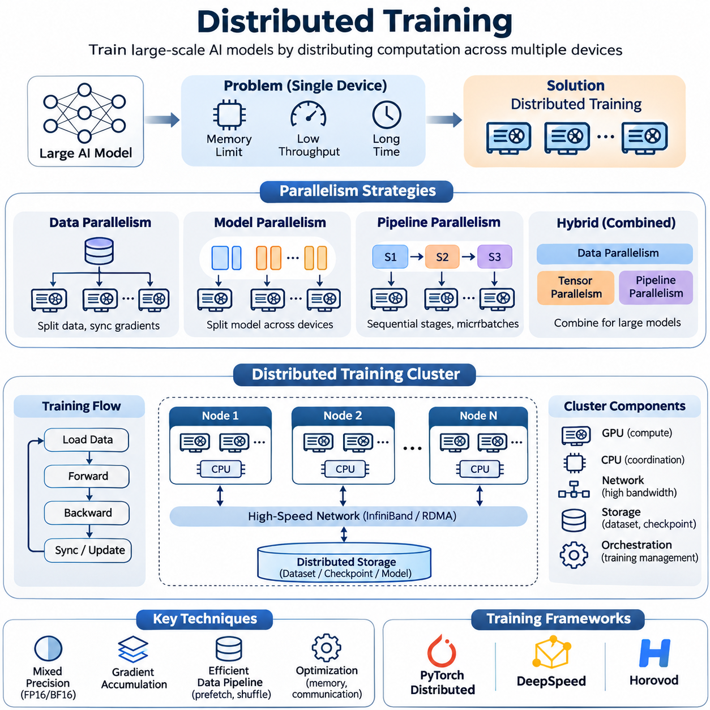
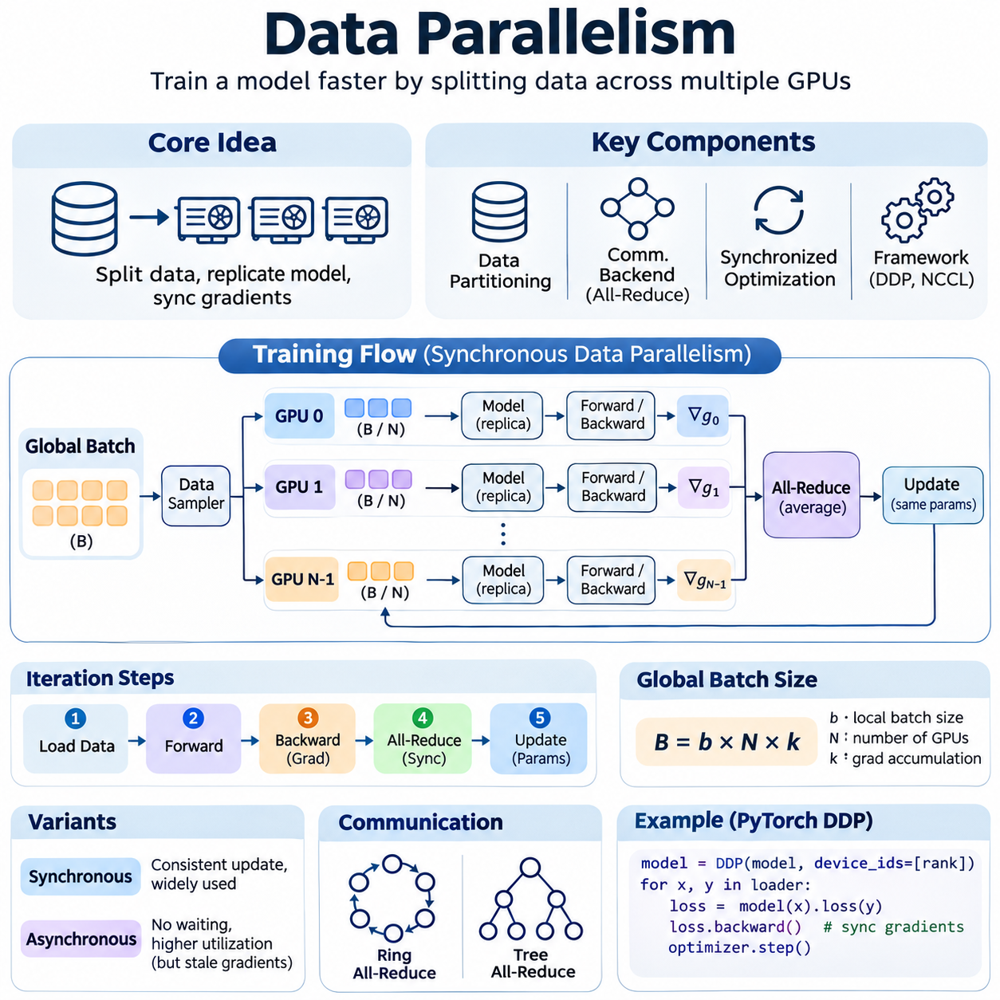
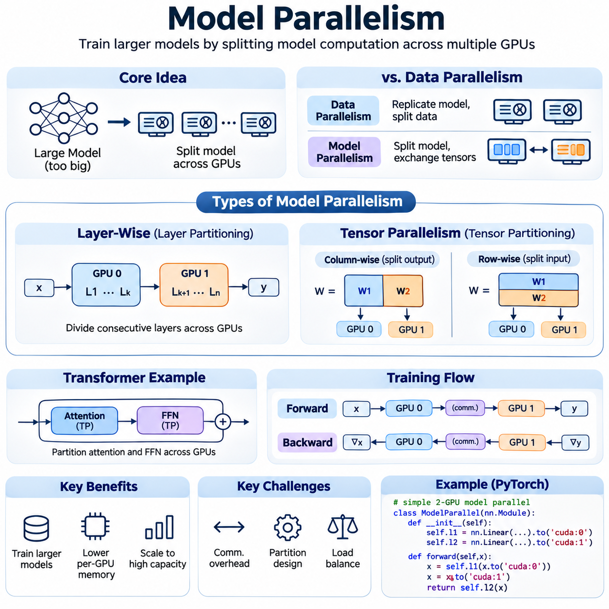
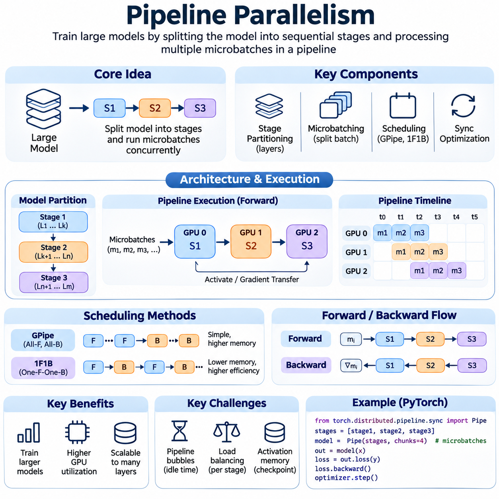
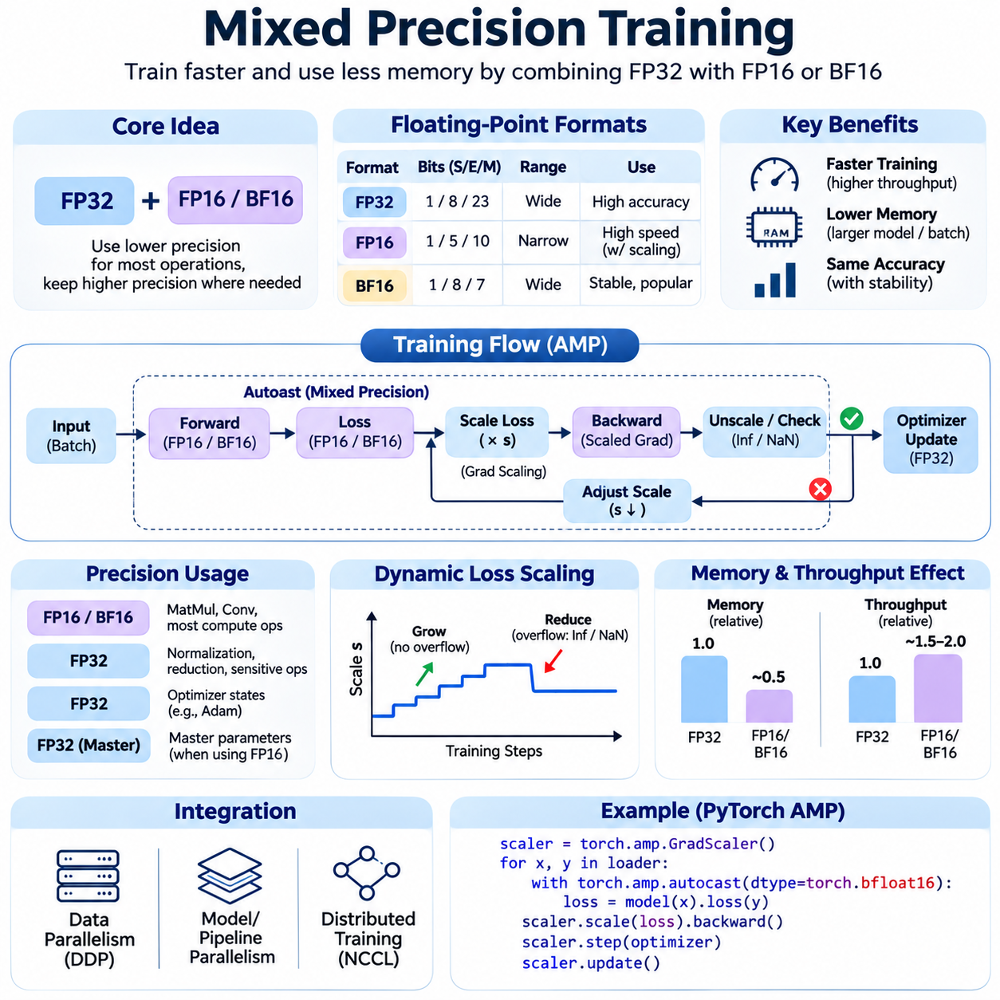
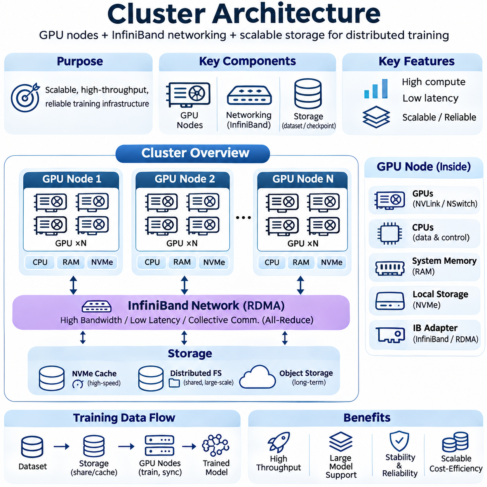
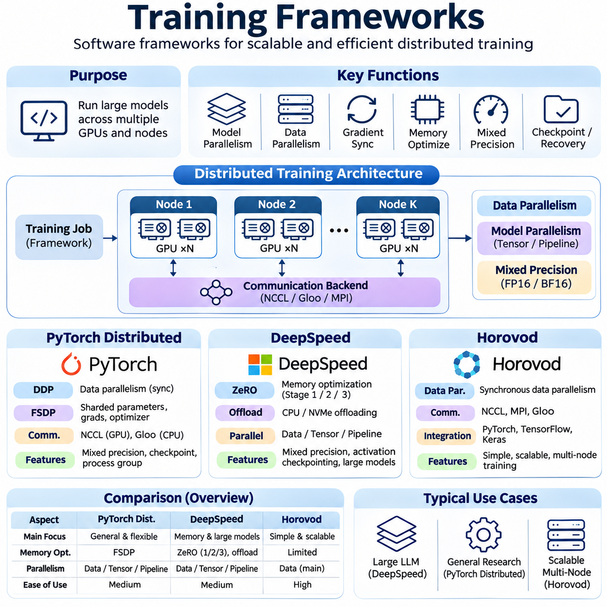
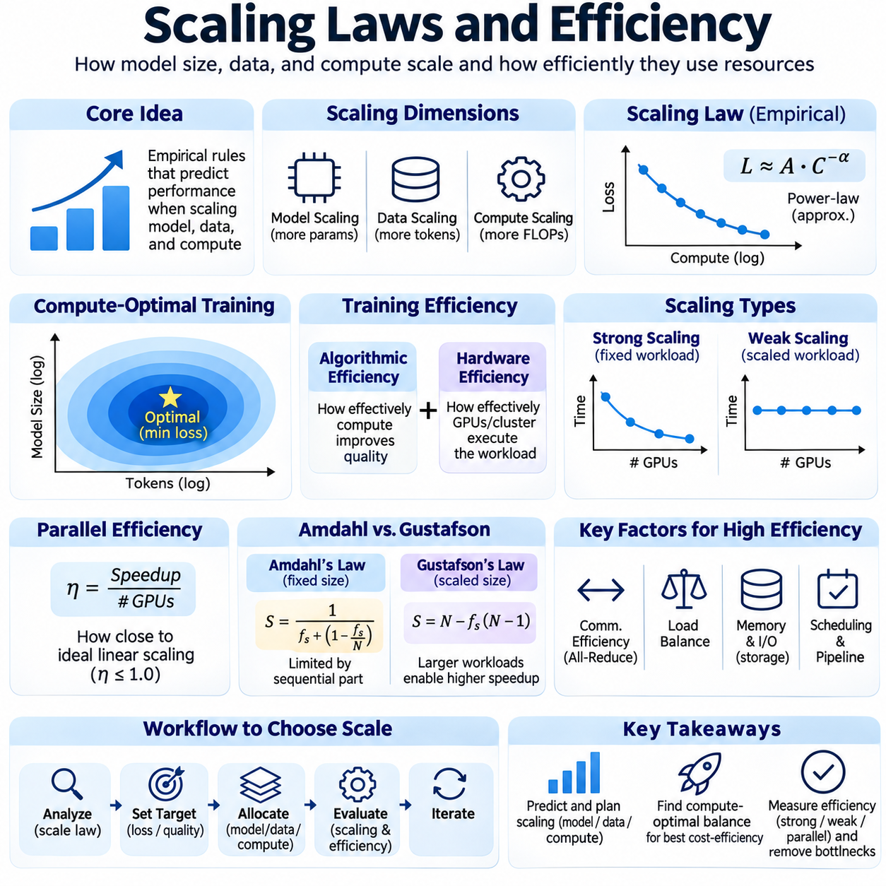
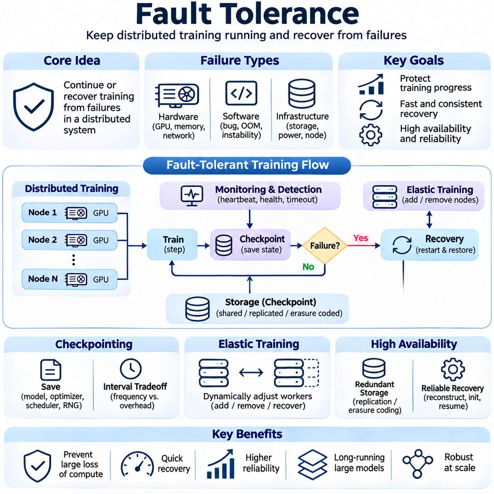
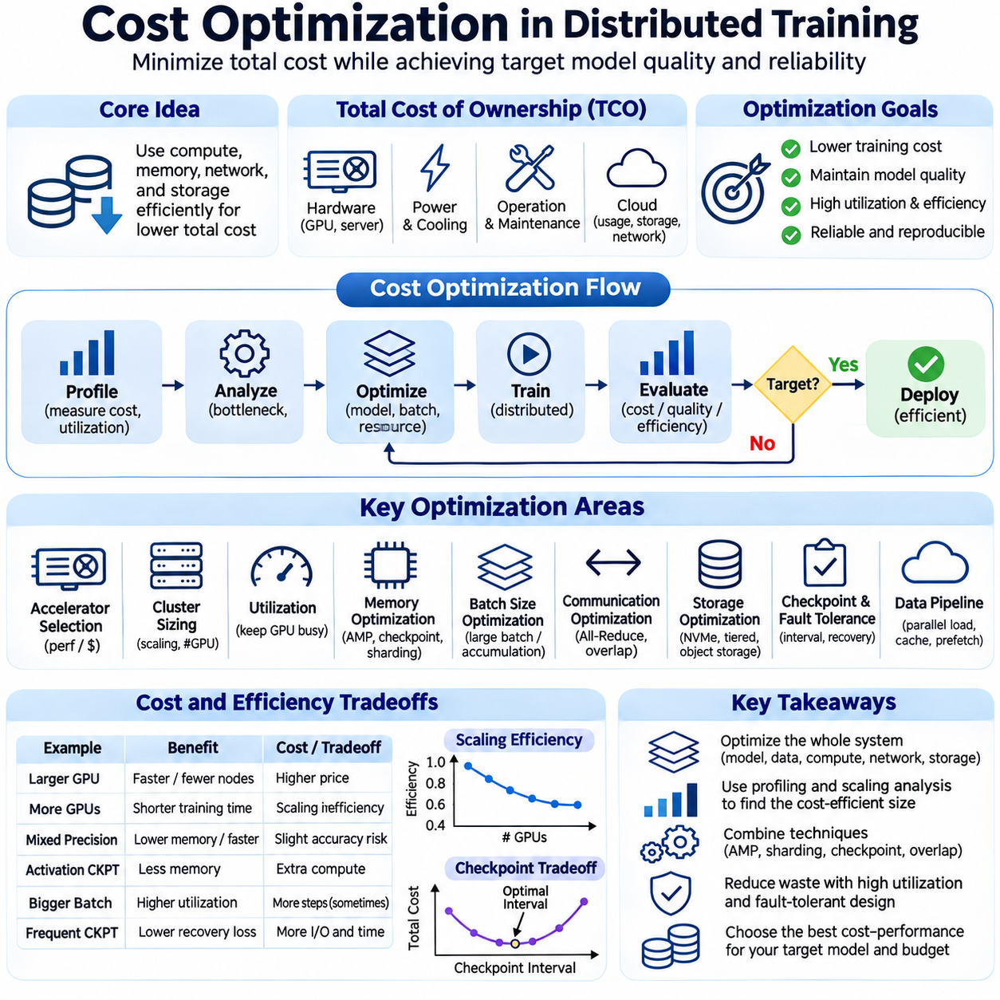

**Volume 38. AI Systems Architecture**

# 02. Distributed Training

## 02.00 Overview

{width="7.268055555555556in" height="7.268055555555556in"}

Distributed training is a fundamental architectural approach for developing large-scale artificial intelligence systems by distributing computational workloads across multiple GPUs, servers, or interconnected computing clusters. As neural networks increase in parameter count, dataset size, and computational complexity, conventional single-device training becomes constrained by memory capacity, processing throughput, and execution time. Distributed training addresses these limitations through coordinated parallel computation.

The primary objective of distributed training is to accelerate model development while enabling neural networks that exceed the computational or memory capacity of individual accelerators. Rather than executing every training operation on one device, a distributed system partitions data, model parameters, or computational stages among multiple processing units. These units cooperate through communication protocols, synchronization mechanisms, and shared optimization procedures to maintain consistent learning behavior.

A distributed training architecture consists of several interconnected components, including computational accelerators, host processors, communication networks, distributed storage, and training orchestration software. GPUs perform intensive tensor operations, while CPUs coordinate data loading, scheduling, and system management. High-speed interconnects transfer gradients, activations, and model parameters between devices, allowing separate computational resources to operate as a coordinated training environment.

Data parallelism is one of the most widely adopted distributed training strategies. Each participating GPU maintains a replica of the neural network and processes a different subset of the training data. During backpropagation, every device computes gradients from its assigned samples. These gradients are subsequently synchronized and aggregated so that model replicas receive consistent parameter updates, preserving the mathematical behavior of synchronous minibatch optimization.

The effectiveness of data parallelism depends on the relationship between computational workload and communication overhead. Increasing the number of GPUs can reduce the time required to process a fixed dataset, but gradient synchronization introduces additional latency. When communication becomes comparable to or greater than computation, scaling efficiency deteriorates. Consequently, distributed training systems must balance batch size, gradient accumulation, network bandwidth, and synchronization frequency.

Model parallelism addresses situations in which a neural network cannot fit within the memory of a single accelerator. Instead of replicating the complete model, the system distributes different parameters, layers, or tensor operations across multiple devices. Each accelerator stores and computes only its assigned portion of the network. Intermediate activations and gradients move between devices as required, enabling the training of models whose total parameter footprint exceeds individual GPU memory limits.

Pipeline parallelism extends model partitioning by dividing a neural network into sequential computational stages. Different GPUs execute different stages while processing multiple microbatches concurrently. Once the pipeline reaches a steady operating state, several microbatches can occupy different stages simultaneously. This improves accelerator utilization, although pipeline bubbles, workload imbalance, and interstage communication can reduce the theoretical performance advantage.

Modern large-scale training frequently combines data parallelism, tensor parallelism, and pipeline parallelism into a hybrid architecture. Data parallelism distributes training examples, tensor parallelism partitions operations within individual layers, and pipeline parallelism divides sequential model execution. Selecting an appropriate combination requires understanding model architecture, parameter distribution, activation memory, GPU topology, and communication characteristics across nodes.

Mixed precision training is another essential technique for improving distributed training efficiency. By performing suitable operations using lower-precision numerical formats, such as FP16 or BF16, the system can reduce memory consumption and increase computational throughput on compatible accelerators. Selected operations may retain higher precision to protect numerical stability. Loss scaling, precision-aware optimization, and numerical monitoring help prevent overflow, underflow, and unstable gradient updates.

Distributed cluster architecture strongly influences overall training performance. A typical cluster contains multiple GPU nodes connected through high-bandwidth networking infrastructure and supported by shared or distributed storage. Within individual nodes, high-speed GPU interconnects enable efficient device communication. Across nodes, technologies such as InfiniBand and RDMA reduce data transfer overhead, supporting frequent collective communication during synchronized training.

Storage architecture is equally important because training performance depends on the continuous delivery of data to computational accelerators. Large datasets may reside in object storage, distributed file systems, or shared network storage, while local NVMe devices provide high-speed caching. Efficient data pipelines perform prefetching, parallel decoding, shuffling, and asynchronous transfers. Without adequate storage throughput, expensive GPUs may remain idle while waiting for training samples.

Distributed training frameworks provide abstractions for managing communication, process coordination, and parameter synchronization. PyTorch Distributed supports collective communication and distributed data parallel execution, while DeepSpeed provides memory optimization and large-model training capabilities. Horovod offers distributed training interfaces across supported machine learning frameworks. These systems reduce implementation complexity while exposing mechanisms for performance tuning and resource management.

Communication collectives form the foundation of synchronized distributed optimization. Operations such as All-Reduce, Reduce-Scatter, All-Gather, and Broadcast coordinate information exchange among participating processes. All-Reduce commonly aggregates gradients across data-parallel workers, while other collectives support parameter sharding and tensor partitioning. Their efficiency depends on message size, communication topology, network congestion, and collective algorithm selection.

Scaling laws describe how model performance and computational requirements evolve as parameter counts, training data, and computational budgets increase. However, hardware scaling efficiency must be evaluated separately from statistical learning performance. Adding accelerators does not guarantee proportional reductions in training time because synchronization, memory access, data loading, and sequential dependencies introduce overhead. Strong scaling and weak scaling experiments reveal different aspects of system behavior.

Training efficiency can be characterized through throughput, accelerator utilization, step latency, scaling efficiency, and time to convergence. Samples per second or tokens per second measure processing capacity, while model FLOPs utilization estimates how effectively theoretical hardware capability is employed. Time to convergence captures the practical duration required to reach a target model quality. These measurements should be evaluated together because maximum hardware throughput does not necessarily produce the fastest useful training outcome.

Fault tolerance becomes increasingly important as distributed training expands across hundreds or thousands of accelerators. The probability of encountering hardware failures, communication interruptions, or software exceptions generally increases with cluster size and execution duration. Checkpointing preserves model parameters, optimizer states, scheduler information, and training progress. Recovery mechanisms restore consistent execution after failures, limiting the loss of completed computation.

Reliable checkpoint management requires balancing recovery capability against storage and synchronization overhead. Frequent checkpoints reduce potential recomputation but consume bandwidth, storage capacity, and processing time. Asynchronous checkpointing, distributed state partitioning, and incremental persistence can reduce these costs under suitable conditions. Effective recovery procedures must also preserve data sampling progress and distributed consistency to prevent unintended changes in optimization behavior.

Cost optimization is a central consideration because distributed training consumes substantial computing, networking, storage, and electrical resources. GPU rental rates or hardware acquisition costs represent only part of the total expenditure. Network infrastructure, storage operations, power consumption, cooling, engineering effort, and failed training runs also contribute. Economic efficiency is therefore better evaluated through cost per completed training objective than through accelerator price alone.

Resource scheduling and workload placement can significantly influence training economics. Jobs that communicate frequently benefit from GPUs connected through high-bandwidth, low-latency interconnects, while loosely coupled workloads may tolerate greater network separation. Cluster schedulers must account for accelerator availability, memory requirements, network topology, and job priority. Poor placement can create communication bottlenecks even when sufficient aggregate computing capacity exists.

Distributed training also introduces challenges involving reproducibility, numerical consistency, and debugging. Differences in operation ordering, floating-point reduction, random number generation, and asynchronous execution may produce variations between training runs. Reproducible experiments require controlled software environments, documented configurations, deterministic procedures where practical, and consistent data partitioning. Distributed logging and profiling help identify failures that are difficult to reproduce locally.

Observability is essential for operating distributed training systems reliably. Engineers must monitor GPU utilization, memory allocation, communication throughput, network latency, storage performance, and training metrics across all participating nodes. Distributed traces and profiling tools reveal synchronization delays, pipeline stalls, and workload imbalance. Correlating infrastructure measurements with optimization behavior allows teams to distinguish computational inefficiency from problems involving model convergence.

The architectural principles of distributed training apply to large language models, computer vision systems, multimodal foundation models, and robotics-oriented learning systems. Each workload introduces different requirements involving sequence length, image resolution, temporal structure, or training data diversity. Successful implementations adapt parallelism strategies and infrastructure configurations to these characteristics rather than assuming that one distributed architecture is optimal for every model.

Ultimately, distributed training is not simply the process of adding more GPUs to a machine learning workload. It is a coordinated systems engineering discipline involving algorithm design, numerical computation, parallel execution, communication networks, storage architecture, reliability, and economic optimization. A well-designed distributed training system transforms available computational resources into predictable, scalable, and cost-effective learning capability while maintaining model quality and operational stability.

## 02.01 Data Parallelism [w/Code]

{width="7.268055555555556in" height="7.268055555555556in"}

Data parallelism is a fundamental distributed training strategy that accelerates neural network optimization by dividing training data across multiple computing devices. Each participating GPU maintains a complete replica of the model while processing a different subset of the dataset. Through coordinated gradient synchronization, these devices collectively optimize shared model parameters, increasing training throughput without requiring the model architecture itself to be partitioned.

The central principle of data parallelism is to distribute computational workloads while preserving consistent model updates. During each training iteration, a global batch is divided into smaller local batches assigned to individual workers. Every worker performs forward propagation, calculates a loss function, and executes backpropagation independently. The resulting gradients are aggregated before the optimizer updates the model parameters.

A typical data-parallel architecture consists of multiple GPU workers, a distributed communication backend, a data partitioning mechanism, and synchronized optimization procedures. Each worker stores identical model parameters at the beginning of training and executes the same computational graph. Although the input samples differ between workers, gradient synchronization ensures that model replicas remain consistent after each successful optimization step.

Data partitioning determines how training samples are distributed across participating devices. Distributed samplers divide a dataset into approximately equal subsets, allowing each worker to process different examples during an epoch. Random shuffling improves statistical diversity, while coordinated sampling prevents unintended duplication or omission. Careful handling of incomplete batches is necessary when dataset size is not divisible by the total number of workers.

The global batch size is determined by the local batch size, the number of participating workers, and the number of gradient accumulation steps. For synchronous training, the effective global batch size equals their product when local batches have equal sizes. Increasing this value improves parallel workload capacity but may change optimization dynamics, gradient variance, and generalization behavior, requiring adjustments to learning rates and training schedules.

Forward propagation occurs independently on each GPU using its assigned input batch. The model produces predictions, computes intermediate activations, and evaluates the loss associated with local training samples. Since each worker maintains the same network structure, the computational operations are equivalent except for differences in input data. This independence allows substantial portions of the training iteration to execute concurrently.

During backpropagation, every worker computes gradients of the loss function with respect to model parameters. These local gradients represent information derived from the worker\'s assigned samples rather than the complete global batch. To reproduce the intended global minibatch gradient, the distributed system combines local contributions using an appropriate weighted aggregation rule, accounting for differences in batch size and loss normalization.

Gradient synchronization is commonly implemented using the All-Reduce collective communication operation. Each worker contributes its local gradient tensors, and the communication backend aggregates them across participating processes. The aggregated result is distributed to all workers, enabling identical optimizer updates. When local gradients represent equally sized batch means, averaging them produces the corresponding global batch mean gradient.

The efficiency of All-Reduce depends on communication algorithms, message sizes, network topology, and available bandwidth. Ring-based algorithms distribute communication across workers, while tree-based approaches can reduce communication latency under suitable conditions. Modern implementations may select different algorithms dynamically according to tensor sizes and hardware characteristics, seeking to minimize synchronization overhead without changing the intended numerical computation.

Synchronous data parallelism requires participating workers to coordinate before completing each optimization step. This approach provides consistent parameter updates and predictable optimization semantics, but overall progress may be limited by the slowest worker. Hardware contention, uneven data loading, and network delays can create stragglers that increase iteration time. Balanced workloads and efficient communication are therefore essential for scalable execution.

Asynchronous data parallelism allows workers to update shared parameters without waiting for complete synchronization. This can improve resource utilization in heterogeneous environments, but workers may compute gradients using outdated model parameters. Such stale gradients introduce optimization inconsistencies and can complicate convergence. Consequently, synchronous execution is generally preferred for tightly coupled GPU clusters, while asynchronous methods remain useful in selected distributed settings.

PyTorch Distributed Data Parallel provides a practical implementation of synchronous data parallelism. Each process typically controls one GPU and maintains its own model replica, optimizer, and data loader. DistributedDataParallel automatically coordinates gradient synchronization during backward execution. The NCCL backend is commonly used for NVIDIA GPU communication, while distributed process groups establish communication relationships among workers.

Efficient implementations overlap gradient communication with backward computation whenever dependencies permit. Gradients are organized into communication buckets, allowing synchronization to begin before the entire backward pass finishes. This overlap reduces exposed communication latency and improves accelerator utilization. However, bucket configuration, parameter execution order, and network performance influence the effectiveness of the optimization.

Gradient accumulation enables larger effective batch sizes without increasing the number of samples simultaneously stored in GPU memory. Each worker processes multiple microbatches and accumulates their gradients before synchronization and parameter updates. Framework mechanisms can suppress unnecessary synchronization during intermediate accumulation steps. Correct loss scaling and accumulation scheduling are required to preserve the intended optimization behavior.

Mixed precision training complements data parallelism by reducing memory consumption and accelerating suitable tensor operations. FP16 and BF16 formats can improve throughput on supported GPUs, while selected computations retain higher precision for numerical stability. Gradient scaling may be required for FP16 training to prevent underflow. Distributed implementations must also coordinate nonfinite-gradient detection and skipped optimizer steps to maintain replica consistency.

Scaling efficiency describes how effectively additional GPUs reduce training time or increase throughput. Ideal strong scaling would reduce the execution time of a fixed workload proportionally to the number of workers. In practice, communication, synchronization, data loading, and fixed execution overhead limit acceleration. Weak scaling instead evaluates performance as workload size increases alongside computational resources, revealing different architectural bottlenecks.

Communication overhead becomes particularly important when models contain many parameters or local batches are small. Frequent gradient synchronization can consume substantial network bandwidth and reduce the fraction of time spent performing useful computation. Increasing local computation per synchronization step, overlapping communication, and optimizing collective operations can improve efficiency, although larger batches may require corresponding optimization adjustments.

Distributed data pipelines must deliver training samples fast enough to keep all GPUs occupied. Parallel data loading, pinned host memory, asynchronous transfers, and local dataset caching reduce input bottlenecks. Storage throughput and preprocessing performance must scale with the number of workers. Without coordinated pipeline design, adding GPUs may increase resource contention rather than improve overall training throughput.

Fault tolerance is essential because a failure in one synchronous worker can interrupt the entire training job. Distributed checkpoints preserve model parameters, optimizer states, training schedules, and progress information needed for recovery. Restart procedures must restore compatible process groups and consistent model states. Elastic training can accommodate changing worker counts, but changes in global batch size and data partitioning require careful management.

Reproducibility requires controlling random seeds, data shuffling, numerical precision, and distributed execution settings. Floating-point reduction order may vary across communication algorithms, producing small numerical differences between runs. Distributed samplers must also advance consistently between epochs. Recording software versions, hardware configurations, batch parameters, and checkpoint metadata helps researchers reproduce results and diagnose unexpected training behavior.

Performance evaluation should consider samples per second, training step duration, GPU utilization, communication time, memory consumption, and scaling efficiency. Model convergence and validation quality remain equally important because higher throughput does not necessarily produce better learning outcomes. Time to target accuracy provides a useful combined measure of computational performance and optimization effectiveness across different distributed configurations.

Data parallelism is widely applied to image classification, object detection, language modeling, multimodal learning, and robotics perception systems. It is particularly effective when a complete model fits within each GPU and the training dataset provides sufficient parallel workload. For models exceeding individual accelerator memory capacity, data parallelism can be combined with parameter sharding, tensor parallelism, or pipeline parallelism.

Ultimately, successful data parallelism requires more than distributing input samples across available GPUs. It depends on coordinated optimization, efficient gradient communication, balanced data pipelines, reliable synchronization, and careful performance measurement. When these elements are engineered together, data parallelism provides a scalable foundation for accelerating neural network training while preserving consistent learning behavior and practical operational efficiency.

## 02.02 Model Parallelism [w/Code]

{width="7.268055555555556in" height="7.268055555555556in"}

Model parallelism is a distributed training strategy that enables neural networks to exceed the memory and computational capacity of individual accelerators. Instead of replicating an entire model on every GPU, model parallelism partitions model components across multiple devices. Each device stores and processes an assigned portion of the network, allowing large-scale architectures to execute through coordinated computation and communication.

The fundamental objective of model parallelism is to distribute model parameters, intermediate activations, and computational operations while preserving the mathematical behavior of the original neural network. This approach becomes essential when model weights, gradients, optimizer states, and activation tensors cannot fit within a single GPU. Effective partitioning transforms multiple accelerators into a coordinated computational environment.

Model parallelism differs fundamentally from data parallelism in how computational resources are allocated. Data parallelism replicates the complete model while distributing training samples across workers. Model parallelism distributes the model itself, requiring devices to exchange intermediate results during forward and backward propagation. These communication dependencies make model partitioning more complex but enable training architectures beyond individual device memory limits.

A model-parallel architecture typically consists of multiple GPUs connected through high-bandwidth communication links. Model layers, tensor dimensions, or computational operators are assigned to specific devices according to memory capacity and processing requirements. During execution, each device performs its allocated operations and exchanges necessary tensors with other devices. Efficient scheduling minimizes idle periods and communication delays.

Layer-wise model parallelism divides a neural network into groups of consecutive layers assigned to different accelerators. During forward propagation, activations generated by one partition are transferred to the next partition. Backpropagation reverses this communication direction as gradients propagate through the network. Although conceptually straightforward, sequential execution can leave many devices idle without additional scheduling techniques.

Tensor parallelism partitions computational operations within individual neural network layers. Large weight matrices may be divided across GPUs along selected dimensions, allowing multiple accelerators to participate in a single matrix multiplication. Each device computes a partial result, which is combined through communication operations when required. This approach is particularly useful for large transformer layers containing extensive attention and feedforward computations.

Column-wise partitioning divides a weight matrix across its output dimensions, allowing each GPU to calculate a subset of output features. Row-wise partitioning divides the matrix across input dimensions, requiring partial outputs to be combined appropriately. These approaches can be arranged to reduce unnecessary communication between consecutive operations. Correct implementation must preserve tensor shapes, mathematical equivalence, and gradient propagation.

Transformer architectures are particularly suitable for tensor parallelism because their computation is dominated by structured matrix operations. Attention projections, multi-head attention, and feedforward layers can often be partitioned across accelerators. Attention heads may be distributed among GPUs, while large intermediate feature dimensions can be divided across tensor partitions. Communication remains necessary when operations require information spanning multiple partitions.

During forward propagation, model-parallel workers exchange activations according to the dependencies between their assigned computations. Tensor parallelism may require collective communication to combine partial results, while layer-wise partitioning transfers intermediate tensors between consecutive devices. Communication patterns depend on the partitioning strategy and model architecture. Excessive transfers can offset computational gains and reduce effective accelerator utilization.

Backward propagation introduces additional communication requirements because gradients must follow the dependencies established during forward execution. Each device computes gradients for its assigned parameters and transfers activation gradients to preceding partitions when necessary. Tensor-parallel operations may require gradient aggregation or redistribution. Maintaining correct gradient flow is essential for preserving the optimization objective and ensuring consistent training behavior.

Memory efficiency is a primary advantage of model parallelism. Partitioning model parameters reduces the amount of parameter storage required on each GPU, potentially enabling networks far larger than a single device can accommodate. However, activation tensors, temporary buffers, communication workspaces, and optimizer states still consume memory. Effective memory planning must consider peak allocation rather than parameter size alone.

Optimizer state management becomes increasingly important when training large neural networks. Adaptive optimizers such as Adam maintain additional tensors representing parameter statistics, increasing memory requirements beyond model weights and gradients. Model parallelism naturally distributes states associated with partitioned parameters, while complementary techniques can further shard optimizer states. These approaches reduce per-device memory pressure but introduce additional coordination requirements.

Communication infrastructure strongly influences model-parallel performance. High-speed GPU interconnects such as NVLink and NVSwitch can provide efficient communication within compatible systems, while InfiniBand supports communication across nodes. Tensor parallelism often benefits from low-latency, high-bandwidth connections because synchronization may occur repeatedly within individual layers. Poor network topology can significantly limit achievable throughput.

Collective communication operations such as All-Reduce, All-Gather, Reduce-Scatter, and Broadcast support distributed tensor computation. Their usage depends on how model parameters and intermediate tensors are partitioned. All-Reduce combines partial contributions, while All-Gather reconstructs distributed tensor segments when required. Selecting suitable collective operations and minimizing redundant transfers are essential for efficient model-parallel execution.

Load balancing determines whether computational work is distributed effectively among accelerators. Unequal partition sizes, heterogeneous layer complexity, and differences in memory requirements can cause some GPUs to finish earlier than others. Faster devices may remain idle while waiting for slower partitions. Partition planning should therefore consider execution time, activation size, communication volume, and available device memory rather than dividing parameters equally.

Model parallelism can be combined with pipeline parallelism to improve execution concurrency. Pipeline parallelism organizes model partitions into sequential stages and processes multiple microbatches concurrently. While basic layer-wise partitioning may execute stages sequentially, pipelining overlaps computations across different microbatches. This reduces idle time and improves utilization, although pipeline bubbles and scheduling dependencies remain important performance considerations.

Hybrid parallelism combines model parallelism with data parallelism to scale training across larger accelerator clusters. Model partitions are distributed within groups of GPUs, while multiple groups process different training samples. Tensor parallelism may operate within high-bandwidth communication domains, and data parallelism synchronizes corresponding parameters across groups. Such architectures support large models while increasing aggregate training throughput.

Mixed precision training complements model parallelism by reducing the memory footprint of suitable tensors and accelerating supported mathematical operations. FP16 and BF16 computation can improve throughput on compatible accelerators, while selected operations retain higher precision for numerical stability. Precision management must remain consistent across partition boundaries, particularly when activations and gradients are exchanged between devices.

Activation checkpointing provides another mechanism for reducing memory consumption during model-parallel training. Instead of retaining every intermediate activation, selected values are recomputed during backpropagation. This trades additional computation for lower memory usage, allowing larger models or microbatches to fit within available resources. Checkpoint placement should account for computational cost, communication dependencies, and peak memory requirements.

Frameworks such as PyTorch Distributed, DeepSpeed, and Megatron-LM provide mechanisms for implementing large-scale model parallelism. These systems support distributed process coordination, tensor partitioning, communication management, and memory optimization. Their capabilities differ according to supported architectures and parallelization strategies. Selecting a framework requires evaluating model compatibility, hardware topology, operational complexity, and performance requirements.

Fault tolerance is challenging because model parameters are distributed across multiple devices. A failure affecting one partition may interrupt the entire training process. Distributed checkpointing must preserve parameter shards, optimizer states, partition metadata, and training progress. Recovery procedures must reconstruct compatible model partitions and restore consistent execution states, particularly when hardware availability or cluster topology changes.

Performance evaluation should consider training throughput, GPU utilization, peak memory consumption, communication overhead, and scaling efficiency. Model parallelism may enable otherwise impossible training workloads without necessarily reducing execution time. The benefits depend on partition quality, communication bandwidth, computational balance, and synchronization requirements. Measurements should distinguish increased model capacity from improvements in computational speed.

Model parallelism is especially relevant to large language models, multimodal foundation models, scientific neural networks, and other architectures containing extensive parameter matrices. It enables the training of systems whose memory requirements exceed individual GPU capacity while supporting specialized partitioning strategies. Nevertheless, smaller models that fit comfortably on one accelerator may achieve better efficiency through data parallelism alone.

Ultimately, successful model parallelism requires coordinated decisions involving neural network architecture, tensor partitioning, memory allocation, communication topology, and distributed optimization. Its effectiveness depends on balancing computational concurrency against communication and synchronization costs. When properly engineered, model parallelism provides a scalable foundation for training increasingly complex artificial intelligence systems beyond the limitations of individual accelerators.

## 02.03 Pipeline Parallelism [w/Code]

{width="7.268055555555556in" height="7.268055555555556in"}

Pipeline parallelism is a distributed training strategy that partitions a neural network into sequential computational stages executed across multiple accelerators. Instead of assigning an entire model to one GPU, consecutive groups of layers are distributed among devices. Multiple microbatches move through these stages concurrently, enabling overlapping computation and improved hardware utilization while supporting models that exceed individual GPU memory capacity.

The fundamental principle of pipeline parallelism is to transform sequential model execution into a coordinated processing pipeline. Each accelerator is responsible for a particular stage of the neural network, receiving intermediate activations from the preceding stage and transmitting results to the next. By processing different microbatches simultaneously, the system reduces the idle time associated with conventional layer-wise model parallelism.

Pipeline construction begins by dividing the neural network into computational stages according to layer dependencies, memory requirements, and execution costs. A stage may contain several transformer blocks, convolutional layers, or other computational modules. The partitioning strategy must preserve the original forward and backward dependencies while distributing work efficiently. Poor partitioning can create bottlenecks that limit overall training throughput.

Microbatching is essential for achieving computational overlap in pipeline parallelism. A global training batch is divided into smaller microbatches that enter the pipeline at successive intervals. While one microbatch advances through a later stage, another can execute on an earlier stage. This concurrent processing increases accelerator utilization without requiring every GPU to execute the same operations or maintain a complete model replica.

During forward propagation, each stage processes its assigned layers and transfers resulting activations to the next stage. Different microbatches occupy different pipeline stages as execution progresses. The first stage begins processing new microbatches while downstream stages handle earlier ones. Once the pipeline is sufficiently populated, multiple accelerators perform useful computations concurrently, improving throughput compared with purely sequential model execution.

Backward propagation follows the reverse direction of the forward pipeline. Each stage receives activation gradients from the subsequent stage, computes gradients for its local parameters, and transfers input gradients to the preceding stage. Correct dependency tracking is necessary because backward computation for a microbatch cannot proceed until the required downstream gradients are available. Scheduling determines how forward and backward operations share accelerator resources.

Pipeline scheduling algorithms strongly influence execution efficiency. The traditional all-forward-all-backward schedule, often called GPipe-style scheduling, executes forward operations for all microbatches before beginning their backward passes. This approach provides straightforward optimization semantics but may require substantial activation memory. Alternative schedules interleave forward and backward operations to reduce memory pressure and improve execution efficiency.

The one-forward-one-backward schedule, commonly abbreviated as 1F1B, alternates forward and backward computations after an initial pipeline warm-up period. This arrangement allows activations to be released earlier than in all-forward-all-backward execution. As a result, memory consumption can decrease while maintaining pipeline concurrency. However, precise scheduling depends on stage dependencies, microbatch availability, and communication timing.

Pipeline bubbles represent periods when one or more stages remain idle because suitable computations are unavailable. Bubbles occur during pipeline initialization, draining, and workload imbalance. Their relative overhead depends on the number of stages and microbatches, as well as the scheduling strategy. Increasing the number of microbatches generally reduces the relative impact of startup and shutdown bubbles, although it may introduce additional scheduling and communication costs.

Load balancing is critical because the slowest pipeline stage can determine the overall processing rate. Stages containing expensive attention operations, large matrix multiplications, or substantial communication may require more execution time than others. Assigning equal numbers of layers does not necessarily produce balanced computation. Effective partitioning considers measured execution time, memory requirements, activation sizes, and hardware capabilities.

Communication between pipeline stages primarily involves transferring intermediate activations during forward propagation and activation gradients during backward propagation. Unlike tensor parallelism, which may require frequent collective communication within individual layers, pipeline parallelism often relies on point-to-point communication between adjacent stages. Efficient data transfer and communication-computation overlap are essential for maintaining high throughput.

Memory management is a central design consideration because each pipeline stage must retain information required for backward propagation. The number of simultaneously active microbatches affects activation memory consumption. Activation checkpointing can reduce memory requirements by recomputing selected intermediate tensors during backward execution. This introduces additional computation but may allow larger microbatch sizes or more complex model partitions.

Pipeline parallelism can introduce weight staleness when different microbatches use inconsistent parameter versions during asynchronous updates. Carefully designed synchronous schedules avoid this problem by accumulating gradients across the intended global batch before applying optimizer updates. Other pipeline approaches permit controlled parameter staleness to improve concurrency. Their convergence behavior depends on the update strategy and consistency guarantees.

Gradient accumulation naturally complements pipeline parallelism because multiple microbatches contribute to a single optimizer update. Each stage accumulates parameter gradients from its assigned microbatches before updating local weights. This preserves the intended effective batch size when loss normalization is handled correctly. Synchronizing optimizer steps across stages ensures that subsequent training iterations use compatible parameter versions.

Interleaved pipeline parallelism assigns multiple nonconsecutive model segments to individual devices, creating several virtual pipeline stages per accelerator. This can reduce pipeline bubble overhead by improving scheduling flexibility and computational overlap. However, interleaving may increase communication frequency and scheduling complexity. Its effectiveness depends on the model structure, number of microbatches, and available interconnect bandwidth.

Pipeline parallelism is frequently combined with tensor parallelism and data parallelism in large-scale training systems. Tensor parallelism divides computations within individual layers, while pipeline parallelism distributes groups of layers across stages. Data parallelism replicates these distributed model configurations to process additional training samples. This hybrid approach enables training models with substantial parameter counts while utilizing large accelerator clusters.

Hardware topology significantly influences pipeline placement and communication performance. Adjacent stages should ideally communicate through sufficiently fast connections, particularly when activation tensors are large. NVLink and NVSwitch can support high-bandwidth transfers within compatible GPU systems, while InfiniBand enables communication across compute nodes. Placement strategies should consider both communication volume and the computational requirements of each stage.

Frameworks such as PyTorch distributed pipeline facilities, DeepSpeed, and Megatron-LM provide mechanisms for constructing and scheduling pipeline-parallel models. These systems can manage stage partitioning, microbatch execution, communication, and gradient coordination. Their supported scheduling strategies and integration requirements vary. Framework selection should consider model compatibility, pipeline flexibility, debugging complexity, and hardware infrastructure.

Fault tolerance becomes more complex when training execution spans multiple dependent pipeline stages. Failure of one stage can interrupt the entire pipeline and invalidate partially processed microbatches. Distributed checkpointing must preserve model partitions, optimizer states, and training progress consistently. Recovery procedures must reconstruct stage assignments and restore compatible execution states before training resumes.

Performance evaluation should measure microbatch throughput, pipeline utilization, stage execution time, communication overhead, memory consumption, and pipeline bubble ratios. Overall training speed depends on both steady-state throughput and initialization or draining costs. Profiling individual stages helps identify computational imbalance and synchronization delays. Time to convergence remains important because increased throughput does not automatically guarantee improved optimization efficiency.

Pipeline parallelism is particularly valuable for large language models, multimodal foundation models, and deep neural networks containing many sequential layers. It enables architectures that cannot fit within one accelerator while providing opportunities for concurrent execution. However, models with extensive cross-layer dependencies or limited sequential depth may be difficult to partition efficiently, reducing the practical benefits of pipelining.

Ultimately, pipeline parallelism transforms model execution into a coordinated sequence of overlapping computational stages. Its effectiveness depends on stage partitioning, microbatch scheduling, communication efficiency, activation memory management, and consistent optimization. When these elements are carefully engineered, pipeline parallelism provides a scalable foundation for training large neural networks while improving accelerator utilization and managing distributed computational resources.

## 02.04 Mixed Precision Training [w/Code]

{width="7.268055555555556in" height="7.268055555555556in"}

Mixed precision training is a computational optimization technique that combines numerical formats with different precision levels during neural network training. Instead of performing every operation using 32-bit floating-point arithmetic, selected computations use lower-precision formats such as FP16 or BF16. This approach reduces memory consumption and can accelerate tensor operations while preserving numerical stability through carefully controlled precision management.

The primary motivation for mixed precision training is the increasing computational and memory demand of large neural networks. Model parameters, gradients, optimizer states, and intermediate activations consume substantial GPU memory. Lower-precision representations reduce the storage required for suitable tensors, allowing larger models or batches to fit within available resources. Specialized accelerator hardware can also execute supported low-precision operations at higher throughput.

Floating-point formats differ in their allocation of bits to sign, exponent, and significand components. FP32 provides a broad numerical range and relatively high precision, while FP16 uses fewer bits and has a narrower exponent range. BF16 retains an exponent range comparable to FP32 but offers fewer significand bits. These differences influence numerical accuracy, overflow, underflow, and the suitability of each format for particular training operations.

FP16 training can provide significant performance benefits on GPUs equipped with compatible tensor acceleration hardware. However, its limited numerical range creates challenges when representing very small gradients or large intermediate values. Gradients may underflow to zero, while excessive values may overflow to infinity. Mixed precision methods address these limitations by retaining selected computations in FP32 and applying numerical stabilization techniques.

BF16 has become widely adopted for large-scale neural network training because its exponent range is comparable to FP32. This characteristic reduces the risk of overflow and underflow relative to FP16, although its lower significand precision introduces rounding errors. BF16 often avoids the need for gradient scaling, making it convenient for large transformer architectures. Nevertheless, numerical stability must still be evaluated for the specific model and workload.

Automatic mixed precision, commonly abbreviated as AMP, simplifies precision management by selecting appropriate numerical formats for supported operations. Frameworks such as PyTorch provide automatic casting mechanisms that execute eligible operations in lower precision while retaining higher precision where necessary. This reduces manual implementation complexity and allows developers to benefit from hardware acceleration without rewriting every neural network layer.

Autocasting determines the numerical format used by individual operations according to framework policies and hardware support. Matrix multiplications and convolutions frequently benefit from reduced precision, while certain reductions, normalization operations, and sensitive mathematical functions may require higher precision. The exact behavior depends on the framework and selected dtype. Autocasting does not guarantee that every operation executes in reduced precision.

Gradient scaling is an important stabilization technique for FP16 training. Small gradients can become unrepresentable when converted into FP16, potentially causing information loss during backpropagation. Loss scaling multiplies the loss by a scaling factor before gradient computation, increasing gradient magnitudes. Before optimizer updates, gradients are unscaled to recover their intended values, provided no numerical overflow has occurred.

Dynamic loss scaling adjusts the scaling factor according to observed numerical behavior. When gradients contain infinity or NaN values, the optimizer step is skipped and the scale may be reduced. After a sequence of successful updates, the scale can increase to improve the representation of small gradients. This adaptive mechanism reduces manual tuning and helps maintain stable optimization across changing gradient distributions.

Mixed precision training often retains optimizer states in FP32 to preserve update accuracy. Adaptive optimizers such as Adam maintain moving averages of gradients and squared gradients, which can be sensitive to rounding errors. Some implementations also maintain FP32 master parameters when training with FP16 model weights. The exact memory savings therefore depend on how parameters, gradients, activations, and optimizer states are represented.

Memory reduction is one of the most practical advantages of mixed precision training. FP16 and BF16 tensors require approximately half the storage of equivalent FP32 tensors, although total training memory does not necessarily decrease by half. Optimizer states, temporary buffers, communication workspaces, and retained FP32 values contribute additional overhead. Actual savings depend on model architecture, implementation strategy, and memory allocation behavior.

Hardware acceleration is another major benefit because modern GPUs contain specialized units for high-throughput matrix operations. NVIDIA Tensor Cores and comparable accelerator technologies can execute supported lower-precision computations efficiently. Performance improvements depend on tensor dimensions, operation types, memory bandwidth, and hardware generation. Consequently, theoretical arithmetic throughput does not directly translate into equivalent end-to-end training speedups.

Mixed precision training integrates naturally with data parallelism, where multiple GPUs maintain model replicas and synchronize gradients. Reduced-precision communication can decrease network traffic when supported by the distributed training configuration. However, gradient reduction and optimizer updates must preserve sufficient numerical accuracy. Distributed implementations must also coordinate overflow detection and skipped updates to prevent model replicas from diverging.

In tensor parallelism, mixed precision reduces the memory footprint of partitioned tensors and may decrease communication volume between accelerators. Large matrix operations can benefit from specialized low-precision hardware while selected accumulation operations retain higher precision. Careful handling of tensor boundaries and collective communication is required to prevent excessive numerical error. Precision choices should remain compatible across participating devices.

Pipeline parallelism also benefits from mixed precision because activation tensors and activation gradients are transferred between computational stages. Lower-precision representations can reduce communication bandwidth requirements and activation memory consumption. However, stage boundaries must preserve compatible tensor formats and numerical behavior. Inconsistent casting policies may introduce unnecessary conversions or destabilize distributed optimization.

Numerical stability remains the central engineering challenge of mixed precision training. Operations involving exponentials, logarithms, normalization, or accumulation can be sensitive to rounding and limited dynamic range. Softmax calculations, attention scores, and loss functions require appropriate precision policies. Stable implementations often use higher-precision accumulation or numerically robust formulations rather than relying exclusively on reduced-precision arithmetic.

Training convergence must be evaluated independently of computational throughput. Reduced precision can introduce numerical differences that affect gradients, optimizer trajectories, and final model quality. Many architectures achieve comparable results under well-designed mixed precision configurations, but equivalence is not guaranteed. Validation metrics, loss curves, gradient statistics, and reproducibility experiments help identify precision-related degradation.

Mixed precision interacts with gradient accumulation, activation checkpointing, and optimizer state sharding. Gradient accumulation increases effective batch size without requiring all samples to remain in memory simultaneously. Activation checkpointing trades additional computation for reduced activation storage, while optimizer sharding distributes optimizer states across devices. Combining these techniques can substantially improve memory efficiency, although their interactions require careful implementation.

Implementation frameworks provide practical mechanisms for integrating mixed precision into training workflows. PyTorch supports autocast and gradient scaling through its automatic mixed precision facilities, while DeepSpeed and other distributed training systems offer precision configuration options. Developers must verify hardware compatibility, supported numerical formats, and framework behavior. Explicit testing is particularly important when custom operations or specialized kernels are involved.

Performance profiling should measure training throughput, GPU memory consumption, kernel execution time, communication overhead, and numerical stability. Comparisons between FP32, FP16, and BF16 should use consistent model configurations and equivalent training workloads. Monitoring gradient overflow, skipped optimizer steps, and validation accuracy helps distinguish genuine performance improvements from unstable execution or altered optimization behavior.

Mixed precision is particularly valuable for large language models, computer vision networks, multimodal foundation models, and robotics learning systems. These applications frequently contain computationally intensive matrix operations and substantial activation memory requirements. Reduced precision can enable larger batch sizes, longer sequences, or more complex architectures within fixed hardware budgets. Nevertheless, precision selection must reflect the numerical characteristics of each workload.

Ultimately, mixed precision training is a balance between computational efficiency, memory capacity, and numerical reliability. Its effectiveness depends on selecting appropriate floating-point formats, preserving sensitive operations, managing gradient scaling, and validating convergence. When integrated with distributed training architectures and modern accelerator hardware, mixed precision provides a practical foundation for efficient and scalable neural network optimization.

## 02.05 Cluster Architecture

{width="7.268055555555556in" height="7.268055555555556in"}

Cluster architecture forms the physical and logical foundation of distributed artificial intelligence training systems. It integrates GPU compute nodes, high-speed networking, and scalable storage into a coordinated infrastructure capable of executing large neural network workloads. Effective cluster design must balance computational throughput, communication latency, memory capacity, data availability, and operational reliability to achieve efficient training at scale.

A distributed training cluster typically consists of interconnected GPU servers managed by orchestration and scheduling software. Each server contributes computational resources, while the network enables communication between participating devices. Shared or distributed storage supplies training datasets and preserves checkpoints. These components must operate together because improvements in GPU performance alone cannot overcome limitations imposed by networking or storage bottlenecks.

GPU nodes represent the primary computational units within an AI training cluster. A node commonly contains multiple accelerators, host CPUs, system memory, local storage, and high-speed network adapters. GPU selection depends on computational capability, accelerator memory, memory bandwidth, power consumption, and supported numerical formats. Large training workloads benefit from nodes designed to sustain intensive matrix operations while maintaining predictable communication performance.

The internal architecture of a GPU node strongly influences distributed training efficiency. Accelerators communicate through PCIe or specialized interconnects such as NVLink and NVSwitch, depending on hardware configuration. High-bandwidth GPU connections reduce the cost of exchanging tensors, gradients, and intermediate activations. Node topology should therefore be considered when assigning tensor-parallel groups, pipeline stages, and other tightly coupled computational tasks.

Host CPUs coordinate data loading, preprocessing, communication initialization, and system-level operations. Adequate CPU cores and memory bandwidth are necessary to prevent input pipelines from limiting GPU utilization. Nonuniform memory access, commonly called NUMA, can influence performance when accelerators and network adapters are attached to different processor domains. Careful CPU affinity and memory placement improve data movement efficiency.

GPU memory capacity determines the size of model partitions, activation tensors, and training batches that each accelerator can accommodate. High-bandwidth memory supports intensive tensor computation, while system RAM and local NVMe storage provide additional buffering and caching capabilities. Memory planning must account for model parameters, gradients, optimizer states, temporary workspaces, and communication buffers rather than considering model weights alone.

Node-level reliability requires appropriate power delivery, thermal management, and hardware monitoring. Training accelerators may operate under sustained high utilization for extended periods, producing substantial heat and electrical demand. Insufficient cooling can cause thermal throttling, reducing effective throughput. Hardware telemetry should track GPU temperature, memory errors, power consumption, and accelerator availability to identify developing problems before they interrupt training.

Networking connects GPU nodes into a unified distributed computing environment. During synchronous training, workers frequently exchange gradients, model parameters, and intermediate tensors. Communication requirements increase with model size, parallelization strategy, and synchronization frequency. A suitable network must provide sufficient bandwidth and low latency while maintaining predictable performance under simultaneous traffic from many participating nodes.

InfiniBand is widely used in high-performance computing and large-scale AI clusters because it supports high-throughput, low-latency communication. Its architecture enables efficient data exchange between servers and supports remote direct memory access, commonly abbreviated as RDMA. RDMA allows compatible systems to transfer data with reduced CPU involvement and fewer software processing steps, helping minimize communication overhead during distributed training.

InfiniBand networks rely on host channel adapters, switches, cables, and fabric management components. Network adapters connect compute nodes to the communication fabric, while switches establish paths between participating servers. Fabric topology influences available bandwidth, congestion, and communication latency. Designs such as fat-tree networks can provide substantial aggregate bandwidth when appropriately provisioned, although implementation cost and operational complexity must be considered.

Collective communication operations are central to distributed training performance. All-Reduce combines gradients across workers, while All-Gather and Reduce-Scatter support distributed tensor and optimizer-state management. Communication libraries such as NCCL coordinate these operations across compatible GPUs and network configurations. Efficient collective execution depends on network topology, message size, communication algorithms, and the placement of participating processes.

Network congestion can significantly reduce training efficiency when multiple distributed jobs compete for shared bandwidth. Oversubscribed links, poorly balanced traffic, and excessive communication synchronization can create delays that propagate across the cluster. Network monitoring should measure throughput, latency, packet errors, and congestion indicators. Traffic-aware scheduling and appropriate fabric provisioning help maintain predictable performance under concurrent workloads.

GPU Direct technologies can improve communication efficiency by reducing unnecessary transfers through host memory. GPUDirect RDMA enables supported network adapters to access GPU memory directly under compatible hardware and software configurations. This reduces data movement overhead and can improve distributed communication performance. Actual benefits depend on accelerator topology, adapter placement, driver support, and the communication library implementation.

Storage architecture provides the persistent data foundation for distributed training. Large datasets, model checkpoints, experiment artifacts, and training logs must remain accessible across compute nodes. Storage systems may include local NVMe drives, shared network file systems, distributed parallel file systems, and object storage. The appropriate combination depends on dataset size, access patterns, throughput requirements, durability expectations, and operational cost.

Local NVMe storage offers high-throughput, low-latency access for temporary datasets and frequently accessed files. Caching training data near compute resources reduces repeated network transfers and helps maintain GPU utilization. However, local storage is generally tied to individual nodes and may not provide the durability or shared accessibility required for long-term datasets. Cluster designs therefore commonly combine local caching with centralized or distributed persistent storage.

Distributed file systems allow multiple compute nodes to access shared datasets and checkpoints through a common namespace. Parallel file systems can distribute data across storage servers to increase aggregate throughput. Their performance depends on metadata handling, file size, access concurrency, and network bandwidth. Workloads containing millions of small files may require different optimization strategies from workloads using large sequential data shards.

Object storage provides scalable capacity for training datasets, pretrained models, and experiment archives. Its durability and flexible access interfaces make it useful for long-term data management, but access latency and request overhead can limit direct use in highly demanding training loops. Data staging pipelines often transfer frequently accessed objects into faster storage tiers before training begins. This separates durable storage requirements from high-performance data delivery.

Data pipeline design determines whether storage performance translates into sustained accelerator utilization. Parallel data loading, preprocessing, decompression, shuffling, and prefetching must supply samples at the required rate. Dataset sharding can reduce metadata overhead and improve sequential access efficiency. Asynchronous transfers and pinned host memory help overlap data movement with GPU computation, reducing periods when accelerators wait for input.

Checkpoint storage introduces additional requirements because large distributed models may generate substantial state snapshots. Checkpoints must preserve model parameters, optimizer states, scheduler information, and training progress. Parallel checkpoint writing can reduce completion time, while asynchronous techniques may overlap storage operations with computation. Storage bandwidth and consistency mechanisms must be sufficient to support reliable recovery without excessive training interruption.

Cluster orchestration coordinates compute allocation, workload scheduling, process placement, and failure recovery. Systems such as Kubernetes and Slurm can manage distributed jobs according to resource availability and scheduling policies. GPU-aware scheduling should consider accelerator topology, network proximity, memory requirements, and job priority. Poor placement may increase communication costs even when sufficient computational capacity is available.

Security and operational governance are also important in shared training environments. Access controls protect datasets, model artifacts, and infrastructure management interfaces. Network segmentation, authentication, and controlled storage permissions reduce unauthorized access risks. Monitoring and audit logs support operational accountability, while configuration management helps maintain consistent software environments across nodes and reduces deployment-related failures.

Cluster performance should be evaluated through end-to-end training metrics rather than isolated hardware specifications. GPU utilization, model FLOPs utilization, network throughput, storage bandwidth, training step latency, and time to convergence provide complementary perspectives. Bottleneck analysis should identify whether execution is limited by computation, communication, memory, or data delivery. Balanced optimization produces more reliable improvements than maximizing any single component.

Ultimately, effective cluster architecture requires coordinated engineering across GPU nodes, InfiniBand networking, and scalable storage systems. Computational resources must be matched with communication capacity, reliable data delivery, and appropriate operational controls. When these components are designed as an integrated infrastructure, distributed training clusters can support increasingly complex AI models while maintaining scalability, reliability, and economic efficiency.

## 02.06 Training Frameworks

{width="7.268055555555556in" height="7.268055555555556in"}

Distributed training frameworks provide the software foundation for executing large neural network workloads across multiple GPUs and compute nodes. They coordinate model replication, gradient synchronization, communication, memory allocation, and optimizer execution. PyTorch Distributed, DeepSpeed, and Horovod offer different approaches to distributed computation, allowing developers to select architectures according to model complexity, hardware infrastructure, and scalability requirements.

PyTorch Distributed provides native distributed computing capabilities within the PyTorch ecosystem. Its architecture supports communication between multiple training processes operating across GPUs and compute nodes. Each process typically controls one accelerator and participates in a distributed process group. Communication backends coordinate tensor exchanges and collective operations, enabling data parallelism and other distributed training strategies.

The DistributedDataParallel module, commonly abbreviated as DDP, is a fundamental component of PyTorch Distributed. DDP maintains model replicas across participating processes and synchronizes gradients during backward propagation. Each process computes gradients using its assigned data partition, while collective communication combines the results. This approach supports scalable synchronous training without requiring a centralized parameter server.

PyTorch Distributed uses process groups to define collections of processes participating in communication operations. Each process receives a rank that identifies its position within the distributed environment. The world size represents the total number of participating processes. These concepts allow developers to organize communication groups for data parallelism, tensor parallelism, and pipeline parallelism while controlling synchronization boundaries.

Communication backends determine how distributed processes exchange tensors and coordinate collective operations. NCCL is commonly used for GPU-based training, while Gloo supports communication scenarios involving CPUs and selected distributed configurations. Operations such as All-Reduce, Broadcast, All-Gather, and Reduce-Scatter enable gradient synchronization and distributed tensor management. Backend selection depends on device compatibility and network infrastructure.

Fully Sharded Data Parallel, commonly known as FSDP, extends distributed training by partitioning model parameters, gradients, and optimizer states across participating devices. Instead of maintaining complete copies of every training state on each GPU, FSDP reconstructs required parameter representations during computation. This reduces redundant memory consumption and supports training models that exceed the memory capacity of conventional data parallel configurations.

PyTorch Distributed also provides mechanisms for distributed checkpointing, process initialization, and integration with mixed precision training. Checkpoints must preserve model state, optimizer information, and relevant distributed metadata. Reliable recovery requires compatible process configurations and consistent parameter reconstruction. These capabilities are important for long-running training jobs where interruptions can otherwise result in substantial computational losses.

DeepSpeed is a distributed training optimization framework designed to improve the efficiency of large-scale deep learning workloads. It integrates memory optimization, distributed execution, mixed precision, and communication management into configurable training workflows. DeepSpeed is particularly useful for large transformer architectures and foundation models where optimizer states, parameters, and activations create substantial memory pressure.

The Zero Redundancy Optimizer, commonly abbreviated as ZeRO, is a central feature of DeepSpeed. ZeRO reduces memory redundancy by distributing training states across data-parallel processes. Its optimization stages progressively partition optimizer states, gradients, and model parameters. This allows large models to utilize aggregate accelerator memory more effectively while preserving the logical behavior of data-parallel optimization.

ZeRO Stage 1 partitions optimizer states across participating devices while retaining replicated model parameters and gradients. ZeRO Stage 2 additionally partitions gradients, reducing memory requirements further. ZeRO Stage 3 partitions model parameters as well, requiring coordinated parameter gathering during execution. Each stage introduces different communication and memory tradeoffs, making configuration dependent on model size and available hardware resources.

DeepSpeed supports CPU and NVMe offloading to extend effective training capacity beyond GPU memory. Selected optimizer states or model parameters can be stored in host memory or secondary storage and transferred when needed. This enables training configurations that would otherwise exceed accelerator memory limits. However, offloading introduces data movement overhead, making system memory bandwidth and storage performance important considerations.

DeepSpeed incorporates mixed precision training using numerical formats such as FP16 and BF16. Automatic precision management and loss scaling can improve computational throughput while maintaining numerical stability. The framework also supports gradient accumulation, activation checkpointing, and distributed optimizer execution. These techniques can be combined to reduce memory consumption and improve resource utilization during large-scale training.

Pipeline parallelism and other model partitioning strategies can be integrated into DeepSpeed training workflows. Different model segments execute across accelerators, while microbatches move through computational stages. Efficient scheduling reduces idle periods and enables overlapping computation. Combining pipeline execution with data parallelism and selected memory optimizations requires careful coordination of communication, gradient accumulation, and optimizer updates.

Horovod is a distributed deep learning framework originally developed to simplify scalable training across multiple devices and machines. It provides a programming interface for distributed gradient synchronization and supports multiple deep learning ecosystems. Its design emphasizes data-parallel execution with collective communication. Developers can adapt existing training workflows by integrating Horovod initialization, distributed optimizers, and synchronization mechanisms.

Horovod commonly uses a ring-based All-Reduce approach, although available collective algorithms depend on the communication backend and configuration. During synchronous data-parallel training, workers calculate local gradients and collectively aggregate them. This avoids reliance on a centralized parameter server for gradient aggregation. Efficient collective communication can improve scalability when network bandwidth and worker computation are appropriately balanced.

Horovod integrates with communication technologies such as MPI and NCCL, depending on the execution environment. MPI can coordinate distributed processes across compute nodes, while NCCL provides optimized GPU collective communication. Horovod also supports alternative collective communication mechanisms in compatible configurations. Performance depends on network topology, collective algorithms, tensor sizes, and the characteristics of the underlying hardware.

A key feature of Horovod is its ability to simplify the transition from single-device training to distributed data parallelism. Training scripts generally require distributed initialization, gradient synchronization integration, and appropriate data partitioning. Learning-rate adjustments and batch-size management must be considered when increasing the number of workers. Correct synchronization ensures that distributed replicas maintain compatible parameter values.

Horovod also provides mechanisms for coordinating distributed execution and managing worker participation. Elastic training capabilities can support changes in the number of workers under supported configurations. This can be useful in environments where compute resources vary or failures occur. However, elastic execution requires careful management of optimizer state, training progress, and synchronization to preserve consistent learning behavior.

The three frameworks differ in their primary design emphasis and integration patterns. PyTorch Distributed provides native communication primitives and distributed training abstractions. DeepSpeed emphasizes memory efficiency and large-model optimization through techniques such as ZeRO and offloading. Horovod focuses on simplifying distributed data-parallel training across supported frameworks. These distinctions influence development complexity and operational flexibility.

Framework selection should consider model architecture, available accelerator memory, network performance, software compatibility, and deployment requirements. Large language models may benefit from parameter sharding and advanced memory optimization, while conventional data-parallel workloads may require simpler synchronization mechanisms. The best configuration depends on measured performance rather than assuming that one framework is universally superior.

Performance evaluation should measure training throughput, GPU utilization, memory consumption, communication overhead, scaling efficiency, and time to convergence. Strong scaling evaluates performance as additional resources process a fixed workload, while weak scaling examines behavior as workload size increases with available resources. Profiling distributed operations helps identify communication bottlenecks, memory limitations, and synchronization delays that reduce practical scalability.

Ultimately, PyTorch Distributed, DeepSpeed, and Horovod provide complementary approaches to scalable neural network training. Their effectiveness depends on matching distributed execution strategies with model characteristics, cluster topology, and operational constraints. Carefully configured frameworks enable efficient gradient coordination, memory utilization, and fault recovery, forming an essential software layer for reliable large-scale artificial intelligence training.

## 02.07 Scaling Laws and Efficiency

{width="7.268055555555556in" height="7.268055555555556in"}

Scaling laws describe how neural network performance changes as model size, training data, and computational resources increase. They provide empirical relationships between training loss, parameter count, dataset size, and compute expenditure. In distributed training, these relationships guide decisions about model capacity, hardware allocation, and training duration. Understanding scaling behavior helps engineers invest computational resources where they produce the greatest measurable improvement.

Empirical scaling laws often approximate performance trends using power-law relationships over particular operating ranges. As model parameters, training tokens, or computation increase, predictive loss may decrease according to relatively smooth patterns. However, these relationships are not universal guarantees and may change with architecture, data quality, or optimization methods. Reliable scaling analysis therefore requires controlled experiments and careful interpretation.

Model scaling increases the number of trainable parameters to improve representational capacity. Larger networks can capture more complex patterns, but their memory requirements and computational costs also increase. Parameter growth affects optimizer states, gradients, activation storage, and communication requirements. Distributed training techniques such as tensor parallelism, pipeline parallelism, and parameter sharding enable larger architectures to operate across multiple accelerators.

Data scaling increases the amount and diversity of information available during training. Additional high-quality samples can improve generalization and reduce overfitting, particularly when model capacity is sufficient. However, repeated, low-quality, or highly redundant data may produce diminishing returns. Effective scaling therefore considers dataset composition, deduplication, sampling strategies, and the balance between data quantity and informational value.

Compute scaling examines how additional arithmetic operations influence training outcomes. Training compute is often estimated using floating-point operations, although the precise cost depends on architecture, sequence length, and implementation details. Larger computational budgets can support more parameters, additional training tokens, or longer optimization schedules. The central challenge is allocating compute efficiently rather than simply maximizing its consumption.

Compute-optimal training seeks an effective balance between model size and the number of training tokens under a fixed computational budget. Research on language model scaling has shown that training an excessively large model on insufficient data can be inefficient. Smaller models trained on more tokens may achieve better loss at comparable compute. The optimal allocation depends on model architecture, dataset properties, and the intended deployment environment.

Training efficiency must distinguish algorithmic efficiency from hardware efficiency. Algorithmic efficiency describes how effectively computation improves model quality, while hardware efficiency measures how effectively available processors execute the workload. A system may achieve high GPU utilization without producing rapid convergence. Conversely, an algorithm requiring fewer optimization steps may deliver better results despite lower instantaneous hardware throughput.

Strong scaling evaluates how training time changes when additional computational resources are assigned to a fixed workload. Ideally, doubling the number of accelerators would halve execution time, but practical systems experience communication, synchronization, and scheduling overhead. As local workloads become smaller, these overheads represent a larger fraction of execution time. Strong scaling efficiency therefore typically decreases beyond certain cluster sizes.

Weak scaling evaluates system behavior when the workload increases proportionally with the number of computational resources. Ideally, execution time remains approximately constant as both workload size and accelerator count increase. In distributed training, weak scaling depends on data partitioning, communication patterns, and memory capacity. Maintaining high weak scaling efficiency requires controlling synchronization overhead and avoiding shared infrastructure bottlenecks.

Parallel efficiency measures how closely observed speedup approaches ideal linear scaling. It is commonly expressed as the achieved speedup divided by the number of participating processing units. Efficiency declines when communication costs, load imbalance, idle periods, or resource contention increase. Measuring parallel efficiency across different cluster sizes helps identify practical scaling limits and determine whether additional accelerators provide sufficient benefit.

Amdahl\'s law explains why accelerating only part of a computation limits overall speedup. Sequential operations, data preparation, checkpointing, and unavoidable synchronization can constrain distributed training even when parallel computation becomes faster. As accelerator counts increase, the relative importance of nonparallel components grows. Improving scalability therefore requires optimizing the entire training workflow rather than focusing exclusively on GPU kernels.

Gustafson\'s law provides another perspective by considering larger workloads as computational resources increase. Instead of assuming a fixed problem size, it recognizes that additional processors can support more ambitious computations within a similar time budget. This interpretation is relevant to training larger models or processing larger datasets. Nevertheless, communication and memory limitations still influence the practical benefits of scaled workloads.

Communication efficiency is a major determinant of distributed training scalability. Data parallelism requires gradient synchronization, tensor parallelism exchanges intermediate tensors, and pipeline parallelism transfers activations between stages. The resulting communication volume depends on model partitioning and execution schedules. High-bandwidth interconnects, efficient collective algorithms, and communication-computation overlap reduce the impact of data exchange.

Memory efficiency influences how effectively accelerator capacity supports larger models and training batches. Mixed precision reduces tensor storage requirements, while activation checkpointing trades additional computation for lower memory consumption. Optimizer state sharding distributes training states across devices, and offloading extends capacity into host memory or storage. These techniques improve scalability but introduce different computational and communication tradeoffs.

Batch size is an important variable connecting statistical efficiency and hardware utilization. Larger batches can improve accelerator throughput and reduce the frequency of optimizer updates, but they may change optimization dynamics. Beyond certain ranges, increasing batch size can provide diminishing improvements in training speed or convergence. Learning-rate schedules, gradient accumulation, and optimizer settings must be adapted to preserve effective learning behavior.

Scaling efficiency also depends on the relationship between computation and communication. Arithmetic intensity describes the amount of computation performed relative to data movement. Operations with high arithmetic intensity can utilize accelerators efficiently, while memory-bound or communication-bound operations may achieve limited speedups. Model architecture, tensor dimensions, and kernel fusion influence this balance and determine attainable hardware performance.

Model FLOPs utilization, commonly abbreviated as MFU, estimates the fraction of theoretical peak computational capability used for model-related operations. It provides a useful perspective on accelerator efficiency, although definitions and measurement assumptions must remain consistent. High MFU generally indicates effective computational execution but does not directly measure model quality. Training throughput and convergence behavior should therefore be evaluated alongside utilization metrics.

Infrastructure efficiency extends beyond accelerators to networking, storage, scheduling, and system reliability. Slow data loading can leave GPUs idle, while network congestion can delay synchronized workers. Frequent failures and lengthy checkpoint operations increase total training time. Effective cluster engineering reduces these losses through balanced resource provisioning, reliable data pipelines, and coordinated workload scheduling.

Economic efficiency evaluates the relationship between model quality, training duration, and financial cost. Accelerator rental or ownership, electricity, cooling, networking, storage, and engineering operations contribute to total expenditure. A configuration with higher instantaneous throughput may not minimize cost if hardware utilization is poor or communication overhead is excessive. Cost-aware scaling compares improvements in model performance against their marginal resource requirements.

Energy efficiency has become increasingly important as large training clusters consume substantial electrical power. Energy per training step, energy per processed token, and total energy to convergence provide complementary measurements. Power management, efficient numerical formats, optimized communication, and appropriate hardware selection can reduce energy demand. Environmental evaluation should also consider infrastructure utilization and the electricity supply characteristics.

Scaling experiments should vary model size, dataset size, compute budget, and cluster configuration under controlled conditions. Training loss, validation performance, throughput, memory consumption, communication overhead, and energy usage should be recorded consistently. Repeated measurements help distinguish genuine scaling trends from experimental noise. Extrapolations beyond observed ranges require caution because bottlenecks and optimization behavior may change.

Practical scaling decisions require identifying the dominant limitation at each stage of development. Small experiments may be constrained by model quality or data availability, while large deployments may encounter memory capacity, network bandwidth, or operational reliability limits. Performance profiling and scaling curves reveal where additional resources become less productive. Adaptive system design allows parallelization strategies and hardware configurations to evolve with workload requirements.

Ultimately, scaling laws and efficiency analysis connect model development with distributed systems engineering. Scaling laws estimate how additional data, parameters, and computation influence learning outcomes, while efficiency metrics reveal how effectively hardware converts resources into progress. Combining both perspectives enables informed decisions about cluster size, parallelization, training duration, and cost, supporting scalable artificial intelligence development.

## 02.08 Fault Tolerance

{width="7.268055555555556in" height="7.268055555555556in"}

Fault tolerance is the ability of a distributed training system to continue or recover from hardware failures, software errors, and infrastructure interruptions. Large-scale neural network training may run across hundreds of accelerators for extended periods, increasing the probability of component failures. Effective fault tolerance combines failure detection, checkpointing, recovery procedures, and resilient execution strategies to protect computational progress and maintain training reliability.

Distributed training introduces failure dependencies because multiple processes cooperate to execute a single optimization workload. A GPU failure, network disconnection, or terminated worker can interrupt collective communication and prevent synchronized processes from advancing. Unlike independent computations, distributed training jobs often require coordinated recovery. System architecture must therefore consider how individual component failures affect the entire training group.

Hardware failures include accelerator errors, memory faults, processor failures, storage disruptions, and power interruptions. GPU memory errors may produce incorrect calculations or trigger device resets, while thermal problems can cause unexpected shutdowns. Network adapter failures may isolate otherwise healthy compute nodes. Continuous hardware monitoring and preventive maintenance reduce operational risks but cannot eliminate all failures.

Software failures arise from programming errors, memory leaks, incompatible libraries, numerical instability, and unexpected runtime conditions. Distributed applications may encounter deadlocks when processes execute inconsistent communication sequences. Out-of-memory errors can terminate training when model states or activation tensors exceed available capacity. Robust implementations require defensive validation, consistent process coordination, and meaningful error reporting.

Failure detection is the first stage of a resilient training workflow. Monitoring systems observe process health, GPU availability, network connectivity, and training progress. Heartbeat mechanisms can identify workers that stop responding, while timeout policies detect stalled collective operations. Detection thresholds must balance rapid recovery against false alarms caused by temporary congestion, long computations, or variable workload behavior.

Checkpointing is the primary mechanism for preserving training progress. A checkpoint typically stores model parameters, optimizer states, learning-rate scheduler information, and the current training position. Depending on the workload, random number generator states, data sampler positions, and gradient scaler states may also be necessary. Complete checkpoints enable training to resume with behavior closely matching uninterrupted execution.

Checkpoint frequency involves a tradeoff between storage overhead and potential lost computation. Frequent checkpoints reduce the amount of work that must be repeated after failure but consume additional storage bandwidth and execution time. Infrequent checkpoints improve normal training throughput while increasing recovery losses. Optimal intervals depend on checkpoint cost, failure probability, storage performance, and the expected remaining training duration.

Synchronous checkpointing pauses or coordinates training while state information is written to persistent storage. This approach simplifies consistency management but can introduce significant execution delays for large models. Asynchronous checkpointing attempts to overlap data transfer and storage operations with ongoing computation. However, it requires careful handling of state snapshots to prevent inconsistencies between model parameters and optimizer states.

Distributed checkpointing becomes necessary when model parameters and optimizer states are partitioned across multiple accelerators. Each worker may store only a subset of the complete training state. Recovery must reconstruct a logically consistent global checkpoint from these distributed partitions. Coordination mechanisms ensure that all checkpoint components correspond to compatible training steps and that incomplete snapshots are not treated as valid recovery points.

Checkpoint consistency is particularly important during optimizer updates and gradient synchronization. Saving parameters from one training step alongside optimizer states from another can produce incorrect recovery behavior. Transactional checkpoint protocols or coordinated snapshot boundaries help prevent partial-state corruption. Checkpoint metadata should identify model versions, training steps, partition layouts, and configuration information required for restoration.

Redundant storage improves checkpoint durability by protecting against individual disk or storage-node failures. Replication and erasure coding can preserve data despite selected component failures, depending on the storage system. However, redundancy increases storage consumption and may introduce additional write overhead. Reliable designs balance durability, recovery speed, bandwidth requirements, and infrastructure cost according to the importance of training progress.

Recovery procedures restore the distributed environment after a detected failure. The system must identify available resources, recreate communication groups, initialize model partitions, and load compatible checkpoint states. Optimizer states and scheduler progress must be restored consistently across workers. Training can resume only after participating processes agree on the restored execution state and synchronization configuration.

Elastic training allows the number of participating workers to change during execution under supported frameworks and algorithms. When nodes fail or additional resources become available, the system may reconstruct process groups and redistribute workloads. Elastic execution requires adjustments to data partitioning, effective batch size, and learning-rate behavior. Preserving optimization consistency is essential because changing worker counts can alter training dynamics.

Data parallelism presents specific recovery challenges because workers maintain replicated model parameters and synchronize gradients. A failed worker may prevent collective operations from completing, requiring process-group reconstruction. After recovery, all replicas must begin from compatible parameter and optimizer states. Data samplers must also be restored or adjusted to avoid unintended duplication or omission of training samples.

Tensor parallelism creates stronger dependencies between devices because individual layers are partitioned across multiple accelerators. Failure of one participating device can prevent completion of the entire distributed layer operation. Recovery generally requires restoring the affected parallel group or reconstructing its partitions. Checkpoint layouts and communication topology must support correct parameter redistribution when the available hardware configuration changes.

Pipeline parallelism introduces additional recovery complexity because multiple microbatches may occupy different execution stages simultaneously. A failure can invalidate partially completed forward and backward computations. Recovery must determine which optimizer updates were committed and which microbatches require reprocessing. Consistent checkpoint boundaries and deterministic scheduling policies simplify reconstruction of the pipeline execution state.

Fault tolerance also requires attention to numerical failures that do not immediately terminate processes. NaN gradients, infinite losses, and unstable optimizer updates can corrupt model parameters while hardware remains operational. Numerical monitoring should detect abnormal values and identify affected training steps. Recovery may require reverting to an earlier valid checkpoint, adjusting precision settings, or modifying optimization parameters.

Network resilience influences the ability of distributed workers to maintain communication during transient disruptions. Congestion, packet loss, or fabric instability may delay collective operations and trigger timeouts. Appropriate timeout configuration and network monitoring help distinguish temporary slowdowns from persistent failures. Nevertheless, many synchronous distributed jobs cannot safely continue after communication-group failure without coordinated reinitialization.

Job orchestration systems coordinate failure handling at the infrastructure level. Kubernetes, Slurm, and specialized training controllers can restart failed processes, allocate replacement nodes, and enforce retry policies. These systems must integrate with application-level checkpointing because restarting containers or processes alone does not restore training progress. Effective orchestration combines resource recovery with consistent application-state restoration.

Observability is essential for diagnosing failures and improving recovery strategies. Logs, metrics, distributed traces, and hardware telemetry provide information about process termination, communication delays, memory errors, and checkpoint performance. Correlating events across nodes helps identify root causes that may otherwise appear as isolated worker failures. Historical failure data also supports better checkpoint scheduling and infrastructure maintenance.

Fault injection testing evaluates whether recovery mechanisms behave correctly under realistic disruptions. Engineers can deliberately terminate workers, interrupt network connections, exhaust memory, or simulate storage failures in controlled environments. Successful testing verifies that checkpoints remain usable, distributed states are reconstructed correctly, and training resumes without silent corruption. Recovery time and lost computation should be measured alongside functional correctness.

Recovery efficiency is commonly evaluated through mean time to detect, mean time to recover, checkpoint overhead, and the amount of computation lost per failure. System availability alone does not fully describe training resilience because repeated restarts may prevent useful progress. Effective training throughput should account for both productive computation and failure-related interruptions. These metrics help determine whether additional redundancy or checkpoint frequency is economically justified.

Ultimately, fault tolerance transforms distributed training from a fragile coordinated computation into a recoverable engineering workflow. Reliable systems combine hardware monitoring, consistent distributed checkpoints, coordinated process recovery, numerical validation, and operational automation. As model sizes and cluster scales increase, fault tolerance becomes essential for protecting training investments, sustaining computational efficiency, and delivering reproducible artificial intelligence models.

## 02.09 Cost Optimization

{width="7.268055555555556in" height="7.268055555555556in"}

Cost optimization in distributed training focuses on minimizing the resources required to achieve a specified level of model quality. Large-scale artificial intelligence training consumes substantial computational capacity, memory, networking, storage, and electrical power. Effective optimization considers total training expenditure rather than accelerator prices alone. The objective is to improve economic efficiency while preserving convergence behavior, reliability, and reproducibility.

The total cost of ownership includes hardware acquisition, infrastructure installation, electricity, cooling, maintenance, and operational support. Cloud environments replace some capital expenditure with usage-based charges but introduce costs for compute instances, storage, and data transfer. Financial comparisons must account for equipment utilization, depreciation, service agreements, and expected workload duration. A lower purchase price does not necessarily imply lower lifetime cost.

Accelerator selection strongly influences training economics because GPUs differ in computational throughput, memory capacity, bandwidth, and energy consumption. High-performance accelerators may cost more per hour but complete workloads faster. Lower-cost devices may be economical for smaller models or memory-light experiments. Evaluation should compare cost per useful training step, processed token, and achieved model quality rather than relying exclusively on theoretical FLOPS.

Cluster sizing requires balancing parallel execution speed against communication and synchronization overhead. Increasing accelerator counts can shorten training duration, but scaling efficiency often declines as distributed workloads expand. Beyond a certain point, additional devices contribute limited performance improvement while continuing to generate costs. Profiling strong and weak scaling behavior helps determine the economically efficient number of participating accelerators.

GPU utilization is a major determinant of cost efficiency because idle accelerators continue consuming financial and electrical resources. Slow data loading, insufficient CPU capacity, network congestion, and inefficient scheduling can reduce productive execution time. Monitoring utilization, memory pressure, and training throughput reveals underused infrastructure. Improving input pipelines and workload placement may provide greater savings than purchasing faster hardware.

Memory optimization can reduce the number of accelerators required for large-model training. Mixed precision, activation checkpointing, optimizer-state sharding, and parameter partitioning reduce memory requirements through different mechanisms. These techniques may introduce additional computation or communication, so their economic value depends on the resulting training duration. The preferred configuration minimizes total cost rather than memory consumption alone.

Batch-size optimization affects both accelerator throughput and statistical training efficiency. Larger batches can improve computational utilization and reduce synchronization frequency, but excessively large batches may require additional optimization steps to achieve comparable model quality. Gradient accumulation enables larger effective batches without proportional memory growth. Cost-aware tuning evaluates convergence speed alongside hardware throughput to identify efficient operating conditions.

Communication optimization reduces the expense of coordinating distributed workers. Gradient synchronization, tensor exchanges, and pipeline transfers can consume substantial network bandwidth. Efficient collective communication, topology-aware process placement, and communication-computation overlap reduce waiting time. Network investment should match actual traffic requirements because both insufficient bandwidth and unnecessarily expensive interconnects can increase total expenditure.

Storage optimization balances dataset accessibility, checkpoint durability, and infrastructure cost. Frequently accessed training samples benefit from local NVMe caching, while shared storage supports collaboration and distributed execution. Object storage can provide economical long-term capacity for datasets and model artifacts. Tiered storage architectures place data according to access frequency, throughput requirements, and recovery importance, reducing unnecessary use of premium storage resources.

Data pipeline efficiency directly influences the amount of paid compute time converted into productive training. Parallel loading, preprocessing, dataset sharding, and prefetching help maintain accelerator utilization. Repeated decoding or remote retrieval of unchanged samples can waste CPU cycles and network bandwidth. Caching and preprocessing strategies should be evaluated against their storage requirements and preparation costs to determine whether they produce net savings.

Checkpoint frequency introduces an economic tradeoff between routine storage overhead and computation lost during failures. Frequent checkpoints consume bandwidth and execution time, while infrequent checkpoints increase recovery losses. The appropriate interval depends on checkpoint duration, failure rates, and the cost of restarting training. Asynchronous checkpointing and distributed snapshot techniques can reduce interruptions when their implementation overhead is justified.

Fault tolerance contributes to cost optimization by protecting expensive computational progress. Hardware failures, software crashes, and communication interruptions can force distributed jobs to repeat completed work. Automated recovery, reliable checkpoints, and infrastructure monitoring reduce wasted accelerator hours. However, redundancy and recovery infrastructure also have costs. Economically efficient designs balance failure prevention, recovery speed, and additional resource consumption.

Cloud pricing models create opportunities for workload-specific cost reduction. On-demand instances offer flexibility, while reserved capacity or committed-use agreements may reduce costs for predictable demand. Interruptible or spot instances can be economical for fault-tolerant workloads but introduce termination risks. Effective scheduling considers price variability, checkpoint overhead, availability constraints, and the consequences of interrupted distributed jobs.

Hybrid infrastructure combines on-premises resources with cloud computing to accommodate changing computational demand. Owned clusters can support predictable workloads, while cloud capacity provides temporary expansion for intensive experiments. This approach may improve resource utilization and reduce excessive capital investment. However, data movement, software compatibility, security requirements, and operational complexity must be included in economic comparisons.

Energy efficiency is increasingly important because training clusters require substantial power and cooling. Energy consumption depends on accelerator utilization, numerical precision, memory traffic, and communication activity. Power-aware scheduling and efficient hardware configurations can reduce electricity expenditure. Evaluating energy per processed token or energy to convergence provides more meaningful comparisons than measuring instantaneous power consumption alone.

Experiment management prevents unnecessary repetition of expensive training runs. Configuration tracking, reproducible environments, systematic hyperparameter searches, and early termination of unpromising experiments improve research efficiency. Smaller proxy models can help evaluate architectural choices before full-scale training. Nevertheless, proxy results must be validated because performance relationships may change when model size or dataset scale increases.

Compute-optimal training considers how model parameters, training tokens, and computational budgets should be balanced. A larger model is not automatically the most economical choice when training data or compute resources are limited. Scaling-law analysis can guide resource allocation and estimate diminishing returns. Practical decisions must also account for inference costs, deployment requirements, and whether additional training improves the intended application sufficiently.

Workload scheduling influences overall infrastructure efficiency when multiple experiments share a cluster. Queue policies, resource reservations, GPU-aware placement, and job priorities determine how effectively available capacity is used. Fragmentation can leave accelerators idle even when pending jobs require additional resources. Coordinated scheduling, appropriate job sizing, and controlled preemption can improve utilization without compromising critical training workloads.

Cost monitoring requires consistent measurement of compute hours, storage usage, network traffic, energy consumption, and operational overhead. Metrics such as cost per training step, cost per million tokens, and cost to convergence support comparisons between configurations. Financial dashboards should connect infrastructure expenditure with model quality and experiment outcomes. This prevents local optimizations from increasing overall project costs.

Optimization decisions should consider the full training lifecycle, including data preparation, experimentation, large-scale execution, evaluation, checkpoint management, and model deployment. A technique that accelerates one stage may increase expenses elsewhere. For example, aggressive model sharding can reduce memory requirements while increasing communication overhead. End-to-end cost analysis identifies improvements that remain beneficial across the complete workflow.

Ultimately, distributed training cost optimization requires coordinated decisions across algorithms, accelerators, networking, storage, scheduling, and reliability engineering. The most economical system is not necessarily the fastest or least expensive individual component. It is the configuration that achieves the required model quality within acceptable time, energy, and reliability constraints. Continuous measurement and adaptive resource allocation enable sustainable large-scale AI development.
