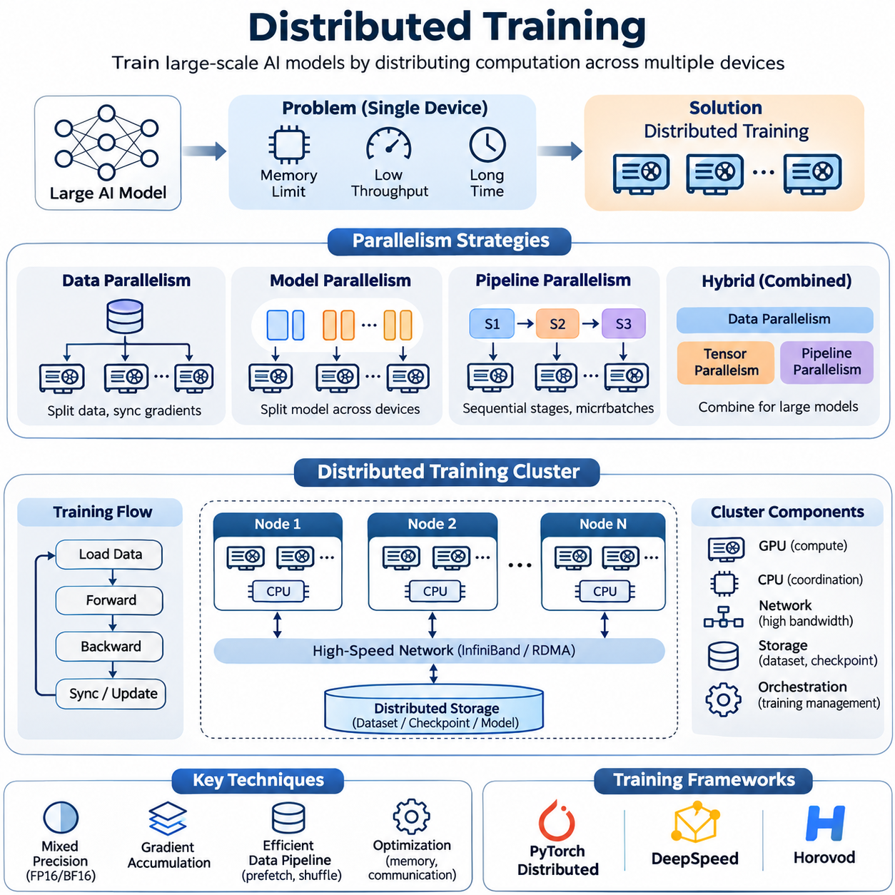
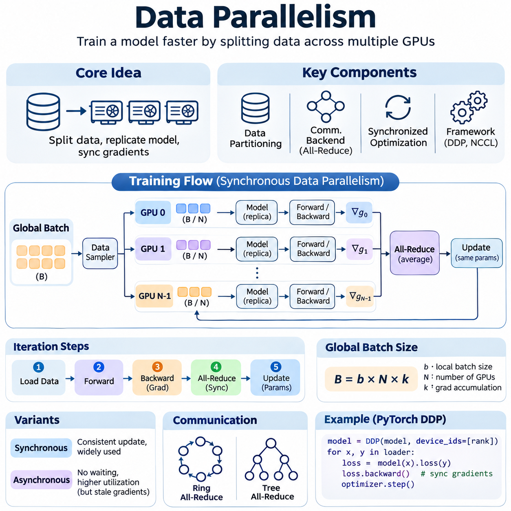
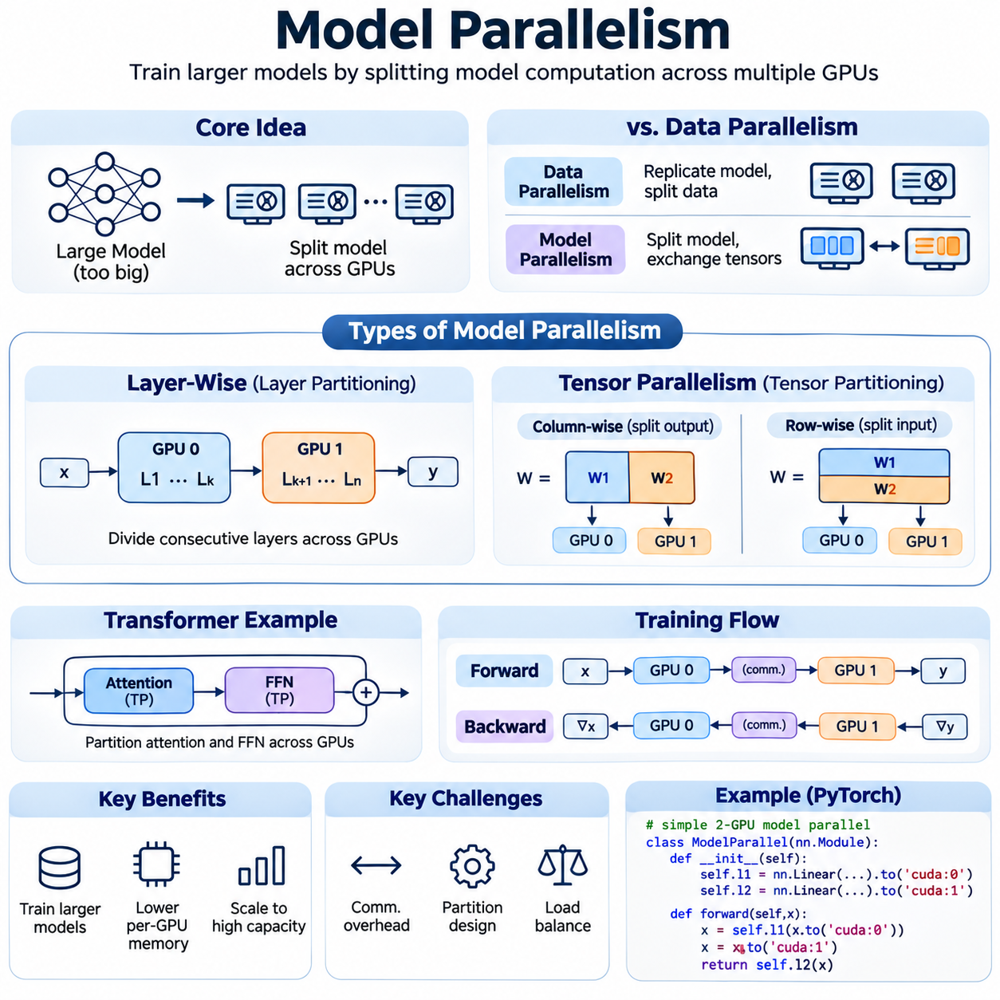
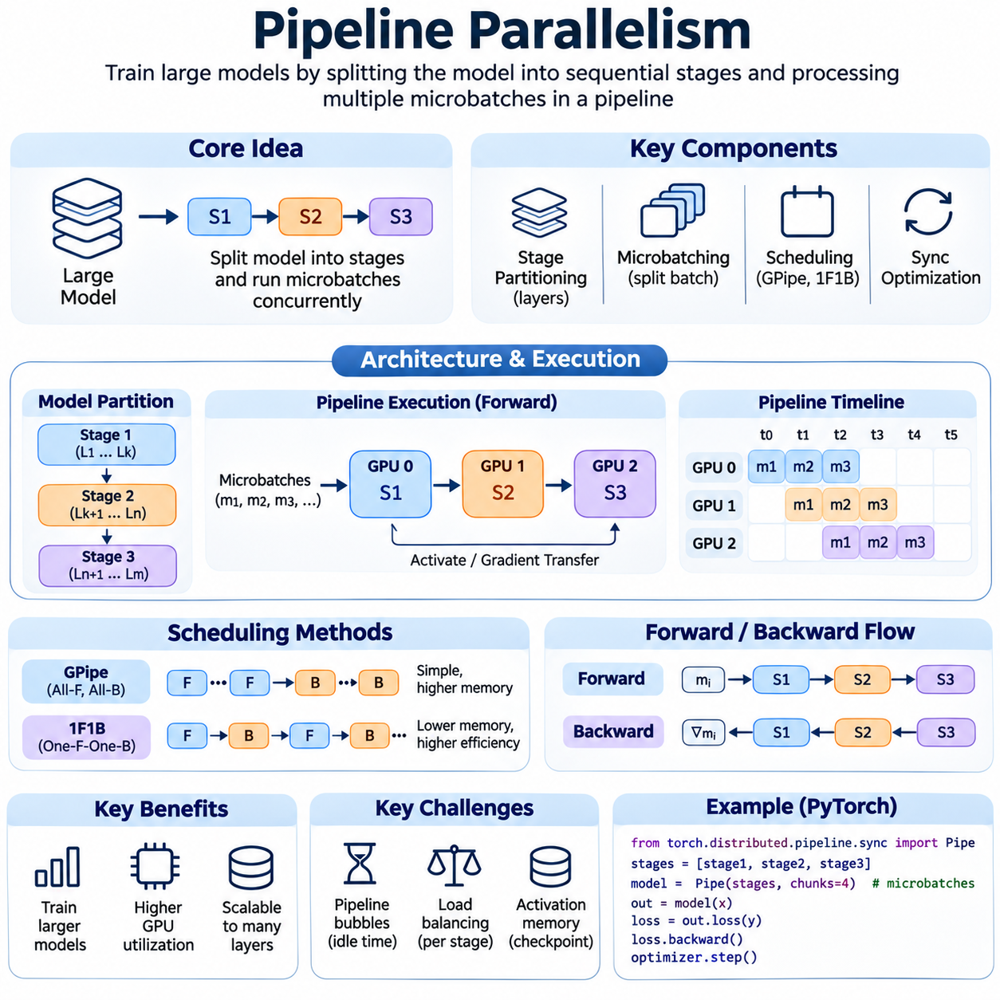
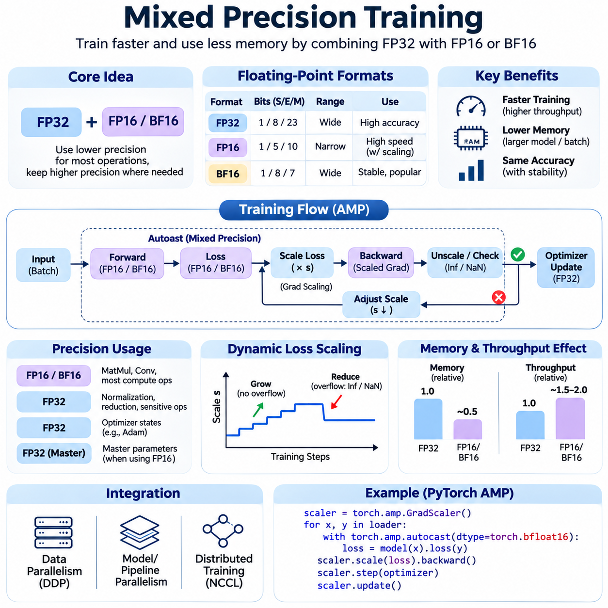
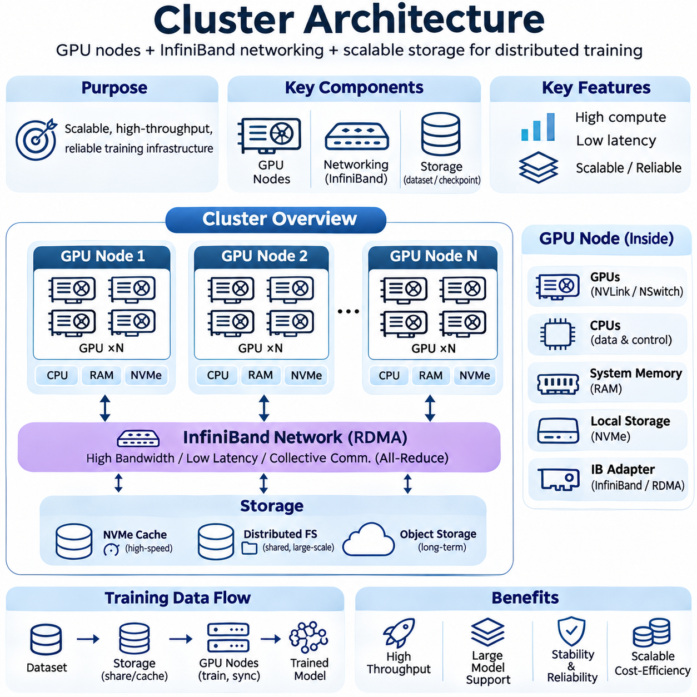
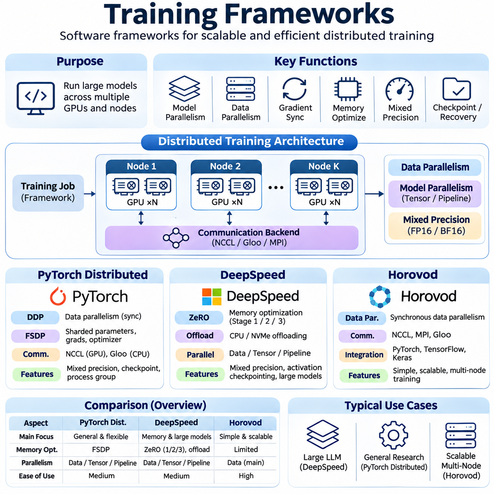
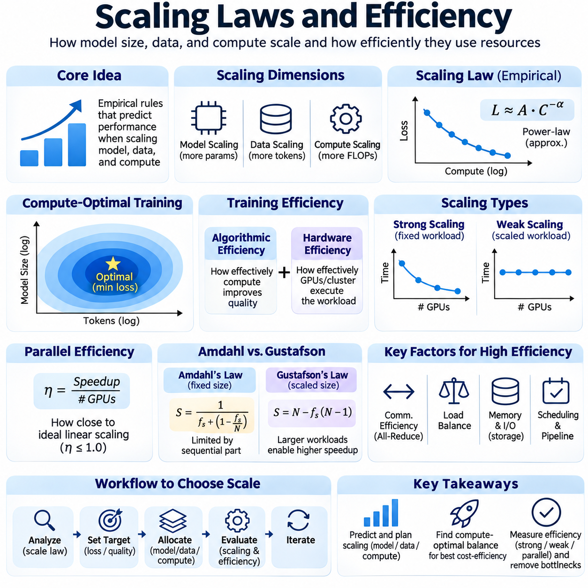
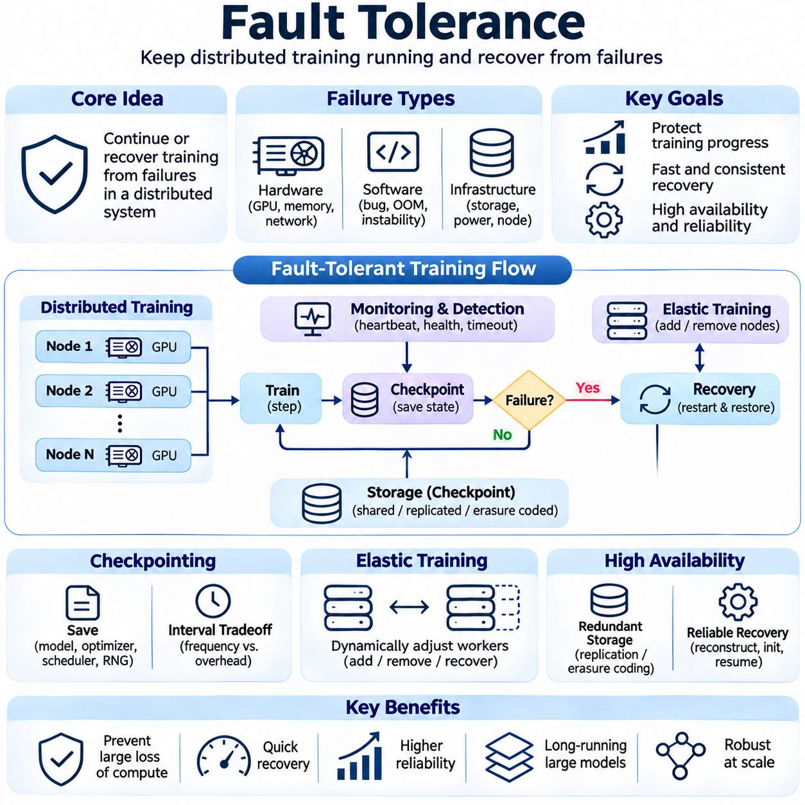
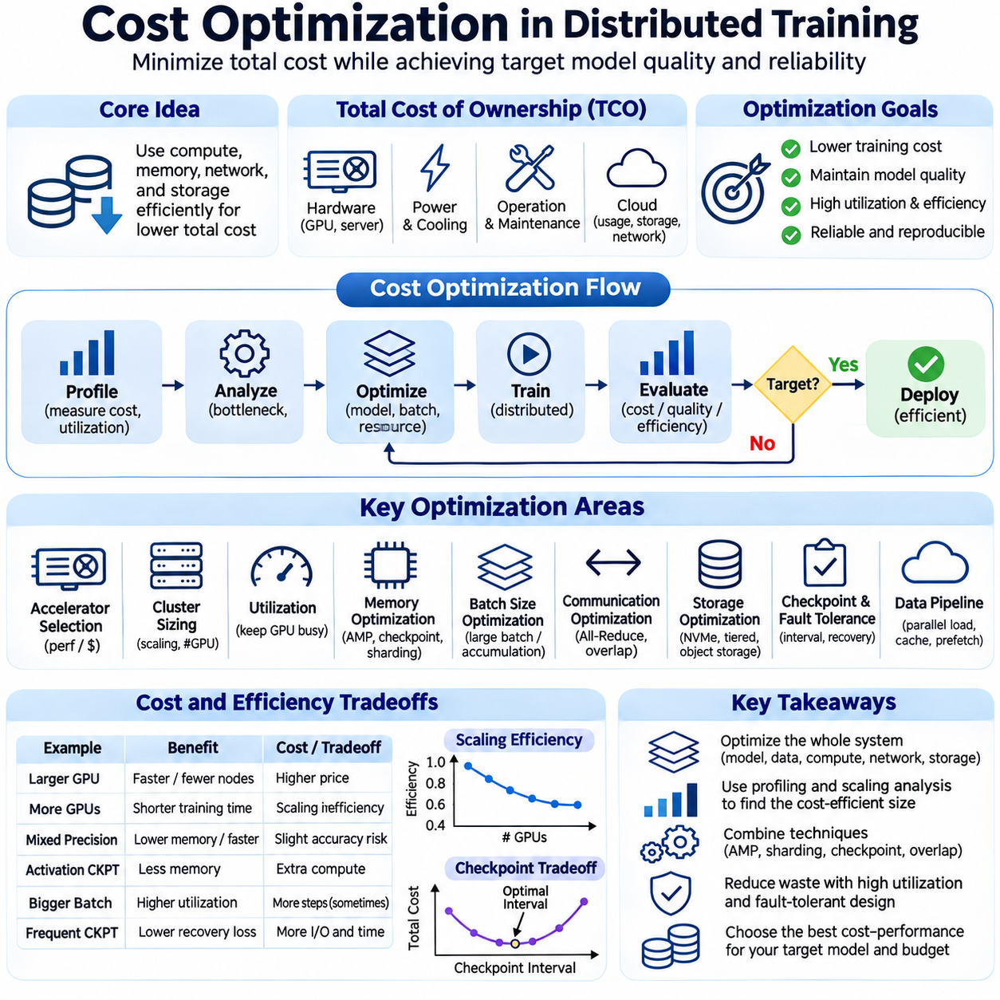

**Volume 38. AI Systems Architecture**

# 02. Distributed Training

## 02.00 Overview

{width="7.268055555555556in" height="7.268055555555556in"}

분산 학습(Distributed Training)은 여러 그래픽 처리 장치(GPU), 서버 또는 상호 연결된 컴퓨팅 클러스터(Computing Cluster)에 계산 작업을 분산하여 대규모 인공지능(Artificial Intelligence) 시스템을 개발하는 핵심 아키텍처 접근 방식이다. 신경망(Neural Network)의 매개변수(Parameter) 수, 데이터셋(Dataset) 크기, 계산 복잡도가 증가하면서 기존 단일 장치 학습은 메모리 용량, 처리량(Throughput), 실행 시간의 제약을 받게 된다. 분산 학습은 조정된 병렬 계산(Parallel Computation)을 통해 이러한 한계를 해결한다.

분산 학습의 주요 목적은 개별 가속기(Accelerator)의 계산 능력이나 메모리 용량을 초과하는 신경망을 학습하면서 모델 개발 속도를 높이는 것이다. 모든 학습 연산을 하나의 장치에서 실행하는 대신, 분산 시스템은 데이터, 모델 매개변수 또는 계산 단계를 여러 처리 장치에 분할한다. 이러한 장치들은 통신 프로토콜(Communication Protocol), 동기화 메커니즘(Synchronization Mechanism), 공유 최적화 절차를 통해 협력하며 일관된 학습 동작을 유지한다.

분산 학습 아키텍처(Distributed Training Architecture)는 계산 가속기, 호스트 프로세서(Host Processor), 통신 네트워크, 분산 저장소(Distributed Storage), 학습 오케스트레이션 소프트웨어(Training Orchestration Software) 등 상호 연결된 여러 구성 요소로 이루어진다. GPU는 집약적인 텐서 연산(Tensor Operation)을 수행하고, CPU는 데이터 로딩(Data Loading), 스케줄링(Scheduling), 시스템 관리를 조정한다. 고속 상호 연결망(High-Speed Interconnect)은 장치 간 기울기(Gradient), 활성화 값(Activation), 모델 매개변수를 전송하여 독립적인 계산 자원이 하나의 학습 환경으로 동작하도록 한다.

데이터 병렬화(Data Parallelism)는 가장 널리 사용되는 분산 학습 전략 중 하나이다. 각 GPU는 동일한 신경망 복제본(Model Replica)을 유지하면서 서로 다른 학습 데이터 부분집합(Subset)을 처리한다. 역전파(Backpropagation) 과정에서 각 장치는 할당된 샘플로부터 기울기를 계산한다. 이후 기울기를 동기화하고 집계하여 모든 모델 복제본이 일관된 매개변수 갱신(Parameter Update)을 수행하도록 하며, 동기식 미니배치 최적화(Synchronous Minibatch Optimization)의 수학적 동작을 유지한다.

데이터 병렬화의 효율성은 계산 작업량(Computational Workload)과 통신 오버헤드(Communication Overhead)의 관계에 따라 결정된다. GPU 수를 늘리면 고정된 데이터셋을 처리하는 시간을 줄일 수 있지만, 기울기 동기화(Gradient Synchronization)는 추가 지연을 발생시킨다. 통신 시간이 계산 시간과 비슷하거나 더 커지면 확장 효율성(Scaling Efficiency)이 저하된다. 따라서 분산 학습 시스템은 배치 크기(Batch Size), 기울기 누적(Gradient Accumulation), 네트워크 대역폭(Network Bandwidth), 동기화 빈도 사이의 균형을 유지해야 한다.

모델 병렬화(Model Parallelism)는 신경망 전체를 단일 가속기의 메모리에 저장할 수 없는 상황을 해결한다. 전체 모델을 복제하는 대신, 시스템은 서로 다른 매개변수, 계층(Layer) 또는 텐서 연산을 여러 장치에 분산한다. 각 가속기는 자신에게 할당된 모델 부분만 저장하고 계산한다. 필요한 경우 중간 활성화 값(Intermediate Activation)과 기울기가 장치 사이에서 이동하며, 이를 통해 개별 GPU의 메모리 한계를 초과하는 대규모 모델을 학습할 수 있다.

파이프라인 병렬화(Pipeline Parallelism)는 신경망을 순차적인 계산 단계(Computational Stage)로 나누어 모델 분할을 확장하는 방식이다. 서로 다른 GPU가 여러 마이크로배치(Microbatch)를 동시에 처리하면서 각기 다른 단계를 실행한다. 파이프라인이 정상 상태(Steady State)에 도달하면 여러 마이크로배치가 서로 다른 단계에서 동시에 처리될 수 있다. 이를 통해 가속기 활용률(Accelerator Utilization)을 높일 수 있지만, 파이프라인 버블(Pipeline Bubble), 작업량 불균형(Workload Imbalance), 단계 간 통신은 이론적인 성능 향상을 감소시킬 수 있다.

현대의 대규모 학습은 데이터 병렬화(Data Parallelism), 텐서 병렬화(Tensor Parallelism), 파이프라인 병렬화(Pipeline Parallelism)를 결합한 하이브리드 아키텍처(Hybrid Architecture)를 사용하는 경우가 많다. 데이터 병렬화는 학습 샘플을 분산하고, 텐서 병렬화는 개별 계층 내부의 연산을 분할하며, 파이프라인 병렬화는 순차적인 모델 실행을 여러 단계로 나눈다. 적절한 조합을 선택하려면 모델 구조, 매개변수 분포, 활성화 메모리(Activation Memory), GPU 토폴로지(Topology), 노드 간 통신 특성을 이해해야 한다.

혼합 정밀도 학습(Mixed Precision Training)은 분산 학습의 효율성을 향상시키는 또 다른 핵심 기술이다. FP16 또는 BF16과 같은 저정밀도 수치 형식(Lower-Precision Numerical Format)을 적절한 연산에 적용하면 메모리 사용량을 줄이고 호환되는 가속기에서 계산 처리량을 높일 수 있다. 수치 안정성(Numerical Stability)을 보호하기 위해 일부 연산은 더 높은 정밀도를 유지한다. 손실 스케일링(Loss Scaling), 정밀도 인식 최적화(Precision-Aware Optimization), 수치 모니터링(Numerical Monitoring)은 오버플로(Overflow), 언더플로(Underflow), 불안정한 기울기 갱신을 방지하는 데 도움을 준다.

분산 클러스터 아키텍처(Distributed Cluster Architecture)는 전체 학습 성능에 큰 영향을 미친다. 일반적인 클러스터는 고대역폭 네트워크(High-Bandwidth Network)로 연결된 여러 GPU 노드(GPU Node)와 공유 또는 분산 저장소로 구성된다. 개별 노드 내부에서는 고속 GPU 상호 연결망을 통해 효율적인 장치 간 통신이 이루어진다. 노드 사이에서는 인피니밴드(InfiniBand)와 원격 직접 메모리 접근(RDMA) 같은 기술이 데이터 전송 오버헤드를 줄여 동기식 학습에서 빈번하게 발생하는 집합 통신(Collective Communication)을 지원한다.

저장소 아키텍처(Storage Architecture) 역시 중요하다. 학습 성능은 계산 가속기에 데이터를 지속적으로 공급할 수 있는 능력에 따라 달라지기 때문이다. 대규모 데이터셋은 객체 저장소(Object Storage), 분산 파일 시스템(Distributed File System), 공유 네트워크 저장소에 저장할 수 있으며, 로컬 NVMe 장치는 고속 캐싱(Caching)을 제공한다. 효율적인 데이터 파이프라인(Data Pipeline)은 사전 가져오기(Prefetching), 병렬 디코딩(Parallel Decoding), 셔플링(Shuffling), 비동기 전송(Asynchronous Transfer)을 수행한다. 저장소 처리량이 충분하지 않으면 고가의 GPU가 학습 데이터를 기다리면서 유휴 상태(Idle State)에 머물 수 있다.

분산 학습 프레임워크(Distributed Training Framework)는 통신, 프로세스 조정(Process Coordination), 매개변수 동기화를 관리하기 위한 추상화(Abstraction)를 제공한다. 파이토치 분산(PyTorch Distributed)은 집합 통신과 분산 데이터 병렬 실행을 지원하며, 딥스피드(DeepSpeed)는 메모리 최적화와 대규모 모델 학습 기능을 제공한다. 호로보드(Horovod)는 지원되는 기계학습 프레임워크에서 분산 학습 인터페이스를 제공한다. 이러한 시스템은 구현 복잡도를 줄이면서 성능 조정과 자원 관리를 위한 기능을 제공한다.

집합 통신 연산(Communication Collective)은 동기식 분산 최적화(Synchronous Distributed Optimization)의 기반을 형성한다. 전체 축약(All-Reduce), 축약 분산(Reduce-Scatter), 전체 수집(All-Gather), 브로드캐스트(Broadcast)와 같은 연산은 참여 프로세스 사이의 정보 교환을 조정한다. 전체 축약은 데이터 병렬 작업자(Worker) 사이의 기울기를 집계하는 데 일반적으로 사용되며, 다른 집합 연산은 매개변수 샤딩(Parameter Sharding)과 텐서 분할을 지원한다. 이러한 연산의 효율성은 메시지 크기, 통신 토폴로지, 네트워크 혼잡, 집합 통신 알고리즘에 따라 달라진다.

스케일링 법칙(Scaling Laws)은 매개변수 수, 학습 데이터, 계산 예산이 증가함에 따라 모델 성능과 계산 요구사항이 어떻게 변화하는지 설명한다. 그러나 하드웨어 확장 효율성(Hardware Scaling Efficiency)은 통계적 학습 성능(Statistical Learning Performance)과 별도로 평가해야 한다. 가속기를 추가한다고 해서 학습 시간이 비례적으로 감소하는 것은 아니다. 동기화, 메모리 접근, 데이터 로딩, 순차적 의존성(Sequential Dependency)이 오버헤드를 발생시키기 때문이다. 강한 확장(Strong Scaling)과 약한 확장(Weak Scaling) 실험은 서로 다른 시스템 특성을 보여준다.

학습 효율성(Training Efficiency)은 처리량(Throughput), 가속기 활용률, 학습 단계 지연(Step Latency), 확장 효율성, 수렴 시간(Time to Convergence)을 통해 평가할 수 있다. 초당 샘플 수(Samples per Second) 또는 초당 토큰 수(Tokens per Second)는 처리 능력을 측정하며, 모델 부동소수점 연산 활용률(Model FLOPs Utilization)은 이론적인 하드웨어 계산 능력이 얼마나 효과적으로 사용되는지를 추정한다. 수렴 시간은 목표 모델 품질에 도달하는 데 필요한 실제 시간을 나타낸다. 최대 하드웨어 처리량이 반드시 가장 빠른 유효 학습 결과를 의미하지는 않으므로 이러한 지표를 함께 평가해야 한다.

분산 학습이 수백 또는 수천 개의 가속기로 확장되면서 결함 허용성(Fault Tolerance)은 더욱 중요해진다. 클러스터 규모와 실행 시간이 증가하면 하드웨어 고장, 통신 중단, 소프트웨어 예외(Software Exception)가 발생할 가능성도 일반적으로 높아진다. 체크포인팅(Checkpointing)은 모델 매개변수, 옵티마이저 상태(Optimizer State), 스케줄러 정보(Scheduler Information), 학습 진행 상태를 보존한다. 복구 메커니즘(Recovery Mechanism)은 장애 발생 후 일관된 실행 상태를 복원하여 이미 수행한 계산의 손실을 제한한다.

안정적인 체크포인트 관리(Checkpoint Management)는 복구 능력과 저장소 및 동기화 오버헤드 사이의 균형을 필요로 한다. 체크포인트를 자주 저장하면 재계산(Recomputation) 가능성을 줄일 수 있지만, 대역폭과 저장 용량, 처리 시간을 소비한다. 비동기 체크포인팅(Asynchronous Checkpointing), 분산 상태 분할(Distributed State Partitioning), 증분 저장(Incremental Persistence)은 적절한 조건에서 이러한 비용을 줄일 수 있다. 효과적인 복구 절차는 데이터 샘플링 진행 상태와 분산 일관성(Distributed Consistency)도 유지하여 의도하지 않은 최적화 동작의 변화를 방지해야 한다.

비용 최적화(Cost Optimization)는 분산 학습이 상당한 계산, 네트워크, 저장소, 전력 자원을 소비하기 때문에 핵심적인 고려 사항이다. GPU 임대료나 하드웨어 구매 비용은 전체 지출의 일부에 불과하다. 네트워크 인프라, 저장소 작업, 전력 소비, 냉각, 엔지니어링 작업, 실패한 학습 실행도 비용에 포함된다. 따라서 경제적 효율성(Economic Efficiency)은 단순한 가속기 가격보다 완료된 학습 목표당 비용(Cost per Completed Training Objective)을 기준으로 평가하는 것이 적절하다.

자원 스케줄링(Resource Scheduling)과 작업 배치(Workload Placement)는 학습 경제성에 상당한 영향을 미칠 수 있다. 빈번하게 통신하는 작업은 고대역폭 및 저지연 상호 연결망으로 연결된 GPU에서 유리하며, 결합도가 낮은 작업(Loosely Coupled Workload)은 상대적으로 큰 네트워크 거리도 허용할 수 있다. 클러스터 스케줄러(Cluster Scheduler)는 가속기 가용성, 메모리 요구사항, 네트워크 토폴로지, 작업 우선순위를 고려해야 한다. 전체 계산 자원이 충분하더라도 부적절한 작업 배치는 통신 병목현상(Communication Bottleneck)을 발생시킬 수 있다.

분산 학습은 재현성(Reproducibility), 수치적 일관성(Numerical Consistency), 디버깅(Debugging)과 관련된 문제도 발생시킨다. 연산 순서, 부동소수점 축약(Floating-Point Reduction), 난수 생성(Random Number Generation), 비동기 실행의 차이는 학습 실행 사이에 변동을 일으킬 수 있다. 재현 가능한 실험을 위해서는 통제된 소프트웨어 환경, 문서화된 설정, 실용적인 범위에서의 결정론적 절차(Deterministic Procedure), 일관된 데이터 분할이 필요하다. 분산 로깅(Distributed Logging)과 프로파일링(Profiling)은 로컬 환경에서 재현하기 어려운 장애를 식별하는 데 도움을 준다.

관측 가능성(Observability)은 분산 학습 시스템을 안정적으로 운영하기 위한 필수 요소이다. 엔지니어는 모든 참여 노드에서 GPU 활용률, 메모리 할당, 통신 처리량, 네트워크 지연, 저장소 성능, 학습 지표를 모니터링해야 한다. 분산 추적(Distributed Tracing)과 프로파일링 도구는 동기화 지연, 파이프라인 정체(Pipeline Stall), 작업량 불균형을 파악한다. 인프라 측정값과 최적화 동작을 연관 분석하면 계산 비효율성과 모델 수렴 문제를 구분할 수 있다.

분산 학습의 아키텍처 원칙은 대규모 언어 모델(Large Language Model), 컴퓨터 비전(Computer Vision) 시스템, 멀티모달 기반 모델(Multimodal Foundation Model), 로보틱스 중심 학습 시스템(Robotics-Oriented Learning System)에 적용된다. 각 작업은 시퀀스 길이(Sequence Length), 이미지 해상도(Image Resolution), 시간적 구조(Temporal Structure), 학습 데이터 다양성 측면에서 서로 다른 요구사항을 가진다. 성공적인 구현을 위해서는 하나의 분산 아키텍처가 모든 모델에 최적이라고 가정하기보다 이러한 특성에 맞춰 병렬화 전략과 인프라 구성을 조정해야 한다.

궁극적으로 분산 학습(Distributed Training)은 단순히 기계학습 작업에 GPU를 추가하는 과정이 아니다. 이는 알고리즘 설계(Algorithm Design), 수치 계산(Numerical Computation), 병렬 실행(Parallel Execution), 통신 네트워크, 저장소 아키텍처, 신뢰성(Reliability), 경제적 최적화(Economic Optimization)를 포함하는 통합 시스템 엔지니어링(Systems Engineering) 분야이다. 잘 설계된 분산 학습 시스템은 모델 품질과 운영 안정성을 유지하면서 사용 가능한 계산 자원을 예측 가능하고 확장 가능하며 비용 효율적인 학습 능력으로 전환한다.

## 02.01 Data Parallelism [w/Code]

{width="7.268055555555556in" height="7.268055555555556in"}

데이터 병렬화(Data Parallelism)는 학습 데이터를 여러 컴퓨팅 장치(Computing Device)에 분산하여 신경망 최적화(Neural Network Optimization)를 가속하는 핵심 분산 학습(Distributed Training) 전략이다. 각 GPU는 모델의 완전한 복제본(Model Replica)을 유지하면서 데이터셋(Dataset)의 서로 다른 부분집합(Subset)을 처리한다. 이러한 장치들은 기울기 동기화(Gradient Synchronization)를 통해 공유 모델 매개변수(Model Parameter)를 공동으로 최적화하며, 모델 구조 자체를 분할하지 않고도 학습 처리량(Training Throughput)을 증가시킨다.

데이터 병렬화의 핵심 원리는 일관된 모델 갱신(Model Update)을 유지하면서 계산 작업량(Computational Workload)을 분산하는 것이다. 각 학습 반복(Training Iteration)에서 전역 배치(Global Batch)는 개별 작업자(Worker)에 할당되는 작은 로컬 배치(Local Batch)로 나뉜다. 모든 작업자는 순전파(Forward Propagation)를 수행하고 손실 함수(Loss Function)를 계산한 다음 역전파(Backpropagation)를 독립적으로 실행한다. 이후 생성된 기울기를 집계한 다음 옵티마이저(Optimizer)가 모델 매개변수를 갱신한다.

일반적인 데이터 병렬 아키텍처(Data-Parallel Architecture)는 여러 GPU 작업자(GPU Worker), 분산 통신 백엔드(Distributed Communication Backend), 데이터 분할 메커니즘(Data Partitioning Mechanism), 동기화된 최적화 절차(Synchronized Optimization Procedure)로 구성된다. 각 작업자는 학습 시작 시 동일한 모델 매개변수를 저장하고 같은 계산 그래프(Computational Graph)를 실행한다. 작업자마다 입력 샘플은 다르지만, 기울기 동기화를 통해 각 최적화 단계가 성공적으로 완료된 후 모델 복제본의 일관성이 유지된다.

데이터 분할(Data Partitioning)은 학습 샘플을 참여 장치에 어떻게 분배할 것인지 결정한다. 분산 샘플러(Distributed Sampler)는 데이터셋을 거의 동일한 크기의 부분집합으로 나누어 각 작업자가 에포크(Epoch) 동안 서로 다른 데이터를 처리하도록 한다. 무작위 셔플링(Random Shuffling)은 통계적 다양성(Statistical Diversity)을 높이며, 조정된 샘플링(Coordinated Sampling)은 의도하지 않은 데이터 중복이나 누락을 방지한다. 데이터셋 크기가 전체 작업자 수로 나누어떨어지지 않는 경우에는 불완전 배치(Incomplete Batch)를 신중하게 처리해야 한다.

전역 배치 크기(Global Batch Size)는 로컬 배치 크기(Local Batch Size), 참여 작업자 수(Number of Workers), 기울기 누적 단계 수(Gradient Accumulation Steps)에 따라 결정된다. 동기식 학습(Synchronous Training)에서 로컬 배치 크기가 동일하다면 유효 전역 배치 크기(Effective Global Batch Size)는 이 세 값의 곱과 같다. 이 값을 증가시키면 병렬 작업 처리 능력이 향상되지만, 최적화 동역학(Optimization Dynamics), 기울기 분산(Gradient Variance), 일반화 성능(Generalization Performance)이 달라질 수 있으므로 학습률(Learning Rate)과 학습 일정(Training Schedule)을 조정해야 할 수 있다.

순전파(Forward Propagation)는 각 GPU에 할당된 입력 배치(Input Batch)를 사용하여 독립적으로 수행된다. 모델은 예측값(Prediction)을 생성하고 중간 활성화 값(Intermediate Activation)을 계산하며 로컬 학습 샘플에 대한 손실(Loss)을 평가한다. 각 작업자는 동일한 신경망 구조(Network Architecture)를 유지하므로 입력 데이터의 차이를 제외하면 계산 연산은 동일하다. 이러한 독립성 덕분에 학습 반복 과정의 상당 부분을 여러 장치에서 동시에 실행할 수 있다.

역전파(Backpropagation) 과정에서 모든 작업자는 모델 매개변수에 대한 손실 함수의 기울기(Gradient)를 계산한다. 이러한 로컬 기울기(Local Gradient)는 전체 전역 배치가 아니라 각 작업자에 할당된 샘플에서 얻은 정보를 나타낸다. 의도한 전역 미니배치 기울기(Global Minibatch Gradient)를 재현하기 위해 분산 시스템은 배치 크기와 손실 정규화(Loss Normalization)의 차이를 고려한 적절한 가중 집계 규칙(Weighted Aggregation Rule)을 사용하여 로컬 기여도를 결합한다.

기울기 동기화(Gradient Synchronization)는 일반적으로 전체 축약(All-Reduce) 집합 통신 연산(Collective Communication Operation)을 통해 구현된다. 각 작업자는 자신의 로컬 기울기 텐서(Gradient Tensor)를 제공하며, 통신 백엔드(Communication Backend)는 참여 프로세스 전체에서 이를 집계한다. 집계된 결과는 모든 작업자에게 분배되어 동일한 옵티마이저 갱신(Optimizer Update)을 가능하게 한다. 로컬 기울기가 동일한 크기의 배치 평균을 나타내는 경우, 이를 평균하면 해당 전역 배치의 평균 기울기가 생성된다.

전체 축약(All-Reduce)의 효율성은 통신 알고리즘(Communication Algorithm), 메시지 크기(Message Size), 네트워크 토폴로지(Network Topology), 사용 가능한 대역폭(Bandwidth)에 따라 달라진다. 링 기반 알고리즘(Ring-Based Algorithm)은 작업자 사이에 통신을 분산하며, 트리 기반 방식(Tree-Based Approach)은 적절한 조건에서 통신 지연을 줄일 수 있다. 현대적인 구현에서는 텐서 크기와 하드웨어 특성에 따라 서로 다른 알고리즘을 동적으로 선택하여 의도한 수치 계산을 변경하지 않으면서 동기화 오버헤드(Synchronization Overhead)를 최소화한다.

동기식 데이터 병렬화(Synchronous Data Parallelism)는 각 최적화 단계(Optimization Step)를 완료하기 전에 참여 작업자들이 서로 조정하도록 요구한다. 이 방식은 일관된 매개변수 갱신(Parameter Update)과 예측 가능한 최적화 의미론(Optimization Semantics)을 제공하지만, 전체 진행 속도는 가장 느린 작업자에 의해 제한될 수 있다. 하드웨어 자원 경합(Resource Contention), 불균형한 데이터 로딩(Data Loading), 네트워크 지연(Network Delay)은 지연 작업자(Straggler)를 발생시켜 반복 실행 시간을 증가시킨다. 따라서 확장 가능한 실행을 위해서는 균형 잡힌 작업량과 효율적인 통신이 필수적이다.

비동기식 데이터 병렬화(Asynchronous Data Parallelism)는 모든 작업자의 완전한 동기화를 기다리지 않고 공유 매개변수를 갱신할 수 있도록 한다. 이 방식은 이기종 환경(Heterogeneous Environment)에서 자원 활용률(Resource Utilization)을 높일 수 있지만, 작업자가 오래된 모델 매개변수를 사용하여 기울기를 계산할 수 있다. 이러한 지연 기울기(Stale Gradient)는 최적화 불일치(Optimization Inconsistency)를 유발하고 수렴(Convergence)을 복잡하게 만들 수 있다. 따라서 긴밀하게 연결된 GPU 클러스터에서는 일반적으로 동기식 실행이 선호되며, 비동기식 방식은 특정 분산 환경에서 유용하게 사용된다.

파이토치 분산 데이터 병렬(PyTorch Distributed Data Parallel)은 동기식 데이터 병렬화를 실용적으로 구현한 기술이다. 일반적으로 각 프로세스(Process)는 하나의 GPU를 제어하며 자체 모델 복제본(Model Replica), 옵티마이저(Optimizer), 데이터 로더(Data Loader)를 유지한다. 분산 데이터 병렬(DistributedDataParallel, DDP)은 역전파 실행 중 기울기 동기화를 자동으로 조정한다. NCCL 백엔드(NCCL Backend)는 엔비디아(NVIDIA) GPU 통신에 널리 사용되며, 분산 프로세스 그룹(Distributed Process Group)은 작업자 사이의 통신 관계를 설정한다.

효율적인 구현에서는 의존성(Dependency)이 허용하는 범위에서 기울기 통신(Gradient Communication)과 역전파 계산(Backward Computation)을 중첩한다. 기울기는 통신 버킷(Communication Bucket)으로 구성되며, 전체 역전파가 완료되기 전에 동기화를 시작할 수 있다. 이러한 중첩 실행(Overlapping Execution)은 외부로 드러나는 통신 지연을 줄이고 가속기 활용률(Accelerator Utilization)을 향상시킨다. 그러나 버킷 구성(Bucket Configuration), 매개변수 실행 순서(Parameter Execution Order), 네트워크 성능이 최적화 효과에 영향을 미친다.

기울기 누적(Gradient Accumulation)은 GPU 메모리에 동시에 저장되는 샘플 수를 늘리지 않고도 더 큰 유효 배치 크기(Effective Batch Size)를 사용할 수 있도록 한다. 각 작업자는 여러 마이크로배치(Microbatch)를 처리하고 동기화 및 매개변수 갱신 전에 기울기를 누적한다. 프레임워크 메커니즘(Framework Mechanism)은 중간 누적 단계에서 불필요한 동기화를 억제할 수 있다. 의도한 최적화 동작을 유지하려면 올바른 손실 스케일링(Loss Scaling)과 누적 일정(Accumulation Scheduling)이 필요하다.

혼합 정밀도 학습(Mixed Precision Training)은 메모리 사용량을 줄이고 적절한 텐서 연산을 가속하여 데이터 병렬화를 보완한다. FP16과 BF16 형식은 지원되는 GPU에서 처리량(Throughput)을 향상시킬 수 있으며, 일부 계산은 수치 안정성(Numerical Stability)을 위해 더 높은 정밀도를 유지한다. FP16 학습에서는 언더플로(Underflow)를 방지하기 위해 기울기 스케일링(Gradient Scaling)이 필요할 수 있다. 분산 구현에서는 모델 복제본의 일관성을 유지하기 위해 비유한 기울기 탐지(Nonfinite-Gradient Detection)와 생략된 옵티마이저 단계(Skipped Optimizer Step)도 조정해야 한다.

확장 효율성(Scaling Efficiency)은 GPU를 추가했을 때 학습 시간이 얼마나 효과적으로 감소하거나 처리량이 증가하는지를 나타낸다. 이상적인 강한 확장(Strong Scaling)은 고정된 작업량의 실행 시간을 작업자 수에 비례하여 감소시킨다. 실제로는 통신, 동기화, 데이터 로딩, 고정 실행 오버헤드(Fixed Execution Overhead)가 가속 성능을 제한한다. 반면 약한 확장(Weak Scaling)은 계산 자원과 함께 작업량을 증가시키면서 성능을 평가하여 서로 다른 아키텍처 병목현상(Architectural Bottleneck)을 파악한다.

통신 오버헤드(Communication Overhead)는 모델에 많은 매개변수가 포함되어 있거나 로컬 배치 크기가 작은 경우 특히 중요해진다. 빈번한 기울기 동기화는 상당한 네트워크 대역폭(Network Bandwidth)을 소비하고 실제 계산에 사용되는 시간의 비율을 감소시킬 수 있다. 동기화 단계당 로컬 계산량을 늘리고, 통신을 중첩하며, 집합 통신 연산(Collective Operation)을 최적화하면 효율성을 높일 수 있다. 다만 배치 크기를 늘리는 경우에는 그에 맞는 최적화 조정이 필요할 수 있다.

분산 데이터 파이프라인(Distributed Data Pipeline)은 모든 GPU가 지속적으로 작업할 수 있도록 충분한 속도로 학습 샘플을 공급해야 한다. 병렬 데이터 로딩(Parallel Data Loading), 고정 호스트 메모리(Pinned Host Memory), 비동기 전송(Asynchronous Transfer), 로컬 데이터셋 캐싱(Local Dataset Caching)은 입력 병목현상(Input Bottleneck)을 줄인다. 저장소 처리량(Storage Throughput)과 전처리 성능(Preprocessing Performance)은 작업자 수에 맞춰 확장되어야 한다. 조정된 파이프라인 설계가 없다면 GPU를 추가해도 전체 학습 처리량이 향상되기보다 자원 경합이 증가할 수 있다.

결함 허용성(Fault Tolerance)은 하나의 동기식 작업자에서 발생한 장애가 전체 학습 작업을 중단시킬 수 있기 때문에 필수적이다. 분산 체크포인트(Distributed Checkpoint)는 복구에 필요한 모델 매개변수, 옵티마이저 상태(Optimizer State), 학습 일정(Training Schedule), 진행 정보를 보존한다. 재시작 절차(Restart Procedure)는 호환되는 프로세스 그룹(Process Group)과 일관된 모델 상태(Model State)를 복원해야 한다. 탄력적 학습(Elastic Training)은 작업자 수의 변화를 수용할 수 있지만, 전역 배치 크기와 데이터 분할의 변화는 신중하게 관리해야 한다.

재현성(Reproducibility)을 확보하려면 난수 시드(Random Seed), 데이터 셔플링(Data Shuffling), 수치 정밀도(Numerical Precision), 분산 실행 설정(Distributed Execution Setting)을 제어해야 한다. 부동소수점 축약 순서(Floating-Point Reduction Order)는 통신 알고리즘에 따라 달라질 수 있으며, 실행 사이에 작은 수치적 차이를 발생시킬 수 있다. 분산 샘플러(Distributed Sampler) 역시 에포크 사이에서 일관되게 진행되어야 한다. 소프트웨어 버전, 하드웨어 구성, 배치 매개변수, 체크포인트 메타데이터(Checkpoint Metadata)를 기록하면 연구자가 결과를 재현하고 예상하지 못한 학습 동작을 진단하는 데 도움이 된다.

성능 평가(Performance Evaluation)에서는 초당 샘플 수(Samples per Second), 학습 단계 실행 시간(Training Step Duration), GPU 활용률(GPU Utilization), 통신 시간(Communication Time), 메모리 사용량(Memory Consumption), 확장 효율성(Scaling Efficiency)을 고려해야 한다. 높은 처리량이 반드시 더 나은 학습 결과를 의미하지 않으므로 모델 수렴(Model Convergence)과 검증 품질(Validation Quality)도 중요하다. 목표 정확도 도달 시간(Time to Target Accuracy)은 서로 다른 분산 구성에서 계산 성능과 최적화 효과를 함께 평가할 수 있는 유용한 지표이다.

데이터 병렬화(Data Parallelism)는 이미지 분류(Image Classification), 객체 탐지(Object Detection), 언어 모델링(Language Modeling), 멀티모달 학습(Multimodal Learning), 로보틱스 인지 시스템(Robotics Perception System)에 널리 적용된다. 전체 모델이 각 GPU의 메모리에 저장될 수 있고 학습 데이터셋이 충분한 병렬 작업량을 제공하는 경우 특히 효과적이다. 개별 가속기의 메모리 용량을 초과하는 모델에서는 데이터 병렬화를 매개변수 샤딩(Parameter Sharding), 텐서 병렬화(Tensor Parallelism), 파이프라인 병렬화(Pipeline Parallelism)와 결합할 수 있다.

궁극적으로 성공적인 데이터 병렬화(Data Parallelism)는 단순히 입력 샘플을 사용 가능한 GPU에 분산하는 것 이상의 작업을 요구한다. 조정된 최적화(Coordinated Optimization), 효율적인 기울기 통신(Gradient Communication), 균형 잡힌 데이터 파이프라인(Data Pipeline), 안정적인 동기화(Synchronization), 신중한 성능 측정(Performance Measurement)이 필요하다. 이러한 요소를 통합적으로 설계하면 데이터 병렬화는 일관된 학습 동작과 실질적인 운영 효율성(Operational Efficiency)을 유지하면서 신경망 학습을 가속하는 확장 가능한 기반을 제공한다.

## 02.02 Model Parallelism [w/Code]

{width="7.268055555555556in" height="7.268055555555556in"}

모델 병렬화(Model Parallelism)는 개별 가속기(Accelerator)의 메모리 및 계산 용량을 초과하는 신경망(Neural Network)을 학습할 수 있도록 하는 분산 학습(Distributed Training) 전략이다. 모든 GPU에 전체 모델을 복제하는 대신, 모델 병렬화는 모델 구성 요소(Model Component)를 여러 장치에 분할한다. 각 장치는 할당된 신경망 부분을 저장하고 처리하며, 조정된 계산과 통신을 통해 대규모 모델 아키텍처(Large-Scale Model Architecture)를 실행할 수 있도록 한다.

모델 병렬화의 근본적인 목적은 원래 신경망의 수학적 동작(Mathematical Behavior)을 유지하면서 모델 매개변수(Model Parameter), 중간 활성화 값(Intermediate Activation), 계산 연산(Computational Operation)을 분산하는 것이다. 이러한 접근 방식은 모델 가중치(Model Weight), 기울기(Gradient), 옵티마이저 상태(Optimizer State), 활성화 텐서(Activation Tensor)를 단일 GPU 메모리에 저장할 수 없는 경우 필수적이다. 효과적인 분할은 여러 가속기를 하나의 조정된 계산 환경(Coordinated Computational Environment)으로 통합한다.

모델 병렬화는 계산 자원(Computational Resource)을 할당하는 방식에서 데이터 병렬화(Data Parallelism)와 근본적으로 다르다. 데이터 병렬화는 전체 모델을 복제하면서 학습 샘플(Training Sample)을 여러 작업자(Worker)에 분산한다. 반면 모델 병렬화는 모델 자체를 분산하므로 순전파(Forward Propagation)와 역전파(Backward Propagation) 과정에서 장치 간 중간 결과(Intermediate Result)를 교환해야 한다. 이러한 통신 의존성(Communication Dependency)은 모델 분할을 더욱 복잡하게 만들지만, 개별 장치의 메모리 한계를 초과하는 모델 학습을 가능하게 한다.

모델 병렬 아키텍처(Model-Parallel Architecture)는 일반적으로 고대역폭 통신 연결(High-Bandwidth Communication Link)로 연결된 여러 GPU로 구성된다. 모델 계층(Model Layer), 텐서 차원(Tensor Dimension), 계산 연산자(Computational Operator)는 메모리 용량과 처리 요구사항에 따라 특정 장치에 할당된다. 실행 중 각 장치는 자신에게 할당된 연산을 수행하고 필요한 텐서를 다른 장치와 교환한다. 효율적인 스케줄링(Scheduling)은 유휴 시간(Idle Period)과 통신 지연(Communication Delay)을 최소화한다.

계층별 모델 병렬화(Layer-Wise Model Parallelism)는 신경망을 연속적인 계층 그룹으로 나누어 서로 다른 가속기에 할당한다. 순전파 과정에서는 하나의 분할 영역(Partition)에서 생성된 활성화 값이 다음 분할 영역으로 전송된다. 역전파 과정에서는 기울기가 신경망을 따라 역방향으로 전달되면서 통신 방향도 반대로 바뀐다. 이 방식은 개념적으로 단순하지만, 추가적인 스케줄링 기술이 없다면 순차 실행(Sequential Execution)으로 인해 여러 장치가 유휴 상태로 남을 수 있다.

텐서 병렬화(Tensor Parallelism)는 개별 신경망 계층 내부의 계산 연산을 분할한다. 대규모 가중치 행렬(Weight Matrix)은 선택된 차원을 따라 여러 GPU에 분할될 수 있으며, 이를 통해 여러 가속기가 하나의 행렬 곱셈(Matrix Multiplication)에 참여할 수 있다. 각 장치는 부분 결과(Partial Result)를 계산하고, 필요한 경우 통신 연산을 통해 이를 결합한다. 이 방식은 대규모 어텐션(Attention) 및 피드포워드(Feedforward) 계산을 포함하는 트랜스포머(Transformer) 계층에서 특히 유용하다.

열 방향 분할(Column-Wise Partitioning)은 가중치 행렬을 출력 차원(Output Dimension)을 따라 분할하여 각 GPU가 출력 특징(Output Feature)의 일부를 계산하도록 한다. 행 방향 분할(Row-Wise Partitioning)은 입력 차원(Input Dimension)을 따라 행렬을 분할하며, 부분 출력(Partial Output)을 적절하게 결합해야 한다. 이러한 방식은 연속된 연산 사이에서 불필요한 통신을 줄이도록 구성할 수 있다. 올바른 구현을 위해서는 텐서 형태(Tensor Shape), 수학적 동등성(Mathematical Equivalence), 기울기 전파(Gradient Propagation)를 유지해야 한다.

트랜스포머 아키텍처(Transformer Architecture)는 계산의 대부분이 구조화된 행렬 연산(Structured Matrix Operation)으로 이루어지므로 텐서 병렬화에 특히 적합하다. 어텐션 투영(Attention Projection), 다중 헤드 어텐션(Multi-Head Attention), 피드포워드 계층(Feedforward Layer)은 여러 가속기에 분할할 수 있다. 어텐션 헤드(Attention Head)를 GPU에 분산하거나 큰 중간 특징 차원(Intermediate Feature Dimension)을 텐서 분할 영역에 나누어 배치할 수 있다. 여러 분할 영역의 정보가 필요한 연산에서는 여전히 통신이 필요하다.

순전파(Forward Propagation) 과정에서 모델 병렬 작업자(Model-Parallel Worker)는 할당된 계산 사이의 의존성에 따라 활성화 값(Activation)을 교환한다. 텐서 병렬화는 부분 결과를 결합하기 위해 집합 통신(Collective Communication)이 필요할 수 있으며, 계층별 분할은 연속된 장치 사이에 중간 텐서(Intermediate Tensor)를 전송한다. 통신 패턴(Communication Pattern)은 분할 전략과 모델 아키텍처에 따라 달라진다. 과도한 데이터 전송은 계산 성능 향상을 상쇄하고 실질적인 가속기 활용률(Accelerator Utilization)을 감소시킬 수 있다.

역전파(Backward Propagation)는 순전파 실행 중 형성된 의존성을 따라 기울기를 전달해야 하므로 추가적인 통신 요구사항을 발생시킨다. 각 장치는 할당된 매개변수에 대한 기울기를 계산하고, 필요한 경우 활성화 기울기(Activation Gradient)를 이전 분할 영역으로 전송한다. 텐서 병렬 연산에서는 기울기 집계(Gradient Aggregation) 또는 재분배(Redistribution)가 필요할 수 있다. 올바른 기울기 흐름(Gradient Flow)을 유지하는 것은 최적화 목적(Optimization Objective)을 보존하고 일관된 학습 동작을 보장하는 데 필수적이다.

메모리 효율성(Memory Efficiency)은 모델 병렬화의 주요 장점이다. 모델 매개변수를 분할하면 각 GPU에 필요한 매개변수 저장 공간(Parameter Storage)이 줄어들어 단일 장치가 수용할 수 있는 크기를 훨씬 초과하는 신경망을 학습할 수 있다. 그러나 활성화 텐서(Activation Tensor), 임시 버퍼(Temporary Buffer), 통신 작업 공간(Communication Workspace), 옵티마이저 상태(Optimizer State)는 여전히 메모리를 소비한다. 효과적인 메모리 계획(Memory Planning)은 매개변수 크기뿐 아니라 최대 메모리 할당량(Peak Memory Allocation)도 고려해야 한다.

대규모 신경망을 학습할 때 옵티마이저 상태 관리(Optimizer State Management)는 더욱 중요해진다. 아담(Adam)과 같은 적응형 옵티마이저(Adaptive Optimizer)는 매개변수 통계(Parameter Statistics)를 나타내는 추가 텐서를 유지하므로 모델 가중치와 기울기 외에도 메모리가 필요하다. 모델 병렬화는 분할된 매개변수에 연결된 상태를 자연스럽게 분산하며, 보완 기술을 통해 옵티마이저 상태를 추가로 샤딩(Sharding)할 수 있다. 이러한 접근 방식은 장치별 메모리 부담을 줄이지만 추가적인 조정 요구사항을 발생시킨다.

통신 인프라(Communication Infrastructure)는 모델 병렬화 성능에 큰 영향을 미친다. NVLink와 NVSwitch 같은 고속 GPU 상호 연결 기술(GPU Interconnect)은 호환되는 시스템 내부에서 효율적인 통신을 제공하며, 인피니밴드(InfiniBand)는 노드 간 통신을 지원한다. 텐서 병렬화는 개별 계층 내부에서 동기화가 반복적으로 발생할 수 있으므로 저지연(Low Latency) 및 고대역폭(High Bandwidth) 연결의 이점이 크다. 부적절한 네트워크 토폴로지(Network Topology)는 달성 가능한 처리량(Throughput)을 크게 제한할 수 있다.

전체 축약(All-Reduce), 전체 수집(All-Gather), 축약 분산(Reduce-Scatter), 브로드캐스트(Broadcast)와 같은 집합 통신 연산(Collective Communication Operation)은 분산 텐서 계산(Distributed Tensor Computation)을 지원한다. 이러한 연산의 사용 방식은 모델 매개변수와 중간 텐서가 어떻게 분할되는지에 따라 달라진다. 전체 축약은 부분 기여도(Partial Contribution)를 결합하고, 전체 수집은 필요한 경우 분산된 텐서 조각(Tensor Segment)을 재구성한다. 적절한 집합 연산을 선택하고 중복 전송(Redundant Transfer)을 최소화하는 것은 효율적인 모델 병렬 실행에 필수적이다.

부하 균형(Load Balancing)은 계산 작업이 가속기 사이에 효과적으로 분산되는지를 결정한다. 불균등한 분할 크기(Partition Size), 이기종 계층 복잡도(Heterogeneous Layer Complexity), 메모리 요구사항의 차이로 인해 일부 GPU가 다른 GPU보다 먼저 작업을 완료할 수 있다. 빠른 장치는 느린 분할 영역을 기다리는 동안 유휴 상태에 머물 수 있다. 따라서 분할 계획(Partition Planning)은 단순히 매개변수를 동일하게 나누는 것이 아니라 실행 시간, 활성화 크기, 통신량, 사용 가능한 장치 메모리를 고려해야 한다.

모델 병렬화는 실행 동시성(Execution Concurrency)을 높이기 위해 파이프라인 병렬화(Pipeline Parallelism)와 결합할 수 있다. 파이프라인 병렬화는 모델 분할 영역을 순차적인 단계(Stage)로 구성하고 여러 마이크로배치(Microbatch)를 동시에 처리한다. 기본적인 계층별 분할은 단계를 순차적으로 실행할 수 있지만, 파이프라이닝(Pipelining)은 서로 다른 마이크로배치의 계산을 중첩한다. 이를 통해 유휴 시간을 줄이고 활용률을 높일 수 있지만, 파이프라인 버블(Pipeline Bubble)과 스케줄링 의존성(Scheduling Dependency)은 여전히 중요한 성능 고려사항이다.

하이브리드 병렬화(Hybrid Parallelism)는 모델 병렬화와 데이터 병렬화(Data Parallelism)를 결합하여 더 큰 가속기 클러스터로 학습을 확장한다. 모델 분할 영역은 GPU 그룹 내부에 분산되며, 여러 그룹은 서로 다른 학습 샘플을 처리한다. 텐서 병렬화는 고대역폭 통신 영역(High-Bandwidth Communication Domain) 내부에서 동작할 수 있고, 데이터 병렬화는 그룹 사이의 대응되는 매개변수를 동기화한다. 이러한 아키텍처는 대규모 모델을 지원하면서 전체 학습 처리량(Aggregate Training Throughput)을 증가시킨다.

혼합 정밀도 학습(Mixed Precision Training)은 적절한 텐서의 메모리 사용량(Memory Footprint)을 줄이고 지원되는 수학 연산을 가속하여 모델 병렬화를 보완한다. FP16과 BF16 계산은 호환되는 가속기에서 처리량을 향상시킬 수 있으며, 일부 연산은 수치 안정성(Numerical Stability)을 위해 더 높은 정밀도를 유지한다. 특히 장치 사이에서 활성화 값과 기울기를 교환하는 경우에는 분할 경계(Partition Boundary) 전체에서 일관된 정밀도 관리(Precision Management)를 유지해야 한다.

활성화 체크포인팅(Activation Checkpointing)은 모델 병렬 학습 중 메모리 소비를 줄이는 또 다른 메커니즘이다. 모든 중간 활성화 값을 저장하는 대신, 선택된 값을 역전파 과정에서 다시 계산한다. 이 방식은 추가 계산 비용(Computational Cost)을 감수하는 대신 메모리 사용량을 줄여 더 큰 모델이나 마이크로배치를 사용 가능한 자원에 저장할 수 있도록 한다. 체크포인트 배치(Checkpoint Placement)는 계산 비용, 통신 의존성, 최대 메모리 요구사항(Peak Memory Requirement)을 고려해야 한다.

파이토치 분산(PyTorch Distributed), 딥스피드(DeepSpeed), 메가트론-LM(Megatron-LM)과 같은 프레임워크(Framework)는 대규모 모델 병렬화를 구현하기 위한 메커니즘을 제공한다. 이러한 시스템은 분산 프로세스 조정(Distributed Process Coordination), 텐서 분할(Tensor Partitioning), 통신 관리(Communication Management), 메모리 최적화(Memory Optimization)를 지원한다. 지원되는 아키텍처와 병렬화 전략에 따라 기능이 다르므로 프레임워크 선택 시 모델 호환성(Model Compatibility), 하드웨어 토폴로지, 운영 복잡도, 성능 요구사항을 평가해야 한다.

모델 매개변수가 여러 장치에 분산되어 있기 때문에 결함 허용성(Fault Tolerance)을 확보하는 것은 어려운 과제이다. 하나의 분할 영역에서 발생한 장애가 전체 학습 과정을 중단시킬 수 있다. 분산 체크포인팅(Distributed Checkpointing)은 매개변수 샤드(Parameter Shard), 옵티마이저 상태(Optimizer State), 분할 메타데이터(Partition Metadata), 학습 진행 상태를 보존해야 한다. 복구 절차(Recovery Procedure)는 특히 하드웨어 가용성이나 클러스터 토폴로지가 변경되는 경우 호환되는 모델 분할을 재구성하고 일관된 실행 상태를 복원해야 한다.

성능 평가(Performance Evaluation)에서는 학습 처리량(Training Throughput), GPU 활용률(GPU Utilization), 최대 메모리 소비(Peak Memory Consumption), 통신 오버헤드(Communication Overhead), 확장 효율성(Scaling Efficiency)을 고려해야 한다. 모델 병렬화는 기존에 불가능했던 학습 작업을 가능하게 하지만 반드시 실행 시간을 줄이는 것은 아니다. 그 효과는 분할 품질(Partition Quality), 통신 대역폭, 계산 부하 균형(Computational Balance), 동기화 요구사항에 따라 달라진다. 성능 측정에서는 모델 용량(Model Capacity)의 증가와 계산 속도(Computational Speed)의 향상을 구분해야 한다.

모델 병렬화는 대규모 언어 모델(Large Language Model), 멀티모달 기반 모델(Multimodal Foundation Model), 과학 신경망(Scientific Neural Network), 대규모 매개변수 행렬(Parameter Matrix)을 포함하는 기타 아키텍처에서 특히 중요하다. 이 기술은 개별 GPU 용량을 초과하는 메모리 요구사항을 가진 시스템의 학습을 가능하게 하며 특화된 분할 전략을 지원한다. 그러나 하나의 가속기에 충분히 저장할 수 있는 작은 모델은 데이터 병렬화만으로 더 높은 효율성을 달성할 수 있다.

궁극적으로 성공적인 모델 병렬화(Model Parallelism)는 신경망 아키텍처(Neural Network Architecture), 텐서 분할(Tensor Partitioning), 메모리 할당(Memory Allocation), 통신 토폴로지(Communication Topology), 분산 최적화(Distributed Optimization)에 대한 조정된 의사결정을 필요로 한다. 그 효과는 계산 동시성(Computational Concurrency)과 통신 및 동기화 비용(Communication and Synchronization Cost) 사이의 균형에 따라 결정된다. 적절하게 설계된 모델 병렬화는 개별 가속기의 한계를 넘어 점점 더 복잡해지는 인공지능 시스템을 학습하기 위한 확장 가능한 기반을 제공한다.

## 02.03 Pipeline Parallelism [w/Code]

{width="7.268055555555556in" height="7.268055555555556in"}

파이프라인 병렬화(Pipeline Parallelism)는 신경망(Neural Network)을 여러 가속기(Accelerator)에서 실행되는 순차적인 계산 단계(Computational Stage)로 분할하는 분산 학습(Distributed Training) 전략이다. 전체 모델을 하나의 GPU에 할당하는 대신, 연속된 계층 그룹(Layer Group)을 여러 장치에 분산한다. 여러 마이크로배치(Microbatch)가 이러한 단계를 동시에 통과하면서 계산 중첩(Computation Overlap)과 하드웨어 활용률(Hardware Utilization)을 향상시키고, 개별 GPU의 메모리 용량을 초과하는 모델을 지원한다.

파이프라인 병렬화의 기본 원리는 순차적인 모델 실행(Sequential Model Execution)을 조정된 처리 파이프라인(Processing Pipeline)으로 변환하는 것이다. 각 가속기는 신경망의 특정 단계를 담당하며, 이전 단계에서 중간 활성화 값(Intermediate Activation)을 수신하고 다음 단계로 결과를 전송한다. 서로 다른 마이크로배치를 동시에 처리함으로써 기존의 계층별 모델 병렬화(Layer-Wise Model Parallelism)에서 발생하는 유휴 시간(Idle Time)을 줄일 수 있다.

파이프라인 구성(Pipeline Construction)은 계층 의존성(Layer Dependency), 메모리 요구사항(Memory Requirement), 실행 비용(Execution Cost)에 따라 신경망을 계산 단계로 분할하는 과정에서 시작된다. 하나의 단계에는 여러 트랜스포머 블록(Transformer Block), 합성곱 계층(Convolutional Layer) 또는 기타 계산 모듈(Computational Module)이 포함될 수 있다. 분할 전략(Partitioning Strategy)은 원래의 순전파 및 역전파 의존성을 유지하면서 작업을 효율적으로 분산해야 한다. 부적절한 분할은 전체 학습 처리량(Training Throughput)을 제한하는 병목현상(Bottleneck)을 발생시킬 수 있다.

마이크로배치 분할(Microbatching)은 파이프라인 병렬화에서 계산 중첩(Computational Overlap)을 달성하기 위한 필수 요소이다. 전역 학습 배치(Global Training Batch)는 연속적인 시간 간격으로 파이프라인에 진입하는 작은 마이크로배치로 나뉜다. 하나의 마이크로배치가 후속 단계에서 처리되는 동안 다른 마이크로배치는 이전 단계에서 실행될 수 있다. 이러한 동시 처리는 모든 GPU가 동일한 연산을 수행하거나 전체 모델 복제본(Model Replica)을 유지하지 않아도 가속기 활용률을 높인다.

순전파(Forward Propagation) 과정에서 각 단계는 할당된 계층을 처리하고 생성된 활성화 값(Activation)을 다음 단계로 전달한다. 실행이 진행됨에 따라 서로 다른 마이크로배치가 각기 다른 파이프라인 단계를 차지한다. 첫 번째 단계는 새로운 마이크로배치를 처리하기 시작하고, 후속 단계는 이전에 전달된 마이크로배치를 처리한다. 파이프라인이 충분히 채워지면 여러 가속기가 동시에 유효한 계산을 수행하여 순차적인 모델 실행보다 처리량을 향상시킨다.

역전파(Backward Propagation)는 순전파 파이프라인과 반대 방향으로 진행된다. 각 단계는 다음 단계에서 활성화 기울기(Activation Gradient)를 수신하고, 로컬 매개변수(Local Parameter)에 대한 기울기를 계산한 다음, 입력 기울기(Input Gradient)를 이전 단계로 전송한다. 마이크로배치의 역전파 계산은 필요한 후속 단계의 기울기가 준비된 이후에만 진행할 수 있으므로 정확한 의존성 추적(Dependency Tracking)이 필요하다. 스케줄링(Scheduling)은 순전파와 역전파 연산이 가속기 자원을 어떻게 공유할지 결정한다.

파이프라인 스케줄링 알고리즘(Pipeline Scheduling Algorithm)은 실행 효율성(Execution Efficiency)에 큰 영향을 미친다. 일반적으로 GPipe 방식 스케줄링(GPipe-Style Scheduling)이라고 불리는 전체 순전파 후 전체 역전파(All-Forward-All-Backward) 방식은 모든 마이크로배치에 대한 순전파를 실행한 다음 역전파를 시작한다. 이 접근 방식은 비교적 단순한 최적화 의미론(Optimization Semantics)을 제공하지만 상당한 활성화 메모리(Activation Memory)를 필요로 할 수 있다. 대안적인 스케줄은 순전파와 역전파를 교차 실행하여 메모리 부담을 줄이고 실행 효율성을 높인다.

일반적으로 1F1B로 줄여 부르는 단일 순전파·단일 역전파(One-Forward-One-Backward) 스케줄은 초기 파이프라인 준비 구간(Pipeline Warm-Up Period) 이후 순전파와 역전파 계산을 번갈아 수행한다. 이러한 구성에서는 전체 순전파 후 전체 역전파 방식보다 활성화 값을 더 일찍 해제할 수 있다. 결과적으로 파이프라인 동시성(Pipeline Concurrency)을 유지하면서 메모리 소비를 줄일 수 있다. 다만 정확한 스케줄링은 단계 간 의존성, 마이크로배치 가용성(Microbatch Availability), 통신 시점(Communication Timing)에 따라 달라진다.

파이프라인 버블(Pipeline Bubble)은 적절한 계산 작업이 준비되지 않아 하나 이상의 단계가 유휴 상태로 남아 있는 시간을 의미한다. 버블은 파이프라인 초기화(Initialization), 종료 처리(Draining), 작업량 불균형(Workload Imbalance) 과정에서 발생한다. 상대적인 오버헤드는 단계 수, 마이크로배치 수, 스케줄링 전략에 따라 결정된다. 일반적으로 마이크로배치 수를 늘리면 시작 및 종료 구간에서 발생하는 버블의 상대적 영향을 줄일 수 있지만, 추가적인 스케줄링 및 통신 비용이 발생할 수 있다.

부하 균형(Load Balancing)은 가장 느린 파이프라인 단계가 전체 처리 속도(Processing Rate)를 결정할 수 있기 때문에 매우 중요하다. 계산 비용이 높은 어텐션 연산(Attention Operation), 대규모 행렬 곱셈(Matrix Multiplication), 상당한 통신 작업을 포함하는 단계는 다른 단계보다 실행 시간이 길어질 수 있다. 계층 수를 동일하게 할당한다고 해서 반드시 계산 부하가 균형을 이루는 것은 아니다. 효과적인 분할은 측정된 실행 시간, 메모리 요구사항, 활성화 크기(Activation Size), 하드웨어 성능을 고려해야 한다.

파이프라인 단계 사이의 통신은 주로 순전파 과정의 중간 활성화 값 전송과 역전파 과정의 활성화 기울기 전송으로 구성된다. 개별 계층 내부에서 빈번한 집합 통신(Collective Communication)이 필요할 수 있는 텐서 병렬화(Tensor Parallelism)와 달리, 파이프라인 병렬화는 인접한 단계 사이의 점대점 통신(Point-to-Point Communication)을 주로 사용한다. 높은 처리량을 유지하려면 효율적인 데이터 전송(Data Transfer)과 통신·계산 중첩(Communication-Computation Overlap)이 필수적이다.

메모리 관리(Memory Management)는 각 파이프라인 단계가 역전파에 필요한 정보를 유지해야 하므로 핵심적인 설계 고려사항이다. 동시에 활성화된 마이크로배치의 수는 활성화 메모리 소비(Activation Memory Consumption)에 영향을 미친다. 활성화 체크포인팅(Activation Checkpointing)은 역전파 실행 중 선택된 중간 텐서를 다시 계산하여 메모리 요구사항을 줄일 수 있다. 이 방식은 추가 계산을 발생시키지만 더 큰 마이크로배치 크기 또는 더 복잡한 모델 분할을 가능하게 한다.

파이프라인 병렬화에서는 서로 다른 마이크로배치가 일관되지 않은 매개변수 버전(Parameter Version)을 사용하여 비동기식 갱신(Asynchronous Update)을 수행하는 경우 가중치 지연(Weight Staleness)이 발생할 수 있다. 신중하게 설계된 동기식 스케줄(Synchronous Schedule)은 의도한 전역 배치 전체에서 기울기를 누적한 후 옵티마이저 갱신을 적용하여 이러한 문제를 방지한다. 다른 파이프라인 접근 방식에서는 동시성을 높이기 위해 제어된 매개변수 지연(Parameter Staleness)을 허용하기도 한다. 이러한 방식의 수렴 특성(Convergence Behavior)은 갱신 전략(Update Strategy)과 일관성 보장(Consistency Guarantee)에 따라 달라진다.

기울기 누적(Gradient Accumulation)은 여러 마이크로배치가 하나의 옵티마이저 갱신(Optimizer Update)에 기여하므로 파이프라인 병렬화와 자연스럽게 결합된다. 각 단계는 로컬 가중치(Local Weight)를 갱신하기 전에 할당된 마이크로배치에서 생성된 매개변수 기울기(Parameter Gradient)를 누적한다. 손실 정규화(Loss Normalization)가 올바르게 처리되면 의도한 유효 배치 크기(Effective Batch Size)를 유지할 수 있다. 단계 간 옵티마이저 갱신을 동기화하면 후속 학습 반복에서 호환되는 매개변수 버전을 사용할 수 있다.

교차 배치 파이프라인 병렬화(Interleaved Pipeline Parallelism)는 하나의 장치에 연속되지 않은 여러 모델 구간(Model Segment)을 할당하여 가속기당 여러 가상 파이프라인 단계(Virtual Pipeline Stage)를 생성한다. 이 방식은 스케줄링 유연성(Scheduling Flexibility)과 계산 중첩을 향상시켜 파이프라인 버블 오버헤드를 줄일 수 있다. 그러나 교차 배치는 통신 빈도(Communication Frequency)와 스케줄링 복잡도(Scheduling Complexity)를 증가시킬 수 있다. 효과는 모델 구조, 마이크로배치 수, 사용 가능한 상호 연결 대역폭(Interconnect Bandwidth)에 따라 달라진다.

파이프라인 병렬화는 대규모 학습 시스템(Large-Scale Training System)에서 텐서 병렬화(Tensor Parallelism) 및 데이터 병렬화(Data Parallelism)와 자주 결합된다. 텐서 병렬화는 개별 계층 내부의 계산을 분할하고, 파이프라인 병렬화는 계층 그룹을 여러 단계에 분산한다. 데이터 병렬화는 이러한 분산 모델 구성을 복제하여 추가적인 학습 샘플을 처리한다. 이와 같은 하이브리드 접근 방식(Hybrid Approach)은 상당한 수의 매개변수를 가진 모델을 학습하면서 대규모 가속기 클러스터를 활용할 수 있도록 한다.

하드웨어 토폴로지(Hardware Topology)는 파이프라인 배치(Pipeline Placement)와 통신 성능에 상당한 영향을 미친다. 특히 활성화 텐서가 큰 경우 인접한 단계는 충분히 빠른 연결을 통해 통신하는 것이 바람직하다. NVLink와 NVSwitch는 호환되는 GPU 시스템 내부에서 고대역폭 전송(High-Bandwidth Transfer)을 지원하며, 인피니밴드(InfiniBand)는 컴퓨팅 노드(Compute Node) 사이의 통신을 가능하게 한다. 배치 전략(Placement Strategy)은 통신량과 각 단계의 계산 요구사항을 모두 고려해야 한다.

파이토치 분산 파이프라인 기능(PyTorch Distributed Pipeline Facilities), 딥스피드(DeepSpeed), 메가트론-LM(Megatron-LM)과 같은 프레임워크(Framework)는 파이프라인 병렬 모델을 구성하고 스케줄링하기 위한 메커니즘을 제공한다. 이러한 시스템은 단계 분할(Stage Partitioning), 마이크로배치 실행(Microbatch Execution), 통신, 기울기 조정(Gradient Coordination)을 관리할 수 있다. 지원되는 스케줄링 전략과 통합 요구사항(Integration Requirement)은 서로 다르므로 프레임워크 선택 시 모델 호환성, 파이프라인 유연성, 디버깅 복잡도(Debugging Complexity), 하드웨어 인프라를 고려해야 한다.

학습 실행이 서로 의존하는 여러 파이프라인 단계에 걸쳐 이루어지면 결함 허용성(Fault Tolerance)은 더욱 복잡해진다. 하나의 단계에서 발생한 장애가 전체 파이프라인을 중단시키고 부분적으로 처리된 마이크로배치를 무효화할 수 있다. 분산 체크포인팅(Distributed Checkpointing)은 모델 분할 영역(Model Partition), 옵티마이저 상태(Optimizer State), 학습 진행 상태(Training Progress)를 일관되게 보존해야 한다. 복구 절차(Recovery Procedure)는 학습을 재개하기 전에 단계 할당(Stage Assignment)을 재구성하고 호환되는 실행 상태를 복원해야 한다.

성능 평가(Performance Evaluation)에서는 마이크로배치 처리량(Microbatch Throughput), 파이프라인 활용률(Pipeline Utilization), 단계 실행 시간(Stage Execution Time), 통신 오버헤드(Communication Overhead), 메모리 소비(Memory Consumption), 파이프라인 버블 비율(Pipeline Bubble Ratio)을 측정해야 한다. 전체 학습 속도는 정상 상태 처리량(Steady-State Throughput)뿐 아니라 초기화 및 종료 처리 비용에도 영향을 받는다. 개별 단계에 대한 프로파일링(Profiling)은 계산 불균형과 동기화 지연(Synchronization Delay)을 식별하는 데 도움이 된다. 처리량 증가가 반드시 최적화 효율성 향상을 보장하지는 않으므로 수렴 시간(Time to Convergence)도 중요하다.

파이프라인 병렬화는 대규모 언어 모델(Large Language Model), 멀티모달 기반 모델(Multimodal Foundation Model), 다수의 순차 계층을 포함하는 심층 신경망(Deep Neural Network)에 특히 유용하다. 이 기술은 하나의 가속기에 저장할 수 없는 아키텍처를 지원하면서 동시 실행(Concurrent Execution)의 기회를 제공한다. 그러나 광범위한 계층 간 의존성(Cross-Layer Dependency)을 가진 모델이나 순차적 깊이(Sequential Depth)가 제한된 모델은 효율적으로 분할하기 어려워 파이프라이닝(Pipelining)의 실질적인 이점이 감소할 수 있다.

궁극적으로 파이프라인 병렬화(Pipeline Parallelism)는 모델 실행을 서로 중첩되는 계산 단계의 조정된 순서(Coordinated Sequence)로 변환한다. 그 효과는 단계 분할(Stage Partitioning), 마이크로배치 스케줄링(Microbatch Scheduling), 통신 효율성(Communication Efficiency), 활성화 메모리 관리(Activation Memory Management), 일관된 최적화(Consistent Optimization)에 따라 결정된다. 이러한 요소를 신중하게 설계하면 파이프라인 병렬화는 가속기 활용률을 향상시키고 분산 계산 자원(Distributed Computational Resource)을 효율적으로 관리하면서 대규모 신경망을 학습하기 위한 확장 가능한 기반을 제공한다.

## 02.04 Mixed Precision Training [w/Code]

{width="7.268055555555556in" height="7.268055555555556in"}

혼합 정밀도 학습(Mixed Precision Training)은 신경망 학습(Neural Network Training) 과정에서 서로 다른 정밀도 수준(Precision Level)의 수치 형식(Numerical Format)을 결합하는 계산 최적화(Computational Optimization) 기술이다. 모든 연산을 32비트 부동소수점 연산(32-Bit Floating-Point Arithmetic)으로 수행하는 대신, 일부 계산에 FP16 또는 BF16과 같은 저정밀도 형식(Lower-Precision Format)을 사용한다. 이 접근 방식은 메모리 소비를 줄이고 텐서 연산(Tensor Operation)을 가속하면서, 신중한 정밀도 관리(Precision Management)를 통해 수치 안정성(Numerical Stability)을 유지한다.

혼합 정밀도 학습의 주요 목적은 대규모 신경망(Large Neural Network)의 계산 및 메모리 요구사항 증가에 대응하는 것이다. 모델 매개변수(Model Parameter), 기울기(Gradient), 옵티마이저 상태(Optimizer State), 중간 활성화 값(Intermediate Activation)은 상당한 GPU 메모리를 소비한다. 저정밀도 표현(Lower-Precision Representation)은 적절한 텐서의 저장 공간을 줄여 더 큰 모델이나 배치를 사용 가능한 자원에 저장할 수 있도록 한다. 특수 가속기 하드웨어(Specialized Accelerator Hardware)는 지원되는 저정밀도 연산을 더 높은 처리량(Throughput)으로 실행할 수도 있다.

부동소수점 형식(Floating-Point Format)은 부호(Sign), 지수(Exponent), 가수(Significand)에 할당되는 비트 수에서 차이가 있다. FP32는 넓은 수치 범위(Numerical Range)와 상대적으로 높은 정밀도를 제공하는 반면, FP16은 더 적은 비트를 사용하며 지수 범위가 좁다. BF16은 FP32와 유사한 지수 범위를 유지하지만 가수 비트 수가 적다. 이러한 차이는 수치 정확도(Numerical Accuracy), 오버플로(Overflow), 언더플로(Underflow), 특정 학습 연산에 대한 각 형식의 적합성에 영향을 미친다.

FP16 학습은 호환되는 텐서 가속 하드웨어(Tensor Acceleration Hardware)를 갖춘 GPU에서 상당한 성능 향상을 제공할 수 있다. 그러나 제한된 수치 범위는 매우 작은 기울기나 큰 중간 값을 표현할 때 문제를 발생시킨다. 기울기는 언더플로로 인해 0이 될 수 있으며, 지나치게 큰 값은 오버플로로 인해 무한대(Infinity)가 될 수 있다. 혼합 정밀도 방식은 일부 계산을 FP32로 유지하고 수치 안정화 기술(Numerical Stabilization Technique)을 적용하여 이러한 한계를 해결한다.

BF16은 FP32와 유사한 지수 범위를 제공하므로 대규모 신경망 학습에서 널리 사용되고 있다. 이러한 특성은 FP16에 비해 오버플로와 언더플로 위험을 줄이지만, 낮은 가수 정밀도(Significand Precision)는 반올림 오차(Rounding Error)를 발생시킨다. BF16은 일반적으로 기울기 스케일링(Gradient Scaling)이 필요하지 않아 대규모 트랜스포머 아키텍처(Transformer Architecture)에 편리하다. 그러나 특정 모델과 작업량(Workload)에 대한 수치 안정성은 여전히 평가해야 한다.

일반적으로 AMP로 줄여 부르는 자동 혼합 정밀도(Automatic Mixed Precision)는 지원되는 연산에 적절한 수치 형식을 선택하여 정밀도 관리를 단순화한다. 파이토치(PyTorch)와 같은 프레임워크(Framework)는 적합한 연산을 저정밀도로 실행하면서 필요한 부분에는 높은 정밀도를 유지하는 자동 형 변환 메커니즘(Automatic Casting Mechanism)을 제공한다. 이를 통해 수동 구현 복잡도(Manual Implementation Complexity)를 줄이고 모든 신경망 계층을 다시 작성하지 않고도 하드웨어 가속의 이점을 활용할 수 있다.

자동 형 변환(Autocasting)은 프레임워크 정책(Framework Policy)과 하드웨어 지원에 따라 개별 연산에 사용할 수치 형식을 결정한다. 행렬 곱셈(Matrix Multiplication)과 합성곱(Convolution)은 저정밀도의 이점을 얻는 경우가 많지만, 일부 축약 연산(Reduction Operation), 정규화 연산(Normalization Operation), 수치적으로 민감한 수학 함수(Mathematical Function)는 더 높은 정밀도가 필요할 수 있다. 정확한 동작은 프레임워크와 선택한 데이터 형식(Dtype)에 따라 달라진다. 자동 형 변환이 모든 연산을 저정밀도로 실행한다는 의미는 아니다.

기울기 스케일링(Gradient Scaling)은 FP16 학습에서 중요한 안정화 기술이다. 작은 기울기는 FP16으로 변환할 때 표현할 수 없는 값이 되어 역전파(Backpropagation) 과정에서 정보 손실(Information Loss)을 발생시킬 수 있다. 손실 스케일링(Loss Scaling)은 기울기를 계산하기 전에 손실 값(Loss Value)에 스케일 계수(Scaling Factor)를 곱하여 기울기의 크기를 증가시킨다. 옵티마이저 갱신(Optimizer Update) 전에는 기울기의 스케일을 다시 조정하여, 수치 오버플로가 발생하지 않았다면 의도한 값을 복원한다.

동적 손실 스케일링(Dynamic Loss Scaling)은 관찰된 수치 동작(Numerical Behavior)에 따라 스케일 계수를 조정한다. 기울기에 무한대(Infinity) 또는 비수치 값(Not a Number, NaN)이 포함되면 옵티마이저 단계(Optimizer Step)를 건너뛰고 스케일을 줄일 수 있다. 일정 횟수의 갱신이 성공적으로 수행되면 작은 기울기의 표현 능력을 개선하기 위해 스케일을 증가시킬 수 있다. 이러한 적응형 메커니즘(Adaptive Mechanism)은 수동 조정 부담을 줄이고 변화하는 기울기 분포(Gradient Distribution)에서도 안정적인 최적화를 유지하도록 돕는다.

혼합 정밀도 학습에서는 갱신 정확도(Update Accuracy)를 유지하기 위해 옵티마이저 상태(Optimizer State)를 FP32로 저장하는 경우가 많다. 아담(Adam)과 같은 적응형 옵티마이저(Adaptive Optimizer)는 기울기와 기울기 제곱의 이동 평균(Moving Average)을 유지하며, 이러한 값은 반올림 오차에 민감할 수 있다. 일부 구현에서는 FP16 모델 가중치와 함께 FP32 마스터 매개변수(Master Parameter)를 유지하기도 한다. 따라서 실제 메모리 절감 효과는 매개변수, 기울기, 활성화 값, 옵티마이저 상태를 어떤 형식으로 표현하는지에 따라 달라진다.

메모리 절감(Memory Reduction)은 혼합 정밀도 학습의 가장 실용적인 장점 중 하나이다. FP16과 BF16 텐서는 동일한 FP32 텐서에 비해 약 절반의 저장 공간을 필요로 하지만, 전체 학습 메모리가 반드시 절반으로 줄어드는 것은 아니다. 옵티마이저 상태, 임시 버퍼(Temporary Buffer), 통신 작업 공간(Communication Workspace), 유지되는 FP32 값은 추가적인 메모리 오버헤드(Memory Overhead)를 발생시킨다. 실제 절감량은 모델 아키텍처(Model Architecture), 구현 전략(Implementation Strategy), 메모리 할당 동작(Memory Allocation Behavior)에 따라 달라진다.

하드웨어 가속(Hardware Acceleration)은 현대 GPU가 높은 처리량의 행렬 연산(Matrix Operation)을 수행하기 위한 특수 연산 장치를 포함하고 있기 때문에 또 다른 주요 장점이다. 엔비디아 텐서 코어(NVIDIA Tensor Core)와 유사한 가속기 기술(Accelerator Technology)은 지원되는 저정밀도 계산을 효율적으로 실행할 수 있다. 성능 향상은 텐서 차원(Tensor Dimension), 연산 유형(Operation Type), 메모리 대역폭(Memory Bandwidth), 하드웨어 세대(Hardware Generation)에 따라 달라진다. 따라서 이론적인 산술 처리량(Arithmetic Throughput)이 동일한 수준의 전체 학습 속도 향상으로 직접 이어지는 것은 아니다.

혼합 정밀도 학습은 여러 GPU가 모델 복제본(Model Replica)을 유지하고 기울기를 동기화하는 데이터 병렬화(Data Parallelism)와 자연스럽게 통합된다. 분산 학습 구성(Distributed Training Configuration)이 지원하는 경우 저정밀도 통신(Reduced-Precision Communication)은 네트워크 트래픽(Network Traffic)을 줄일 수 있다. 그러나 기울기 축약(Gradient Reduction)과 옵티마이저 갱신은 충분한 수치 정확도를 유지해야 한다. 분산 구현에서는 모델 복제본이 서로 다른 상태로 변하는 것을 방지하기 위해 오버플로 탐지(Overflow Detection)와 생략된 갱신(Skipped Update)도 조정해야 한다.

텐서 병렬화(Tensor Parallelism)에서 혼합 정밀도는 분할된 텐서(Partitioned Tensor)의 메모리 사용량을 줄이고 가속기 사이의 통신량을 감소시킬 수 있다. 대규모 행렬 연산은 특수 저정밀도 하드웨어의 이점을 얻을 수 있으며, 일부 누적 연산(Accumulation Operation)은 더 높은 정밀도를 유지한다. 과도한 수치 오차(Numerical Error)를 방지하려면 텐서 경계(Tensor Boundary)와 집합 통신(Collective Communication)을 신중하게 처리해야 한다. 정밀도 선택(Precision Selection)은 참여 장치 전체에서 호환성을 유지해야 한다.

파이프라인 병렬화(Pipeline Parallelism) 역시 활성화 텐서(Activation Tensor)와 활성화 기울기(Activation Gradient)가 계산 단계(Computational Stage) 사이에서 전송되기 때문에 혼합 정밀도의 이점을 얻는다. 저정밀도 표현은 통신 대역폭 요구사항(Communication Bandwidth Requirement)과 활성화 메모리 소비(Activation Memory Consumption)를 줄일 수 있다. 그러나 단계 경계(Stage Boundary)에서는 호환되는 텐서 형식(Tensor Format)과 수치 동작을 유지해야 한다. 일관되지 않은 형 변환 정책(Casting Policy)은 불필요한 변환을 발생시키거나 분산 최적화(Distributed Optimization)를 불안정하게 만들 수 있다.

수치 안정성(Numerical Stability)은 혼합 정밀도 학습에서 가장 중요한 엔지니어링 과제이다. 지수 함수(Exponential Function), 로그 함수(Logarithmic Function), 정규화(Normalization), 누적 연산(Accumulation Operation)은 반올림과 제한된 동적 범위(Dynamic Range)에 민감할 수 있다. 소프트맥스(Softmax) 계산, 어텐션 점수(Attention Score), 손실 함수(Loss Function)에는 적절한 정밀도 정책(Precision Policy)이 필요하다. 안정적인 구현에서는 저정밀도 연산에만 의존하기보다 고정밀도 누적(Higher-Precision Accumulation)이나 수치적으로 안정적인 수식(Numerically Robust Formulation)을 사용하는 경우가 많다.

학습 수렴(Training Convergence)은 계산 처리량(Computational Throughput)과 독립적으로 평가해야 한다. 저정밀도는 기울기, 옵티마이저의 최적화 경로(Optimizer Trajectory), 최종 모델 품질(Model Quality)에 영향을 미치는 수치적 차이를 발생시킬 수 있다. 적절하게 설계된 혼합 정밀도 구성에서는 많은 아키텍처가 유사한 결과를 달성하지만, 동등성이 항상 보장되는 것은 아니다. 검증 지표(Validation Metric), 손실 곡선(Loss Curve), 기울기 통계(Gradient Statistics), 재현성 실험(Reproducibility Experiment)은 정밀도와 관련된 성능 저하를 식별하는 데 도움이 된다.

혼합 정밀도는 기울기 누적(Gradient Accumulation), 활성화 체크포인팅(Activation Checkpointing), 옵티마이저 상태 샤딩(Optimizer State Sharding)과 상호작용한다. 기울기 누적은 모든 샘플을 동시에 메모리에 유지하지 않고도 유효 배치 크기(Effective Batch Size)를 증가시킨다. 활성화 체크포인팅은 추가 계산을 수행하는 대신 활성화 저장 공간을 줄이며, 옵티마이저 샤딩은 옵티마이저 상태를 여러 장치에 분산한다. 이러한 기술을 결합하면 메모리 효율성(Memory Efficiency)을 크게 향상시킬 수 있지만, 기술 간 상호작용을 신중하게 구현해야 한다.

구현 프레임워크(Implementation Framework)는 혼합 정밀도를 학습 워크플로(Training Workflow)에 통합하기 위한 실용적인 메커니즘을 제공한다. 파이토치(PyTorch)는 자동 혼합 정밀도 기능(Automatic Mixed Precision Facilities)을 통해 자동 형 변환(Autocast)과 기울기 스케일링(Gradient Scaling)을 지원하며, 딥스피드(DeepSpeed) 및 기타 분산 학습 시스템은 정밀도 구성 옵션(Precision Configuration Option)을 제공한다. 개발자는 하드웨어 호환성(Hardware Compatibility), 지원되는 수치 형식, 프레임워크 동작을 확인해야 한다. 사용자 정의 연산(Custom Operation)이나 특수 커널(Specialized Kernel)을 사용하는 경우에는 명시적인 테스트가 특히 중요하다.

성능 프로파일링(Performance Profiling)에서는 학습 처리량(Training Throughput), GPU 메모리 소비(GPU Memory Consumption), 커널 실행 시간(Kernel Execution Time), 통신 오버헤드(Communication Overhead), 수치 안정성(Numerical Stability)을 측정해야 한다. FP32, FP16, BF16의 비교는 일관된 모델 구성(Model Configuration)과 동등한 학습 작업량(Training Workload)을 사용해야 한다. 기울기 오버플로, 생략된 옵티마이저 단계, 검증 정확도(Validation Accuracy)를 모니터링하면 실제 성능 향상과 불안정한 실행 또는 변경된 최적화 동작을 구분할 수 있다.

혼합 정밀도는 대규모 언어 모델(Large Language Model), 컴퓨터 비전 네트워크(Computer Vision Network), 멀티모달 기반 모델(Multimodal Foundation Model), 로보틱스 학습 시스템(Robotics Learning System)에서 특히 유용하다. 이러한 응용 분야는 계산 집약적인 행렬 연산(Computationally Intensive Matrix Operation)과 상당한 활성화 메모리 요구사항을 포함하는 경우가 많다. 저정밀도는 고정된 하드웨어 예산(Hardware Budget) 내에서 더 큰 배치 크기, 더 긴 시퀀스(Sequence), 더 복잡한 아키텍처를 사용할 수 있도록 한다. 그러나 정밀도 선택은 각 작업량의 수치적 특성(Numerical Characteristic)을 반영해야 한다.

궁극적으로 혼합 정밀도 학습(Mixed Precision Training)은 계산 효율성(Computational Efficiency), 메모리 용량(Memory Capacity), 수치적 신뢰성(Numerical Reliability) 사이의 균형을 추구하는 기술이다. 그 효과는 적절한 부동소수점 형식(Floating-Point Format)을 선택하고, 민감한 연산의 정밀도를 유지하며, 기울기 스케일링을 관리하고, 수렴을 검증하는 데 달려 있다. 분산 학습 아키텍처(Distributed Training Architecture)와 현대적인 가속기 하드웨어(Accelerator Hardware)에 통합되면 혼합 정밀도는 효율적이고 확장 가능한 신경망 최적화(Scalable Neural Network Optimization)를 위한 실용적인 기반을 제공한다.

## 02.05 Cluster Architecture

{width="7.268055555555556in" height="7.268055555555556in"}

클러스터 아키텍처(Cluster Architecture)는 분산 인공지능 학습 시스템(Distributed Artificial Intelligence Training System)의 물리적·논리적 기반을 형성한다. GPU 컴퓨팅 노드(GPU Compute Node), 고속 네트워킹(High-Speed Networking), 확장 가능한 저장소(Scalable Storage)를 통합하여 대규모 신경망 작업을 실행할 수 있는 조정된 인프라를 구성한다. 효과적인 클러스터 설계는 대규모 학습의 효율성을 확보하기 위해 계산 처리량(Computational Throughput), 통신 지연(Communication Latency), 메모리 용량(Memory Capacity), 데이터 가용성(Data Availability), 운영 신뢰성(Operational Reliability) 사이의 균형을 유지해야 한다.

분산 학습 클러스터(Distributed Training Cluster)는 일반적으로 오케스트레이션(Orchestration) 및 스케줄링 소프트웨어(Scheduling Software)에 의해 관리되는 상호 연결된 GPU 서버로 구성된다. 각 서버는 계산 자원(Computational Resource)을 제공하며, 네트워크는 참여 장치 사이의 통신을 지원한다. 공유 저장소(Shared Storage) 또는 분산 저장소(Distributed Storage)는 학습 데이터셋을 공급하고 체크포인트(Checkpoint)를 보존한다. 네트워킹이나 저장소의 병목현상(Bottleneck)은 GPU 성능 향상만으로 해결할 수 없으므로 이러한 구성 요소는 통합적으로 작동해야 한다.

GPU 노드(GPU Node)는 인공지능 학습 클러스터의 주요 계산 단위(Computational Unit)이다. 하나의 노드는 일반적으로 여러 가속기(Accelerator), 호스트 CPU(Host CPU), 시스템 메모리(System Memory), 로컬 저장소(Local Storage), 고속 네트워크 어댑터(High-Speed Network Adapter)를 포함한다. GPU 선택은 계산 능력(Computational Capability), 가속기 메모리(Accelerator Memory), 메모리 대역폭(Memory Bandwidth), 전력 소비(Power Consumption), 지원되는 수치 형식(Numerical Format)에 따라 결정된다. 대규모 학습 작업은 예측 가능한 통신 성능을 유지하면서 집약적인 행렬 연산(Matrix Operation)을 지속적으로 수행하도록 설계된 노드에서 이점을 얻는다.

GPU 노드의 내부 아키텍처(Internal Architecture)는 분산 학습 효율성(Distributed Training Efficiency)에 큰 영향을 미친다. 가속기는 하드웨어 구성에 따라 PCIe 또는 NVLink, NVSwitch와 같은 특수 상호 연결망(Specialized Interconnect)을 통해 통신한다. 고대역폭 GPU 연결(High-Bandwidth GPU Connection)은 텐서(Tensor), 기울기(Gradient), 중간 활성화 값(Intermediate Activation)을 교환하는 비용을 줄인다. 따라서 텐서 병렬 그룹(Tensor-Parallel Group), 파이프라인 단계(Pipeline Stage), 기타 긴밀하게 결합된 계산 작업을 할당할 때 노드 토폴로지(Node Topology)를 고려해야 한다.

호스트 CPU는 데이터 로딩(Data Loading), 전처리(Preprocessing), 통신 초기화(Communication Initialization), 시스템 수준 작업(System-Level Operation)을 조정한다. 입력 파이프라인(Input Pipeline)이 GPU 활용률(GPU Utilization)을 제한하지 않도록 충분한 CPU 코어(CPU Core)와 메모리 대역폭이 필요하다. 일반적으로 NUMA라고 부르는 비균일 메모리 접근(Nonuniform Memory Access)은 가속기와 네트워크 어댑터가 서로 다른 프로세서 영역(Processor Domain)에 연결된 경우 성능에 영향을 줄 수 있다. 적절한 CPU 친화도(CPU Affinity)와 메모리 배치(Memory Placement)는 데이터 이동 효율성(Data Movement Efficiency)을 향상시킨다.

GPU 메모리 용량(GPU Memory Capacity)은 각 가속기가 수용할 수 있는 모델 분할 영역(Model Partition), 활성화 텐서(Activation Tensor), 학습 배치(Training Batch)의 크기를 결정한다. 고대역폭 메모리(High-Bandwidth Memory)는 집약적인 텐서 계산을 지원하며, 시스템 RAM과 로컬 NVMe 저장소는 추가적인 버퍼링(Buffering) 및 캐싱(Caching) 기능을 제공한다. 메모리 계획(Memory Planning)은 모델 가중치(Model Weight)만 고려하는 것이 아니라 모델 매개변수(Model Parameter), 기울기, 옵티마이저 상태(Optimizer State), 임시 작업 공간(Temporary Workspace), 통신 버퍼(Communication Buffer)를 모두 포함해야 한다.

노드 수준 신뢰성(Node-Level Reliability)을 확보하려면 적절한 전력 공급(Power Delivery), 열 관리(Thermal Management), 하드웨어 모니터링(Hardware Monitoring)이 필요하다. 학습 가속기는 장시간 높은 활용률로 작동하면서 상당한 열과 전력을 소비할 수 있다. 냉각이 충분하지 않으면 열 스로틀링(Thermal Throttling)이 발생하여 실제 처리량이 감소한다. 하드웨어 원격 측정(Hardware Telemetry)은 GPU 온도, 메모리 오류(Memory Error), 전력 소비, 가속기 가용성(Accelerator Availability)을 추적하여 학습 중단으로 이어지기 전에 잠재적인 문제를 식별해야 한다.

네트워킹(Networking)은 GPU 노드를 하나의 통합된 분산 컴퓨팅 환경(Distributed Computing Environment)으로 연결한다. 동기식 학습(Synchronous Training) 과정에서 작업자(Worker)는 기울기, 모델 매개변수, 중간 텐서를 빈번하게 교환한다. 통신 요구사항(Communication Requirement)은 모델 크기(Model Size), 병렬화 전략(Parallelization Strategy), 동기화 빈도(Synchronization Frequency)에 따라 증가한다. 적절한 네트워크는 충분한 대역폭과 낮은 지연 시간을 제공하면서 여러 참여 노드에서 동시에 트래픽이 발생하는 상황에서도 예측 가능한 성능을 유지해야 한다.

인피니밴드(InfiniBand)는 높은 처리량(High Throughput)과 낮은 지연 시간(Low Latency)의 통신을 지원하므로 고성능 컴퓨팅(High-Performance Computing) 및 대규모 인공지능 클러스터에서 널리 사용된다. 인피니밴드 아키텍처는 서버 사이의 효율적인 데이터 교환을 가능하게 하며, 일반적으로 RDMA로 줄여 부르는 원격 직접 메모리 접근(Remote Direct Memory Access)을 지원한다. RDMA는 호환되는 시스템에서 CPU 개입과 소프트웨어 처리 단계를 줄이면서 데이터를 전송할 수 있도록 하여 분산 학습 중 통신 오버헤드(Communication Overhead)를 최소화하는 데 기여한다.

인피니밴드 네트워크(InfiniBand Network)는 호스트 채널 어댑터(Host Channel Adapter), 스위치(Switch), 케이블(Cable), 패브릭 관리 구성 요소(Fabric Management Component)를 기반으로 작동한다. 네트워크 어댑터(Network Adapter)는 컴퓨팅 노드를 통신 패브릭(Communication Fabric)에 연결하며, 스위치는 참여 서버 사이의 통신 경로를 구성한다. 패브릭 토폴로지(Fabric Topology)는 사용 가능한 대역폭, 혼잡도(Congestion), 통신 지연에 영향을 미친다. 팻트리 네트워크(Fat-Tree Network)와 같은 설계는 적절하게 구성되면 높은 총 대역폭(Aggregate Bandwidth)을 제공할 수 있지만, 구현 비용과 운영 복잡도(Operational Complexity)를 고려해야 한다.

집합 통신 연산(Collective Communication Operation)은 분산 학습 성능의 핵심 요소이다. 전체 축약(All-Reduce)은 작업자 사이의 기울기를 결합하며, 전체 수집(All-Gather)과 축약 분산(Reduce-Scatter)은 분산 텐서(Distributed Tensor) 및 옵티마이저 상태 관리(Optimizer-State Management)를 지원한다. NCCL과 같은 통신 라이브러리(Communication Library)는 호환되는 GPU와 네트워크 구성에서 이러한 연산을 조정한다. 효율적인 집합 통신 실행은 네트워크 토폴로지, 메시지 크기(Message Size), 통신 알고리즘(Communication Algorithm), 참여 프로세스의 배치(Process Placement)에 따라 달라진다.

여러 분산 학습 작업이 공유 대역폭(Shared Bandwidth)을 경쟁적으로 사용하면 네트워크 혼잡(Network Congestion)이 학습 효율성을 크게 저하시킬 수 있다. 과도하게 할당된 링크(Oversubscribed Link), 불균형한 트래픽(Unbalanced Traffic), 과도한 통신 동기화(Communication Synchronization)는 클러스터 전체로 전파되는 지연을 발생시킨다. 네트워크 모니터링(Network Monitoring)은 처리량, 지연 시간, 패킷 오류(Packet Error), 혼잡 지표(Congestion Indicator)를 측정해야 한다. 트래픽 인식 스케줄링(Traffic-Aware Scheduling)과 적절한 패브릭 용량 구성(Fabric Provisioning)은 동시 작업 환경에서 예측 가능한 성능을 유지하도록 돕는다.

GPU 다이렉트 기술(GPUDirect Technology)은 호스트 메모리(Host Memory)를 경유하는 불필요한 데이터 전송을 줄여 통신 효율성(Communication Efficiency)을 향상시킬 수 있다. GPUDirect RDMA는 호환되는 하드웨어 및 소프트웨어 구성에서 지원되는 네트워크 어댑터가 GPU 메모리에 직접 접근할 수 있도록 한다. 이를 통해 데이터 이동 오버헤드(Data Movement Overhead)를 줄이고 분산 통신 성능을 향상시킬 수 있다. 실제 이점은 가속기 토폴로지, 어댑터 배치(Adapter Placement), 드라이버 지원(Driver Support), 통신 라이브러리 구현에 따라 달라진다.

저장소 아키텍처(Storage Architecture)는 분산 학습을 위한 영구 데이터 기반(Persistent Data Foundation)을 제공한다. 대규모 데이터셋(Dataset), 모델 체크포인트(Model Checkpoint), 실험 산출물(Experiment Artifact), 학습 로그(Training Log)는 여러 컴퓨팅 노드에서 접근할 수 있어야 한다. 저장소 시스템은 로컬 NVMe 드라이브(Local NVMe Drive), 공유 네트워크 파일 시스템(Shared Network File System), 분산 병렬 파일 시스템(Distributed Parallel File System), 객체 저장소(Object Storage)를 포함할 수 있다. 적절한 조합은 데이터셋 크기, 접근 패턴(Access Pattern), 처리량 요구사항, 내구성 요구사항(Durability Requirement), 운영 비용에 따라 결정된다.

로컬 NVMe 저장소(Local NVMe Storage)는 임시 데이터셋과 자주 접근하는 파일에 대해 높은 처리량과 낮은 지연 시간의 접근을 제공한다. 컴퓨팅 자원 가까이에 학습 데이터를 캐싱하면 반복적인 네트워크 전송을 줄이고 GPU 활용률을 유지하는 데 도움이 된다. 그러나 로컬 저장소는 일반적으로 개별 노드에 종속되며, 장기 데이터셋에 필요한 내구성(Durability)이나 공유 접근성(Shared Accessibility)을 제공하지 못할 수 있다. 따라서 클러스터 설계에서는 로컬 캐싱과 중앙 집중식 또는 분산 영구 저장소(Persistent Storage)를 결합하는 경우가 많다.

분산 파일 시스템(Distributed File System)은 여러 컴퓨팅 노드가 공통 네임스페이스(Common Namespace)를 통해 공유 데이터셋과 체크포인트에 접근할 수 있도록 한다. 병렬 파일 시스템(Parallel File System)은 데이터를 여러 저장소 서버(Storage Server)에 분산하여 총 처리량(Aggregate Throughput)을 높일 수 있다. 성능은 메타데이터 처리(Metadata Handling), 파일 크기(File Size), 동시 접근(Access Concurrency), 네트워크 대역폭에 따라 달라진다. 수백만 개의 작은 파일을 포함하는 작업은 큰 순차 데이터 샤드(Sequential Data Shard)를 사용하는 작업과 다른 최적화 전략이 필요할 수 있다.

객체 저장소(Object Storage)는 학습 데이터셋, 사전 학습 모델(Pretrained Model), 실험 아카이브(Experiment Archive)를 위한 확장 가능한 용량을 제공한다. 높은 내구성과 유연한 접근 인터페이스(Access Interface) 덕분에 장기 데이터 관리(Long-Term Data Management)에 유용하지만, 접근 지연(Access Latency)과 요청 오버헤드(Request Overhead)는 높은 성능을 요구하는 학습 반복 과정에서 직접 사용하는 데 제약이 될 수 있다. 데이터 스테이징 파이프라인(Data Staging Pipeline)은 학습 시작 전에 자주 사용하는 객체를 더 빠른 저장소 계층(Storage Tier)으로 전송한다. 이를 통해 영구 저장 요구사항과 고성능 데이터 공급 요구사항을 분리할 수 있다.

데이터 파이프라인 설계(Data Pipeline Design)는 저장소 성능이 지속적인 가속기 활용률(Sustained Accelerator Utilization)로 이어지는지를 결정한다. 병렬 데이터 로딩(Parallel Data Loading), 전처리(Preprocessing), 압축 해제(Decompression), 셔플링(Shuffling), 사전 가져오기(Prefetching)는 필요한 속도로 학습 샘플을 공급해야 한다. 데이터셋 샤딩(Dataset Sharding)은 메타데이터 오버헤드를 줄이고 순차 접근 효율성(Sequential Access Efficiency)을 향상시킬 수 있다. 비동기 전송(Asynchronous Transfer)과 고정 호스트 메모리(Pinned Host Memory)는 데이터 이동과 GPU 계산을 중첩하여 가속기가 입력을 기다리는 시간을 줄이는 데 도움이 된다.

체크포인트 저장소(Checkpoint Storage)는 대규모 분산 모델이 상당한 크기의 상태 스냅샷(State Snapshot)을 생성할 수 있으므로 추가적인 요구사항을 발생시킨다. 체크포인트는 모델 매개변수, 옵티마이저 상태(Optimizer State), 스케줄러 정보(Scheduler Information), 학습 진행 상태(Training Progress)를 보존해야 한다. 병렬 체크포인트 기록(Parallel Checkpoint Writing)은 완료 시간을 줄일 수 있으며, 비동기 기술(Asynchronous Technique)은 저장소 작업과 계산을 중첩할 수 있다. 저장소 대역폭(Storage Bandwidth)과 일관성 메커니즘(Consistency Mechanism)은 과도한 학습 중단 없이 안정적인 복구를 지원할 수 있어야 한다.

클러스터 오케스트레이션(Cluster Orchestration)은 계산 자원 할당(Compute Allocation), 작업 스케줄링(Workload Scheduling), 프로세스 배치(Process Placement), 장애 복구(Failure Recovery)를 조정한다. 쿠버네티스(Kubernetes)와 슬럼(Slurm) 같은 시스템은 자원 가용성(Resource Availability)과 스케줄링 정책(Scheduling Policy)에 따라 분산 작업을 관리할 수 있다. GPU 인식 스케줄링(GPU-Aware Scheduling)은 가속기 토폴로지, 네트워크 근접성(Network Proximity), 메모리 요구사항, 작업 우선순위(Job Priority)를 고려해야 한다. 계산 용량이 충분하더라도 부적절한 배치는 통신 비용을 증가시킬 수 있다.

보안(Security)과 운영 거버넌스(Operational Governance) 역시 공유 학습 환경(Shared Training Environment)에서 중요하다. 접근 제어(Access Control)는 데이터셋, 모델 산출물(Model Artifact), 인프라 관리 인터페이스(Infrastructure Management Interface)를 보호한다. 네트워크 분할(Network Segmentation), 인증(Authentication), 통제된 저장소 권한(Storage Permission)은 무단 접근 위험(Unauthorized Access Risk)을 줄인다. 모니터링과 감사 로그(Audit Log)는 운영 책임성(Operational Accountability)을 지원하며, 구성 관리(Configuration Management)는 노드 전체에서 일관된 소프트웨어 환경을 유지하고 배포 관련 장애를 줄이는 데 도움이 된다.

클러스터 성능(Cluster Performance)은 개별 하드웨어 사양(Hardware Specification)이 아니라 종단 간 학습 지표(End-to-End Training Metric)를 통해 평가해야 한다. GPU 활용률, 모델 부동소수점 연산 활용률(Model FLOPs Utilization), 네트워크 처리량(Network Throughput), 저장소 대역폭, 학습 단계 지연(Training Step Latency), 수렴 시간(Time to Convergence)은 서로 보완적인 평가 관점을 제공한다. 병목현상 분석(Bottleneck Analysis)은 실행이 계산, 통신, 메모리 또는 데이터 공급 중 어떤 요소에 의해 제한되는지 식별해야 한다. 균형 잡힌 최적화(Balanced Optimization)는 특정 구성 요소 하나의 성능을 극대화하는 것보다 안정적인 개선을 제공한다.

궁극적으로 효과적인 클러스터 아키텍처(Cluster Architecture)는 GPU 노드(GPU Node), 인피니밴드 네트워킹(InfiniBand Networking), 확장 가능한 저장소 시스템(Scalable Storage System)에 걸친 통합 엔지니어링(Coordinated Engineering)을 필요로 한다. 계산 자원은 통신 용량(Communication Capacity), 안정적인 데이터 공급(Reliable Data Delivery), 적절한 운영 제어(Operational Control)와 균형을 이루어야 한다. 이러한 구성 요소를 하나의 통합 인프라(Integrated Infrastructure)로 설계하면 분산 학습 클러스터는 확장성(Scalability), 신뢰성(Reliability), 경제적 효율성(Economic Efficiency)을 유지하면서 점점 더 복잡해지는 인공지능 모델을 지원할 수 있다.

## 02.06 Training Frameworks

{width="7.268055555555556in" height="7.268055555555556in"}

분산 학습 프레임워크(Distributed Training Framework)는 여러 GPU와 컴퓨팅 노드(Compute Node)에서 대규모 신경망 작업을 실행하기 위한 소프트웨어 기반(Software Foundation)을 제공한다. 이러한 프레임워크는 모델 복제(Model Replication), 기울기 동기화(Gradient Synchronization), 통신(Communication), 메모리 할당(Memory Allocation), 옵티마이저 실행(Optimizer Execution)을 조정한다. 파이토치 분산 학습(PyTorch Distributed), 딥스피드(DeepSpeed), 호로보드(Horovod)는 분산 계산(Distributed Computation)에 서로 다른 접근 방식을 제공하여 개발자가 모델 복잡도(Model Complexity), 하드웨어 인프라(Hardware Infrastructure), 확장성 요구사항(Scalability Requirement)에 따라 아키텍처를 선택할 수 있도록 한다.

파이토치 분산 학습(PyTorch Distributed)은 파이토치 생태계(PyTorch Ecosystem) 내에서 기본적으로 제공되는 분산 컴퓨팅 기능(Distributed Computing Capability)을 지원한다. 이 아키텍처는 여러 GPU와 컴퓨팅 노드에서 실행되는 학습 프로세스(Training Process) 사이의 통신을 지원한다. 각 프로세스는 일반적으로 하나의 가속기(Accelerator)를 제어하고 분산 프로세스 그룹(Distributed Process Group)에 참여한다. 통신 백엔드(Communication Backend)는 텐서 교환(Tensor Exchange)과 집합 연산(Collective Operation)을 조정하여 데이터 병렬화(Data Parallelism) 및 기타 분산 학습 전략을 가능하게 한다.

일반적으로 DDP로 줄여 부르는 분산 데이터 병렬화(DistributedDataParallel)는 파이토치 분산 학습의 핵심 구성 요소이다. DDP는 참여 프로세스 전체에 모델 복제본(Model Replica)을 유지하고 역전파(Backward Propagation) 과정에서 기울기를 동기화한다. 각 프로세스는 할당된 데이터 분할 영역(Data Partition)을 사용하여 기울기를 계산하며, 집합 통신(Collective Communication)은 이러한 결과를 결합한다. 이 접근 방식은 중앙 집중식 매개변수 서버(Centralized Parameter Server) 없이도 확장 가능한 동기식 학습(Synchronous Training)을 지원한다.

파이토치 분산 학습은 통신 연산에 참여하는 프로세스 집합을 정의하기 위해 프로세스 그룹(Process Group)을 사용한다. 각 프로세스에는 분산 환경(Distributed Environment) 내에서 자신의 위치를 식별하는 순위(Rank)가 할당된다. 월드 크기(World Size)는 참여하는 전체 프로세스 수를 나타낸다. 이러한 개념을 통해 개발자는 동기화 경계(Synchronization Boundary)를 제어하면서 데이터 병렬화, 텐서 병렬화(Tensor Parallelism), 파이프라인 병렬화(Pipeline Parallelism)를 위한 통신 그룹을 구성할 수 있다.

통신 백엔드(Communication Backend)는 분산 프로세스가 텐서를 교환하고 집합 연산을 조정하는 방식을 결정한다. NCCL은 일반적으로 GPU 기반 학습(GPU-Based Training)에 사용되며, 글루(Gloo)는 CPU 및 일부 분산 구성과 관련된 통신 시나리오를 지원한다. 전체 축약(All-Reduce), 브로드캐스트(Broadcast), 전체 수집(All-Gather), 축약 분산(Reduce-Scatter)과 같은 연산은 기울기 동기화와 분산 텐서 관리(Distributed Tensor Management)를 가능하게 한다. 백엔드 선택은 장치 호환성(Device Compatibility)과 네트워크 인프라(Network Infrastructure)에 따라 달라진다.

일반적으로 FSDP라고 부르는 완전 샤딩 데이터 병렬화(Fully Sharded Data Parallel)는 모델 매개변수(Model Parameter), 기울기(Gradient), 옵티마이저 상태(Optimizer State)를 참여 장치 전체에 분할하여 분산 학습을 확장한다. 각 GPU에 모든 학습 상태(Training State)의 전체 복제본을 유지하는 대신, FSDP는 계산 과정에서 필요한 매개변수 표현(Parameter Representation)을 재구성한다. 이를 통해 중복 메모리 소비(Redundant Memory Consumption)를 줄이고 기존 데이터 병렬 구성의 메모리 용량을 초과하는 모델의 학습을 지원한다.

파이토치 분산 학습은 분산 체크포인팅(Distributed Checkpointing), 프로세스 초기화(Process Initialization), 혼합 정밀도 학습(Mixed Precision Training)과의 통합을 위한 메커니즘도 제공한다. 체크포인트(Checkpoint)는 모델 상태(Model State), 옵티마이저 정보(Optimizer Information), 관련 분산 메타데이터(Distributed Metadata)를 보존해야 한다. 안정적인 복구(Reliable Recovery)를 위해서는 호환되는 프로세스 구성(Process Configuration)과 일관된 매개변수 재구성(Parameter Reconstruction)이 필요하다. 이러한 기능은 중단으로 인해 상당한 계산 손실이 발생할 수 있는 장시간 학습 작업에서 중요하다.

딥스피드(DeepSpeed)는 대규모 딥러닝 작업(Large-Scale Deep Learning Workload)의 효율성을 향상시키도록 설계된 분산 학습 최적화 프레임워크(Distributed Training Optimization Framework)이다. 메모리 최적화(Memory Optimization), 분산 실행(Distributed Execution), 혼합 정밀도(Mixed Precision), 통신 관리(Communication Management)를 구성 가능한 학습 워크플로(Training Workflow)에 통합한다. 딥스피드는 옵티마이저 상태, 매개변수, 활성화 값(Activation)이 상당한 메모리 부담을 발생시키는 대규모 트랜스포머 아키텍처(Transformer Architecture)와 기반 모델(Foundation Model)에 특히 유용하다.

일반적으로 ZeRO로 줄여 부르는 무중복 옵티마이저(Zero Redundancy Optimizer)는 딥스피드의 핵심 기능이다. ZeRO는 학습 상태를 데이터 병렬 프로세스(Data-Parallel Process) 전체에 분산하여 메모리 중복(Memory Redundancy)을 줄인다. 최적화 단계(Optimization Stage)에 따라 옵티마이저 상태, 기울기, 모델 매개변수를 점진적으로 분할한다. 이를 통해 대규모 모델은 데이터 병렬 최적화(Data-Parallel Optimization)의 논리적 동작을 유지하면서 가속기 전체의 통합 메모리(Aggregate Accelerator Memory)를 더욱 효율적으로 활용할 수 있다.

ZeRO 1단계(ZeRO Stage 1)는 모델 매개변수와 기울기의 복제본을 유지하면서 옵티마이저 상태를 참여 장치 전체에 분할한다. ZeRO 2단계(ZeRO Stage 2)는 기울기까지 추가로 분할하여 메모리 요구사항을 더욱 줄인다. ZeRO 3단계(ZeRO Stage 3)는 모델 매개변수도 분할하므로 실행 중 조정된 매개변수 수집(Parameter Gathering)이 필요하다. 각 단계는 서로 다른 통신 및 메모리 절충 관계(Communication and Memory Tradeoff)를 발생시키므로 구성은 모델 크기와 사용 가능한 하드웨어 자원에 따라 결정된다.

딥스피드는 GPU 메모리를 넘어 유효 학습 용량(Effective Training Capacity)을 확장하기 위해 CPU 및 NVMe 오프로딩(Offloading)을 지원한다. 선택된 옵티마이저 상태 또는 모델 매개변수를 호스트 메모리(Host Memory)나 보조 저장소(Secondary Storage)에 저장하고 필요할 때 전송할 수 있다. 이를 통해 가속기 메모리 한계를 초과하는 학습 구성이 가능해진다. 그러나 오프로딩은 데이터 이동 오버헤드(Data Movement Overhead)를 발생시키므로 시스템 메모리 대역폭(System Memory Bandwidth)과 저장소 성능(Storage Performance)이 중요한 고려사항이 된다.

딥스피드는 FP16 및 BF16과 같은 수치 형식(Numerical Format)을 사용하는 혼합 정밀도 학습을 통합한다. 자동 정밀도 관리(Automatic Precision Management)와 손실 스케일링(Loss Scaling)은 수치 안정성(Numerical Stability)을 유지하면서 계산 처리량(Computational Throughput)을 향상시킬 수 있다. 또한 기울기 누적(Gradient Accumulation), 활성화 체크포인팅(Activation Checkpointing), 분산 옵티마이저 실행(Distributed Optimizer Execution)을 지원한다. 이러한 기술을 결합하면 대규모 학습 중 메모리 소비를 줄이고 자원 활용률(Resource Utilization)을 높일 수 있다.

파이프라인 병렬화(Pipeline Parallelism)와 기타 모델 분할 전략(Model Partitioning Strategy)은 딥스피드 학습 워크플로에 통합될 수 있다. 서로 다른 모델 구간(Model Segment)이 여러 가속기에서 실행되는 동안 마이크로배치(Microbatch)는 계산 단계(Computational Stage)를 통과한다. 효율적인 스케줄링(Scheduling)은 유휴 시간(Idle Period)을 줄이고 계산 중첩(Computation Overlap)을 가능하게 한다. 파이프라인 실행을 데이터 병렬화 및 선택된 메모리 최적화 기술과 결합하려면 통신, 기울기 누적, 옵티마이저 갱신을 신중하게 조정해야 한다.

호로보드(Horovod)는 여러 장치와 컴퓨터에 걸친 확장 가능한 학습(Scalable Training)을 단순화하기 위해 처음 개발된 분산 딥러닝 프레임워크(Distributed Deep Learning Framework)이다. 분산 기울기 동기화(Distributed Gradient Synchronization)를 위한 프로그래밍 인터페이스(Programming Interface)를 제공하며 여러 딥러닝 생태계(Deep Learning Ecosystem)를 지원한다. 설계의 중심은 집합 통신을 활용하는 데이터 병렬 실행(Data-Parallel Execution)에 있다. 개발자는 호로보드 초기화(Horovod Initialization), 분산 옵티마이저(Distributed Optimizer), 동기화 메커니즘(Synchronization Mechanism)을 통합하여 기존 학습 워크플로를 분산 환경에 맞게 조정할 수 있다.

호로보드는 일반적으로 링 기반 전체 축약(Ring-Based All-Reduce) 접근 방식을 사용하지만, 사용 가능한 집합 통신 알고리즘(Collective Algorithm)은 통신 백엔드와 구성에 따라 달라진다. 동기식 데이터 병렬 학습(Synchronous Data-Parallel Training)에서 작업자(Worker)는 로컬 기울기(Local Gradient)를 계산하고 이를 집합적으로 집계한다. 이 방식은 기울기 집계를 위해 중앙 집중식 매개변수 서버에 의존할 필요가 없다. 네트워크 대역폭(Network Bandwidth)과 작업자 계산량(Worker Computation)이 적절하게 균형을 이루면 효율적인 집합 통신을 통해 확장성을 향상시킬 수 있다.

호로보드는 실행 환경에 따라 MPI 및 NCCL과 같은 통신 기술(Communication Technology)과 통합된다. MPI는 컴퓨팅 노드 사이의 분산 프로세스를 조정할 수 있으며, NCCL은 최적화된 GPU 집합 통신(GPU Collective Communication)을 제공한다. 호로보드는 호환되는 구성에서 대체 집합 통신 메커니즘(Alternative Collective Communication Mechanism)도 지원한다. 성능은 네트워크 토폴로지(Network Topology), 집합 통신 알고리즘, 텐서 크기(Tensor Size), 기반 하드웨어의 특성에 따라 달라진다.

호로보드의 핵심 특징 중 하나는 단일 장치 학습(Single-Device Training)에서 분산 데이터 병렬화(Distributed Data Parallelism)로의 전환을 단순화한다는 점이다. 일반적으로 학습 스크립트(Training Script)에는 분산 초기화(Distributed Initialization), 기울기 동기화 통합(Gradient Synchronization Integration), 적절한 데이터 분할(Data Partitioning)이 필요하다. 작업자 수를 늘릴 때는 학습률 조정(Learning-Rate Adjustment)과 배치 크기 관리(Batch-Size Management)를 고려해야 한다. 올바른 동기화는 분산 모델 복제본이 서로 호환되는 매개변수 값을 유지하도록 보장한다.

호로보드는 분산 실행을 조정하고 작업자 참여(Worker Participation)를 관리하기 위한 메커니즘도 제공한다. 탄력적 학습 기능(Elastic Training Capability)은 지원되는 구성에서 작업자 수의 변화를 처리할 수 있다. 이는 계산 자원이 변동하거나 장애가 발생하는 환경에서 유용할 수 있다. 그러나 탄력적 실행(Elastic Execution)에서는 일관된 학습 동작(Consistent Learning Behavior)을 유지하기 위해 옵티마이저 상태, 학습 진행 상태, 동기화를 신중하게 관리해야 한다.

세 프레임워크는 주요 설계 목적(Design Emphasis)과 통합 방식(Integration Pattern)에서 차이를 보인다. 파이토치 분산 학습은 기본 통신 기능(Native Communication Primitive)과 분산 학습 추상화(Distributed Training Abstraction)를 제공한다. 딥스피드는 ZeRO 및 오프로딩과 같은 기술을 통해 메모리 효율성(Memory Efficiency)과 대규모 모델 최적화(Large-Model Optimization)를 강조한다. 호로보드는 지원되는 프레임워크 전반에서 분산 데이터 병렬 학습을 단순화하는 데 중점을 둔다. 이러한 차이는 개발 복잡도(Development Complexity)와 운영 유연성(Operational Flexibility)에 영향을 미친다.

프레임워크 선택(Framework Selection)에서는 모델 아키텍처(Model Architecture), 사용 가능한 가속기 메모리(Accelerator Memory), 네트워크 성능(Network Performance), 소프트웨어 호환성(Software Compatibility), 배포 요구사항(Deployment Requirement)을 고려해야 한다. 대규모 언어 모델(Large Language Model)은 매개변수 샤딩(Parameter Sharding)과 고급 메모리 최적화(Advanced Memory Optimization)의 이점을 얻을 수 있으며, 일반적인 데이터 병렬 작업은 더 단순한 동기화 메커니즘으로 충분할 수 있다. 최적의 구성은 특정 프레임워크가 보편적으로 우수하다고 가정하기보다 실제 측정된 성능(Measured Performance)에 따라 결정해야 한다.

성능 평가(Performance Evaluation)에서는 학습 처리량(Training Throughput), GPU 활용률(GPU Utilization), 메모리 소비(Memory Consumption), 통신 오버헤드(Communication Overhead), 확장 효율성(Scaling Efficiency), 수렴 시간(Time to Convergence)을 측정해야 한다. 강한 확장성(Strong Scaling)은 고정된 작업량(Fixed Workload)을 처리하는 데 추가 자원을 투입할 때의 성능을 평가하며, 약한 확장성(Weak Scaling)은 사용 가능한 자원 증가에 비례하여 작업량을 늘릴 때의 동작을 평가한다. 분산 연산 프로파일링(Distributed Operation Profiling)은 실제 확장성을 저하시키는 통신 병목현상(Communication Bottleneck), 메모리 제한(Memory Limitation), 동기화 지연(Synchronization Delay)을 식별하는 데 도움이 된다.

궁극적으로 파이토치 분산 학습(PyTorch Distributed), 딥스피드(DeepSpeed), 호로보드(Horovod)는 확장 가능한 신경망 학습(Scalable Neural Network Training)을 위한 상호 보완적인 접근 방식을 제공한다. 효과는 분산 실행 전략(Distributed Execution Strategy)을 모델 특성(Model Characteristic), 클러스터 토폴로지(Cluster Topology), 운영 제약조건(Operational Constraint)에 얼마나 적절하게 맞추는지에 따라 달라진다. 신중하게 구성된 프레임워크는 효율적인 기울기 조정(Gradient Coordination), 메모리 활용(Memory Utilization), 장애 복구(Fault Recovery)를 가능하게 하며, 안정적인 대규모 인공지능 학습을 위한 필수 소프트웨어 계층(Essential Software Layer)을 형성한다.

## 02.07 Scaling Laws and Efficiency

{width="7.268055555555556in" height="7.268055555555556in"}

스케일링 법칙(Scaling Laws)은 모델 크기(Model Size), 학습 데이터(Training Data), 계산 자원(Computational Resources)이 증가함에 따라 신경망 성능(Neural Network Performance)이 어떻게 변화하는지를 설명한다. 이러한 법칙은 학습 손실(Training Loss), 매개변수 수(Parameter Count), 데이터셋 크기(Dataset Size), 계산 비용(Compute Expenditure) 사이의 경험적 관계(Empirical Relationship)를 제공한다. 분산 학습(Distributed Training)에서는 이러한 관계를 활용하여 모델 용량(Model Capacity), 하드웨어 할당(Hardware Allocation), 학습 기간(Training Duration)을 결정한다. 스케일링 동작(Scaling Behavior)을 이해하면 계산 자원이 가장 큰 성능 개선을 제공하는 영역에 효율적으로 투자할 수 있다.

경험적 스케일링 법칙(Empirical Scaling Laws)은 특정 작동 범위(Operating Range)에서 멱법칙 관계(Power-Law Relationship)를 사용하여 성능 변화 추세를 근사적으로 설명하는 경우가 많다. 모델 매개변수, 학습 토큰(Training Token), 계산량이 증가하면 예측 손실(Predictive Loss)은 비교적 일정한 패턴에 따라 감소할 수 있다. 그러나 이러한 관계는 보편적으로 보장되지 않으며 아키텍처(Architecture), 데이터 품질(Data Quality), 최적화 방법(Optimization Method)에 따라 달라질 수 있다. 따라서 신뢰할 수 있는 스케일링 분석(Scaling Analysis)을 위해서는 통제된 실험(Controlled Experiment)과 신중한 결과 해석이 필요하다.

모델 스케일링(Model Scaling)은 표현 능력(Representational Capacity)을 향상시키기 위해 학습 가능한 매개변수(Trainable Parameter)의 수를 증가시키는 것이다. 더 큰 신경망은 복잡한 패턴을 학습할 수 있지만 메모리 요구사항(Memory Requirement)과 계산 비용(Computational Cost)도 증가한다. 매개변수 증가는 옵티마이저 상태(Optimizer State), 기울기(Gradient), 활성화 저장 공간(Activation Storage), 통신 요구사항(Communication Requirement)에 영향을 미친다. 텐서 병렬화(Tensor Parallelism), 파이프라인 병렬화(Pipeline Parallelism), 매개변수 샤딩(Parameter Sharding)과 같은 분산 학습 기술은 더 큰 아키텍처를 여러 가속기(Accelerator)에 걸쳐 실행할 수 있도록 한다.

데이터 스케일링(Data Scaling)은 학습 과정에서 사용할 수 있는 정보의 양과 다양성을 증가시키는 것이다. 충분한 모델 용량이 확보된 경우 추가적인 고품질 샘플(High-Quality Sample)은 일반화 성능(Generalization Performance)을 향상시키고 과적합(Overfitting)을 줄일 수 있다. 그러나 반복적이거나 품질이 낮거나 중복성이 높은 데이터는 수익 체감(Diminishing Returns)을 발생시킬 수 있다. 따라서 효과적인 스케일링에서는 데이터셋 구성(Dataset Composition), 중복 제거(Deduplication), 샘플링 전략(Sampling Strategy), 데이터 양과 정보 가치(Informational Value) 사이의 균형을 고려해야 한다.

계산 스케일링(Compute Scaling)은 추가적인 산술 연산(Arithmetic Operation)이 학습 결과에 어떤 영향을 미치는지를 분석한다. 학습 계산량(Training Compute)은 일반적으로 부동소수점 연산(Floating-Point Operations)을 사용하여 추정하지만, 정확한 비용은 아키텍처, 시퀀스 길이(Sequence Length), 구현 세부사항(Implementation Details)에 따라 달라진다. 더 큰 계산 예산(Computational Budget)은 더 많은 매개변수, 추가 학습 토큰, 더 긴 최적화 일정(Optimization Schedule)을 지원할 수 있다. 핵심 과제는 단순히 계산량을 극대화하는 것이 아니라 계산 자원을 효율적으로 배분하는 것이다.

계산 최적 학습(Compute-Optimal Training)은 고정된 계산 예산 내에서 모델 크기와 학습 토큰 수 사이의 효과적인 균형을 찾는 것을 목표로 한다. 언어 모델 스케일링(Language Model Scaling)에 관한 연구에서는 데이터가 부족한 상태에서 지나치게 큰 모델을 학습하는 것이 비효율적일 수 있음을 보여주었다. 더 작은 모델을 더 많은 토큰으로 학습하면 비슷한 계산량에서 더 낮은 손실을 달성할 수 있다. 최적의 자원 배분(Optimal Allocation)은 모델 아키텍처, 데이터셋 특성(Dataset Properties), 목표 배포 환경(Deployment Environment)에 따라 달라진다.

학습 효율성(Training Efficiency)을 평가할 때는 알고리즘 효율성(Algorithmic Efficiency)과 하드웨어 효율성(Hardware Efficiency)을 구분해야 한다. 알고리즘 효율성은 계산이 모델 품질(Model Quality)을 얼마나 효과적으로 개선하는지를 나타내며, 하드웨어 효율성은 사용 가능한 프로세서(Processor)가 작업을 얼마나 효율적으로 실행하는지를 측정한다. 시스템이 높은 GPU 활용률(GPU Utilization)을 달성하더라도 빠른 수렴(Convergence)을 보장하지는 않는다. 반대로 더 적은 최적화 단계(Optimization Step)를 필요로 하는 알고리즘은 순간적인 하드웨어 처리량이 낮더라도 더 나은 결과를 제공할 수 있다.

강한 확장성(Strong Scaling)은 고정된 작업량(Fixed Workload)에 추가적인 계산 자원을 할당할 때 학습 시간이 어떻게 변화하는지를 평가한다. 이상적으로 가속기 수를 두 배로 늘리면 실행 시간이 절반으로 줄어들지만, 실제 시스템에서는 통신(Communication), 동기화(Synchronization), 스케줄링 오버헤드(Scheduling Overhead)가 발생한다. 개별 장치의 작업량이 작아질수록 이러한 오버헤드가 전체 실행 시간에서 차지하는 비율이 증가한다. 따라서 강한 확장 효율성(Strong Scaling Efficiency)은 일반적으로 특정 클러스터 크기(Cluster Size)를 초과하면 감소한다.

약한 확장성(Weak Scaling)은 계산 자원 수에 비례하여 작업량을 증가시킬 때 시스템의 동작을 평가한다. 이상적으로 작업량과 가속기 수가 함께 증가하더라도 실행 시간은 거의 일정하게 유지된다. 분산 학습에서 약한 확장성은 데이터 분할(Data Partitioning), 통신 패턴(Communication Pattern), 메모리 용량(Memory Capacity)에 따라 달라진다. 높은 약한 확장 효율성(Weak Scaling Efficiency)을 유지하려면 동기화 오버헤드를 제어하고 공유 인프라 병목현상(Shared Infrastructure Bottleneck)을 방지해야 한다.

병렬 효율성(Parallel Efficiency)은 실제 속도 향상(Observed Speedup)이 이상적인 선형 확장(Linear Scaling)에 얼마나 근접하는지를 측정한다. 일반적으로 달성한 속도 향상을 참여 처리 장치(Processing Unit)의 수로 나눈 값으로 표현한다. 통신 비용(Communication Cost), 부하 불균형(Load Imbalance), 유휴 시간(Idle Period), 자원 경합(Resource Contention)이 증가하면 효율성이 감소한다. 서로 다른 클러스터 크기에서 병렬 효율성을 측정하면 실질적인 확장 한계(Scaling Limit)를 식별하고 추가 가속기가 충분한 이점을 제공하는지 판단할 수 있다.

암달의 법칙(Amdahl\'s Law)은 계산의 일부만 가속할 경우 전체 속도 향상에 한계가 발생하는 이유를 설명한다. 순차 연산(Sequential Operation), 데이터 준비(Data Preparation), 체크포인팅(Checkpointing), 불가피한 동기화(Unavoidable Synchronization)는 병렬 계산이 빨라지더라도 분산 학습 성능을 제한할 수 있다. 가속기 수가 증가할수록 병렬화할 수 없는 구성 요소(Nonparallel Component)의 상대적인 중요성이 커진다. 따라서 확장성을 향상시키려면 GPU 커널(GPU Kernel)에만 집중하지 않고 전체 학습 워크플로(Training Workflow)를 최적화해야 한다.

구스타프슨의 법칙(Gustafson\'s Law)은 계산 자원이 증가함에 따라 더 큰 작업량을 처리하는 관점에서 확장성을 설명한다. 고정된 문제 크기(Fixed Problem Size)를 가정하는 대신, 추가 프로세서를 활용하여 비슷한 시간 예산(Time Budget) 내에서 더 큰 규모의 계산을 수행할 수 있음을 인정한다. 이러한 해석은 더 큰 모델을 학습하거나 더 큰 데이터셋을 처리하는 상황과 관련이 있다. 그러나 통신 및 메모리 제한은 확장된 작업량의 실질적인 이점에 여전히 영향을 미친다.

통신 효율성(Communication Efficiency)은 분산 학습 확장성(Distributed Training Scalability)을 결정하는 주요 요소이다. 데이터 병렬화(Data Parallelism)는 기울기 동기화(Gradient Synchronization)를 필요로 하고, 텐서 병렬화는 중간 텐서(Intermediate Tensor)를 교환하며, 파이프라인 병렬화는 단계 사이에서 활성화 값(Activation)을 전송한다. 이러한 통신량(Communication Volume)은 모델 분할(Model Partitioning)과 실행 스케줄(Execution Schedule)에 따라 달라진다. 고대역폭 상호 연결망(High-Bandwidth Interconnect), 효율적인 집합 통신 알고리즘(Collective Communication Algorithm), 통신·계산 중첩(Communication-Computation Overlap)은 데이터 교환의 영향을 줄인다.

메모리 효율성(Memory Efficiency)은 가속기 용량(Accelerator Capacity)이 더 큰 모델과 학습 배치를 얼마나 효과적으로 지원하는지에 영향을 미친다. 혼합 정밀도(Mixed Precision)는 텐서 저장 공간(Tensor Storage Requirement)을 줄이며, 활성화 체크포인팅(Activation Checkpointing)은 추가 계산을 수행하는 대신 메모리 소비를 줄인다. 옵티마이저 상태 샤딩(Optimizer State Sharding)은 학습 상태(Training State)를 여러 장치에 분산하고, 오프로딩(Offloading)은 호스트 메모리(Host Memory)나 저장소(Storage)까지 용량을 확장한다. 이러한 기술은 확장성을 향상시키지만 서로 다른 계산 및 통신 절충 관계(Computational and Communication Tradeoff)를 발생시킨다.

배치 크기(Batch Size)는 통계적 효율성(Statistical Efficiency)과 하드웨어 활용률(Hardware Utilization)을 연결하는 중요한 변수이다. 더 큰 배치는 가속기 처리량(Accelerator Throughput)을 향상시키고 옵티마이저 갱신(Optimizer Update) 빈도를 줄일 수 있지만 최적화 동역학(Optimization Dynamics)을 변화시킬 수 있다. 특정 범위를 초과하면 배치 크기 증가는 학습 속도나 수렴 측면에서 점차 감소하는 개선 효과를 제공할 수 있다. 효과적인 학습 동작(Effective Learning Behavior)을 유지하려면 학습률 스케줄(Learning-Rate Schedule), 기울기 누적(Gradient Accumulation), 옵티마이저 설정(Optimizer Setting)을 적절하게 조정해야 한다.

확장 효율성(Scaling Efficiency)은 계산과 통신 사이의 관계에도 영향을 받는다. 산술 집약도(Arithmetic Intensity)는 데이터 이동량(Data Movement)에 대한 계산량의 비율을 나타낸다. 산술 집약도가 높은 연산은 가속기를 효율적으로 활용할 수 있지만, 메모리 병목 연산(Memory-Bound Operation)이나 통신 병목 연산(Communication-Bound Operation)은 속도 향상이 제한될 수 있다. 모델 아키텍처(Model Architecture), 텐서 차원(Tensor Dimension), 커널 융합(Kernel Fusion)은 이러한 균형에 영향을 미치며 달성 가능한 하드웨어 성능을 결정한다.

일반적으로 MFU로 줄여 부르는 모델 부동소수점 연산 활용률(Model FLOPs Utilization)은 모델 관련 연산(Model-Related Operation)에 사용되는 계산 능력이 이론적 최대 계산 성능(Theoretical Peak Computational Capability)의 어느 정도인지를 추정한다. 이는 가속기 효율성(Accelerator Efficiency)을 평가하는 유용한 지표이지만 정의와 측정 가정(Measurement Assumption)을 일관되게 유지해야 한다. 높은 MFU는 일반적으로 효율적인 계산 실행을 의미하지만 모델 품질을 직접 측정하지는 않는다. 따라서 활용률 지표(Utilization Metric)와 함께 학습 처리량(Training Throughput) 및 수렴 동작(Convergence Behavior)을 평가해야 한다.

인프라 효율성(Infrastructure Efficiency)은 가속기를 넘어 네트워킹(Networking), 저장소(Storage), 스케줄링(Scheduling), 시스템 신뢰성(System Reliability)까지 포함한다. 느린 데이터 로딩(Data Loading)은 GPU를 유휴 상태로 만들 수 있으며, 네트워크 혼잡(Network Congestion)은 동기화된 작업자(Synchronized Worker)의 실행을 지연시킬 수 있다. 빈번한 장애(Failure)와 긴 체크포인트 작업(Checkpoint Operation)은 전체 학습 시간을 증가시킨다. 효과적인 클러스터 엔지니어링(Cluster Engineering)은 균형 잡힌 자원 구성(Resource Provisioning), 안정적인 데이터 파이프라인(Data Pipeline), 조정된 작업 스케줄링(Workload Scheduling)을 통해 이러한 손실을 줄인다.

경제적 효율성(Economic Efficiency)은 모델 품질, 학습 기간, 재무적 비용(Financial Cost) 사이의 관계를 평가한다. 가속기 임대 또는 소유 비용(Accelerator Rental or Ownership Cost), 전력(Electricity), 냉각(Cooling), 네트워킹, 저장소, 엔지니어링 운영(Engineering Operations)은 총지출(Total Expenditure)에 포함된다. 순간 처리량(Instantaneous Throughput)이 높은 구성이라도 하드웨어 활용률이 낮거나 통신 오버헤드가 과도하면 비용을 최소화하지 못할 수 있다. 비용 인식 스케일링(Cost-Aware Scaling)은 모델 성능 개선을 추가 자원 요구량(Marginal Resource Requirement)과 비교한다.

에너지 효율성(Energy Efficiency)은 대규모 학습 클러스터가 상당한 전력을 소비하면서 점점 더 중요해지고 있다. 학습 단계당 에너지(Energy per Training Step), 처리된 토큰당 에너지(Energy per Processed Token), 수렴까지의 총에너지(Total Energy to Convergence)는 상호 보완적인 측정 지표를 제공한다. 전력 관리(Power Management), 효율적인 수치 형식(Numerical Format), 최적화된 통신(Optimized Communication), 적절한 하드웨어 선택(Hardware Selection)은 에너지 수요를 줄일 수 있다. 환경 영향 평가(Environmental Evaluation)에서는 인프라 활용률과 전력 공급 특성(Electricity Supply Characteristics)도 고려해야 한다.

스케일링 실험(Scaling Experiment)은 통제된 조건(Controlled Condition)에서 모델 크기, 데이터셋 크기, 계산 예산, 클러스터 구성(Cluster Configuration)을 변화시키면서 수행해야 한다. 학습 손실, 검증 성능(Validation Performance), 처리량, 메모리 소비, 통신 오버헤드, 에너지 사용량(Energy Usage)을 일관되게 기록해야 한다. 반복 측정(Repeated Measurement)은 실제 스케일링 추세(Scaling Trend)와 실험 잡음(Experimental Noise)을 구분하는 데 도움이 된다. 관찰된 범위를 벗어나는 외삽(Extrapolation)은 병목현상과 최적화 동작이 변화할 수 있으므로 신중하게 수행해야 한다.

실용적인 스케일링 결정(Practical Scaling Decision)을 위해서는 개발 단계별로 지배적인 제약 요인(Dominant Limitation)을 식별해야 한다. 소규모 실험은 모델 품질이나 데이터 가용성(Data Availability)에 의해 제한될 수 있지만, 대규모 배포(Large-Scale Deployment)에서는 메모리 용량, 네트워크 대역폭(Network Bandwidth), 운영 신뢰성(Operational Reliability)의 한계에 직면할 수 있다. 성능 프로파일링(Performance Profiling)과 스케일링 곡선(Scaling Curve)은 추가 자원의 생산성이 감소하는 지점을 보여준다. 적응형 시스템 설계(Adaptive System Design)는 작업 요구사항에 따라 병렬화 전략(Parallelization Strategy)과 하드웨어 구성을 발전시킬 수 있도록 한다.

궁극적으로 스케일링 법칙(Scaling Laws)과 효율성 분석(Efficiency Analysis)은 모델 개발(Model Development)과 분산 시스템 엔지니어링(Distributed Systems Engineering)을 연결한다. 스케일링 법칙은 추가적인 데이터, 매개변수, 계산이 학습 결과에 미치는 영향을 추정하며, 효율성 지표(Efficiency Metric)는 하드웨어가 자원을 학습 성과로 얼마나 효과적으로 전환하는지를 보여준다. 두 관점을 결합하면 클러스터 크기, 병렬화, 학습 기간, 비용에 대해 근거 있는 결정을 내릴 수 있으며, 확장 가능한 인공지능 개발(Scalable Artificial Intelligence Development)을 지원한다.

## 02.08 Fault Tolerance

{width="7.268055555555556in" height="7.268055555555556in"}

결함 허용성(Fault Tolerance)은 분산 학습 시스템(Distributed Training System)이 하드웨어 장애(Hardware Failure), 소프트웨어 오류(Software Error), 인프라 중단(Infrastructure Interruption) 상황에서도 실행을 지속하거나 복구할 수 있는 능력을 의미한다. 대규모 신경망 학습(Large-Scale Neural Network Training)은 수백 개의 가속기(Accelerator)를 사용하여 장시간 실행될 수 있으므로 구성 요소의 장애 발생 가능성이 증가한다. 효과적인 결함 허용성은 장애 탐지(Failure Detection), 체크포인팅(Checkpointing), 복구 절차(Recovery Procedure), 복원력 있는 실행 전략(Resilient Execution Strategy)을 결합하여 계산 진행 상태(Computational Progress)를 보호하고 학습 신뢰성(Training Reliability)을 유지한다.

분산 학습은 여러 프로세스(Process)가 하나의 최적화 작업(Optimization Workload)을 협력하여 실행하기 때문에 장애 의존성(Failure Dependency)이 발생한다. GPU 장애, 네트워크 연결 해제(Network Disconnection), 작업자 종료(Terminated Worker)는 집합 통신(Collective Communication)을 중단시키고 동기화된 프로세스(Synchronized Process)의 진행을 방해할 수 있다. 독립적인 계산과 달리 분산 학습 작업은 조정된 복구(Coordinated Recovery)가 필요한 경우가 많다. 따라서 시스템 아키텍처(System Architecture)는 개별 구성 요소의 장애가 전체 학습 그룹(Training Group)에 미치는 영향을 고려해야 한다.

하드웨어 장애(Hardware Failure)에는 가속기 오류(Accelerator Error), 메모리 결함(Memory Fault), 프로세서 장애(Processor Failure), 저장소 중단(Storage Disruption), 전원 공급 중단(Power Interruption)이 포함된다. GPU 메모리 오류(GPU Memory Error)는 잘못된 계산 결과를 생성하거나 장치 재설정(Device Reset)을 유발할 수 있으며, 열 문제(Thermal Problem)는 예기치 않은 시스템 종료를 발생시킬 수 있다. 네트워크 어댑터 장애(Network Adapter Failure)는 정상적으로 작동하는 컴퓨팅 노드(Compute Node)를 고립시킬 수 있다. 지속적인 하드웨어 모니터링(Hardware Monitoring)과 예방적 유지보수(Preventive Maintenance)는 운영 위험(Operational Risk)을 줄이지만 모든 장애를 제거할 수는 없다.

소프트웨어 장애(Software Failure)는 프로그래밍 오류(Programming Error), 메모리 누수(Memory Leak), 호환되지 않는 라이브러리(Incompatible Library), 수치적 불안정성(Numerical Instability), 예상하지 못한 실행 조건(Runtime Condition)에서 발생한다. 분산 애플리케이션(Distributed Application)은 프로세스가 서로 일치하지 않는 통신 순서(Communication Sequence)를 실행할 때 교착 상태(Deadlock)에 빠질 수 있다. 모델 상태(Model State)나 활성화 텐서(Activation Tensor)가 사용 가능한 메모리 용량을 초과하면 메모리 부족 오류(Out-of-Memory Error)로 학습이 종료될 수 있다. 견고한 구현(Robust Implementation)을 위해서는 방어적 검증(Defensive Validation), 일관된 프로세스 조정(Process Coordination), 의미 있는 오류 보고(Error Reporting)가 필요하다.

장애 탐지(Failure Detection)는 복원력 있는 학습 워크플로(Resilient Training Workflow)의 첫 번째 단계이다. 모니터링 시스템(Monitoring System)은 프로세스 상태(Process Health), GPU 가용성(GPU Availability), 네트워크 연결성(Network Connectivity), 학습 진행 상태(Training Progress)를 관찰한다. 하트비트 메커니즘(Heartbeat Mechanism)은 응답하지 않는 작업자(Worker)를 식별할 수 있으며, 타임아웃 정책(Timeout Policy)은 중단된 집합 연산(Collective Operation)을 탐지한다. 탐지 임계값(Detection Threshold)은 일시적인 네트워크 혼잡, 긴 계산 시간, 변동하는 작업량으로 인한 오탐지(False Alarm)를 방지하면서 신속한 복구가 가능하도록 설정해야 한다.

체크포인팅(Checkpointing)은 학습 진행 상태를 보존하기 위한 주요 메커니즘이다. 체크포인트(Checkpoint)는 일반적으로 모델 매개변수(Model Parameter), 옵티마이저 상태(Optimizer State), 학습률 스케줄러 정보(Learning-Rate Scheduler Information), 현재 학습 위치(Training Position)를 저장한다. 작업 특성에 따라 난수 생성기 상태(Random Number Generator State), 데이터 샘플러 위치(Data Sampler Position), 기울기 스케일러 상태(Gradient Scaler State)도 필요할 수 있다. 완전한 체크포인트(Complete Checkpoint)는 중단 없이 실행된 학습과 최대한 유사한 동작으로 학습을 재개할 수 있도록 한다.

체크포인트 저장 주기(Checkpoint Frequency)는 저장소 오버헤드(Storage Overhead)와 잠재적인 계산 손실(Potential Lost Computation) 사이의 절충 관계(Tradeoff)를 포함한다. 체크포인트를 자주 저장하면 장애 이후 다시 수행해야 하는 작업량이 줄어들지만 추가적인 저장소 대역폭(Storage Bandwidth)과 실행 시간(Execution Time)이 필요하다. 반대로 저장 간격이 길면 정상적인 학습 처리량(Training Throughput)은 향상되지만 복구 과정에서 손실되는 계산량이 증가한다. 최적의 저장 간격(Optimal Checkpoint Interval)은 체크포인트 비용(Checkpoint Cost), 장애 발생 확률(Failure Probability), 저장소 성능(Storage Performance), 예상 잔여 학습 시간(Remaining Training Duration)에 따라 결정된다.

동기식 체크포인팅(Synchronous Checkpointing)은 상태 정보(State Information)를 영구 저장소(Persistent Storage)에 기록하는 동안 학습을 일시 중지하거나 조정한다. 이 접근 방식은 일관성 관리(Consistency Management)를 단순화하지만 대규모 모델에서는 상당한 실행 지연(Execution Delay)을 발생시킬 수 있다. 비동기식 체크포인팅(Asynchronous Checkpointing)은 데이터 전송(Data Transfer) 및 저장소 작업(Storage Operation)을 진행 중인 계산과 중첩하려고 한다. 그러나 모델 매개변수와 옵티마이저 상태 사이의 불일치를 방지하려면 상태 스냅샷(State Snapshot)을 신중하게 처리해야 한다.

분산 체크포인팅(Distributed Checkpointing)은 모델 매개변수와 옵티마이저 상태가 여러 가속기에 분할되어 있을 때 필요하다. 각 작업자는 전체 학습 상태(Training State)의 일부만 저장할 수 있다. 복구 과정에서는 이러한 분산 분할 영역(Distributed Partition)으로부터 논리적으로 일관된 전역 체크포인트(Global Checkpoint)를 재구성해야 한다. 조정 메커니즘(Coordination Mechanism)은 모든 체크포인트 구성 요소가 호환되는 학습 단계(Training Step)에 대응하도록 보장하고, 불완전한 스냅샷(Incomplete Snapshot)이 유효한 복구 지점(Recovery Point)으로 처리되지 않도록 한다.

체크포인트 일관성(Checkpoint Consistency)은 옵티마이저 갱신(Optimizer Update)과 기울기 동기화(Gradient Synchronization) 과정에서 특히 중요하다. 한 학습 단계의 매개변수와 다른 단계의 옵티마이저 상태를 함께 저장하면 잘못된 복구 동작(Recovery Behavior)이 발생할 수 있다. 트랜잭션 기반 체크포인트 프로토콜(Transactional Checkpoint Protocol)이나 조정된 스냅샷 경계(Coordinated Snapshot Boundary)는 부분적인 상태 손상(Partial-State Corruption)을 방지하는 데 도움이 된다. 체크포인트 메타데이터(Checkpoint Metadata)는 복원에 필요한 모델 버전(Model Version), 학습 단계, 분할 레이아웃(Partition Layout), 구성 정보(Configuration Information)를 식별해야 한다.

중복 저장소(Redundant Storage)는 개별 디스크 또는 저장소 노드 장애(Storage-Node Failure)로부터 데이터를 보호하여 체크포인트 내구성(Checkpoint Durability)을 향상시킨다. 복제(Replication)와 소거 코딩(Erasure Coding)은 저장소 시스템의 구성에 따라 일부 구성 요소에 장애가 발생하더라도 데이터를 보존할 수 있다. 그러나 중복성(Redundancy)은 저장소 소비를 증가시키고 추가적인 쓰기 오버헤드(Write Overhead)를 발생시킬 수 있다. 신뢰할 수 있는 설계(Reliable Design)는 학습 진행 상태의 중요도에 따라 내구성, 복구 속도(Recovery Speed), 대역폭 요구사항(Bandwidth Requirement), 인프라 비용(Infrastructure Cost)의 균형을 유지해야 한다.

복구 절차(Recovery Procedure)는 장애가 탐지된 이후 분산 환경(Distributed Environment)을 복원한다. 시스템은 사용 가능한 자원(Available Resource)을 식별하고, 통신 그룹(Communication Group)을 다시 생성하며, 모델 분할 영역(Model Partition)을 초기화하고, 호환되는 체크포인트 상태(Checkpoint State)를 불러와야 한다. 옵티마이저 상태와 스케줄러 진행 상태(Scheduler Progress)는 작업자 전체에서 일관되게 복원되어야 한다. 참여 프로세스가 복원된 실행 상태(Execution State)와 동기화 구성(Synchronization Configuration)에 합의한 이후에만 학습을 재개할 수 있다.

탄력적 학습(Elastic Training)은 지원되는 프레임워크(Framework)와 알고리즘(Algorithm)에서 실행 중 참여 작업자 수를 변경할 수 있도록 한다. 노드 장애가 발생하거나 추가 자원을 사용할 수 있게 되면 시스템은 프로세스 그룹(Process Group)을 재구성하고 작업량(Workload)을 재분배할 수 있다. 탄력적 실행(Elastic Execution)에서는 데이터 분할(Data Partitioning), 유효 배치 크기(Effective Batch Size), 학습률 동작(Learning-Rate Behavior)을 조정해야 한다. 작업자 수의 변화가 학습 동역학(Training Dynamics)을 변경할 수 있으므로 최적화 일관성(Optimization Consistency)을 유지하는 것이 중요하다.

데이터 병렬화(Data Parallelism)는 작업자가 복제된 모델 매개변수(Replicated Model Parameter)를 유지하고 기울기를 동기화하기 때문에 고유한 복구 과제를 가진다. 하나의 작업자에 장애가 발생하면 집합 연산이 완료되지 못할 수 있으며, 프로세스 그룹 재구성(Process-Group Reconstruction)이 필요할 수 있다. 복구 이후 모든 모델 복제본(Model Replica)은 호환되는 매개변수 및 옵티마이저 상태에서 시작해야 한다. 데이터 샘플러(Data Sampler)도 학습 샘플(Training Sample)의 의도하지 않은 중복(Duplication)이나 누락(Omission)을 방지하도록 복원하거나 조정해야 한다.

텐서 병렬화(Tensor Parallelism)는 개별 계층(Individual Layer)이 여러 가속기에 분할되므로 장치 사이에 더 강한 의존성(Dependency)을 형성한다. 참여 장치 중 하나에 장애가 발생하면 전체 분산 계층 연산(Distributed Layer Operation)을 완료하지 못할 수 있다. 일반적으로 복구를 위해 영향을 받은 병렬 그룹(Parallel Group)을 복원하거나 분할 영역을 재구성해야 한다. 사용 가능한 하드웨어 구성이 변경되는 경우에도 올바른 매개변수 재분배(Parameter Redistribution)가 가능하도록 체크포인트 레이아웃(Checkpoint Layout)과 통신 토폴로지(Communication Topology)를 설계해야 한다.

파이프라인 병렬화(Pipeline Parallelism)는 여러 마이크로배치(Microbatch)가 서로 다른 실행 단계(Execution Stage)에 동시에 존재할 수 있으므로 복구 복잡도(Recovery Complexity)가 추가된다. 장애가 발생하면 부분적으로 완료된 순전파(Forward Propagation)와 역전파(Backward Propagation) 계산이 무효화될 수 있다. 복구 과정에서는 어떤 옵티마이저 갱신이 확정(Committed)되었으며 어떤 마이크로배치를 다시 처리해야 하는지 결정해야 한다. 일관된 체크포인트 경계(Consistent Checkpoint Boundary)와 결정적 스케줄링 정책(Deterministic Scheduling Policy)은 파이프라인 실행 상태(Pipeline Execution State)의 재구성을 단순화한다.

결함 허용성에서는 프로세스를 즉시 종료하지 않는 수치적 장애(Numerical Failure)에도 주의를 기울여야 한다. NaN 기울기(NaN Gradient), 무한대 손실(Infinite Loss), 불안정한 옵티마이저 갱신(Unstable Optimizer Update)은 하드웨어가 정상적으로 작동하는 상황에서도 모델 매개변수를 손상시킬 수 있다. 수치 모니터링(Numerical Monitoring)은 비정상적인 값(Abnormal Value)을 탐지하고 영향을 받은 학습 단계를 식별해야 한다. 복구를 위해 이전의 유효한 체크포인트(Valid Checkpoint)로 되돌리거나 정밀도 설정(Precision Setting)을 조정하거나 최적화 매개변수(Optimization Parameter)를 수정해야 할 수 있다.

네트워크 복원력(Network Resilience)은 일시적인 장애(Transient Disruption) 상황에서도 분산 작업자가 통신을 유지할 수 있는 능력에 영향을 미친다. 네트워크 혼잡(Network Congestion), 패킷 손실(Packet Loss), 패브릭 불안정성(Fabric Instability)은 집합 연산을 지연시키고 타임아웃(Timeout)을 발생시킬 수 있다. 적절한 타임아웃 구성(Timeout Configuration)과 네트워크 모니터링(Network Monitoring)은 일시적인 속도 저하(Temporary Slowdown)와 지속적인 장애(Persistent Failure)를 구분하는 데 도움이 된다. 그러나 많은 동기식 분산 학습 작업은 통신 그룹 장애(Communication-Group Failure) 이후 조정된 재초기화(Coordinated Reinitialization) 없이는 안전하게 실행을 지속할 수 없다.

작업 오케스트레이션 시스템(Job Orchestration System)은 인프라 수준(Infrastructure Level)에서 장애 처리를 조정한다. 쿠버네티스(Kubernetes), 슬럼(Slurm), 특수 학습 컨트롤러(Specialized Training Controller)는 실패한 프로세스를 다시 시작하고, 대체 노드(Replacement Node)를 할당하며, 재시도 정책(Retry Policy)을 적용할 수 있다. 이러한 시스템은 컨테이너(Container)나 프로세스를 다시 시작하는 것만으로는 학습 진행 상태를 복원할 수 없으므로 애플리케이션 수준 체크포인팅(Application-Level Checkpointing)과 통합되어야 한다. 효과적인 오케스트레이션은 자원 복구(Resource Recovery)와 일관된 애플리케이션 상태 복원(Application-State Restoration)을 결합한다.

관측 가능성(Observability)은 장애를 진단하고 복구 전략(Recovery Strategy)을 개선하는 데 필수적이다. 로그(Log), 메트릭(Metric), 분산 추적(Distributed Trace), 하드웨어 원격 측정(Hardware Telemetry)은 프로세스 종료(Process Termination), 통신 지연(Communication Delay), 메모리 오류(Memory Error), 체크포인트 성능(Checkpoint Performance)에 관한 정보를 제공한다. 노드 전체의 이벤트(Event)를 연관 분석하면 개별 작업자 장애처럼 보일 수 있는 문제의 근본 원인(Root Cause)을 식별하는 데 도움이 된다. 과거 장애 데이터(Historical Failure Data)는 더 나은 체크포인트 스케줄링(Checkpoint Scheduling)과 인프라 유지보수(Infrastructure Maintenance)에도 활용할 수 있다.

장애 주입 테스트(Fault Injection Testing)는 실제적인 장애 상황에서 복구 메커니즘(Recovery Mechanism)이 올바르게 작동하는지를 평가한다. 엔지니어는 통제된 환경(Controlled Environment)에서 의도적으로 작업자를 종료하고, 네트워크 연결을 중단하며, 메모리를 소진시키거나 저장소 장애(Storage Failure)를 시뮬레이션할 수 있다. 성공적인 테스트는 체크포인트의 사용 가능성, 분산 상태(Distributed State)의 올바른 재구성, 조용한 데이터 손상(Silent Corruption) 없이 학습이 재개되는지를 검증한다. 복구 시간(Recovery Time)과 손실된 계산량(Lost Computation)은 기능적 정확성(Functional Correctness)과 함께 측정해야 한다.

복구 효율성(Recovery Efficiency)은 일반적으로 평균 탐지 시간(Mean Time to Detect), 평균 복구 시간(Mean Time to Recover), 체크포인트 오버헤드(Checkpoint Overhead), 장애당 손실 계산량(Computation Lost per Failure)을 통해 평가한다. 반복적인 재시작이 유효한 학습 진행을 방해할 수 있으므로 시스템 가용성(System Availability)만으로는 학습 복원력(Training Resilience)을 완전히 설명할 수 없다. 유효 학습 처리량(Effective Training Throughput)은 생산적인 계산(Productive Computation)과 장애 관련 중단(Failure-Related Interruption)을 모두 고려해야 한다. 이러한 지표는 추가적인 중복성이나 체크포인트 저장 빈도 증가가 경제적으로 타당한지 판단하는 데 도움이 된다.

궁극적으로 결함 허용성(Fault Tolerance)은 분산 학습을 장애에 취약한 조정된 계산(Fragile Coordinated Computation)에서 복구 가능한 엔지니어링 워크플로(Recoverable Engineering Workflow)로 전환한다. 신뢰할 수 있는 시스템은 하드웨어 모니터링(Hardware Monitoring), 일관된 분산 체크포인트(Consistent Distributed Checkpoint), 조정된 프로세스 복구(Coordinated Process Recovery), 수치 검증(Numerical Validation), 운영 자동화(Operational Automation)를 결합한다. 모델 크기와 클러스터 규모가 증가함에 따라 결함 허용성은 학습 투자(Training Investment)를 보호하고, 계산 효율성(Computational Efficiency)을 유지하며, 재현 가능한 인공지능 모델(Reproducible Artificial Intelligence Model)을 제공하기 위한 필수 요소가 된다.

## 02.09 Cost Optimization

{width="7.268055555555556in" height="7.268055555555556in"}

분산 학습(Distributed Training)에서 비용 최적화(Cost Optimization)는 지정된 수준의 모델 품질(Model Quality)을 달성하는 데 필요한 자원을 최소화하는 데 중점을 둔다. 대규모 인공지능 학습(Large-Scale Artificial Intelligence Training)은 상당한 계산 용량(Computational Capacity), 메모리(Memory), 네트워킹(Networking), 저장소(Storage), 전력(Electrical Power)을 소비한다. 효과적인 최적화는 가속기 가격(Accelerator Price)만이 아니라 전체 학습 비용(Total Training Expenditure)을 고려한다. 목표는 수렴 동작(Convergence Behavior), 신뢰성(Reliability), 재현성(Reproducibility)을 유지하면서 경제적 효율성(Economic Efficiency)을 향상시키는 것이다.

총소유비용(Total Cost of Ownership, TCO)에는 하드웨어 구매(Hardware Acquisition), 인프라 설치(Infrastructure Installation), 전력(Electricity), 냉각(Cooling), 유지보수(Maintenance), 운영 지원(Operational Support)이 포함된다. 클라우드 환경(Cloud Environment)은 일부 자본적 지출(Capital Expenditure)을 사용량 기반 요금(Usage-Based Charge)으로 대체하지만, 컴퓨팅 인스턴스(Compute Instance), 저장소, 데이터 전송(Data Transfer)에 대한 비용이 발생한다. 재무적 비교(Financial Comparison)에서는 장비 활용률(Equipment Utilization), 감가상각(Depreciation), 서비스 계약(Service Agreement), 예상 작업 기간(Expected Workload Duration)을 고려해야 한다. 구매 가격이 낮다고 해서 반드시 전체 수명주기 비용(Lifetime Cost)이 낮은 것은 아니다.

가속기 선택(Accelerator Selection)은 GPU마다 계산 처리량(Computational Throughput), 메모리 용량(Memory Capacity), 대역폭(Bandwidth), 에너지 소비량(Energy Consumption)이 다르기 때문에 학습 경제성(Training Economics)에 큰 영향을 미친다. 고성능 가속기(High-Performance Accelerator)는 시간당 비용이 높더라도 작업을 더 빠르게 완료할 수 있다. 저비용 장치(Lower-Cost Device)는 소규모 모델이나 메모리 요구량이 적은 실험(Memory-Light Experiment)에 경제적일 수 있다. 평가에서는 이론적 부동소수점 연산 성능(Theoretical FLOPS)에만 의존하지 않고 유효 학습 단계당 비용(Cost per Useful Training Step), 처리된 토큰당 비용(Cost per Processed Token), 달성한 모델 품질을 비교해야 한다.

클러스터 규모 결정(Cluster Sizing)에서는 병렬 실행 속도(Parallel Execution Speed)와 통신 및 동기화 오버헤드(Communication and Synchronization Overhead) 사이의 균형을 유지해야 한다. 가속기 수를 늘리면 학습 기간(Training Duration)을 단축할 수 있지만, 분산 작업(Distributed Workload)의 규모가 커질수록 확장 효율성(Scaling Efficiency)은 감소하는 경우가 많다. 특정 지점을 초과하면 추가 장치의 성능 개선 효과는 제한적인 반면 비용은 계속 발생한다. 강한 확장성(Strong Scaling)과 약한 확장성(Weak Scaling)을 프로파일링(Profiling)하면 경제적으로 효율적인 가속기 참여 수를 결정하는 데 도움이 된다.

GPU 활용률(GPU Utilization)은 유휴 상태의 가속기(Idle Accelerator)도 재무적 자원(Financial Resource)과 전력 자원(Electrical Resource)을 계속 소비하기 때문에 비용 효율성(Cost Efficiency)을 결정하는 주요 요소이다. 느린 데이터 로딩(Data Loading), 부족한 CPU 용량(CPU Capacity), 네트워크 혼잡(Network Congestion), 비효율적인 스케줄링(Inefficient Scheduling)은 생산적인 실행 시간(Productive Execution Time)을 감소시킬 수 있다. 활용률, 메모리 압박(Memory Pressure), 학습 처리량(Training Throughput)을 모니터링하면 충분히 활용되지 않는 인프라(Underused Infrastructure)를 식별할 수 있다. 입력 파이프라인(Input Pipeline)과 작업 배치(Workload Placement)를 개선하는 것이 더 빠른 하드웨어를 구매하는 것보다 큰 비용 절감 효과를 제공할 수 있다.

메모리 최적화(Memory Optimization)는 대규모 모델 학습(Large-Model Training)에 필요한 가속기 수를 줄일 수 있다. 혼합 정밀도(Mixed Precision), 활성화 체크포인팅(Activation Checkpointing), 옵티마이저 상태 샤딩(Optimizer-State Sharding), 매개변수 분할(Parameter Partitioning)은 서로 다른 메커니즘을 통해 메모리 요구사항(Memory Requirement)을 줄인다. 이러한 기술은 추가적인 계산(Computation)이나 통신(Communication)을 발생시킬 수 있으므로 경제적 가치(Economic Value)는 최종 학습 기간에 따라 달라진다. 바람직한 구성은 메모리 소비만이 아니라 전체 비용(Total Cost)을 최소화하는 구성이다.

배치 크기 최적화(Batch-Size Optimization)는 가속기 처리량(Accelerator Throughput)과 통계적 학습 효율성(Statistical Training Efficiency)에 모두 영향을 미친다. 더 큰 배치(Larger Batch)는 계산 활용률(Computational Utilization)을 향상시키고 동기화 빈도(Synchronization Frequency)를 줄일 수 있지만, 지나치게 큰 배치는 비슷한 모델 품질을 달성하기 위해 추가적인 최적화 단계(Optimization Step)를 필요로 할 수 있다. 기울기 누적(Gradient Accumulation)은 메모리 사용량을 비례적으로 증가시키지 않으면서 더 큰 유효 배치(Effective Batch)를 사용할 수 있도록 한다. 비용 인식 튜닝(Cost-Aware Tuning)은 하드웨어 처리량과 함께 수렴 속도(Convergence Speed)를 평가하여 효율적인 작동 조건(Operating Condition)을 식별한다.

통신 최적화(Communication Optimization)는 분산 작업자(Distributed Worker)를 조정하는 데 필요한 비용을 줄인다. 기울기 동기화(Gradient Synchronization), 텐서 교환(Tensor Exchange), 파이프라인 전송(Pipeline Transfer)은 상당한 네트워크 대역폭(Network Bandwidth)을 소비할 수 있다. 효율적인 집합 통신(Collective Communication), 토폴로지 인식 프로세스 배치(Topology-Aware Process Placement), 통신·계산 중첩(Communication-Computation Overlap)은 대기 시간(Waiting Time)을 줄인다. 네트워크 투자(Network Investment)는 실제 트래픽 요구사항(Traffic Requirement)에 맞춰야 하며, 대역폭 부족과 불필요하게 고가인 상호 연결망(Interconnect)은 모두 전체 비용을 증가시킬 수 있다.

저장소 최적화(Storage Optimization)는 데이터셋 접근성(Dataset Accessibility), 체크포인트 내구성(Checkpoint Durability), 인프라 비용(Infrastructure Cost) 사이의 균형을 유지한다. 자주 접근하는 학습 샘플(Training Sample)은 로컬 NVMe 캐싱(Local NVMe Caching)의 이점을 얻으며, 공유 저장소(Shared Storage)는 협업(Collaboration)과 분산 실행(Distributed Execution)을 지원한다. 객체 저장소(Object Storage)는 데이터셋과 모델 산출물(Model Artifact)을 위한 경제적인 장기 저장 용량(Long-Term Capacity)을 제공할 수 있다. 계층형 저장소 아키텍처(Tiered Storage Architecture)는 접근 빈도(Access Frequency), 처리량 요구사항(Throughput Requirement), 복구 중요도(Recovery Importance)에 따라 데이터를 배치하여 고성능 저장소(Premium Storage)의 불필요한 사용을 줄인다.

데이터 파이프라인 효율성(Data Pipeline Efficiency)은 비용이 발생하는 계산 시간(Paid Compute Time)이 실제 학습에 얼마나 효과적으로 사용되는지에 직접적인 영향을 미친다. 병렬 로딩(Parallel Loading), 전처리(Preprocessing), 데이터셋 샤딩(Dataset Sharding), 사전 가져오기(Prefetching)는 가속기 활용률을 유지하는 데 도움이 된다. 변경되지 않은 샘플을 반복적으로 디코딩(Decoding)하거나 원격에서 다시 가져오는 작업(Remote Retrieval)은 CPU 연산 자원(CPU Cycle)과 네트워크 대역폭을 낭비할 수 있다. 캐싱(Caching)과 전처리 전략은 저장소 요구사항과 준비 비용(Preparation Cost)을 함께 평가하여 순비용 절감(Net Savings)을 제공하는지 판단해야 한다.

체크포인트 저장 주기(Checkpoint Frequency)는 정기적인 저장소 오버헤드(Routine Storage Overhead)와 장애 발생 시 손실되는 계산량(Computation Lost During Failures) 사이에 경제적 절충 관계(Economic Tradeoff)를 형성한다. 빈번한 체크포인트는 대역폭과 실행 시간을 소비하지만, 저장 간격이 길면 복구 손실(Recovery Loss)이 증가한다. 적절한 저장 간격은 체크포인트 소요 시간(Checkpoint Duration), 장애 발생률(Failure Rate), 학습 재시작 비용(Restarting Cost)에 따라 달라진다. 비동기식 체크포인팅(Asynchronous Checkpointing)과 분산 스냅샷 기술(Distributed Snapshot Technique)은 구현 오버헤드(Implementation Overhead)가 정당화되는 경우 학습 중단을 줄일 수 있다.

결함 허용성(Fault Tolerance)은 비용이 많이 투입된 계산 진행 상태(Computational Progress)를 보호하여 비용 최적화에 기여한다. 하드웨어 장애(Hardware Failure), 소프트웨어 충돌(Software Crash), 통신 중단(Communication Interruption)은 분산 작업이 이미 완료한 계산을 다시 수행하도록 만들 수 있다. 자동 복구(Automated Recovery), 신뢰할 수 있는 체크포인트(Reliable Checkpoint), 인프라 모니터링(Infrastructure Monitoring)은 낭비되는 가속기 사용 시간(Wasted Accelerator Hours)을 줄인다. 그러나 중복성(Redundancy)과 복구 인프라(Recovery Infrastructure)에도 비용이 발생한다. 경제적으로 효율적인 설계는 장애 예방(Failure Prevention), 복구 속도(Recovery Speed), 추가 자원 소비(Additional Resource Consumption)의 균형을 유지해야 한다.

클라우드 가격 모델(Cloud Pricing Model)은 작업 특성에 따른 비용 절감 기회를 제공한다. 온디맨드 인스턴스(On-Demand Instance)는 유연성을 제공하며, 예약 용량(Reserved Capacity)이나 약정 사용 계약(Committed-Use Agreement)은 예측 가능한 수요(Predictable Demand)에 대해 비용을 줄일 수 있다. 중단 가능 인스턴스(Interruptible Instance) 또는 스팟 인스턴스(Spot Instance)는 결함 허용성이 높은 작업에 경제적일 수 있지만 강제 종료 위험(Termination Risk)이 존재한다. 효과적인 스케줄링은 가격 변동성(Price Variability), 체크포인트 오버헤드, 자원 가용성 제약(Availability Constraint), 분산 작업 중단의 영향을 고려해야 한다.

하이브리드 인프라(Hybrid Infrastructure)는 온프레미스 자원(On-Premises Resource)과 클라우드 컴퓨팅(Cloud Computing)을 결합하여 변화하는 계산 수요(Computational Demand)에 대응한다. 자체 보유 클러스터(Owned Cluster)는 예측 가능한 작업을 지원하고, 클라우드 용량(Cloud Capacity)은 계산 집약적인 실험(Intensive Experiment)에 필요한 일시적 확장을 제공한다. 이러한 접근 방식은 자원 활용률을 향상시키고 과도한 자본 투자(Capital Investment)를 줄일 수 있다. 그러나 경제적 비교에서는 데이터 이동(Data Movement), 소프트웨어 호환성(Software Compatibility), 보안 요구사항(Security Requirement), 운영 복잡도(Operational Complexity)를 포함해야 한다.

에너지 효율성(Energy Efficiency)은 학습 클러스터(Training Cluster)가 상당한 전력과 냉각 자원을 필요로 하기 때문에 점점 더 중요해지고 있다. 에너지 소비량(Energy Consumption)은 가속기 활용률, 수치 정밀도(Numerical Precision), 메모리 트래픽(Memory Traffic), 통신 활동(Communication Activity)에 따라 달라진다. 전력 인식 스케줄링(Power-Aware Scheduling)과 효율적인 하드웨어 구성(Hardware Configuration)은 전력 비용(Electricity Expenditure)을 줄일 수 있다. 처리된 토큰당 에너지(Energy per Processed Token) 또는 수렴까지의 에너지(Energy to Convergence)를 평가하는 것이 순간 전력 소비량(Instantaneous Power Consumption)만 측정하는 것보다 의미 있는 비교를 제공한다.

실험 관리(Experiment Management)는 비용이 많이 드는 학습 실행(Training Run)의 불필요한 반복을 방지한다. 구성 추적(Configuration Tracking), 재현 가능한 환경(Reproducible Environment), 체계적인 하이퍼파라미터 탐색(Systematic Hyperparameter Search), 성능이 좋지 않을 것으로 예상되는 실험의 조기 종료(Early Termination)는 연구 효율성(Research Efficiency)을 향상시킨다. 더 작은 대리 모델(Proxy Model)은 전체 규모 학습(Full-Scale Training)에 앞서 아키텍처 선택(Architectural Choice)을 평가하는 데 도움이 된다. 그러나 모델 크기나 데이터셋 규모가 증가하면 성능 관계(Performance Relationship)가 달라질 수 있으므로 대리 모델 결과를 검증해야 한다.

계산 최적 학습(Compute-Optimal Training)은 모델 매개변수(Model Parameter), 학습 토큰(Training Token), 계산 예산(Computational Budget) 사이의 균형을 고려한다. 학습 데이터나 계산 자원이 제한된 경우 더 큰 모델이 자동으로 가장 경제적인 선택이 되는 것은 아니다. 스케일링 법칙 분석(Scaling-Law Analysis)은 자원 배분(Resource Allocation)을 안내하고 수익 체감(Diminishing Returns)을 추정하는 데 활용할 수 있다. 실질적인 결정에서는 추론 비용(Inference Cost), 배포 요구사항(Deployment Requirement), 추가 학습이 목표 애플리케이션(Intended Application)을 충분히 개선하는지도 고려해야 한다.

작업 스케줄링(Workload Scheduling)은 여러 실험이 클러스터를 공유할 때 전체 인프라 효율성(Infrastructure Efficiency)에 영향을 미친다. 대기열 정책(Queue Policy), 자원 예약(Resource Reservation), GPU 인식 배치(GPU-Aware Placement), 작업 우선순위(Job Priority)는 사용 가능한 용량(Available Capacity)이 얼마나 효과적으로 활용되는지를 결정한다. 자원 단편화(Fragmentation)는 대기 중인 작업(Pending Job)에 추가 자원이 필요하더라도 일부 가속기를 유휴 상태로 남겨둘 수 있다. 조정된 스케줄링(Coordinated Scheduling), 적절한 작업 규모 결정(Job Sizing), 제어된 선점(Controlled Preemption)은 중요한 학습 작업을 방해하지 않으면서 활용률을 향상시킬 수 있다.

비용 모니터링(Cost Monitoring)을 위해서는 계산 사용 시간(Compute Hours), 저장소 사용량(Storage Usage), 네트워크 트래픽(Network Traffic), 에너지 소비량(Energy Consumption), 운영 오버헤드(Operational Overhead)를 일관되게 측정해야 한다. 학습 단계당 비용(Cost per Training Step), 백만 토큰당 비용(Cost per Million Tokens), 수렴까지의 비용(Cost to Convergence)과 같은 지표는 구성 간 비교를 지원한다. 재무 대시보드(Financial Dashboard)는 인프라 지출(Infrastructure Expenditure)을 모델 품질 및 실험 결과(Experiment Outcome)와 연결해야 한다. 이를 통해 부분적인 최적화(Local Optimization)가 전체 프로젝트 비용(Overall Project Cost)을 증가시키는 상황을 방지할 수 있다.

최적화 결정(Optimization Decision)에서는 데이터 준비(Data Preparation), 실험(Experimentation), 대규모 실행(Large-Scale Execution), 평가(Evaluation), 체크포인트 관리(Checkpoint Management), 모델 배포(Model Deployment)를 포함하는 전체 학습 수명주기(Full Training Lifecycle)를 고려해야 한다. 한 단계의 실행을 가속하는 기술이 다른 단계의 비용을 증가시킬 수 있다. 예를 들어 공격적인 모델 샤딩(Aggressive Model Sharding)은 메모리 요구사항을 줄이지만 통신 오버헤드를 증가시킬 수 있다. 종단 간 비용 분석(End-to-End Cost Analysis)은 전체 워크플로에서 지속적으로 이점을 제공하는 개선 방법을 식별한다.

궁극적으로 분산 학습 비용 최적화(Distributed Training Cost Optimization)는 알고리즘(Algorithm), 가속기(Accelerator), 네트워킹(Networking), 저장소(Storage), 스케줄링(Scheduling), 신뢰성 엔지니어링(Reliability Engineering) 전반에 걸친 조정된 의사결정(Coordinated Decision)을 필요로 한다. 가장 경제적인 시스템(Economical System)은 반드시 가장 빠르거나 개별 구성 요소의 가격이 가장 낮은 시스템은 아니다. 필요한 모델 품질을 허용 가능한 시간(Time), 에너지(Energy), 신뢰성 제약(Reliability Constraint) 내에서 달성하는 구성이 가장 경제적인 시스템이다. 지속적인 측정(Continuous Measurement)과 적응형 자원 배분(Adaptive Resource Allocation)은 지속 가능한 대규모 인공지능 개발(Sustainable Large-Scale AI Development)을 가능하게 한다.
