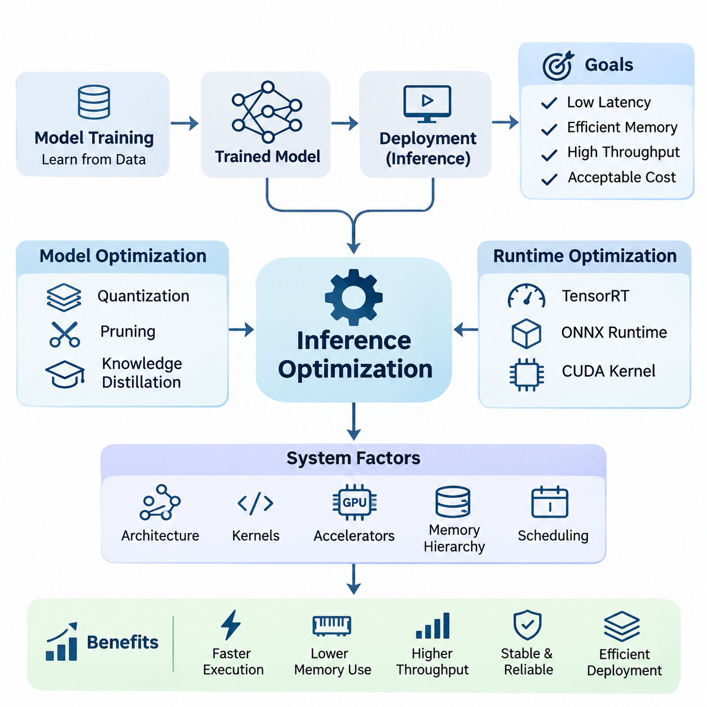
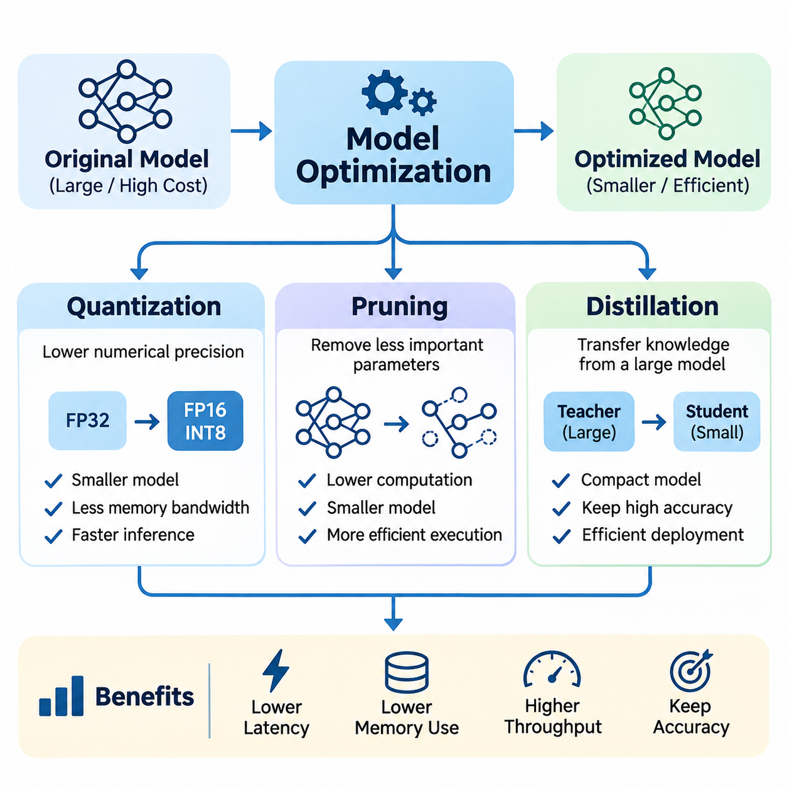
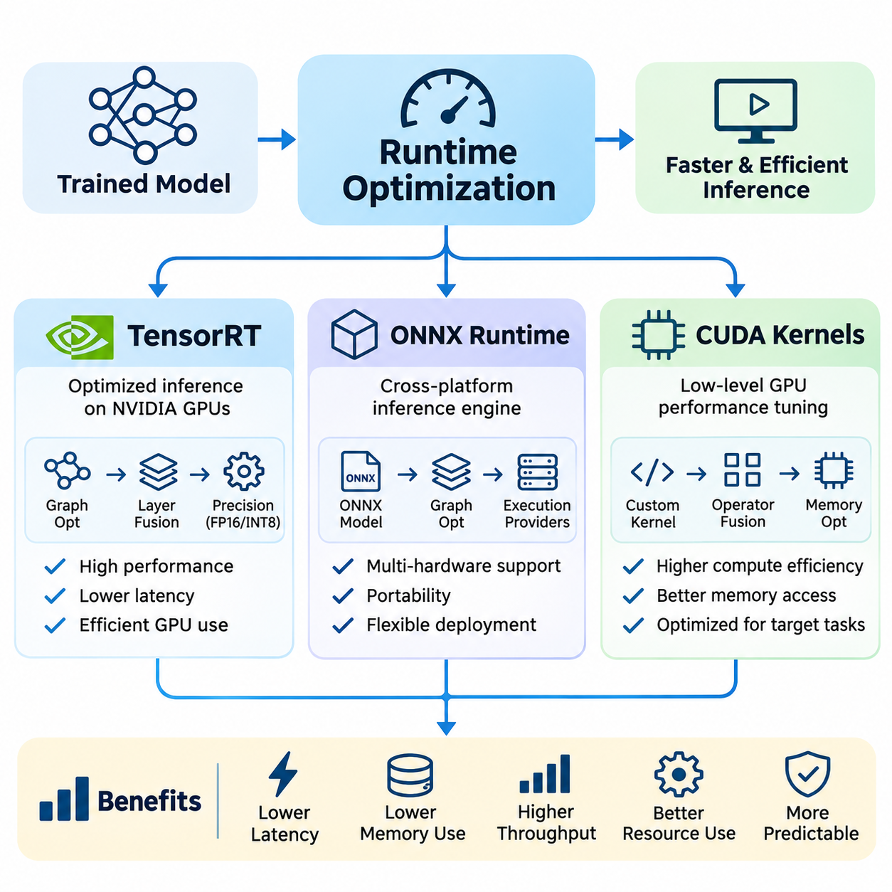
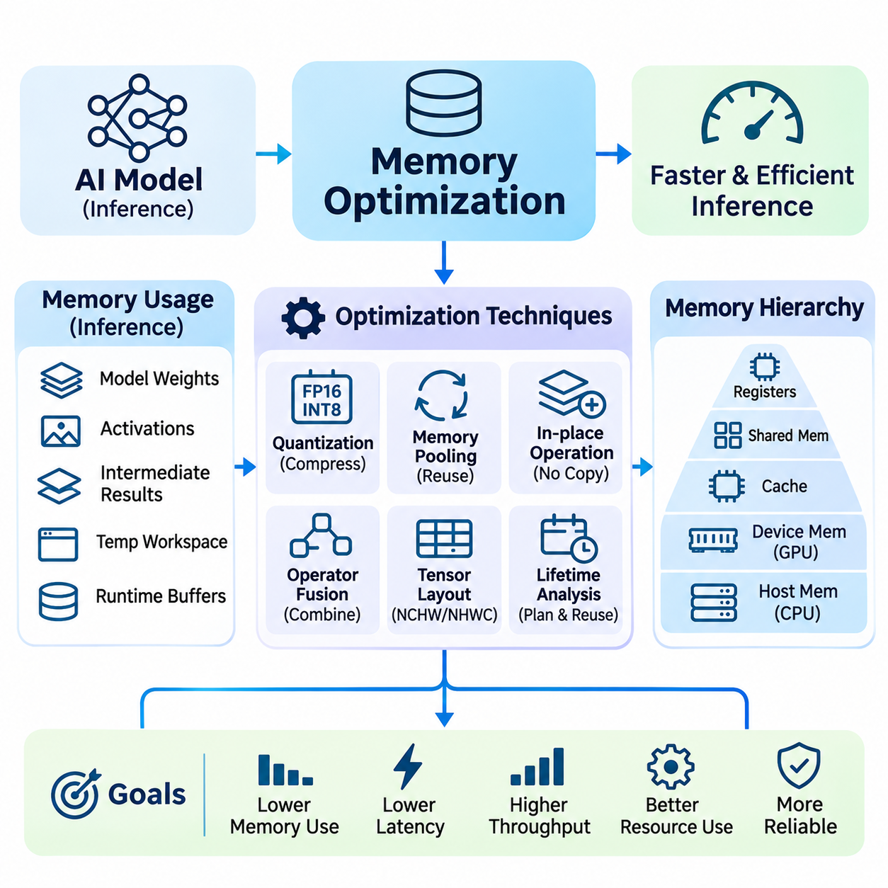
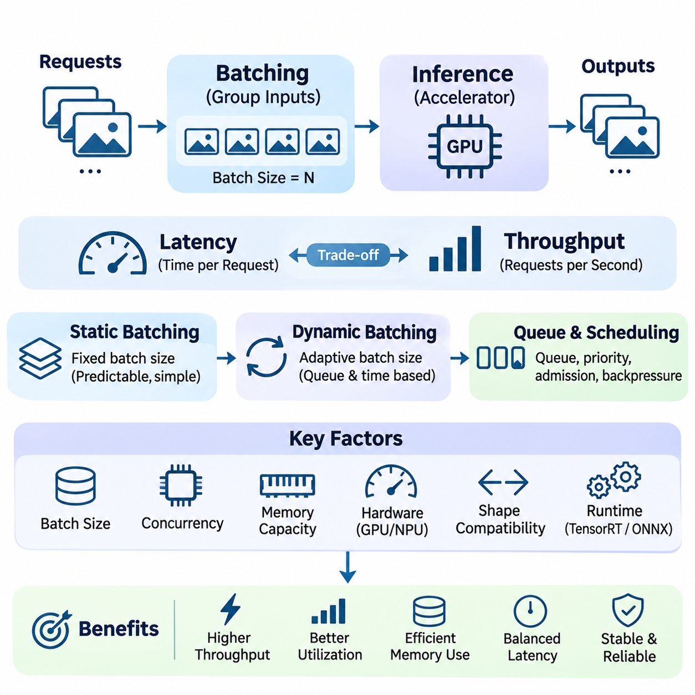
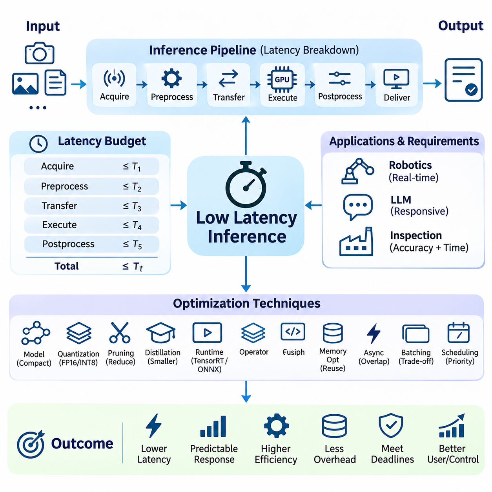
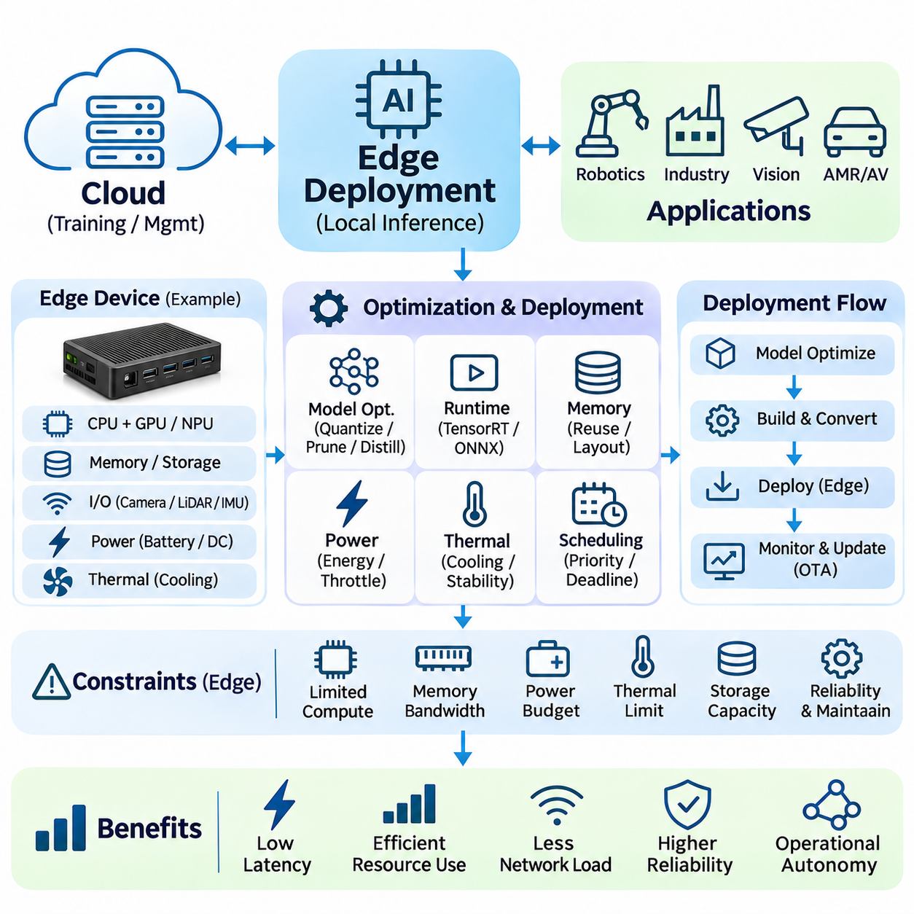
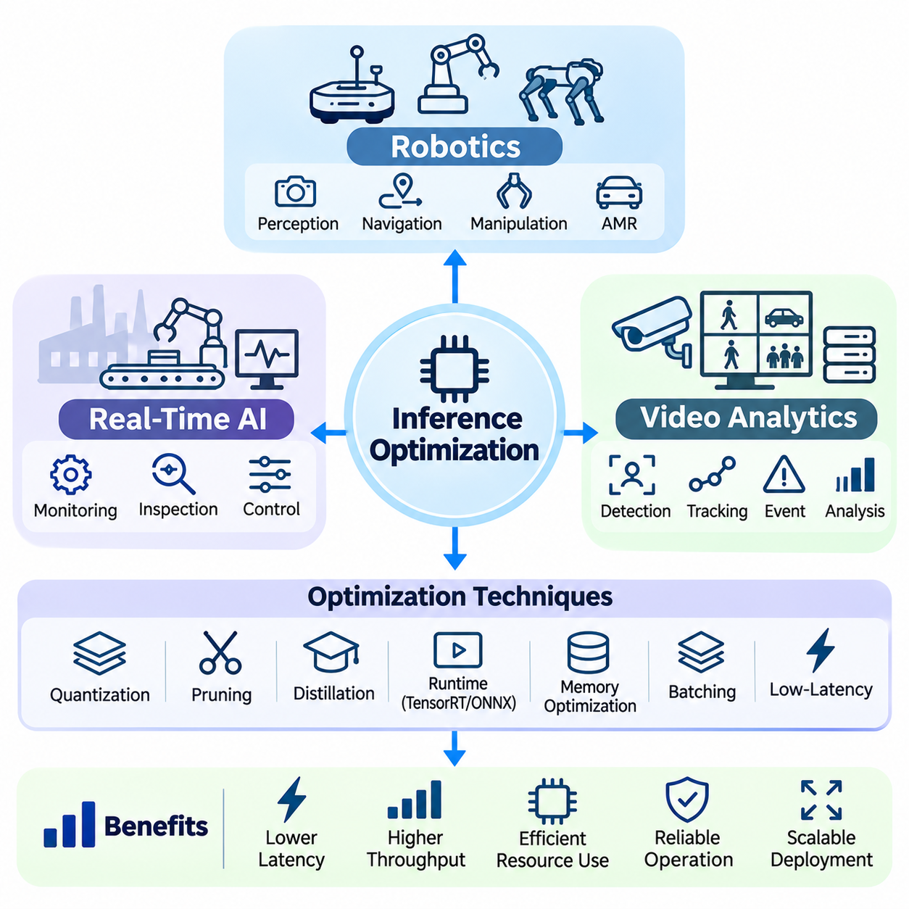

**Volume 38. AI Systems Architecture**


# 03. Inference Optimization

## 03.00 Overview

{width="7.268055555555556in" height="7.268055555555556in"}

Inference optimization is a fundamental discipline in artificial intelligence systems architecture, focusing on improving the execution efficiency of trained models during deployment. While model training emphasizes learning accurate representations from data, inference optimization concentrates on delivering predictions with minimal latency, efficient memory utilization, high throughput, and acceptable computational cost across different hardware environments.

Modern AI applications increasingly depend on large neural networks that require substantial computational resources. Convolutional neural networks, transformers, and multimodal architectures introduce significant demands on processing capacity and memory bandwidth. Without effective inference optimization, even highly accurate models may become impractical for real-time applications, embedded platforms, or large-scale cloud services.

The primary objective of inference optimization is to balance predictive accuracy with operational efficiency. Improvements in execution speed must be evaluated alongside memory consumption, energy requirements, numerical stability, and system reliability. An optimized inference system should satisfy application-specific performance requirements while preserving the essential behavior and predictive capabilities of the original model.

Inference performance depends on interactions among model architecture, computational kernels, hardware accelerators, memory hierarchy, and runtime scheduling. Consequently, optimization cannot be treated exclusively as a neural network problem. It requires coordinated engineering across software frameworks, execution engines, device drivers, operating systems, and hardware platforms to achieve measurable end-to-end improvements.

Model optimization represents one of the most important approaches to reducing inference complexity. Techniques such as quantization, pruning, and knowledge distillation modify the numerical representation, parameter structure, or architecture of neural networks. These methods aim to reduce computational requirements while maintaining sufficient predictive accuracy for the intended deployment environment and application constraints.

Quantization reduces the numerical precision used to represent model parameters and intermediate activations. Converting floating-point operations into lower-precision formats, including FP16, BF16, and INT8, can decrease memory consumption and improve computational throughput on compatible hardware. However, quantization requires careful validation because reduced precision may introduce numerical errors and affect model accuracy.

Pruning improves computational efficiency by removing parameters, channels, or structural components that contribute relatively little to model predictions. Structured pruning can reduce actual execution time when the resulting architecture aligns with available hardware acceleration. Unstructured pruning may achieve substantial parameter sparsity, but its practical benefits depend on specialized sparse computation support and efficient runtime implementations.

Knowledge distillation transfers predictive behavior from a larger teacher model into a smaller student model. The student learns to approximate the teacher\'s outputs or intermediate representations while requiring fewer computational resources. This approach is particularly valuable when deploying advanced AI capabilities on embedded processors, mobile devices, and robotic systems with restricted power and memory budgets.

Runtime optimization focuses on improving how neural networks execute after model development. Execution engines such as NVIDIA TensorRT and ONNX Runtime provide mechanisms for graph optimization, operator fusion, execution planning, and hardware-specific acceleration. These capabilities reduce unnecessary operations and improve the utilization of available processing resources without necessarily changing the conceptual model architecture.

TensorRT enables optimized neural network execution on supported NVIDIA GPU platforms through graph transformations, precision selection, kernel optimization, and execution scheduling. ONNX Runtime provides a flexible inference environment supporting multiple execution providers and hardware backends. Selecting an appropriate runtime requires evaluating model compatibility, operator coverage, deployment portability, and actual performance under representative workloads.

CUDA kernel optimization addresses computational efficiency at a lower execution level. Custom kernels and optimized libraries can improve memory access patterns, parallel execution, and arithmetic intensity. Operator fusion reduces intermediate memory transfers by combining compatible operations. Nevertheless, low-level optimization should be guided by profiling evidence because computational bottlenecks vary across architectures and input configurations.

Memory optimization is essential because inference workloads frequently encounter limitations imposed by memory capacity and bandwidth rather than arithmetic throughput alone. Model weights, activation tensors, temporary buffers, and intermediate outputs compete for available memory resources. Efficient memory allocation, buffer reuse, tensor lifetime management, and reduced data movement can significantly improve execution performance.

GPU memory management becomes especially important when multiple models execute simultaneously. Fragmentation, repeated allocation, unnecessary tensor copies, and excessive intermediate storage can reduce effective device utilization. Techniques such as preallocated buffers, memory pooling, in-place operations where safe, and optimized tensor layouts help maintain predictable execution behavior under demanding production workloads.

Batching improves inference throughput by processing multiple inputs together, allowing accelerators to exploit parallel computational resources more effectively. Larger batches can increase hardware utilization and reduce average processing cost per input. However, batching may increase individual request latency and memory consumption, creating an important tradeoff between throughput efficiency and responsiveness.

Dynamic batching adjusts the number of inputs processed together according to incoming workload conditions. This approach is particularly useful in cloud inference services where request rates fluctuate. Effective batching policies consider queue waiting time, execution duration, memory availability, and service-level objectives. The optimal batch size therefore depends on workload characteristics rather than hardware capability alone.

Low-latency inference is critical for applications requiring rapid responses to environmental changes or user interactions. Autonomous robots, industrial controllers, interactive AI services, and intelligent monitoring systems must often complete inference within defined timing constraints. Optimization efforts should therefore consider preprocessing, data transfer, model execution, postprocessing, and communication delays as components of total response latency.

Latency evaluation must distinguish average execution time from worst-case behavior and high-percentile response times. A system with excellent average performance may still experience occasional delays caused by memory contention, scheduling interference, or resource saturation. For time-sensitive applications, consistent response behavior and deadline compliance can be more important than achieving the highest possible average throughput.

Hardware characteristics strongly influence the effectiveness of inference optimization. GPUs provide substantial parallel processing capability, while CPUs offer flexibility for control-intensive operations and smaller workloads. Dedicated neural processing units and embedded accelerators provide alternative efficiency characteristics. Selecting hardware requires understanding computational precision support, memory bandwidth, power consumption, and software ecosystem compatibility.

Edge deployment introduces additional constraints because inference must execute close to sensors, machines, or users with limited computational resources. Embedded platforms such as NVIDIA Jetson integrate accelerated processing within relatively compact power envelopes. Successful edge inference optimization requires coordinated management of model complexity, memory usage, thermal behavior, power consumption, and communication requirements.

Edge AI systems often operate under changing environmental and computational conditions. Sensor workloads, background processes, thermal throttling, and concurrent inference tasks can influence execution performance. Adaptive scheduling, workload prioritization, and resource monitoring help maintain reliable operation. Optimization must therefore account for sustained performance rather than relying exclusively on short-duration benchmark measurements.

Robotics provides a representative example of inference optimization under demanding operational constraints. Autonomous platforms may execute object detection, semantic segmentation, localization, tracking, and environmental understanding simultaneously. These workloads share computational resources while supporting navigation and control decisions. Efficient inference scheduling helps preserve responsiveness and reduces the risk of delayed perception updates.

Real-time AI systems require close coordination between inference execution and broader system scheduling. Processing deadlines, sensor synchronization, communication latency, and actuator response times influence the effectiveness of AI-driven decisions. An optimized neural network alone cannot guarantee real-time performance unless the complete processing pipeline satisfies its required timing characteristics under representative operating conditions.

Video analytics presents another important application domain because continuous image streams generate substantial computational workloads. Multiple cameras may require simultaneous object detection, classification, tracking, and event recognition. Techniques such as frame selection, resolution adaptation, model sharing, and asynchronous processing can reduce resource requirements while maintaining sufficient analytical quality for operational objectives.

Inference optimization also has significant economic implications for large-scale AI services. Improved computational efficiency can reduce accelerator requirements, electricity consumption, and infrastructure expenditure. Higher throughput per device can increase service capacity without proportional hardware expansion. However, economic evaluation must include development effort, maintenance complexity, licensing constraints, and the operational costs associated with optimization techniques.

Performance benchmarking provides the evidence necessary to determine whether optimization strategies produce meaningful improvements. Measurements should include latency, throughput, memory utilization, power consumption, and predictive accuracy. Experiments must use representative input distributions, realistic concurrency levels, and clearly defined hardware configurations to ensure that observed improvements translate into production environments.

Optimization introduces engineering tradeoffs that require systematic validation. Aggressive quantization may reduce accuracy, excessive pruning may remove important representational capacity, and large batches may violate latency constraints. Similarly, hardware-specific runtime optimizations can complicate portability. Reliable optimization processes compare candidate configurations against explicit requirements rather than assuming that reduced computational complexity always improves system performance.

A practical inference optimization workflow begins with establishing a reproducible performance baseline. Profiling identifies expensive operators, memory bottlenecks, data transfer overhead, and scheduling inefficiencies. Engineers then apply targeted optimization techniques, evaluate their effects, and verify predictive consistency. Iterative measurement helps distinguish genuine system improvements from changes that merely shift computational costs between components.

Production deployment requires continued monitoring because inference performance can change with software updates, hardware configurations, and evolving workload distributions. Runtime metrics should reveal latency degradation, memory pressure, resource saturation, and unexpected execution failures. Maintaining versioned models, reproducible configurations, and regression benchmarks supports controlled optimization throughout the operational lifecycle.

Ultimately, inference optimization connects neural network efficiency with practical AI systems engineering. Model compression, runtime acceleration, memory management, batching, low-latency execution, and edge deployment form complementary components of a unified optimization strategy. Their coordinated application enables AI systems to deliver reliable intelligence within the computational, temporal, and economic constraints of real-world environments.

추론 최적화(Inference Optimization)는 인공지능 시스템 아키텍처(AI Systems Architecture)의 핵심 기술 분야로, 학습이 완료된 모델(Model)의 배포(Deployment) 과정에서 실행 효율성을 향상시키는 데 중점을 둔다. 모델 학습(Model Training)이 데이터로부터 정확한 표현(Representation)을 학습하는 데 집중한다면, 추론 최적화는 다양한 하드웨어 환경에서 지연시간(Latency)을 최소화하고, 메모리 활용(Memory Utilization)을 효율화하며, 높은 처리량(Throughput)과 적절한 연산 비용(Computational Cost)을 달성하는 것을 목표로 한다.

현대 인공지능 응용 시스템(AI Application Systems)은 상당한 연산 자원(Computational Resources)을 요구하는 대규모 신경망(Neural Networks)에 점점 더 의존하고 있다. 합성곱 신경망(Convolutional Neural Networks), 트랜스포머(Transformers), 멀티모달 아키텍처(Multimodal Architectures)는 처리 능력(Processing Capacity)과 메모리 대역폭(Memory Bandwidth)에 상당한 부담을 발생시킨다. 효과적인 추론 최적화가 없다면 정확도가 높은 모델조차 실시간 응용(Real-Time Applications), 임베디드 플랫폼(Embedded Platforms), 대규모 클라우드 서비스(Cloud Services)에서 실용적으로 활용하기 어려울 수 있다.

추론 최적화의 주요 목적은 예측 정확도(Predictive Accuracy)와 운영 효율성(Operational Efficiency) 사이의 균형을 확보하는 것이다. 실행 속도(Execution Speed)의 향상은 메모리 소비량(Memory Consumption), 에너지 요구량(Energy Requirements), 수치적 안정성(Numerical Stability), 시스템 신뢰성(System Reliability)과 함께 평가되어야 한다. 최적화된 추론 시스템은 원래 모델의 핵심 동작과 예측 능력을 유지하면서 응용 분야별 성능 요구사항(Performance Requirements)을 충족해야 한다.

추론 성능(Inference Performance)은 모델 아키텍처(Model Architecture), 연산 커널(Computational Kernels), 하드웨어 가속기(Hardware Accelerators), 메모리 계층 구조(Memory Hierarchy), 런타임 스케줄링(Runtime Scheduling) 사이의 상호작용에 의해 결정된다. 따라서 최적화를 신경망 자체의 문제로만 취급해서는 안 된다. 측정 가능한 종단 간 성능 향상(End-to-End Performance Improvement)을 달성하려면 소프트웨어 프레임워크(Software Frameworks), 실행 엔진(Execution Engines), 장치 드라이버(Device Drivers), 운영체제(Operating Systems), 하드웨어 플랫폼(Hardware Platforms) 전반에 걸친 통합적인 엔지니어링이 필요하다.

모델 최적화(Model Optimization)는 추론 복잡도(Inference Complexity)를 줄이기 위한 가장 중요한 접근 방법 중 하나이다. 양자화(Quantization), 가지치기(Pruning), 지식 증류(Knowledge Distillation)와 같은 기술은 신경망의 수치 표현(Numerical Representation), 매개변수 구조(Parameter Structure), 모델 아키텍처(Model Architecture)를 변경한다. 이러한 방법은 목표 배포 환경(Deployment Environment)과 응용 제약조건(Application Constraints)에 필요한 예측 정확도를 유지하면서 연산 요구량(Computational Requirements)을 줄이는 것을 목표로 한다.

양자화(Quantization)는 모델 매개변수(Model Parameters)와 중간 활성화 값(Intermediate Activations)을 표현하는 수치 정밀도(Numerical Precision)를 낮추는 기술이다. 부동소수점 연산(Floating-Point Operations)을 FP16, BF16, INT8과 같은 저정밀도 형식(Low-Precision Formats)으로 변환하면 호환되는 하드웨어에서 메모리 사용량을 줄이고 연산 처리량을 향상시킬 수 있다. 그러나 정밀도 감소는 수치 오차(Numerical Errors)를 발생시키고 모델 정확도에 영향을 줄 수 있으므로 신중한 검증(Validation)이 필요하다.

가지치기(Pruning)는 모델 예측에 상대적으로 적게 기여하는 매개변수(Parameters), 채널(Channels), 구조적 구성요소(Structural Components)를 제거하여 연산 효율성을 향상시킨다. 구조적 가지치기(Structured Pruning)는 변경된 아키텍처가 하드웨어 가속 기능과 적절히 결합될 때 실제 실행시간을 줄일 수 있다. 비구조적 가지치기(Unstructured Pruning)는 높은 매개변수 희소성(Parameter Sparsity)을 달성할 수 있지만, 실질적인 성능 향상은 희소 연산(Sparse Computation) 지원과 효율적인 런타임 구현(Runtime Implementation)에 따라 달라진다.

지식 증류(Knowledge Distillation)는 대규모 교사 모델(Teacher Model)의 예측 동작(Predictive Behavior)을 소규모 학생 모델(Student Model)에 전달하는 기술이다. 학생 모델은 더 적은 연산 자원을 사용하면서 교사 모델의 출력(Outputs)이나 중간 표현(Intermediate Representations)을 근사하도록 학습한다. 이러한 접근 방법은 전력(Power)과 메모리(Memory)가 제한된 임베디드 프로세서(Embedded Processors), 모바일 장치(Mobile Devices), 로봇 시스템(Robotic Systems)에 고급 인공지능 기능을 배포할 때 특히 유용하다.

런타임 최적화(Runtime Optimization)는 모델 개발 이후 신경망이 실행되는 방식을 개선하는 데 중점을 둔다. NVIDIA TensorRT와 ONNX Runtime 같은 실행 엔진(Execution Engines)은 그래프 최적화(Graph Optimization), 연산자 융합(Operator Fusion), 실행 계획(Execution Planning), 하드웨어별 가속(Hardware-Specific Acceleration) 기능을 제공한다. 이러한 기능은 불필요한 연산을 줄이고 사용 가능한 처리 자원의 활용도를 높이면서 모델의 개념적 아키텍처를 반드시 변경하지 않고도 실행 성능을 개선할 수 있다.

TensorRT는 그래프 변환(Graph Transformations), 정밀도 선택(Precision Selection), 커널 최적화(Kernel Optimization), 실행 스케줄링(Execution Scheduling)을 통해 지원되는 NVIDIA GPU 플랫폼에서 신경망 실행을 최적화한다. ONNX Runtime은 다양한 실행 공급자(Execution Providers)와 하드웨어 백엔드(Hardware Backends)를 지원하는 유연한 추론 환경을 제공한다. 적절한 런타임을 선택하려면 모델 호환성(Model Compatibility), 연산자 지원 범위(Operator Coverage), 배포 이식성(Deployment Portability), 실제 작업 부하(Workloads)에서의 성능을 평가해야 한다.

CUDA 커널 최적화(CUDA Kernel Optimization)는 보다 낮은 실행 계층에서 연산 효율성을 개선한다. 사용자 정의 커널(Custom Kernels)과 최적화된 라이브러리(Optimized Libraries)는 메모리 접근 패턴(Memory Access Patterns), 병렬 실행(Parallel Execution), 연산 집약도(Arithmetic Intensity)를 향상시킬 수 있다. 연산자 융합(Operator Fusion)은 호환되는 연산을 결합하여 중간 메모리 전송(Intermediate Memory Transfers)을 줄인다. 다만 연산 병목현상(Computational Bottlenecks)은 아키텍처와 입력 구성에 따라 달라지므로 저수준 최적화(Low-Level Optimization)는 프로파일링(Profiling) 결과를 기반으로 수행해야 한다.

메모리 최적화(Memory Optimization)는 추론 작업 부하(Inference Workloads)가 연산 처리량 자체보다 메모리 용량(Memory Capacity)과 대역폭(Bandwidth)의 제약을 받는 경우가 많기 때문에 필수적이다. 모델 가중치(Model Weights), 활성화 텐서(Activation Tensors), 임시 버퍼(Temporary Buffers), 중간 출력(Intermediate Outputs)은 제한된 메모리 자원을 공유한다. 효율적인 메모리 할당(Memory Allocation), 버퍼 재사용(Buffer Reuse), 텐서 수명 관리(Tensor Lifetime Management), 데이터 이동 감소(Reduced Data Movement)는 실행 성능을 크게 개선할 수 있다.

여러 모델이 동시에 실행되는 환경에서는 GPU 메모리 관리(GPU Memory Management)가 특히 중요하다. 메모리 단편화(Memory Fragmentation), 반복적인 메모리 할당(Repeated Allocation), 불필요한 텐서 복사(Tensor Copies), 과도한 중간 저장 공간(Intermediate Storage)은 장치 활용도(Device Utilization)를 낮출 수 있다. 사전 할당 버퍼(Preallocated Buffers), 메모리 풀링(Memory Pooling), 안전한 조건에서의 제자리 연산(In-Place Operations), 최적화된 텐서 배치(Tensor Layouts)는 높은 작업 부하에서도 예측 가능한 실행 동작을 유지하는 데 도움이 된다.

배칭(Batching)은 여러 입력을 함께 처리하여 추론 처리량(Inference Throughput)을 향상시키며, 가속기(Accelerators)가 병렬 연산 자원을 더욱 효과적으로 활용하도록 한다. 배치 크기(Batch Size)를 증가시키면 하드웨어 활용도(Hardware Utilization)를 높이고 입력당 평균 처리 비용(Average Processing Cost)을 줄일 수 있다. 그러나 배칭은 개별 요청 지연시간(Request Latency)과 메모리 사용량을 증가시킬 수 있으므로 처리량 효율성(Throughput Efficiency)과 응답성(Responsiveness) 사이의 중요한 절충 관계(Tradeoff)가 발생한다.

동적 배칭(Dynamic Batching)은 유입되는 작업 부하(Workload Conditions)에 따라 함께 처리하는 입력의 수를 조정한다. 이 방법은 요청 발생률(Request Rates)이 변동하는 클라우드 추론 서비스(Cloud Inference Services)에서 특히 유용하다. 효과적인 배칭 정책(Batching Policies)은 대기열 지연시간(Queue Waiting Time), 실행시간(Execution Duration), 메모리 가용성(Memory Availability), 서비스 수준 목표(Service-Level Objectives)를 고려한다. 따라서 최적 배치 크기는 하드웨어 성능뿐 아니라 작업 부하의 특성에 따라 결정된다.

저지연 추론(Low-Latency Inference)은 환경 변화나 사용자 상호작용에 빠르게 대응해야 하는 응용 분야에서 매우 중요하다. 자율주행 로봇(Autonomous Robots), 산업용 제어기(Industrial Controllers), 대화형 인공지능 서비스(Interactive AI Services), 지능형 모니터링 시스템(Intelligent Monitoring Systems)은 정해진 시간 제약 내에서 추론을 완료해야 하는 경우가 많다. 따라서 최적화 과정에서는 전처리(Preprocessing), 데이터 전송(Data Transfer), 모델 실행(Model Execution), 후처리(Postprocessing), 통신 지연(Communication Delays)을 전체 응답 지연시간의 구성요소로 고려해야 한다.

지연시간 평가(Latency Evaluation)에서는 평균 실행시간(Average Execution Time)과 최악 조건의 실행 동작(Worst-Case Behavior), 높은 백분위수 응답시간(High-Percentile Response Times)을 구분해야 한다. 평균 성능이 우수한 시스템도 메모리 경합(Memory Contention), 스케줄링 간섭(Scheduling Interference), 자원 포화(Resource Saturation)로 인해 간헐적인 지연을 경험할 수 있다. 시간 민감형 응용(Time-Sensitive Applications)에서는 최대 평균 처리량보다 일관된 응답 동작(Consistent Response Behavior)과 마감시간 준수(Deadline Compliance)가 더 중요할 수 있다.

하드웨어 특성(Hardware Characteristics)은 추론 최적화의 효과에 큰 영향을 미친다. GPU는 높은 병렬 처리 능력(Parallel Processing Capability)을 제공하는 반면, CPU는 제어 중심 연산(Control-Intensive Operations)과 소규모 작업 부하(Smaller Workloads)에 유연성을 제공한다. 전용 신경망 처리 장치(Neural Processing Units)와 임베디드 가속기(Embedded Accelerators)는 서로 다른 효율성 특성을 제공한다. 하드웨어 선택에는 연산 정밀도 지원(Computational Precision Support), 메모리 대역폭, 전력 소비(Power Consumption), 소프트웨어 생태계(Software Ecosystem)에 대한 이해가 필요하다.

엣지 배포(Edge Deployment)는 제한된 연산 자원을 사용하여 센서(Sensors), 기계(Machines), 사용자(Users)와 가까운 위치에서 추론을 수행해야 하므로 추가적인 제약조건을 발생시킨다. NVIDIA Jetson과 같은 임베디드 플랫폼(Embedded Platforms)은 비교적 작은 전력 범위(Power Envelopes)에서 가속 연산 기능을 통합한다. 성공적인 엣지 추론 최적화(Edge Inference Optimization)를 위해서는 모델 복잡도(Model Complexity), 메모리 사용량(Memory Usage), 열적 동작(Thermal Behavior), 전력 소비, 통신 요구사항(Communication Requirements)을 통합적으로 관리해야 한다.

엣지 인공지능 시스템(Edge AI Systems)은 변화하는 환경 및 연산 조건(Computational Conditions)에서 동작하는 경우가 많다. 센서 작업 부하(Sensor Workloads), 백그라운드 프로세스(Background Processes), 열 스로틀링(Thermal Throttling), 동시 추론 작업(Concurrent Inference Tasks)은 실행 성능에 영향을 줄 수 있다. 적응형 스케줄링(Adaptive Scheduling), 작업 우선순위 관리(Workload Prioritization), 자원 모니터링(Resource Monitoring)은 안정적인 운영을 유지하는 데 도움이 된다. 따라서 최적화는 단기간 벤치마크(Benchmark) 측정에만 의존하지 않고 지속 성능(Sustained Performance)을 고려해야 한다.

로보틱스(Robotics)는 까다로운 운영 제약조건(Operational Constraints)에서 추론 최적화가 필요한 대표적인 사례이다. 자율주행 플랫폼(Autonomous Platforms)은 객체 탐지(Object Detection), 의미론적 분할(Semantic Segmentation), 위치 추정(Localization), 객체 추적(Tracking), 환경 이해(Environmental Understanding)를 동시에 실행할 수 있다. 이러한 작업은 연산 자원을 공유하면서 내비게이션(Navigation)과 제어 의사결정(Control Decisions)을 지원한다. 효율적인 추론 스케줄링(Inference Scheduling)은 응답성을 유지하고 인지 정보(Perception Updates)의 지연 위험을 줄이는 데 기여한다.

실시간 인공지능 시스템(Real-Time AI Systems)은 추론 실행(Inference Execution)과 전체 시스템 스케줄링(System Scheduling) 사이의 긴밀한 조정이 필요하다. 처리 마감시간(Processing Deadlines), 센서 동기화(Sensor Synchronization), 통신 지연시간(Communication Latency), 액추에이터 응답시간(Actuator Response Times)은 인공지능 기반 의사결정의 효과에 영향을 미친다. 최적화된 신경망만으로는 실시간 성능을 보장할 수 없으며, 전체 처리 파이프라인(Processing Pipeline)이 실제 운영 조건에서 요구되는 시간 제약을 충족해야 한다.

비디오 분석(Video Analytics)은 연속적인 영상 스트림(Image Streams)이 상당한 연산 작업 부하를 발생시키기 때문에 또 다른 중요한 응용 분야이다. 여러 카메라는 객체 탐지(Object Detection), 분류(Classification), 추적(Tracking), 이벤트 인식(Event Recognition)을 동시에 수행해야 할 수 있다. 프레임 선택(Frame Selection), 해상도 적응(Resolution Adaptation), 모델 공유(Model Sharing), 비동기 처리(Asynchronous Processing)와 같은 기술은 운영 목표에 필요한 분석 품질(Analytical Quality)을 유지하면서 자원 요구량을 줄일 수 있다.

추론 최적화는 대규모 인공지능 서비스(Large-Scale AI Services)의 경제성에도 중요한 영향을 미친다. 연산 효율성(Computational Efficiency)이 향상되면 가속기 요구량(Accelerator Requirements), 전력 소비(Electricity Consumption), 인프라 지출(Infrastructure Expenditure)을 줄일 수 있다. 장치당 처리량(Throughput per Device)이 높아지면 하드웨어를 비례적으로 확장하지 않고도 서비스 용량(Service Capacity)을 증가시킬 수 있다. 그러나 경제성 평가(Economic Evaluation)에는 개발 노력(Development Effort), 유지보수 복잡도(Maintenance Complexity), 라이선스 제약(Licensing Constraints), 최적화 기술의 운영 비용(Operational Costs)을 포함해야 한다.

성능 벤치마킹(Performance Benchmarking)은 최적화 전략(Optimization Strategies)이 의미 있는 개선을 제공하는지 판단하는 데 필요한 근거를 제공한다. 측정 항목에는 지연시간(Latency), 처리량(Throughput), 메모리 활용도(Memory Utilization), 전력 소비(Power Consumption), 예측 정확도(Predictive Accuracy)가 포함되어야 한다. 실험은 대표적인 입력 분포(Input Distributions), 현실적인 동시 실행 수준(Concurrency Levels), 명확하게 정의된 하드웨어 구성(Hardware Configurations)을 사용하여 관찰된 성능 향상이 실제 운영 환경에도 적용되는지 확인해야 한다.

최적화는 체계적인 검증(Systematic Validation)이 필요한 엔지니어링 절충 관계(Engineering Tradeoffs)를 발생시킨다. 공격적인 양자화(Aggressive Quantization)는 정확도를 낮출 수 있고, 과도한 가지치기(Excessive Pruning)는 중요한 표현 능력(Representational Capacity)을 제거할 수 있으며, 큰 배치 크기(Large Batch Sizes)는 지연시간 제약(Latency Constraints)을 위반할 수 있다. 또한 하드웨어별 런타임 최적화(Hardware-Specific Runtime Optimization)는 이식성(Portability)을 복잡하게 만들 수 있다. 신뢰할 수 있는 최적화 과정은 연산 복잡도의 감소가 항상 시스템 성능 향상으로 이어진다고 가정하지 않고 명시적인 요구사항을 기준으로 후보 구성을 비교해야 한다.

실용적인 추론 최적화 작업 흐름(Inference Optimization Workflow)은 재현 가능한 성능 기준선(Reproducible Performance Baseline)을 수립하는 것에서 시작한다. 프로파일링(Profiling)은 비용이 높은 연산자(Expensive Operators), 메모리 병목현상(Memory Bottlenecks), 데이터 전송 오버헤드(Data Transfer Overhead), 스케줄링 비효율성(Scheduling Inefficiencies)을 식별한다. 이후 엔지니어는 목표에 맞는 최적화 기술을 적용하고 효과를 평가하며 예측 일관성(Predictive Consistency)을 검증한다. 반복적인 측정(Iterative Measurement)은 실제 시스템 개선과 단순히 연산 비용을 다른 구성요소로 이동시키는 변화를 구분하는 데 도움이 된다.

운영 환경 배포(Production Deployment)에서는 소프트웨어 업데이트(Software Updates), 하드웨어 구성(Hardware Configurations), 변화하는 작업 부하 분포(Workload Distributions)에 따라 추론 성능이 달라질 수 있으므로 지속적인 모니터링(Continuous Monitoring)이 필요하다. 런타임 지표(Runtime Metrics)는 지연시간 악화(Latency Degradation), 메모리 압박(Memory Pressure), 자원 포화(Resource Saturation), 예상하지 못한 실행 오류(Execution Failures)를 파악할 수 있어야 한다. 버전 관리된 모델(Versioned Models), 재현 가능한 구성(Reproducible Configurations), 회귀 벤치마크(Regression Benchmarks)를 유지하면 운영 수명주기(Operational Lifecycle) 전반에 걸쳐 통제된 최적화를 지원할 수 있다.

궁극적으로 추론 최적화(Inference Optimization)는 신경망 효율성(Neural Network Efficiency)과 실용적인 인공지능 시스템 엔지니어링(AI Systems Engineering)을 연결한다. 모델 압축(Model Compression), 런타임 가속(Runtime Acceleration), 메모리 관리(Memory Management), 배칭(Batching), 저지연 실행(Low-Latency Execution), 엣지 배포(Edge Deployment)는 통합 최적화 전략(Unified Optimization Strategy)을 구성하는 상호 보완적인 요소이다. 이러한 기술을 체계적으로 결합하면 실제 환경의 연산적 제약(Computational Constraints), 시간적 제약(Temporal Constraints), 경제적 제약(Economic Constraints) 내에서 신뢰할 수 있는 지능형 시스템(Intelligent Systems)을 구현할 수 있다.

## 03.01 Model Optimization

{width="7.268055555555556in" height="7.268055555555556in"}

Model optimization is a fundamental component of efficient artificial intelligence inference, focusing on reducing computational complexity, memory requirements, and execution latency while preserving predictive accuracy. Unlike runtime optimization, which improves how an existing model executes, model optimization modifies numerical representations, parameter structures, or learned behavior to produce architectures better suited for practical deployment.

Three major techniques define the foundation of model optimization: quantization, pruning, and knowledge distillation. Each addresses computational inefficiency from a different perspective. Quantization reduces numerical precision, pruning eliminates unnecessary parameters or structures, and distillation transfers knowledge from a larger model into a smaller one. These methods can be applied independently or combined within a coordinated optimization workflow.

Quantization converts neural network weights and activations from high-precision numerical formats into lower-precision representations. Traditional models frequently use FP32 floating-point arithmetic, while optimized inference implementations may employ FP16, BF16, INT8, or lower-bit formats. Reducing precision decreases model storage requirements and memory bandwidth consumption while potentially increasing arithmetic throughput on compatible hardware accelerators.

The effectiveness of quantization depends on the numerical characteristics of the model and the capabilities of the target processor. Modern GPUs, neural processing units, and specialized accelerators support different low-precision operations. INT8 execution can provide substantial efficiency improvements when supported by optimized kernels, but conversion overhead, unsupported operators, and numerical sensitivity may limit achievable acceleration.

Post-training quantization applies numerical compression to an already trained model without requiring complete retraining. Calibration data may be used to estimate activation ranges and determine appropriate scaling parameters. This approach provides a relatively efficient deployment workflow, although models containing highly sensitive layers, extreme activation values, or complex attention mechanisms may experience measurable accuracy degradation.

Quantization-aware training incorporates simulated quantization effects during model training or fine-tuning. By exposing the network to reduced-precision behavior, the optimization process can adapt model parameters to compensate for numerical errors. This approach often improves accuracy retention compared with simple post-training quantization, but it requires additional training resources and careful configuration of quantization parameters.

Quantization may use symmetric or asymmetric numerical mappings, depending on the distribution of weights and activations. Per-tensor quantization applies a common scale across an entire tensor, while per-channel quantization assigns separate scales to individual channels. The selection influences numerical accuracy, implementation complexity, and hardware compatibility, making calibration and deployment-specific evaluation essential.

Mixed-precision inference assigns different numerical formats to selected layers or operations according to their sensitivity and computational requirements. Numerically sensitive components may retain higher precision, while computationally intensive matrix operations use lower precision. This strategy balances accuracy and efficiency, particularly in transformer models where attention, normalization, and projection operations exhibit different numerical characteristics.

Pruning reduces neural network complexity by removing parameters or computational structures that contribute relatively little to predictive performance. Large neural networks frequently contain redundancy that can be exploited to create smaller representations. Pruning techniques identify less important connections, channels, filters, attention heads, or layers, allowing the remaining network to perform similar tasks with fewer computational resources.

Unstructured pruning removes individual weights according to criteria such as magnitude, gradient information, or estimated importance. This approach can produce highly sparse parameter matrices while retaining much of the original model architecture. However, reduced parameter counts do not automatically translate into faster inference because conventional hardware and dense computational kernels may not efficiently exploit irregular sparsity.

Structured pruning removes complete computational components, including convolutional filters, channels, transformer heads, or network blocks. Because these modifications produce smaller dense operations, structured pruning is often more compatible with standard inference runtimes and accelerators. Nevertheless, removing entire structures can affect representation capacity and requires careful evaluation of the resulting model architecture.

Pruning strategies may operate during training, after training, or through iterative optimization cycles. Iterative pruning typically removes a portion of parameters, fine-tunes the remaining network, and repeats the process until a target complexity is reached. Gradual reduction can help preserve predictive performance, although aggressive pruning may cause irreversible information loss or reduced robustness under unfamiliar inputs.

The importance of a parameter cannot always be determined from its magnitude alone. Sensitivity-based pruning evaluates how parameter removal influences model outputs or loss functions, while hardware-aware pruning considers the actual execution characteristics of target accelerators. Effective pruning therefore combines statistical importance with practical constraints such as tensor dimensions, memory alignment, and supported computational operations.

Knowledge distillation provides an alternative approach by transferring learned behavior from a larger teacher model to a smaller student model. Instead of directly removing components from the original network, distillation trains a compact architecture to reproduce important characteristics of the teacher. The resulting student can achieve favorable accuracy and efficiency when its architecture is appropriately designed for the deployment environment.

In conventional knowledge distillation, the student learns from softened probability distributions generated by the teacher. These distributions contain information about relationships among output classes beyond conventional hard labels. A temperature parameter controls the softness of the distributions, allowing the student to learn relative class similarities and decision boundaries that may improve generalization.

The distillation objective commonly combines supervised learning loss with a teacher-student matching loss. Supervised loss encourages correct predictions using ground-truth labels, while distillation loss encourages agreement with the teacher\'s outputs. Their relative weighting determines how strongly the student follows the teacher compared with the original training data, influencing accuracy, calibration, and generalization.

Feature-based distillation transfers intermediate representations rather than relying exclusively on final predictions. The student may learn to approximate selected feature maps, hidden states, attention distributions, or relational structures produced by the teacher. This approach can improve representation learning when teacher and student architectures differ substantially, although additional projection layers or alignment mechanisms may be necessary.

Distillation can also be applied to transformer architectures, multimodal models, and perception systems. A large vision model may teach a compact detector, while a language model may transfer task-specific behavior into a smaller network. In robotics, a computationally expensive perception model can supervise a lightweight student intended for real-time operation on an embedded accelerator.

Quantization, pruning, and distillation address different dimensions of model efficiency and can complement one another. Distillation can establish a compact student architecture, structured pruning can remove remaining redundant components, and quantization can reduce numerical precision. However, the order of application influences the final result because each transformation changes the model\'s numerical and structural characteristics.

Combining optimization techniques introduces additional challenges related to accuracy preservation and training stability. A heavily pruned network may become more sensitive to quantization errors, while a distilled student may lack sufficient capacity to recover from aggressive compression. Consequently, optimization pipelines should evaluate intermediate models rather than assuming that independently successful techniques will remain effective when combined.

Hardware-aware model optimization considers the computational characteristics of the deployment platform from the beginning. A theoretically smaller model may execute more slowly if its operators are poorly supported or its tensor dimensions produce inefficient hardware utilization. Effective optimization therefore requires examining memory access patterns, arithmetic intensity, kernel availability, and accelerator-specific execution behavior.

Performance evaluation should measure model size, parameter count, computational operations, memory consumption, latency, throughput, and predictive quality. Parameter reduction alone is insufficient because actual execution time depends on memory movement, operator scheduling, and hardware efficiency. Measurements should include representative inputs and realistic deployment conditions to establish whether compression produces meaningful operational improvements.

Accuracy evaluation must also extend beyond aggregate benchmark scores. Quantization may disproportionately affect rare classes, pruning may reduce robustness to unusual inputs, and distillation may transfer limitations or biases from the teacher. Application-specific validation should examine difficult examples, distribution shifts, confidence calibration, and failure modes, particularly when optimized models support safety-sensitive decisions.

For edge AI and autonomous robotics, model optimization directly influences operational feasibility. Compact models reduce memory pressure and computational demand, enabling multiple perception and decision-making workloads to share limited hardware resources. Lower execution latency can improve sensor processing responsiveness, while reduced power consumption may support longer operation within constrained thermal and energy budgets.

A systematic model optimization workflow begins with a validated baseline and clearly defined deployment objectives. Engineers profile computational bottlenecks, select suitable compression techniques, generate candidate models, and evaluate accuracy and hardware performance. Iterative refinement identifies configurations that satisfy application constraints without introducing unacceptable numerical instability, execution variability, or maintenance complexity.

Ultimately, model optimization transforms computationally demanding neural networks into deployable components of efficient AI systems. Quantization improves numerical efficiency, pruning reduces structural redundancy, and knowledge distillation transfers learned capabilities into compact architectures. Their coordinated application enables practical inference across cloud infrastructure, embedded platforms, robotics, and real-time intelligent systems.

모델 최적화(Model Optimization)는 효율적인 인공지능 추론(AI Inference)의 핵심 구성요소로, 예측 정확도(Predictive Accuracy)를 유지하면서 연산 복잡도(Computational Complexity), 메모리 요구량(Memory Requirements), 실행 지연시간(Execution Latency)을 줄이는 데 중점을 둔다. 기존 모델의 실행 방식을 개선하는 런타임 최적화(Runtime Optimization)와 달리, 모델 최적화는 수치 표현(Numerical Representations), 매개변수 구조(Parameter Structures), 학습된 동작(Learned Behavior)을 변경하여 실제 배포 환경에 더욱 적합한 아키텍처를 생성한다.

모델 최적화의 기반을 구성하는 세 가지 주요 기술은 양자화(Quantization), 가지치기(Pruning), 지식 증류(Knowledge Distillation)이다. 각 기술은 서로 다른 관점에서 연산 비효율성(Computational Inefficiency)을 해결한다. 양자화는 수치 정밀도(Numerical Precision)를 낮추고, 가지치기는 불필요한 매개변수나 구조를 제거하며, 지식 증류는 대규모 모델의 지식을 소규모 모델로 전달한다. 이러한 방법은 독립적으로 적용하거나 통합된 최적화 작업 흐름(Optimization Workflow) 내에서 결합하여 사용할 수 있다.

양자화(Quantization)는 신경망의 가중치(Weights)와 활성화 값(Activations)을 고정밀도 수치 형식(High-Precision Numerical Formats)에서 저정밀도 표현(Lower-Precision Representations)으로 변환하는 기술이다. 기존 모델은 FP32 부동소수점 연산(Floating-Point Arithmetic)을 사용하는 경우가 많지만, 최적화된 추론 구현에서는 FP16, BF16, INT8 또는 더 낮은 비트 형식(Lower-Bit Formats)을 사용할 수 있다. 정밀도를 낮추면 모델 저장 공간과 메모리 대역폭 소비량(Memory Bandwidth Consumption)이 감소하며, 호환되는 하드웨어 가속기(Hardware Accelerators)에서 연산 처리량(Arithmetic Throughput)을 높일 수 있다.

양자화의 효과는 모델의 수치적 특성(Numerical Characteristics)과 대상 프로세서(Target Processor)의 성능에 따라 달라진다. 최신 GPU, 신경망 처리 장치(Neural Processing Units), 특수 목적 가속기(Specialized Accelerators)는 서로 다른 저정밀도 연산(Low-Precision Operations)을 지원한다. INT8 실행은 최적화된 커널(Optimized Kernels)이 지원되는 경우 상당한 효율 향상을 제공할 수 있지만, 변환 오버헤드(Conversion Overhead), 지원되지 않는 연산자(Unsupported Operators), 수치 민감도(Numerical Sensitivity)는 실제 가속 성능을 제한할 수 있다.

학습 후 양자화(Post-Training Quantization)는 전체 재학습(Complete Retraining) 없이 이미 학습된 모델에 수치 압축(Numerical Compression)을 적용한다. 보정 데이터(Calibration Data)를 사용하여 활성화 범위(Activation Ranges)를 추정하고 적절한 스케일링 매개변수(Scaling Parameters)를 결정할 수 있다. 이 방법은 비교적 효율적인 배포 작업 흐름(Deployment Workflow)을 제공하지만, 민감도가 높은 계층(Sensitive Layers), 극단적인 활성화 값(Extreme Activation Values), 복잡한 어텐션 메커니즘(Attention Mechanisms)을 포함하는 모델에서는 정확도 저하(Accuracy Degradation)가 발생할 수 있다.

양자화 인식 학습(Quantization-Aware Training)은 모델 학습이나 미세조정(Fine-Tuning) 과정에서 양자화 효과를 모의적으로 반영한다. 신경망이 저정밀도 동작(Reduced-Precision Behavior)에 노출되도록 하여 최적화 과정에서 수치 오차(Numerical Errors)를 보상하도록 모델 매개변수를 조정할 수 있다. 이 방법은 단순한 학습 후 양자화보다 정확도 유지(Accuracy Retention)에 유리한 경우가 많지만, 추가 학습 자원(Training Resources)과 양자화 매개변수(Quantization Parameters)의 신중한 설정이 필요하다.

양자화는 가중치와 활성화 값의 분포에 따라 대칭 양자화(Symmetric Quantization) 또는 비대칭 양자화(Asymmetric Quantization)를 사용할 수 있다. 텐서 단위 양자화(Per-Tensor Quantization)는 전체 텐서에 공통 스케일(Common Scale)을 적용하는 반면, 채널 단위 양자화(Per-Channel Quantization)는 개별 채널마다 별도의 스케일을 할당한다. 이러한 선택은 수치 정확도(Numerical Accuracy), 구현 복잡도(Implementation Complexity), 하드웨어 호환성(Hardware Compatibility)에 영향을 주므로 보정(Calibration)과 배포 환경별 평가(Deployment-Specific Evaluation)가 필수적이다.

혼합 정밀도 추론(Mixed-Precision Inference)은 각 계층이나 연산의 민감도와 연산 요구사항에 따라 서로 다른 수치 형식(Numerical Formats)을 할당한다. 수치적으로 민감한 구성요소는 높은 정밀도를 유지하고, 연산 집약적인 행렬 연산(Matrix Operations)은 낮은 정밀도를 사용할 수 있다. 이러한 전략은 정확도와 효율성 사이의 균형을 제공하며, 특히 어텐션(Attention), 정규화(Normalization), 투영 연산(Projection Operations)이 서로 다른 수치적 특성을 나타내는 트랜스포머 모델(Transformer Models)에서 유용하다.

가지치기(Pruning)는 예측 성능(Predictive Performance)에 상대적으로 적게 기여하는 매개변수나 연산 구조를 제거하여 신경망 복잡도(Neural Network Complexity)를 줄인다. 대규모 신경망에는 더 작은 표현(Smaller Representations)을 생성하는 데 활용할 수 있는 중복성(Redundancy)이 존재하는 경우가 많다. 가지치기 기술은 중요도가 낮은 연결(Connection), 채널(Channel), 필터(Filter), 어텐션 헤드(Attention Head), 계층(Layer)을 식별하여 남은 신경망이 더 적은 연산 자원으로 유사한 작업을 수행하도록 한다.

비구조적 가지치기(Unstructured Pruning)는 가중치 크기(Weight Magnitude), 기울기 정보(Gradient Information), 추정 중요도(Estimated Importance)와 같은 기준에 따라 개별 가중치를 제거한다. 이 방법은 원래 모델 아키텍처의 상당 부분을 유지하면서 높은 희소성을 가진 매개변수 행렬(Sparse Parameter Matrices)을 생성할 수 있다. 그러나 기존 하드웨어와 밀집 연산 커널(Dense Computational Kernels)은 불규칙한 희소성(Irregular Sparsity)을 효율적으로 활용하지 못할 수 있으므로 매개변수 감소가 반드시 빠른 추론으로 이어지는 것은 아니다.

구조적 가지치기(Structured Pruning)는 합성곱 필터(Convolutional Filters), 채널(Channels), 트랜스포머 헤드(Transformer Heads), 네트워크 블록(Network Blocks)과 같은 완전한 연산 구성요소를 제거한다. 이러한 변경은 더 작은 밀집 연산(Dense Operations)을 생성하므로 표준 추론 런타임(Standard Inference Runtimes)과 하드웨어 가속기에서 효율적으로 실행되는 경우가 많다. 그러나 전체 구조를 제거하면 표현 능력(Representation Capacity)에 영향을 줄 수 있으므로 변경된 모델 아키텍처를 신중하게 평가해야 한다.

가지치기 전략(Pruning Strategies)은 학습 중(During Training), 학습 후(After Training), 또는 반복적인 최적화 주기(Iterative Optimization Cycles)를 통해 적용할 수 있다. 반복적 가지치기(Iterative Pruning)는 일반적으로 일부 매개변수를 제거하고 남은 신경망을 미세조정한 후 목표 복잡도(Target Complexity)에 도달할 때까지 과정을 반복한다. 점진적인 축소(Gradual Reduction)는 예측 성능을 유지하는 데 도움이 될 수 있지만, 과도한 가지치기는 복구하기 어려운 정보 손실(Information Loss)이나 익숙하지 않은 입력에 대한 강건성(Robustness) 저하를 초래할 수 있다.

매개변수의 중요도(Parameter Importance)는 가중치 크기만으로 항상 결정할 수 있는 것은 아니다. 민감도 기반 가지치기(Sensitivity-Based Pruning)는 매개변수 제거가 모델 출력(Model Outputs)이나 손실 함수(Loss Functions)에 미치는 영향을 평가하며, 하드웨어 인식 가지치기(Hardware-Aware Pruning)는 대상 가속기의 실제 실행 특성을 고려한다. 따라서 효과적인 가지치기는 통계적 중요도(Statistical Importance)와 텐서 차원(Tensor Dimensions), 메모리 정렬(Memory Alignment), 지원되는 연산 기능(Computational Operations) 등의 실질적인 제약조건을 결합해야 한다.

지식 증류(Knowledge Distillation)는 대규모 교사 모델(Teacher Model)의 학습된 동작을 소규모 학생 모델(Student Model)에 전달하는 대안적인 접근 방법이다. 원래 신경망에서 구성요소를 직접 제거하는 대신, 지식 증류는 교사 모델의 중요한 특성을 재현하도록 간결한 아키텍처(Compact Architecture)를 학습시킨다. 결과적으로 생성된 학생 모델은 배포 환경에 적합하게 설계되었을 때 정확도와 효율성 측면에서 유리한 성능을 달성할 수 있다.

전통적인 지식 증류(Conventional Knowledge Distillation)에서는 학생 모델이 교사 모델이 생성한 완화된 확률 분포(Softened Probability Distributions)로부터 학습한다. 이러한 분포에는 일반적인 정답 레이블(Hard Labels)만으로는 얻기 어려운 출력 클래스 사이의 관계 정보가 포함되어 있다. 온도 매개변수(Temperature Parameter)는 확률 분포의 완화 정도를 조절하며, 학생 모델이 클래스 간 상대적 유사성(Relative Class Similarities)과 결정 경계(Decision Boundaries)를 학습하여 일반화 성능(Generalization)을 개선하도록 한다.

지식 증류의 목적 함수(Distillation Objective)는 일반적으로 지도학습 손실(Supervised Learning Loss)과 교사-학생 일치 손실(Teacher-Student Matching Loss)을 결합한다. 지도학습 손실은 실제 정답 레이블(Ground-Truth Labels)을 사용하여 올바른 예측을 유도하고, 증류 손실(Distillation Loss)은 교사 모델의 출력과 일치하도록 학습시킨다. 두 손실의 상대적 가중치(Relative Weighting)는 학생 모델이 원래 학습 데이터와 비교하여 교사 모델을 얼마나 강하게 따르는지를 결정하며, 정확도(Accuracy), 확률 보정(Calibration), 일반화 성능에 영향을 미친다.

특징 기반 증류(Feature-Based Distillation)는 최종 예측 결과에만 의존하지 않고 중간 표현(Intermediate Representations)을 전달한다. 학생 모델은 교사 모델이 생성한 특징 맵(Feature Maps), 은닉 상태(Hidden States), 어텐션 분포(Attention Distributions), 관계 구조(Relational Structures)를 근사하도록 학습할 수 있다. 이 방법은 교사와 학생의 아키텍처가 상당히 다른 경우에도 표현 학습(Representation Learning)을 개선할 수 있지만, 추가적인 투영 계층(Projection Layers)이나 정렬 메커니즘(Alignment Mechanisms)이 필요할 수 있다.

지식 증류는 트랜스포머 아키텍처(Transformer Architectures), 멀티모달 모델(Multimodal Models), 인지 시스템(Perception Systems)에도 적용할 수 있다. 대규모 비전 모델(Vision Model)은 소형 탐지기(Compact Detector)를 학습시킬 수 있으며, 언어 모델(Language Model)은 작업별 동작(Task-Specific Behavior)을 더 작은 신경망으로 전달할 수 있다. 로보틱스(Robotics)에서는 연산 비용이 높은 인지 모델이 임베디드 가속기(Embedded Accelerator)에서 실시간으로 동작하도록 설계된 경량 학생 모델(Lightweight Student Model)을 지도할 수 있다.

양자화(Quantization), 가지치기(Pruning), 지식 증류(Knowledge Distillation)는 모델 효율성(Model Efficiency)의 서로 다른 측면을 개선하므로 상호 보완적으로 사용할 수 있다. 지식 증류를 통해 소형 학생 아키텍처(Compact Student Architecture)를 구성하고, 구조적 가지치기(Structured Pruning)로 남은 중복 구성요소를 제거한 다음, 양자화를 통해 수치 정밀도를 낮출 수 있다. 그러나 각 변환이 모델의 수치적·구조적 특성을 변경하므로 적용 순서(Application Order)는 최종 결과에 영향을 미친다.

최적화 기술을 결합하면 정확도 유지(Accuracy Preservation)와 학습 안정성(Training Stability)에 관련된 추가적인 문제가 발생한다. 과도하게 가지치기된 신경망은 양자화 오차(Quantization Errors)에 더 민감해질 수 있으며, 증류된 학생 모델(Distilled Student Model)은 공격적인 압축(Aggressive Compression)으로 발생한 성능 손실을 복구할 충분한 용량을 갖추지 못할 수 있다. 따라서 최적화 파이프라인(Optimization Pipelines)은 개별적으로 성공한 기술이 결합된 상태에서도 효과적일 것이라고 가정하지 않고 중간 단계의 모델을 평가해야 한다.

하드웨어 인식 모델 최적화(Hardware-Aware Model Optimization)는 초기 설계 단계부터 배포 플랫폼(Deployment Platform)의 연산 특성을 고려한다. 이론적으로 더 작은 모델이라도 연산자 지원(Operator Support)이 부족하거나 텐서 차원(Tensor Dimensions)이 비효율적인 하드웨어 활용(Hardware Utilization)을 초래하면 오히려 느리게 실행될 수 있다. 따라서 효과적인 최적화를 위해서는 메모리 접근 패턴(Memory Access Patterns), 연산 집약도(Arithmetic Intensity), 커널 가용성(Kernel Availability), 가속기별 실행 동작(Accelerator-Specific Execution Behavior)을 검토해야 한다.

성능 평가(Performance Evaluation)에서는 모델 크기(Model Size), 매개변수 수(Parameter Count), 연산량(Computational Operations), 메모리 소비량(Memory Consumption), 지연시간(Latency), 처리량(Throughput), 예측 품질(Predictive Quality)을 측정해야 한다. 실제 실행시간은 메모리 이동(Memory Movement), 연산자 스케줄링(Operator Scheduling), 하드웨어 효율성(Hardware Efficiency)에 영향을 받으므로 매개변수 감소만으로는 충분하지 않다. 압축이 의미 있는 운영 성능 개선을 제공하는지 확인하려면 대표적인 입력(Representative Inputs)과 실제 배포 조건(Realistic Deployment Conditions)을 포함한 측정이 필요하다.

정확도 평가(Accuracy Evaluation)는 전체 벤치마크 점수(Aggregate Benchmark Scores)를 넘어 확장되어야 한다. 양자화는 희귀 클래스(Rare Classes)에 불균형한 영향을 줄 수 있고, 가지치기는 비정상적인 입력(Unusual Inputs)에 대한 강건성을 낮출 수 있으며, 지식 증류는 교사 모델의 한계나 편향(Biases)을 학생 모델에 전달할 수 있다. 특히 안전 민감형 의사결정(Safety-Sensitive Decisions)을 지원하는 최적화 모델에서는 어려운 사례(Difficult Examples), 분포 변화(Distribution Shifts), 신뢰도 보정(Confidence Calibration), 실패 유형(Failure Modes)을 응용 분야별로 검증해야 한다.

엣지 인공지능(Edge AI)과 자율주행 로보틱스(Autonomous Robotics)에서 모델 최적화는 실제 운영 가능성(Operational Feasibility)에 직접적인 영향을 미친다. 소형 모델(Compact Models)은 메모리 부담(Memory Pressure)과 연산 요구량(Computational Demand)을 줄여 여러 인지 및 의사결정 작업(Perception and Decision-Making Workloads)이 제한된 하드웨어 자원을 공유할 수 있도록 한다. 낮은 실행 지연시간은 센서 처리 응답성(Sensor Processing Responsiveness)을 개선하며, 전력 소비 감소는 제한된 열 및 에너지 예산(Thermal and Energy Budgets) 내에서 더 긴 운영시간을 지원할 수 있다.

체계적인 모델 최적화 작업 흐름(Systematic Model Optimization Workflow)은 검증된 기준 모델(Validated Baseline)과 명확하게 정의된 배포 목표(Deployment Objectives)를 수립하는 것에서 시작한다. 엔지니어는 연산 병목현상(Computational Bottlenecks)을 프로파일링하고, 적절한 압축 기술(Compression Techniques)을 선택하며, 후보 모델(Candidate Models)을 생성한 후 정확도와 하드웨어 성능을 평가한다. 반복적인 개선(Iterative Refinement)을 통해 허용할 수 없는 수치적 불안정성(Numerical Instability), 실행 변동성(Execution Variability), 유지보수 복잡도(Maintenance Complexity)를 발생시키지 않으면서 응용 제약조건을 충족하는 구성을 식별한다.

궁극적으로 모델 최적화(Model Optimization)는 연산 요구량이 높은 신경망을 효율적인 인공지능 시스템에 배포할 수 있는 구성요소로 변환한다. 양자화(Quantization)는 수치 효율성(Numerical Efficiency)을 향상시키고, 가지치기(Pruning)는 구조적 중복성(Structural Redundancy)을 줄이며, 지식 증류(Knowledge Distillation)는 학습된 능력을 소형 아키텍처(Compact Architectures)로 전달한다. 이러한 기술을 통합적으로 적용하면 클라우드 인프라(Cloud Infrastructure), 임베디드 플랫폼(Embedded Platforms), 로보틱스(Robotics), 실시간 지능형 시스템(Real-Time Intelligent Systems) 전반에서 실용적이고 효율적인 추론을 구현할 수 있다.

## 03.02 Runtime Optimization

{width="7.268055555555556in" height="7.268055555555556in"}

Runtime optimization focuses on improving the execution efficiency of trained artificial intelligence models without fundamentally changing their learned parameters or predictive architecture. It addresses computational overhead, memory movement, operator scheduling, and hardware utilization during inference. Effective runtime optimization enables models to achieve lower latency, higher throughput, and more predictable performance across production environments.

Modern neural networks consist of numerous computational operators that must execute efficiently across processors, accelerators, and memory systems. Although training frameworks provide flexible execution environments, their default inference behavior may introduce unnecessary overhead. Specialized inference runtimes optimize computational graphs, select efficient kernels, manage intermediate tensors, and coordinate execution to improve overall system performance.

Runtime optimization operates at several interconnected levels, including computational graph transformation, kernel selection, memory allocation, precision management, and execution scheduling. These mechanisms must account for model structure, input dimensions, hardware characteristics, and workload patterns. A successful optimization strategy improves complete inference pipelines rather than concentrating exclusively on individual mathematical operations.

NVIDIA TensorRT is a specialized inference optimization framework designed to accelerate neural network execution on supported NVIDIA GPU platforms. It transforms trained models into optimized execution engines through graph analysis, layer fusion, precision selection, and hardware-specific kernel optimization. TensorRT is particularly valuable for applications requiring high computational efficiency under constrained latency and memory requirements.

TensorRT optimization begins with importing a compatible neural network representation and constructing an internal computational graph. The framework analyzes supported operations, identifies opportunities for fusion, and selects implementation strategies suited to the target GPU. During engine construction, optimization profiles and available hardware capabilities influence the selection of kernels, tensor layouts, and execution configurations.

Layer fusion combines compatible operations into more efficient computational units, reducing intermediate memory transfers and kernel launch overhead. For example, convolution, bias addition, and activation operations may be combined when supported by the execution engine. Fusion improves performance by limiting unnecessary movement between GPU memory and computational units while preserving the mathematical behavior of the original network.

TensorRT supports multiple numerical precision modes, including FP32, FP16, BF16, and INT8 where supported by the hardware and software configuration. Lower precision can reduce memory bandwidth requirements and improve accelerator utilization. However, precision selection must consider numerical stability, operator support, calibration requirements, and the accuracy characteristics of the deployed model.

Dynamic input shapes introduce additional complexity because inference workloads may contain varying image resolutions, sequence lengths, or batch sizes. TensorRT optimization profiles define supported input dimension ranges and guide execution planning. Carefully selected profiles improve flexibility while controlling memory allocation and optimization overhead, although broad shape ranges may reduce opportunities for specialized kernel selection.

TensorRT execution engines are generally optimized for particular hardware and software configurations. Engine serialization can reduce repeated build overhead, but compatibility requirements must be considered when transferring engines between devices or runtime environments. Deployment workflows should maintain reproducible build configurations and verify engine behavior after changes to GPU architecture, drivers, or supporting libraries.

ONNX Runtime provides a general-purpose inference execution framework designed to support models represented in the Open Neural Network Exchange format. It offers a unified execution interface across multiple hardware platforms and acceleration backends. This portability makes ONNX Runtime suitable for applications requiring consistent model deployment across cloud servers, desktop systems, embedded devices, and heterogeneous computing environments.

The ONNX format represents neural networks as computational graphs containing standardized operators, tensor definitions, and model parameters. Exporting a trained model into ONNX separates its representation from the original training framework. Nevertheless, successful conversion requires validating operator compatibility, dynamic shape behavior, numerical consistency, and differences between the original and exported execution graphs.

ONNX Runtime uses execution providers to connect its inference engine with available computational backends. Depending on platform support, these may include CPU execution, CUDA acceleration, TensorRT integration, and other specialized hardware interfaces. Execution providers determine how supported graph operations are assigned to processing resources, influencing performance, portability, and deployment complexity.

Graph optimization in ONNX Runtime includes constant folding, redundant operation elimination, operator fusion, and other transformations that simplify execution. These optimizations reduce unnecessary computation and improve resource utilization. Their effectiveness depends on model structure, available execution providers, operator compatibility, and optimization settings selected for the inference session.

Execution provider partitioning allows different portions of a computational graph to execute on different backends when necessary. Unsupported operations may fall back to another provider, preserving functional compatibility in supported configurations. However, frequent transfers between processing devices can introduce substantial overhead, making execution placement and data movement important considerations during performance evaluation.

ONNX Runtime also provides mechanisms for controlling execution sessions, memory allocation, thread scheduling, and graph optimization levels. CPU inference can benefit from carefully configured thread pools and optimized numerical libraries, while GPU execution requires attention to device memory management and asynchronous processing. Configuration choices should reflect workload concurrency, processor topology, and latency requirements.

CUDA kernels provide the low-level computational foundation for many GPU-accelerated inference operations. CUDA enables developers to express parallel computations that execute across thousands of GPU threads. Neural network operations such as matrix multiplication, convolution, normalization, activation functions, and tensor transformations can be implemented using CUDA kernels or optimized libraries built upon the CUDA programming model.

CUDA execution organizes threads into blocks and grids, allowing computational workloads to be distributed across GPU processing units. Efficient kernel design requires understanding thread scheduling, warp execution, register utilization, shared memory, and global memory access. Poorly configured kernels may suffer from low occupancy, excessive synchronization, or inefficient memory transactions despite performing relatively simple mathematical operations.

Memory access optimization is central to CUDA kernel performance because many inference operations are limited by data movement rather than arithmetic throughput. Coalesced global memory accesses, shared memory reuse, and appropriate tensor layouts reduce unnecessary memory transactions. Efficient kernels attempt to maximize useful computation per transferred byte while respecting hardware constraints and available memory capacity.

Kernel fusion combines multiple compatible operations into a single CUDA execution unit, reducing launch overhead and intermediate tensor storage. Fused normalization, activation, and elementwise operations can improve inference efficiency when memory traffic dominates execution time. However, excessive fusion may increase register pressure, reduce occupancy, or complicate numerical behavior, requiring careful benchmarking.

GPU kernel optimization also involves selecting appropriate thread block dimensions, vectorized memory operations, and specialized mathematical instructions. Tensor Cores can accelerate supported matrix operations when data types and dimensions satisfy hardware requirements. Performance depends on balancing arithmetic throughput, memory bandwidth, register pressure, and occupancy rather than maximizing any single hardware utilization metric.

Asynchronous execution enables CUDA operations to overlap computation and data transfer when hardware capabilities and workload dependencies permit. CUDA streams can coordinate concurrent kernels and memory transfers, while events provide synchronization and timing mechanisms. Proper scheduling reduces idle periods, although unnecessary synchronization or competing workloads can eliminate potential concurrency benefits.

CUDA Graphs can reduce repeated CPU-side launch overhead by capturing compatible sequences of GPU operations for subsequent execution. This capability is useful for inference workloads with relatively stable execution patterns and repeated computational structures. Graph capture requires attention to memory addresses, execution dependencies, dynamic shapes, and compatibility with the operations included in the captured sequence.

TensorRT, ONNX Runtime, and CUDA kernels operate at complementary abstraction levels. TensorRT emphasizes optimized GPU inference engines, ONNX Runtime provides portable graph execution through multiple backends, and CUDA enables detailed control over GPU computation. These technologies may be integrated rather than treated as mutually exclusive alternatives, depending on deployment requirements and available hardware.

Selecting an inference runtime requires evaluating model compatibility, execution latency, throughput, memory consumption, numerical accuracy, and maintenance requirements. TensorRT may offer specialized optimization opportunities on supported NVIDIA hardware, while ONNX Runtime provides broader deployment flexibility. Custom CUDA kernels are most appropriate when profiling identifies specific operations that cannot be adequately optimized through existing runtime implementations.

Runtime benchmarking must distinguish model execution time from complete application latency. Data preprocessing, host-to-device transfers, inference execution, device-to-host transfers, and postprocessing contribute to end-to-end response time. Accurate GPU measurements require appropriate synchronization, warm-up execution, representative input distributions, and consistent hardware conditions to avoid misleading performance conclusions.

For robotics and real-time AI systems, runtime optimization must support predictable execution under concurrent workloads. Perception models may share GPU resources with localization, planning, and control-related computations. Scheduling policies should consider processing deadlines, memory contention, and workload priorities. High average throughput alone does not guarantee acceptable worst-case latency or deterministic system behavior.

Production runtime optimization requires continuous validation because performance characteristics may change with model updates, software versions, GPU drivers, and hardware configurations. Monitoring should track latency distributions, memory utilization, execution failures, and resource saturation. Reproducible configurations and regression benchmarks help maintain performance consistency throughout the deployment lifecycle.

Ultimately, runtime optimization connects high-level neural network models with efficient hardware execution. TensorRT provides specialized inference compilation and acceleration, ONNX Runtime supports portable execution across heterogeneous platforms, and CUDA kernels enable fine-grained computational optimization. Their coordinated application improves inference efficiency, scalability, and operational reliability in cloud, edge, robotics, and industrial AI systems.

런타임 최적화(Runtime Optimization)는 학습된 인공지능 모델(Artificial Intelligence Models)의 매개변수(Parameters)나 예측 아키텍처(Predictive Architecture)를 근본적으로 변경하지 않으면서 실행 효율성(Execution Efficiency)을 향상시키는 데 중점을 둔다. 추론 과정에서 발생하는 연산 오버헤드(Computational Overhead), 메모리 이동(Memory Movement), 연산자 스케줄링(Operator Scheduling), 하드웨어 활용도(Hardware Utilization)를 개선한다. 효과적인 런타임 최적화는 실제 운영 환경에서 지연시간(Latency)을 줄이고 처리량(Throughput)을 높이며 더욱 예측 가능한 성능을 제공한다.

현대 신경망(Neural Networks)은 프로세서(Processors), 가속기(Accelerators), 메모리 시스템(Memory Systems) 전반에서 효율적으로 실행되어야 하는 수많은 연산자(Computational Operators)로 구성된다. 학습 프레임워크(Training Frameworks)는 유연한 실행 환경을 제공하지만, 기본 추론 동작(Default Inference Behavior)에는 불필요한 오버헤드가 포함될 수 있다. 전문 추론 런타임(Specialized Inference Runtimes)은 연산 그래프(Computational Graphs)를 최적화하고 효율적인 커널(Kernels)을 선택하며 중간 텐서(Intermediate Tensors)를 관리하고 실행을 조정하여 전체 시스템 성능을 향상시킨다.

런타임 최적화는 연산 그래프 변환(Computational Graph Transformation), 커널 선택(Kernel Selection), 메모리 할당(Memory Allocation), 정밀도 관리(Precision Management), 실행 스케줄링(Execution Scheduling)을 포함하는 여러 상호 연결된 계층에서 수행된다. 이러한 메커니즘은 모델 구조(Model Structure), 입력 차원(Input Dimensions), 하드웨어 특성(Hardware Characteristics), 작업 부하 패턴(Workload Patterns)을 고려해야 한다. 성공적인 최적화 전략은 개별 수학 연산에만 집중하지 않고 전체 추론 파이프라인(Inference Pipeline)의 성능을 개선한다.

NVIDIA TensorRT는 지원되는 NVIDIA GPU 플랫폼에서 신경망 실행을 가속하도록 설계된 전문 추론 최적화 프레임워크(Inference Optimization Framework)이다. 그래프 분석(Graph Analysis), 계층 융합(Layer Fusion), 정밀도 선택(Precision Selection), 하드웨어별 커널 최적화(Hardware-Specific Kernel Optimization)를 통해 학습된 모델을 최적화된 실행 엔진(Execution Engines)으로 변환한다. TensorRT는 특히 엄격한 지연시간 및 메모리 제약조건 아래에서 높은 연산 효율성이 요구되는 응용 분야에 유용하다.

TensorRT 최적화는 호환 가능한 신경망 표현(Neural Network Representation)을 가져오고 내부 연산 그래프(Internal Computational Graph)를 구성하는 과정에서 시작된다. 프레임워크는 지원되는 연산을 분석하고 융합 가능성을 식별하며 대상 GPU에 적합한 구현 전략(Implementation Strategies)을 선택한다. 엔진 구축(Engine Construction) 과정에서는 최적화 프로파일(Optimization Profiles)과 사용 가능한 하드웨어 기능(Hardware Capabilities)이 커널, 텐서 배치(Tensor Layouts), 실행 구성(Execution Configurations)의 선택에 영향을 미친다.

계층 융합(Layer Fusion)은 호환되는 연산을 더욱 효율적인 연산 단위(Computational Units)로 결합하여 중간 메모리 전송(Intermediate Memory Transfers)과 커널 실행 오버헤드(Kernel Launch Overhead)를 줄인다. 예를 들어 실행 엔진에서 지원하는 경우 합성곱(Convolution), 편향 추가(Bias Addition), 활성화 연산(Activation Operations)을 결합할 수 있다. 융합은 원래 신경망의 수학적 동작을 유지하면서 GPU 메모리와 연산 장치 사이의 불필요한 데이터 이동을 제한하여 성능을 향상시킨다.

TensorRT는 하드웨어와 소프트웨어 구성에서 지원되는 경우 FP32, FP16, BF16, INT8을 포함한 다양한 수치 정밀도 모드(Numerical Precision Modes)를 지원한다. 낮은 정밀도(Lower Precision)는 메모리 대역폭 요구량(Memory Bandwidth Requirements)을 줄이고 가속기 활용도(Accelerator Utilization)를 높일 수 있다. 그러나 정밀도 선택은 수치적 안정성(Numerical Stability), 연산자 지원(Operator Support), 보정 요구사항(Calibration Requirements), 배포된 모델의 정확도 특성(Accuracy Characteristics)을 고려해야 한다.

동적 입력 형상(Dynamic Input Shapes)은 추론 작업 부하에 서로 다른 영상 해상도(Image Resolutions), 시퀀스 길이(Sequence Lengths), 배치 크기(Batch Sizes)가 포함될 수 있기 때문에 추가적인 복잡성을 발생시킨다. TensorRT 최적화 프로파일(Optimization Profiles)은 지원되는 입력 차원 범위(Input Dimension Ranges)를 정의하고 실행 계획(Execution Planning)을 안내한다. 적절하게 선택된 프로파일은 메모리 할당과 최적화 오버헤드를 제어하면서 유연성을 높이지만, 지나치게 넓은 형상 범위는 특화된 커널 선택(Specialized Kernel Selection)의 기회를 줄일 수 있다.

TensorRT 실행 엔진(Execution Engines)은 일반적으로 특정 하드웨어 및 소프트웨어 구성에 맞게 최적화된다. 엔진 직렬화(Engine Serialization)는 반복적인 구축 오버헤드(Build Overhead)를 줄일 수 있지만, 장치나 런타임 환경 사이에서 엔진을 이전할 때는 호환성 요구사항(Compatibility Requirements)을 고려해야 한다. 배포 작업 흐름(Deployment Workflows)은 재현 가능한 구축 구성(Reproducible Build Configurations)을 유지하고 GPU 아키텍처, 드라이버, 지원 라이브러리가 변경된 이후 엔진 동작을 검증해야 한다.

ONNX Runtime은 개방형 신경망 교환 형식(Open Neural Network Exchange Format)으로 표현된 모델을 지원하도록 설계된 범용 추론 실행 프레임워크(General-Purpose Inference Execution Framework)이다. 여러 하드웨어 플랫폼과 가속 백엔드(Acceleration Backends)에서 통합된 실행 인터페이스(Unified Execution Interface)를 제공한다. 이러한 이식성(Portability)은 클라우드 서버(Cloud Servers), 데스크톱 시스템(Desktop Systems), 임베디드 장치(Embedded Devices), 이기종 컴퓨팅 환경(Heterogeneous Computing Environments)에서 일관된 모델 배포가 필요한 응용 분야에 적합하다.

ONNX 형식(ONNX Format)은 표준화된 연산자(Standardized Operators), 텐서 정의(Tensor Definitions), 모델 매개변수(Model Parameters)를 포함하는 연산 그래프(Computational Graphs)로 신경망을 표현한다. 학습된 모델을 ONNX로 내보내면 원래 학습 프레임워크(Training Framework)와 모델 표현을 분리할 수 있다. 그러나 성공적인 변환을 위해서는 연산자 호환성(Operator Compatibility), 동적 형상 동작(Dynamic Shape Behavior), 수치적 일관성(Numerical Consistency), 원본과 변환된 실행 그래프 사이의 차이를 검증해야 한다.

ONNX Runtime은 실행 공급자(Execution Providers)를 사용하여 추론 엔진(Inference Engine)을 사용 가능한 연산 백엔드(Computational Backends)에 연결한다. 플랫폼 지원에 따라 CPU 실행(CPU Execution), CUDA 가속(CUDA Acceleration), TensorRT 통합(TensorRT Integration), 기타 특수 하드웨어 인터페이스(Specialized Hardware Interfaces)를 사용할 수 있다. 실행 공급자는 지원되는 그래프 연산을 처리 자원에 할당하는 방식을 결정하며 성능, 이식성, 배포 복잡도(Deployment Complexity)에 영향을 미친다.

ONNX Runtime의 그래프 최적화(Graph Optimization)에는 상수 접기(Constant Folding), 중복 연산 제거(Redundant Operation Elimination), 연산자 융합(Operator Fusion), 실행을 단순화하는 기타 변환이 포함된다. 이러한 최적화는 불필요한 연산을 줄이고 자원 활용도(Resource Utilization)를 향상시킨다. 최적화 효과는 모델 구조, 사용 가능한 실행 공급자, 연산자 호환성, 추론 세션(Inference Session)에 선택된 최적화 설정(Optimization Settings)에 따라 달라진다.

실행 공급자 분할(Execution Provider Partitioning)은 필요한 경우 연산 그래프의 서로 다른 부분을 다른 백엔드에서 실행할 수 있도록 한다. 지원되지 않는 연산은 지원되는 구성에서 다른 실행 공급자로 대체 실행(Fallback Execution)되어 기능적 호환성(Functional Compatibility)을 유지할 수 있다. 그러나 처리 장치 사이의 빈번한 데이터 전송(Data Transfers)은 상당한 오버헤드를 발생시킬 수 있으므로 성능 평가에서는 실행 위치(Execution Placement)와 데이터 이동을 중요하게 고려해야 한다.

ONNX Runtime은 실행 세션(Execution Sessions), 메모리 할당(Memory Allocation), 스레드 스케줄링(Thread Scheduling), 그래프 최적화 수준(Graph Optimization Levels)을 제어하는 기능도 제공한다. CPU 추론(CPU Inference)은 적절하게 설정된 스레드 풀(Thread Pools)과 최적화된 수치 연산 라이브러리(Numerical Libraries)의 이점을 얻을 수 있으며, GPU 실행(GPU Execution)은 장치 메모리 관리(Device Memory Management)와 비동기 처리(Asynchronous Processing)에 주의해야 한다. 구성 선택은 작업 부하 동시성(Workload Concurrency), 프로세서 토폴로지(Processor Topology), 지연시간 요구사항을 반영해야 한다.

CUDA 커널(CUDA Kernels)은 많은 GPU 가속 추론 연산(GPU-Accelerated Inference Operations)의 저수준 연산 기반(Low-Level Computational Foundation)을 제공한다. CUDA는 개발자가 수천 개의 GPU 스레드(GPU Threads)에 걸쳐 실행되는 병렬 연산(Parallel Computations)을 표현할 수 있도록 한다. 행렬 곱셈(Matrix Multiplication), 합성곱(Convolution), 정규화(Normalization), 활성화 함수(Activation Functions), 텐서 변환(Tensor Transformations)과 같은 신경망 연산은 CUDA 커널이나 CUDA 프로그래밍 모델(CUDA Programming Model)을 기반으로 구축된 최적화 라이브러리를 통해 구현할 수 있다.

CUDA 실행은 스레드를 블록(Blocks)과 그리드(Grids)로 구성하여 연산 작업 부하를 GPU 처리 장치 전반에 분산한다. 효율적인 커널 설계(Kernel Design)를 위해서는 스레드 스케줄링(Thread Scheduling), 워프 실행(Warp Execution), 레지스터 활용(Register Utilization), 공유 메모리(Shared Memory), 전역 메모리 접근(Global Memory Access)을 이해해야 한다. 잘못 구성된 커널은 비교적 단순한 수학 연산을 수행하더라도 낮은 점유율(Low Occupancy), 과도한 동기화(Excessive Synchronization), 비효율적인 메모리 트랜잭션(Memory Transactions)으로 인해 성능이 저하될 수 있다.

메모리 접근 최적화(Memory Access Optimization)는 많은 추론 연산이 산술 처리량(Arithmetic Throughput)보다 데이터 이동(Data Movement)에 의해 제한되므로 CUDA 커널 성능의 핵심 요소이다. 병합된 전역 메모리 접근(Coalesced Global Memory Accesses), 공유 메모리 재사용(Shared Memory Reuse), 적절한 텐서 배치(Tensor Layouts)는 불필요한 메모리 트랜잭션을 줄인다. 효율적인 커널은 하드웨어 제약조건과 사용 가능한 메모리 용량을 준수하면서 전송되는 바이트당 유효 연산량(Useful Computation per Transferred Byte)을 최대화하려고 한다.

커널 융합(Kernel Fusion)은 여러 호환 연산을 하나의 CUDA 실행 단위(CUDA Execution Unit)로 결합하여 실행 오버헤드(Launch Overhead)와 중간 텐서 저장 공간(Intermediate Tensor Storage)을 줄인다. 융합된 정규화(Fused Normalization), 활성화(Activation), 요소별 연산(Elementwise Operations)은 메모리 트래픽(Memory Traffic)이 실행시간을 지배하는 경우 추론 효율성을 향상시킬 수 있다. 그러나 과도한 융합은 레지스터 압박(Register Pressure)을 증가시키고 점유율을 낮추거나 수치적 동작을 복잡하게 만들 수 있으므로 신중한 벤치마킹(Benchmarking)이 필요하다.

GPU 커널 최적화(GPU Kernel Optimization)에는 적절한 스레드 블록 차원(Thread Block Dimensions), 벡터화된 메모리 연산(Vectorized Memory Operations), 특수 수학 명령어(Specialized Mathematical Instructions)를 선택하는 작업도 포함된다. 텐서 코어(Tensor Cores)는 데이터 형식(Data Types)과 차원(Dimensions)이 하드웨어 요구사항을 충족하는 경우 지원되는 행렬 연산을 가속할 수 있다. 성능은 단일 하드웨어 활용 지표를 최대화하는 것보다 산술 처리량, 메모리 대역폭, 레지스터 압박, 점유율 사이의 균형을 확보하는 데 달려 있다.

비동기 실행(Asynchronous Execution)은 하드웨어 기능과 작업 의존성(Workload Dependencies)이 허용하는 경우 CUDA 연산에서 계산과 데이터 전송을 중첩할 수 있도록 한다. CUDA 스트림(CUDA Streams)은 동시 커널 실행(Concurrent Kernel Execution)과 메모리 전송을 조정할 수 있으며, 이벤트(Events)는 동기화(Synchronization)와 시간 측정(Timing)을 위한 메커니즘을 제공한다. 적절한 스케줄링은 유휴 시간(Idle Periods)을 줄이지만, 불필요한 동기화나 경쟁 작업 부하는 잠재적인 동시 실행 이점(Concurrency Benefits)을 제거할 수 있다.

CUDA 그래프(CUDA Graphs)는 호환되는 GPU 연산 시퀀스(Sequences of GPU Operations)를 캡처(Capture)하여 이후 반복 실행함으로써 CPU 측 실행 요청 오버헤드(CPU-Side Launch Overhead)를 줄일 수 있다. 이 기능은 비교적 안정적인 실행 패턴(Execution Patterns)과 반복적인 연산 구조(Computational Structures)를 가진 추론 작업 부하에 유용하다. 그래프 캡처(Graph Capture)에서는 메모리 주소(Memory Addresses), 실행 의존성(Execution Dependencies), 동적 형상(Dynamic Shapes), 캡처된 시퀀스에 포함된 연산의 호환성을 고려해야 한다.

TensorRT, ONNX Runtime, CUDA 커널(CUDA Kernels)은 상호 보완적인 추상화 수준(Abstraction Levels)에서 동작한다. TensorRT는 최적화된 GPU 추론 엔진(GPU Inference Engines)에 중점을 두고, ONNX Runtime은 여러 백엔드를 통한 이식 가능한 그래프 실행(Portable Graph Execution)을 제공하며, CUDA는 GPU 연산에 대한 세부적인 제어(Fine-Grained Control)를 가능하게 한다. 이러한 기술은 상호 배타적인 대안으로 취급하기보다 배포 요구사항과 사용 가능한 하드웨어에 따라 통합하여 사용할 수 있다.

추론 런타임(Inference Runtime)을 선택하려면 모델 호환성(Model Compatibility), 실행 지연시간(Execution Latency), 처리량(Throughput), 메모리 소비량(Memory Consumption), 수치 정확도(Numerical Accuracy), 유지보수 요구사항(Maintenance Requirements)을 평가해야 한다. TensorRT는 지원되는 NVIDIA 하드웨어에서 특화된 최적화 기회를 제공할 수 있으며, ONNX Runtime은 더 넓은 배포 유연성(Deployment Flexibility)을 제공한다. 사용자 정의 CUDA 커널(Custom CUDA Kernels)은 기존 런타임 구현으로 충분히 최적화할 수 없는 특정 연산이 프로파일링(Profiling)을 통해 확인된 경우에 가장 적합하다.

런타임 벤치마킹(Runtime Benchmarking)은 모델 실행시간(Model Execution Time)과 전체 응용 프로그램 지연시간(Complete Application Latency)을 구분해야 한다. 데이터 전처리(Data Preprocessing), 호스트에서 장치로의 전송(Host-to-Device Transfers), 추론 실행(Inference Execution), 장치에서 호스트로의 전송(Device-to-Host Transfers), 후처리(Postprocessing)는 모두 종단 간 응답시간(End-to-End Response Time)에 영향을 미친다. 정확한 GPU 측정에는 적절한 동기화(Synchronization), 워밍업 실행(Warm-Up Execution), 대표적인 입력 분포(Representative Input Distributions), 일관된 하드웨어 조건(Consistent Hardware Conditions)이 필요하다.

로보틱스(Robotics)와 실시간 인공지능 시스템(Real-Time AI Systems)에서 런타임 최적화는 동시 작업 부하(Concurrent Workloads) 아래에서도 예측 가능한 실행을 지원해야 한다. 인지 모델(Perception Models)은 위치 추정(Localization), 경로 계획(Planning), 제어 관련 연산(Control-Related Computations)과 GPU 자원을 공유할 수 있다. 스케줄링 정책(Scheduling Policies)은 처리 마감시간(Processing Deadlines), 메모리 경합(Memory Contention), 작업 우선순위(Workload Priorities)를 고려해야 한다. 높은 평균 처리량만으로는 허용 가능한 최악 조건 지연시간(Worst-Case Latency)이나 결정론적 시스템 동작(Deterministic System Behavior)을 보장할 수 없다.

운영 환경의 런타임 최적화(Production Runtime Optimization)는 모델 업데이트(Model Updates), 소프트웨어 버전(Software Versions), GPU 드라이버(GPU Drivers), 하드웨어 구성(Hardware Configurations)에 따라 성능 특성이 달라질 수 있으므로 지속적인 검증(Continuous Validation)이 필요하다. 모니터링(Monitoring)은 지연시간 분포(Latency Distributions), 메모리 활용도(Memory Utilization), 실행 오류(Execution Failures), 자원 포화(Resource Saturation)를 추적해야 한다. 재현 가능한 구성(Reproducible Configurations)과 회귀 벤치마크(Regression Benchmarks)는 배포 수명주기(Deployment Lifecycle) 전반에서 성능 일관성(Performance Consistency)을 유지하는 데 도움이 된다.

궁극적으로 런타임 최적화(Runtime Optimization)는 고수준 신경망 모델(High-Level Neural Network Models)과 효율적인 하드웨어 실행(Efficient Hardware Execution)을 연결한다. TensorRT는 특화된 추론 컴파일(Inference Compilation)과 가속(Acceleration)을 제공하고, ONNX Runtime은 이기종 플랫폼(Heterogeneous Platforms)에서 이식 가능한 실행을 지원하며, CUDA 커널은 세밀한 연산 최적화(Fine-Grained Computational Optimization)를 가능하게 한다. 이러한 기술을 통합적으로 적용하면 클라우드(Cloud), 엣지(Edge), 로보틱스(Robotics), 산업용 인공지능 시스템(Industrial AI Systems)에서 추론 효율성(Inference Efficiency), 확장성(Scalability), 운영 신뢰성(Operational Reliability)을 향상시킬 수 있다.

## 03.03 Memory Optimization

{width="7.268055555555556in" height="7.268055555555556in"}

Memory optimization is a critical discipline in artificial intelligence inference systems, focusing on reducing memory consumption, improving data access efficiency, and minimizing unnecessary transfers between computational resources. Modern neural networks frequently encounter memory limitations even when sufficient arithmetic processing capability is available. Effective memory optimization improves execution latency, throughput, scalability, and operational reliability.

Inference memory requirements arise from model parameters, activation tensors, intermediate results, temporary workspaces, and runtime execution buffers. Each component contributes to the total memory footprint and may exhibit different allocation and access patterns. Understanding these requirements is essential for designing inference systems that operate efficiently across GPUs, CPUs, embedded accelerators, and heterogeneous computing platforms.

Memory capacity and memory bandwidth impose distinct constraints on inference performance. Capacity determines whether a model and its working data can reside within available device memory, while bandwidth determines how quickly information can be transferred. A model may fit comfortably within GPU memory yet remain limited by repeated weight loading, activation movement, or inefficient memory access patterns.

The memory hierarchy includes registers, caches, shared memory, device memory, and host memory, each providing different latency, bandwidth, and capacity characteristics. Efficient inference execution attempts to keep frequently accessed information close to computational units. Optimizing data locality and reuse reduces expensive memory transactions and improves the effective utilization of available processing resources.

Model weights often represent a substantial portion of inference memory consumption, particularly in transformer architectures and large language models. Weight compression through quantization reduces storage requirements and memory transfer overhead. Lower-precision representations such as FP16, BF16, and INT8 can improve efficiency, although actual benefits depend on hardware support, numerical accuracy, and runtime implementation.

Activation memory becomes especially important when processing high-resolution images, long sequences, or large batches. Intermediate feature maps and hidden states may occupy significant memory even when model parameters are relatively compact. Reducing unnecessary intermediate tensors, optimizing execution order, and releasing temporary allocations promptly can decrease peak memory requirements without changing predictive behavior.

Tensor lifetime analysis identifies when intermediate values are created, consumed, and no longer required. By tracking these dependencies, inference runtimes can reuse memory regions for tensors whose lifetimes do not overlap. Memory planning based on tensor lifetimes reduces repeated allocation overhead and limits the total workspace required for executing complex computational graphs.

Memory pooling improves allocation efficiency by reserving reusable blocks rather than repeatedly requesting memory from the underlying allocator. This approach reduces allocation latency and can mitigate fragmentation under dynamic workloads. However, poorly configured pools may retain excessive memory or create contention, requiring careful selection of pool sizes, allocation policies, and release mechanisms.

Memory fragmentation occurs when free memory is divided into blocks that cannot efficiently satisfy new allocation requests. In long-running inference services, varying tensor dimensions and repeated allocations can gradually increase fragmentation. Preallocation, stable buffer reuse, and memory-aware scheduling help maintain predictable resource availability and reduce the likelihood of allocation failures.

In-place operations modify existing tensors rather than allocating separate output buffers, potentially reducing memory consumption and data movement. They are useful for selected activation functions and elementwise transformations when input values are no longer needed. Nevertheless, in-place execution must respect tensor dependencies, aliasing constraints, and runtime correctness to avoid unintended changes in model behavior.

Operator fusion improves memory efficiency by combining compatible computational operations and eliminating unnecessary intermediate tensor storage. Fused convolution, normalization, and activation sequences can reduce memory traffic and kernel launch overhead. The effectiveness of fusion depends on operator compatibility, register pressure, available shared memory, and the ability to preserve numerical correctness.

Tensor layout optimization determines how multidimensional data is arranged in memory. Layouts such as NCHW and NHWC influence access patterns, vectorization, and accelerator utilization. Selecting layouts compatible with optimized kernels can improve memory coalescing and reduce conversion overhead, while frequent layout transformations may eliminate the benefits of otherwise efficient operations.

GPU memory optimization requires careful coordination between global memory, shared memory, caches, and registers. Coalesced memory accesses reduce transaction overhead, while shared memory enables data reuse within cooperating thread blocks. Excessive register usage or shared memory allocation may reduce occupancy, making performance optimization a balance between locality, parallelism, and resource availability.

Host-to-device and device-to-host transfers can contribute significantly to inference latency, particularly when individual computations are relatively short. Avoiding unnecessary tensor copies and retaining data on the accelerator across successive operations reduces communication overhead. Pinned host memory and asynchronous transfers may further improve performance when supported by appropriate execution scheduling.

Unified memory and shared-memory architectures simplify certain data management tasks by allowing processors to access common or managed memory regions. However, simplified addressing does not eliminate physical bandwidth limitations or data migration costs. Effective deployment requires understanding whether memory is physically shared, remotely accessed, or migrated between devices during execution.

Batch size directly influences memory consumption because larger batches typically require additional activation storage and temporary workspaces. Although batching can improve throughput, excessive batch sizes may trigger memory exhaustion or increase latency. Memory-aware batching policies balance device utilization, request concurrency, and available capacity to maintain stable inference performance.

Dynamic input dimensions complicate memory planning because tensor sizes may change between inference requests. Variable image resolutions, sequence lengths, and batch configurations can produce unpredictable allocation patterns. Shape bucketing, bounded input dimensions, and reusable workspace configurations help control memory requirements while preserving flexibility for realistic workloads.

Transformer inference introduces distinctive memory challenges through attention operations and autoregressive generation. The key-value cache stores previously computed attention representations to avoid redundant calculations during token generation. Cache memory grows with sequence length and active requests, making cache allocation, reuse, precision, and eviction policies important considerations for scalable language model serving.

Attention memory optimization can reduce the need to materialize large intermediate attention matrices. Tiled computation and memory-efficient attention algorithms improve data locality and reduce transfers between high-bandwidth memory and on-chip storage. Their effectiveness depends on sequence dimensions, supported kernels, numerical precision, and the computational characteristics of the target accelerator.

Multi-model inference environments require coordinated memory management because several networks may share the same accelerator. Independent allocation strategies can create fragmentation, excessive reserved capacity, and unpredictable resource contention. Shared execution policies, model residency management, and workload prioritization help balance memory availability with inference responsiveness.

Edge AI platforms face additional constraints because memory capacity, bandwidth, power consumption, and thermal limits are tightly coupled. Embedded systems may share physical memory between CPU and GPU components, increasing contention under concurrent workloads. Compact model representations, controlled buffer allocation, and reduced data movement are therefore essential for sustained inference performance.

Robotic perception systems often execute object detection, segmentation, localization, and tracking simultaneously. Camera frames, point clouds, intermediate feature tensors, and control-related data compete for limited memory resources. Efficient buffer sharing, bounded queues, and predictable allocation patterns help preserve timely sensor processing and reduce the risk of delayed perception updates.

Memory optimization must also consider reliability and safety under resource pressure. Allocation failures, excessive swapping, unexpected cache growth, and memory leaks can disrupt inference services or real-time processing pipelines. Defensive resource limits, admission control, monitoring, and graceful degradation strategies help maintain operational continuity when memory demand approaches available capacity.

Performance profiling provides the evidence needed to identify memory bottlenecks accurately. Measurements should include peak allocated memory, reserved memory, bandwidth utilization, allocation frequency, transfer volume, and memory-related execution stalls. GPU profiling tools and runtime instrumentation help distinguish capacity limitations from bandwidth constraints and inefficient access patterns.

A systematic memory optimization workflow begins with establishing a reproducible baseline under representative workloads. Engineers identify peak-memory contributors, analyze tensor lifetimes, eliminate unnecessary copies, improve buffer reuse, and evaluate operator-level transformations. Each modification should be validated against predictive accuracy, latency distributions, throughput, and resource stability.

Ultimately, memory optimization connects neural network execution with the physical limitations of computing hardware. Efficient allocation, tensor reuse, optimized data layouts, reduced transfers, and memory-aware scheduling collectively improve inference performance. Their coordinated application enables reliable AI deployment across cloud infrastructure, edge devices, autonomous robotics, and real-time industrial systems.

메모리 최적화(Memory Optimization)는 인공지능 추론 시스템(Artificial Intelligence Inference Systems)의 핵심 기술 분야로, 메모리 소비량(Memory Consumption)을 줄이고 데이터 접근 효율성(Data Access Efficiency)을 향상시키며 연산 자원 사이의 불필요한 데이터 전송(Data Transfers)을 최소화하는 데 중점을 둔다. 현대 신경망(Neural Networks)은 충분한 산술 처리 능력(Arithmetic Processing Capability)을 확보한 경우에도 메모리 제약(Memory Limitations)에 직면하는 경우가 많다. 효과적인 메모리 최적화는 실행 지연시간(Execution Latency), 처리량(Throughput), 확장성(Scalability), 운영 신뢰성(Operational Reliability)을 향상시킨다.

추론 과정의 메모리 요구량(Inference Memory Requirements)은 모델 매개변수(Model Parameters), 활성화 텐서(Activation Tensors), 중간 결과(Intermediate Results), 임시 작업 공간(Temporary Workspaces), 런타임 실행 버퍼(Runtime Execution Buffers)에서 발생한다. 각 구성요소는 전체 메모리 사용량(Memory Footprint)에 영향을 미치며 서로 다른 할당 및 접근 패턴(Allocation and Access Patterns)을 나타낼 수 있다. 이러한 요구사항을 이해하는 것은 GPU, CPU, 임베디드 가속기(Embedded Accelerators), 이기종 컴퓨팅 플랫폼(Heterogeneous Computing Platforms)에서 효율적으로 동작하는 추론 시스템을 설계하는 데 필수적이다.

메모리 용량(Memory Capacity)과 메모리 대역폭(Memory Bandwidth)은 추론 성능(Inference Performance)에 서로 다른 제약조건을 부과한다. 메모리 용량은 모델과 작업 데이터(Working Data)를 사용 가능한 장치 메모리(Device Memory)에 저장할 수 있는지를 결정하며, 메모리 대역폭은 정보를 얼마나 빠르게 전송할 수 있는지를 결정한다. 모델이 GPU 메모리에 충분히 저장되더라도 반복적인 가중치 로딩(Weight Loading), 활성화 값 이동(Activation Movement), 비효율적인 메모리 접근 패턴(Memory Access Patterns)으로 인해 성능이 제한될 수 있다.

메모리 계층 구조(Memory Hierarchy)는 레지스터(Registers), 캐시(Caches), 공유 메모리(Shared Memory), 장치 메모리(Device Memory), 호스트 메모리(Host Memory)로 구성되며, 각 계층은 서로 다른 지연시간(Latency), 대역폭(Bandwidth), 용량(Capacity) 특성을 제공한다. 효율적인 추론 실행은 자주 접근하는 정보를 연산 장치(Computational Units) 가까이에 유지하려고 한다. 데이터 지역성(Data Locality)과 재사용(Data Reuse)을 최적화하면 비용이 높은 메모리 트랜잭션(Memory Transactions)을 줄이고 사용 가능한 처리 자원의 실질적인 활용도를 향상시킬 수 있다.

모델 가중치(Model Weights)는 특히 트랜스포머 아키텍처(Transformer Architectures)와 대규모 언어 모델(Large Language Models)에서 추론 메모리 소비량의 상당 부분을 차지한다. 양자화(Quantization)를 통한 가중치 압축(Weight Compression)은 저장 공간 요구량과 메모리 전송 오버헤드(Memory Transfer Overhead)를 줄인다. FP16, BF16, INT8과 같은 저정밀도 표현(Lower-Precision Representations)은 효율성을 향상시킬 수 있지만, 실제 효과는 하드웨어 지원(Hardware Support), 수치 정확도(Numerical Accuracy), 런타임 구현(Runtime Implementation)에 따라 달라진다.

활성화 메모리(Activation Memory)는 고해상도 영상(High-Resolution Images), 긴 시퀀스(Long Sequences), 대규모 배치(Large Batches)를 처리할 때 특히 중요하다. 중간 특징 맵(Intermediate Feature Maps)과 은닉 상태(Hidden States)는 모델 매개변수가 비교적 작더라도 상당한 메모리를 차지할 수 있다. 불필요한 중간 텐서(Intermediate Tensors)를 줄이고 실행 순서(Execution Order)를 최적화하며 임시 할당(Temporary Allocations)을 신속하게 해제하면 예측 동작(Predictive Behavior)을 변경하지 않고도 최대 메모리 요구량(Peak Memory Requirements)을 줄일 수 있다.

텐서 수명 분석(Tensor Lifetime Analysis)은 중간 값(Intermediate Values)이 생성되고 사용되며 더 이상 필요하지 않게 되는 시점을 식별한다. 이러한 의존성(Dependencies)을 추적하면 추론 런타임(Inference Runtimes)은 수명이 겹치지 않는 텐서에 동일한 메모리 영역(Memory Regions)을 재사용할 수 있다. 텐서 수명을 기반으로 하는 메모리 계획(Memory Planning)은 반복적인 할당 오버헤드(Allocation Overhead)를 줄이고 복잡한 연산 그래프(Computational Graphs)를 실행하는 데 필요한 전체 작업 공간(Workspace)을 제한한다.

메모리 풀링(Memory Pooling)은 기본 메모리 할당자(Underlying Allocator)에 반복적으로 메모리를 요청하는 대신 재사용 가능한 블록(Reusable Blocks)을 확보하여 할당 효율성(Allocation Efficiency)을 높인다. 이 방법은 할당 지연시간(Allocation Latency)을 줄이고 동적 작업 부하(Dynamic Workloads)에서 단편화(Fragmentation)를 완화할 수 있다. 그러나 잘못 설정된 메모리 풀(Memory Pools)은 과도한 메모리를 유지하거나 자원 경합(Contention)을 발생시킬 수 있으므로 풀 크기(Pool Sizes), 할당 정책(Allocation Policies), 해제 메커니즘(Release Mechanisms)을 신중하게 선택해야 한다.

메모리 단편화(Memory Fragmentation)는 사용 가능한 메모리가 새로운 할당 요청(Allocation Requests)을 효율적으로 충족하지 못하는 여러 블록으로 나뉠 때 발생한다. 장시간 실행되는 추론 서비스(Long-Running Inference Services)에서는 변화하는 텐서 차원(Tensor Dimensions)과 반복적인 할당으로 인해 단편화가 점진적으로 증가할 수 있다. 사전 할당(Preallocation), 안정적인 버퍼 재사용(Stable Buffer Reuse), 메모리 인식 스케줄링(Memory-Aware Scheduling)은 예측 가능한 자원 가용성(Resource Availability)을 유지하고 메모리 할당 실패(Allocation Failures)의 가능성을 줄이는 데 도움이 된다.

제자리 연산(In-Place Operations)은 별도의 출력 버퍼(Output Buffers)를 할당하지 않고 기존 텐서(Existing Tensors)를 수정하여 메모리 소비량과 데이터 이동을 줄일 수 있다. 입력 값(Input Values)이 더 이상 필요하지 않은 경우 일부 활성화 함수(Activation Functions)와 요소별 변환(Elementwise Transformations)에 유용하다. 그러나 제자리 실행(In-Place Execution)은 의도하지 않은 모델 동작 변경을 방지하기 위해 텐서 의존성(Tensor Dependencies), 별칭 제약조건(Aliasing Constraints), 런타임 정확성(Runtime Correctness)을 준수해야 한다.

연산자 융합(Operator Fusion)은 호환되는 연산을 결합하고 불필요한 중간 텐서 저장 공간(Intermediate Tensor Storage)을 제거하여 메모리 효율성(Memory Efficiency)을 향상시킨다. 융합된 합성곱(Fused Convolution), 정규화(Normalization), 활성화 연산(Activation Operations)은 메모리 트래픽(Memory Traffic)과 커널 실행 오버헤드(Kernel Launch Overhead)를 줄일 수 있다. 융합의 효과는 연산자 호환성(Operator Compatibility), 레지스터 압박(Register Pressure), 사용 가능한 공유 메모리(Shared Memory), 수치적 정확성(Numerical Correctness)을 유지하는 능력에 따라 달라진다.

텐서 배치 최적화(Tensor Layout Optimization)는 다차원 데이터(Multidimensional Data)가 메모리에 배열되는 방식을 결정한다. NCHW와 NHWC 같은 배치 형식(Layouts)은 메모리 접근 패턴(Memory Access Patterns), 벡터화(Vectorization), 가속기 활용도(Accelerator Utilization)에 영향을 미친다. 최적화된 커널(Optimized Kernels)과 호환되는 배치 형식을 선택하면 메모리 접근 병합(Memory Coalescing)을 개선하고 변환 오버헤드(Conversion Overhead)를 줄일 수 있지만, 빈번한 배치 변환(Layout Transformations)은 효율적인 연산의 이점을 상쇄할 수 있다.

GPU 메모리 최적화(GPU Memory Optimization)는 전역 메모리(Global Memory), 공유 메모리(Shared Memory), 캐시(Caches), 레지스터(Registers) 사이의 신중한 조정이 필요하다. 병합된 메모리 접근(Coalesced Memory Accesses)은 트랜잭션 오버헤드(Transaction Overhead)를 줄이고, 공유 메모리는 협력하는 스레드 블록(Thread Blocks) 내부에서 데이터 재사용(Data Reuse)을 가능하게 한다. 과도한 레지스터 사용(Register Usage)이나 공유 메모리 할당(Shared Memory Allocation)은 점유율(Occupancy)을 낮출 수 있으므로 성능 최적화는 데이터 지역성(Locality), 병렬성(Parallelism), 자원 가용성(Resource Availability) 사이의 균형을 고려해야 한다.

호스트에서 장치로의 전송(Host-to-Device Transfers)과 장치에서 호스트로의 전송(Device-to-Host Transfers)은 특히 개별 연산의 실행시간이 짧을 때 추론 지연시간(Inference Latency)에 상당한 영향을 미칠 수 있다. 불필요한 텐서 복사(Tensor Copies)를 방지하고 연속적인 연산 사이에서 데이터를 가속기(Accelerator)에 유지하면 통신 오버헤드(Communication Overhead)를 줄일 수 있다. 페이지 고정 호스트 메모리(Pinned Host Memory)와 비동기 전송(Asynchronous Transfers)은 적절한 실행 스케줄링(Execution Scheduling)이 지원되는 경우 성능을 추가로 향상시킬 수 있다.

통합 메모리(Unified Memory)와 공유 메모리 아키텍처(Shared-Memory Architectures)는 프로세서가 공통 또는 관리되는 메모리 영역(Common or Managed Memory Regions)에 접근할 수 있도록 하여 일부 데이터 관리 작업(Data Management Tasks)을 단순화한다. 그러나 주소 지정(Addressing)이 단순해졌다고 해서 물리적인 대역폭 제약(Physical Bandwidth Limitations)이나 데이터 이동 비용(Data Migration Costs)이 사라지는 것은 아니다. 효과적인 배포를 위해서는 실행 중 메모리가 물리적으로 공유되는지, 원격으로 접근되는지, 장치 사이에서 이동되는지를 이해해야 한다.

배치 크기(Batch Size)는 일반적으로 더 큰 배치가 추가적인 활성화 저장 공간(Activation Storage)과 임시 작업 공간(Temporary Workspaces)을 요구하므로 메모리 소비량에 직접적인 영향을 미친다. 배칭(Batching)은 처리량(Throughput)을 향상시킬 수 있지만, 과도한 배치 크기는 메모리 고갈(Memory Exhaustion)을 발생시키거나 지연시간(Latency)을 증가시킬 수 있다. 메모리 인식 배칭 정책(Memory-Aware Batching Policies)은 안정적인 추론 성능을 유지하기 위해 장치 활용도(Device Utilization), 요청 동시성(Request Concurrency), 사용 가능한 메모리 용량(Available Capacity)의 균형을 조정한다.

동적 입력 차원(Dynamic Input Dimensions)은 추론 요청(Inference Requests)마다 텐서 크기(Tensor Sizes)가 달라질 수 있으므로 메모리 계획(Memory Planning)을 복잡하게 만든다. 가변 영상 해상도(Variable Image Resolutions), 시퀀스 길이(Sequence Lengths), 배치 구성(Batch Configurations)은 예측하기 어려운 할당 패턴(Allocation Patterns)을 발생시킬 수 있다. 형상 버킷화(Shape Bucketing), 제한된 입력 차원(Bounded Input Dimensions), 재사용 가능한 작업 공간 구성(Reusable Workspace Configurations)은 실제 작업 부하에 필요한 유연성을 유지하면서 메모리 요구량을 제어하는 데 도움이 된다.

트랜스포머 추론(Transformer Inference)은 어텐션 연산(Attention Operations)과 자기회귀 생성(Autoregressive Generation)으로 인해 고유한 메모리 문제를 발생시킨다. 키-값 캐시(Key-Value Cache)는 토큰 생성(Token Generation) 과정에서 중복 계산을 방지하기 위해 이전에 계산된 어텐션 표현(Attention Representations)을 저장한다. 캐시 메모리(Cache Memory)는 시퀀스 길이(Sequence Length)와 활성 요청(Active Requests)에 따라 증가하므로 캐시 할당(Cache Allocation), 재사용(Reuse), 정밀도(Precision), 제거 정책(Eviction Policies)은 확장 가능한 언어 모델 서비스(Language Model Serving)의 중요한 고려사항이다.

어텐션 메모리 최적화(Attention Memory Optimization)는 대규모 중간 어텐션 행렬(Intermediate Attention Matrices)을 명시적으로 생성할 필요성을 줄일 수 있다. 타일 기반 연산(Tiled Computation)과 메모리 효율적인 어텐션 알고리즘(Memory-Efficient Attention Algorithms)은 데이터 지역성(Data Locality)을 개선하고 고대역폭 메모리(High-Bandwidth Memory)와 칩 내부 저장 공간(On-Chip Storage) 사이의 전송을 줄인다. 이러한 기술의 효과는 시퀀스 차원(Sequence Dimensions), 지원되는 커널(Supported Kernels), 수치 정밀도(Numerical Precision), 대상 가속기(Target Accelerator)의 연산 특성에 따라 달라진다.

다중 모델 추론 환경(Multi-Model Inference Environments)에서는 여러 신경망이 동일한 가속기를 공유할 수 있으므로 통합적인 메모리 관리(Coordinated Memory Management)가 필요하다. 독립적인 할당 전략(Independent Allocation Strategies)은 메모리 단편화(Memory Fragmentation), 과도한 예약 용량(Reserved Capacity), 예측하기 어려운 자원 경합(Resource Contention)을 발생시킬 수 있다. 공유 실행 정책(Shared Execution Policies), 모델 상주 관리(Model Residency Management), 작업 우선순위 관리(Workload Prioritization)는 메모리 가용성과 추론 응답성(Inference Responsiveness) 사이의 균형을 유지하는 데 도움이 된다.

엣지 인공지능 플랫폼(Edge AI Platforms)은 메모리 용량(Memory Capacity), 대역폭(Bandwidth), 전력 소비(Power Consumption), 열적 한계(Thermal Limits)가 밀접하게 연결되어 있기 때문에 추가적인 제약조건에 직면한다. 임베디드 시스템(Embedded Systems)은 CPU와 GPU 구성요소가 물리적 메모리를 공유할 수 있으므로 동시 작업 부하(Concurrent Workloads)에서 경합이 증가할 수 있다. 따라서 소형 모델 표현(Compact Model Representations), 통제된 버퍼 할당(Controlled Buffer Allocation), 데이터 이동 감소(Reduced Data Movement)는 지속적인 추론 성능(Sustained Inference Performance)을 확보하는 데 필수적이다.

로봇 인지 시스템(Robotic Perception Systems)은 객체 탐지(Object Detection), 분할(Segmentation), 위치 추정(Localization), 추적(Tracking)을 동시에 실행하는 경우가 많다. 카메라 프레임(Camera Frames), 포인트 클라우드(Point Clouds), 중간 특징 텐서(Intermediate Feature Tensors), 제어 관련 데이터(Control-Related Data)는 제한된 메모리 자원을 공유한다. 효율적인 버퍼 공유(Buffer Sharing), 제한된 대기열(Bounded Queues), 예측 가능한 할당 패턴(Predictable Allocation Patterns)은 적시에 센서 데이터를 처리하고 인지 정보 갱신(Perception Updates)의 지연 위험을 줄이는 데 도움이 된다.

메모리 최적화는 자원 압박(Resource Pressure) 상황에서의 신뢰성(Reliability)과 안전성(Safety)도 고려해야 한다. 메모리 할당 실패(Allocation Failures), 과도한 스와핑(Excessive Swapping), 예상하지 못한 캐시 증가(Unexpected Cache Growth), 메모리 누수(Memory Leaks)는 추론 서비스(Inference Services)나 실시간 처리 파이프라인(Real-Time Processing Pipelines)을 중단시킬 수 있다. 방어적인 자원 제한(Defensive Resource Limits), 수용 제어(Admission Control), 모니터링(Monitoring), 단계적 성능 저하 전략(Graceful Degradation Strategies)은 메모리 수요가 가용 용량에 접근할 때 운영 연속성(Operational Continuity)을 유지하는 데 도움이 된다.

성능 프로파일링(Performance Profiling)은 메모리 병목현상(Memory Bottlenecks)을 정확하게 식별하는 데 필요한 근거를 제공한다. 측정 항목에는 최대 할당 메모리(Peak Allocated Memory), 예약 메모리(Reserved Memory), 대역폭 활용도(Bandwidth Utilization), 할당 빈도(Allocation Frequency), 전송량(Transfer Volume), 메모리 관련 실행 정체(Memory-Related Execution Stalls)가 포함되어야 한다. GPU 프로파일링 도구(GPU Profiling Tools)와 런타임 계측(Runtime Instrumentation)은 용량 제약(Capacity Limitations), 대역폭 제약(Bandwidth Constraints), 비효율적인 접근 패턴(Inefficient Access Patterns)을 구분하는 데 도움이 된다.

체계적인 메모리 최적화 작업 흐름(Systematic Memory Optimization Workflow)은 대표적인 작업 부하(Representative Workloads)에서 재현 가능한 성능 기준선(Reproducible Baseline)을 수립하는 것으로 시작한다. 엔지니어는 최대 메모리 사용량에 크게 기여하는 구성요소(Peak-Memory Contributors)를 식별하고, 텐서 수명(Tensor Lifetimes)을 분석하며, 불필요한 복사를 제거하고, 버퍼 재사용(Buffer Reuse)을 개선하며, 연산자 수준 변환(Operator-Level Transformations)을 평가한다. 각 변경 사항은 예측 정확도(Predictive Accuracy), 지연시간 분포(Latency Distributions), 처리량(Throughput), 자원 안정성(Resource Stability)을 기준으로 검증해야 한다.

궁극적으로 메모리 최적화(Memory Optimization)는 신경망 실행(Neural Network Execution)을 컴퓨팅 하드웨어(Computing Hardware)의 물리적 한계(Physical Limitations)와 연결한다. 효율적인 할당(Efficient Allocation), 텐서 재사용(Tensor Reuse), 최적화된 데이터 배치(Optimized Data Layouts), 전송량 감소(Reduced Transfers), 메모리 인식 스케줄링(Memory-Aware Scheduling)은 종합적으로 추론 성능(Inference Performance)을 향상시킨다. 이러한 기술을 통합적으로 적용하면 클라우드 인프라(Cloud Infrastructure), 엣지 장치(Edge Devices), 자율주행 로보틱스(Autonomous Robotics), 실시간 산업 시스템(Real-Time Industrial Systems) 전반에서 신뢰할 수 있는 인공지능 배포(AI Deployment)를 구현할 수 있다.

## 03.04 Batching and Throughput

{width="7.268055555555556in" height="7.268055555555556in"}

Batching and throughput optimization are essential components of efficient artificial intelligence inference systems. Batching combines multiple inputs into a single execution workload, while throughput measures the amount of useful processing completed within a given period. Together, these concepts determine how effectively computational resources serve incoming requests while maintaining acceptable latency, memory consumption, and operational reliability.

Modern accelerators achieve high efficiency when sufficient parallel work is available to occupy their computational units. Processing individual inputs may leave GPU cores, memory interfaces, and specialized matrix engines underutilized. Batching increases the amount of concurrent computation within each inference execution, allowing hardware resources to process larger workloads with reduced scheduling overhead per input.

Batch size represents the number of inputs processed together during a single inference operation. Increasing batch size can improve arithmetic intensity, amortize kernel launch overhead, and increase accelerator utilization. However, the relationship between batch size and throughput is not linear because memory capacity, bandwidth limitations, kernel efficiency, and scheduling constraints eventually restrict additional performance gains.

Throughput is commonly expressed as requests, images, frames, samples, or generated tokens processed per second. The appropriate measurement depends on the application and workload characteristics. For example, image classification services may measure images per second, while language model serving systems distinguish input token processing from output token generation because their computational behavior differs substantially.

Latency and throughput represent related but distinct performance objectives. Latency measures the time required to complete an individual request, while throughput measures the aggregate processing rate. Larger batches may increase throughput while extending request waiting time or execution duration. Consequently, maximizing throughput without considering response deadlines can produce systems that perform poorly in interactive or real-time applications.

Static batching processes a predetermined number of inputs together, making execution dimensions relatively predictable. This approach simplifies memory planning, kernel selection, and performance benchmarking. It is effective for offline processing and workloads with stable input availability, but it may introduce unnecessary waiting when incoming requests arrive irregularly or fail to fill the configured batch.

Dynamic batching groups incoming requests according to current queue conditions, batch size limits, and scheduling policies. Instead of waiting indefinitely for a full batch, the system may execute a partially filled batch after a defined waiting interval. This approach improves accelerator utilization under variable traffic while limiting additional queuing latency for individual requests.

A dynamic batching scheduler must balance batch formation time against computational efficiency. Short waiting intervals improve responsiveness but may produce smaller batches and lower utilization. Longer intervals increase opportunities for aggregation but can violate latency objectives. Effective scheduling therefore considers arrival rates, execution-time distributions, queue depth, and service-level requirements.

Queue management is central to maintaining stable throughput under changing workloads. When incoming request rates exceed processing capacity, queue lengths and response times increase. Admission control, bounded queues, request prioritization, and backpressure mechanisms prevent uncontrolled resource consumption. These techniques help preserve predictable service behavior during temporary demand spikes or sustained overload.

The relationship between concurrency and batching requires careful consideration. Concurrency represents the number of requests active within the system, while batching determines how many inputs share an execution operation. High concurrency can supply sufficient requests for efficient batching, but excessive concurrency may increase memory pressure, scheduling contention, and tail latency without improving useful throughput.

Memory consumption typically increases with batch size because activation tensors, intermediate results, and temporary workspaces must accommodate more inputs. Large batches may exceed accelerator memory capacity or reduce the number of models that can remain resident simultaneously. Memory-aware batching adjusts execution configurations according to available capacity and workload requirements rather than relying on a fixed maximum batch size.

Hardware characteristics strongly influence optimal batching behavior. GPUs with substantial parallel processing capability may benefit from larger batches, while embedded accelerators with limited memory and power budgets often require smaller configurations. Kernel implementations, tensor dimensions, precision formats, and memory bandwidth determine whether additional inputs produce meaningful performance improvements.

Inference runtimes such as TensorRT and ONNX Runtime support optimized execution for different batch configurations and hardware environments. TensorRT can use optimization profiles to accommodate supported dynamic dimensions, while ONNX Runtime provides execution mechanisms across multiple backends. Actual batching policies are often implemented by serving frameworks or application schedulers rather than the execution engine alone.

Shape compatibility becomes important when requests contain different image resolutions, sequence lengths, or tensor dimensions. Combining incompatible shapes may require padding, resizing, or grouping inputs into compatible categories. Shape bucketing reduces unnecessary padding and improves execution efficiency, although additional queues and scheduling complexity may increase waiting time.

Sequence-based models introduce variable computational costs because requests may contain different input lengths or generation requirements. Padding all sequences to the longest member of a batch can waste substantial computation. Length-aware batching groups requests with similar dimensions, reducing unnecessary operations while preserving sufficient flexibility to handle diverse incoming workloads.

Large language model inference introduces additional batching challenges through autoregressive token generation. Prefill processing handles input sequences with substantial parallel computation, while decoding repeatedly generates new tokens and accesses cached attention states. Their different resource requirements make scheduling policies particularly important for balancing token throughput, memory utilization, and user-perceived latency.

Continuous batching allows active requests to enter or leave execution groups as generation progresses. Unlike conventional batching, which may wait for all requests in a group to finish, continuous batching can reuse available execution capacity when individual sequences complete. This approach improves utilization for variable-length generation workloads but requires sophisticated scheduling and key-value cache management.

The key-value cache stores previously computed attention representations during autoregressive generation. Its memory consumption increases with sequence length and the number of active requests. Batching strategies must account for cache allocation, fragmentation, reuse, and capacity limits. Poor cache management can reduce concurrency and throughput even when sufficient arithmetic processing capability remains available.

Pipeline parallelism and model parallelism introduce further scheduling considerations when inference workloads span multiple accelerators. Batches must move through distributed computational stages while maintaining efficient device utilization. Communication overhead, synchronization delays, and uneven stage execution times can reduce throughput, making balanced partitioning and coordinated scheduling essential.

For real-time AI systems, batching must respect strict processing deadlines rather than maximize aggregate throughput alone. Autonomous robots and industrial controllers often require immediate responses to sensor observations. Large waiting intervals can delay perception updates and control decisions. Small batches, priority-aware scheduling, or dedicated execution paths may therefore be preferable for time-critical workloads.

Video analytics systems can benefit from batching frames across multiple camera streams. Shared inference execution reduces per-frame overhead and improves accelerator utilization when sufficient frames are available. However, batching policies must consider camera frame rates, synchronization requirements, frame freshness, and acceptable detection delays to prevent stale information from influencing operational decisions.

Throughput optimization also involves overlapping data preparation, memory transfers, and accelerator execution. Asynchronous processing, preallocated buffers, pinned host memory, and carefully coordinated execution streams can reduce idle periods. Nevertheless, overlapping workloads compete for shared resources, so concurrency should be evaluated through measurements rather than assumed to provide automatic acceleration.

Performance benchmarking should measure throughput alongside average latency, high-percentile latency, queue waiting time, memory utilization, and accelerator occupancy. Testing only fully populated batches can overestimate production performance when traffic is irregular. Representative arrival patterns, realistic input distributions, and sustained load testing provide a more accurate understanding of operational efficiency.

A systematic optimization workflow begins by establishing baseline performance across several batch sizes and concurrency levels. Engineers identify saturation points, measure memory growth, evaluate queue behavior, and compare static and dynamic batching strategies. Iterative tuning then selects configurations that satisfy throughput objectives without violating latency limits or creating unstable resource consumption.

Ultimately, batching and throughput optimization connect parallel hardware efficiency with practical inference service requirements. Static batching, dynamic batching, continuous batching, queue management, and memory-aware scheduling provide complementary mechanisms for improving processing capacity. Their coordinated application enables scalable AI inference while preserving responsiveness, predictable execution, and reliable operation across cloud, edge, robotics, and industrial systems.

배칭(Batching)과 처리량 최적화(Throughput Optimization)는 효율적인 인공지능 추론 시스템(Artificial Intelligence Inference Systems)의 핵심 구성요소이다. 배칭은 여러 입력을 하나의 실행 작업 부하(Execution Workload)로 결합하는 기술이며, 처리량(Throughput)은 일정 시간 동안 완료되는 유효 처리량을 나타낸다. 이 두 개념은 허용 가능한 지연시간(Latency), 메모리 소비량(Memory Consumption), 운영 신뢰성(Operational Reliability)을 유지하면서 연산 자원(Computational Resources)이 유입되는 요청을 얼마나 효율적으로 처리하는지를 결정한다.

현대 가속기(Modern Accelerators)는 연산 장치(Computational Units)를 충분히 활용할 수 있는 병렬 작업(Parallel Work)이 제공될 때 높은 효율성을 달성한다. 개별 입력을 처리하는 방식은 GPU 코어(GPU Cores), 메모리 인터페이스(Memory Interfaces), 특수 행렬 연산 엔진(Specialized Matrix Engines)의 활용도를 낮출 수 있다. 배칭은 각 추론 실행(Inference Execution)에서 동시 연산량(Concurrent Computation)을 증가시켜 하드웨어 자원이 입력당 스케줄링 오버헤드(Scheduling Overhead)를 줄이면서 더 큰 작업 부하를 처리하도록 한다.

배치 크기(Batch Size)는 단일 추론 연산(Inference Operation)에서 함께 처리되는 입력의 수를 의미한다. 배치 크기를 증가시키면 연산 집약도(Arithmetic Intensity)를 높이고, 커널 실행 오버헤드(Kernel Launch Overhead)를 분산시키며, 가속기 활용도(Accelerator Utilization)를 향상시킬 수 있다. 그러나 메모리 용량(Memory Capacity), 대역폭 제약(Bandwidth Limitations), 커널 효율성(Kernel Efficiency), 스케줄링 제약조건(Scheduling Constraints)이 추가적인 성능 향상을 제한하므로 배치 크기와 처리량의 관계는 선형적이지 않다.

처리량(Throughput)은 일반적으로 초당 처리되는 요청(Requests), 영상(Images), 프레임(Frames), 샘플(Samples), 생성 토큰(Generated Tokens)의 수로 표현된다. 적절한 측정 단위는 응용 분야와 작업 부하 특성(Workload Characteristics)에 따라 달라진다. 예를 들어 영상 분류 서비스(Image Classification Services)는 초당 영상 처리량(Images per Second)을 측정할 수 있으며, 언어 모델 서비스(Language Model Serving Systems)는 연산 동작이 크게 다르기 때문에 입력 토큰 처리(Input Token Processing)와 출력 토큰 생성(Output Token Generation)을 구분한다.

지연시간(Latency)과 처리량(Throughput)은 서로 관련되어 있지만 구별되는 성능 목표(Performance Objectives)이다. 지연시간은 개별 요청(Individual Request)을 완료하는 데 필요한 시간을 측정하고, 처리량은 전체 처리 속도(Aggregate Processing Rate)를 측정한다. 배치 크기가 커지면 처리량이 증가하는 동시에 요청 대기시간(Request Waiting Time)이나 실행시간(Execution Duration)이 길어질 수 있다. 따라서 응답 마감시간(Response Deadlines)을 고려하지 않고 처리량만 최대화하면 대화형 또는 실시간 응용(Interactive or Real-Time Applications)에서 성능이 저하될 수 있다.

정적 배칭(Static Batching)은 미리 결정된 수의 입력을 함께 처리하므로 실행 차원(Execution Dimensions)을 비교적 예측하기 쉽다. 이 방법은 메모리 계획(Memory Planning), 커널 선택(Kernel Selection), 성능 벤치마킹(Performance Benchmarking)을 단순화한다. 오프라인 처리(Offline Processing)와 입력 가용성(Input Availability)이 안정적인 작업 부하에 효과적이지만, 유입되는 요청이 불규칙하거나 설정된 배치를 채우지 못하면 불필요한 대기시간이 발생할 수 있다.

동적 배칭(Dynamic Batching)은 현재 대기열 상태(Queue Conditions), 배치 크기 제한(Batch Size Limits), 스케줄링 정책(Scheduling Policies)에 따라 유입되는 요청을 그룹화한다. 전체 배치가 채워질 때까지 무기한 대기하는 대신, 정의된 대기 간격(Waiting Interval)이 지나면 일부만 채워진 배치를 실행할 수 있다. 이 방법은 개별 요청의 추가적인 대기열 지연시간(Queuing Latency)을 제한하면서 변동하는 트래픽(Variable Traffic)에서 가속기 활용도를 향상시킨다.

동적 배칭 스케줄러(Dynamic Batching Scheduler)는 배치 형성 시간(Batch Formation Time)과 연산 효율성(Computational Efficiency) 사이의 균형을 유지해야 한다. 짧은 대기 간격은 응답성(Responsiveness)을 향상시키지만 더 작은 배치와 낮은 활용도를 발생시킬 수 있다. 긴 대기 간격은 요청을 결합할 기회를 늘리지만 지연시간 목표(Latency Objectives)를 위반할 수 있다. 따라서 효과적인 스케줄링은 요청 도착률(Arrival Rates), 실행시간 분포(Execution-Time Distributions), 대기열 깊이(Queue Depth), 서비스 수준 요구사항(Service-Level Requirements)을 고려한다.

대기열 관리(Queue Management)는 변화하는 작업 부하에서 안정적인 처리량을 유지하는 데 핵심적인 역할을 한다. 유입되는 요청 속도(Incoming Request Rates)가 처리 용량(Processing Capacity)을 초과하면 대기열 길이(Queue Lengths)와 응답시간(Response Times)이 증가한다. 수용 제어(Admission Control), 제한된 대기열(Bounded Queues), 요청 우선순위 관리(Request Prioritization), 역압 메커니즘(Backpressure Mechanisms)은 통제되지 않는 자원 소비(Resource Consumption)를 방지한다. 이러한 기술은 일시적인 수요 급증(Demand Spikes)이나 지속적인 과부하(Sustained Overload) 상황에서도 예측 가능한 서비스 동작(Service Behavior)을 유지하는 데 도움이 된다.

동시성(Concurrency)과 배칭(Batching)의 관계는 신중하게 고려해야 한다. 동시성은 시스템 내부에서 활성화된 요청(Active Requests)의 수를 나타내며, 배칭은 하나의 실행 연산(Execution Operation)을 공유하는 입력의 수를 결정한다. 높은 동시성은 효율적인 배칭에 필요한 충분한 요청을 제공할 수 있지만, 과도한 동시성은 유효 처리량(Useful Throughput)을 향상시키지 못하면서 메모리 압박(Memory Pressure), 스케줄링 경합(Scheduling Contention), 꼬리 지연시간(Tail Latency)을 증가시킬 수 있다.

메모리 소비량(Memory Consumption)은 일반적으로 배치 크기에 따라 증가하는데, 활성화 텐서(Activation Tensors), 중간 결과(Intermediate Results), 임시 작업 공간(Temporary Workspaces)이 더 많은 입력을 수용해야 하기 때문이다. 큰 배치는 가속기 메모리 용량(Accelerator Memory Capacity)을 초과하거나 여러 모델이 동시에 메모리에 상주(Model Residency)할 수 있는 수를 줄일 수 있다. 메모리 인식 배칭(Memory-Aware Batching)은 고정된 최대 배치 크기에만 의존하지 않고 사용 가능한 용량과 작업 부하 요구사항에 따라 실행 구성을 조정한다.

하드웨어 특성(Hardware Characteristics)은 최적 배칭 동작(Optimal Batching Behavior)에 큰 영향을 미친다. 높은 병렬 처리 능력(Parallel Processing Capability)을 갖춘 GPU는 큰 배치에서 이점을 얻을 수 있지만, 메모리와 전력 예산(Power Budgets)이 제한된 임베디드 가속기(Embedded Accelerators)는 작은 배치 구성이 필요한 경우가 많다. 커널 구현(Kernel Implementations), 텐서 차원(Tensor Dimensions), 정밀도 형식(Precision Formats), 메모리 대역폭(Memory Bandwidth)은 추가 입력이 의미 있는 성능 향상으로 이어지는지를 결정한다.

TensorRT와 ONNX Runtime 같은 추론 런타임(Inference Runtimes)은 다양한 배치 구성(Batch Configurations)과 하드웨어 환경(Hardware Environments)에 최적화된 실행을 지원한다. TensorRT는 최적화 프로파일(Optimization Profiles)을 사용하여 지원되는 동적 차원(Dynamic Dimensions)을 처리할 수 있으며, ONNX Runtime은 여러 백엔드(Backends)에서 실행 메커니즘을 제공한다. 실제 배칭 정책(Batching Policies)은 실행 엔진(Execution Engine) 자체보다는 서빙 프레임워크(Serving Frameworks)나 응용 프로그램 스케줄러(Application Schedulers)에서 구현되는 경우가 많다.

형상 호환성(Shape Compatibility)은 요청에 서로 다른 영상 해상도(Image Resolutions), 시퀀스 길이(Sequence Lengths), 텐서 차원(Tensor Dimensions)이 포함될 때 중요해진다. 호환되지 않는 형상을 결합하려면 패딩(Padding), 크기 조정(Resizing), 호환 가능한 범주로의 입력 그룹화(Input Grouping)가 필요할 수 있다. 형상 버킷화(Shape Bucketing)는 불필요한 패딩을 줄이고 실행 효율성(Execution Efficiency)을 향상시키지만, 추가적인 대기열과 스케줄링 복잡도(Scheduling Complexity)가 대기시간을 증가시킬 수 있다.

시퀀스 기반 모델(Sequence-Based Models)은 요청마다 입력 길이(Input Lengths)나 생성 요구사항(Generation Requirements)이 다를 수 있으므로 가변적인 연산 비용(Computational Costs)을 발생시킨다. 모든 시퀀스를 배치에서 가장 긴 시퀀스에 맞춰 패딩하면 상당한 연산 낭비가 발생할 수 있다. 길이 인식 배칭(Length-Aware Batching)은 비슷한 차원의 요청을 그룹화하여 불필요한 연산을 줄이면서 다양한 유입 작업 부하를 처리할 수 있는 충분한 유연성을 유지한다.

대규모 언어 모델 추론(Large Language Model Inference)은 자기회귀 토큰 생성(Autoregressive Token Generation)으로 인해 추가적인 배칭 문제를 발생시킨다. 프리필 처리(Prefill Processing)는 상당한 병렬 연산을 사용하여 입력 시퀀스를 처리하는 반면, 디코딩(Decoding)은 새로운 토큰을 반복적으로 생성하고 캐시된 어텐션 상태(Cached Attention States)에 접근한다. 서로 다른 자원 요구사항(Resource Requirements) 때문에 토큰 처리량(Token Throughput), 메모리 활용도(Memory Utilization), 사용자 체감 지연시간(User-Perceived Latency) 사이의 균형을 유지하는 스케줄링 정책이 특히 중요하다.

연속 배칭(Continuous Batching)은 생성 과정이 진행됨에 따라 활성 요청(Active Requests)이 실행 그룹(Execution Groups)에 들어오거나 빠져나갈 수 있도록 한다. 그룹의 모든 요청이 완료될 때까지 기다릴 수 있는 기존 배칭(Conventional Batching)과 달리, 연속 배칭은 개별 시퀀스가 완료되면 사용 가능한 실행 용량(Execution Capacity)을 재사용할 수 있다. 이 방법은 가변 길이 생성 작업 부하(Variable-Length Generation Workloads)의 활용도를 향상시키지만 정교한 스케줄링과 키-값 캐시 관리(Key-Value Cache Management)가 필요하다.

키-값 캐시(Key-Value Cache)는 자기회귀 생성(Autoregressive Generation) 과정에서 이전에 계산된 어텐션 표현(Attention Representations)을 저장한다. 메모리 소비량은 시퀀스 길이(Sequence Length)와 활성 요청 수(Number of Active Requests)에 따라 증가한다. 배칭 전략은 캐시 할당(Cache Allocation), 단편화(Fragmentation), 재사용(Reuse), 용량 제한(Capacity Limits)을 고려해야 한다. 캐시 관리가 비효율적이면 충분한 산술 처리 능력(Arithmetic Processing Capability)이 남아 있더라도 동시성과 처리량이 감소할 수 있다.

파이프라인 병렬화(Pipeline Parallelism)와 모델 병렬화(Model Parallelism)는 추론 작업 부하가 여러 가속기에 걸쳐 분산될 때 추가적인 스케줄링 고려사항을 발생시킨다. 배치는 효율적인 장치 활용도(Device Utilization)를 유지하면서 분산된 연산 단계(Distributed Computational Stages)를 통과해야 한다. 통신 오버헤드(Communication Overhead), 동기화 지연(Synchronization Delays), 불균형한 단계별 실행시간(Uneven Stage Execution Times)은 처리량을 감소시킬 수 있으므로 균형 잡힌 분할(Balanced Partitioning)과 통합 스케줄링(Coordinated Scheduling)이 필수적이다.

실시간 인공지능 시스템(Real-Time AI Systems)에서 배칭은 전체 처리량만 최대화하기보다 엄격한 처리 마감시간(Processing Deadlines)을 준수해야 한다. 자율주행 로봇(Autonomous Robots)과 산업용 제어기(Industrial Controllers)는 센서 관측(Sensor Observations)에 즉각적으로 대응해야 하는 경우가 많다. 긴 대기 간격은 인지 정보 갱신(Perception Updates)과 제어 의사결정(Control Decisions)을 지연시킬 수 있다. 따라서 시간 민감형 작업 부하(Time-Critical Workloads)에는 작은 배치, 우선순위 인식 스케줄링(Priority-Aware Scheduling), 전용 실행 경로(Dedicated Execution Paths)가 더 적합할 수 있다.

비디오 분석 시스템(Video Analytics Systems)은 여러 카메라 스트림(Camera Streams)의 프레임을 배칭하여 이점을 얻을 수 있다. 공유 추론 실행(Shared Inference Execution)은 충분한 프레임이 제공될 때 프레임당 오버헤드(Per-Frame Overhead)를 줄이고 가속기 활용도를 향상시킨다. 그러나 오래된 정보(Stale Information)가 운영 의사결정(Operational Decisions)에 영향을 주지 않도록 배칭 정책은 카메라 프레임 속도(Camera Frame Rates), 동기화 요구사항(Synchronization Requirements), 프레임 최신성(Frame Freshness), 허용 가능한 탐지 지연(Detection Delays)을 고려해야 한다.

처리량 최적화(Throughput Optimization)에는 데이터 준비(Data Preparation), 메모리 전송(Memory Transfers), 가속기 실행(Accelerator Execution)을 중첩하는 작업도 포함된다. 비동기 처리(Asynchronous Processing), 사전 할당 버퍼(Preallocated Buffers), 페이지 고정 호스트 메모리(Pinned Host Memory), 신중하게 조정된 실행 스트림(Execution Streams)은 유휴 시간(Idle Periods)을 줄일 수 있다. 그러나 중첩된 작업 부하(Overlapping Workloads)는 공유 자원을 두고 경쟁하므로 동시 실행이 자동으로 가속 효과를 제공한다고 가정하지 않고 측정을 통해 평가해야 한다.

성능 벤치마킹(Performance Benchmarking)은 처리량과 함께 평균 지연시간(Average Latency), 높은 백분위수 지연시간(High-Percentile Latency), 대기열 대기시간(Queue Waiting Time), 메모리 활용도(Memory Utilization), 가속기 점유율(Accelerator Occupancy)을 측정해야 한다. 완전히 채워진 배치(Fully Populated Batches)만 테스트하면 트래픽이 불규칙한 실제 운영 환경의 성능을 과대평가할 수 있다. 대표적인 요청 도착 패턴(Representative Arrival Patterns), 현실적인 입력 분포(Realistic Input Distributions), 지속 부하 테스트(Sustained Load Testing)는 운영 효율성(Operational Efficiency)을 더욱 정확하게 이해하는 데 도움이 된다.

체계적인 최적화 작업 흐름(Systematic Optimization Workflow)은 여러 배치 크기(Batch Sizes)와 동시성 수준(Concurrency Levels)에 대한 기준 성능(Baseline Performance)을 수립하는 것으로 시작한다. 엔지니어는 포화 지점(Saturation Points)을 식별하고 메모리 증가(Memory Growth)를 측정하며 대기열 동작(Queue Behavior)을 평가하고 정적 배칭과 동적 배칭 전략을 비교한다. 이후 반복적인 조정(Iterative Tuning)을 통해 지연시간 제한(Latency Limits)을 위반하거나 불안정한 자원 소비(Resource Consumption)를 발생시키지 않으면서 처리량 목표(Throughput Objectives)를 충족하는 구성을 선택한다.

궁극적으로 배칭과 처리량 최적화(Batching and Throughput Optimization)는 병렬 하드웨어 효율성(Parallel Hardware Efficiency)을 실제 추론 서비스 요구사항(Inference Service Requirements)과 연결한다. 정적 배칭(Static Batching), 동적 배칭(Dynamic Batching), 연속 배칭(Continuous Batching), 대기열 관리(Queue Management), 메모리 인식 스케줄링(Memory-Aware Scheduling)은 처리 용량(Processing Capacity)을 향상시키는 상호 보완적인 메커니즘을 제공한다. 이러한 기술을 통합적으로 적용하면 클라우드(Cloud), 엣지(Edge), 로보틱스(Robotics), 산업 시스템(Industrial Systems) 전반에서 응답성(Responsiveness), 예측 가능한 실행(Predictable Execution), 신뢰할 수 있는 운영(Reliable Operation)을 유지하면서 확장 가능한 인공지능 추론(Scalable AI Inference)을 구현할 수 있다.

## 03.05 Low Latency Inference

{width="7.268055555555556in" height="7.268055555555556in"}

Low-latency inference is a fundamental requirement for artificial intelligence systems that must respond rapidly to incoming data and operational events. It focuses on minimizing the time between receiving an input and producing a usable prediction or decision. Unlike throughput-oriented optimization, low-latency inference emphasizes individual response times, predictable execution, and compliance with application-specific deadlines.

Inference latency consists of several interconnected stages, including input acquisition, preprocessing, data transfer, model execution, postprocessing, and result delivery. Optimizing neural network computation alone may provide limited benefits when other stages dominate response time. Effective low-latency design therefore evaluates the complete execution pipeline and identifies bottlenecks across software, hardware, and communication boundaries.

Latency requirements vary considerably between applications. Interactive language models prioritize responsive token generation, while robotic perception systems must process sensor observations before control deadlines expire. Industrial inspection may tolerate longer computation when accuracy is critical. System architects must translate application requirements into measurable latency budgets that guide implementation and resource allocation.

A latency budget assigns allowable execution time to individual processing stages within an end-to-end workflow. These allocations help identify which components require optimization and where scheduling margins are necessary. Practical budgets should account for variable execution times, communication delays, operating system interference, and occasional workload spikes rather than relying exclusively on average measurements.

Average latency alone cannot characterize the responsiveness of production inference systems. Tail latency, commonly measured using high-percentile response times, reveals delays experienced by the slowest requests. A system with excellent average performance may still violate operational deadlines because of memory contention, queue accumulation, synchronization overhead, or unpredictable background activity.

Model architecture strongly influences inference latency through computational depth, operator complexity, memory access patterns, and sequential dependencies. Smaller models may execute faster, but parameter count alone does not determine response time. Architectures containing hardware-friendly operations, efficient tensor layouts, and limited sequential processing can outperform theoretically smaller networks with inefficient execution characteristics.

Model compression techniques such as quantization, pruning, and knowledge distillation can reduce computational and memory requirements. Lower numerical precision may accelerate supported operations, while structured pruning can remove computational units that contribute little predictive value. However, actual latency improvements depend on runtime support, hardware capabilities, and whether the optimized model avoids introducing additional conversion overhead.

Inference runtimes reduce execution overhead through graph optimization, operator fusion, kernel selection, and efficient memory planning. TensorRT provides hardware-specific optimization for supported NVIDIA GPUs, while ONNX Runtime enables execution across multiple acceleration backends. Runtime selection should reflect model compatibility, numerical accuracy, deployment constraints, and measured end-to-end latency.

Kernel launch overhead becomes significant when neural networks contain numerous small operations. Each launch introduces scheduling costs that may dominate short computations. Operator fusion, CUDA Graphs, and optimized execution engines can reduce repeated launch overhead by combining compatible operations or replaying captured execution sequences under supported conditions.

Memory movement is frequently a major contributor to inference latency. Transferring tensors between host memory and accelerator memory introduces communication overhead, particularly for small workloads. Retaining intermediate data on the processing device, reusing allocated buffers, and eliminating unnecessary copies can improve responsiveness without changing the underlying model architecture.

Asynchronous execution can overlap data transfers, preprocessing, and accelerator computation when dependencies and hardware capabilities permit. CUDA streams and synchronization events provide mechanisms for coordinating concurrent operations. Nevertheless, excessive concurrency can introduce resource contention, making careful scheduling essential for achieving consistent latency rather than merely increasing apparent parallelism.

Batching creates a tradeoff between computational efficiency and request responsiveness. Larger batches may improve accelerator utilization but increase queue waiting time and execution duration. Latency-sensitive systems often favor small batches, bounded batching delays, or immediate execution. Dynamic batching policies should enforce explicit deadlines and avoid delaying urgent requests solely to improve throughput.

Request scheduling determines how inference workloads compete for available computational resources. Priority-aware queues, admission control, and deadline-based scheduling can protect time-critical operations from less urgent tasks. However, scheduling guarantees depend on the underlying runtime, operating system, and hardware behavior, requiring validation under realistic concurrent workloads.

CPU-side overhead can substantially affect short inference workloads even when GPU execution is highly optimized. Python interpreter costs, framework dispatch, tensor allocation, synchronization, and data preparation may consume significant portions of the latency budget. Compiled execution paths, persistent worker processes, preallocated memory, and reduced framework transitions can mitigate these costs.

Operating system scheduling introduces additional variability through thread preemption, interrupt handling, and competition for shared processor resources. Real-time scheduling policies, CPU affinity, isolated processing cores, and controlled background workloads may improve predictability. Such mechanisms require careful configuration because aggressive priority assignments can interfere with essential system services.

Hardware acceleration must be evaluated according to workload characteristics rather than peak computational specifications alone. GPUs, NPUs, FPGAs, and specialized inference processors offer different tradeoffs in execution overhead, memory bandwidth, power consumption, and supported operators. The best accelerator for low-latency inference is the one that consistently satisfies application deadlines under realistic operating conditions.

Edge inference can reduce communication latency by processing data near its source instead of transmitting every request to a remote cloud service. This is particularly important for autonomous machines and industrial systems operating with intermittent connectivity. However, edge devices have limited computational capacity, memory, and thermal budgets, requiring careful model selection and workload scheduling.

Distributed inference introduces additional delays through network transmission, serialization, remote execution, and response delivery. Even when remote accelerators provide faster model computation, communication overhead may dominate short requests. Hybrid architectures can assign urgent inference to local processors while reserving cloud resources for computationally intensive or noncritical workloads.

Robotic systems require coordinated latency management across perception, localization, planning, and control pipelines. Delayed object detection or obstacle classification can reduce the usefulness of otherwise accurate predictions. Designers must consider sensor timestamps, data freshness, processing deadlines, and actuator response when evaluating the operational impact of inference latency.

Real-time AI applications distinguish between soft deadlines and hard deadlines. Soft real-time systems may tolerate occasional delays with degraded service quality, whereas hard real-time systems require deadlines to be met to preserve correctness or safety. Conventional GPU inference runtimes generally do not provide hard real-time guarantees without additional system-level analysis and suitable execution controls.

Latency benchmarking must measure representative workloads under controlled conditions. Warm-up execution, appropriate device synchronization, realistic input dimensions, and consistent power settings help produce meaningful results. Measurements should distinguish model execution time from queue delays and end-to-end response time, while reporting latency distributions rather than a single average value.

Performance optimization should also examine cold-start behavior, including model loading, memory allocation, runtime initialization, and engine construction. These operations may introduce substantial delays during service startup or model switching. Persistent model residency, engine caching, initialization during deployment, and controlled resource provisioning can reduce unexpected first-request latency.

Thermal throttling, power management, and resource sharing can alter inference latency during sustained operation. A configuration that performs well in short benchmarks may become slower under prolonged workloads. Long-duration testing should evaluate temperature, processor frequency, memory pressure, and competing applications to identify performance degradation that would otherwise remain hidden.

A systematic low-latency optimization workflow begins by establishing an end-to-end latency baseline and allocating time budgets to processing stages. Engineers then profile dominant delays, apply targeted optimizations, and verify improvements under realistic concurrency. Each modification must preserve predictive accuracy, numerical stability, and operational reliability while avoiding regressions in worst-case response behavior.

Ultimately, low-latency inference requires coordinated optimization across model architecture, runtime execution, memory management, scheduling, hardware acceleration, and system integration. The objective is not simply to minimize isolated computation time but to deliver useful predictions within predictable deadlines. This integrated approach supports responsive AI services, autonomous robotics, edge intelligence, and real-time industrial applications.

저지연 추론(Low-Latency Inference)은 유입되는 데이터와 운영 이벤트(Operational Events)에 신속하게 대응해야 하는 인공지능 시스템(Artificial Intelligence Systems)의 기본적인 요구사항이다. 입력을 수신한 시점부터 활용 가능한 예측(Prediction)이나 의사결정(Decision)을 생성하기까지의 시간을 최소화하는 데 중점을 둔다. 처리량 중심 최적화(Throughput-Oriented Optimization)와 달리 저지연 추론은 개별 응답시간(Individual Response Times), 예측 가능한 실행(Predictable Execution), 응용 분야별 마감시간(Application-Specific Deadlines) 준수를 강조한다.

추론 지연시간(Inference Latency)은 입력 획득(Input Acquisition), 전처리(Preprocessing), 데이터 전송(Data Transfer), 모델 실행(Model Execution), 후처리(Postprocessing), 결과 전달(Result Delivery)을 포함하는 여러 상호 연결된 단계로 구성된다. 다른 단계가 응답시간을 지배하는 경우 신경망 연산(Neural Network Computation)만 최적화해도 얻을 수 있는 이점은 제한적일 수 있다. 따라서 효과적인 저지연 설계(Low-Latency Design)는 전체 실행 파이프라인(Execution Pipeline)을 평가하고 소프트웨어, 하드웨어, 통신 경계(Communication Boundaries) 전반의 병목현상(Bottlenecks)을 식별한다.

지연시간 요구사항(Latency Requirements)은 응용 분야에 따라 상당한 차이가 있다. 대화형 언어 모델(Interactive Language Models)은 응답성이 높은 토큰 생성(Responsive Token Generation)을 우선시하는 반면, 로봇 인지 시스템(Robotic Perception Systems)은 제어 마감시간(Control Deadlines)이 만료되기 전에 센서 관측 데이터(Sensor Observations)를 처리해야 한다. 산업 검사(Industrial Inspection)는 정확도(Accuracy)가 중요한 경우 더 긴 연산시간을 허용할 수 있다. 시스템 아키텍트(System Architects)는 응용 분야의 요구사항을 구현과 자원 할당(Resource Allocation)의 기준이 되는 측정 가능한 지연시간 예산(Latency Budgets)으로 변환해야 한다.

지연시간 예산(Latency Budget)은 종단 간 작업 흐름(End-to-End Workflow)의 개별 처리 단계에 허용 가능한 실행시간(Allowable Execution Time)을 할당한다. 이러한 시간 배분은 최적화가 필요한 구성요소를 식별하고 스케줄링 여유시간(Scheduling Margins)이 필요한 위치를 결정하는 데 도움이 된다. 실제 지연시간 예산은 평균 측정값(Average Measurements)에만 의존하지 않고 가변적인 실행시간(Variable Execution Times), 통신 지연(Communication Delays), 운영체제 간섭(Operating System Interference), 간헐적인 작업 부하 급증(Workload Spikes)을 고려해야 한다.

평균 지연시간(Average Latency)만으로는 실제 운영 추론 시스템(Production Inference Systems)의 응답성을 충분히 설명할 수 없다. 일반적으로 높은 백분위수 응답시간(High-Percentile Response Times)으로 측정되는 꼬리 지연시간(Tail Latency)은 가장 느린 요청에서 발생하는 지연을 보여준다. 평균 성능이 우수한 시스템이라도 메모리 경합(Memory Contention), 대기열 누적(Queue Accumulation), 동기화 오버헤드(Synchronization Overhead), 예측하기 어려운 백그라운드 활동(Background Activity)으로 인해 운영 마감시간(Operational Deadlines)을 위반할 수 있다.

모델 아키텍처(Model Architecture)는 연산 깊이(Computational Depth), 연산자 복잡도(Operator Complexity), 메모리 접근 패턴(Memory Access Patterns), 순차적 의존성(Sequential Dependencies)을 통해 추론 지연시간에 큰 영향을 미친다. 작은 모델이 더 빠르게 실행될 수 있지만 매개변수 수(Parameter Count)만으로 응답시간이 결정되지는 않는다. 하드웨어 친화적인 연산(Hardware-Friendly Operations), 효율적인 텐서 배치(Tensor Layouts), 제한된 순차 처리(Sequential Processing)를 갖춘 아키텍처는 실행 특성이 비효율적인 이론적으로 더 작은 신경망보다 높은 성능을 보일 수 있다.

양자화(Quantization), 가지치기(Pruning), 지식 증류(Knowledge Distillation)와 같은 모델 압축 기술(Model Compression Techniques)은 연산 및 메모리 요구량(Computational and Memory Requirements)을 줄일 수 있다. 낮은 수치 정밀도(Lower Numerical Precision)는 지원되는 연산을 가속할 수 있으며, 구조적 가지치기(Structured Pruning)는 예측 성능에 대한 기여도가 낮은 연산 단위(Computational Units)를 제거할 수 있다. 그러나 실제 지연시간 개선 효과는 런타임 지원(Runtime Support), 하드웨어 기능(Hardware Capabilities), 최적화된 모델이 추가적인 변환 오버헤드(Conversion Overhead)를 발생시키지 않는지에 따라 달라진다.

추론 런타임(Inference Runtimes)은 그래프 최적화(Graph Optimization), 연산자 융합(Operator Fusion), 커널 선택(Kernel Selection), 효율적인 메모리 계획(Memory Planning)을 통해 실행 오버헤드(Execution Overhead)를 줄인다. TensorRT는 지원되는 NVIDIA GPU에 대해 하드웨어별 최적화(Hardware-Specific Optimization)를 제공하며, ONNX Runtime은 여러 가속 백엔드(Acceleration Backends)에서 실행을 지원한다. 런타임 선택(Runtime Selection)은 모델 호환성(Model Compatibility), 수치 정확도(Numerical Accuracy), 배포 제약조건(Deployment Constraints), 측정된 종단 간 지연시간(End-to-End Latency)을 반영해야 한다.

커널 실행 오버헤드(Kernel Launch Overhead)는 신경망에 수많은 작은 연산(Small Operations)이 포함될 때 중요해진다. 각 커널 실행 요청(Kernel Launch)은 짧은 연산의 실행시간을 지배할 수 있는 스케줄링 비용(Scheduling Costs)을 발생시킨다. 연산자 융합(Operator Fusion), CUDA 그래프(CUDA Graphs), 최적화된 실행 엔진(Optimized Execution Engines)은 호환되는 연산을 결합하거나 지원되는 조건에서 캡처된 실행 시퀀스(Captured Execution Sequences)를 재실행하여 반복적인 실행 오버헤드를 줄일 수 있다.

메모리 이동(Memory Movement)은 추론 지연시간(Inference Latency)의 주요 원인이 되는 경우가 많다. 호스트 메모리(Host Memory)와 가속기 메모리(Accelerator Memory) 사이에서 텐서를 전송하면 특히 작은 작업 부하(Small Workloads)에서 통신 오버헤드(Communication Overhead)가 발생한다. 중간 데이터(Intermediate Data)를 처리 장치(Processing Device)에 유지하고 할당된 버퍼(Allocated Buffers)를 재사용하며 불필요한 복사(Unnecessary Copies)를 제거하면 기본 모델 아키텍처를 변경하지 않고도 응답성을 향상시킬 수 있다.

비동기 실행(Asynchronous Execution)은 의존성(Dependencies)과 하드웨어 기능(Hardware Capabilities)이 허용하는 경우 데이터 전송(Data Transfers), 전처리(Preprocessing), 가속기 연산(Accelerator Computation)을 중첩할 수 있다. CUDA 스트림(CUDA Streams)과 동기화 이벤트(Synchronization Events)는 동시 연산(Concurrent Operations)을 조정하는 메커니즘을 제공한다. 그러나 과도한 동시성(Excessive Concurrency)은 자원 경합(Resource Contention)을 발생시킬 수 있으므로 단순히 겉으로 드러나는 병렬성(Apparent Parallelism)을 높이는 것보다 일관된 지연시간(Consistent Latency)을 확보하기 위한 신중한 스케줄링이 필수적이다.

배칭(Batching)은 연산 효율성(Computational Efficiency)과 요청 응답성(Request Responsiveness) 사이에 상충관계(Tradeoff)를 형성한다. 큰 배치는 가속기 활용도(Accelerator Utilization)를 향상시킬 수 있지만 대기열 대기시간(Queue Waiting Time)과 실행시간(Execution Duration)을 증가시킬 수 있다. 지연시간에 민감한 시스템(Latency-Sensitive Systems)은 작은 배치(Small Batches), 제한된 배칭 지연(Bounded Batching Delays), 즉시 실행(Immediate Execution)을 선호하는 경우가 많다. 동적 배칭 정책(Dynamic Batching Policies)은 명시적인 마감시간(Explicit Deadlines)을 준수하고 처리량 향상만을 위해 긴급 요청(Urgent Requests)을 지연시키지 않아야 한다.

요청 스케줄링(Request Scheduling)은 추론 작업 부하(Inference Workloads)가 사용 가능한 연산 자원(Computational Resources)을 놓고 경쟁하는 방식을 결정한다. 우선순위 인식 대기열(Priority-Aware Queues), 수용 제어(Admission Control), 마감시간 기반 스케줄링(Deadline-Based Scheduling)은 시간에 민감한 연산(Time-Critical Operations)을 긴급성이 낮은 작업으로부터 보호할 수 있다. 그러나 스케줄링 보장(Scheduling Guarantees)은 기본 런타임(Underlying Runtime), 운영체제(Operating System), 하드웨어 동작(Hardware Behavior)에 따라 달라지므로 실제 동시 작업 부하(Concurrent Workloads)에서 검증해야 한다.

CPU 측 오버헤드(CPU-Side Overhead)는 GPU 실행(GPU Execution)이 고도로 최적화되어 있더라도 짧은 추론 작업 부하(Short Inference Workloads)에 상당한 영향을 미칠 수 있다. Python 인터프리터 비용(Python Interpreter Costs), 프레임워크 디스패치(Framework Dispatch), 텐서 할당(Tensor Allocation), 동기화(Synchronization), 데이터 준비(Data Preparation)는 지연시간 예산(Latency Budget)의 상당 부분을 소비할 수 있다. 컴파일된 실행 경로(Compiled Execution Paths), 상주 작업자 프로세스(Persistent Worker Processes), 사전 할당 메모리(Preallocated Memory), 프레임워크 간 전환 감소(Reduced Framework Transitions)는 이러한 비용을 완화할 수 있다.

운영체제 스케줄링(Operating System Scheduling)은 스레드 선점(Thread Preemption), 인터럽트 처리(Interrupt Handling), 공유 프로세서 자원(Shared Processor Resources)에 대한 경쟁으로 인해 추가적인 변동성(Variability)을 발생시킨다. 실시간 스케줄링 정책(Real-Time Scheduling Policies), CPU 친화도(CPU Affinity), 격리된 처리 코어(Isolated Processing Cores), 통제된 백그라운드 작업 부하(Controlled Background Workloads)는 예측 가능성(Predictability)을 향상시킬 수 있다. 그러나 지나치게 공격적인 우선순위 설정(Aggressive Priority Assignments)은 필수 시스템 서비스(Essential System Services)를 방해할 수 있으므로 신중한 구성이 필요하다.

하드웨어 가속(Hardware Acceleration)은 최대 연산 성능 사양(Peak Computational Specifications)만이 아니라 작업 부하 특성(Workload Characteristics)에 따라 평가해야 한다. GPU, NPU, FPGA, 특수 추론 프로세서(Specialized Inference Processors)는 실행 오버헤드(Execution Overhead), 메모리 대역폭(Memory Bandwidth), 전력 소비(Power Consumption), 지원 연산자(Supported Operators) 측면에서 서로 다른 상충관계를 제공한다. 저지연 추론에 가장 적합한 가속기는 실제 운영 조건(Realistic Operating Conditions)에서 응용 프로그램의 마감시간을 일관되게 충족하는 장치이다.

엣지 추론(Edge Inference)은 모든 요청을 원격 클라우드 서비스(Remote Cloud Service)로 전송하는 대신 데이터 발생 위치 가까이에서 처리함으로써 통신 지연시간(Communication Latency)을 줄일 수 있다. 이는 특히 연결 상태가 불안정한 환경에서 작동하는 자율 기계(Autonomous Machines)와 산업 시스템(Industrial Systems)에 중요하다. 그러나 엣지 장치(Edge Devices)는 연산 용량(Computational Capacity), 메모리(Memory), 열적 예산(Thermal Budgets)이 제한되어 있으므로 신중한 모델 선택(Model Selection)과 작업 부하 스케줄링(Workload Scheduling)이 필요하다.

분산 추론(Distributed Inference)은 네트워크 전송(Network Transmission), 직렬화(Serialization), 원격 실행(Remote Execution), 응답 전달(Response Delivery)을 통해 추가적인 지연을 발생시킨다. 원격 가속기(Remote Accelerators)가 더 빠른 모델 연산(Model Computation)을 제공하더라도 짧은 요청에서는 통신 오버헤드(Communication Overhead)가 전체 지연시간을 지배할 수 있다. 하이브리드 아키텍처(Hybrid Architectures)는 긴급 추론(Urgent Inference)을 로컬 프로세서(Local Processors)에 할당하고 연산 집약적이거나 중요도가 낮은 작업(Computationally Intensive or Noncritical Workloads)에 클라우드 자원(Cloud Resources)을 활용할 수 있다.

로봇 시스템(Robotic Systems)은 인지(Perception), 위치 추정(Localization), 경로 계획(Planning), 제어 파이프라인(Control Pipelines) 전반에 걸쳐 통합된 지연시간 관리(Coordinated Latency Management)가 필요하다. 객체 탐지(Object Detection)나 장애물 분류(Obstacle Classification)가 지연되면 정확한 예측 결과라도 활용 가치가 감소할 수 있다. 설계자는 추론 지연시간의 운영상 영향(Operational Impact)을 평가할 때 센서 타임스탬프(Sensor Timestamps), 데이터 최신성(Data Freshness), 처리 마감시간(Processing Deadlines), 액추에이터 응답(Actuator Response)을 고려해야 한다.

실시간 인공지능 응용(Real-Time AI Applications)은 유연한 마감시간(Soft Deadlines)과 엄격한 마감시간(Hard Deadlines)을 구분한다. 연성 실시간 시스템(Soft Real-Time Systems)은 서비스 품질(Service Quality)이 저하되는 조건에서 간헐적인 지연을 허용할 수 있지만, 경성 실시간 시스템(Hard Real-Time Systems)은 정확성(Correctness)이나 안전성(Safety)을 유지하기 위해 마감시간을 반드시 준수해야 한다. 일반적인 GPU 추론 런타임(GPU Inference Runtimes)은 추가적인 시스템 수준 분석(System-Level Analysis)과 적절한 실행 제어(Execution Controls) 없이는 경성 실시간 보장(Hard Real-Time Guarantees)을 제공하지 않는다.

지연시간 벤치마킹(Latency Benchmarking)은 통제된 조건(Controlled Conditions)에서 대표적인 작업 부하(Representative Workloads)를 측정해야 한다. 워밍업 실행(Warm-Up Execution), 적절한 장치 동기화(Device Synchronization), 현실적인 입력 차원(Realistic Input Dimensions), 일관된 전력 설정(Consistent Power Settings)은 의미 있는 측정 결과를 얻는 데 도움이 된다. 측정 과정에서는 모델 실행시간(Model Execution Time), 대기열 지연(Queue Delays), 종단 간 응답시간(End-to-End Response Time)을 구분하고 단일 평균값 대신 지연시간 분포(Latency Distributions)를 보고해야 한다.

성능 최적화(Performance Optimization)는 모델 로딩(Model Loading), 메모리 할당(Memory Allocation), 런타임 초기화(Runtime Initialization), 엔진 구축(Engine Construction)을 포함하는 콜드 스타트 동작(Cold-Start Behavior)도 검토해야 한다. 이러한 작업은 서비스 시작(Service Startup)이나 모델 전환(Model Switching) 과정에서 상당한 지연을 발생시킬 수 있다. 지속적인 모델 상주(Persistent Model Residency), 엔진 캐싱(Engine Caching), 배포 중 초기화(Initialization During Deployment), 통제된 자원 프로비저닝(Controlled Resource Provisioning)은 예상하지 못한 첫 번째 요청 지연시간(First-Request Latency)을 줄일 수 있다.

열적 스로틀링(Thermal Throttling), 전력 관리(Power Management), 자원 공유(Resource Sharing)는 지속적인 운영(Sustained Operation) 중 추론 지연시간을 변화시킬 수 있다. 짧은 벤치마크(Short Benchmarks)에서 우수한 성능을 보인 구성도 장시간 작업 부하(Prolonged Workloads)에서는 느려질 수 있다. 장시간 테스트(Long-Duration Testing)는 온도(Temperature), 프로세서 주파수(Processor Frequency), 메모리 압박(Memory Pressure), 경쟁 응용 프로그램(Competing Applications)을 평가하여 일반적인 단기 측정에서는 드러나지 않는 성능 저하(Performance Degradation)를 식별해야 한다.

체계적인 저지연 최적화 작업 흐름(Systematic Low-Latency Optimization Workflow)은 종단 간 지연시간 기준선(End-to-End Latency Baseline)을 수립하고 처리 단계별 시간 예산(Time Budgets)을 할당하는 것으로 시작한다. 엔지니어는 주요 지연 요인(Dominant Delays)을 프로파일링(Profiling)하고 목표에 맞는 최적화(Targeted Optimizations)를 적용한 다음 실제 동시성(Realistic Concurrency) 조건에서 개선 효과를 검증한다. 각 변경 사항은 예측 정확도(Predictive Accuracy), 수치적 안정성(Numerical Stability), 운영 신뢰성(Operational Reliability)을 유지하면서 최악 조건 응답 동작(Worst-Case Response Behavior)의 성능 저하를 방지해야 한다.

궁극적으로 저지연 추론(Low-Latency Inference)은 모델 아키텍처(Model Architecture), 런타임 실행(Runtime Execution), 메모리 관리(Memory Management), 스케줄링(Scheduling), 하드웨어 가속(Hardware Acceleration), 시스템 통합(System Integration) 전반의 조정된 최적화를 필요로 한다. 목표는 단순히 개별 연산시간(Isolated Computation Time)을 최소화하는 것이 아니라 예측 가능한 마감시간(Predictable Deadlines) 내에 활용 가능한 예측 결과(Useful Predictions)를 제공하는 것이다. 이러한 통합적 접근(Integrated Approach)은 응답성이 높은 인공지능 서비스(Responsive AI Services), 자율 로보틱스(Autonomous Robotics), 엣지 인텔리전스(Edge Intelligence), 실시간 산업 응용(Real-Time Industrial Applications)을 지원한다.

## 03.06 Edge Deployment

{width="7.268055555555556in" height="7.268055555555556in"}

Edge deployment refers to executing artificial intelligence models directly on devices located near the sources of data generation. Unlike cloud-centered inference, edge deployment reduces dependence on remote computing infrastructure and network connectivity. This architecture enables faster responses, improved data locality, and greater operational autonomy, making it particularly valuable for robotics, industrial automation, intelligent cameras, and embedded AI systems.

Edge AI systems operate under constraints that differ substantially from those of centralized data centers. Limited computational capacity, memory bandwidth, power availability, storage resources, and thermal dissipation restrict model selection and execution strategies. Successful deployment requires balancing predictive accuracy, inference latency, energy consumption, hardware reliability, and long-term maintainability within a constrained physical environment.

The selection of edge hardware determines the computational capabilities and deployment flexibility of an inference system. Embedded GPUs, neural processing units, digital signal processors, and specialized AI accelerators provide different performance characteristics. Engineers must evaluate supported operators, numerical precision formats, memory architecture, software compatibility, and sustained processing capability rather than relying exclusively on advertised peak performance.

Platforms such as NVIDIA Jetson integrate CPU and GPU resources within compact embedded computing environments. Their shared memory architectures can simplify data exchange between processing components, although memory bandwidth remains a shared resource. Efficient deployment requires careful management of accelerator workloads, memory allocation, device interfaces, and thermal conditions to maintain predictable inference behavior.

Model optimization is essential when deploying neural networks on resource-constrained edge devices. Quantization reduces numerical precision and memory requirements, while pruning and knowledge distillation can decrease computational complexity. However, compressed models must be evaluated on the actual target hardware because theoretical reductions in parameter count or arithmetic operations do not always produce proportional improvements in execution latency.

Inference runtime selection strongly influences edge deployment performance. TensorRT can optimize supported models for NVIDIA GPU platforms, while ONNX Runtime provides execution flexibility across different hardware backends. Other vendor-specific runtimes may accelerate supported neural network operations. Runtime compatibility, operator coverage, memory overhead, and software maintenance requirements should guide deployment decisions.

Memory management is particularly important because embedded devices frequently operate with limited physical memory shared among multiple processing components. Model parameters, activation tensors, sensor buffers, and application services compete for available capacity. Preallocated buffers, tensor reuse, efficient data layouts, and controlled concurrency reduce memory fragmentation and improve execution stability during prolonged operation.

Power consumption directly affects the feasibility of edge AI deployment in battery-powered or thermally constrained systems. Higher computational utilization can increase energy demand and heat generation, potentially triggering frequency reductions or thermal throttling. Engineers must evaluate energy per inference, sustained power consumption, and workload-dependent performance rather than optimizing only instantaneous processing speed.

Thermal management determines whether an edge device can sustain its required inference performance under realistic environmental conditions. Compact enclosures, limited airflow, elevated ambient temperatures, and continuous workloads can reduce cooling effectiveness. Heat sinks, active cooling, enclosure ventilation, and appropriate power configurations should be evaluated through extended testing under representative operating conditions.

Low-latency inference is a major advantage of edge deployment because data can be processed without repeated communication with remote servers. Local execution reduces network transmission delays and supports timely decisions when connectivity is unstable. Nevertheless, end-to-end latency still includes sensor acquisition, preprocessing, memory transfers, model execution, postprocessing, and communication with local control systems.

Edge AI applications frequently process multiple sensor streams simultaneously. Cameras, LiDAR, radar, inertial sensors, and industrial interfaces generate data with different rates, formats, and timing requirements. Coordinated acquisition, timestamp alignment, bounded buffering, and priority-aware scheduling help maintain data freshness while preventing noncritical workloads from delaying time-sensitive inference tasks.

Real-time robotics introduces additional requirements because inference results influence navigation, obstacle avoidance, manipulation, and control decisions. Delayed predictions may become operationally irrelevant even when their classification accuracy remains high. Edge deployment architectures should therefore establish explicit processing deadlines, monitor worst-case latency, and isolate critical functions from unpredictable background workloads.

Hardware and software partitioning can improve reliability by assigning tasks according to their timing and computational requirements. High-performance accelerators may execute perception networks, while CPUs or dedicated controllers handle deterministic control loops. This separation reduces interference between computationally intensive AI workloads and safety-related functions, although communication boundaries and synchronization must be carefully managed.

Connectivity remains important even when inference executes locally. Edge devices may exchange telemetry, receive configuration updates, synchronize models, and communicate with centralized orchestration systems. Hybrid edge-cloud architectures can reserve cloud infrastructure for training, fleet analytics, and computationally intensive processing while keeping latency-sensitive inference and essential operational decisions close to the physical environment.

Offline operation is a critical capability for autonomous edge systems deployed in environments with intermittent or unavailable networks. Devices should maintain essential inference functions without continuous cloud access and preserve necessary configuration data locally. Store-and-forward communication, local event logging, and controlled synchronization enable operational continuity while supporting later analysis when connectivity becomes available.

Model deployment workflows must ensure compatibility between trained artifacts and target execution environments. Exporting models through standardized formats can simplify integration, but operator support, numerical behavior, input dimensions, and runtime versions require validation. Hardware-specific compilation may improve performance while introducing dependencies that must be tracked throughout the software lifecycle.

Containerization and reproducible software environments can simplify deployment across fleets of edge devices. Containers package application dependencies and support consistent runtime configurations, although access to accelerators, drivers, and device interfaces remains platform-dependent. Version-controlled deployment artifacts and hardware compatibility testing reduce configuration drift and simplify maintenance.

Remote updates introduce operational risks because devices may be deployed in locations where physical recovery is difficult. Secure over-the-air update mechanisms should verify software authenticity, preserve compatible configurations, and support rollback when deployment fails. Staged releases, health checks, and controlled activation reduce the likelihood that an incorrect model or runtime update disrupts an entire device fleet.

Security and privacy are fundamental considerations because edge devices may process sensitive sensor information and operate outside protected data centers. Secure boot, authenticated communication, encrypted storage, access control, and protected model artifacts reduce exposure to unauthorized modification. Local processing can limit unnecessary data transmission, but physical access and device compromise remain important security risks.

Observability enables engineers to evaluate edge inference behavior after deployment. Monitoring should capture latency distributions, memory utilization, processor load, temperature, power consumption, model failures, and communication status. Resource-aware logging and telemetry collection provide operational insight without overwhelming limited storage, network bandwidth, or computational capacity.

Reliability engineering must address unexpected failures caused by power interruptions, memory exhaustion, thermal events, sensor disconnections, and software faults. Watchdog mechanisms, bounded resource usage, controlled restart procedures, and degraded operating modes improve resilience. Safety-critical functions should not depend solely on the successful execution of probabilistic AI models.

Fleet-scale deployment introduces challenges involving hardware variation, software version consistency, configuration management, and operational monitoring. Different devices may exhibit distinct thermal behavior, accelerator capabilities, and sensor configurations. Deployment systems should maintain device inventories, compatibility profiles, model version records, and performance baselines to support reliable updates across heterogeneous installations.

Benchmarking edge AI requires measurements on the actual deployment platform rather than relying exclusively on desktop GPU results. Representative sensor inputs, realistic concurrency, sustained workloads, and environmental temperature variations should be included. Evaluation must distinguish model execution time from complete application latency while measuring energy efficiency, resource stability, and worst-case behavior.

A systematic edge deployment workflow begins with defining application requirements and selecting hardware that satisfies computational, memory, power, and environmental constraints. Engineers then optimize models, configure inference runtimes, integrate sensor pipelines, and establish reproducible deployment procedures. Validation under realistic operating conditions ensures that performance improvements remain compatible with reliability and maintenance objectives.

Ultimately, edge deployment transforms optimized neural networks into operational intelligence embedded within physical systems. Successful implementations coordinate model efficiency, hardware acceleration, memory management, power control, real-time scheduling, security, and lifecycle maintenance. This integrated approach enables responsive and dependable AI capabilities across autonomous robots, intelligent infrastructure, industrial equipment, and distributed edge environments.

엣지 배포(Edge Deployment)는 데이터가 생성되는 위치와 가까운 장치에서 인공지능 모델(Artificial Intelligence Models)을 직접 실행하는 것을 의미한다. 클라우드 중심 추론(Cloud-Centered Inference)과 달리 엣지 배포는 원격 컴퓨팅 인프라(Remote Computing Infrastructure)와 네트워크 연결(Network Connectivity)에 대한 의존도를 줄인다. 이러한 아키텍처(Architecture)는 빠른 응답(Faster Responses), 향상된 데이터 지역성(Data Locality), 높은 운영 자율성(Operational Autonomy)을 제공하므로 로보틱스(Robotics), 산업 자동화(Industrial Automation), 지능형 카메라(Intelligent Cameras), 임베디드 인공지능 시스템(Embedded AI Systems)에 특히 유용하다.

엣지 인공지능 시스템(Edge AI Systems)은 중앙 집중형 데이터센터(Centralized Data Centers)와 상당히 다른 제약조건(Constraints)에서 동작한다. 제한된 연산 용량(Computational Capacity), 메모리 대역폭(Memory Bandwidth), 전력 가용성(Power Availability), 저장 자원(Storage Resources), 방열 능력(Thermal Dissipation)은 모델 선택(Model Selection)과 실행 전략(Execution Strategies)을 제한한다. 성공적인 배포를 위해서는 제약된 물리적 환경(Constrained Physical Environment)에서 예측 정확도(Predictive Accuracy), 추론 지연시간(Inference Latency), 에너지 소비(Energy Consumption), 하드웨어 신뢰성(Hardware Reliability), 장기 유지보수성(Long-Term Maintainability) 사이의 균형을 유지해야 한다.

엣지 하드웨어(Edge Hardware)의 선택은 추론 시스템(Inference System)의 연산 능력(Computational Capabilities)과 배포 유연성(Deployment Flexibility)을 결정한다. 임베디드 GPU(Embedded GPUs), 신경망 처리 장치(Neural Processing Units), 디지털 신호 처리기(Digital Signal Processors), 특수 인공지능 가속기(Specialized AI Accelerators)는 서로 다른 성능 특성을 제공한다. 엔지니어는 광고된 최대 성능(Peak Performance)에만 의존하지 않고 지원 연산자(Supported Operators), 수치 정밀도 형식(Numerical Precision Formats), 메모리 아키텍처(Memory Architecture), 소프트웨어 호환성(Software Compatibility), 지속 처리 능력(Sustained Processing Capability)을 평가해야 한다.

NVIDIA Jetson과 같은 플랫폼(Platforms)은 CPU와 GPU 자원을 소형 임베디드 컴퓨팅 환경(Compact Embedded Computing Environments)에 통합한다. 공유 메모리 아키텍처(Shared Memory Architectures)는 처리 구성요소 사이의 데이터 교환(Data Exchange)을 단순화할 수 있지만, 메모리 대역폭은 여전히 공유 자원(Shared Resource)으로 남는다. 효율적인 배포를 위해서는 예측 가능한 추론 동작(Predictable Inference Behavior)을 유지하도록 가속기 작업 부하(Accelerator Workloads), 메모리 할당(Memory Allocation), 장치 인터페이스(Device Interfaces), 열적 조건(Thermal Conditions)을 신중하게 관리해야 한다.

자원이 제한된 엣지 장치(Resource-Constrained Edge Devices)에 신경망(Neural Networks)을 배포할 때 모델 최적화(Model Optimization)는 필수적이다. 양자화(Quantization)는 수치 정밀도(Numerical Precision)와 메모리 요구량(Memory Requirements)을 줄이며, 가지치기(Pruning)와 지식 증류(Knowledge Distillation)는 연산 복잡도(Computational Complexity)를 낮출 수 있다. 그러나 매개변수 수(Parameter Count)나 산술 연산량(Arithmetic Operations)의 이론적인 감소가 실행 지연시간(Execution Latency)의 비례적인 개선으로 이어지는 것은 아니므로 압축된 모델(Compressed Models)은 실제 대상 하드웨어(Target Hardware)에서 평가해야 한다.

추론 런타임 선택(Inference Runtime Selection)은 엣지 배포 성능(Edge Deployment Performance)에 큰 영향을 미친다. TensorRT는 지원되는 모델을 NVIDIA GPU 플랫폼에 맞게 최적화할 수 있으며, ONNX Runtime은 다양한 하드웨어 백엔드(Hardware Backends)에서 실행 유연성(Execution Flexibility)을 제공한다. 기타 공급업체별 런타임(Vendor-Specific Runtimes)은 지원되는 신경망 연산을 가속할 수 있다. 런타임 호환성(Runtime Compatibility), 연산자 지원 범위(Operator Coverage), 메모리 오버헤드(Memory Overhead), 소프트웨어 유지보수 요구사항(Software Maintenance Requirements)을 기준으로 배포 방식을 결정해야 한다.

임베디드 장치(Embedded Devices)는 여러 처리 구성요소가 제한된 물리적 메모리(Physical Memory)를 공유하는 경우가 많으므로 메모리 관리(Memory Management)가 특히 중요하다. 모델 매개변수(Model Parameters), 활성화 텐서(Activation Tensors), 센서 버퍼(Sensor Buffers), 응용 서비스(Application Services)는 사용 가능한 메모리 용량(Available Capacity)을 놓고 경쟁한다. 사전 할당 버퍼(Preallocated Buffers), 텐서 재사용(Tensor Reuse), 효율적인 데이터 배치(Efficient Data Layouts), 통제된 동시성(Controlled Concurrency)은 메모리 단편화(Memory Fragmentation)를 줄이고 장시간 운영(Prolonged Operation) 중 실행 안정성(Execution Stability)을 향상시킨다.

전력 소비(Power Consumption)는 배터리 구동 시스템(Battery-Powered Systems)이나 열적 제약이 있는 시스템(Thermally Constrained Systems)에서 엣지 인공지능 배포의 실현 가능성(Feasibility)에 직접적인 영향을 미친다. 연산 활용도(Computational Utilization)가 높아지면 에너지 수요(Energy Demand)와 발열(Heat Generation)이 증가하여 주파수 감소(Frequency Reductions)나 열적 스로틀링(Thermal Throttling)이 발생할 수 있다. 엔지니어는 순간적인 처리 속도(Instantaneous Processing Speed)만 최적화하지 않고 추론당 에너지(Energy per Inference), 지속 전력 소비(Sustained Power Consumption), 작업 부하에 따른 성능(Workload-Dependent Performance)을 평가해야 한다.

열 관리(Thermal Management)는 실제 환경 조건(Realistic Environmental Conditions)에서 엣지 장치가 요구되는 추론 성능(Inference Performance)을 지속적으로 유지할 수 있는지를 결정한다. 소형 인클로저(Compact Enclosures), 제한된 공기 흐름(Limited Airflow), 높은 주변 온도(Elevated Ambient Temperatures), 연속 작업 부하(Continuous Workloads)는 냉각 효율(Cooling Effectiveness)을 감소시킬 수 있다. 방열판(Heat Sinks), 능동 냉각(Active Cooling), 인클로저 환기(Enclosure Ventilation), 적절한 전력 구성(Power Configurations)은 대표적인 운영 조건에서 장시간 테스트(Extended Testing)를 통해 평가해야 한다.

저지연 추론(Low-Latency Inference)은 원격 서버(Remote Servers)와 반복적으로 통신하지 않고 데이터를 처리할 수 있기 때문에 엣지 배포의 주요 장점이다. 로컬 실행(Local Execution)은 네트워크 전송 지연(Network Transmission Delays)을 줄이고 연결 상태가 불안정한 경우에도 적시에 의사결정(Timely Decisions)을 수행하도록 지원한다. 그러나 종단 간 지연시간(End-to-End Latency)에는 여전히 센서 데이터 획득(Sensor Acquisition), 전처리(Preprocessing), 메모리 전송(Memory Transfers), 모델 실행(Model Execution), 후처리(Postprocessing), 로컬 제어 시스템(Local Control Systems)과의 통신이 포함된다.

엣지 인공지능 응용(Edge AI Applications)은 여러 센서 스트림(Sensor Streams)을 동시에 처리하는 경우가 많다. 카메라(Cameras), 라이다(LiDAR), 레이더(Radar), 관성 센서(Inertial Sensors), 산업용 인터페이스(Industrial Interfaces)는 서로 다른 속도(Rates), 형식(Formats), 시간 요구사항(Timing Requirements)을 가진 데이터를 생성한다. 통합된 데이터 획득(Coordinated Acquisition), 타임스탬프 정렬(Timestamp Alignment), 제한된 버퍼링(Bounded Buffering), 우선순위 인식 스케줄링(Priority-Aware Scheduling)은 중요도가 낮은 작업 부하가 시간에 민감한 추론 작업(Time-Sensitive Inference Tasks)을 지연시키지 않도록 하면서 데이터 최신성(Data Freshness)을 유지하는 데 도움이 된다.

실시간 로보틱스(Real-Time Robotics)는 추론 결과(Inference Results)가 내비게이션(Navigation), 장애물 회피(Obstacle Avoidance), 조작(Manipulation), 제어 의사결정(Control Decisions)에 영향을 미치므로 추가적인 요구사항을 발생시킨다. 분류 정확도(Classification Accuracy)가 높더라도 예측 결과가 지연되면 운영상 유효성(Operational Relevance)을 잃을 수 있다. 따라서 엣지 배포 아키텍처(Edge Deployment Architectures)는 명시적인 처리 마감시간(Processing Deadlines)을 설정하고 최악 조건 지연시간(Worst-Case Latency)을 모니터링하며 중요한 기능(Critical Functions)을 예측하기 어려운 백그라운드 작업 부하(Background Workloads)로부터 격리해야 한다.

하드웨어 및 소프트웨어 분할(Hardware and Software Partitioning)은 작업의 시간적 요구사항(Timing Requirements)과 연산 요구사항(Computational Requirements)에 따라 기능을 할당함으로써 신뢰성(Reliability)을 향상시킬 수 있다. 고성능 가속기(High-Performance Accelerators)는 인지 신경망(Perception Networks)을 실행하고, CPU나 전용 제어기(Dedicated Controllers)는 결정론적 제어 루프(Deterministic Control Loops)를 처리할 수 있다. 이러한 분리는 연산 집약적인 인공지능 작업 부하(Computationally Intensive AI Workloads)와 안전 관련 기능(Safety-Related Functions) 사이의 간섭을 줄이지만, 통신 경계(Communication Boundaries)와 동기화(Synchronization)는 신중하게 관리해야 한다.

추론이 로컬에서 실행되더라도 연결성(Connectivity)은 여전히 중요하다. 엣지 장치는 원격 측정 데이터(Telemetry)를 교환하고 구성 업데이트(Configuration Updates)를 수신하며 모델을 동기화(Synchronize Models)하고 중앙 집중형 오케스트레이션 시스템(Centralized Orchestration Systems)과 통신할 수 있다. 하이브리드 엣지-클라우드 아키텍처(Hybrid Edge-Cloud Architectures)는 학습(Training), 플릿 분석(Fleet Analytics), 연산 집약적 처리(Computationally Intensive Processing)에 클라우드 인프라(Cloud Infrastructure)를 활용하면서 지연시간에 민감한 추론(Latency-Sensitive Inference)과 필수 운영 의사결정(Essential Operational Decisions)을 물리적 환경 가까이에서 수행하도록 구성할 수 있다.

오프라인 운영(Offline Operation)은 네트워크 연결이 간헐적이거나 제공되지 않는 환경에 배포된 자율 엣지 시스템(Autonomous Edge Systems)의 핵심 기능이다. 장치는 지속적인 클라우드 접근(Continuous Cloud Access) 없이도 필수 추론 기능(Essential Inference Functions)을 유지하고 필요한 구성 데이터(Configuration Data)를 로컬에 보존해야 한다. 저장 후 전달 통신(Store-and-Forward Communication), 로컬 이벤트 로깅(Local Event Logging), 통제된 동기화(Controlled Synchronization)는 운영 연속성(Operational Continuity)을 지원하면서 연결이 복구되었을 때 후속 분석(Later Analysis)을 가능하게 한다.

모델 배포 작업 흐름(Model Deployment Workflows)은 학습된 모델 산출물(Trained Artifacts)과 대상 실행 환경(Target Execution Environments) 사이의 호환성(Compatibility)을 보장해야 한다. 표준화된 형식(Standardized Formats)을 통한 모델 내보내기(Model Export)는 통합을 단순화할 수 있지만 연산자 지원(Operator Support), 수치적 동작(Numerical Behavior), 입력 차원(Input Dimensions), 런타임 버전(Runtime Versions)은 검증이 필요하다. 하드웨어별 컴파일(Hardware-Specific Compilation)은 성능을 향상시킬 수 있지만 소프트웨어 수명주기(Software Lifecycle) 전반에서 추적해야 하는 의존성(Dependencies)을 발생시킬 수 있다.

컨테이너화(Containerization)와 재현 가능한 소프트웨어 환경(Reproducible Software Environments)은 여러 엣지 장치로 구성된 플릿(Device Fleets)의 배포를 단순화할 수 있다. 컨테이너(Containers)는 응용 프로그램 의존성(Application Dependencies)을 패키징하고 일관된 런타임 구성(Runtime Configurations)을 지원하지만, 가속기(Accelerators), 드라이버(Drivers), 장치 인터페이스(Device Interfaces)에 대한 접근은 여전히 플랫폼에 따라 달라진다. 버전 관리된 배포 산출물(Version-Controlled Deployment Artifacts)과 하드웨어 호환성 테스트(Hardware Compatibility Testing)는 구성 편차(Configuration Drift)를 줄이고 유지보수를 단순화한다.

원격 업데이트(Remote Updates)는 물리적인 복구(Physical Recovery)가 어려운 위치에 장치가 배포될 수 있기 때문에 운영상 위험(Operational Risks)을 발생시킨다. 안전한 무선 업데이트 메커니즘(Secure Over-the-Air Update Mechanisms)은 소프트웨어 진위성(Software Authenticity)을 검증하고 호환 가능한 구성(Compatible Configurations)을 보존하며 배포가 실패했을 때 롤백(Rollback)을 지원해야 한다. 단계적 배포(Staged Releases), 상태 점검(Health Checks), 통제된 활성화(Controlled Activation)는 잘못된 모델이나 런타임 업데이트가 전체 장치 플릿(Device Fleet)의 운영을 중단시킬 가능성을 줄인다.

보안(Security)과 개인정보 보호(Privacy)는 엣지 장치가 민감한 센서 정보(Sensitive Sensor Information)를 처리하고 보호된 데이터센터(Protected Data Centers) 외부에서 작동할 수 있으므로 기본적인 고려사항이다. 보안 부팅(Secure Boot), 인증된 통신(Authenticated Communication), 암호화된 저장소(Encrypted Storage), 접근 제어(Access Control), 보호된 모델 산출물(Protected Model Artifacts)은 무단 변경(Unauthorized Modification)에 대한 노출을 줄인다. 로컬 처리(Local Processing)는 불필요한 데이터 전송을 제한할 수 있지만 물리적 접근(Physical Access)과 장치 침해(Device Compromise)는 여전히 중요한 보안 위험(Security Risks)이다.

관측 가능성(Observability)은 엔지니어가 배포 이후 엣지 추론 동작(Edge Inference Behavior)을 평가할 수 있도록 한다. 모니터링(Monitoring)은 지연시간 분포(Latency Distributions), 메모리 활용도(Memory Utilization), 프로세서 부하(Processor Load), 온도(Temperature), 전력 소비(Power Consumption), 모델 오류(Model Failures), 통신 상태(Communication Status)를 수집해야 한다. 자원 인식 로깅(Resource-Aware Logging)과 원격 측정 데이터 수집(Telemetry Collection)은 제한된 저장 공간(Storage), 네트워크 대역폭(Network Bandwidth), 연산 용량(Computational Capacity)에 과도한 부담을 주지 않으면서 운영 상태에 대한 정보를 제공한다.

신뢰성 엔지니어링(Reliability Engineering)은 전원 중단(Power Interruptions), 메모리 고갈(Memory Exhaustion), 열적 이벤트(Thermal Events), 센서 연결 해제(Sensor Disconnections), 소프트웨어 오류(Software Faults)로 인한 예상하지 못한 장애를 처리해야 한다. 워치독 메커니즘(Watchdog Mechanisms), 제한된 자원 사용(Bounded Resource Usage), 통제된 재시작 절차(Controlled Restart Procedures), 성능 저하 운영 모드(Degraded Operating Modes)는 복원력(Resilience)을 향상시킨다. 안전 필수 기능(Safety-Critical Functions)은 확률적 인공지능 모델(Probabilistic AI Models)의 성공적인 실행에만 의존해서는 안 된다.

플릿 규모 배포(Fleet-Scale Deployment)는 하드웨어 다양성(Hardware Variation), 소프트웨어 버전 일관성(Software Version Consistency), 구성 관리(Configuration Management), 운영 모니터링(Operational Monitoring)과 관련된 문제를 발생시킨다. 서로 다른 장치는 열적 동작(Thermal Behavior), 가속기 기능(Accelerator Capabilities), 센서 구성(Sensor Configurations)에서 차이를 보일 수 있다. 배포 시스템(Deployment Systems)은 이기종 설치 환경(Heterogeneous Installations) 전반에서 안정적인 업데이트를 지원하기 위해 장치 목록(Device Inventories), 호환성 프로파일(Compatibility Profiles), 모델 버전 기록(Model Version Records), 성능 기준선(Performance Baselines)을 유지해야 한다.

엣지 인공지능 벤치마킹(Edge AI Benchmarking)은 데스크톱 GPU 결과(Desktop GPU Results)에만 의존하지 않고 실제 배포 플랫폼(Actual Deployment Platform)에서 측정해야 한다. 대표적인 센서 입력(Representative Sensor Inputs), 현실적인 동시성(Realistic Concurrency), 지속 작업 부하(Sustained Workloads), 환경 온도 변화(Environmental Temperature Variations)를 포함해야 한다. 평가 과정에서는 모델 실행시간(Model Execution Time)과 전체 응용 프로그램 지연시간(Complete Application Latency)을 구분하면서 에너지 효율성(Energy Efficiency), 자원 안정성(Resource Stability), 최악 조건 동작(Worst-Case Behavior)을 측정해야 한다.

체계적인 엣지 배포 작업 흐름(Systematic Edge Deployment Workflow)은 응용 분야 요구사항(Application Requirements)을 정의하고 연산, 메모리, 전력, 환경 제약조건(Computational, Memory, Power, and Environmental Constraints)을 충족하는 하드웨어를 선택하는 것으로 시작한다. 엔지니어는 이후 모델을 최적화하고 추론 런타임(Inference Runtimes)을 구성하며 센서 파이프라인(Sensor Pipelines)을 통합하고 재현 가능한 배포 절차(Reproducible Deployment Procedures)를 수립한다. 실제 운영 조건(Realistic Operating Conditions)에서의 검증은 성능 개선이 신뢰성(Reliability) 및 유지보수 목표(Maintenance Objectives)와 양립할 수 있도록 보장한다.

궁극적으로 엣지 배포(Edge Deployment)는 최적화된 신경망(Optimized Neural Networks)을 물리적 시스템(Physical Systems)에 내장된 운영 지능(Operational Intelligence)으로 전환한다. 성공적인 구현은 모델 효율성(Model Efficiency), 하드웨어 가속(Hardware Acceleration), 메모리 관리(Memory Management), 전력 제어(Power Control), 실시간 스케줄링(Real-Time Scheduling), 보안(Security), 수명주기 유지보수(Lifecycle Maintenance)를 통합적으로 조정한다. 이러한 접근 방식은 자율 로봇(Autonomous Robots), 지능형 인프라(Intelligent Infrastructure), 산업 장비(Industrial Equipment), 분산 엣지 환경(Distributed Edge Environments) 전반에서 응답성이 높고 신뢰할 수 있는 인공지능 기능(AI Capabilities)을 구현할 수 있도록 한다.

## 03.07 Applications

{width="7.268055555555556in" height="7.268055555555556in"}

Inference optimization plays a fundamental role in deploying artificial intelligence across robotics, real-time AI, and video analytics applications. These domains require neural networks to process continuously arriving data while respecting latency, memory, and computational constraints. Although their operational objectives differ, all three benefit from efficient model execution, predictable scheduling, optimized data movement, and reliable hardware utilization.

Robotic systems integrate artificial intelligence inference with sensing, navigation, planning, manipulation, and physical control. Cameras, LiDAR, depth sensors, and inertial measurement units generate information that must be interpreted within operational deadlines. Optimized inference enables robots to recognize objects, estimate environmental conditions, and support decisions without introducing excessive delays into perception and control pipelines.

Autonomous mobile robots rely on timely perception to navigate dynamic environments containing people, equipment, and unexpected obstacles. Object detection, semantic segmentation, and depth estimation networks may operate simultaneously with localization and path planning. Efficient inference scheduling helps prevent computationally intensive perception tasks from interfering with navigation updates and time-sensitive control operations.

Robotic manipulation introduces additional requirements because perception results must remain consistent with changing object positions and robot configurations. Vision models may estimate object poses, identify grasp points, and evaluate workspace conditions. Low-latency execution reduces the interval between observation and action, improving responsiveness while supporting closed-loop manipulation under dynamic operating conditions.

Edge deployment is particularly important in robotics because communication with remote servers may introduce unpredictable delays or become temporarily unavailable. Embedded accelerators can execute perception and decision-support models directly on robotic platforms. Local inference improves operational autonomy, although computational resources must be shared carefully among AI processing, navigation software, and device communication services.

Inference optimization in robotics must account for the complete sensing-to-action pipeline rather than model execution alone. Sensor acquisition, timestamp synchronization, preprocessing, neural network inference, postprocessing, and control communication all contribute to response time. Engineers should evaluate data freshness and end-to-end latency to ensure that predictions remain useful when physical actions are executed.

Real-time AI systems extend these principles to applications requiring bounded response times and continuous interaction with external processes. Examples include industrial monitoring, automated inspection, adaptive manufacturing, and intelligent control assistance. Their inference pipelines must maintain consistent performance despite fluctuating input rates, competing computational workloads, and changing environmental conditions.

A central challenge in real-time AI is distinguishing average computational performance from deadline compliance. A model may achieve excellent average latency while occasionally experiencing unacceptable delays. Tail latency, scheduling interference, memory contention, and queue accumulation must therefore be measured. Predictable execution is often more valuable than maximizing peak throughput in time-sensitive applications.

Real-time inference architectures frequently combine optimized neural networks with deterministic software components. AI models provide classification, estimation, or anomaly detection, while conventional controllers manage time-critical actuation. Separating probabilistic inference from safety-critical control reduces the risk that variable neural network execution times will disrupt essential operational functions.

Priority-aware scheduling enables real-time AI systems to allocate computational resources according to task urgency. Critical sensor processing may receive preferential execution over background analytics or nonessential monitoring. Bounded queues, controlled concurrency, and admission policies prevent overload from producing uncontrolled latency growth, although system-level validation remains necessary to establish actual timing guarantees.

Hardware selection influences real-time inference through processing capability, memory bandwidth, power consumption, and execution predictability. GPUs offer substantial parallel computation, while embedded NPUs and specialized accelerators may provide efficient execution within constrained power budgets. Selecting appropriate hardware requires evaluating sustained latency and workload interference rather than relying exclusively on theoretical performance specifications.

Video analytics applies neural network inference to continuous image sequences obtained from cameras, recorded media, and distributed monitoring infrastructure. Common tasks include object detection, tracking, classification, segmentation, and event recognition. Efficient execution enables systems to process multiple video streams while preserving sufficient temporal information for accurate interpretation and operational decision-making.

Video processing workloads differ from isolated image inference because frames arrive continuously and often contain substantial temporal redundancy. Processing every frame at maximum resolution may waste computational resources when scene conditions change slowly. Adaptive frame sampling, resolution selection, and event-triggered inference can reduce unnecessary computation while maintaining application-specific detection requirements.

Multi-camera video analytics benefits from batching frames across independent streams when their processing deadlines permit aggregation. Shared GPU execution can improve throughput and reduce per-frame overhead. However, excessive batching delays may reduce frame freshness or increase detection latency. Scheduling policies should balance aggregate processing capacity with the responsiveness required by individual camera streams.

Object tracking can reduce repeated computational work by associating detections across successive frames. Detection networks identify objects, while tracking algorithms maintain identities and estimate motion between observations. Combining periodic detection with lightweight tracking can improve efficiency, although detection frequency must remain sufficient to handle occlusions, rapid movement, and newly appearing objects.

Video analytics pipelines require careful management of decoding, preprocessing, inference, and postprocessing stages. Hardware-accelerated video decoding can reduce CPU overhead, while efficient buffer reuse and device-resident tensors minimize unnecessary memory transfers. Pipeline parallelism may overlap processing stages, but resource contention and synchronization overhead must be measured to determine actual performance improvements.

Memory bandwidth becomes a major constraint when processing high-resolution video or numerous camera streams. Image buffers, intermediate feature maps, detection results, and tracking states compete for available memory resources. Efficient tensor layouts, controlled buffering, and selective frame retention reduce memory pressure while preventing stale frames from accumulating in processing queues.

Real-time video analytics must consider the relationship between frame rate, inference latency, and event detection accuracy. High throughput does not guarantee timely responses if frames remain queued for extended periods. Applications involving safety monitoring or rapid event recognition may require strict frame-age limits and preferential processing of recent observations rather than exhaustive processing of outdated frames.

Distributed video analytics architectures can divide processing between intelligent cameras, local edge servers, and centralized cloud infrastructure. Edge devices may perform initial detection or filtering, while more computationally demanding analysis occurs on shared servers. This hierarchical approach reduces unnecessary network traffic and supports scalable deployment, provided that communication delays and data consistency are carefully managed.

Model optimization strategies vary according to the requirements of each application domain. Robotics may prioritize low-latency perception and predictable resource usage, while video analytics often emphasizes sustained throughput across multiple streams. Real-time industrial AI may require conservative scheduling margins and extensive reliability validation. Optimization decisions should therefore follow operational requirements rather than universal performance assumptions.

Quantization, pruning, and knowledge distillation can improve deployment efficiency across all three domains. Reduced numerical precision lowers memory traffic and may accelerate supported operations, while compact architectures simplify edge execution. However, optimization must preserve task-relevant accuracy, including obstacle recognition, anomaly sensitivity, object localization, and temporal consistency.

Runtime technologies such as TensorRT, ONNX Runtime, and optimized CUDA kernels provide complementary execution capabilities. TensorRT supports specialized acceleration on compatible NVIDIA GPUs, while ONNX Runtime enables deployment across heterogeneous platforms. Custom kernels can address specific bottlenecks when profiling demonstrates that existing implementations fail to satisfy performance requirements.

Benchmarking should reflect the complete application workflow and realistic operating conditions. Robotics evaluation must include sensing-to-action latency, real-time AI requires deadline and tail-latency measurements, and video analytics must assess frame processing rate and frame freshness. Sustained testing should also monitor memory consumption, thermal behavior, accelerator utilization, and failures under concurrent workloads.

Operational reliability requires continuous monitoring and controlled deployment procedures. Model updates, runtime changes, and hardware variations can alter latency or numerical behavior. Reproducible configurations, regression testing, resource limits, and graceful degradation mechanisms help preserve service continuity. Safety-related applications additionally require independent safeguards that do not rely solely on probabilistic model predictions.

Ultimately, robotics, real-time AI, and video analytics demonstrate how inference optimization translates neural network capability into practical system performance. Their shared requirements include efficient computation, memory-aware execution, controlled scheduling, and dependable deployment. By adapting these mechanisms to domain-specific timing and reliability constraints, engineers can build scalable and responsive intelligent systems for physical environments.

추론 최적화(Inference Optimization)는 로보틱스(Robotics), 실시간 인공지능(Real-Time AI), 비디오 분석(Video Analytics) 응용 분야에 인공지능을 배포하는 데 핵심적인 역할을 한다. 이러한 분야에서는 신경망(Neural Networks)이 지속적으로 유입되는 데이터를 처리하면서 지연시간(Latency), 메모리(Memory), 연산 자원(Computational Resources)의 제약조건을 준수해야 한다. 운영 목적(Operational Objectives)은 서로 다르지만 세 분야 모두 효율적인 모델 실행(Efficient Model Execution), 예측 가능한 스케줄링(Predictable Scheduling), 최적화된 데이터 이동(Optimized Data Movement), 안정적인 하드웨어 활용(Reliable Hardware Utilization)을 통해 성능을 향상시킬 수 있다.

로봇 시스템(Robotic Systems)은 인공지능 추론(AI Inference)을 센싱(Sensing), 내비게이션(Navigation), 경로 계획(Planning), 조작(Manipulation), 물리적 제어(Physical Control)와 통합한다. 카메라(Cameras), 라이다(LiDAR), 깊이 센서(Depth Sensors), 관성 측정 장치(Inertial Measurement Units)는 운영 마감시간(Operational Deadlines) 내에 해석해야 하는 정보를 생성한다. 최적화된 추론(Optimized Inference)은 인지 및 제어 파이프라인(Perception and Control Pipelines)에 과도한 지연을 발생시키지 않으면서 로봇이 객체를 인식하고 환경 상태(Environmental Conditions)를 추정하며 의사결정(Decision-Making)을 수행하도록 지원한다.

자율 이동 로봇(Autonomous Mobile Robots)은 사람, 장비, 예기치 않은 장애물이 존재하는 동적 환경(Dynamic Environments)을 탐색하기 위해 적시 인지(Timely Perception)에 의존한다. 객체 탐지(Object Detection), 의미론적 분할(Semantic Segmentation), 깊이 추정(Depth Estimation) 신경망은 위치 추정(Localization) 및 경로 계획(Path Planning)과 동시에 실행될 수 있다. 효율적인 추론 스케줄링(Inference Scheduling)은 연산 집약적인 인지 작업(Computationally Intensive Perception Tasks)이 내비게이션 갱신(Navigation Updates)과 시간에 민감한 제어 연산(Time-Sensitive Control Operations)을 방해하지 않도록 지원한다.

로봇 조작(Robotic Manipulation)은 인지 결과(Perception Results)가 변화하는 객체 위치(Object Positions)와 로봇 구성(Robot Configurations)에 일관되게 대응해야 하므로 추가적인 요구사항을 발생시킨다. 비전 모델(Vision Models)은 객체 자세(Object Poses)를 추정하고 파지 지점(Grasp Points)을 식별하며 작업 공간 조건(Workspace Conditions)을 평가할 수 있다. 저지연 실행(Low-Latency Execution)은 관측(Observation)과 동작(Action) 사이의 시간 간격을 줄여 동적 운영 조건(Dynamic Operating Conditions)에서 폐루프 조작(Closed-Loop Manipulation)을 지원하면서 응답성(Responsiveness)을 향상시킨다.

엣지 배포(Edge Deployment)는 원격 서버(Remote Servers)와의 통신이 예측하기 어려운 지연을 발생시키거나 일시적으로 중단될 수 있기 때문에 로보틱스에서 특히 중요하다. 임베디드 가속기(Embedded Accelerators)는 로봇 플랫폼(Robotic Platforms)에서 인지 및 의사결정 지원 모델(Perception and Decision-Support Models)을 직접 실행할 수 있다. 로컬 추론(Local Inference)은 운영 자율성(Operational Autonomy)을 향상시키지만, 인공지능 처리(AI Processing), 내비게이션 소프트웨어(Navigation Software), 장치 통신 서비스(Device Communication Services) 사이에서 연산 자원을 신중하게 공유해야 한다.

로보틱스의 추론 최적화(Inference Optimization)는 모델 실행(Model Execution)만이 아니라 전체 센싱-동작 파이프라인(Sensing-to-Action Pipeline)을 고려해야 한다. 센서 데이터 획득(Sensor Acquisition), 타임스탬프 동기화(Timestamp Synchronization), 전처리(Preprocessing), 신경망 추론(Neural Network Inference), 후처리(Postprocessing), 제어 통신(Control Communication)은 모두 응답시간(Response Time)에 영향을 미친다. 엔지니어는 물리적 동작(Physical Actions)이 실행되는 시점에도 예측 결과가 유효하도록 데이터 최신성(Data Freshness)과 종단 간 지연시간(End-to-End Latency)을 평가해야 한다.

실시간 인공지능 시스템(Real-Time AI Systems)은 이러한 원칙을 제한된 응답시간(Bounded Response Times)과 외부 프로세스(External Processes)와의 지속적인 상호작용(Continuous Interaction)이 필요한 응용 분야로 확장한다. 대표적인 사례에는 산업 모니터링(Industrial Monitoring), 자동 검사(Automated Inspection), 적응형 제조(Adaptive Manufacturing), 지능형 제어 지원(Intelligent Control Assistance)이 포함된다. 추론 파이프라인(Inference Pipelines)은 입력 속도(Input Rates), 경쟁 연산 작업 부하(Competing Computational Workloads), 환경 조건(Environmental Conditions)이 변화하더라도 일관된 성능(Consistent Performance)을 유지해야 한다.

실시간 인공지능(Real-Time AI)의 핵심 과제는 평균 연산 성능(Average Computational Performance)과 마감시간 준수(Deadline Compliance)를 구분하는 것이다. 모델은 평균 지연시간(Average Latency)이 매우 우수하더라도 간헐적으로 허용할 수 없는 지연(Unacceptable Delays)을 경험할 수 있다. 따라서 꼬리 지연시간(Tail Latency), 스케줄링 간섭(Scheduling Interference), 메모리 경합(Memory Contention), 대기열 누적(Queue Accumulation)을 측정해야 한다. 시간에 민감한 응용 분야(Time-Sensitive Applications)에서는 최대 처리량(Peak Throughput)을 높이는 것보다 예측 가능한 실행(Predictable Execution)이 더 중요할 수 있다.

실시간 추론 아키텍처(Real-Time Inference Architectures)는 최적화된 신경망(Optimized Neural Networks)과 결정론적 소프트웨어 구성요소(Deterministic Software Components)를 결합하는 경우가 많다. 인공지능 모델(AI Models)은 분류(Classification), 추정(Estimation), 이상 탐지(Anomaly Detection)를 수행하고 기존 제어기(Conventional Controllers)는 시간에 민감한 구동(Time-Critical Actuation)을 관리한다. 확률적 추론(Probabilistic Inference)을 안전 필수 제어(Safety-Critical Control)와 분리하면 가변적인 신경망 실행시간(Variable Neural Network Execution Times)이 필수 운영 기능(Essential Operational Functions)을 방해할 위험을 줄일 수 있다.

우선순위 인식 스케줄링(Priority-Aware Scheduling)은 실시간 인공지능 시스템(Real-Time AI Systems)이 작업의 긴급성(Task Urgency)에 따라 연산 자원(Computational Resources)을 할당하도록 한다. 중요한 센서 처리(Critical Sensor Processing)는 백그라운드 분석(Background Analytics)이나 비필수 모니터링(Nonessential Monitoring)보다 우선적으로 실행될 수 있다. 제한된 대기열(Bounded Queues), 통제된 동시성(Controlled Concurrency), 작업 수용 정책(Admission Policies)은 과부하(Overload)로 인해 지연시간이 통제되지 않은 상태로 증가하는 것을 방지하지만, 실제 시간 보장(Timing Guarantees)을 확립하려면 시스템 수준 검증(System-Level Validation)이 필요하다.

하드웨어 선택(Hardware Selection)은 처리 능력(Processing Capability), 메모리 대역폭(Memory Bandwidth), 전력 소비(Power Consumption), 실행 예측 가능성(Execution Predictability)을 통해 실시간 추론(Real-Time Inference)에 영향을 미친다. GPU는 높은 병렬 연산 성능(Parallel Computation)을 제공하며, 임베디드 NPU(Embedded NPUs)와 특수 가속기(Specialized Accelerators)는 제한된 전력 예산(Power Budgets)에서 효율적인 실행을 제공할 수 있다. 적절한 하드웨어를 선택하려면 이론적인 성능 사양(Theoretical Performance Specifications)에만 의존하지 않고 지속 지연시간(Sustained Latency)과 작업 부하 간섭(Workload Interference)을 평가해야 한다.

비디오 분석(Video Analytics)은 카메라(Cameras), 녹화된 영상(Recorded Media), 분산 모니터링 인프라(Distributed Monitoring Infrastructure)에서 획득한 연속 이미지 시퀀스(Continuous Image Sequences)에 신경망 추론(Neural Network Inference)을 적용한다. 일반적인 작업에는 객체 탐지(Object Detection), 추적(Tracking), 분류(Classification), 분할(Segmentation), 이벤트 인식(Event Recognition)이 포함된다. 효율적인 실행(Efficient Execution)은 정확한 해석(Accurate Interpretation)과 운영 의사결정(Operational Decision-Making)에 필요한 시간적 정보(Temporal Information)를 충분히 보존하면서 여러 비디오 스트림(Video Streams)을 처리하도록 지원한다.

비디오 처리 작업 부하(Video Processing Workloads)는 프레임(Frames)이 지속적으로 도착하고 상당한 시간적 중복성(Temporal Redundancy)을 포함하는 경우가 많기 때문에 개별 이미지 추론(Isolated Image Inference)과 다르다. 장면 조건(Scene Conditions)이 천천히 변화할 때 모든 프레임을 최대 해상도(Maximum Resolution)로 처리하면 연산 자원(Computational Resources)이 낭비될 수 있다. 적응형 프레임 샘플링(Adaptive Frame Sampling), 해상도 선택(Resolution Selection), 이벤트 기반 추론(Event-Triggered Inference)은 응용 분야별 탐지 요구사항(Application-Specific Detection Requirements)을 유지하면서 불필요한 연산을 줄일 수 있다.

다중 카메라 비디오 분석(Multi-Camera Video Analytics)은 처리 마감시간(Processing Deadlines)이 허용하는 경우 독립적인 스트림(Independent Streams)의 프레임을 배칭(Batching)하여 이점을 얻을 수 있다. 공유 GPU 실행(Shared GPU Execution)은 처리량(Throughput)을 높이고 프레임당 오버헤드(Per-Frame Overhead)를 줄일 수 있다. 그러나 과도한 배칭 지연(Batching Delays)은 프레임 최신성(Frame Freshness)을 떨어뜨리거나 탐지 지연시간(Detection Latency)을 증가시킬 수 있다. 스케줄링 정책(Scheduling Policies)은 전체 처리 용량(Aggregate Processing Capacity)과 개별 카메라 스트림(Camera Streams)에 필요한 응답성(Responsiveness) 사이의 균형을 유지해야 한다.

객체 추적(Object Tracking)은 연속 프레임(Successive Frames) 사이에서 탐지 결과(Detections)를 연관시켜 반복적인 연산 작업(Repeated Computational Work)을 줄일 수 있다. 탐지 신경망(Detection Networks)은 객체를 식별하고 추적 알고리즘(Tracking Algorithms)은 관측 사이에서 객체 식별자(Object Identities)를 유지하며 움직임(Motion)을 추정한다. 주기적 탐지(Periodic Detection)와 경량 추적(Lightweight Tracking)을 결합하면 효율성을 향상시킬 수 있지만, 가림 현상(Occlusions), 빠른 움직임(Rapid Movement), 새롭게 등장하는 객체(Newly Appearing Objects)를 처리할 수 있도록 충분한 탐지 빈도(Detection Frequency)를 유지해야 한다.

비디오 분석 파이프라인(Video Analytics Pipelines)은 디코딩(Decoding), 전처리(Preprocessing), 추론(Inference), 후처리(Postprocessing) 단계를 신중하게 관리해야 한다. 하드웨어 가속 비디오 디코딩(Hardware-Accelerated Video Decoding)은 CPU 오버헤드(CPU Overhead)를 줄일 수 있으며, 효율적인 버퍼 재사용(Buffer Reuse)과 장치 상주 텐서(Device-Resident Tensors)는 불필요한 메모리 전송(Memory Transfers)을 최소화한다. 파이프라인 병렬성(Pipeline Parallelism)은 처리 단계들을 중첩할 수 있지만, 실제 성능 개선을 확인하려면 자원 경합(Resource Contention)과 동기화 오버헤드(Synchronization Overhead)를 측정해야 한다.

메모리 대역폭(Memory Bandwidth)은 고해상도 비디오(High-Resolution Video)나 다수의 카메라 스트림(Camera Streams)을 처리할 때 주요 제약조건이 된다. 이미지 버퍼(Image Buffers), 중간 특징 맵(Intermediate Feature Maps), 탐지 결과(Detection Results), 추적 상태(Tracking States)는 사용 가능한 메모리 자원(Memory Resources)을 놓고 경쟁한다. 효율적인 텐서 배치(Tensor Layouts), 통제된 버퍼링(Controlled Buffering), 선택적 프레임 유지(Selective Frame Retention)는 오래된 프레임(Stale Frames)이 처리 대기열(Processing Queues)에 누적되는 것을 방지하면서 메모리 부담(Memory Pressure)을 줄인다.

실시간 비디오 분석(Real-Time Video Analytics)은 프레임 속도(Frame Rate), 추론 지연시간(Inference Latency), 이벤트 탐지 정확도(Event Detection Accuracy) 사이의 관계를 고려해야 한다. 프레임이 장시간 대기열에 머무르면 높은 처리량(High Throughput)도 적시 응답(Timely Responses)을 보장하지 못한다. 안전 모니터링(Safety Monitoring)이나 신속한 이벤트 인식(Rapid Event Recognition)이 필요한 응용 분야에서는 오래된 프레임(Outdated Frames)을 빠짐없이 처리하는 것보다 엄격한 프레임 경과시간 제한(Frame-Age Limits)을 적용하고 최신 관측 데이터(Recent Observations)를 우선 처리해야 할 수 있다.

분산 비디오 분석 아키텍처(Distributed Video Analytics Architectures)는 지능형 카메라(Intelligent Cameras), 로컬 엣지 서버(Local Edge Servers), 중앙 집중형 클라우드 인프라(Centralized Cloud Infrastructure) 사이에 처리 작업을 분산할 수 있다. 엣지 장치(Edge Devices)는 초기 탐지(Initial Detection)나 필터링(Filtering)을 수행하고, 연산 요구량이 높은 분석(Computationally Demanding Analysis)은 공유 서버(Shared Servers)에서 실행할 수 있다. 이러한 계층적 접근(Hierarchical Approach)은 불필요한 네트워크 트래픽(Network Traffic)을 줄이고 확장 가능한 배포(Scalable Deployment)를 지원하지만, 통신 지연(Communication Delays)과 데이터 일관성(Data Consistency)을 신중하게 관리해야 한다.

모델 최적화 전략(Model Optimization Strategies)은 각 응용 분야(Application Domain)의 요구사항에 따라 달라진다. 로보틱스(Robotics)는 저지연 인지(Low-Latency Perception)와 예측 가능한 자원 사용(Predictable Resource Usage)을 우선시할 수 있으며, 비디오 분석(Video Analytics)은 여러 스트림에 대한 지속 처리량(Sustained Throughput)을 강조하는 경우가 많다. 실시간 산업 인공지능(Real-Time Industrial AI)은 보수적인 스케줄링 여유시간(Conservative Scheduling Margins)과 광범위한 신뢰성 검증(Extensive Reliability Validation)이 필요할 수 있다. 따라서 최적화 결정(Optimization Decisions)은 보편적인 성능 가정(Universal Performance Assumptions)이 아니라 운영 요구사항(Operational Requirements)에 따라 이루어져야 한다.

양자화(Quantization), 가지치기(Pruning), 지식 증류(Knowledge Distillation)는 세 분야 모두에서 배포 효율성(Deployment Efficiency)을 향상시킬 수 있다. 낮은 수치 정밀도(Reduced Numerical Precision)는 메모리 트래픽(Memory Traffic)을 줄이고 지원되는 연산을 가속할 수 있으며, 경량 아키텍처(Compact Architectures)는 엣지 실행(Edge Execution)을 단순화한다. 그러나 최적화는 장애물 인식(Obstacle Recognition), 이상 탐지 민감도(Anomaly Sensitivity), 객체 위치 추정(Object Localization), 시간적 일관성(Temporal Consistency)을 포함한 작업 관련 정확도(Task-Relevant Accuracy)를 유지해야 한다.

TensorRT, ONNX Runtime, 최적화된 CUDA 커널(Optimized CUDA Kernels)과 같은 런타임 기술(Runtime Technologies)은 상호 보완적인 실행 기능(Complementary Execution Capabilities)을 제공한다. TensorRT는 호환되는 NVIDIA GPU에서 특화된 가속(Specialized Acceleration)을 지원하며, ONNX Runtime은 이기종 플랫폼(Heterogeneous Platforms) 전반에 걸친 배포를 가능하게 한다. 사용자 정의 커널(Custom Kernels)은 프로파일링(Profiling)을 통해 기존 구현(Existing Implementations)이 성능 요구사항(Performance Requirements)을 충족하지 못한다는 사실이 확인되었을 때 특정 병목현상(Specific Bottlenecks)을 해결할 수 있다.

벤치마킹(Benchmarking)은 전체 응용 프로그램 작업 흐름(Complete Application Workflow)과 실제 운영 조건(Realistic Operating Conditions)을 반영해야 한다. 로보틱스 평가(Robotics Evaluation)에는 센싱-동작 지연시간(Sensing-to-Action Latency)이 포함되어야 하고, 실시간 인공지능(Real-Time AI)에서는 마감시간(Deadlines)과 꼬리 지연시간(Tail Latency)을 측정해야 하며, 비디오 분석(Video Analytics)에서는 프레임 처리 속도(Frame Processing Rate)와 프레임 최신성(Frame Freshness)을 평가해야 한다. 지속 테스트(Sustained Testing)는 동시 작업 부하(Concurrent Workloads)에서 메모리 소비(Memory Consumption), 열적 동작(Thermal Behavior), 가속기 활용도(Accelerator Utilization), 장애(Failures)도 모니터링해야 한다.

운영 신뢰성(Operational Reliability)을 확보하려면 지속적인 모니터링(Continuous Monitoring)과 통제된 배포 절차(Controlled Deployment Procedures)가 필요하다. 모델 업데이트(Model Updates), 런타임 변경(Runtime Changes), 하드웨어 차이(Hardware Variations)는 지연시간(Latency)이나 수치적 동작(Numerical Behavior)을 변화시킬 수 있다. 재현 가능한 구성(Reproducible Configurations), 회귀 테스트(Regression Testing), 자원 제한(Resource Limits), 점진적 성능 저하 대응 메커니즘(Graceful Degradation Mechanisms)은 서비스 연속성(Service Continuity)을 유지하는 데 도움이 된다. 안전 관련 응용 분야(Safety-Related Applications)에서는 확률적 모델 예측(Probabilistic Model Predictions)에만 의존하지 않는 독립적인 안전장치(Independent Safeguards)도 필요하다.

궁극적으로 로보틱스(Robotics), 실시간 인공지능(Real-Time AI), 비디오 분석(Video Analytics)은 추론 최적화(Inference Optimization)가 신경망의 능력(Neural Network Capability)을 실제 시스템 성능(Practical System Performance)으로 전환하는 방식을 보여준다. 세 분야의 공통 요구사항(Shared Requirements)에는 효율적인 연산(Efficient Computation), 메모리 인식 실행(Memory-Aware Execution), 통제된 스케줄링(Controlled Scheduling), 신뢰할 수 있는 배포(Dependable Deployment)가 포함된다. 엔지니어는 이러한 메커니즘을 분야별 시간 제약조건(Domain-Specific Timing Constraints)과 신뢰성 요구사항(Reliability Requirements)에 맞게 조정함으로써 물리적 환경(Physical Environments)에서 확장 가능하고 응답성이 높은 지능형 시스템(Scalable and Responsive Intelligent Systems)을 구축할 수 있다.
