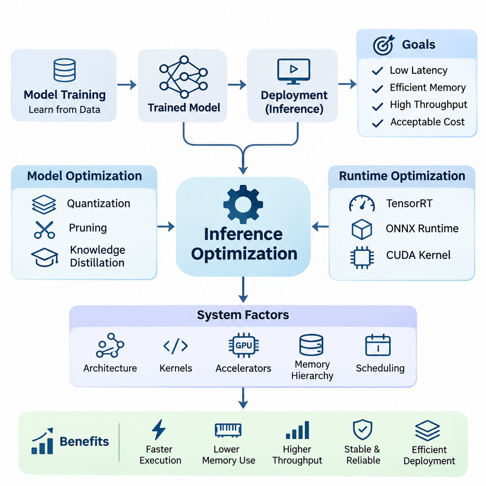
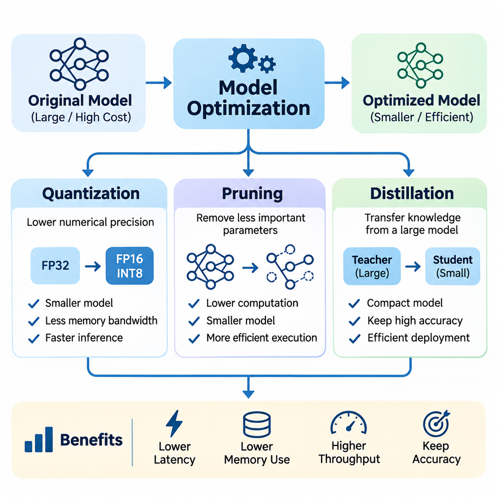
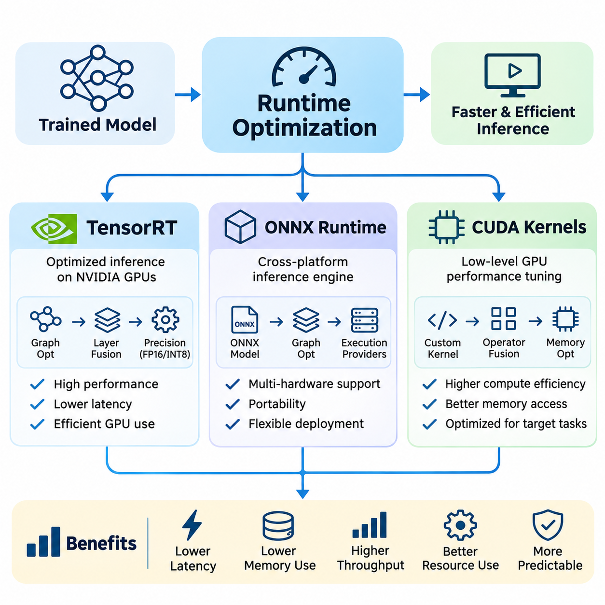
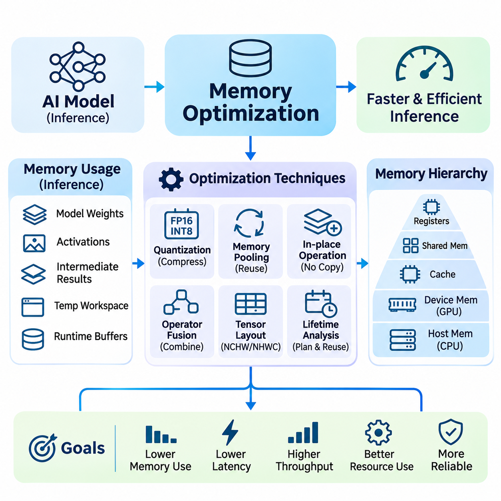
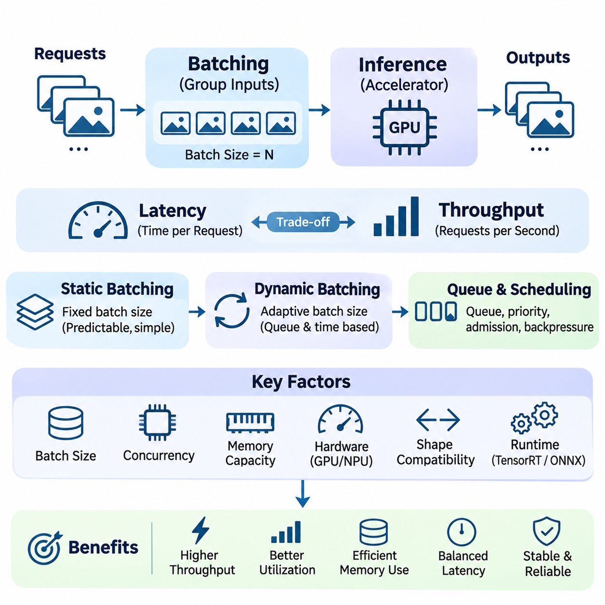
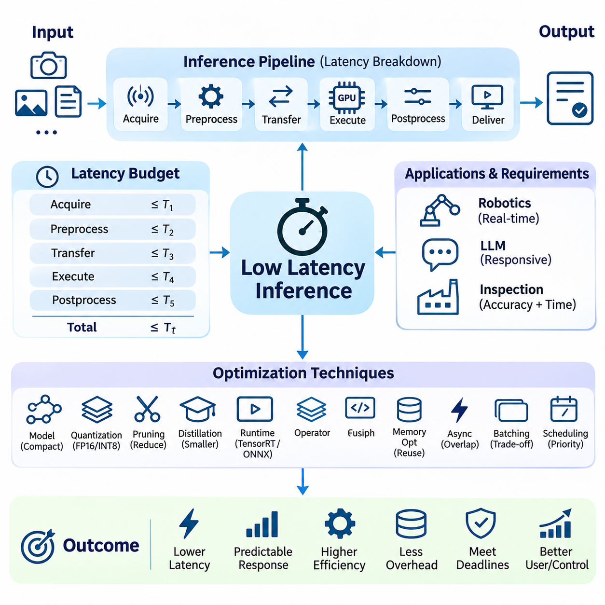
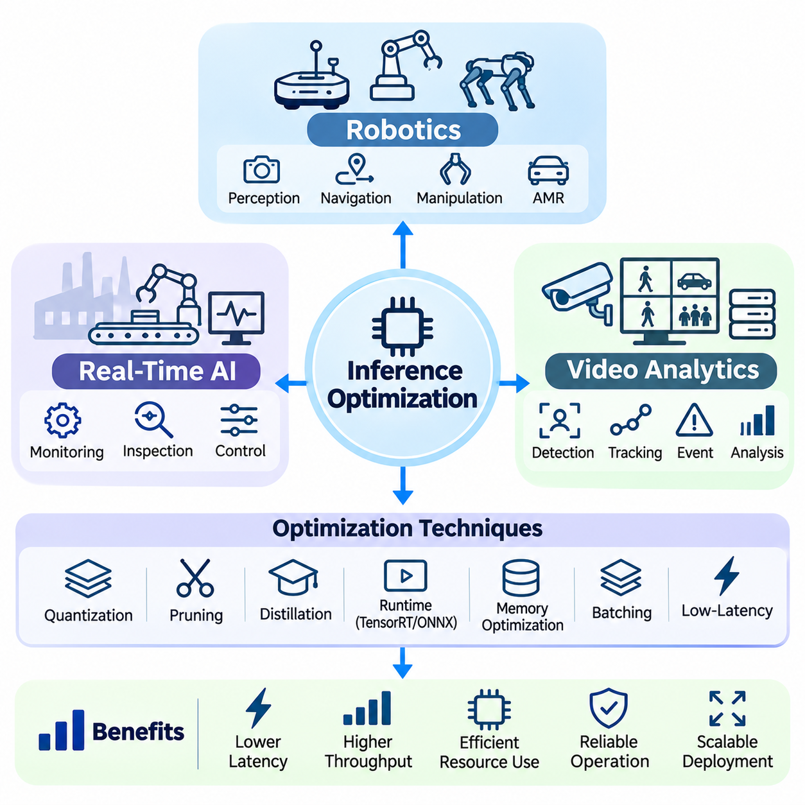

**Volume 38. AI Systems Architecture**

# 03. Inference Optimization

## 03.00 Overview

{width="7.268055555555556in" height="7.268055555555556in"}

Inference optimization is a fundamental discipline in artificial intelligence systems architecture, focusing on improving the execution efficiency of trained models during deployment. While model training emphasizes learning accurate representations from data, inference optimization concentrates on delivering predictions with minimal latency, efficient memory utilization, high throughput, and acceptable computational cost across different hardware environments.

Modern AI applications increasingly depend on large neural networks that require substantial computational resources. Convolutional neural networks, transformers, and multimodal architectures introduce significant demands on processing capacity and memory bandwidth. Without effective inference optimization, even highly accurate models may become impractical for real-time applications, embedded platforms, or large-scale cloud services.

The primary objective of inference optimization is to balance predictive accuracy with operational efficiency. Improvements in execution speed must be evaluated alongside memory consumption, energy requirements, numerical stability, and system reliability. An optimized inference system should satisfy application-specific performance requirements while preserving the essential behavior and predictive capabilities of the original model.

Inference performance depends on interactions among model architecture, computational kernels, hardware accelerators, memory hierarchy, and runtime scheduling. Consequently, optimization cannot be treated exclusively as a neural network problem. It requires coordinated engineering across software frameworks, execution engines, device drivers, operating systems, and hardware platforms to achieve measurable end-to-end improvements.

Model optimization represents one of the most important approaches to reducing inference complexity. Techniques such as quantization, pruning, and knowledge distillation modify the numerical representation, parameter structure, or architecture of neural networks. These methods aim to reduce computational requirements while maintaining sufficient predictive accuracy for the intended deployment environment and application constraints.

Quantization reduces the numerical precision used to represent model parameters and intermediate activations. Converting floating-point operations into lower-precision formats, including FP16, BF16, and INT8, can decrease memory consumption and improve computational throughput on compatible hardware. However, quantization requires careful validation because reduced precision may introduce numerical errors and affect model accuracy.

Pruning improves computational efficiency by removing parameters, channels, or structural components that contribute relatively little to model predictions. Structured pruning can reduce actual execution time when the resulting architecture aligns with available hardware acceleration. Unstructured pruning may achieve substantial parameter sparsity, but its practical benefits depend on specialized sparse computation support and efficient runtime implementations.

Knowledge distillation transfers predictive behavior from a larger teacher model into a smaller student model. The student learns to approximate the teacher\'s outputs or intermediate representations while requiring fewer computational resources. This approach is particularly valuable when deploying advanced AI capabilities on embedded processors, mobile devices, and robotic systems with restricted power and memory budgets.

Runtime optimization focuses on improving how neural networks execute after model development. Execution engines such as NVIDIA TensorRT and ONNX Runtime provide mechanisms for graph optimization, operator fusion, execution planning, and hardware-specific acceleration. These capabilities reduce unnecessary operations and improve the utilization of available processing resources without necessarily changing the conceptual model architecture.

TensorRT enables optimized neural network execution on supported NVIDIA GPU platforms through graph transformations, precision selection, kernel optimization, and execution scheduling. ONNX Runtime provides a flexible inference environment supporting multiple execution providers and hardware backends. Selecting an appropriate runtime requires evaluating model compatibility, operator coverage, deployment portability, and actual performance under representative workloads.

CUDA kernel optimization addresses computational efficiency at a lower execution level. Custom kernels and optimized libraries can improve memory access patterns, parallel execution, and arithmetic intensity. Operator fusion reduces intermediate memory transfers by combining compatible operations. Nevertheless, low-level optimization should be guided by profiling evidence because computational bottlenecks vary across architectures and input configurations.

Memory optimization is essential because inference workloads frequently encounter limitations imposed by memory capacity and bandwidth rather than arithmetic throughput alone. Model weights, activation tensors, temporary buffers, and intermediate outputs compete for available memory resources. Efficient memory allocation, buffer reuse, tensor lifetime management, and reduced data movement can significantly improve execution performance.

GPU memory management becomes especially important when multiple models execute simultaneously. Fragmentation, repeated allocation, unnecessary tensor copies, and excessive intermediate storage can reduce effective device utilization. Techniques such as preallocated buffers, memory pooling, in-place operations where safe, and optimized tensor layouts help maintain predictable execution behavior under demanding production workloads.

Batching improves inference throughput by processing multiple inputs together, allowing accelerators to exploit parallel computational resources more effectively. Larger batches can increase hardware utilization and reduce average processing cost per input. However, batching may increase individual request latency and memory consumption, creating an important tradeoff between throughput efficiency and responsiveness.

Dynamic batching adjusts the number of inputs processed together according to incoming workload conditions. This approach is particularly useful in cloud inference services where request rates fluctuate. Effective batching policies consider queue waiting time, execution duration, memory availability, and service-level objectives. The optimal batch size therefore depends on workload characteristics rather than hardware capability alone.

Low-latency inference is critical for applications requiring rapid responses to environmental changes or user interactions. Autonomous robots, industrial controllers, interactive AI services, and intelligent monitoring systems must often complete inference within defined timing constraints. Optimization efforts should therefore consider preprocessing, data transfer, model execution, postprocessing, and communication delays as components of total response latency.

Latency evaluation must distinguish average execution time from worst-case behavior and high-percentile response times. A system with excellent average performance may still experience occasional delays caused by memory contention, scheduling interference, or resource saturation. For time-sensitive applications, consistent response behavior and deadline compliance can be more important than achieving the highest possible average throughput.

Hardware characteristics strongly influence the effectiveness of inference optimization. GPUs provide substantial parallel processing capability, while CPUs offer flexibility for control-intensive operations and smaller workloads. Dedicated neural processing units and embedded accelerators provide alternative efficiency characteristics. Selecting hardware requires understanding computational precision support, memory bandwidth, power consumption, and software ecosystem compatibility.

Edge deployment introduces additional constraints because inference must execute close to sensors, machines, or users with limited computational resources. Embedded platforms such as NVIDIA Jetson integrate accelerated processing within relatively compact power envelopes. Successful edge inference optimization requires coordinated management of model complexity, memory usage, thermal behavior, power consumption, and communication requirements.

Edge AI systems often operate under changing environmental and computational conditions. Sensor workloads, background processes, thermal throttling, and concurrent inference tasks can influence execution performance. Adaptive scheduling, workload prioritization, and resource monitoring help maintain reliable operation. Optimization must therefore account for sustained performance rather than relying exclusively on short-duration benchmark measurements.

Robotics provides a representative example of inference optimization under demanding operational constraints. Autonomous platforms may execute object detection, semantic segmentation, localization, tracking, and environmental understanding simultaneously. These workloads share computational resources while supporting navigation and control decisions. Efficient inference scheduling helps preserve responsiveness and reduces the risk of delayed perception updates.

Real-time AI systems require close coordination between inference execution and broader system scheduling. Processing deadlines, sensor synchronization, communication latency, and actuator response times influence the effectiveness of AI-driven decisions. An optimized neural network alone cannot guarantee real-time performance unless the complete processing pipeline satisfies its required timing characteristics under representative operating conditions.

Video analytics presents another important application domain because continuous image streams generate substantial computational workloads. Multiple cameras may require simultaneous object detection, classification, tracking, and event recognition. Techniques such as frame selection, resolution adaptation, model sharing, and asynchronous processing can reduce resource requirements while maintaining sufficient analytical quality for operational objectives.

Inference optimization also has significant economic implications for large-scale AI services. Improved computational efficiency can reduce accelerator requirements, electricity consumption, and infrastructure expenditure. Higher throughput per device can increase service capacity without proportional hardware expansion. However, economic evaluation must include development effort, maintenance complexity, licensing constraints, and the operational costs associated with optimization techniques.

Performance benchmarking provides the evidence necessary to determine whether optimization strategies produce meaningful improvements. Measurements should include latency, throughput, memory utilization, power consumption, and predictive accuracy. Experiments must use representative input distributions, realistic concurrency levels, and clearly defined hardware configurations to ensure that observed improvements translate into production environments.

Optimization introduces engineering tradeoffs that require systematic validation. Aggressive quantization may reduce accuracy, excessive pruning may remove important representational capacity, and large batches may violate latency constraints. Similarly, hardware-specific runtime optimizations can complicate portability. Reliable optimization processes compare candidate configurations against explicit requirements rather than assuming that reduced computational complexity always improves system performance.

A practical inference optimization workflow begins with establishing a reproducible performance baseline. Profiling identifies expensive operators, memory bottlenecks, data transfer overhead, and scheduling inefficiencies. Engineers then apply targeted optimization techniques, evaluate their effects, and verify predictive consistency. Iterative measurement helps distinguish genuine system improvements from changes that merely shift computational costs between components.

Production deployment requires continued monitoring because inference performance can change with software updates, hardware configurations, and evolving workload distributions. Runtime metrics should reveal latency degradation, memory pressure, resource saturation, and unexpected execution failures. Maintaining versioned models, reproducible configurations, and regression benchmarks supports controlled optimization throughout the operational lifecycle.

Ultimately, inference optimization connects neural network efficiency with practical AI systems engineering. Model compression, runtime acceleration, memory management, batching, low-latency execution, and edge deployment form complementary components of a unified optimization strategy. Their coordinated application enables AI systems to deliver reliable intelligence within the computational, temporal, and economic constraints of real-world environments.

## 03.01 Model Optimization

{width="7.268055555555556in" height="7.268055555555556in"}

Model optimization is a fundamental component of efficient artificial intelligence inference, focusing on reducing computational complexity, memory requirements, and execution latency while preserving predictive accuracy. Unlike runtime optimization, which improves how an existing model executes, model optimization modifies numerical representations, parameter structures, or learned behavior to produce architectures better suited for practical deployment.

Three major techniques define the foundation of model optimization: quantization, pruning, and knowledge distillation. Each addresses computational inefficiency from a different perspective. Quantization reduces numerical precision, pruning eliminates unnecessary parameters or structures, and distillation transfers knowledge from a larger model into a smaller one. These methods can be applied independently or combined within a coordinated optimization workflow.

Quantization converts neural network weights and activations from high-precision numerical formats into lower-precision representations. Traditional models frequently use FP32 floating-point arithmetic, while optimized inference implementations may employ FP16, BF16, INT8, or lower-bit formats. Reducing precision decreases model storage requirements and memory bandwidth consumption while potentially increasing arithmetic throughput on compatible hardware accelerators.

The effectiveness of quantization depends on the numerical characteristics of the model and the capabilities of the target processor. Modern GPUs, neural processing units, and specialized accelerators support different low-precision operations. INT8 execution can provide substantial efficiency improvements when supported by optimized kernels, but conversion overhead, unsupported operators, and numerical sensitivity may limit achievable acceleration.

Post-training quantization applies numerical compression to an already trained model without requiring complete retraining. Calibration data may be used to estimate activation ranges and determine appropriate scaling parameters. This approach provides a relatively efficient deployment workflow, although models containing highly sensitive layers, extreme activation values, or complex attention mechanisms may experience measurable accuracy degradation.

Quantization-aware training incorporates simulated quantization effects during model training or fine-tuning. By exposing the network to reduced-precision behavior, the optimization process can adapt model parameters to compensate for numerical errors. This approach often improves accuracy retention compared with simple post-training quantization, but it requires additional training resources and careful configuration of quantization parameters.

Quantization may use symmetric or asymmetric numerical mappings, depending on the distribution of weights and activations. Per-tensor quantization applies a common scale across an entire tensor, while per-channel quantization assigns separate scales to individual channels. The selection influences numerical accuracy, implementation complexity, and hardware compatibility, making calibration and deployment-specific evaluation essential.

Mixed-precision inference assigns different numerical formats to selected layers or operations according to their sensitivity and computational requirements. Numerically sensitive components may retain higher precision, while computationally intensive matrix operations use lower precision. This strategy balances accuracy and efficiency, particularly in transformer models where attention, normalization, and projection operations exhibit different numerical characteristics.

Pruning reduces neural network complexity by removing parameters or computational structures that contribute relatively little to predictive performance. Large neural networks frequently contain redundancy that can be exploited to create smaller representations. Pruning techniques identify less important connections, channels, filters, attention heads, or layers, allowing the remaining network to perform similar tasks with fewer computational resources.

Unstructured pruning removes individual weights according to criteria such as magnitude, gradient information, or estimated importance. This approach can produce highly sparse parameter matrices while retaining much of the original model architecture. However, reduced parameter counts do not automatically translate into faster inference because conventional hardware and dense computational kernels may not efficiently exploit irregular sparsity.

Structured pruning removes complete computational components, including convolutional filters, channels, transformer heads, or network blocks. Because these modifications produce smaller dense operations, structured pruning is often more compatible with standard inference runtimes and accelerators. Nevertheless, removing entire structures can affect representation capacity and requires careful evaluation of the resulting model architecture.

Pruning strategies may operate during training, after training, or through iterative optimization cycles. Iterative pruning typically removes a portion of parameters, fine-tunes the remaining network, and repeats the process until a target complexity is reached. Gradual reduction can help preserve predictive performance, although aggressive pruning may cause irreversible information loss or reduced robustness under unfamiliar inputs.

The importance of a parameter cannot always be determined from its magnitude alone. Sensitivity-based pruning evaluates how parameter removal influences model outputs or loss functions, while hardware-aware pruning considers the actual execution characteristics of target accelerators. Effective pruning therefore combines statistical importance with practical constraints such as tensor dimensions, memory alignment, and supported computational operations.

Knowledge distillation provides an alternative approach by transferring learned behavior from a larger teacher model to a smaller student model. Instead of directly removing components from the original network, distillation trains a compact architecture to reproduce important characteristics of the teacher. The resulting student can achieve favorable accuracy and efficiency when its architecture is appropriately designed for the deployment environment.

In conventional knowledge distillation, the student learns from softened probability distributions generated by the teacher. These distributions contain information about relationships among output classes beyond conventional hard labels. A temperature parameter controls the softness of the distributions, allowing the student to learn relative class similarities and decision boundaries that may improve generalization.

The distillation objective commonly combines supervised learning loss with a teacher-student matching loss. Supervised loss encourages correct predictions using ground-truth labels, while distillation loss encourages agreement with the teacher\'s outputs. Their relative weighting determines how strongly the student follows the teacher compared with the original training data, influencing accuracy, calibration, and generalization.

Feature-based distillation transfers intermediate representations rather than relying exclusively on final predictions. The student may learn to approximate selected feature maps, hidden states, attention distributions, or relational structures produced by the teacher. This approach can improve representation learning when teacher and student architectures differ substantially, although additional projection layers or alignment mechanisms may be necessary.

Distillation can also be applied to transformer architectures, multimodal models, and perception systems. A large vision model may teach a compact detector, while a language model may transfer task-specific behavior into a smaller network. In robotics, a computationally expensive perception model can supervise a lightweight student intended for real-time operation on an embedded accelerator.

Quantization, pruning, and distillation address different dimensions of model efficiency and can complement one another. Distillation can establish a compact student architecture, structured pruning can remove remaining redundant components, and quantization can reduce numerical precision. However, the order of application influences the final result because each transformation changes the model\'s numerical and structural characteristics.

Combining optimization techniques introduces additional challenges related to accuracy preservation and training stability. A heavily pruned network may become more sensitive to quantization errors, while a distilled student may lack sufficient capacity to recover from aggressive compression. Consequently, optimization pipelines should evaluate intermediate models rather than assuming that independently successful techniques will remain effective when combined.

Hardware-aware model optimization considers the computational characteristics of the deployment platform from the beginning. A theoretically smaller model may execute more slowly if its operators are poorly supported or its tensor dimensions produce inefficient hardware utilization. Effective optimization therefore requires examining memory access patterns, arithmetic intensity, kernel availability, and accelerator-specific execution behavior.

Performance evaluation should measure model size, parameter count, computational operations, memory consumption, latency, throughput, and predictive quality. Parameter reduction alone is insufficient because actual execution time depends on memory movement, operator scheduling, and hardware efficiency. Measurements should include representative inputs and realistic deployment conditions to establish whether compression produces meaningful operational improvements.

Accuracy evaluation must also extend beyond aggregate benchmark scores. Quantization may disproportionately affect rare classes, pruning may reduce robustness to unusual inputs, and distillation may transfer limitations or biases from the teacher. Application-specific validation should examine difficult examples, distribution shifts, confidence calibration, and failure modes, particularly when optimized models support safety-sensitive decisions.

For edge AI and autonomous robotics, model optimization directly influences operational feasibility. Compact models reduce memory pressure and computational demand, enabling multiple perception and decision-making workloads to share limited hardware resources. Lower execution latency can improve sensor processing responsiveness, while reduced power consumption may support longer operation within constrained thermal and energy budgets.

A systematic model optimization workflow begins with a validated baseline and clearly defined deployment objectives. Engineers profile computational bottlenecks, select suitable compression techniques, generate candidate models, and evaluate accuracy and hardware performance. Iterative refinement identifies configurations that satisfy application constraints without introducing unacceptable numerical instability, execution variability, or maintenance complexity.

Ultimately, model optimization transforms computationally demanding neural networks into deployable components of efficient AI systems. Quantization improves numerical efficiency, pruning reduces structural redundancy, and knowledge distillation transfers learned capabilities into compact architectures. Their coordinated application enables practical inference across cloud infrastructure, embedded platforms, robotics, and real-time intelligent systems.

## 03.02 Runtime Optimization

{width="7.268055555555556in" height="7.268055555555556in"}

Runtime optimization focuses on improving the execution efficiency of trained artificial intelligence models without fundamentally changing their learned parameters or predictive architecture. It addresses computational overhead, memory movement, operator scheduling, and hardware utilization during inference. Effective runtime optimization enables models to achieve lower latency, higher throughput, and more predictable performance across production environments.

Modern neural networks consist of numerous computational operators that must execute efficiently across processors, accelerators, and memory systems. Although training frameworks provide flexible execution environments, their default inference behavior may introduce unnecessary overhead. Specialized inference runtimes optimize computational graphs, select efficient kernels, manage intermediate tensors, and coordinate execution to improve overall system performance.

Runtime optimization operates at several interconnected levels, including computational graph transformation, kernel selection, memory allocation, precision management, and execution scheduling. These mechanisms must account for model structure, input dimensions, hardware characteristics, and workload patterns. A successful optimization strategy improves complete inference pipelines rather than concentrating exclusively on individual mathematical operations.

NVIDIA TensorRT is a specialized inference optimization framework designed to accelerate neural network execution on supported NVIDIA GPU platforms. It transforms trained models into optimized execution engines through graph analysis, layer fusion, precision selection, and hardware-specific kernel optimization. TensorRT is particularly valuable for applications requiring high computational efficiency under constrained latency and memory requirements.

TensorRT optimization begins with importing a compatible neural network representation and constructing an internal computational graph. The framework analyzes supported operations, identifies opportunities for fusion, and selects implementation strategies suited to the target GPU. During engine construction, optimization profiles and available hardware capabilities influence the selection of kernels, tensor layouts, and execution configurations.

Layer fusion combines compatible operations into more efficient computational units, reducing intermediate memory transfers and kernel launch overhead. For example, convolution, bias addition, and activation operations may be combined when supported by the execution engine. Fusion improves performance by limiting unnecessary movement between GPU memory and computational units while preserving the mathematical behavior of the original network.

TensorRT supports multiple numerical precision modes, including FP32, FP16, BF16, and INT8 where supported by the hardware and software configuration. Lower precision can reduce memory bandwidth requirements and improve accelerator utilization. However, precision selection must consider numerical stability, operator support, calibration requirements, and the accuracy characteristics of the deployed model.

Dynamic input shapes introduce additional complexity because inference workloads may contain varying image resolutions, sequence lengths, or batch sizes. TensorRT optimization profiles define supported input dimension ranges and guide execution planning. Carefully selected profiles improve flexibility while controlling memory allocation and optimization overhead, although broad shape ranges may reduce opportunities for specialized kernel selection.

TensorRT execution engines are generally optimized for particular hardware and software configurations. Engine serialization can reduce repeated build overhead, but compatibility requirements must be considered when transferring engines between devices or runtime environments. Deployment workflows should maintain reproducible build configurations and verify engine behavior after changes to GPU architecture, drivers, or supporting libraries.

ONNX Runtime provides a general-purpose inference execution framework designed to support models represented in the Open Neural Network Exchange format. It offers a unified execution interface across multiple hardware platforms and acceleration backends. This portability makes ONNX Runtime suitable for applications requiring consistent model deployment across cloud servers, desktop systems, embedded devices, and heterogeneous computing environments.

The ONNX format represents neural networks as computational graphs containing standardized operators, tensor definitions, and model parameters. Exporting a trained model into ONNX separates its representation from the original training framework. Nevertheless, successful conversion requires validating operator compatibility, dynamic shape behavior, numerical consistency, and differences between the original and exported execution graphs.

ONNX Runtime uses execution providers to connect its inference engine with available computational backends. Depending on platform support, these may include CPU execution, CUDA acceleration, TensorRT integration, and other specialized hardware interfaces. Execution providers determine how supported graph operations are assigned to processing resources, influencing performance, portability, and deployment complexity.

Graph optimization in ONNX Runtime includes constant folding, redundant operation elimination, operator fusion, and other transformations that simplify execution. These optimizations reduce unnecessary computation and improve resource utilization. Their effectiveness depends on model structure, available execution providers, operator compatibility, and optimization settings selected for the inference session.

Execution provider partitioning allows different portions of a computational graph to execute on different backends when necessary. Unsupported operations may fall back to another provider, preserving functional compatibility in supported configurations. However, frequent transfers between processing devices can introduce substantial overhead, making execution placement and data movement important considerations during performance evaluation.

ONNX Runtime also provides mechanisms for controlling execution sessions, memory allocation, thread scheduling, and graph optimization levels. CPU inference can benefit from carefully configured thread pools and optimized numerical libraries, while GPU execution requires attention to device memory management and asynchronous processing. Configuration choices should reflect workload concurrency, processor topology, and latency requirements.

CUDA kernels provide the low-level computational foundation for many GPU-accelerated inference operations. CUDA enables developers to express parallel computations that execute across thousands of GPU threads. Neural network operations such as matrix multiplication, convolution, normalization, activation functions, and tensor transformations can be implemented using CUDA kernels or optimized libraries built upon the CUDA programming model.

CUDA execution organizes threads into blocks and grids, allowing computational workloads to be distributed across GPU processing units. Efficient kernel design requires understanding thread scheduling, warp execution, register utilization, shared memory, and global memory access. Poorly configured kernels may suffer from low occupancy, excessive synchronization, or inefficient memory transactions despite performing relatively simple mathematical operations.

Memory access optimization is central to CUDA kernel performance because many inference operations are limited by data movement rather than arithmetic throughput. Coalesced global memory accesses, shared memory reuse, and appropriate tensor layouts reduce unnecessary memory transactions. Efficient kernels attempt to maximize useful computation per transferred byte while respecting hardware constraints and available memory capacity.

Kernel fusion combines multiple compatible operations into a single CUDA execution unit, reducing launch overhead and intermediate tensor storage. Fused normalization, activation, and elementwise operations can improve inference efficiency when memory traffic dominates execution time. However, excessive fusion may increase register pressure, reduce occupancy, or complicate numerical behavior, requiring careful benchmarking.

GPU kernel optimization also involves selecting appropriate thread block dimensions, vectorized memory operations, and specialized mathematical instructions. Tensor Cores can accelerate supported matrix operations when data types and dimensions satisfy hardware requirements. Performance depends on balancing arithmetic throughput, memory bandwidth, register pressure, and occupancy rather than maximizing any single hardware utilization metric.

Asynchronous execution enables CUDA operations to overlap computation and data transfer when hardware capabilities and workload dependencies permit. CUDA streams can coordinate concurrent kernels and memory transfers, while events provide synchronization and timing mechanisms. Proper scheduling reduces idle periods, although unnecessary synchronization or competing workloads can eliminate potential concurrency benefits.

CUDA Graphs can reduce repeated CPU-side launch overhead by capturing compatible sequences of GPU operations for subsequent execution. This capability is useful for inference workloads with relatively stable execution patterns and repeated computational structures. Graph capture requires attention to memory addresses, execution dependencies, dynamic shapes, and compatibility with the operations included in the captured sequence.

TensorRT, ONNX Runtime, and CUDA kernels operate at complementary abstraction levels. TensorRT emphasizes optimized GPU inference engines, ONNX Runtime provides portable graph execution through multiple backends, and CUDA enables detailed control over GPU computation. These technologies may be integrated rather than treated as mutually exclusive alternatives, depending on deployment requirements and available hardware.

Selecting an inference runtime requires evaluating model compatibility, execution latency, throughput, memory consumption, numerical accuracy, and maintenance requirements. TensorRT may offer specialized optimization opportunities on supported NVIDIA hardware, while ONNX Runtime provides broader deployment flexibility. Custom CUDA kernels are most appropriate when profiling identifies specific operations that cannot be adequately optimized through existing runtime implementations.

Runtime benchmarking must distinguish model execution time from complete application latency. Data preprocessing, host-to-device transfers, inference execution, device-to-host transfers, and postprocessing contribute to end-to-end response time. Accurate GPU measurements require appropriate synchronization, warm-up execution, representative input distributions, and consistent hardware conditions to avoid misleading performance conclusions.

For robotics and real-time AI systems, runtime optimization must support predictable execution under concurrent workloads. Perception models may share GPU resources with localization, planning, and control-related computations. Scheduling policies should consider processing deadlines, memory contention, and workload priorities. High average throughput alone does not guarantee acceptable worst-case latency or deterministic system behavior.

Production runtime optimization requires continuous validation because performance characteristics may change with model updates, software versions, GPU drivers, and hardware configurations. Monitoring should track latency distributions, memory utilization, execution failures, and resource saturation. Reproducible configurations and regression benchmarks help maintain performance consistency throughout the deployment lifecycle.

Ultimately, runtime optimization connects high-level neural network models with efficient hardware execution. TensorRT provides specialized inference compilation and acceleration, ONNX Runtime supports portable execution across heterogeneous platforms, and CUDA kernels enable fine-grained computational optimization. Their coordinated application improves inference efficiency, scalability, and operational reliability in cloud, edge, robotics, and industrial AI systems.

## 03.03 Memory Optimization

{width="7.268055555555556in" height="7.268055555555556in"}

Memory optimization is a critical discipline in artificial intelligence inference systems, focusing on reducing memory consumption, improving data access efficiency, and minimizing unnecessary transfers between computational resources. Modern neural networks frequently encounter memory limitations even when sufficient arithmetic processing capability is available. Effective memory optimization improves execution latency, throughput, scalability, and operational reliability.

Inference memory requirements arise from model parameters, activation tensors, intermediate results, temporary workspaces, and runtime execution buffers. Each component contributes to the total memory footprint and may exhibit different allocation and access patterns. Understanding these requirements is essential for designing inference systems that operate efficiently across GPUs, CPUs, embedded accelerators, and heterogeneous computing platforms.

Memory capacity and memory bandwidth impose distinct constraints on inference performance. Capacity determines whether a model and its working data can reside within available device memory, while bandwidth determines how quickly information can be transferred. A model may fit comfortably within GPU memory yet remain limited by repeated weight loading, activation movement, or inefficient memory access patterns.

The memory hierarchy includes registers, caches, shared memory, device memory, and host memory, each providing different latency, bandwidth, and capacity characteristics. Efficient inference execution attempts to keep frequently accessed information close to computational units. Optimizing data locality and reuse reduces expensive memory transactions and improves the effective utilization of available processing resources.

Model weights often represent a substantial portion of inference memory consumption, particularly in transformer architectures and large language models. Weight compression through quantization reduces storage requirements and memory transfer overhead. Lower-precision representations such as FP16, BF16, and INT8 can improve efficiency, although actual benefits depend on hardware support, numerical accuracy, and runtime implementation.

Activation memory becomes especially important when processing high-resolution images, long sequences, or large batches. Intermediate feature maps and hidden states may occupy significant memory even when model parameters are relatively compact. Reducing unnecessary intermediate tensors, optimizing execution order, and releasing temporary allocations promptly can decrease peak memory requirements without changing predictive behavior.

Tensor lifetime analysis identifies when intermediate values are created, consumed, and no longer required. By tracking these dependencies, inference runtimes can reuse memory regions for tensors whose lifetimes do not overlap. Memory planning based on tensor lifetimes reduces repeated allocation overhead and limits the total workspace required for executing complex computational graphs.

Memory pooling improves allocation efficiency by reserving reusable blocks rather than repeatedly requesting memory from the underlying allocator. This approach reduces allocation latency and can mitigate fragmentation under dynamic workloads. However, poorly configured pools may retain excessive memory or create contention, requiring careful selection of pool sizes, allocation policies, and release mechanisms.

Memory fragmentation occurs when free memory is divided into blocks that cannot efficiently satisfy new allocation requests. In long-running inference services, varying tensor dimensions and repeated allocations can gradually increase fragmentation. Preallocation, stable buffer reuse, and memory-aware scheduling help maintain predictable resource availability and reduce the likelihood of allocation failures.

In-place operations modify existing tensors rather than allocating separate output buffers, potentially reducing memory consumption and data movement. They are useful for selected activation functions and elementwise transformations when input values are no longer needed. Nevertheless, in-place execution must respect tensor dependencies, aliasing constraints, and runtime correctness to avoid unintended changes in model behavior.

Operator fusion improves memory efficiency by combining compatible computational operations and eliminating unnecessary intermediate tensor storage. Fused convolution, normalization, and activation sequences can reduce memory traffic and kernel launch overhead. The effectiveness of fusion depends on operator compatibility, register pressure, available shared memory, and the ability to preserve numerical correctness.

Tensor layout optimization determines how multidimensional data is arranged in memory. Layouts such as NCHW and NHWC influence access patterns, vectorization, and accelerator utilization. Selecting layouts compatible with optimized kernels can improve memory coalescing and reduce conversion overhead, while frequent layout transformations may eliminate the benefits of otherwise efficient operations.

GPU memory optimization requires careful coordination between global memory, shared memory, caches, and registers. Coalesced memory accesses reduce transaction overhead, while shared memory enables data reuse within cooperating thread blocks. Excessive register usage or shared memory allocation may reduce occupancy, making performance optimization a balance between locality, parallelism, and resource availability.

Host-to-device and device-to-host transfers can contribute significantly to inference latency, particularly when individual computations are relatively short. Avoiding unnecessary tensor copies and retaining data on the accelerator across successive operations reduces communication overhead. Pinned host memory and asynchronous transfers may further improve performance when supported by appropriate execution scheduling.

Unified memory and shared-memory architectures simplify certain data management tasks by allowing processors to access common or managed memory regions. However, simplified addressing does not eliminate physical bandwidth limitations or data migration costs. Effective deployment requires understanding whether memory is physically shared, remotely accessed, or migrated between devices during execution.

Batch size directly influences memory consumption because larger batches typically require additional activation storage and temporary workspaces. Although batching can improve throughput, excessive batch sizes may trigger memory exhaustion or increase latency. Memory-aware batching policies balance device utilization, request concurrency, and available capacity to maintain stable inference performance.

Dynamic input dimensions complicate memory planning because tensor sizes may change between inference requests. Variable image resolutions, sequence lengths, and batch configurations can produce unpredictable allocation patterns. Shape bucketing, bounded input dimensions, and reusable workspace configurations help control memory requirements while preserving flexibility for realistic workloads.

Transformer inference introduces distinctive memory challenges through attention operations and autoregressive generation. The key-value cache stores previously computed attention representations to avoid redundant calculations during token generation. Cache memory grows with sequence length and active requests, making cache allocation, reuse, precision, and eviction policies important considerations for scalable language model serving.

Attention memory optimization can reduce the need to materialize large intermediate attention matrices. Tiled computation and memory-efficient attention algorithms improve data locality and reduce transfers between high-bandwidth memory and on-chip storage. Their effectiveness depends on sequence dimensions, supported kernels, numerical precision, and the computational characteristics of the target accelerator.

Multi-model inference environments require coordinated memory management because several networks may share the same accelerator. Independent allocation strategies can create fragmentation, excessive reserved capacity, and unpredictable resource contention. Shared execution policies, model residency management, and workload prioritization help balance memory availability with inference responsiveness.

Edge AI platforms face additional constraints because memory capacity, bandwidth, power consumption, and thermal limits are tightly coupled. Embedded systems may share physical memory between CPU and GPU components, increasing contention under concurrent workloads. Compact model representations, controlled buffer allocation, and reduced data movement are therefore essential for sustained inference performance.

Robotic perception systems often execute object detection, segmentation, localization, and tracking simultaneously. Camera frames, point clouds, intermediate feature tensors, and control-related data compete for limited memory resources. Efficient buffer sharing, bounded queues, and predictable allocation patterns help preserve timely sensor processing and reduce the risk of delayed perception updates.

Memory optimization must also consider reliability and safety under resource pressure. Allocation failures, excessive swapping, unexpected cache growth, and memory leaks can disrupt inference services or real-time processing pipelines. Defensive resource limits, admission control, monitoring, and graceful degradation strategies help maintain operational continuity when memory demand approaches available capacity.

Performance profiling provides the evidence needed to identify memory bottlenecks accurately. Measurements should include peak allocated memory, reserved memory, bandwidth utilization, allocation frequency, transfer volume, and memory-related execution stalls. GPU profiling tools and runtime instrumentation help distinguish capacity limitations from bandwidth constraints and inefficient access patterns.

A systematic memory optimization workflow begins with establishing a reproducible baseline under representative workloads. Engineers identify peak-memory contributors, analyze tensor lifetimes, eliminate unnecessary copies, improve buffer reuse, and evaluate operator-level transformations. Each modification should be validated against predictive accuracy, latency distributions, throughput, and resource stability.

Ultimately, memory optimization connects neural network execution with the physical limitations of computing hardware. Efficient allocation, tensor reuse, optimized data layouts, reduced transfers, and memory-aware scheduling collectively improve inference performance. Their coordinated application enables reliable AI deployment across cloud infrastructure, edge devices, autonomous robotics, and real-time industrial systems.

## 03.04 Batching and Throughput

{width="7.268055555555556in" height="7.268055555555556in"}

Batching and throughput optimization are essential components of efficient artificial intelligence inference systems. Batching combines multiple inputs into a single execution workload, while throughput measures the amount of useful processing completed within a given period. Together, these concepts determine how effectively computational resources serve incoming requests while maintaining acceptable latency, memory consumption, and operational reliability.

Modern accelerators achieve high efficiency when sufficient parallel work is available to occupy their computational units. Processing individual inputs may leave GPU cores, memory interfaces, and specialized matrix engines underutilized. Batching increases the amount of concurrent computation within each inference execution, allowing hardware resources to process larger workloads with reduced scheduling overhead per input.

Batch size represents the number of inputs processed together during a single inference operation. Increasing batch size can improve arithmetic intensity, amortize kernel launch overhead, and increase accelerator utilization. However, the relationship between batch size and throughput is not linear because memory capacity, bandwidth limitations, kernel efficiency, and scheduling constraints eventually restrict additional performance gains.

Throughput is commonly expressed as requests, images, frames, samples, or generated tokens processed per second. The appropriate measurement depends on the application and workload characteristics. For example, image classification services may measure images per second, while language model serving systems distinguish input token processing from output token generation because their computational behavior differs substantially.

Latency and throughput represent related but distinct performance objectives. Latency measures the time required to complete an individual request, while throughput measures the aggregate processing rate. Larger batches may increase throughput while extending request waiting time or execution duration. Consequently, maximizing throughput without considering response deadlines can produce systems that perform poorly in interactive or real-time applications.

Static batching processes a predetermined number of inputs together, making execution dimensions relatively predictable. This approach simplifies memory planning, kernel selection, and performance benchmarking. It is effective for offline processing and workloads with stable input availability, but it may introduce unnecessary waiting when incoming requests arrive irregularly or fail to fill the configured batch.

Dynamic batching groups incoming requests according to current queue conditions, batch size limits, and scheduling policies. Instead of waiting indefinitely for a full batch, the system may execute a partially filled batch after a defined waiting interval. This approach improves accelerator utilization under variable traffic while limiting additional queuing latency for individual requests.

A dynamic batching scheduler must balance batch formation time against computational efficiency. Short waiting intervals improve responsiveness but may produce smaller batches and lower utilization. Longer intervals increase opportunities for aggregation but can violate latency objectives. Effective scheduling therefore considers arrival rates, execution-time distributions, queue depth, and service-level requirements.

Queue management is central to maintaining stable throughput under changing workloads. When incoming request rates exceed processing capacity, queue lengths and response times increase. Admission control, bounded queues, request prioritization, and backpressure mechanisms prevent uncontrolled resource consumption. These techniques help preserve predictable service behavior during temporary demand spikes or sustained overload.

The relationship between concurrency and batching requires careful consideration. Concurrency represents the number of requests active within the system, while batching determines how many inputs share an execution operation. High concurrency can supply sufficient requests for efficient batching, but excessive concurrency may increase memory pressure, scheduling contention, and tail latency without improving useful throughput.

Memory consumption typically increases with batch size because activation tensors, intermediate results, and temporary workspaces must accommodate more inputs. Large batches may exceed accelerator memory capacity or reduce the number of models that can remain resident simultaneously. Memory-aware batching adjusts execution configurations according to available capacity and workload requirements rather than relying on a fixed maximum batch size.

Hardware characteristics strongly influence optimal batching behavior. GPUs with substantial parallel processing capability may benefit from larger batches, while embedded accelerators with limited memory and power budgets often require smaller configurations. Kernel implementations, tensor dimensions, precision formats, and memory bandwidth determine whether additional inputs produce meaningful performance improvements.

Inference runtimes such as TensorRT and ONNX Runtime support optimized execution for different batch configurations and hardware environments. TensorRT can use optimization profiles to accommodate supported dynamic dimensions, while ONNX Runtime provides execution mechanisms across multiple backends. Actual batching policies are often implemented by serving frameworks or application schedulers rather than the execution engine alone.

Shape compatibility becomes important when requests contain different image resolutions, sequence lengths, or tensor dimensions. Combining incompatible shapes may require padding, resizing, or grouping inputs into compatible categories. Shape bucketing reduces unnecessary padding and improves execution efficiency, although additional queues and scheduling complexity may increase waiting time.

Sequence-based models introduce variable computational costs because requests may contain different input lengths or generation requirements. Padding all sequences to the longest member of a batch can waste substantial computation. Length-aware batching groups requests with similar dimensions, reducing unnecessary operations while preserving sufficient flexibility to handle diverse incoming workloads.

Large language model inference introduces additional batching challenges through autoregressive token generation. Prefill processing handles input sequences with substantial parallel computation, while decoding repeatedly generates new tokens and accesses cached attention states. Their different resource requirements make scheduling policies particularly important for balancing token throughput, memory utilization, and user-perceived latency.

Continuous batching allows active requests to enter or leave execution groups as generation progresses. Unlike conventional batching, which may wait for all requests in a group to finish, continuous batching can reuse available execution capacity when individual sequences complete. This approach improves utilization for variable-length generation workloads but requires sophisticated scheduling and key-value cache management.

The key-value cache stores previously computed attention representations during autoregressive generation. Its memory consumption increases with sequence length and the number of active requests. Batching strategies must account for cache allocation, fragmentation, reuse, and capacity limits. Poor cache management can reduce concurrency and throughput even when sufficient arithmetic processing capability remains available.

Pipeline parallelism and model parallelism introduce further scheduling considerations when inference workloads span multiple accelerators. Batches must move through distributed computational stages while maintaining efficient device utilization. Communication overhead, synchronization delays, and uneven stage execution times can reduce throughput, making balanced partitioning and coordinated scheduling essential.

For real-time AI systems, batching must respect strict processing deadlines rather than maximize aggregate throughput alone. Autonomous robots and industrial controllers often require immediate responses to sensor observations. Large waiting intervals can delay perception updates and control decisions. Small batches, priority-aware scheduling, or dedicated execution paths may therefore be preferable for time-critical workloads.

Video analytics systems can benefit from batching frames across multiple camera streams. Shared inference execution reduces per-frame overhead and improves accelerator utilization when sufficient frames are available. However, batching policies must consider camera frame rates, synchronization requirements, frame freshness, and acceptable detection delays to prevent stale information from influencing operational decisions.

Throughput optimization also involves overlapping data preparation, memory transfers, and accelerator execution. Asynchronous processing, preallocated buffers, pinned host memory, and carefully coordinated execution streams can reduce idle periods. Nevertheless, overlapping workloads compete for shared resources, so concurrency should be evaluated through measurements rather than assumed to provide automatic acceleration.

Performance benchmarking should measure throughput alongside average latency, high-percentile latency, queue waiting time, memory utilization, and accelerator occupancy. Testing only fully populated batches can overestimate production performance when traffic is irregular. Representative arrival patterns, realistic input distributions, and sustained load testing provide a more accurate understanding of operational efficiency.

A systematic optimization workflow begins by establishing baseline performance across several batch sizes and concurrency levels. Engineers identify saturation points, measure memory growth, evaluate queue behavior, and compare static and dynamic batching strategies. Iterative tuning then selects configurations that satisfy throughput objectives without violating latency limits or creating unstable resource consumption.

Ultimately, batching and throughput optimization connect parallel hardware efficiency with practical inference service requirements. Static batching, dynamic batching, continuous batching, queue management, and memory-aware scheduling provide complementary mechanisms for improving processing capacity. Their coordinated application enables scalable AI inference while preserving responsiveness, predictable execution, and reliable operation across cloud, edge, robotics, and industrial systems.

## 03.05 Low Latency Inference

{width="7.268055555555556in" height="7.268055555555556in"}

Low-latency inference is a fundamental requirement for artificial intelligence systems that must respond rapidly to incoming data and operational events. It focuses on minimizing the time between receiving an input and producing a usable prediction or decision. Unlike throughput-oriented optimization, low-latency inference emphasizes individual response times, predictable execution, and compliance with application-specific deadlines.

Inference latency consists of several interconnected stages, including input acquisition, preprocessing, data transfer, model execution, postprocessing, and result delivery. Optimizing neural network computation alone may provide limited benefits when other stages dominate response time. Effective low-latency design therefore evaluates the complete execution pipeline and identifies bottlenecks across software, hardware, and communication boundaries.

Latency requirements vary considerably between applications. Interactive language models prioritize responsive token generation, while robotic perception systems must process sensor observations before control deadlines expire. Industrial inspection may tolerate longer computation when accuracy is critical. System architects must translate application requirements into measurable latency budgets that guide implementation and resource allocation.

A latency budget assigns allowable execution time to individual processing stages within an end-to-end workflow. These allocations help identify which components require optimization and where scheduling margins are necessary. Practical budgets should account for variable execution times, communication delays, operating system interference, and occasional workload spikes rather than relying exclusively on average measurements.

Average latency alone cannot characterize the responsiveness of production inference systems. Tail latency, commonly measured using high-percentile response times, reveals delays experienced by the slowest requests. A system with excellent average performance may still violate operational deadlines because of memory contention, queue accumulation, synchronization overhead, or unpredictable background activity.

Model architecture strongly influences inference latency through computational depth, operator complexity, memory access patterns, and sequential dependencies. Smaller models may execute faster, but parameter count alone does not determine response time. Architectures containing hardware-friendly operations, efficient tensor layouts, and limited sequential processing can outperform theoretically smaller networks with inefficient execution characteristics.

Model compression techniques such as quantization, pruning, and knowledge distillation can reduce computational and memory requirements. Lower numerical precision may accelerate supported operations, while structured pruning can remove computational units that contribute little predictive value. However, actual latency improvements depend on runtime support, hardware capabilities, and whether the optimized model avoids introducing additional conversion overhead.

Inference runtimes reduce execution overhead through graph optimization, operator fusion, kernel selection, and efficient memory planning. TensorRT provides hardware-specific optimization for supported NVIDIA GPUs, while ONNX Runtime enables execution across multiple acceleration backends. Runtime selection should reflect model compatibility, numerical accuracy, deployment constraints, and measured end-to-end latency.

Kernel launch overhead becomes significant when neural networks contain numerous small operations. Each launch introduces scheduling costs that may dominate short computations. Operator fusion, CUDA Graphs, and optimized execution engines can reduce repeated launch overhead by combining compatible operations or replaying captured execution sequences under supported conditions.

Memory movement is frequently a major contributor to inference latency. Transferring tensors between host memory and accelerator memory introduces communication overhead, particularly for small workloads. Retaining intermediate data on the processing device, reusing allocated buffers, and eliminating unnecessary copies can improve responsiveness without changing the underlying model architecture.

Asynchronous execution can overlap data transfers, preprocessing, and accelerator computation when dependencies and hardware capabilities permit. CUDA streams and synchronization events provide mechanisms for coordinating concurrent operations. Nevertheless, excessive concurrency can introduce resource contention, making careful scheduling essential for achieving consistent latency rather than merely increasing apparent parallelism.

Batching creates a tradeoff between computational efficiency and request responsiveness. Larger batches may improve accelerator utilization but increase queue waiting time and execution duration. Latency-sensitive systems often favor small batches, bounded batching delays, or immediate execution. Dynamic batching policies should enforce explicit deadlines and avoid delaying urgent requests solely to improve throughput.

Request scheduling determines how inference workloads compete for available computational resources. Priority-aware queues, admission control, and deadline-based scheduling can protect time-critical operations from less urgent tasks. However, scheduling guarantees depend on the underlying runtime, operating system, and hardware behavior, requiring validation under realistic concurrent workloads.

CPU-side overhead can substantially affect short inference workloads even when GPU execution is highly optimized. Python interpreter costs, framework dispatch, tensor allocation, synchronization, and data preparation may consume significant portions of the latency budget. Compiled execution paths, persistent worker processes, preallocated memory, and reduced framework transitions can mitigate these costs.

Operating system scheduling introduces additional variability through thread preemption, interrupt handling, and competition for shared processor resources. Real-time scheduling policies, CPU affinity, isolated processing cores, and controlled background workloads may improve predictability. Such mechanisms require careful configuration because aggressive priority assignments can interfere with essential system services.

Hardware acceleration must be evaluated according to workload characteristics rather than peak computational specifications alone. GPUs, NPUs, FPGAs, and specialized inference processors offer different tradeoffs in execution overhead, memory bandwidth, power consumption, and supported operators. The best accelerator for low-latency inference is the one that consistently satisfies application deadlines under realistic operating conditions.

Edge inference can reduce communication latency by processing data near its source instead of transmitting every request to a remote cloud service. This is particularly important for autonomous machines and industrial systems operating with intermittent connectivity. However, edge devices have limited computational capacity, memory, and thermal budgets, requiring careful model selection and workload scheduling.

Distributed inference introduces additional delays through network transmission, serialization, remote execution, and response delivery. Even when remote accelerators provide faster model computation, communication overhead may dominate short requests. Hybrid architectures can assign urgent inference to local processors while reserving cloud resources for computationally intensive or noncritical workloads.

Robotic systems require coordinated latency management across perception, localization, planning, and control pipelines. Delayed object detection or obstacle classification can reduce the usefulness of otherwise accurate predictions. Designers must consider sensor timestamps, data freshness, processing deadlines, and actuator response when evaluating the operational impact of inference latency.

Real-time AI applications distinguish between soft deadlines and hard deadlines. Soft real-time systems may tolerate occasional delays with degraded service quality, whereas hard real-time systems require deadlines to be met to preserve correctness or safety. Conventional GPU inference runtimes generally do not provide hard real-time guarantees without additional system-level analysis and suitable execution controls.

Latency benchmarking must measure representative workloads under controlled conditions. Warm-up execution, appropriate device synchronization, realistic input dimensions, and consistent power settings help produce meaningful results. Measurements should distinguish model execution time from queue delays and end-to-end response time, while reporting latency distributions rather than a single average value.

Performance optimization should also examine cold-start behavior, including model loading, memory allocation, runtime initialization, and engine construction. These operations may introduce substantial delays during service startup or model switching. Persistent model residency, engine caching, initialization during deployment, and controlled resource provisioning can reduce unexpected first-request latency.

Thermal throttling, power management, and resource sharing can alter inference latency during sustained operation. A configuration that performs well in short benchmarks may become slower under prolonged workloads. Long-duration testing should evaluate temperature, processor frequency, memory pressure, and competing applications to identify performance degradation that would otherwise remain hidden.

A systematic low-latency optimization workflow begins by establishing an end-to-end latency baseline and allocating time budgets to processing stages. Engineers then profile dominant delays, apply targeted optimizations, and verify improvements under realistic concurrency. Each modification must preserve predictive accuracy, numerical stability, and operational reliability while avoiding regressions in worst-case response behavior.

Ultimately, low-latency inference requires coordinated optimization across model architecture, runtime execution, memory management, scheduling, hardware acceleration, and system integration. The objective is not simply to minimize isolated computation time but to deliver useful predictions within predictable deadlines. This integrated approach supports responsive AI services, autonomous robotics, edge intelligence, and real-time industrial applications.

## 03.06 Edge Deployment

{width="7.268055555555556in" height="7.268055555555556in"}

Edge deployment refers to executing artificial intelligence models directly on devices located near the sources of data generation. Unlike cloud-centered inference, edge deployment reduces dependence on remote computing infrastructure and network connectivity. This architecture enables faster responses, improved data locality, and greater operational autonomy, making it particularly valuable for robotics, industrial automation, intelligent cameras, and embedded AI systems.

Edge AI systems operate under constraints that differ substantially from those of centralized data centers. Limited computational capacity, memory bandwidth, power availability, storage resources, and thermal dissipation restrict model selection and execution strategies. Successful deployment requires balancing predictive accuracy, inference latency, energy consumption, hardware reliability, and long-term maintainability within a constrained physical environment.

The selection of edge hardware determines the computational capabilities and deployment flexibility of an inference system. Embedded GPUs, neural processing units, digital signal processors, and specialized AI accelerators provide different performance characteristics. Engineers must evaluate supported operators, numerical precision formats, memory architecture, software compatibility, and sustained processing capability rather than relying exclusively on advertised peak performance.

Platforms such as NVIDIA Jetson integrate CPU and GPU resources within compact embedded computing environments. Their shared memory architectures can simplify data exchange between processing components, although memory bandwidth remains a shared resource. Efficient deployment requires careful management of accelerator workloads, memory allocation, device interfaces, and thermal conditions to maintain predictable inference behavior.

Model optimization is essential when deploying neural networks on resource-constrained edge devices. Quantization reduces numerical precision and memory requirements, while pruning and knowledge distillation can decrease computational complexity. However, compressed models must be evaluated on the actual target hardware because theoretical reductions in parameter count or arithmetic operations do not always produce proportional improvements in execution latency.

Inference runtime selection strongly influences edge deployment performance. TensorRT can optimize supported models for NVIDIA GPU platforms, while ONNX Runtime provides execution flexibility across different hardware backends. Other vendor-specific runtimes may accelerate supported neural network operations. Runtime compatibility, operator coverage, memory overhead, and software maintenance requirements should guide deployment decisions.

Memory management is particularly important because embedded devices frequently operate with limited physical memory shared among multiple processing components. Model parameters, activation tensors, sensor buffers, and application services compete for available capacity. Preallocated buffers, tensor reuse, efficient data layouts, and controlled concurrency reduce memory fragmentation and improve execution stability during prolonged operation.

Power consumption directly affects the feasibility of edge AI deployment in battery-powered or thermally constrained systems. Higher computational utilization can increase energy demand and heat generation, potentially triggering frequency reductions or thermal throttling. Engineers must evaluate energy per inference, sustained power consumption, and workload-dependent performance rather than optimizing only instantaneous processing speed.

Thermal management determines whether an edge device can sustain its required inference performance under realistic environmental conditions. Compact enclosures, limited airflow, elevated ambient temperatures, and continuous workloads can reduce cooling effectiveness. Heat sinks, active cooling, enclosure ventilation, and appropriate power configurations should be evaluated through extended testing under representative operating conditions.

Low-latency inference is a major advantage of edge deployment because data can be processed without repeated communication with remote servers. Local execution reduces network transmission delays and supports timely decisions when connectivity is unstable. Nevertheless, end-to-end latency still includes sensor acquisition, preprocessing, memory transfers, model execution, postprocessing, and communication with local control systems.

Edge AI applications frequently process multiple sensor streams simultaneously. Cameras, LiDAR, radar, inertial sensors, and industrial interfaces generate data with different rates, formats, and timing requirements. Coordinated acquisition, timestamp alignment, bounded buffering, and priority-aware scheduling help maintain data freshness while preventing noncritical workloads from delaying time-sensitive inference tasks.

Real-time robotics introduces additional requirements because inference results influence navigation, obstacle avoidance, manipulation, and control decisions. Delayed predictions may become operationally irrelevant even when their classification accuracy remains high. Edge deployment architectures should therefore establish explicit processing deadlines, monitor worst-case latency, and isolate critical functions from unpredictable background workloads.

Hardware and software partitioning can improve reliability by assigning tasks according to their timing and computational requirements. High-performance accelerators may execute perception networks, while CPUs or dedicated controllers handle deterministic control loops. This separation reduces interference between computationally intensive AI workloads and safety-related functions, although communication boundaries and synchronization must be carefully managed.

Connectivity remains important even when inference executes locally. Edge devices may exchange telemetry, receive configuration updates, synchronize models, and communicate with centralized orchestration systems. Hybrid edge-cloud architectures can reserve cloud infrastructure for training, fleet analytics, and computationally intensive processing while keeping latency-sensitive inference and essential operational decisions close to the physical environment.

Offline operation is a critical capability for autonomous edge systems deployed in environments with intermittent or unavailable networks. Devices should maintain essential inference functions without continuous cloud access and preserve necessary configuration data locally. Store-and-forward communication, local event logging, and controlled synchronization enable operational continuity while supporting later analysis when connectivity becomes available.

Model deployment workflows must ensure compatibility between trained artifacts and target execution environments. Exporting models through standardized formats can simplify integration, but operator support, numerical behavior, input dimensions, and runtime versions require validation. Hardware-specific compilation may improve performance while introducing dependencies that must be tracked throughout the software lifecycle.

Containerization and reproducible software environments can simplify deployment across fleets of edge devices. Containers package application dependencies and support consistent runtime configurations, although access to accelerators, drivers, and device interfaces remains platform-dependent. Version-controlled deployment artifacts and hardware compatibility testing reduce configuration drift and simplify maintenance.

Remote updates introduce operational risks because devices may be deployed in locations where physical recovery is difficult. Secure over-the-air update mechanisms should verify software authenticity, preserve compatible configurations, and support rollback when deployment fails. Staged releases, health checks, and controlled activation reduce the likelihood that an incorrect model or runtime update disrupts an entire device fleet.

Security and privacy are fundamental considerations because edge devices may process sensitive sensor information and operate outside protected data centers. Secure boot, authenticated communication, encrypted storage, access control, and protected model artifacts reduce exposure to unauthorized modification. Local processing can limit unnecessary data transmission, but physical access and device compromise remain important security risks.

Observability enables engineers to evaluate edge inference behavior after deployment. Monitoring should capture latency distributions, memory utilization, processor load, temperature, power consumption, model failures, and communication status. Resource-aware logging and telemetry collection provide operational insight without overwhelming limited storage, network bandwidth, or computational capacity.

Reliability engineering must address unexpected failures caused by power interruptions, memory exhaustion, thermal events, sensor disconnections, and software faults. Watchdog mechanisms, bounded resource usage, controlled restart procedures, and degraded operating modes improve resilience. Safety-critical functions should not depend solely on the successful execution of probabilistic AI models.

Fleet-scale deployment introduces challenges involving hardware variation, software version consistency, configuration management, and operational monitoring. Different devices may exhibit distinct thermal behavior, accelerator capabilities, and sensor configurations. Deployment systems should maintain device inventories, compatibility profiles, model version records, and performance baselines to support reliable updates across heterogeneous installations.

Benchmarking edge AI requires measurements on the actual deployment platform rather than relying exclusively on desktop GPU results. Representative sensor inputs, realistic concurrency, sustained workloads, and environmental temperature variations should be included. Evaluation must distinguish model execution time from complete application latency while measuring energy efficiency, resource stability, and worst-case behavior.

A systematic edge deployment workflow begins with defining application requirements and selecting hardware that satisfies computational, memory, power, and environmental constraints. Engineers then optimize models, configure inference runtimes, integrate sensor pipelines, and establish reproducible deployment procedures. Validation under realistic operating conditions ensures that performance improvements remain compatible with reliability and maintenance objectives.

Ultimately, edge deployment transforms optimized neural networks into operational intelligence embedded within physical systems. Successful implementations coordinate model efficiency, hardware acceleration, memory management, power control, real-time scheduling, security, and lifecycle maintenance. This integrated approach enables responsive and dependable AI capabilities across autonomous robots, intelligent infrastructure, industrial equipment, and distributed edge environments.

## 03.07 Applications

{width="7.268055555555556in" height="7.268055555555556in"}

Inference optimization plays a fundamental role in deploying artificial intelligence across robotics, real-time AI, and video analytics applications. These domains require neural networks to process continuously arriving data while respecting latency, memory, and computational constraints. Although their operational objectives differ, all three benefit from efficient model execution, predictable scheduling, optimized data movement, and reliable hardware utilization.

Robotic systems integrate artificial intelligence inference with sensing, navigation, planning, manipulation, and physical control. Cameras, LiDAR, depth sensors, and inertial measurement units generate information that must be interpreted within operational deadlines. Optimized inference enables robots to recognize objects, estimate environmental conditions, and support decisions without introducing excessive delays into perception and control pipelines.

Autonomous mobile robots rely on timely perception to navigate dynamic environments containing people, equipment, and unexpected obstacles. Object detection, semantic segmentation, and depth estimation networks may operate simultaneously with localization and path planning. Efficient inference scheduling helps prevent computationally intensive perception tasks from interfering with navigation updates and time-sensitive control operations.

Robotic manipulation introduces additional requirements because perception results must remain consistent with changing object positions and robot configurations. Vision models may estimate object poses, identify grasp points, and evaluate workspace conditions. Low-latency execution reduces the interval between observation and action, improving responsiveness while supporting closed-loop manipulation under dynamic operating conditions.

Edge deployment is particularly important in robotics because communication with remote servers may introduce unpredictable delays or become temporarily unavailable. Embedded accelerators can execute perception and decision-support models directly on robotic platforms. Local inference improves operational autonomy, although computational resources must be shared carefully among AI processing, navigation software, and device communication services.

Inference optimization in robotics must account for the complete sensing-to-action pipeline rather than model execution alone. Sensor acquisition, timestamp synchronization, preprocessing, neural network inference, postprocessing, and control communication all contribute to response time. Engineers should evaluate data freshness and end-to-end latency to ensure that predictions remain useful when physical actions are executed.

Real-time AI systems extend these principles to applications requiring bounded response times and continuous interaction with external processes. Examples include industrial monitoring, automated inspection, adaptive manufacturing, and intelligent control assistance. Their inference pipelines must maintain consistent performance despite fluctuating input rates, competing computational workloads, and changing environmental conditions.

A central challenge in real-time AI is distinguishing average computational performance from deadline compliance. A model may achieve excellent average latency while occasionally experiencing unacceptable delays. Tail latency, scheduling interference, memory contention, and queue accumulation must therefore be measured. Predictable execution is often more valuable than maximizing peak throughput in time-sensitive applications.

Real-time inference architectures frequently combine optimized neural networks with deterministic software components. AI models provide classification, estimation, or anomaly detection, while conventional controllers manage time-critical actuation. Separating probabilistic inference from safety-critical control reduces the risk that variable neural network execution times will disrupt essential operational functions.

Priority-aware scheduling enables real-time AI systems to allocate computational resources according to task urgency. Critical sensor processing may receive preferential execution over background analytics or nonessential monitoring. Bounded queues, controlled concurrency, and admission policies prevent overload from producing uncontrolled latency growth, although system-level validation remains necessary to establish actual timing guarantees.

Hardware selection influences real-time inference through processing capability, memory bandwidth, power consumption, and execution predictability. GPUs offer substantial parallel computation, while embedded NPUs and specialized accelerators may provide efficient execution within constrained power budgets. Selecting appropriate hardware requires evaluating sustained latency and workload interference rather than relying exclusively on theoretical performance specifications.

Video analytics applies neural network inference to continuous image sequences obtained from cameras, recorded media, and distributed monitoring infrastructure. Common tasks include object detection, tracking, classification, segmentation, and event recognition. Efficient execution enables systems to process multiple video streams while preserving sufficient temporal information for accurate interpretation and operational decision-making.

Video processing workloads differ from isolated image inference because frames arrive continuously and often contain substantial temporal redundancy. Processing every frame at maximum resolution may waste computational resources when scene conditions change slowly. Adaptive frame sampling, resolution selection, and event-triggered inference can reduce unnecessary computation while maintaining application-specific detection requirements.

Multi-camera video analytics benefits from batching frames across independent streams when their processing deadlines permit aggregation. Shared GPU execution can improve throughput and reduce per-frame overhead. However, excessive batching delays may reduce frame freshness or increase detection latency. Scheduling policies should balance aggregate processing capacity with the responsiveness required by individual camera streams.

Object tracking can reduce repeated computational work by associating detections across successive frames. Detection networks identify objects, while tracking algorithms maintain identities and estimate motion between observations. Combining periodic detection with lightweight tracking can improve efficiency, although detection frequency must remain sufficient to handle occlusions, rapid movement, and newly appearing objects.

Video analytics pipelines require careful management of decoding, preprocessing, inference, and postprocessing stages. Hardware-accelerated video decoding can reduce CPU overhead, while efficient buffer reuse and device-resident tensors minimize unnecessary memory transfers. Pipeline parallelism may overlap processing stages, but resource contention and synchronization overhead must be measured to determine actual performance improvements.

Memory bandwidth becomes a major constraint when processing high-resolution video or numerous camera streams. Image buffers, intermediate feature maps, detection results, and tracking states compete for available memory resources. Efficient tensor layouts, controlled buffering, and selective frame retention reduce memory pressure while preventing stale frames from accumulating in processing queues.

Real-time video analytics must consider the relationship between frame rate, inference latency, and event detection accuracy. High throughput does not guarantee timely responses if frames remain queued for extended periods. Applications involving safety monitoring or rapid event recognition may require strict frame-age limits and preferential processing of recent observations rather than exhaustive processing of outdated frames.

Distributed video analytics architectures can divide processing between intelligent cameras, local edge servers, and centralized cloud infrastructure. Edge devices may perform initial detection or filtering, while more computationally demanding analysis occurs on shared servers. This hierarchical approach reduces unnecessary network traffic and supports scalable deployment, provided that communication delays and data consistency are carefully managed.

Model optimization strategies vary according to the requirements of each application domain. Robotics may prioritize low-latency perception and predictable resource usage, while video analytics often emphasizes sustained throughput across multiple streams. Real-time industrial AI may require conservative scheduling margins and extensive reliability validation. Optimization decisions should therefore follow operational requirements rather than universal performance assumptions.

Quantization, pruning, and knowledge distillation can improve deployment efficiency across all three domains. Reduced numerical precision lowers memory traffic and may accelerate supported operations, while compact architectures simplify edge execution. However, optimization must preserve task-relevant accuracy, including obstacle recognition, anomaly sensitivity, object localization, and temporal consistency.

Runtime technologies such as TensorRT, ONNX Runtime, and optimized CUDA kernels provide complementary execution capabilities. TensorRT supports specialized acceleration on compatible NVIDIA GPUs, while ONNX Runtime enables deployment across heterogeneous platforms. Custom kernels can address specific bottlenecks when profiling demonstrates that existing implementations fail to satisfy performance requirements.

Benchmarking should reflect the complete application workflow and realistic operating conditions. Robotics evaluation must include sensing-to-action latency, real-time AI requires deadline and tail-latency measurements, and video analytics must assess frame processing rate and frame freshness. Sustained testing should also monitor memory consumption, thermal behavior, accelerator utilization, and failures under concurrent workloads.

Operational reliability requires continuous monitoring and controlled deployment procedures. Model updates, runtime changes, and hardware variations can alter latency or numerical behavior. Reproducible configurations, regression testing, resource limits, and graceful degradation mechanisms help preserve service continuity. Safety-related applications additionally require independent safeguards that do not rely solely on probabilistic model predictions.

Ultimately, robotics, real-time AI, and video analytics demonstrate how inference optimization translates neural network capability into practical system performance. Their shared requirements include efficient computation, memory-aware execution, controlled scheduling, and dependable deployment. By adapting these mechanisms to domain-specific timing and reliability constraints, engineers can build scalable and responsive intelligent systems for physical environments.
