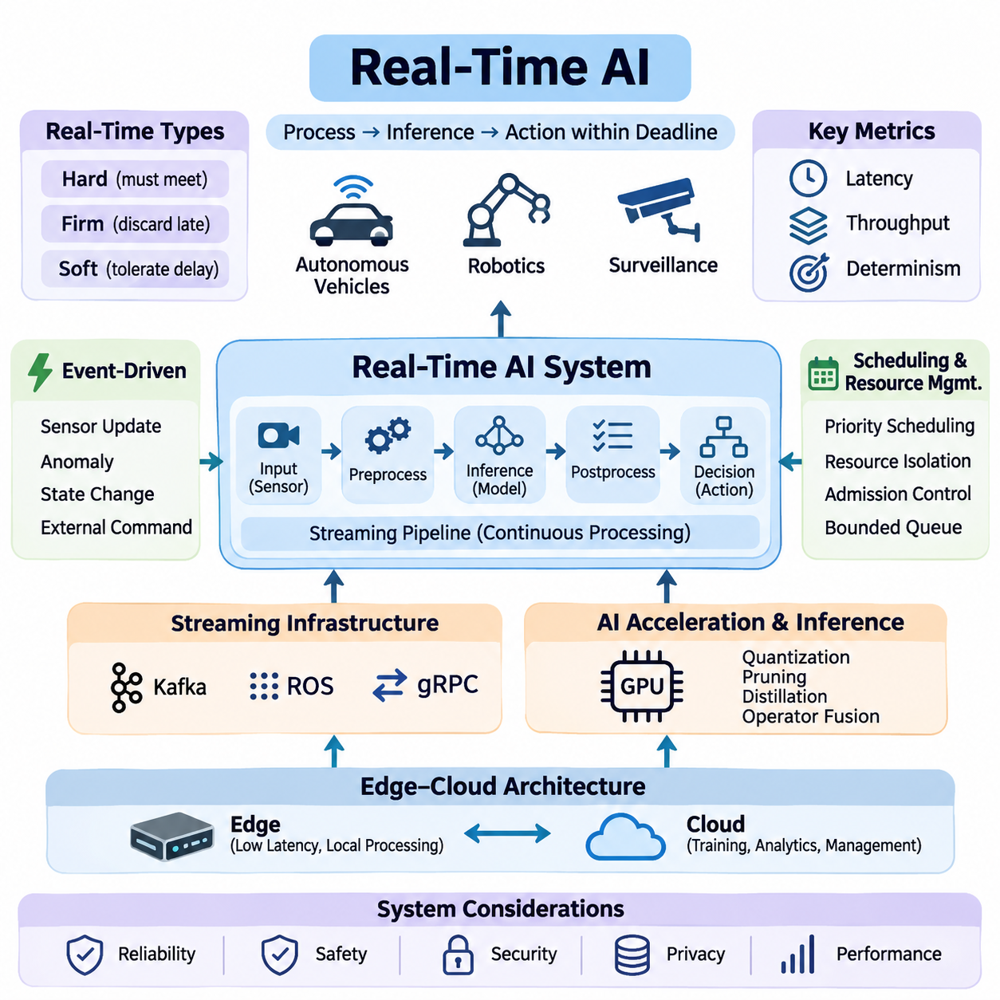
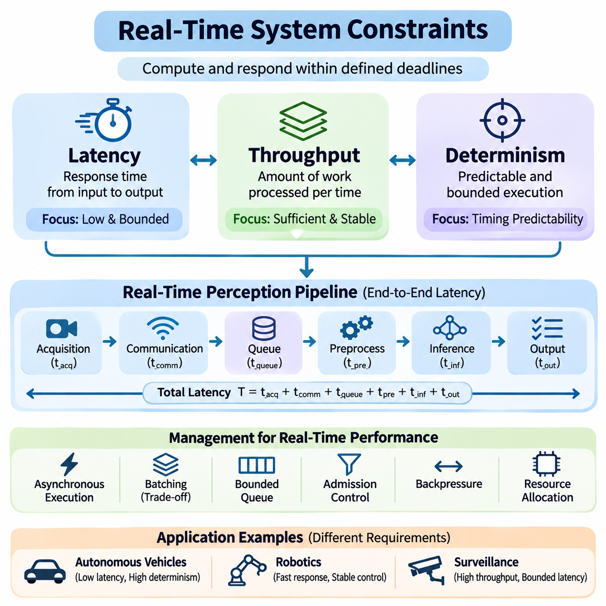
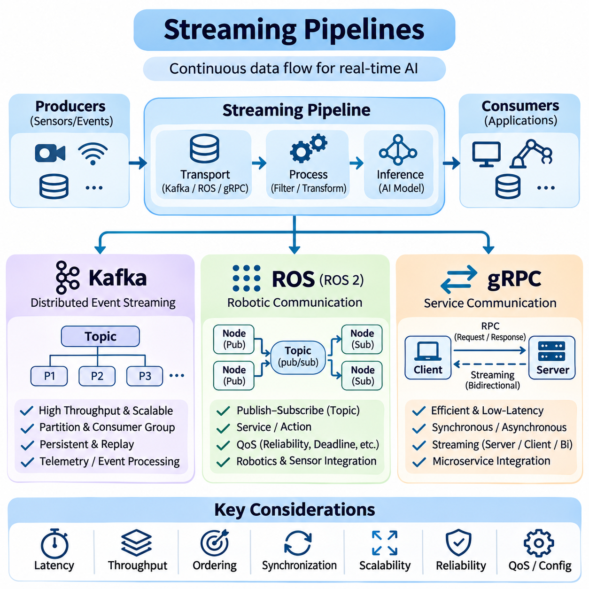
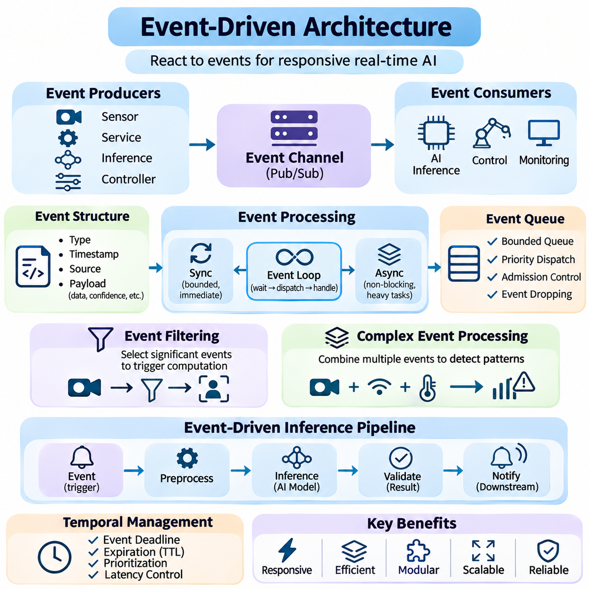
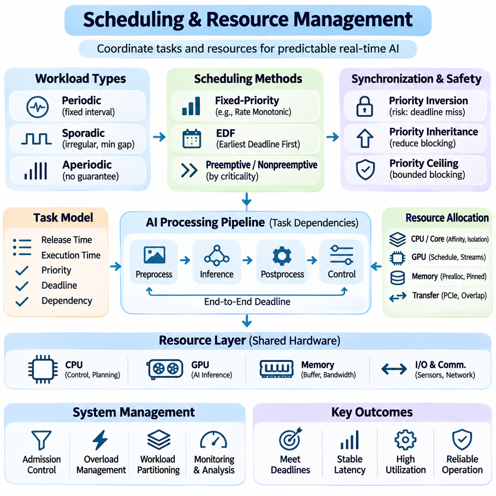
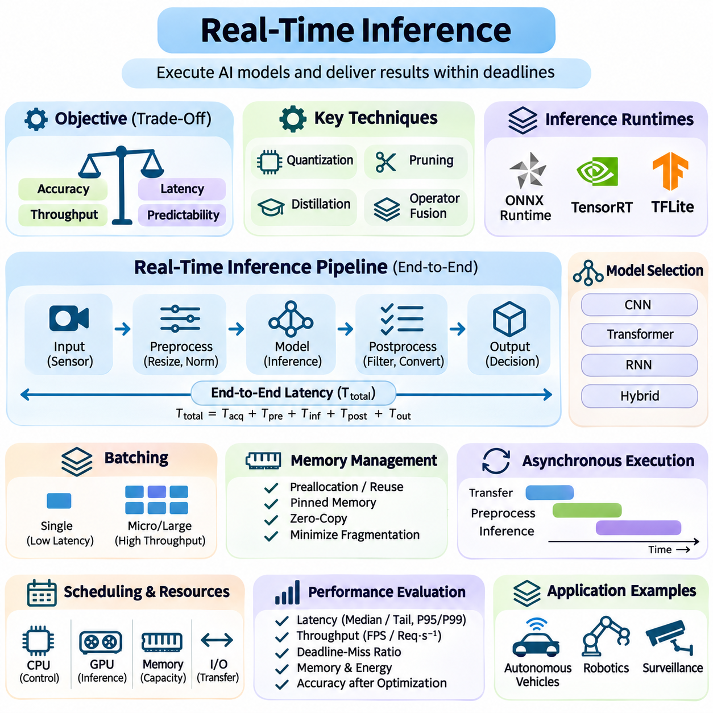
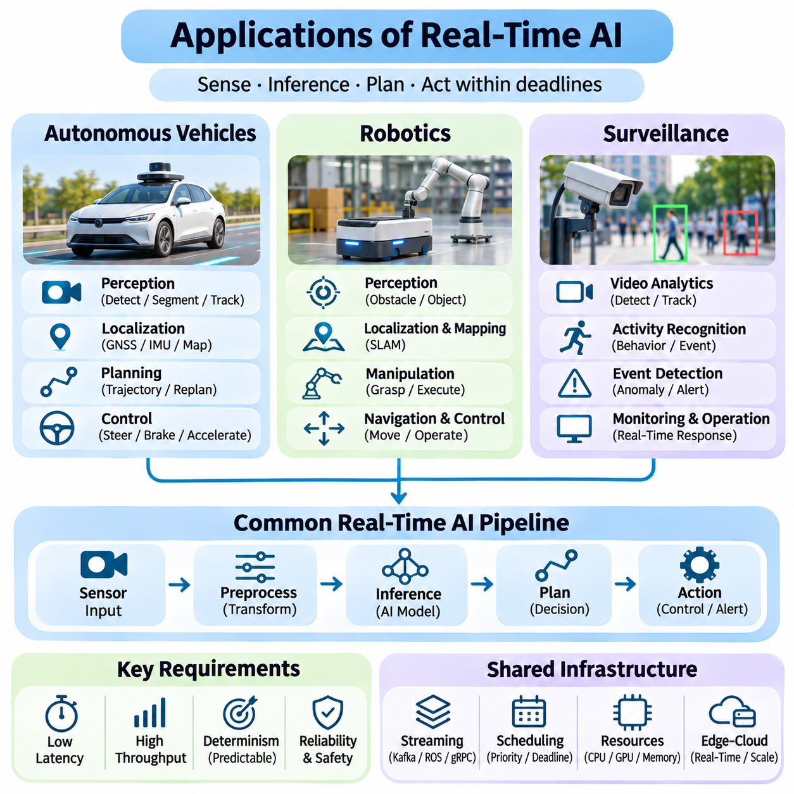

**Volume 38. AI Systems Architecture**


# 04. Real Time AI

## 04.00 Overview

{width="7.268055555555556in" height="7.268055555555556in"}

Real-time artificial intelligence refers to AI systems that process incoming information, perform inference, and produce actionable outputs within defined timing constraints. Unlike conventional AI applications that prioritize computational accuracy or aggregate throughput, real-time AI must deliver results before their usefulness expires. This requirement is essential in autonomous vehicles, robotics, industrial automation, and intelligent surveillance systems.

The defining characteristic of real-time AI is the relationship between computational execution and physical or operational deadlines. A prediction may be mathematically correct but practically useless if it arrives after the required decision point. Consequently, real-time AI architecture must consider not only model accuracy but also execution latency, scheduling behavior, communication delays, resource availability, and the consequences of missed deadlines.

Real-time systems are commonly classified into hard, firm, and soft real-time categories. Hard real-time systems require deadlines to be satisfied because violations may create unacceptable safety or operational consequences. Firm real-time systems discard results that arrive too late, while soft real-time systems tolerate occasional delays with reduced service quality. AI workloads must be integrated according to the timing guarantees required by their applications.

Latency represents the elapsed time between receiving an input and producing a corresponding output. In real-time AI, end-to-end latency includes sensor acquisition, preprocessing, data transfer, model execution, postprocessing, and decision delivery. Optimizing neural network inference alone is therefore insufficient. Every component of the processing pipeline contributes to the total response time and must be evaluated under realistic operating conditions.

Throughput measures the amount of information processed within a given period, such as frames per second, sensor messages per second, or inference requests per second. Although high throughput improves processing capacity, it does not necessarily guarantee low latency. Large batches may increase accelerator utilization while delaying individual predictions. Real-time architectures must balance throughput, responsiveness, and available computational resources.

Determinism describes the predictability of system execution time and behavior. A deterministic processing architecture aims to provide bounded execution times under specified operating conditions. This property becomes particularly important when AI components interact with control systems. Variations caused by operating system scheduling, memory allocation, accelerator contention, and communication congestion can undermine timing reliability.

Real-time AI commonly operates through continuous streaming pipelines rather than isolated batch-processing workflows. Sensor measurements, video frames, telemetry, and operational events enter the system as ongoing data streams. Processing components transform these streams into intermediate representations, predictions, and decisions. Pipeline architecture must minimize unnecessary buffering, control queue growth, and preserve temporal consistency across processing stages.

Streaming infrastructure provides communication mechanisms for connecting distributed processing components. Apache Kafka supports scalable event streaming and persistent message distribution, while the Robot Operating System provides communication abstractions for robotic applications. gRPC enables efficient service-to-service communication through structured remote procedure calls. Their suitability depends on latency requirements, delivery semantics, and deployment architecture.

Event-driven architecture provides another foundation for responsive AI systems. Instead of executing every operation at fixed intervals, components may react to sensor updates, detected anomalies, state transitions, or external commands. Events can trigger inference, activate specialized processing modules, or initiate safety responses. This approach reduces unnecessary computation when workloads are sparse or irregular, although event bursts require careful management.

Scheduling and resource management determine how processing tasks compete for CPU time, GPU execution capacity, memory bandwidth, and communication resources. Real-time workloads often combine periodic control operations with asynchronous perception and analytics tasks. Priority-aware scheduling, resource isolation, admission control, and bounded queues help protect critical operations from interference caused by less urgent computational activities.

Modern AI accelerators provide substantial parallel processing capability, but their execution characteristics introduce additional timing challenges. GPU kernels, memory transfers, synchronization operations, and concurrent inference workloads may produce variable execution delays. Efficient implementations reduce data movement, reuse allocated memory, and avoid unnecessary synchronization. Predictable accelerator behavior requires measurement under representative workloads.

Real-time inference focuses on executing trained models within application-specific response deadlines. Techniques such as quantization, pruning, knowledge distillation, operator fusion, and optimized inference runtimes can reduce computational requirements. However, model compression may affect prediction accuracy and robustness. Deployment decisions must therefore evaluate the relationship between inference speed, resource consumption, and acceptable model performance.

Edge computing plays a central role in real-time AI because local processing can eliminate network round trips to remote cloud infrastructure. Embedded accelerators and industrial computing platforms allow sensor data to be interpreted near its source. Cloud services remain valuable for model training, historical analysis, fleet coordination, and long-term optimization. Hybrid architectures separate time-critical local decisions from less urgent centralized operations.

Reliable real-time AI requires synchronization between heterogeneous data sources. Cameras, LiDAR sensors, radar systems, inertial measurement units, and positioning devices may operate at different sampling frequencies. Accurate timestamps and coordinated clocks allow measurements to be associated with the correct physical events. Without temporal alignment, sensor fusion may produce inconsistent environmental representations even when individual models perform accurately.

Temporal data management must also account for delayed, duplicated, missing, and out-of-order messages. A processing system should distinguish the time at which a measurement was acquired from the time at which it was received or processed. Timestamp-aware buffering, sequence tracking, expiration policies, and bounded waiting intervals help maintain valid state estimates. These mechanisms are especially important when communication conditions fluctuate.

Fault tolerance is essential because real-time AI systems operate under unpredictable environmental and computational conditions. Sensor failures, overloaded processors, network interruptions, and inference errors can disrupt normal operation. Robust architectures incorporate health monitoring, timeout detection, fallback processing, and degraded operating modes. Safety-critical decisions should not depend exclusively on an AI model whose timing or reliability cannot be guaranteed.

In autonomous vehicles, real-time AI supports environmental perception, object tracking, localization, trajectory planning, and interaction with vehicle control systems. Cameras, radar, and LiDAR generate continuous observations that must be interpreted within appropriate decision intervals. Perception delays can reduce the time available for braking or obstacle avoidance. System design must therefore connect inference deadlines with vehicle dynamics and operational safety requirements.

Robotic systems introduce additional challenges because perception and action occur within continuously changing physical environments. Mobile robots must interpret obstacles, estimate position, update navigation decisions, and coordinate motion controllers. Manipulation systems require timely feedback about object contact, force, and movement. AI processing must coexist with deterministic low-level control, which may require separate execution environments and scheduling priorities.

Intelligent surveillance systems apply real-time AI to continuous video analysis, object detection, tracking, behavior recognition, and event identification. Multiple camera streams may share computing resources while generating different processing demands. Event prioritization and adaptive inference can reduce computational pressure. Critical alerts require controlled delivery latency, while historical video analysis can operate through asynchronous processing pipelines.

Performance evaluation must consider more than average inference time. Relevant measurements include median latency, tail latency, deadline-miss ratio, throughput, jitter, queue occupancy, and resource utilization. Stress testing should examine simultaneous sensor activity, burst traffic, processor contention, and degraded communication conditions. These measurements reveal whether the architecture remains responsive when operating conditions differ from ideal benchmarks.

Real-time AI engineering ultimately requires coordinated design across machine learning, operating systems, networking, hardware acceleration, and application control. The objective is not simply to execute increasingly powerful models at higher speed, but to deliver trustworthy intelligence within meaningful temporal boundaries. Successful systems integrate predictable processing, efficient communication, resource-aware scheduling, and reliable operational behavior into a unified architecture.

실시간 인공지능(Real-Time Artificial Intelligence)은 입력되는 정보를 처리하고, 추론(Inference)을 수행하며, 정의된 시간 제약(Time Constraints) 내에서 실행 가능한 결과를 생성하는 인공지능 시스템을 의미한다. 계산 정확도(Computational Accuracy)나 전체 처리량(Throughput)을 우선시하는 일반적인 인공지능 응용과 달리, 실시간 인공지능은 결과의 유효성이 사라지기 전에 이를 제공해야 한다. 이러한 요구사항은 자율주행 차량(Autonomous Vehicles), 로보틱스(Robotics), 산업 자동화(Industrial Automation), 지능형 감시 시스템(Intelligent Surveillance Systems)에서 필수적이다.

실시간 인공지능의 핵심적인 특징은 계산 실행(Computational Execution)과 물리적 또는 운영상 마감시간(Deadlines) 사이의 관계에 있다. 예측 결과가 수학적으로 정확하더라도 필요한 의사결정 시점을 지나 도착한다면 실질적인 가치가 없을 수 있다. 따라서 실시간 인공지능 아키텍처(Real-Time AI Architecture)는 모델 정확도(Model Accuracy)뿐만 아니라 실행 지연시간(Execution Latency), 스케줄링 동작(Scheduling Behavior), 통신 지연(Communication Delays), 자원 가용성(Resource Availability), 마감시간 위반의 결과까지 고려해야 한다.

실시간 시스템(Real-Time Systems)은 일반적으로 경성 실시간(Hard Real-Time), 확정형 실시간(Firm Real-Time), 연성 실시간(Soft Real-Time)으로 분류된다. 경성 실시간 시스템은 마감시간 위반이 허용할 수 없는 안전 또는 운영상의 결과를 초래할 수 있으므로 반드시 시간 제약을 충족해야 한다. 확정형 실시간 시스템은 늦게 도착한 결과를 폐기하며, 연성 실시간 시스템은 일부 지연을 허용하지만 서비스 품질(Service Quality)이 저하될 수 있다. 인공지능 작업부하(AI Workloads)는 응용 분야에서 요구하는 시간 보장 수준에 따라 통합되어야 한다.

지연시간(Latency)은 입력을 수신한 시점부터 해당 출력이 생성될 때까지 경과한 시간을 의미한다. 실시간 인공지능에서 종단 간 지연시간(End-to-End Latency)은 센서 데이터 수집(Sensor Acquisition), 전처리(Preprocessing), 데이터 전송(Data Transfer), 모델 실행(Model Execution), 후처리(Postprocessing), 의사결정 전달(Decision Delivery)을 포함한다. 따라서 신경망 추론(Neural Network Inference)만 최적화하는 것으로는 충분하지 않다. 처리 파이프라인(Processing Pipeline)의 모든 구성요소가 전체 응답시간에 영향을 미치므로 실제 운영 조건에서 평가해야 한다.

처리량(Throughput)은 초당 프레임 수(Frames Per Second), 초당 센서 메시지 수(Sensor Messages Per Second), 초당 추론 요청 수(Inference Requests Per Second)와 같이 일정 시간 동안 처리되는 정보량을 나타낸다. 높은 처리량은 처리 용량(Processing Capacity)을 향상시키지만 반드시 낮은 지연시간을 보장하지는 않는다. 대규모 배치(Batching)는 가속기 활용률(Accelerator Utilization)을 높이는 동시에 개별 예측을 지연시킬 수 있다. 실시간 아키텍처는 처리량, 응답성(Responsiveness), 가용 계산 자원 사이의 균형을 유지해야 한다.

결정성(Determinism)은 시스템 실행시간과 동작의 예측 가능성을 의미한다. 결정적 처리 아키텍처(Deterministic Processing Architecture)는 지정된 운영 조건에서 실행시간의 상한을 제공하는 것을 목표로 한다. 이러한 특성은 인공지능 구성요소가 제어 시스템(Control Systems)과 상호작용할 때 특히 중요하다. 운영체제 스케줄링(Operating System Scheduling), 메모리 할당(Memory Allocation), 가속기 자원 경합(Accelerator Contention), 통신 혼잡(Communication Congestion)으로 발생하는 변동은 시간적 신뢰성(Timing Reliability)을 저하시킬 수 있다.

실시간 인공지능은 일반적으로 독립적인 배치 처리(Batch Processing)보다 연속적인 스트리밍 파이프라인(Streaming Pipelines)을 통해 동작한다. 센서 측정값, 비디오 프레임(Video Frames), 원격 측정 데이터(Telemetry), 운영 이벤트(Operational Events)는 지속적인 데이터 스트림(Data Streams)으로 시스템에 입력된다. 처리 구성요소는 이러한 스트림을 중간 표현(Intermediate Representations), 예측 결과(Predictions), 의사결정(Decisions)으로 변환한다. 파이프라인 아키텍처는 불필요한 버퍼링(Buffering)을 최소화하고, 대기열 증가(Queue Growth)를 제어하며, 처리 단계 간 시간적 일관성(Temporal Consistency)을 유지해야 한다.

스트리밍 인프라(Streaming Infrastructure)는 분산 처리 구성요소를 연결하는 통신 메커니즘(Communication Mechanisms)을 제공한다. 아파치 카프카(Apache Kafka)는 확장 가능한 이벤트 스트리밍(Event Streaming)과 지속성 있는 메시지 배포(Persistent Message Distribution)를 지원하며, 로봇 운영체제(Robot Operating System, ROS)는 로봇 응용을 위한 통신 추상화(Communication Abstractions)를 제공한다. gRPC는 구조화된 원격 프로시저 호출(Remote Procedure Calls)을 통해 효율적인 서비스 간 통신을 지원한다. 이러한 기술의 적합성은 지연시간 요구사항, 전달 의미론(Delivery Semantics), 배포 아키텍처(Deployment Architecture)에 따라 달라진다.

이벤트 기반 아키텍처(Event-Driven Architecture)는 응답성이 높은 인공지능 시스템을 위한 또 다른 기반을 제공한다. 모든 작업을 고정된 주기로 실행하는 대신, 구성요소는 센서 갱신(Sensor Updates), 이상 탐지(Anomaly Detection), 상태 전이(State Transitions), 외부 명령(External Commands)에 반응할 수 있다. 이벤트는 추론을 실행하거나 특화된 처리 모듈을 활성화하고 안전 대응(Safety Responses)을 시작할 수 있다. 이러한 접근법은 작업부하가 드물거나 불규칙할 때 불필요한 계산을 줄이지만, 이벤트가 집중적으로 발생하는 상황에 대한 관리가 필요하다.

스케줄링 및 자원 관리(Scheduling and Resource Management)는 처리 작업들이 중앙처리장치(CPU) 실행시간, 그래픽처리장치(GPU) 실행 용량, 메모리 대역폭(Memory Bandwidth), 통신 자원(Communication Resources)을 어떻게 공유하고 경쟁하는지 결정한다. 실시간 작업부하는 주기적 제어 작업(Periodic Control Operations)과 비동기 인식 작업(Asynchronous Perception Tasks)을 함께 포함하는 경우가 많다. 우선순위 인식 스케줄링(Priority-Aware Scheduling), 자원 격리(Resource Isolation), 수용 제어(Admission Control), 제한된 대기열(Bounded Queues)은 중요도가 낮은 계산 작업으로부터 핵심 작업을 보호한다.

최신 인공지능 가속기(AI Accelerators)는 상당한 병렬 처리 능력(Parallel Processing Capability)을 제공하지만, 실행 특성으로 인해 추가적인 시간 제약 문제가 발생한다. GPU 커널(GPU Kernels), 메모리 전송(Memory Transfers), 동기화 작업(Synchronization Operations), 동시 추론 작업(Concurrent Inference Workloads)은 실행 지연시간을 불규칙하게 만들 수 있다. 효율적인 구현은 데이터 이동을 줄이고, 할당된 메모리를 재사용하며, 불필요한 동기화를 방지한다. 예측 가능한 가속기 동작을 확보하려면 대표적인 작업부하에서 성능을 측정해야 한다.

실시간 추론(Real-Time Inference)은 학습된 모델(Trained Models)을 응용 분야별 응답 마감시간 내에 실행하는 데 초점을 맞춘다. 양자화(Quantization), 가지치기(Pruning), 지식 증류(Knowledge Distillation), 연산자 융합(Operator Fusion), 최적화된 추론 실행환경(Optimized Inference Runtimes)과 같은 기술은 계산 요구량을 줄일 수 있다. 그러나 모델 압축(Model Compression)은 예측 정확도와 강건성(Robustness)에 영향을 줄 수 있다. 따라서 배포 결정에서는 추론 속도, 자원 소비(Resource Consumption), 허용 가능한 모델 성능 사이의 관계를 평가해야 한다.

엣지 컴퓨팅(Edge Computing)은 원격 클라우드 인프라(Cloud Infrastructure)와의 네트워크 왕복 통신(Network Round Trips)을 제거할 수 있으므로 실시간 인공지능에서 핵심적인 역할을 한다. 임베디드 가속기(Embedded Accelerators)와 산업용 컴퓨팅 플랫폼(Industrial Computing Platforms)은 데이터 발생 위치 가까이에서 센서 정보를 해석할 수 있도록 한다. 클라우드 서비스(Cloud Services)는 모델 학습(Model Training), 과거 데이터 분석(Historical Analysis), 플릿 조정(Fleet Coordination), 장기 최적화(Long-Term Optimization)에 여전히 유용하다. 하이브리드 아키텍처(Hybrid Architectures)는 시간적으로 중요한 로컬 의사결정과 상대적으로 긴급하지 않은 중앙 집중식 작업을 분리한다.

신뢰성 있는 실시간 인공지능은 이기종 데이터 소스(Heterogeneous Data Sources) 사이의 동기화(Synchronization)를 요구한다. 카메라(Cameras), 라이다(LiDAR), 레이더(Radar), 관성측정장치(Inertial Measurement Units), 위치 측정 장치(Positioning Devices)는 서로 다른 샘플링 주파수(Sampling Frequencies)로 동작할 수 있다. 정확한 타임스탬프(Timestamps)와 동기화된 시계(Coordinated Clocks)를 사용하면 측정값을 올바른 물리적 이벤트와 연결할 수 있다. 시간적 정렬(Temporal Alignment)이 이루어지지 않으면 개별 모델의 정확도가 높더라도 센서 융합(Sensor Fusion) 결과에 불일치가 발생할 수 있다.

시간적 데이터 관리(Temporal Data Management)는 지연되거나 중복되거나 누락되거나 순서가 뒤바뀐 메시지도 처리해야 한다. 처리 시스템은 측정값이 획득된 시점과 수신 또는 처리된 시점을 구분해야 한다. 타임스탬프 기반 버퍼링(Timestamp-Aware Buffering), 시퀀스 추적(Sequence Tracking), 만료 정책(Expiration Policies), 제한된 대기 간격(Bounded Waiting Intervals)은 유효한 상태 추정(State Estimation)을 유지하는 데 도움이 된다. 이러한 메커니즘은 통신 조건이 변동하는 환경에서 특히 중요하다.

결함 허용성(Fault Tolerance)은 실시간 인공지능 시스템이 예측하기 어려운 환경 및 계산 조건에서 동작하기 때문에 필수적이다. 센서 고장(Sensor Failures), 프로세서 과부하(Processor Overload), 네트워크 중단(Network Interruptions), 추론 오류(Inference Errors)는 정상적인 운영을 방해할 수 있다. 강건한 아키텍처는 상태 감시(Health Monitoring), 시간 초과 감지(Timeout Detection), 대체 처리(Fallback Processing), 성능 저하 운용 모드(Degraded Operating Modes)를 포함한다. 안전 필수 의사결정(Safety-Critical Decisions)은 시간적 성능이나 신뢰성을 보장할 수 없는 인공지능 모델에만 의존해서는 안 된다.

자율주행 차량(Autonomous Vehicles)에서 실시간 인공지능은 환경 인식(Environmental Perception), 객체 추적(Object Tracking), 위치 추정(Localization), 궤적 계획(Trajectory Planning), 차량 제어 시스템(Vehicle Control Systems)과의 상호작용을 지원한다. 카메라, 레이더, 라이다는 적절한 의사결정 주기 내에서 해석해야 하는 연속적인 관측 정보를 생성한다. 인식 지연(Perception Delays)은 제동(Braking)이나 장애물 회피(Obstacle Avoidance)에 사용할 수 있는 시간을 줄일 수 있다. 따라서 시스템 설계는 추론 마감시간을 차량 동역학(Vehicle Dynamics) 및 운영 안전 요구사항과 연결해야 한다.

로봇 시스템(Robotic Systems)은 인식과 동작이 지속적으로 변화하는 물리적 환경에서 이루어지므로 추가적인 문제를 발생시킨다. 이동 로봇(Mobile Robots)은 장애물을 해석하고, 위치를 추정하며, 경로 탐색 의사결정(Navigation Decisions)을 갱신하고, 운동 제어기(Motion Controllers)를 조정해야 한다. 조작 시스템(Manipulation Systems)은 물체 접촉(Object Contact), 힘(Force), 움직임(Movement)에 관한 적시 피드백(Timely Feedback)을 요구한다. 인공지능 처리는 결정적인 저수준 제어(Deterministic Low-Level Control)와 공존해야 하며, 이를 위해 별도의 실행환경과 스케줄링 우선순위가 필요할 수 있다.

지능형 감시 시스템(Intelligent Surveillance Systems)은 연속적인 비디오 분석(Video Analysis), 객체 탐지(Object Detection), 추적(Tracking), 행동 인식(Behavior Recognition), 이벤트 식별(Event Identification)에 실시간 인공지능을 적용한다. 여러 카메라 스트림(Camera Streams)은 서로 다른 처리 요구량을 발생시키면서 계산 자원을 공유할 수 있다. 이벤트 우선순위 지정(Event Prioritization)과 적응형 추론(Adaptive Inference)은 계산 부담을 줄일 수 있다. 중요한 경보(Critical Alerts)는 제어된 전달 지연시간(Delivery Latency)을 요구하지만, 과거 비디오 분석(Historical Video Analysis)은 비동기 처리 파이프라인(Asynchronous Processing Pipelines)을 통해 수행할 수 있다.

성능 평가(Performance Evaluation)는 평균 추론시간(Average Inference Time) 이상의 요소를 고려해야 한다. 주요 측정 지표에는 중앙값 지연시간(Median Latency), 꼬리 지연시간(Tail Latency), 마감시간 위반율(Deadline-Miss Ratio), 처리량(Throughput), 지터(Jitter), 대기열 점유율(Queue Occupancy), 자원 활용률(Resource Utilization)이 포함된다. 스트레스 테스트(Stress Testing)는 동시 센서 활동, 순간적인 트래픽 집중(Burst Traffic), 프로세서 자원 경합(Processor Contention), 통신 성능 저하 조건을 검토해야 한다. 이러한 측정은 이상적인 벤치마크(Benchmarks)와 다른 운영 조건에서도 아키텍처가 응답성을 유지하는지 확인할 수 있게 한다.

실시간 인공지능 엔지니어링(Real-Time AI Engineering)은 궁극적으로 기계학습(Machine Learning), 운영체제(Operating Systems), 네트워킹(Networking), 하드웨어 가속(Hardware Acceleration), 응용 제어(Application Control)를 아우르는 통합적인 설계를 요구한다. 목표는 단순히 더욱 강력한 모델을 더 빠르게 실행하는 것이 아니라, 의미 있는 시간적 제약 내에서 신뢰할 수 있는 지능(Trustworthy Intelligence)을 제공하는 것이다. 성공적인 시스템은 예측 가능한 처리(Predictable Processing), 효율적인 통신(Efficient Communication), 자원 인식 스케줄링(Resource-Aware Scheduling), 신뢰성 있는 운영 동작(Reliable Operational Behavior)을 하나의 통합 아키텍처(Unified Architecture)로 결합한다.

## 04.01 Real Time System Constraints

{width="7.268055555555556in" height="7.268055555555556in"}

Real-time system constraints define the temporal and computational boundaries within which an artificial intelligence system must operate. Unlike conventional computing environments, where performance is often evaluated through average execution speed, real-time systems must produce valid results within specified deadlines. These constraints influence architecture, hardware selection, software scheduling, communication mechanisms, and operational reliability.

Three fundamental dimensions characterize real-time system performance: latency, throughput, and determinism. Latency measures how quickly an individual operation completes, throughput measures how much work a system processes over time, and determinism describes the predictability of execution behavior. These dimensions are closely related but cannot be optimized independently without considering their effects on overall system performance.

Latency represents the elapsed time between an initiating event and the completion of its corresponding response. In AI systems, this interval may include sensor acquisition, data preprocessing, memory transfers, neural network inference, postprocessing, and command delivery. End-to-end latency is particularly important because optimizing an individual processing stage does not necessarily improve the responsiveness of the complete application.

A real-time perception pipeline can be represented as a sequence of processing delays. Total response time consists of acquisition latency, communication latency, queueing delay, preprocessing time, inference execution time, and output delivery latency. Each component contributes to the overall timing budget. Engineers must measure these components separately to identify bottlenecks and determine where optimization provides the greatest benefit.

Latency requirements depend on the physical dynamics and operational characteristics of an application. Autonomous vehicles require timely obstacle detection and motion planning, while industrial inspection systems may tolerate longer processing intervals. High-speed robotic manipulation often demands rapid feedback updates. Consequently, latency targets should be derived from application-level safety, control stability, and operational requirements rather than arbitrary computational benchmarks.

Average latency alone cannot adequately characterize real-time performance. A system may exhibit excellent average response times while occasionally producing severe delays. Tail latency, commonly measured at the 95th, 99th, or 99.9th percentile, reveals the behavior of unusually slow operations. These measurements are important for identifying scheduling interference, memory contention, communication congestion, and other sources of unpredictable execution delays.

Latency optimization involves reducing computational overhead and eliminating unnecessary waiting between processing stages. Techniques include asynchronous execution, memory preallocation, zero-copy data transfer, optimized inference runtimes, and pipeline parallelism. However, aggressive optimization can introduce additional complexity or resource contention. Every improvement must be validated through end-to-end measurements under representative operating conditions.

Throughput describes the quantity of computational work completed within a defined time interval. Depending on the application, throughput may be expressed as frames per second, inference requests per second, processed sensor messages, or completed transactions. High throughput is essential for systems handling multiple cameras, distributed sensors, or concurrent inference workloads. Nevertheless, processing capacity alone does not establish real-time responsiveness.

The relationship between latency and throughput is influenced by batching, concurrency, and resource utilization. Larger batches can improve GPU efficiency by distributing execution overhead across multiple inputs. However, collecting enough inputs to form a batch introduces additional waiting time. Real-time applications must therefore select batching strategies that balance accelerator efficiency against individual request deadlines and temporal freshness requirements.

Queueing behavior becomes critical when incoming data rates approach or exceed available processing capacity. If messages arrive faster than they can be processed, queues grow and response latency increases. Even when average throughput appears sufficient, temporary workload bursts can create substantial delays. Bounded queues, admission control, backpressure mechanisms, and selective frame dropping help prevent uncontrolled accumulation of outdated information.

Throughput requirements should be evaluated alongside the sampling rates of connected sensors. A system processing several camera streams, LiDAR measurements, radar observations, and control messages must allocate sufficient capacity to each workload. Different processing stages may operate at different frequencies. Proper architecture prevents high-volume data sources from monopolizing computational resources needed by time-critical operations.

Resource utilization provides another important perspective on throughput efficiency. Maximizing GPU or CPU utilization may improve aggregate processing capacity but reduce the available headroom for unexpected workload increases. Real-time systems often reserve computational capacity to accommodate transient demand, emergency processing, and scheduling variability. This deliberate resource margin supports predictable operation rather than maximum benchmark performance.

Determinism refers to the ability of a system to execute operations within predictable timing boundaries. In real-time computing, deterministic behavior does not necessarily mean every operation requires exactly the same execution time. Instead, it emphasizes bounded execution variability and reliable deadline satisfaction. A system with slightly slower but predictable execution may be more suitable for critical applications than one with faster average performance and occasional extreme delays.

Worst-case execution time provides an important basis for deterministic system design. It represents an upper bound on the time required to complete a task under specified assumptions and operating conditions. Establishing credible execution bounds requires consideration of processor scheduling, cache behavior, memory access, synchronization, and competing workloads. For complex AI accelerators, rigorous worst-case guarantees can be difficult to establish.

Operating system scheduling strongly influences execution predictability. General-purpose operating systems prioritize overall responsiveness and resource sharing, which can introduce variable task delays. Real-time scheduling policies assign execution priorities according to timing requirements. Techniques such as CPU affinity, priority-based scheduling, interrupt management, and real-time operating system configurations can reduce interference affecting critical processing tasks.

GPU execution introduces additional challenges for deterministic AI processing. Kernel launch overhead, memory allocation, asynchronous execution, and concurrent workloads may produce variable completion times. GPU scheduling mechanisms do not always provide the same timing guarantees as dedicated real-time controllers. Consequently, safety-critical architectures frequently separate neural network inference from deterministic low-level control and establish explicit deadlines for communication between them.

Determinism also depends on predictable communication and synchronization. Distributed AI components exchange messages through networks, middleware, and shared-memory interfaces. Network congestion, retransmissions, buffering, and clock drift can affect message arrival times. Timestamp synchronization, bounded communication queues, priority-aware transport, and carefully designed timeout policies help maintain temporal consistency across distributed processing components.

Latency, throughput, and determinism create important engineering tradeoffs. Increasing batch sizes may improve throughput while increasing latency. Running additional inference tasks may improve hardware utilization but introduce execution variability. Reserving processor capacity may reduce maximum throughput while improving deadline reliability. Real-time architecture therefore requires multi-objective optimization based on application priorities rather than a single performance metric.

Scheduling policies must account for different levels of task criticality. Safety monitoring, actuator control, perception, logging, and cloud communication do not necessarily require identical timing guarantees. Critical tasks should receive protected execution resources and well-defined deadlines. Lower-priority workloads may be delayed, reduced, or suspended when resources become constrained, allowing the system to preserve essential operational functions.

Real-time performance evaluation requires measurements across realistic workload conditions. Engineers should examine end-to-end latency distributions, sustained throughput, deadline-miss ratios, execution jitter, queue occupancy, and resource utilization. Testing should include simultaneous sensor activity, computational bursts, communication degradation, and competing processing tasks. Such experiments reveal timing weaknesses that isolated inference benchmarks may overlook.

System-level timing budgets provide a practical method for coordinating performance requirements. Each processing stage receives an allocated execution interval based on the overall response deadline. These allocations should include margins for scheduling variability and communication overhead. Monitoring actual execution against assigned budgets allows engineers to identify emerging bottlenecks and determine whether the architecture can maintain required operating performance.

Ultimately, real-time system constraints establish the relationship between computational intelligence and dependable operational behavior. Latency determines response speed, throughput determines sustainable processing capacity, and determinism determines timing predictability. Successful real-time AI systems balance these characteristics through coordinated hardware selection, software optimization, scheduling design, communication management, and continuous performance validation.

실시간 시스템 제약조건(Real-Time System Constraints)은 인공지능 시스템이 동작해야 하는 시간적 및 계산적 경계(Temporal and Computational Boundaries)를 정의한다. 성능을 주로 평균 실행 속도(Average Execution Speed)로 평가하는 일반적인 컴퓨팅 환경과 달리, 실시간 시스템(Real-Time Systems)은 지정된 마감시간(Deadlines) 내에 유효한 결과를 생성해야 한다. 이러한 제약조건은 시스템 아키텍처(System Architecture), 하드웨어 선정(Hardware Selection), 소프트웨어 스케줄링(Software Scheduling), 통신 메커니즘(Communication Mechanisms), 운영 신뢰성(Operational Reliability)에 영향을 미친다.

실시간 시스템 성능은 지연시간(Latency), 처리량(Throughput), 결정성(Determinism)이라는 세 가지 핵심 요소로 특징지어진다. 지연시간은 개별 작업이 얼마나 빠르게 완료되는지를 측정하고, 처리량은 일정 시간 동안 시스템이 처리하는 작업량을 나타내며, 결정성은 실행 동작의 예측 가능성(Predictability)을 설명한다. 이러한 요소들은 밀접하게 연관되어 있으며, 전체 시스템 성능(Overall System Performance)에 미치는 영향을 고려하지 않고 독립적으로 최적화할 수 없다.

지연시간(Latency)은 특정 이벤트가 발생한 시점부터 이에 대응하는 응답이 완료될 때까지 경과한 시간을 의미한다. 인공지능 시스템에서 이 시간에는 센서 데이터 수집(Sensor Acquisition), 데이터 전처리(Data Preprocessing), 메모리 전송(Memory Transfers), 신경망 추론(Neural Network Inference), 후처리(Postprocessing), 명령 전달(Command Delivery)이 포함될 수 있다. 종단 간 지연시간(End-to-End Latency)은 개별 처리 단계의 최적화가 반드시 전체 응용 시스템의 응답성(Responsiveness)을 향상시키는 것은 아니므로 특히 중요하다.

실시간 인식 파이프라인(Real-Time Perception Pipeline)은 여러 처리 지연의 연속적인 구조로 표현할 수 있다. 전체 응답시간(Total Response Time)은 데이터 수집 지연(Acquisition Latency), 통신 지연(Communication Latency), 대기열 지연(Queueing Delay), 전처리 시간(Preprocessing Time), 추론 실행시간(Inference Execution Time), 출력 전달 지연(Output Delivery Latency)으로 구성된다. 각 구성요소는 전체 시간 예산(Timing Budget)에 영향을 미친다. 엔지니어는 병목현상(Bottlenecks)을 식별하고 최적화 효과가 가장 큰 영역을 결정하기 위해 이러한 요소를 개별적으로 측정해야 한다.

지연시간 요구사항(Latency Requirements)은 응용 분야의 물리적 동역학(Physical Dynamics)과 운영 특성(Operational Characteristics)에 따라 달라진다. 자율주행 차량(Autonomous Vehicles)은 적시에 장애물을 탐지하고 이동 경로를 계획해야 하지만, 산업 검사 시스템(Industrial Inspection Systems)은 상대적으로 긴 처리 간격을 허용할 수 있다. 고속 로봇 조작(High-Speed Robotic Manipulation)은 빠른 피드백 갱신(Feedback Updates)을 요구하는 경우가 많다. 따라서 지연시간 목표는 임의의 계산 벤치마크(Computational Benchmarks)가 아니라 응용 수준의 안전성, 제어 안정성(Control Stability), 운영 요구사항(Operational Requirements)을 기반으로 도출해야 한다.

평균 지연시간(Average Latency)만으로는 실시간 성능을 충분히 설명할 수 없다. 시스템이 매우 우수한 평균 응답시간을 보이더라도 간헐적으로 심각한 지연이 발생할 수 있다. 일반적으로 95번째, 99번째 또는 99.9번째 백분위수(Percentile)로 측정하는 꼬리 지연시간(Tail Latency)은 비정상적으로 느린 작업의 동작을 보여준다. 이러한 측정은 스케줄링 간섭(Scheduling Interference), 메모리 자원 경합(Memory Contention), 통신 혼잡(Communication Congestion), 예측하기 어려운 실행 지연의 원인을 식별하는 데 중요하다.

지연시간 최적화(Latency Optimization)는 계산 오버헤드(Computational Overhead)를 줄이고 처리 단계 사이의 불필요한 대기시간을 제거하는 작업을 포함한다. 주요 기술에는 비동기 실행(Asynchronous Execution), 메모리 사전 할당(Memory Preallocation), 무복사 데이터 전송(Zero-Copy Data Transfer), 최적화된 추론 실행환경(Optimized Inference Runtimes), 파이프라인 병렬화(Pipeline Parallelism)가 있다. 그러나 지나치게 공격적인 최적화는 추가적인 복잡성이나 자원 경합(Resource Contention)을 유발할 수 있다. 모든 개선 사항은 실제 운영 조건을 대표하는 환경에서 종단 간 측정을 통해 검증해야 한다.

처리량(Throughput)은 정의된 시간 간격 내에 완료되는 계산 작업의 양을 의미한다. 응용 분야에 따라 처리량은 초당 프레임 수(Frames Per Second), 초당 추론 요청 수(Inference Requests Per Second), 처리된 센서 메시지(Processed Sensor Messages), 완료된 트랜잭션(Completed Transactions)으로 표현할 수 있다. 높은 처리량은 여러 카메라, 분산 센서(Distributed Sensors), 동시 추론 작업(Concurrent Inference Workloads)을 처리하는 시스템에서 필수적이다. 그러나 처리 용량(Processing Capacity)만으로 실시간 응답성이 보장되는 것은 아니다.

지연시간과 처리량 사이의 관계는 배치 처리(Batching), 동시성(Concurrency), 자원 활용률(Resource Utilization)의 영향을 받는다. 큰 배치(Larger Batches)는 여러 입력에 실행 오버헤드를 분산시켜 GPU 효율성(GPU Efficiency)을 향상시킬 수 있다. 그러나 배치를 구성하기 위해 충분한 입력을 수집하는 과정에서 추가적인 대기시간이 발생한다. 따라서 실시간 응용은 가속기 효율성(Accelerator Efficiency)과 개별 요청의 마감시간 및 데이터의 시간적 최신성(Temporal Freshness Requirements) 사이에서 균형을 유지하는 배치 전략을 선택해야 한다.

대기열 동작(Queueing Behavior)은 입력 데이터 속도가 사용 가능한 처리 용량에 접근하거나 이를 초과할 때 중요해진다. 메시지가 처리 가능한 속도보다 빠르게 도착하면 대기열이 증가하고 응답 지연시간이 길어진다. 평균 처리량이 충분해 보이더라도 일시적인 작업부하 급증(Workload Bursts)은 상당한 지연을 발생시킬 수 있다. 제한된 대기열(Bounded Queues), 수용 제어(Admission Control), 역압 메커니즘(Backpressure Mechanisms), 선택적 프레임 폐기(Selective Frame Dropping)는 오래된 정보가 통제 없이 누적되는 것을 방지한다.

처리량 요구사항(Throughput Requirements)은 연결된 센서의 샘플링 속도(Sampling Rates)와 함께 평가해야 한다. 여러 카메라 스트림(Camera Streams), 라이다 측정값(LiDAR Measurements), 레이더 관측값(Radar Observations), 제어 메시지(Control Messages)를 처리하는 시스템은 각 작업부하에 충분한 처리 용량을 할당해야 한다. 서로 다른 처리 단계는 서로 다른 주파수(Frequencies)로 동작할 수 있다. 적절한 아키텍처는 대용량 데이터 소스(High-Volume Data Sources)가 시간적으로 중요한 작업에 필요한 계산 자원을 독점하지 못하도록 한다.

자원 활용률(Resource Utilization)은 처리량 효율성(Throughput Efficiency)을 평가하는 또 다른 중요한 관점을 제공한다. GPU 또는 CPU 활용률을 극대화하면 전체 처리 용량이 향상될 수 있지만, 예상하지 못한 작업부하 증가에 대응할 수 있는 여유 자원(Headroom)은 감소할 수 있다. 실시간 시스템은 일시적인 수요 증가(Transient Demand), 긴급 처리(Emergency Processing), 스케줄링 변동성(Scheduling Variability)에 대응하기 위해 계산 자원을 일정 부분 확보하는 경우가 많다. 이러한 의도적인 자원 여유(Resource Margin)는 최대 벤치마크 성능보다 예측 가능한 운영을 지원한다.

결정성(Determinism)은 시스템이 예측 가능한 시간적 경계(Timing Boundaries) 내에서 작업을 실행할 수 있는 능력을 의미한다. 실시간 컴퓨팅(Real-Time Computing)에서 결정적 동작(Deterministic Behavior)은 모든 작업이 정확히 동일한 실행시간을 요구한다는 의미는 아니다. 대신 실행시간 변동성(Execution Variability)을 제한하고 마감시간을 안정적으로 충족하는 데 중점을 둔다. 평균 성능은 다소 느리더라도 실행시간을 예측할 수 있는 시스템이 평균적으로 빠르지만 간헐적으로 극단적인 지연이 발생하는 시스템보다 중요한 응용 분야에 더 적합할 수 있다.

최악 실행시간(Worst-Case Execution Time, WCET)은 결정적 시스템 설계(Deterministic System Design)의 중요한 기반을 제공한다. 이는 지정된 가정과 운영 조건에서 작업을 완료하는 데 필요한 시간의 상한(Upper Bound)을 의미한다. 신뢰할 수 있는 실행시간 상한을 설정하려면 프로세서 스케줄링(Processor Scheduling), 캐시 동작(Cache Behavior), 메모리 접근(Memory Access), 동기화(Synchronization), 경쟁 작업부하(Competing Workloads)를 고려해야 한다. 복잡한 인공지능 가속기(AI Accelerators)의 경우 엄격한 최악 실행시간 보장(Worst-Case Guarantees)을 확립하기 어려울 수 있다.

운영체제 스케줄링(Operating System Scheduling)은 실행 예측 가능성(Execution Predictability)에 큰 영향을 미친다. 범용 운영체제(General-Purpose Operating Systems)는 전체적인 응답성과 자원 공유(Resource Sharing)를 우선시하므로 작업 지연시간이 변동할 수 있다. 실시간 스케줄링 정책(Real-Time Scheduling Policies)은 시간 요구사항에 따라 실행 우선순위를 할당한다. CPU 친화도(CPU Affinity), 우선순위 기반 스케줄링(Priority-Based Scheduling), 인터럽트 관리(Interrupt Management), 실시간 운영체제 구성(Real-Time Operating System Configurations)과 같은 기술은 핵심 처리 작업에 영향을 미치는 간섭을 줄일 수 있다.

GPU 실행(GPU Execution)은 결정적 인공지능 처리(Deterministic AI Processing)에 추가적인 문제를 발생시킨다. 커널 실행 오버헤드(Kernel Launch Overhead), 메모리 할당(Memory Allocation), 비동기 실행(Asynchronous Execution), 동시 작업부하(Concurrent Workloads)는 완료시간을 불규칙하게 만들 수 있다. GPU 스케줄링 메커니즘(GPU Scheduling Mechanisms)은 전용 실시간 제어기(Dedicated Real-Time Controllers)와 동일한 시간 보장을 항상 제공하지는 않는다. 따라서 안전 필수 아키텍처(Safety-Critical Architectures)는 신경망 추론과 결정적 저수준 제어(Deterministic Low-Level Control)를 분리하고, 두 구성요소 사이의 통신에 명확한 마감시간을 설정하는 경우가 많다.

결정성은 예측 가능한 통신(Predictable Communication)과 동기화(Synchronization)에도 의존한다. 분산 인공지능 구성요소(Distributed AI Components)는 네트워크(Networks), 미들웨어(Middleware), 공유 메모리 인터페이스(Shared-Memory Interfaces)를 통해 메시지를 교환한다. 네트워크 혼잡(Network Congestion), 재전송(Retransmissions), 버퍼링(Buffering), 시계 드리프트(Clock Drift)는 메시지 도착시간에 영향을 줄 수 있다. 타임스탬프 동기화(Timestamp Synchronization), 제한된 통신 대기열(Bounded Communication Queues), 우선순위 인식 전송(Priority-Aware Transport), 신중하게 설계된 시간 초과 정책(Timeout Policies)은 분산 처리 구성요소 사이의 시간적 일관성(Temporal Consistency)을 유지하는 데 도움이 된다.

지연시간, 처리량, 결정성은 중요한 엔지니어링 절충관계(Engineering Tradeoffs)를 형성한다. 배치 크기(Batch Size)를 증가시키면 처리량은 향상될 수 있지만 지연시간도 증가할 수 있다. 추가적인 추론 작업을 실행하면 하드웨어 활용률(Hardware Utilization)은 높아지지만 실행시간 변동성이 발생할 수 있다. 프로세서 자원을 확보해 두면 최대 처리량은 감소할 수 있지만 마감시간 신뢰성(Deadline Reliability)은 향상된다. 따라서 실시간 아키텍처는 단일 성능 지표가 아니라 응용 분야의 우선순위에 기반한 다목적 최적화(Multi-Objective Optimization)를 요구한다.

스케줄링 정책(Scheduling Policies)은 작업별 중요도 수준(Task Criticality Levels)을 고려해야 한다. 안전 감시(Safety Monitoring), 액추에이터 제어(Actuator Control), 환경 인식(Perception), 로깅(Logging), 클라우드 통신(Cloud Communication)은 반드시 동일한 시간 보장을 요구하지 않는다. 핵심 작업(Critical Tasks)에는 보호된 실행 자원(Protected Execution Resources)과 명확하게 정의된 마감시간이 제공되어야 한다. 자원이 제한되면 우선순위가 낮은 작업은 지연, 축소 또는 중단될 수 있으며, 이를 통해 시스템은 필수 운영 기능(Essential Operational Functions)을 유지할 수 있다.

실시간 성능 평가(Real-Time Performance Evaluation)는 실제 작업부하 조건(Realistic Workload Conditions)에서 측정해야 한다. 엔지니어는 종단 간 지연시간 분포(End-to-End Latency Distributions), 지속 처리량(Sustained Throughput), 마감시간 위반율(Deadline-Miss Ratios), 실행 지터(Execution Jitter), 대기열 점유율(Queue Occupancy), 자원 활용률(Resource Utilization)을 검토해야 한다. 시험에는 동시 센서 동작(Simultaneous Sensor Activity), 계산 작업 급증(Computational Bursts), 통신 성능 저하(Communication Degradation), 경쟁 처리 작업(Competing Processing Tasks)이 포함되어야 한다. 이러한 실험은 개별 추론 벤치마크(Isolated Inference Benchmarks)에서 발견하기 어려운 시간적 취약점(Timing Weaknesses)을 드러낸다.

시스템 수준 시간 예산(System-Level Timing Budgets)은 성능 요구사항을 조정하는 실용적인 방법을 제공한다. 각 처리 단계에는 전체 응답 마감시간(Overall Response Deadline)을 기반으로 할당된 실행 구간(Allocated Execution Interval)이 부여된다. 이러한 할당에는 스케줄링 변동성(Scheduling Variability)과 통신 오버헤드(Communication Overhead)를 고려한 여유 시간(Margins)이 포함되어야 한다. 실제 실행시간을 할당된 시간 예산과 비교하여 감시하면 새롭게 발생하는 병목현상을 식별하고 아키텍처가 요구되는 운영 성능을 유지할 수 있는지 판단할 수 있다.

궁극적으로 실시간 시스템 제약조건(Real-Time System Constraints)은 계산 지능(Computational Intelligence)과 신뢰할 수 있는 운영 동작(Dependable Operational Behavior) 사이의 관계를 정의한다. 지연시간(Latency)은 응답 속도를 결정하고, 처리량(Throughput)은 지속 가능한 처리 용량을 결정하며, 결정성(Determinism)은 시간적 예측 가능성(Timing Predictability)을 결정한다. 성공적인 실시간 인공지능 시스템은 조정된 하드웨어 선정(Hardware Selection), 소프트웨어 최적화(Software Optimization), 스케줄링 설계(Scheduling Design), 통신 관리(Communication Management), 지속적인 성능 검증(Continuous Performance Validation)을 통해 이러한 특성의 균형을 유지한다.

## 04.02 Streaming Pipelines [w/Code]

{width="7.268055555555556in" height="7.268055555555556in"}

Streaming pipelines form the communication foundation of real-time artificial intelligence systems by continuously transferring data between sensors, processing components, inference engines, and downstream applications. Unlike batch-oriented architectures, streaming systems process information as it becomes available. Their design must address message delivery, processing latency, data ordering, synchronization, scalability, and operational reliability under changing workloads.

A typical streaming pipeline consists of data producers, transport mechanisms, processing stages, and consumers. Producers generate sensor measurements, video frames, telemetry, or application events. Transport layers distribute these messages to processing components, which perform filtering, transformation, inference, or aggregation. Consumers use the resulting information for visualization, decision-making, control, or persistent storage.

Real-time streaming architecture must distinguish between data transport and computation. A communication framework determines how messages move between components, while processing services determine how those messages are interpreted. Separating these responsibilities improves modularity and maintainability. However, excessive service boundaries introduce serialization, network transfers, queueing delays, and synchronization overhead that can reduce responsiveness.

Apache Kafka is a distributed event-streaming platform designed for high-throughput data ingestion, durable storage, and scalable message distribution. It organizes records into topics divided into partitions, allowing producers and consumers to operate independently. Kafka is particularly suitable for telemetry collection, event processing, monitoring, and integration between distributed AI services requiring persistent streams.

Kafka producers publish records to designated topics, while consumers retrieve records according to their assigned partitions and offsets. Consumer groups distribute partition processing across multiple instances, enabling horizontal scaling. Ordering is preserved within individual partitions rather than across an entire topic. Partition-key design therefore determines which events can be processed consistently while maintaining parallel execution.

Kafka durability relies on replicated logs and configurable acknowledgment policies. Records can remain available after consumers process them, supporting replay, recovery, and retrospective analysis. Retention policies control how long information remains stored, while replication improves resilience against broker failures. These capabilities are valuable for AI systems requiring historical event reconstruction, auditing, and reliable asynchronous processing.

Kafka performance depends on partition counts, producer batching, compression, broker resources, and consumer processing capacity. Larger batches improve throughput but may increase message delivery latency. Consumer lag indicates how far processing falls behind incoming records. Monitoring lag, partition distribution, request latency, and broker utilization helps identify bottlenecks before they affect downstream inference and operational monitoring.

Although Kafka supports responsive event processing, it does not inherently guarantee strict deterministic deadlines. Broker persistence, network communication, replication, and consumer scheduling introduce timing variability. Consequently, Kafka is generally more appropriate for supervisory data pipelines than tightly constrained actuator control loops. Safety-critical control should remain within architectures that provide independently verified timing guarantees.

The Robot Operating System, particularly ROS 2, provides communication infrastructure for distributed robotic applications. ROS organizes software into nodes that exchange information through topics, services, and actions. This structure supports modular integration of perception, localization, navigation, planning, and hardware interfaces. Its communication model is well suited to robotic systems combining heterogeneous sensors and computational components.

ROS topics implement publish-subscribe communication for continuously updated information such as camera images, LiDAR scans, odometry, and robot state estimates. Publishers transmit messages without requiring direct knowledge of individual subscribers. Subscribers receive information through middleware-managed communication channels. This separation allows robotic components to evolve independently while maintaining standardized message interfaces.

ROS 2 commonly uses Data Distribution Service middleware to support decentralized communication and configurable Quality of Service policies. Reliability, durability, history depth, and deadline settings influence message delivery behavior. Best-effort communication may suit high-frequency sensor streams where occasional losses are acceptable, while reliable delivery may be preferable for important state updates and coordination messages.

ROS services support request-response interactions, while actions represent longer-running operations that require progress feedback and cancellation capabilities. Services are useful for configuration requests or short operations, whereas actions support navigation goals and complex robotic tasks. Selecting the appropriate communication pattern prevents unnecessary blocking and helps maintain responsiveness across distributed robotic software components.

Real-time ROS performance depends on executor scheduling, callback execution time, middleware configuration, and memory management. Long-running callbacks can delay unrelated operations when execution resources are shared. Callback groups, multithreaded executors, controlled allocation, and carefully selected Quality of Service settings can reduce interference. Nevertheless, deterministic guarantees require validation of the complete hardware and software configuration.

ROS pipelines frequently integrate sensors operating at different update frequencies. Camera images, inertial measurements, odometry, and point clouds must be associated with consistent timestamps. Clock synchronization and message synchronization mechanisms help align observations before sensor fusion. Processing stale or temporally inconsistent information can degrade localization, obstacle detection, and motion planning even when individual algorithms remain accurate.

gRPC is a remote procedure call framework commonly used for communication between distributed services. It typically uses HTTP/2 and Protocol Buffers to provide structured interfaces and efficient serialization. In AI architectures, gRPC connects inference servers, orchestration services, edge gateways, and application backends. Strongly defined service contracts simplify integration across programming languages and deployment environments.

gRPC supports unary requests and several streaming communication patterns, including server streaming, client streaming, and bidirectional streaming. Unary calls suit isolated inference requests, while streaming interfaces support continuous data exchange over persistent connections. Bidirectional streams allow clients and servers to transmit messages independently, making them useful for interactive inference, telemetry exchange, and remote supervisory operations.

Protocol Buffers define compact message schemas that can be shared across independently developed services. Schema evolution supports compatible interface changes when fields are managed carefully. Binary serialization generally reduces payload overhead compared with verbose text formats. However, serialization, copying, and network transport still contribute to end-to-end latency, especially when large tensors or image frames are transferred frequently.

gRPC performance depends on connection management, message size, flow control, concurrency, and server processing capacity. Persistent connections reduce repeated setup costs, while asynchronous handling improves responsiveness under concurrent workloads. Deadlines and cancellation mechanisms prevent requests from waiting indefinitely. Proper timeout selection must account for network variability and inference execution time without allowing obsolete results to accumulate.

Security is an important consideration for distributed streaming pipelines. Kafka supports authentication and access-control mechanisms, while ROS deployments require appropriate network isolation and security configuration. gRPC can use Transport Layer Security to protect communication channels. Authentication, authorization, encryption, and credential management should be designed according to deployment risks without introducing uncontrolled latency into critical processing paths.

Kafka, ROS, and gRPC address different communication requirements rather than serving as interchangeable technologies. Kafka emphasizes durable event distribution and scalable asynchronous processing. ROS emphasizes modular robotic communication and sensor-oriented workflows. gRPC emphasizes structured service interactions and streaming between distributed applications. Their complementary characteristics allow them to coexist within larger AI system architectures.

A hybrid architecture may use ROS 2 for local robot perception and navigation, gRPC for communication with remote inference or supervisory services, and Kafka for centralized telemetry collection and event analytics. This separation keeps time-sensitive robotic operations close to their execution environment while supporting distributed monitoring and historical analysis. Network failures should not compromise essential local safety and control functions.

Pipeline reliability requires explicit policies for overload, message expiration, recovery, and component failure. Backpressure mechanisms limit uncontrolled queue growth, while bounded buffers prevent excessive memory consumption. Retry policies must avoid duplicating operations with irreversible effects. Monitoring should capture message age, delivery latency, processing throughput, queue depth, and failure rates to reveal operational degradation.

Ultimately, streaming pipeline engineering requires coordinated decisions about communication semantics, timing requirements, scalability, and fault tolerance. Kafka provides durable event infrastructure, ROS supports distributed robotic processing, and gRPC enables structured service communication. Successful real-time AI systems combine these technologies selectively, preserving data freshness, predictable responsiveness, and reliable information flow across the complete processing architecture.

스트리밍 파이프라인(Streaming Pipelines)은 센서(Sensors), 처리 구성요소(Processing Components), 추론 엔진(Inference Engines), 하위 응용 시스템(Downstream Applications) 사이에서 데이터를 지속적으로 전송함으로써 실시간 인공지능 시스템(Real-Time Artificial Intelligence Systems)의 통신 기반을 형성한다. 배치 중심 아키텍처(Batch-Oriented Architectures)와 달리, 스트리밍 시스템(Streaming Systems)은 정보가 생성되는 즉시 처리한다. 이러한 시스템의 설계에서는 변화하는 작업부하(Workloads)에서 메시지 전달(Message Delivery), 처리 지연시간(Processing Latency), 데이터 순서(Data Ordering), 동기화(Synchronization), 확장성(Scalability), 운영 신뢰성(Operational Reliability)을 고려해야 한다.

일반적인 스트리밍 파이프라인(Streaming Pipeline)은 데이터 생산자(Data Producers), 전송 메커니즘(Transport Mechanisms), 처리 단계(Processing Stages), 소비자(Consumers)로 구성된다. 생산자는 센서 측정값(Sensor Measurements), 비디오 프레임(Video Frames), 원격 측정 데이터(Telemetry), 응용 이벤트(Application Events)를 생성한다. 전송 계층(Transport Layers)은 이러한 메시지를 필터링(Filtering), 변환(Transformation), 추론(Inference), 집계(Aggregation)를 수행하는 처리 구성요소에 배포한다. 소비자는 생성된 정보를 시각화(Visualization), 의사결정(Decision-Making), 제어(Control), 영구 저장(Persistent Storage)에 활용한다.

실시간 스트리밍 아키텍처(Real-Time Streaming Architecture)는 데이터 전송(Data Transport)과 계산(Computation)을 구분해야 한다. 통신 프레임워크(Communication Framework)는 메시지가 구성요소 사이에서 이동하는 방식을 결정하고, 처리 서비스(Processing Services)는 메시지를 해석하는 방식을 결정한다. 이러한 책임을 분리하면 모듈성(Modularity)과 유지보수성(Maintainability)이 향상된다. 그러나 과도한 서비스 경계(Service Boundaries)는 직렬화(Serialization), 네트워크 전송(Network Transfers), 대기열 지연(Queueing Delays), 동기화 오버헤드(Synchronization Overhead)를 발생시켜 응답성을 저하시킬 수 있다.

아파치 카프카(Apache Kafka)는 높은 처리량의 데이터 수집(High-Throughput Data Ingestion), 내구성 있는 저장(Durable Storage), 확장 가능한 메시지 배포(Scalable Message Distribution)를 위해 설계된 분산 이벤트 스트리밍 플랫폼(Distributed Event-Streaming Platform)이다. 카프카는 레코드(Records)를 파티션(Partitions)으로 분할된 토픽(Topics)에 구성하여 생산자와 소비자가 독립적으로 동작하도록 한다. 카프카는 영속적인 데이터 스트림(Persistent Streams)이 필요한 원격 측정 데이터 수집, 이벤트 처리(Event Processing), 모니터링(Monitoring), 분산 인공지능 서비스 간 통합에 특히 적합하다.

카프카 생산자(Kafka Producers)는 지정된 토픽(Topics)에 레코드를 게시하고, 소비자(Consumers)는 할당된 파티션과 오프셋(Offsets)에 따라 레코드를 가져온다. 소비자 그룹(Consumer Groups)은 여러 인스턴스(Instances)에 파티션 처리를 분산하여 수평 확장(Horizontal Scaling)을 지원한다. 메시지 순서(Ordering)는 전체 토픽이 아니라 개별 파티션 내에서 보장된다. 따라서 파티션 키 설계(Partition-Key Design)는 병렬 실행(Parallel Execution)을 유지하면서 어떤 이벤트를 일관되게 처리할 수 있는지 결정한다.

카프카의 내구성(Durability)은 복제된 로그(Replicated Logs)와 구성 가능한 승인 정책(Configurable Acknowledgment Policies)에 기반한다. 소비자가 레코드를 처리한 이후에도 해당 레코드를 보존할 수 있어 재생(Replay), 복구(Recovery), 사후 분석(Retrospective Analysis)을 지원한다. 보존 정책(Retention Policies)은 정보가 저장되는 기간을 제어하며, 복제(Replication)는 브로커 장애(Broker Failures)에 대한 복원력(Resilience)을 향상시킨다. 이러한 기능은 과거 이벤트 재구성(Historical Event Reconstruction), 감사(Auditing), 신뢰성 있는 비동기 처리(Reliable Asynchronous Processing)가 필요한 인공지능 시스템에서 유용하다.

카프카 성능(Kafka Performance)은 파티션 수(Partition Counts), 생산자 배치 처리(Producer Batching), 압축(Compression), 브로커 자원(Broker Resources), 소비자 처리 용량(Consumer Processing Capacity)에 따라 달라진다. 큰 배치는 처리량을 향상시키지만 메시지 전달 지연시간(Message Delivery Latency)을 증가시킬 수 있다. 소비자 지연(Consumer Lag)은 입력 레코드에 비해 처리가 얼마나 뒤처져 있는지를 나타낸다. 소비자 지연, 파티션 분포(Partition Distribution), 요청 지연시간(Request Latency), 브로커 활용률(Broker Utilization)을 감시하면 하위 추론과 운영 모니터링에 영향을 미치기 전에 병목현상을 식별할 수 있다.

카프카는 응답성이 높은 이벤트 처리(Responsive Event Processing)를 지원하지만 엄격한 결정적 마감시간(Strict Deterministic Deadlines)을 본질적으로 보장하지는 않는다. 브로커 영속화(Broker Persistence), 네트워크 통신(Network Communication), 복제(Replication), 소비자 스케줄링(Consumer Scheduling)은 시간적 변동성(Timing Variability)을 발생시킨다. 따라서 카프카는 엄격한 시간 제약을 가진 액추에이터 제어 루프(Actuator Control Loops)보다 상위 수준의 감독용 데이터 파이프라인(Supervisory Data Pipelines)에 일반적으로 더 적합하다. 안전 필수 제어(Safety-Critical Control)는 독립적으로 검증된 시간 보장을 제공하는 아키텍처 내에서 유지되어야 한다.

로봇 운영체제(Robot Operating System, ROS), 특히 ROS 2는 분산 로봇 응용(Distributed Robotic Applications)을 위한 통신 인프라(Communication Infrastructure)를 제공한다. ROS는 소프트웨어를 토픽(Topics), 서비스(Services), 액션(Actions)을 통해 정보를 교환하는 노드(Nodes)로 구성한다. 이러한 구조는 인식(Perception), 위치 추정(Localization), 내비게이션(Navigation), 계획(Planning), 하드웨어 인터페이스(Hardware Interfaces)의 모듈식 통합(Modular Integration)을 지원한다. ROS의 통신 모델은 이기종 센서(Heterogeneous Sensors)와 계산 구성요소를 결합하는 로봇 시스템에 적합하다.

ROS 토픽(ROS Topics)은 카메라 영상(Camera Images), 라이다 스캔(LiDAR Scans), 주행 거리 측정(Odometry), 로봇 상태 추정(Robot State Estimates)과 같이 지속적으로 갱신되는 정보를 위한 발행-구독 통신(Publish-Subscribe Communication)을 구현한다. 발행자(Publishers)는 개별 구독자(Subscribers)를 직접 알 필요 없이 메시지를 전송한다. 구독자는 미들웨어(Middleware)가 관리하는 통신 채널(Communication Channels)을 통해 정보를 수신한다. 이러한 분리는 표준화된 메시지 인터페이스(Standardized Message Interfaces)를 유지하면서 로봇 구성요소를 독립적으로 발전시킬 수 있도록 한다.

ROS 2는 일반적으로 데이터 분산 서비스(Data Distribution Service, DDS) 미들웨어를 사용하여 분산형 통신(Decentralized Communication)과 구성 가능한 서비스 품질(Quality of Service, QoS) 정책을 지원한다. 신뢰성(Reliability), 내구성(Durability), 이력 깊이(History Depth), 마감시간 설정(Deadline Settings)은 메시지 전달 동작에 영향을 미친다. 일부 손실이 허용되는 고주파 센서 스트림(High-Frequency Sensor Streams)에는 최선형 통신(Best-Effort Communication)이 적합할 수 있으며, 중요한 상태 갱신(State Updates)과 조정 메시지(Coordination Messages)에는 신뢰성 있는 전달(Reliable Delivery)이 더 적합할 수 있다.

ROS 서비스(ROS Services)는 요청-응답 상호작용(Request-Response Interactions)을 지원하며, 액션(Actions)은 진행 상황 피드백(Progress Feedback)과 취소 기능(Cancellation Capabilities)이 필요한 장시간 실행 작업(Long-Running Operations)을 표현한다. 서비스는 구성 요청(Configuration Requests)이나 짧은 작업에 유용하고, 액션은 내비게이션 목표(Navigation Goals)와 복잡한 로봇 작업(Complex Robotic Tasks)을 지원한다. 적절한 통신 패턴(Communication Pattern)을 선택하면 불필요한 블로킹(Blocking)을 방지하고 분산 로봇 소프트웨어 구성요소 사이의 응답성을 유지할 수 있다.

실시간 ROS 성능(Real-Time ROS Performance)은 실행기 스케줄링(Executor Scheduling), 콜백 실행시간(Callback Execution Time), 미들웨어 구성(Middleware Configuration), 메모리 관리(Memory Management)에 따라 달라진다. 실행 자원을 공유하는 경우 장시간 실행되는 콜백(Long-Running Callbacks)이 관련 없는 작업을 지연시킬 수 있다. 콜백 그룹(Callback Groups), 다중 스레드 실행기(Multithreaded Executors), 제어된 메모리 할당(Controlled Allocation), 신중하게 선택된 서비스 품질 설정(QoS Settings)은 간섭을 줄일 수 있다. 그러나 결정적 시간 보장(Deterministic Guarantees)은 전체 하드웨어 및 소프트웨어 구성에 대한 검증이 필요하다.

ROS 파이프라인(ROS Pipelines)은 서로 다른 갱신 주파수(Update Frequencies)로 동작하는 센서를 통합하는 경우가 많다. 카메라 영상(Camera Images), 관성 측정값(Inertial Measurements), 주행 거리 측정값(Odometry), 포인트 클라우드(Point Clouds)는 일관된 타임스탬프(Timestamps)와 연결되어야 한다. 시계 동기화(Clock Synchronization)와 메시지 동기화 메커니즘(Message Synchronization Mechanisms)은 센서 융합(Sensor Fusion) 이전에 관측값을 정렬하는 데 도움이 된다. 오래되거나 시간적으로 일관성이 없는 정보를 처리하면 개별 알고리즘의 정확도가 높더라도 위치 추정, 장애물 탐지, 이동 계획(Motion Planning)의 성능이 저하될 수 있다.

gRPC는 분산 서비스(Distributed Services) 사이의 통신에 일반적으로 사용되는 원격 프로시저 호출 프레임워크(Remote Procedure Call Framework)이다. gRPC는 일반적으로 HTTP/2와 프로토콜 버퍼(Protocol Buffers)를 사용하여 구조화된 인터페이스(Structured Interfaces)와 효율적인 직렬화(Efficient Serialization)를 제공한다. 인공지능 아키텍처에서 gRPC는 추론 서버(Inference Servers), 오케스트레이션 서비스(Orchestration Services), 엣지 게이트웨이(Edge Gateways), 응용 백엔드(Application Backends)를 연결한다. 명확하게 정의된 서비스 계약(Service Contracts)은 서로 다른 프로그래밍 언어와 배포 환경 사이의 통합을 단순화한다.

gRPC는 단항 요청(Unary Requests)과 서버 스트리밍(Server Streaming), 클라이언트 스트리밍(Client Streaming), 양방향 스트리밍(Bidirectional Streaming)을 포함한 여러 스트리밍 통신 패턴을 지원한다. 단항 호출(Unary Calls)은 독립적인 추론 요청에 적합하며, 스트리밍 인터페이스(Streaming Interfaces)는 지속 연결(Persistent Connections)을 통한 연속적인 데이터 교환을 지원한다. 양방향 스트림(Bidirectional Streams)은 클라이언트와 서버가 독립적으로 메시지를 전송할 수 있도록 하므로 대화형 추론(Interactive Inference), 원격 측정 데이터 교환(Telemetry Exchange), 원격 감독 작업(Remote Supervisory Operations)에 유용하다.

프로토콜 버퍼(Protocol Buffers)는 독립적으로 개발된 서비스 사이에서 공유할 수 있는 간결한 메시지 스키마(Compact Message Schemas)를 정의한다. 스키마 진화(Schema Evolution)는 필드를 신중하게 관리할 경우 호환 가능한 인터페이스 변경(Compatible Interface Changes)을 지원한다. 이진 직렬화(Binary Serialization)는 일반적으로 장황한 텍스트 형식(Verbose Text Formats)보다 페이로드 오버헤드(Payload Overhead)를 줄인다. 그러나 대형 텐서(Large Tensors)나 영상 프레임(Image Frames)을 빈번하게 전송하는 경우 직렬화, 복사(Copying), 네트워크 전송은 여전히 종단 간 지연시간에 영향을 미친다.

gRPC 성능(gRPC Performance)은 연결 관리(Connection Management), 메시지 크기(Message Size), 흐름 제어(Flow Control), 동시성(Concurrency), 서버 처리 용량(Server Processing Capacity)에 따라 달라진다. 지속 연결(Persistent Connections)은 반복적인 연결 설정 비용을 줄이며, 비동기 처리(Asynchronous Handling)는 동시 작업부하에서 응답성을 향상시킨다. 마감시간(Deadlines)과 취소 메커니즘(Cancellation Mechanisms)은 요청이 무기한 대기하는 것을 방지한다. 적절한 시간 초과 설정(Timeout Selection)은 네트워크 변동성과 추론 실행시간을 고려하면서 오래된 결과가 누적되지 않도록 해야 한다.

보안(Security)은 분산 스트리밍 파이프라인(Distributed Streaming Pipelines)에서 중요한 고려사항이다. 카프카는 인증(Authentication)과 접근 제어 메커니즘(Access-Control Mechanisms)을 지원하며, ROS 배포 환경(ROS Deployments)은 적절한 네트워크 격리(Network Isolation)와 보안 구성(Security Configuration)을 요구한다. gRPC는 전송 계층 보안(Transport Layer Security, TLS)을 사용하여 통신 채널을 보호할 수 있다. 인증, 권한 부여(Authorization), 암호화(Encryption), 자격 증명 관리(Credential Management)는 핵심 처리 경로(Critical Processing Paths)에 통제되지 않은 지연시간을 발생시키지 않으면서 배포 위험(Deployment Risks)에 맞게 설계되어야 한다.

카프카(Kafka), ROS, gRPC는 서로 대체 가능한 기술이라기보다 서로 다른 통신 요구사항(Communication Requirements)을 해결한다. 카프카는 내구성 있는 이벤트 배포(Durable Event Distribution)와 확장 가능한 비동기 처리(Scalable Asynchronous Processing)를 강조한다. ROS는 모듈식 로봇 통신(Modular Robotic Communication)과 센서 중심 작업흐름(Sensor-Oriented Workflows)에 중점을 둔다. gRPC는 구조화된 서비스 상호작용(Structured Service Interactions)과 분산 응용 사이의 스트리밍을 강조한다. 이러한 상호 보완적 특성으로 인해 세 기술은 대규모 인공지능 시스템 아키텍처 내에서 함께 사용될 수 있다.

하이브리드 아키텍처(Hybrid Architecture)는 로컬 로봇 인식(Local Robot Perception)과 내비게이션(Navigation)에 ROS 2를 사용하고, 원격 추론(Remote Inference) 또는 감독 서비스(Supervisory Services)와의 통신에 gRPC를 사용하며, 중앙 집중식 원격 측정 데이터 수집(Centralized Telemetry Collection)과 이벤트 분석(Event Analytics)에 카프카를 사용할 수 있다. 이러한 분리는 시간적으로 중요한 로봇 작업을 실행환경 가까이에 유지하면서 분산 모니터링(Distributed Monitoring)과 과거 데이터 분석(Historical Analysis)을 지원한다. 네트워크 장애(Network Failures)가 필수적인 로컬 안전 및 제어 기능(Essential Local Safety and Control Functions)을 손상시켜서는 안 된다.

파이프라인 신뢰성(Pipeline Reliability)을 확보하려면 과부하(Overload), 메시지 만료(Message Expiration), 복구(Recovery), 구성요소 장애(Component Failure)에 대한 명확한 정책이 필요하다. 역압 메커니즘(Backpressure Mechanisms)은 통제되지 않은 대기열 증가를 제한하며, 제한된 버퍼(Bounded Buffers)는 과도한 메모리 소비(Memory Consumption)를 방지한다. 재시도 정책(Retry Policies)은 되돌릴 수 없는 효과(Irreversible Effects)를 발생시키는 작업의 중복 실행을 방지해야 한다. 모니터링은 메시지 경과시간(Message Age), 전달 지연시간(Delivery Latency), 처리량(Processing Throughput), 대기열 깊이(Queue Depth), 장애율(Failure Rates)을 수집하여 운영 성능 저하(Operational Degradation)를 파악해야 한다.

궁극적으로 스트리밍 파이프라인 엔지니어링(Streaming Pipeline Engineering)은 통신 의미론(Communication Semantics), 시간 요구사항(Timing Requirements), 확장성(Scalability), 결함 허용성(Fault Tolerance)에 관한 조정된 의사결정을 요구한다. 카프카는 내구성 있는 이벤트 인프라(Durable Event Infrastructure)를 제공하고, ROS는 분산 로봇 처리(Distributed Robotic Processing)를 지원하며, gRPC는 구조화된 서비스 통신(Structured Service Communication)을 가능하게 한다. 성공적인 실시간 인공지능 시스템은 이러한 기술을 선택적으로 결합하여 전체 처리 아키텍처(Processing Architecture)에서 데이터 최신성(Data Freshness), 예측 가능한 응답성(Predictable Responsiveness), 신뢰성 있는 정보 흐름(Reliable Information Flow)을 유지한다.

## 04.03 Event Driven Architecture

{width="7.268055555555556in" height="7.268055555555556in"}

Event-driven architecture is a software design approach in which system components respond to events rather than relying exclusively on sequential execution or fixed processing cycles. An event represents a meaningful change in system state, sensor observation, user interaction, or operational condition. In real-time AI systems, event-driven processing enables responsive behavior by activating computational tasks when relevant information becomes available.

The fundamental components of event-driven architecture include event producers, event channels, event consumers, and event handlers. Producers generate notifications when significant conditions occur, while communication channels distribute these notifications to interested components. Consumers receive events and invoke appropriate processing logic. This separation reduces direct dependencies between components and supports modular, extensible system design.

Events may originate from physical sensors, software services, inference engines, communication interfaces, or operational controllers. A camera may generate a frame acquisition event, while an object detection model may produce an obstacle detection event. Similarly, a monitoring service may emit an equipment failure notification. Each event provides contextual information that allows downstream components to determine the appropriate response.

An event generally contains a type identifier, timestamp, source information, and application-specific payload. The event type describes what occurred, while the timestamp indicates when the underlying condition was observed. Source identifiers support traceability across distributed components. Payload fields may include sensor measurements, prediction confidence, object identifiers, or operational parameters required for subsequent processing.

Event-driven systems commonly use publish-subscribe communication to distribute information among independent components. Publishers emit events without explicitly addressing individual consumers, while subscribers register interest in particular event categories. Message brokers or middleware manage delivery and routing. This architecture supports flexible integration because additional processing services can subscribe to existing events without modifying their producers.

Event processing may follow synchronous or asynchronous execution models depending on application requirements. Synchronous handlers execute within the initiating control flow and may delay subsequent operations until completion. Asynchronous handlers execute independently, allowing other activities to continue. Real-time AI systems frequently combine both approaches, reserving synchronous execution for bounded operations and asynchronous processing for computationally intensive workloads.

Event loops provide a common execution mechanism for handling incoming notifications. An event loop waits for available events, dispatches them to registered handlers, and coordinates processing completion. Efficient implementations minimize blocking operations and unnecessary context switching. However, a single overloaded handler can delay unrelated events, making execution-time limits and workload isolation important architectural considerations.

Event queues temporarily store notifications awaiting processing. Queue capacity, ordering policies, and dispatch priorities directly influence response latency. Unbounded queues can accumulate outdated information when event generation exceeds processing capacity. Bounded queues, admission control, and selective event dropping prevent uncontrolled memory growth. Queue management policies must reflect whether events represent replaceable observations or essential operations.

Event ordering becomes important when processing depends on the sequence of state transitions. Distributed components may generate events concurrently, and network delays can change their arrival order. Sequence numbers, timestamps, and partition-specific ordering mechanisms help reconstruct meaningful execution sequences. Nevertheless, timestamps alone cannot guarantee a globally consistent event order without appropriate clock synchronization and coordination mechanisms.

Event-driven AI architectures frequently use event filtering to reduce unnecessary computation. Instead of executing expensive inference for every incoming measurement, lightweight processing stages identify conditions requiring deeper analysis. Motion detection may activate object recognition, while abnormal vibration measurements may trigger predictive maintenance inference. Such selective execution can improve computational efficiency when event frequency remains manageable.

Complex event processing combines multiple observations to identify higher-level conditions. Individual sensor readings may be insufficient to determine whether an operational anomaly exists. By evaluating event sequences, temporal relationships, and correlated measurements, the system can detect meaningful patterns. This approach supports industrial monitoring, intelligent surveillance, robotic coordination, and automated operational decision-making.

Event-driven inference pipelines connect event detection with machine learning execution. A triggering event initiates preprocessing, model inference, result validation, and downstream notification. Each processing stage may emit additional events representing intermediate or completed operations. This architecture supports composability and observability, but excessive event chaining can increase latency and complicate failure diagnosis.

Temporal constraints must be incorporated into event handling because not every event remains useful indefinitely. An obstacle detection event may require immediate processing, while a diagnostic notification can tolerate additional delay. Event deadlines and expiration policies help distinguish urgent information from obsolete data. Processing priorities should reflect the consequences of delayed responses rather than simply the order in which events arrive.

Priority-aware event scheduling allows critical notifications to receive preferential processing. Emergency stop requests, collision warnings, and safety interlock changes may require immediate attention, while logging and statistical analysis can operate at lower priorities. However, software event priorities alone do not establish safety guarantees. Safety-critical actions require independently validated control paths and appropriate hardware protection mechanisms.

Backpressure is essential when event producers generate information faster than consumers can process it. Without flow control, queue growth increases latency and can exhaust system resources. Backpressure mechanisms may reduce production rates, limit outstanding requests, or reject nonessential events. For continuous sensor streams, retaining the newest observation can be more useful than processing every outdated message.

Reliability mechanisms address event loss, duplication, and processing failures. Message delivery policies may provide at-most-once, at-least-once, or effectively exactly-once processing under specified conditions. At-least-once delivery can produce duplicates, requiring idempotent event handlers. Exactly-once effects across external systems generally require additional coordination, transactional mechanisms, or application-specific safeguards.

State management presents another challenge because independent event handlers may operate on shared or distributed information. Stateless handlers are easier to scale, but many AI applications require persistent context, object histories, or operational state. State stores, version identifiers, and concurrency controls help maintain consistency. Event sourcing can preserve sequences of state changes, supporting recovery, auditing, and historical reconstruction.

Fault tolerance requires detecting failed handlers, unavailable services, and interrupted communication paths. Retry mechanisms can recover transient failures, while dead-letter queues isolate events that repeatedly fail processing. Circuit breakers and timeout policies prevent unhealthy services from blocking unrelated operations. Recovery procedures must also consider whether delayed events remain valid when normal processing resumes.

Observability is essential for understanding event-driven execution across distributed AI components. Event identifiers, correlation identifiers, timestamps, and structured logs allow engineers to trace processing paths. Metrics such as event arrival rate, queue depth, handler execution time, delivery latency, and deadline violations reveal system behavior. Distributed tracing helps identify bottlenecks that may not be visible through isolated component measurements.

Event-driven architectures integrate naturally with streaming technologies such as Kafka, ROS 2, and gRPC. Kafka supports durable event distribution and asynchronous analytics, while ROS 2 enables sensor-driven communication between robotic nodes. gRPC streaming connects distributed services through structured interfaces. Selecting the appropriate transport depends on delivery semantics, communication topology, timing constraints, and persistence requirements.

In autonomous vehicles, events may represent newly detected obstacles, changes in traffic conditions, localization failures, or unexpected vehicle behavior. These notifications activate perception updates, planning adjustments, and supervisory responses. Robotic systems similarly use events for obstacle detection, docking completion, manipulation feedback, and task transitions. Time-critical motion control must remain protected from unpredictable event-processing delays.

Industrial AI applications use event-driven architectures to monitor machinery, detect abnormal operating conditions, and coordinate automated responses. Sensor thresholds may trigger diagnostic inference, while inspection results can initiate maintenance workflows. Event-driven processing reduces unnecessary computation when operational conditions remain stable. However, event storms during widespread failures require prioritization, overload protection, and reliable escalation mechanisms.

Ultimately, event-driven architecture provides a flexible foundation for responsive and scalable real-time AI systems. Its effectiveness depends on controlled event generation, predictable dispatch behavior, reliable communication, and appropriate state management. By combining asynchronous processing with explicit timing constraints and fault-handling policies, engineers can construct AI applications that respond efficiently to changing environments while preserving operational reliability.

이벤트 기반 아키텍처(Event-Driven Architecture)는 시스템 구성요소(System Components)가 순차적 실행(Sequential Execution)이나 고정된 처리 주기(Fixed Processing Cycles)에만 의존하지 않고 이벤트(Events)에 반응하도록 설계하는 소프트웨어 설계 접근법(Software Design Approach)이다. 이벤트는 시스템 상태(System State), 센서 관측(Sensor Observation), 사용자 상호작용(User Interaction), 운영 조건(Operational Condition)에서 발생하는 의미 있는 변화를 나타낸다. 실시간 인공지능 시스템(Real-Time AI Systems)에서 이벤트 기반 처리는 관련 정보가 제공되는 시점에 계산 작업을 활성화하여 신속한 응답 동작(Responsive Behavior)을 가능하게 한다.

이벤트 기반 아키텍처의 기본 구성요소에는 이벤트 생산자(Event Producers), 이벤트 채널(Event Channels), 이벤트 소비자(Event Consumers), 이벤트 처리기(Event Handlers)가 포함된다. 생산자는 중요한 조건이 발생하면 알림(Notifications)을 생성하고, 통신 채널은 이러한 알림을 관련 구성요소에 전달한다. 소비자는 이벤트를 수신하여 적절한 처리 논리(Processing Logic)를 실행한다. 이러한 분리는 구성요소 사이의 직접적인 의존성(Direct Dependencies)을 줄이고 모듈식(Modular)이며 확장 가능한(Extensible) 시스템 설계를 지원한다.

이벤트는 물리적 센서(Physical Sensors), 소프트웨어 서비스(Software Services), 추론 엔진(Inference Engines), 통신 인터페이스(Communication Interfaces), 운영 제어기(Operational Controllers)에서 발생할 수 있다. 카메라는 프레임 획득 이벤트(Frame Acquisition Event)를 생성할 수 있으며, 객체 탐지 모델(Object Detection Model)은 장애물 탐지 이벤트(Obstacle Detection Event)를 생성할 수 있다. 마찬가지로 모니터링 서비스(Monitoring Service)는 장비 고장 알림(Equipment Failure Notification)을 발생시킬 수 있다. 각 이벤트는 하위 구성요소가 적절한 대응을 결정할 수 있도록 상황 정보(Contextual Information)를 제공한다.

이벤트는 일반적으로 유형 식별자(Type Identifier), 타임스탬프(Timestamp), 소스 정보(Source Information), 응용별 페이로드(Application-Specific Payload)를 포함한다. 이벤트 유형(Event Type)은 발생한 상황을 설명하고, 타임스탬프는 해당 조건이 관측된 시점을 나타낸다. 소스 식별자(Source Identifiers)는 분산 구성요소(Distributed Components) 사이의 추적 가능성(Traceability)을 지원한다. 페이로드 필드(Payload Fields)에는 후속 처리에 필요한 센서 측정값(Sensor Measurements), 예측 신뢰도(Prediction Confidence), 객체 식별자(Object Identifiers), 운영 매개변수(Operational Parameters)가 포함될 수 있다.

이벤트 기반 시스템(Event-Driven Systems)은 독립적인 구성요소 사이에 정보를 배포하기 위해 발행-구독 통신(Publish-Subscribe Communication)을 일반적으로 사용한다. 발행자(Publishers)는 개별 소비자를 명시적으로 지정하지 않고 이벤트를 발생시키며, 구독자(Subscribers)는 특정 이벤트 범주(Event Categories)에 대한 관심을 등록한다. 메시지 브로커(Message Brokers) 또는 미들웨어(Middleware)는 전달과 라우팅(Delivery and Routing)을 관리한다. 이러한 아키텍처는 기존 이벤트 생산자를 수정하지 않고도 추가 처리 서비스가 이벤트를 구독할 수 있으므로 유연한 통합(Flexible Integration)을 지원한다.

이벤트 처리는 응용 요구사항(Application Requirements)에 따라 동기 실행 모델(Synchronous Execution Models) 또는 비동기 실행 모델(Asynchronous Execution Models)을 따를 수 있다. 동기 처리기(Synchronous Handlers)는 이벤트를 시작한 제어 흐름(Control Flow) 내에서 실행되며, 완료될 때까지 후속 작업을 지연시킬 수 있다. 비동기 처리기(Asynchronous Handlers)는 독립적으로 실행되어 다른 작업이 계속 진행되도록 한다. 실시간 인공지능 시스템은 제한된 실행시간(Bounded Execution Time)이 필요한 작업에는 동기 실행을, 계산 집약적 작업(Computationally Intensive Workloads)에는 비동기 처리를 적용하여 두 방식을 결합하는 경우가 많다.

이벤트 루프(Event Loops)는 입력되는 알림을 처리하기 위한 일반적인 실행 메커니즘(Execution Mechanism)을 제공한다. 이벤트 루프는 사용 가능한 이벤트를 기다리고, 등록된 처리기(Registered Handlers)에 이벤트를 전달하며, 처리 완료를 조정한다. 효율적인 구현은 블로킹 작업(Blocking Operations)과 불필요한 문맥 전환(Context Switching)을 최소화한다. 그러나 과부하가 발생한 단일 처리기(Overloaded Handler)가 관련 없는 이벤트까지 지연시킬 수 있으므로 실행시간 제한(Execution-Time Limits)과 작업부하 격리(Workload Isolation)가 중요한 아키텍처 고려사항이 된다.

이벤트 대기열(Event Queues)은 처리를 기다리는 알림을 일시적으로 저장한다. 대기열 용량(Queue Capacity), 순서 정책(Ordering Policies), 전달 우선순위(Dispatch Priorities)는 응답 지연시간(Response Latency)에 직접적인 영향을 미친다. 이벤트 생성 속도가 처리 용량을 초과하면 무제한 대기열(Unbounded Queues)에 오래된 정보가 누적될 수 있다. 제한된 대기열(Bounded Queues), 수용 제어(Admission Control), 선택적 이벤트 폐기(Selective Event Dropping)는 통제되지 않은 메모리 증가를 방지한다. 대기열 관리 정책(Queue Management Policies)은 이벤트가 대체 가능한 관측값인지 필수적인 작업인지에 따라 결정되어야 한다.

이벤트 순서(Event Ordering)는 처리가 상태 전이(State Transitions)의 순서에 의존할 때 중요해진다. 분산 구성요소는 이벤트를 동시에 생성할 수 있으며, 네트워크 지연(Network Delays)은 이벤트 도착 순서(Arrival Order)를 변경할 수 있다. 시퀀스 번호(Sequence Numbers), 타임스탬프(Timestamps), 파티션별 순서 보장 메커니즘(Partition-Specific Ordering Mechanisms)은 의미 있는 실행 순서를 재구성하는 데 도움이 된다. 그러나 적절한 시계 동기화(Clock Synchronization)와 조정 메커니즘(Coordination Mechanisms)이 없다면 타임스탬프만으로 전역적으로 일관된 이벤트 순서(Globally Consistent Event Order)를 보장할 수 없다.

이벤트 기반 인공지능 아키텍처(Event-Driven AI Architectures)는 불필요한 계산을 줄이기 위해 이벤트 필터링(Event Filtering)을 자주 사용한다. 모든 입력 측정값에 대해 비용이 높은 추론(Expensive Inference)을 실행하는 대신, 경량 처리 단계(Lightweight Processing Stages)가 심층 분석(Deeper Analysis)이 필요한 조건을 식별한다. 움직임 탐지(Motion Detection)는 객체 인식(Object Recognition)을 활성화할 수 있으며, 비정상적인 진동 측정값(Abnormal Vibration Measurements)은 예지보전 추론(Predictive Maintenance Inference)을 실행할 수 있다. 이러한 선택적 실행(Selective Execution)은 이벤트 발생 빈도가 관리 가능한 범위에 있을 때 계산 효율성(Computational Efficiency)을 향상시킬 수 있다.

복합 이벤트 처리(Complex Event Processing)는 여러 관측값을 결합하여 상위 수준의 조건(Higher-Level Conditions)을 식별한다. 개별 센서 측정값만으로는 운영 이상(Operational Anomaly)의 존재 여부를 판단하기 어려울 수 있다. 이벤트 시퀀스(Event Sequences), 시간적 관계(Temporal Relationships), 상관관계가 있는 측정값(Correlated Measurements)을 평가하면 시스템은 의미 있는 패턴(Meaningful Patterns)을 탐지할 수 있다. 이러한 접근법은 산업 모니터링(Industrial Monitoring), 지능형 감시(Intelligent Surveillance), 로봇 협조(Robotic Coordination), 자동화된 운영 의사결정(Automated Operational Decision-Making)을 지원한다.

이벤트 기반 추론 파이프라인(Event-Driven Inference Pipelines)은 이벤트 탐지(Event Detection)와 기계학습 실행(Machine Learning Execution)을 연결한다. 트리거 이벤트(Triggering Event)는 전처리(Preprocessing), 모델 추론(Model Inference), 결과 검증(Result Validation), 하위 알림(Downstream Notification)을 시작한다. 각 처리 단계는 중간 작업이나 완료된 작업을 나타내는 추가 이벤트를 발생시킬 수 있다. 이러한 아키텍처는 조합 가능성(Composability)과 관측 가능성(Observability)을 지원하지만, 과도한 이벤트 연쇄(Event Chaining)는 지연시간을 증가시키고 장애 진단(Failure Diagnosis)을 복잡하게 만들 수 있다.

모든 이벤트가 무기한 유효한 것은 아니므로 이벤트 처리(Event Handling)에는 시간적 제약(Temporal Constraints)이 반영되어야 한다. 장애물 탐지 이벤트(Obstacle Detection Event)는 즉각적인 처리가 필요할 수 있지만, 진단 알림(Diagnostic Notification)은 추가적인 지연을 허용할 수 있다. 이벤트 마감시간(Event Deadlines)과 만료 정책(Expiration Policies)은 긴급한 정보와 유효성이 상실된 데이터(Obsolete Data)를 구분하는 데 도움이 된다. 처리 우선순위(Processing Priorities)는 단순히 이벤트 도착 순서가 아니라 응답 지연으로 발생하는 결과를 반영해야 한다.

우선순위 인식 이벤트 스케줄링(Priority-Aware Event Scheduling)은 중요한 알림이 우선적으로 처리되도록 한다. 비상 정지 요청(Emergency Stop Requests), 충돌 경고(Collision Warnings), 안전 인터록 상태 변경(Safety Interlock Changes)은 즉각적인 대응이 필요할 수 있지만, 로깅(Logging)과 통계 분석(Statistical Analysis)은 낮은 우선순위로 실행할 수 있다. 그러나 소프트웨어 이벤트 우선순위(Software Event Priorities)만으로 안전 보장(Safety Guarantees)이 확립되는 것은 아니다. 안전 필수 작업(Safety-Critical Actions)에는 독립적으로 검증된 제어 경로(Independently Validated Control Paths)와 적절한 하드웨어 보호 메커니즘(Hardware Protection Mechanisms)이 필요하다.

역압(Backpressure)은 이벤트 생산자(Event Producers)가 소비자(Consumers)의 처리 능력보다 빠르게 정보를 생성할 때 필수적이다. 흐름 제어(Flow Control)가 없으면 대기열 증가(Queue Growth)로 지연시간이 늘어나고 시스템 자원이 고갈될 수 있다. 역압 메커니즘(Backpressure Mechanisms)은 생산 속도를 낮추거나, 처리 대기 중인 요청 수(Outstanding Requests)를 제한하거나, 필수적이지 않은 이벤트(Nonessential Events)를 거부할 수 있다. 연속적인 센서 스트림(Continuous Sensor Streams)에서는 오래된 메시지를 모두 처리하는 것보다 최신 관측값(Newest Observation)을 유지하는 것이 더 유용할 수 있다.

신뢰성 메커니즘(Reliability Mechanisms)은 이벤트 손실(Event Loss), 중복(Duplication), 처리 장애(Processing Failures)를 다룬다. 메시지 전달 정책(Message Delivery Policies)은 지정된 조건에서 최대 한 번 전달(At-Most-Once), 최소 한 번 전달(At-Least-Once), 실질적인 정확히 한 번 처리(Effectively Exactly-Once Processing)를 제공할 수 있다. 최소 한 번 전달은 중복을 발생시킬 수 있으므로 멱등성 이벤트 처리기(Idempotent Event Handlers)가 필요하다. 외부 시스템 전반에서 정확히 한 번의 효과(Exactly-Once Effects)를 보장하려면 일반적으로 추가적인 조정(Coordination), 트랜잭션 메커니즘(Transactional Mechanisms), 응용별 보호 조치(Application-Specific Safeguards)가 필요하다.

상태 관리(State Management)는 독립적인 이벤트 처리기가 공유 정보(Shared Information) 또는 분산 정보(Distributed Information)를 사용할 수 있으므로 또 다른 문제를 제기한다. 무상태 처리기(Stateless Handlers)는 확장하기 쉽지만, 많은 인공지능 응용은 지속적인 문맥(Persistent Context), 객체 이력(Object Histories), 운영 상태(Operational State)를 필요로 한다. 상태 저장소(State Stores), 버전 식별자(Version Identifiers), 동시성 제어(Concurrency Controls)는 일관성(Consistency)을 유지하는 데 도움이 된다. 이벤트 소싱(Event Sourcing)은 상태 변경의 시퀀스(Sequences of State Changes)를 보존하여 복구(Recovery), 감사(Auditing), 과거 상태 재구성(Historical Reconstruction)을 지원할 수 있다.

결함 허용성(Fault Tolerance)을 확보하려면 장애가 발생한 처리기(Failed Handlers), 사용 불가능한 서비스(Unavailable Services), 중단된 통신 경로(Interrupted Communication Paths)를 탐지해야 한다. 재시도 메커니즘(Retry Mechanisms)은 일시적인 장애(Transient Failures)를 복구할 수 있으며, 데드 레터 큐(Dead-Letter Queues)는 반복적으로 처리에 실패하는 이벤트를 격리한다. 회로 차단기(Circuit Breakers)와 시간 초과 정책(Timeout Policies)은 비정상적인 서비스(Unhealthy Services)가 관련 없는 작업을 차단하지 않도록 한다. 복구 절차(Recovery Procedures)는 정상 처리가 재개되었을 때 지연된 이벤트가 여전히 유효한지도 고려해야 한다.

관측 가능성(Observability)은 분산 인공지능 구성요소(Distributed AI Components) 전반에서 이벤트 기반 실행(Event-Driven Execution)을 이해하는 데 필수적이다. 이벤트 식별자(Event Identifiers), 상관관계 식별자(Correlation Identifiers), 타임스탬프(Timestamps), 구조화된 로그(Structured Logs)는 엔지니어가 처리 경로(Processing Paths)를 추적할 수 있도록 한다. 이벤트 도착률(Event Arrival Rate), 대기열 깊이(Queue Depth), 처리기 실행시간(Handler Execution Time), 전달 지연시간(Delivery Latency), 마감시간 위반(Deadline Violations)과 같은 지표는 시스템 동작을 보여준다. 분산 추적(Distributed Tracing)은 개별 구성요소 측정만으로는 확인하기 어려운 병목현상(Bottlenecks)을 식별하는 데 도움이 된다.

이벤트 기반 아키텍처는 카프카(Kafka), ROS 2, gRPC와 같은 스트리밍 기술(Streaming Technologies)과 자연스럽게 통합된다. 카프카는 내구성 있는 이벤트 배포(Durable Event Distribution)와 비동기 분석(Asynchronous Analytics)을 지원하며, ROS 2는 로봇 노드(Robotic Nodes) 사이의 센서 기반 통신(Sensor-Driven Communication)을 가능하게 한다. gRPC 스트리밍(gRPC Streaming)은 구조화된 인터페이스(Structured Interfaces)를 통해 분산 서비스를 연결한다. 적절한 전송 기술(Transport Technology)의 선택은 전달 의미론(Delivery Semantics), 통신 토폴로지(Communication Topology), 시간 제약(Timing Constraints), 영속성 요구사항(Persistence Requirements)에 따라 달라진다.

자율주행 차량(Autonomous Vehicles)에서 이벤트는 새롭게 탐지된 장애물(Newly Detected Obstacles), 교통 상황 변화(Changes in Traffic Conditions), 위치 추정 실패(Localization Failures), 예상하지 못한 차량 동작(Unexpected Vehicle Behavior)을 나타낼 수 있다. 이러한 알림은 인식 갱신(Perception Updates), 계획 조정(Planning Adjustments), 감독 대응(Supervisory Responses)을 활성화한다. 로봇 시스템(Robotic Systems) 역시 장애물 탐지(Obstacle Detection), 도킹 완료(Docking Completion), 조작 피드백(Manipulation Feedback), 작업 상태 전이(Task Transitions)에 이벤트를 사용한다. 시간적으로 중요한 운동 제어(Time-Critical Motion Control)는 예측하기 어려운 이벤트 처리 지연(Event-Processing Delays)으로부터 보호되어야 한다.

산업용 인공지능 응용(Industrial AI Applications)은 이벤트 기반 아키텍처를 사용하여 기계 설비(Machinery)를 감시하고, 비정상적인 운영 조건(Abnormal Operating Conditions)을 탐지하며, 자동화된 대응(Automated Responses)을 조정한다. 센서 임계값(Sensor Thresholds)은 진단 추론(Diagnostic Inference)을 실행할 수 있으며, 검사 결과(Inspection Results)는 유지보수 작업흐름(Maintenance Workflows)을 시작할 수 있다. 이벤트 기반 처리는 운영 조건이 안정적으로 유지되는 동안 불필요한 계산을 줄인다. 그러나 광범위한 장애가 발생하면서 이벤트 폭주(Event Storms)가 발생하는 경우에는 우선순위 지정(Prioritization), 과부하 보호(Overload Protection), 신뢰성 있는 단계적 대응 메커니즘(Reliable Escalation Mechanisms)이 필요하다.

궁극적으로 이벤트 기반 아키텍처(Event-Driven Architecture)는 응답성이 높고 확장 가능한 실시간 인공지능 시스템(Responsive and Scalable Real-Time AI Systems)을 위한 유연한 기반을 제공한다. 그 효과는 제어된 이벤트 생성(Controlled Event Generation), 예측 가능한 이벤트 전달 동작(Predictable Dispatch Behavior), 신뢰성 있는 통신(Reliable Communication), 적절한 상태 관리(Appropriate State Management)에 달려 있다. 비동기 처리(Asynchronous Processing)를 명시적인 시간 제약(Explicit Timing Constraints) 및 장애 처리 정책(Fault-Handling Policies)과 결합하면 엔지니어는 운영 신뢰성(Operational Reliability)을 유지하면서 변화하는 환경에 효율적으로 대응하는 인공지능 응용 시스템을 구축할 수 있다.

## 04.04 Scheduling and Resource Management

{width="7.268055555555556in" height="7.268055555555556in"}

Scheduling and resource management are fundamental to real-time artificial intelligence systems because computational tasks must share limited hardware resources while satisfying application-specific deadlines. Unlike conventional workload scheduling, which often emphasizes average utilization, real-time scheduling prioritizes predictable execution. Effective resource management coordinates processors, accelerators, memory, and communication channels to maintain reliable system responsiveness.

Real-time AI workloads typically combine periodic, sporadic, and aperiodic tasks. Periodic tasks execute at fixed intervals, such as motion control updates or sensor sampling. Sporadic tasks occur irregularly but have a defined minimum separation between arrivals, while aperiodic tasks have no guaranteed arrival pattern. Scheduling policies must accommodate these workload characteristics without allowing unpredictable activities to disrupt critical operations.

Task scheduling determines when computational operations begin, how long they execute, and which processing resources they receive. Each task may have a release time, execution requirement, priority, and deadline. The scheduler must coordinate these constraints while accounting for dependencies between processing stages. In AI pipelines, preprocessing, inference, postprocessing, and control decisions frequently form interconnected execution sequences.

Fixed-priority scheduling assigns each task a priority that remains constant during execution. Rate Monotonic Scheduling commonly assigns higher priorities to tasks with shorter periods, assuming suitable periodic task models. This approach offers relatively simple implementation and established schedulability analysis. However, shared resources, blocking operations, and execution variability must be included when evaluating whether deadlines can be satisfied.

Earliest Deadline First scheduling dynamically prioritizes tasks according to their absolute deadlines. Tasks approaching their deadlines receive higher scheduling priority, potentially improving processor utilization under appropriate assumptions. Nevertheless, overload conditions can produce widespread deadline violations. Practical implementations require admission control, overload management, and careful treatment of shared resources to maintain predictable operational behavior.

Preemptive scheduling allows higher-priority tasks to interrupt lower-priority execution when urgent processing becomes necessary. This improves responsiveness for critical operations but introduces context-switching overhead and possible interference. Nonpreemptive execution avoids interruption during selected operations, which can simplify resource coordination. Real-time architectures often combine both approaches according to task criticality and execution characteristics.

Priority inversion occurs when a high-priority task waits for a resource held by a lower-priority task while intermediate-priority tasks delay resource release. This situation can produce unexpected deadline violations. Priority inheritance and priority ceiling protocols reduce certain forms of blocking caused by shared locks. Proper synchronization design is therefore essential when perception, planning, and control components access common resources.

CPU resource management involves allocating processing cores, execution priorities, and scheduling budgets to competing tasks. CPU affinity can bind selected workloads to particular cores, reducing migration overhead and limiting interference. Core isolation may protect time-critical operations from background services. However, isolation also reduces resource flexibility, requiring careful capacity planning and validation under realistic workloads.

GPU scheduling presents additional challenges because accelerators execute many operations asynchronously and share computational resources across workloads. Neural network inference, image processing, and tensor operations may compete for execution capacity and memory bandwidth. Kernel launch delays and synchronization overhead introduce timing variability. GPU utilization must therefore be managed according to deadline requirements rather than maximum throughput alone.

Concurrent GPU workloads can improve accelerator efficiency but may increase tail latency when execution resources become saturated. Techniques such as workload partitioning, controlled concurrency, stream prioritization, and inference admission control help manage contention. Their effectiveness depends on accelerator architecture and runtime behavior. Critical inference deadlines must be measured under simultaneous workloads rather than isolated benchmarks.

Memory management strongly influences real-time execution predictability. Dynamic allocation, page faults, cache misses, and memory fragmentation can introduce unpredictable delays. Memory preallocation, buffer reuse, pinned memory, and bounded data structures reduce execution variability. Systems should also consider memory bandwidth contention between CPU, GPU, and peripheral devices, particularly when processing high-resolution sensor streams.

Data transfer scheduling is important when inference pipelines move information between sensors, host memory, and accelerators. Transfers over PCIe or other interconnects may compete with computational operations and communication traffic. Asynchronous transfers and overlapping computation can improve utilization, but synchronization dependencies must remain controlled. Excessive buffering can increase data age even when computational throughput appears sufficient.

Resource allocation must account for dependencies between processing stages. A perception result may be required before planning begins, while a planning decision must be completed before control commands are updated. These dependencies create end-to-end execution chains with cumulative timing constraints. Scheduling individual tasks independently may therefore fail to guarantee the deadline of the complete AI processing pipeline.

Admission control determines whether additional workloads can execute without violating existing timing commitments. Before accepting a new inference request or sensor stream, the system evaluates available processing capacity and expected resource demand. Requests that cannot be accommodated may be delayed, rejected, or assigned reduced processing quality. This mechanism prevents overload from compromising established real-time operations.

Overload management becomes essential when incoming computational demand exceeds available resources. Instead of allowing queues to grow indefinitely, systems can apply bounded buffering, frame dropping, task cancellation, and adaptive inference frequency. Lower-priority analytics may be suspended to preserve critical functions. Such policies should distinguish replaceable sensor observations from commands or events that require reliable execution.

Mixed-criticality systems execute tasks with different safety and timing requirements on shared computing platforms. Low-level motion control may require strict deadlines, while AI perception and monitoring can tolerate greater variability. Resource partitioning and scheduling isolation help prevent less critical workloads from interfering with essential operations. Safety-related control functions may require independent processors or dedicated execution environments.

Distributed resource management extends scheduling decisions across edge devices, local servers, and cloud infrastructure. Edge processors execute latency-sensitive inference, while remote systems perform computationally intensive analytics or model training. Task placement must consider communication delays, network availability, processing capacity, and data transfer costs. Time-critical control should not depend on remote resources without suitable fallback mechanisms.

Energy and thermal constraints also influence scheduling decisions, particularly in embedded AI platforms. Sustained accelerator utilization can increase power consumption and trigger thermal throttling, reducing available processing performance. Dynamic voltage and frequency scaling may improve energy efficiency but introduce timing variability. Real-time systems must evaluate scheduling behavior under sustained thermal conditions rather than relying only on short-duration benchmarks.

Adaptive scheduling adjusts execution policies according to workload intensity, resource availability, and operational priorities. An autonomous robot may increase perception frequency near obstacles while reducing nonessential analytics during normal navigation. Such adaptation improves resource efficiency when operating conditions change. However, adaptation mechanisms must preserve mandatory deadlines and avoid unstable transitions between scheduling configurations.

Monitoring provides the information required to evaluate scheduling effectiveness and resource utilization. Important metrics include task response time, deadline-miss ratio, execution jitter, CPU utilization, GPU occupancy, memory bandwidth, queue depth, and thermal conditions. Tracing tools reveal scheduling delays and resource contention across processing stages. Continuous measurement helps identify degradation before it affects operational reliability.

Scheduling analysis should consider worst-case execution behavior rather than relying exclusively on average performance. Stress tests must include simultaneous sensor activity, competing inference workloads, memory pressure, and communication disturbances. Execution-time distributions and deadline violations reveal whether the system maintains acceptable behavior under load. Hardware-specific measurements are especially important when formal timing bounds cannot be established.

Ultimately, scheduling and resource management connect computational efficiency with dependable real-time behavior. Successful architectures combine priority-aware execution, bounded resource allocation, workload isolation, overload protection, and continuous monitoring. The objective is not simply to maximize processor utilization, but to ensure that critical AI and control operations receive sufficient resources to complete within meaningful temporal constraints.

스케줄링 및 자원 관리(Scheduling and Resource Management)는 계산 작업(Computational Tasks)이 제한된 하드웨어 자원(Hardware Resources)을 공유하면서 응용 분야별 마감시간(Application-Specific Deadlines)을 충족해야 하므로 실시간 인공지능 시스템(Real-Time Artificial Intelligence Systems)의 핵심 요소이다. 평균 자원 활용률(Average Utilization)을 강조하는 일반적인 작업부하 스케줄링(Workload Scheduling)과 달리, 실시간 스케줄링(Real-Time Scheduling)은 예측 가능한 실행(Predictable Execution)을 우선시한다. 효과적인 자원 관리는 프로세서(Processors), 가속기(Accelerators), 메모리(Memory), 통신 채널(Communication Channels)을 조정하여 안정적인 시스템 응답성(System Responsiveness)을 유지한다.

실시간 인공지능 작업부하(Real-Time AI Workloads)는 일반적으로 주기적 작업(Periodic Tasks), 산발적 작업(Sporadic Tasks), 비주기적 작업(Aperiodic Tasks)을 결합한다. 주기적 작업은 운동 제어 갱신(Motion Control Updates)이나 센서 샘플링(Sensor Sampling)과 같이 고정된 간격으로 실행된다. 산발적 작업은 불규칙하게 발생하지만 연속된 작업 도착 사이에 정의된 최소 간격(Minimum Separation)이 존재하며, 비주기적 작업은 보장된 도착 패턴(Arrival Pattern)이 없다. 스케줄링 정책(Scheduling Policies)은 예측하기 어려운 작업이 핵심 운영을 방해하지 않으면서 이러한 작업부하 특성을 수용해야 한다.

작업 스케줄링(Task Scheduling)은 계산 작업이 언제 시작되고, 얼마나 오래 실행되며, 어떤 처리 자원(Processing Resources)을 할당받는지를 결정한다. 각 작업에는 해제 시각(Release Time), 실행 요구량(Execution Requirement), 우선순위(Priority), 마감시간(Deadline)이 지정될 수 있다. 스케줄러(Scheduler)는 처리 단계 사이의 의존성(Dependencies)을 고려하면서 이러한 제약조건을 조정해야 한다. 인공지능 파이프라인(AI Pipelines)에서는 전처리(Preprocessing), 추론(Inference), 후처리(Postprocessing), 제어 의사결정(Control Decisions)이 상호 연결된 실행 시퀀스(Execution Sequences)를 형성하는 경우가 많다.

고정 우선순위 스케줄링(Fixed-Priority Scheduling)은 각 작업에 실행 중에도 변하지 않는 우선순위를 할당한다. 주기 단조 스케줄링(Rate Monotonic Scheduling)은 적절한 주기적 작업 모델(Periodic Task Models)을 가정할 때 주기가 짧은 작업에 높은 우선순위를 부여한다. 이러한 접근법은 비교적 간단한 구현과 확립된 스케줄 가능성 분석(Schedulability Analysis)을 제공한다. 그러나 마감시간 충족 가능성을 평가할 때는 공유 자원(Shared Resources), 블로킹 작업(Blocking Operations), 실행시간 변동성(Execution Variability)을 포함해야 한다.

최조기 마감시간 우선 스케줄링(Earliest Deadline First Scheduling, EDF)은 절대 마감시간(Absolute Deadlines)에 따라 작업 우선순위를 동적으로 결정한다. 마감시간이 가까워지는 작업에 더 높은 스케줄링 우선순위를 부여하여 적절한 가정하에서 프로세서 활용률(Processor Utilization)을 향상시킬 수 있다. 그러나 과부하 조건(Overload Conditions)에서는 광범위한 마감시간 위반(Deadline Violations)이 발생할 수 있다. 실제 구현에서는 예측 가능한 운영 동작을 유지하기 위해 수용 제어(Admission Control), 과부하 관리(Overload Management), 공유 자원에 대한 신중한 처리가 필요하다.

선점형 스케줄링(Preemptive Scheduling)은 긴급한 처리가 필요할 때 높은 우선순위의 작업이 낮은 우선순위의 실행을 중단할 수 있도록 한다. 이는 핵심 작업(Critical Operations)의 응답성을 향상시키지만 문맥 전환 오버헤드(Context-Switching Overhead)와 잠재적인 간섭(Interference)을 발생시킨다. 비선점형 실행(Nonpreemptive Execution)은 선택된 작업이 실행되는 동안 중단을 방지하여 자원 조정(Resource Coordination)을 단순화할 수 있다. 실시간 아키텍처는 작업 중요도(Task Criticality)와 실행 특성(Execution Characteristics)에 따라 두 접근법을 결합하는 경우가 많다.

우선순위 역전(Priority Inversion)은 높은 우선순위 작업이 낮은 우선순위 작업이 점유한 자원을 기다리는 동안 중간 우선순위 작업들이 해당 자원의 해제를 지연시킬 때 발생한다. 이러한 상황은 예상하지 못한 마감시간 위반을 초래할 수 있다. 우선순위 상속(Priority Inheritance)과 우선순위 상한 프로토콜(Priority Ceiling Protocols)은 공유 잠금(Shared Locks)으로 발생하는 일부 블로킹 문제를 줄인다. 따라서 인식(Perception), 계획(Planning), 제어(Control) 구성요소가 공통 자원(Common Resources)에 접근할 때 적절한 동기화 설계(Synchronization Design)가 필수적이다.

CPU 자원 관리(CPU Resource Management)는 경쟁하는 작업에 처리 코어(Processing Cores), 실행 우선순위(Execution Priorities), 스케줄링 예산(Scheduling Budgets)을 할당하는 작업을 포함한다. CPU 친화도(CPU Affinity)는 특정 작업부하를 지정된 코어에 고정하여 코어 이동 오버헤드(Migration Overhead)를 줄이고 간섭을 제한할 수 있다. 코어 격리(Core Isolation)는 백그라운드 서비스(Background Services)로부터 시간적으로 중요한 작업을 보호할 수 있다. 그러나 격리는 자원 유연성(Resource Flexibility)도 감소시키므로 실제 작업부하를 고려한 신중한 용량 계획(Capacity Planning)과 검증이 필요하다.

GPU 스케줄링(GPU Scheduling)은 가속기(Accelerators)가 많은 작업을 비동기적으로 실행하고 여러 작업부하 사이에서 계산 자원을 공유하기 때문에 추가적인 문제를 발생시킨다. 신경망 추론(Neural Network Inference), 영상 처리(Image Processing), 텐서 연산(Tensor Operations)은 실행 용량(Execution Capacity)과 메모리 대역폭(Memory Bandwidth)을 놓고 경쟁할 수 있다. 커널 실행 지연(Kernel Launch Delays)과 동기화 오버헤드(Synchronization Overhead)는 시간적 변동성(Timing Variability)을 발생시킨다. 따라서 GPU 활용률(GPU Utilization)은 최대 처리량(Maximum Throughput)만이 아니라 마감시간 요구사항(Deadline Requirements)에 따라 관리해야 한다.

동시 GPU 작업부하(Concurrent GPU Workloads)는 가속기 효율성(Accelerator Efficiency)을 향상시킬 수 있지만 실행 자원이 포화되면 꼬리 지연시간(Tail Latency)이 증가할 수 있다. 작업부하 분할(Workload Partitioning), 제어된 동시성(Controlled Concurrency), 스트림 우선순위 지정(Stream Prioritization), 추론 수용 제어(Inference Admission Control)와 같은 기술은 자원 경합(Contention)을 관리하는 데 도움이 된다. 이러한 기술의 효과는 가속기 아키텍처(Accelerator Architecture)와 실행환경 동작(Runtime Behavior)에 따라 달라진다. 핵심 추론 마감시간(Critical Inference Deadlines)은 개별 벤치마크가 아니라 동시 작업부하 조건에서 측정해야 한다.

메모리 관리(Memory Management)는 실시간 실행 예측 가능성(Real-Time Execution Predictability)에 큰 영향을 미친다. 동적 메모리 할당(Dynamic Allocation), 페이지 폴트(Page Faults), 캐시 미스(Cache Misses), 메모리 단편화(Memory Fragmentation)는 예측하기 어려운 지연을 발생시킬 수 있다. 메모리 사전 할당(Memory Preallocation), 버퍼 재사용(Buffer Reuse), 고정 메모리(Pinned Memory), 크기가 제한된 자료구조(Bounded Data Structures)는 실행시간 변동성을 줄인다. 특히 고해상도 센서 스트림(High-Resolution Sensor Streams)을 처리할 때는 CPU, GPU, 주변장치(Peripheral Devices) 사이의 메모리 대역폭 경합도 고려해야 한다.

데이터 전송 스케줄링(Data Transfer Scheduling)은 추론 파이프라인(Inference Pipelines)이 센서, 호스트 메모리(Host Memory), 가속기 사이에서 정보를 이동할 때 중요하다. PCIe 또는 다른 상호연결 장치(Interconnects)를 통한 전송은 계산 작업 및 통신 트래픽(Communication Traffic)과 자원을 놓고 경쟁할 수 있다. 비동기 전송(Asynchronous Transfers)과 계산 중첩(Overlapping Computation)은 활용률을 향상시킬 수 있지만 동기화 의존성(Synchronization Dependencies)은 통제되어야 한다. 과도한 버퍼링(Buffering)은 계산 처리량이 충분해 보이더라도 데이터 경과시간(Data Age)을 증가시킬 수 있다.

자원 할당(Resource Allocation)은 처리 단계 사이의 의존성(Dependencies)을 고려해야 한다. 인식 결과(Perception Result)가 생성되어야 계획 작업(Planning)이 시작될 수 있으며, 제어 명령(Control Commands)을 갱신하기 전에 계획 의사결정(Planning Decision)이 완료되어야 할 수 있다. 이러한 의존성은 누적된 시간 제약(Cumulative Timing Constraints)을 갖는 종단 간 실행 체인(End-to-End Execution Chains)을 형성한다. 따라서 개별 작업을 독립적으로 스케줄링하는 것만으로는 전체 인공지능 처리 파이프라인의 마감시간을 보장하지 못할 수 있다.

수용 제어(Admission Control)는 추가 작업부하가 기존의 시간적 약속(Timing Commitments)을 위반하지 않고 실행될 수 있는지를 결정한다. 새로운 추론 요청(Inference Request)이나 센서 스트림(Sensor Stream)을 수용하기 전에 시스템은 사용 가능한 처리 용량(Processing Capacity)과 예상 자원 수요(Resource Demand)를 평가한다. 수용할 수 없는 요청은 지연, 거부 또는 낮은 처리 품질(Reduced Processing Quality)로 할당될 수 있다. 이러한 메커니즘은 과부하가 기존 실시간 운영을 손상시키는 것을 방지한다.

과부하 관리(Overload Management)는 입력 계산 수요(Incoming Computational Demand)가 사용 가능한 자원을 초과할 때 필수적이다. 시스템은 대기열이 무한정 증가하도록 허용하는 대신 제한된 버퍼링(Bounded Buffering), 프레임 폐기(Frame Dropping), 작업 취소(Task Cancellation), 적응형 추론 주파수(Adaptive Inference Frequency)를 적용할 수 있다. 핵심 기능을 유지하기 위해 우선순위가 낮은 분석 작업(Lower-Priority Analytics)을 중단할 수도 있다. 이러한 정책은 대체 가능한 센서 관측값(Replaceable Sensor Observations)과 신뢰성 있는 실행이 필요한 명령 또는 이벤트를 구분해야 한다.

혼합 중요도 시스템(Mixed-Criticality Systems)은 서로 다른 안전 및 시간 요구사항(Safety and Timing Requirements)을 가진 작업을 공유 컴퓨팅 플랫폼(Shared Computing Platforms)에서 실행한다. 저수준 운동 제어(Low-Level Motion Control)는 엄격한 마감시간(Strict Deadlines)을 요구할 수 있지만, 인공지능 인식(AI Perception)과 모니터링(Monitoring)은 더 큰 변동성을 허용할 수 있다. 자원 분할(Resource Partitioning)과 스케줄링 격리(Scheduling Isolation)는 중요도가 낮은 작업이 필수 운영을 방해하지 않도록 한다. 안전 관련 제어 기능(Safety-Related Control Functions)은 독립적인 프로세서(Independent Processors) 또는 전용 실행환경(Dedicated Execution Environments)이 필요할 수 있다.

분산 자원 관리(Distributed Resource Management)는 스케줄링 결정을 엣지 장치(Edge Devices), 로컬 서버(Local Servers), 클라우드 인프라(Cloud Infrastructure) 전반으로 확장한다. 엣지 프로세서(Edge Processors)는 지연시간에 민감한 추론(Latency-Sensitive Inference)을 실행하고, 원격 시스템(Remote Systems)은 계산 집약적 분석(Computationally Intensive Analytics)이나 모델 학습(Model Training)을 수행한다. 작업 배치(Task Placement)는 통신 지연(Communication Delays), 네트워크 가용성(Network Availability), 처리 용량(Processing Capacity), 데이터 전송 비용(Data Transfer Costs)을 고려해야 한다. 시간적으로 중요한 제어(Time-Critical Control)는 적절한 대체 메커니즘(Fallback Mechanisms) 없이 원격 자원에 의존해서는 안 된다.

에너지 및 열 제약(Energy and Thermal Constraints)도 특히 임베디드 인공지능 플랫폼(Embedded AI Platforms)에서 스케줄링 결정에 영향을 미친다. 지속적인 가속기 활용(Sustained Accelerator Utilization)은 전력 소비(Power Consumption)를 증가시키고 열 스로틀링(Thermal Throttling)을 유발하여 사용 가능한 처리 성능을 감소시킬 수 있다. 동적 전압 및 주파수 조절(Dynamic Voltage and Frequency Scaling, DVFS)은 에너지 효율성(Energy Efficiency)을 향상시킬 수 있지만 시간적 변동성을 발생시킬 수 있다. 실시간 시스템은 단시간 벤치마크에만 의존하지 않고 지속적인 열 조건(Sustained Thermal Conditions)에서 스케줄링 동작을 평가해야 한다.

적응형 스케줄링(Adaptive Scheduling)은 작업부하 강도(Workload Intensity), 자원 가용성(Resource Availability), 운영 우선순위(Operational Priorities)에 따라 실행 정책(Execution Policies)을 조정한다. 자율 로봇(Autonomous Robot)은 장애물 근처에서 인식 주파수(Perception Frequency)를 높이고, 정상적인 내비게이션(Normal Navigation) 중에는 필수적이지 않은 분석 작업을 줄일 수 있다. 이러한 적응은 운영 조건이 변화할 때 자원 효율성(Resource Efficiency)을 향상시킨다. 그러나 적응 메커니즘(Adaptation Mechanisms)은 필수 마감시간(Mandatory Deadlines)을 유지하고 스케줄링 구성(Scheduling Configurations) 사이의 불안정한 전환(Unstable Transitions)을 방지해야 한다.

모니터링(Monitoring)은 스케줄링 효과(Scheduling Effectiveness)와 자원 활용률(Resource Utilization)을 평가하는 데 필요한 정보를 제공한다. 중요한 지표에는 작업 응답시간(Task Response Time), 마감시간 위반율(Deadline-Miss Ratio), 실행 지터(Execution Jitter), CPU 활용률(CPU Utilization), GPU 점유율(GPU Occupancy), 메모리 대역폭(Memory Bandwidth), 대기열 깊이(Queue Depth), 열 조건(Thermal Conditions)이 포함된다. 추적 도구(Tracing Tools)는 처리 단계 전반의 스케줄링 지연(Scheduling Delays)과 자원 경합(Resource Contention)을 보여준다. 지속적인 측정(Continuous Measurement)은 운영 신뢰성에 영향을 미치기 전에 성능 저하를 식별하는 데 도움이 된다.

스케줄링 분석(Scheduling Analysis)은 평균 성능에만 의존하지 않고 최악 실행 동작(Worst-Case Execution Behavior)을 고려해야 한다. 스트레스 테스트(Stress Tests)에는 동시 센서 활동(Simultaneous Sensor Activity), 경쟁 추론 작업부하(Competing Inference Workloads), 메모리 압박(Memory Pressure), 통신 장애(Communication Disturbances)가 포함되어야 한다. 실행시간 분포(Execution-Time Distributions)와 마감시간 위반(Deadline Violations)은 부하 조건에서 시스템이 허용 가능한 동작을 유지하는지 보여준다. 공식적인 시간 상한(Formal Timing Bounds)을 확립할 수 없는 경우에는 하드웨어별 측정(Hardware-Specific Measurements)이 특히 중요하다.

궁극적으로 스케줄링 및 자원 관리(Scheduling and Resource Management)는 계산 효율성(Computational Efficiency)과 신뢰할 수 있는 실시간 동작(Dependable Real-Time Behavior)을 연결한다. 성공적인 아키텍처는 우선순위 인식 실행(Priority-Aware Execution), 제한된 자원 할당(Bounded Resource Allocation), 작업부하 격리(Workload Isolation), 과부하 보호(Overload Protection), 지속적인 모니터링(Continuous Monitoring)을 결합한다. 목표는 단순히 프로세서 활용률을 극대화하는 것이 아니라, 핵심 인공지능 및 제어 작업(Critical AI and Control Operations)이 의미 있는 시간적 제약(Temporal Constraints) 내에서 완료될 수 있도록 충분한 자원을 확보하는 것이다.

## 04.05 Real Time Inference [w/Code]

{width="7.268055555555556in" height="7.268055555555556in"}

Real-time inference refers to the execution of trained artificial intelligence models within predefined temporal constraints. Unlike offline inference, where processing delays may be acceptable, real-time inference must produce predictions before application-specific deadlines expire. Its performance depends on model complexity, hardware acceleration, memory efficiency, scheduling behavior, and the integration of inference with surrounding processing stages.

The primary objective of real-time inference is to balance prediction accuracy, execution latency, throughput, and timing predictability. A highly accurate model may be unsuitable if its response time exceeds operational requirements. Conversely, a faster model may introduce unacceptable prediction errors. System designers must therefore evaluate inference performance against application-level constraints rather than optimizing computational speed in isolation.

An inference pipeline typically includes input acquisition, preprocessing, model execution, postprocessing, and output delivery. Each stage contributes to end-to-end response latency. Camera frames may require resizing and normalization, while LiDAR observations may undergo filtering and geometric transformation. After inference, predictions often require confidence filtering, coordinate conversion, or integration with downstream decision-making modules.

Inference latency is commonly measured as the time required to process an individual input, but this measurement does not fully describe real-time behavior. Queueing delays, data transfers, synchronization, and scheduling interference may dominate total response time. Engineers should measure both isolated model execution and complete pipeline latency, including percentile distributions and deadline violations under representative workloads.

Model architecture strongly influences real-time inference efficiency. Convolutional neural networks, transformers, recurrent models, and hybrid architectures exhibit different computational and memory characteristics. Parameter count alone does not determine execution speed because operator structure, memory access patterns, tensor dimensions, and hardware support also matter. Model selection must consider the characteristics of the target inference platform.

Quantization reduces numerical precision to decrease memory consumption and computational requirements. Converting supported operations from floating-point formats to lower-precision representations such as INT8 can improve inference efficiency on compatible accelerators. However, quantization may introduce numerical errors and reduce model accuracy. Calibration and representative validation datasets are essential for assessing the resulting performance tradeoffs.

Pruning removes selected parameters, channels, or computational structures that contribute relatively little to model performance. Structured pruning can reduce actual execution costs when supported by the inference runtime, while unstructured sparsity may require specialized hardware or kernels. Pruning should be followed by fine-tuning and validation because aggressive removal of model components can degrade prediction quality and robustness.

Knowledge distillation transfers useful behavior from a larger teacher model to a smaller student model. The student learns from training labels and teacher-generated outputs, potentially preserving important predictive capabilities with fewer computational resources. This approach is valuable for edge inference, where memory capacity and power consumption are constrained. The resulting model must still be evaluated under realistic deployment conditions.

Operator fusion combines compatible computational operations to reduce intermediate memory transfers and execution overhead. For example, convolution, normalization, and activation operations may be optimized into more efficient execution patterns. Graph optimization can eliminate redundant computations, simplify tensor transformations, and improve memory reuse. Actual performance gains depend on compiler capabilities and accelerator-specific kernel implementations.

Inference runtimes provide optimized execution environments for trained models. Frameworks such as ONNX Runtime, TensorRT, and TensorFlow Lite support different combinations of graph optimization, hardware acceleration, and numerical precision. Selecting an appropriate runtime requires examining supported operators, deployment compatibility, memory consumption, and measured latency. Unsupported operations may introduce costly execution fallbacks.

Batching improves accelerator utilization by processing multiple inputs together, but it can conflict with strict response deadlines. Larger batches often increase throughput while introducing waiting time before execution begins. Real-time applications may prefer single-request inference or bounded microbatching. Dynamic batching policies should limit queueing delays and prevent older observations from remaining in the pipeline after their operational relevance has expired.

Memory allocation is another important source of inference latency variability. Repeated tensor allocation, memory fragmentation, and host-device transfers can introduce unpredictable delays. Preallocated buffers, reusable execution contexts, pinned memory, and zero-copy interfaces can reduce overhead where supported. Memory optimization must also account for concurrent models competing for accelerator memory and bandwidth.

Asynchronous execution allows data transfers, preprocessing, and inference operations to overlap when hardware dependencies permit. GPU streams and nonblocking interfaces can improve pipeline utilization by reducing idle periods. However, excessive concurrency may increase resource contention and tail latency. Synchronization points must be carefully placed to ensure that predictions correspond to valid input data and completed computational operations.

Real-time inference scheduling determines how model execution competes with perception, planning, communication, and control tasks. Priority-aware execution and admission control can protect critical workloads from overload. GPU execution timing may remain variable because of shared resources and runtime behavior. Consequently, inference components should communicate through bounded interfaces with deterministic controllers rather than directly replacing safety-critical control mechanisms.

Edge inference reduces dependence on remote communication by executing models near sensors and actuators. Embedded GPUs, neural processing units, and specialized accelerators support local perception and decision-making. This architecture improves resilience against network interruptions and reduces data transmission requirements. Nevertheless, thermal limits, energy consumption, and restricted memory capacity constrain sustainable inference performance.

Adaptive inference adjusts computational effort according to operational conditions. A robotic system may increase perception frequency near obstacles while reducing inference activity in stable environments. Models may also use multiple execution paths, resolutions, or complexity levels. Such adaptation can improve resource efficiency, but switching policies must preserve required deadlines and avoid unstable changes in prediction quality.

Temporal consistency is essential when inference processes continuous sensor streams. Predictions must be associated with acquisition timestamps rather than only their completion times. Processing outdated frames can produce incorrect environmental interpretations even when model accuracy is high. Frame skipping, timestamp-aware buffering, and sequence tracking help maintain relevant state estimates while preventing excessive pipeline latency.

Multi-model inference introduces additional resource management challenges. Object detection, semantic segmentation, depth estimation, and tracking models may execute concurrently on shared accelerators. Their combined memory requirements and execution interference can exceed individual benchmark estimates. Resource partitioning, workload scheduling, and selective model activation help maintain responsiveness when multiple AI functions operate simultaneously.

Fault handling is necessary because inference can fail through invalid inputs, resource exhaustion, runtime errors, or excessive execution delays. Timeout mechanisms should detect missed deadlines, while health monitoring identifies degraded accelerator behavior. Fallback strategies may use simpler models, cached state estimates, or conservative operational modes. Safety-critical systems must retain independently validated mechanisms for responding to unreliable inference results.

Performance evaluation should measure median latency, tail latency, sustained throughput, deadline-miss ratio, memory consumption, and energy efficiency. Testing must include concurrent workloads, sensor bursts, thermal saturation, and communication disturbances. Accuracy should also be evaluated after quantization, pruning, or runtime conversion. Reliable deployment requires evidence that computational improvements do not compromise application-level performance.

Real-time inference engineering ultimately combines model optimization, accelerator-aware execution, memory management, and system-level timing control. The goal is not merely to maximize inference speed, but to deliver accurate and operationally useful predictions within predictable temporal boundaries. Successful architectures integrate efficient models, optimized runtimes, bounded processing pipelines, and continuous validation to support dependable intelligent behavior.

실시간 추론(Real-Time Inference)은 사전에 정의된 시간적 제약(Temporal Constraints) 내에서 학습된 인공지능 모델(Trained Artificial Intelligence Models)을 실행하는 것을 의미한다. 처리 지연(Processing Delays)이 허용될 수 있는 오프라인 추론(Offline Inference)과 달리, 실시간 추론은 응용 분야별 마감시간(Application-Specific Deadlines)이 만료되기 전에 예측 결과(Predictions)를 생성해야 한다. 실시간 추론의 성능은 모델 복잡도(Model Complexity), 하드웨어 가속(Hardware Acceleration), 메모리 효율성(Memory Efficiency), 스케줄링 동작(Scheduling Behavior), 주변 처리 단계와의 통합(Integration)에 따라 결정된다.

실시간 추론의 주요 목표는 예측 정확도(Prediction Accuracy), 실행 지연시간(Execution Latency), 처리량(Throughput), 시간적 예측 가능성(Timing Predictability) 사이의 균형을 유지하는 것이다. 정확도가 매우 높은 모델이라도 응답시간(Response Time)이 운영 요구사항(Operational Requirements)을 초과하면 적합하지 않을 수 있다. 반대로 빠른 모델은 허용할 수 없는 예측 오류(Prediction Errors)를 발생시킬 수 있다. 따라서 시스템 설계자(System Designers)는 계산 속도(Computational Speed)만 독립적으로 최적화하기보다 응용 수준의 제약조건(Application-Level Constraints)을 기준으로 추론 성능을 평가해야 한다.

추론 파이프라인(Inference Pipeline)은 일반적으로 입력 획득(Input Acquisition), 전처리(Preprocessing), 모델 실행(Model Execution), 후처리(Postprocessing), 출력 전달(Output Delivery)로 구성된다. 각 단계는 종단 간 응답 지연시간(End-to-End Response Latency)에 영향을 미친다. 카메라 프레임(Camera Frames)은 크기 조정(Resizing)과 정규화(Normalization)가 필요할 수 있으며, 라이다 관측값(LiDAR Observations)은 필터링(Filtering)과 기하학적 변환(Geometric Transformation)을 거칠 수 있다. 추론 이후에는 예측 결과에 신뢰도 필터링(Confidence Filtering), 좌표 변환(Coordinate Conversion), 하위 의사결정 모듈(Downstream Decision-Making Modules)과의 통합이 필요한 경우가 많다.

추론 지연시간(Inference Latency)은 일반적으로 개별 입력을 처리하는 데 필요한 시간으로 측정되지만, 이러한 측정만으로는 실시간 동작(Real-Time Behavior)을 완전히 설명할 수 없다. 대기열 지연(Queueing Delays), 데이터 전송(Data Transfers), 동기화(Synchronization), 스케줄링 간섭(Scheduling Interference)이 전체 응답시간(Total Response Time)의 대부분을 차지할 수 있다. 엔지니어는 대표적인 작업부하(Representative Workloads)에서 백분위수 분포(Percentile Distributions)와 마감시간 위반(Deadline Violations)을 포함하여 개별 모델 실행시간과 전체 파이프라인 지연시간을 모두 측정해야 한다.

모델 아키텍처(Model Architecture)는 실시간 추론 효율성(Real-Time Inference Efficiency)에 큰 영향을 미친다. 합성곱 신경망(Convolutional Neural Networks), 트랜스포머(Transformers), 순환 모델(Recurrent Models), 하이브리드 아키텍처(Hybrid Architectures)는 서로 다른 계산 및 메모리 특성(Computational and Memory Characteristics)을 나타낸다. 연산자 구조(Operator Structure), 메모리 접근 패턴(Memory Access Patterns), 텐서 차원(Tensor Dimensions), 하드웨어 지원(Hardware Support)도 중요하므로 매개변수 수(Parameter Count)만으로 실행 속도를 결정할 수 없다. 모델 선택(Model Selection)은 대상 추론 플랫폼(Target Inference Platform)의 특성을 고려해야 한다.

양자화(Quantization)는 수치 정밀도(Numerical Precision)를 낮추어 메모리 소비(Memory Consumption)와 계산 요구량(Computational Requirements)을 줄인다. 지원되는 연산을 부동소수점 형식(Floating-Point Formats)에서 INT8과 같은 저정밀도 표현(Lower-Precision Representations)으로 변환하면 호환 가능한 가속기(Compatible Accelerators)에서 추론 효율성을 향상시킬 수 있다. 그러나 양자화는 수치 오류(Numerical Errors)를 발생시키고 모델 정확도(Model Accuracy)를 감소시킬 수 있다. 이러한 성능 절충관계(Performance Tradeoffs)를 평가하려면 보정(Calibration)과 대표성 있는 검증 데이터셋(Representative Validation Datasets)이 필수적이다.

가지치기(Pruning)는 모델 성능에 상대적으로 적게 기여하는 매개변수(Parameters), 채널(Channels), 계산 구조(Computational Structures)를 제거한다. 구조적 가지치기(Structured Pruning)는 추론 실행환경(Inference Runtime)이 지원할 경우 실제 실행 비용(Execution Costs)을 줄일 수 있지만, 비구조적 희소성(Unstructured Sparsity)은 특수 하드웨어(Specialized Hardware)나 커널(Kernels)이 필요할 수 있다. 모델 구성요소를 과도하게 제거하면 예측 품질(Prediction Quality)과 강건성(Robustness)이 저하될 수 있으므로 가지치기 이후에는 미세조정(Fine-Tuning)과 검증(Validation)을 수행해야 한다.

지식 증류(Knowledge Distillation)는 대규모 교사 모델(Teacher Model)의 유용한 동작을 소규모 학생 모델(Student Model)로 전달한다. 학생 모델은 학습 라벨(Training Labels)과 교사 모델이 생성한 출력(Teacher-Generated Outputs)을 학습하여 더 적은 계산 자원(Computational Resources)으로 중요한 예측 능력(Predictive Capabilities)을 유지할 수 있다. 이러한 접근법은 메모리 용량(Memory Capacity)과 전력 소비(Power Consumption)가 제한된 엣지 추론(Edge Inference)에 유용하다. 그러나 결과 모델은 실제 배포 조건(Realistic Deployment Conditions)에서 반드시 평가해야 한다.

연산자 융합(Operator Fusion)은 호환 가능한 계산 연산(Computational Operations)을 결합하여 중간 메모리 전송(Intermediate Memory Transfers)과 실행 오버헤드(Execution Overhead)를 줄인다. 예를 들어 합성곱(Convolution), 정규화(Normalization), 활성화(Activation) 연산은 더욱 효율적인 실행 패턴(Execution Patterns)으로 최적화될 수 있다. 그래프 최적화(Graph Optimization)는 중복 계산(Redundant Computations)을 제거하고, 텐서 변환(Tensor Transformations)을 단순화하며, 메모리 재사용(Memory Reuse)을 개선할 수 있다. 실제 성능 향상은 컴파일러 기능(Compiler Capabilities)과 가속기별 커널 구현(Accelerator-Specific Kernel Implementations)에 따라 달라진다.

추론 실행환경(Inference Runtimes)은 학습된 모델을 위한 최적화된 실행환경(Optimized Execution Environments)을 제공한다. ONNX Runtime, TensorRT, TensorFlow Lite와 같은 프레임워크(Frameworks)는 그래프 최적화(Graph Optimization), 하드웨어 가속(Hardware Acceleration), 수치 정밀도(Numerical Precision)에 대해 서로 다른 지원 조합을 제공한다. 적절한 실행환경을 선택하려면 지원 연산자(Supported Operators), 배포 호환성(Deployment Compatibility), 메모리 소비(Memory Consumption), 측정된 지연시간(Measured Latency)을 검토해야 한다. 지원되지 않는 연산은 실행 대체 경로(Execution Fallbacks)를 발생시켜 상당한 처리 비용을 초래할 수 있다.

배치 처리(Batching)는 여러 입력을 함께 처리하여 가속기 활용률(Accelerator Utilization)을 향상시키지만, 엄격한 응답 마감시간(Strict Response Deadlines)과 충돌할 수 있다. 큰 배치(Larger Batches)는 일반적으로 처리량을 증가시키지만 실행이 시작되기 전의 대기시간(Waiting Time)도 늘린다. 실시간 응용(Real-Time Applications)은 단일 요청 추론(Single-Request Inference)이나 제한된 마이크로배치 처리(Bounded Microbatching)를 선호할 수 있다. 동적 배치 처리 정책(Dynamic Batching Policies)은 대기열 지연을 제한하고, 오래된 관측값이 운영상 유효성(Operational Relevance)을 상실한 이후에도 파이프라인에 남아 있지 않도록 해야 한다.

메모리 할당(Memory Allocation)은 추론 지연시간 변동성(Inference Latency Variability)을 발생시키는 또 다른 중요한 요인이다. 반복적인 텐서 할당(Tensor Allocation), 메모리 단편화(Memory Fragmentation), 호스트-장치 전송(Host-Device Transfers)은 예측하기 어려운 지연을 발생시킬 수 있다. 사전 할당된 버퍼(Preallocated Buffers), 재사용 가능한 실행 문맥(Reusable Execution Contexts), 고정 메모리(Pinned Memory), 제로 카피 인터페이스(Zero-Copy Interfaces)는 지원되는 환경에서 오버헤드를 줄일 수 있다. 메모리 최적화(Memory Optimization)는 가속기 메모리(Accelerator Memory)와 대역폭(Bandwidth)을 놓고 경쟁하는 동시 실행 모델(Concurrent Models)도 고려해야 한다.

비동기 실행(Asynchronous Execution)은 하드웨어 의존성(Hardware Dependencies)이 허용하는 경우 데이터 전송(Data Transfers), 전처리(Preprocessing), 추론 작업(Inference Operations)을 중첩하여 실행할 수 있도록 한다. GPU 스트림(GPU Streams)과 비차단 인터페이스(Nonblocking Interfaces)는 유휴 시간(Idle Periods)을 줄여 파이프라인 활용률(Pipeline Utilization)을 향상시킬 수 있다. 그러나 과도한 동시성(Excessive Concurrency)은 자원 경합(Resource Contention)과 꼬리 지연시간(Tail Latency)을 증가시킬 수 있다. 예측 결과가 유효한 입력 데이터(Valid Input Data)와 완료된 계산 작업(Completed Computational Operations)에 대응하도록 동기화 지점(Synchronization Points)을 신중하게 배치해야 한다.

실시간 추론 스케줄링(Real-Time Inference Scheduling)은 모델 실행(Model Execution)이 인식(Perception), 계획(Planning), 통신(Communication), 제어(Control) 작업과 어떻게 자원을 경쟁하는지를 결정한다. 우선순위 인식 실행(Priority-Aware Execution)과 수용 제어(Admission Control)는 핵심 작업부하(Critical Workloads)를 과부하로부터 보호할 수 있다. GPU 실행시간(GPU Execution Timing)은 공유 자원(Shared Resources)과 실행환경 동작(Runtime Behavior)으로 인해 여전히 변동될 수 있다. 따라서 추론 구성요소(Inference Components)는 안전 필수 제어 메커니즘(Safety-Critical Control Mechanisms)을 직접 대체하기보다 제한된 인터페이스(Bounded Interfaces)를 통해 결정적 제어기(Deterministic Controllers)와 통신해야 한다.

엣지 추론(Edge Inference)은 센서(Sensors)와 액추에이터(Actuators) 가까이에서 모델을 실행하여 원격 통신(Remote Communication)에 대한 의존성을 줄인다. 임베디드 GPU(Embedded GPUs), 신경망 처리 장치(Neural Processing Units), 특수 가속기(Specialized Accelerators)는 로컬 인식(Local Perception)과 의사결정(Decision-Making)을 지원한다. 이러한 아키텍처는 네트워크 중단(Network Interruptions)에 대한 복원력(Resilience)을 높이고 데이터 전송 요구량(Data Transmission Requirements)을 줄인다. 그러나 열 제한(Thermal Limits), 에너지 소비(Energy Consumption), 제한된 메모리 용량(Restricted Memory Capacity)은 지속 가능한 추론 성능(Sustainable Inference Performance)을 제약한다.

적응형 추론(Adaptive Inference)은 운영 조건(Operational Conditions)에 따라 계산 노력(Computational Effort)을 조정한다. 로봇 시스템(Robotic System)은 장애물 근처에서 인식 주파수(Perception Frequency)를 높이고 안정적인 환경에서는 추론 활동(Inference Activity)을 줄일 수 있다. 모델은 여러 실행 경로(Execution Paths), 해상도(Resolutions), 복잡도 수준(Complexity Levels)을 사용할 수도 있다. 이러한 적응은 자원 효율성(Resource Efficiency)을 향상시킬 수 있지만, 전환 정책(Switching Policies)은 필수 마감시간(Required Deadlines)을 유지하고 예측 품질(Prediction Quality)의 불안정한 변화를 방지해야 한다.

시간적 일관성(Temporal Consistency)은 연속적인 센서 스트림(Continuous Sensor Streams)을 처리하는 추론에서 필수적이다. 예측 결과는 완료 시각(Completion Times)뿐만 아니라 데이터 획득 타임스탬프(Acquisition Timestamps)와도 연결되어야 한다. 오래된 프레임(Outdated Frames)을 처리하면 모델 정확도가 높더라도 잘못된 환경 해석(Environmental Interpretations)이 발생할 수 있다. 프레임 건너뛰기(Frame Skipping), 타임스탬프 인식 버퍼링(Timestamp-Aware Buffering), 시퀀스 추적(Sequence Tracking)은 과도한 파이프라인 지연을 방지하면서 유효한 상태 추정(State Estimates)을 유지하는 데 도움이 된다.

다중 모델 추론(Multi-Model Inference)은 추가적인 자원 관리 문제(Resource Management Challenges)를 발생시킨다. 객체 탐지(Object Detection), 의미론적 분할(Semantic Segmentation), 깊이 추정(Depth Estimation), 추적(Tracking) 모델은 공유 가속기(Shared Accelerators)에서 동시에 실행될 수 있다. 이들의 결합된 메모리 요구량(Combined Memory Requirements)과 실행 간섭(Execution Interference)은 개별 벤치마크 추정치(Individual Benchmark Estimates)를 초과할 수 있다. 자원 분할(Resource Partitioning), 작업부하 스케줄링(Workload Scheduling), 선택적 모델 활성화(Selective Model Activation)는 여러 인공지능 기능이 동시에 동작할 때 응답성을 유지하는 데 도움이 된다.

추론은 유효하지 않은 입력(Invalid Inputs), 자원 고갈(Resource Exhaustion), 실행환경 오류(Runtime Errors), 과도한 실행 지연(Excessive Execution Delays)으로 인해 실패할 수 있으므로 장애 처리(Fault Handling)가 필요하다. 시간 초과 메커니즘(Timeout Mechanisms)은 마감시간 위반(Missed Deadlines)을 탐지해야 하며, 상태 모니터링(Health Monitoring)은 저하된 가속기 동작(Degraded Accelerator Behavior)을 식별한다. 대체 전략(Fallback Strategies)은 더 단순한 모델(Simpler Models), 캐시된 상태 추정값(Cached State Estimates), 보수적인 운영 모드(Conservative Operational Modes)를 사용할 수 있다. 안전 필수 시스템(Safety-Critical Systems)은 신뢰할 수 없는 추론 결과(Unreliable Inference Results)에 대응하기 위해 독립적으로 검증된 메커니즘(Independently Validated Mechanisms)을 유지해야 한다.

성능 평가(Performance Evaluation)는 중앙값 지연시간(Median Latency), 꼬리 지연시간(Tail Latency), 지속 처리량(Sustained Throughput), 마감시간 위반율(Deadline-Miss Ratio), 메모리 소비(Memory Consumption), 에너지 효율성(Energy Efficiency)을 측정해야 한다. 테스트에는 동시 작업부하(Concurrent Workloads), 센서 데이터 폭주(Sensor Bursts), 열 포화(Thermal Saturation), 통신 장애(Communication Disturbances)가 포함되어야 한다. 양자화(Quantization), 가지치기(Pruning), 실행환경 변환(Runtime Conversion) 이후에도 정확도를 평가해야 한다. 신뢰성 있는 배포(Reliable Deployment)를 위해서는 계산 성능 개선(Computational Improvements)이 응용 수준의 성능(Application-Level Performance)을 손상시키지 않는다는 근거가 필요하다.

궁극적으로 실시간 추론 엔지니어링(Real-Time Inference Engineering)은 모델 최적화(Model Optimization), 가속기 인식 실행(Accelerator-Aware Execution), 메모리 관리(Memory Management), 시스템 수준의 시간 제어(System-Level Timing Control)를 결합한다. 목표는 단순히 추론 속도(Inference Speed)를 극대화하는 것이 아니라 예측 가능한 시간적 경계(Predictable Temporal Boundaries) 내에서 정확하고 운영상 유용한 예측 결과(Accurate and Operationally Useful Predictions)를 제공하는 것이다. 성공적인 아키텍처는 효율적인 모델(Efficient Models), 최적화된 실행환경(Optimized Runtimes), 제한된 처리 파이프라인(Bounded Processing Pipelines), 지속적인 검증(Continuous Validation)을 통합하여 신뢰할 수 있는 지능형 동작(Dependable Intelligent Behavior)을 지원한다.

## 04.06 Applications

{width="7.268055555555556in" height="7.268055555555556in"}

Real-time artificial intelligence plays a fundamental role in autonomous vehicles, robotics, and intelligent surveillance, where computational decisions must respond to continuously changing environments. These applications combine sensor acquisition, perception, inference, planning, and action under strict timing constraints. Although their operational objectives differ, they share requirements for low latency, predictable execution, reliable communication, and robust handling of unexpected events.

Autonomous vehicles depend on real-time AI to interpret road conditions and generate safe driving decisions. Cameras, LiDAR, radar, ultrasonic sensors, and positioning systems provide complementary environmental observations. Their outputs must be synchronized and processed to identify vehicles, pedestrians, road boundaries, and obstacles. Delayed or inconsistent sensor information can degrade situational awareness and compromise subsequent planning decisions.

Perception pipelines in autonomous vehicles commonly perform object detection, semantic segmentation, lane recognition, and object tracking. These operations transform raw sensor measurements into structured representations of the driving environment. Multi-sensor fusion improves robustness by combining complementary information sources. However, fusion introduces synchronization requirements and additional computation that must remain compatible with real-time deadlines.

Vehicle localization estimates position and orientation using satellite navigation, inertial measurements, wheel odometry, and environmental observations. Real-time localization algorithms continuously update the vehicle state while compensating for sensor noise and uncertainty. Localization errors can propagate into path planning and control. Consequently, localization systems require timestamp consistency, bounded processing delays, and mechanisms for detecting degraded estimation quality.

Motion planning converts environmental understanding into feasible vehicle trajectories. Planning algorithms evaluate road geometry, obstacle motion, traffic rules, and vehicle dynamics before selecting appropriate actions. Their computational requirements vary with scene complexity and the number of candidate trajectories. Real-time scheduling must preserve sufficient processing capacity for urgent replanning when unexpected obstacles or hazardous conditions appear.

Vehicle control translates planned trajectories into steering, braking, and acceleration commands. Unlike computationally intensive perception tasks, low-level control typically operates at fixed frequencies with stringent timing requirements. Control execution should remain isolated from unpredictable inference workloads. Safety mechanisms must provide reliable responses when perception becomes unavailable, communication fails, or planning deadlines are missed.

Autonomous driving systems frequently employ heterogeneous computing architectures that combine CPUs, GPUs, dedicated accelerators, and automotive controllers. GPUs execute perception networks, while CPUs coordinate planning and supervisory functions. Dedicated controllers manage time-critical vehicle interfaces. Resource partitioning and priority-aware scheduling reduce interference, while redundancy and health monitoring support dependable operation under component failures.

Robotics presents similar real-time requirements but introduces additional diversity in physical interaction and task execution. Mobile robots, industrial manipulators, collaborative robots, and autonomous inspection systems operate under different mechanical constraints. Their AI pipelines must connect perception with localization, motion planning, manipulation, and actuator control. Effective integration requires consistent timing across sensing, computation, and physical movement.

Autonomous mobile robots use real-time perception to detect obstacles, recognize traversable regions, and update local navigation plans. LiDAR, depth cameras, wheel encoders, and inertial sensors provide complementary measurements. Localization and mapping algorithms maintain environmental representations, while navigation controllers generate motion commands. Delayed obstacle detection or outdated maps can reduce navigation reliability in dynamic environments.

Robotic manipulation requires coordinated perception, object localization, grasp planning, and trajectory execution. Vision models identify target objects and estimate their positions, while motion planners evaluate reachability and collision constraints. Feedback from cameras, force sensors, and joint encoders supports corrective actions. Real-time performance becomes especially important when objects move or manipulation occurs near humans and other equipment.

Human-robot collaboration requires continuous monitoring of shared workspaces and appropriate responses to changing human behavior. AI models may estimate human poses, recognize gestures, or predict movement intentions. These capabilities improve interaction and task coordination but cannot independently guarantee safety. Safety-rated sensing, protective control functions, and validated stopping mechanisms remain necessary for hazardous operating conditions.

Distributed robotic systems often use ROS 2 communication to exchange sensor observations, robot states, and task commands. Publish-subscribe messaging supports modular components, while configurable quality-of-service policies influence delivery behavior. However, middleware communication alone does not guarantee deterministic execution. Critical control loops require appropriate scheduling, bounded communication delays, and careful separation from nonessential workloads.

Intelligent surveillance applies real-time AI to continuous video and sensor streams for monitoring environments, detecting abnormal events, and supporting operational awareness. Applications include industrial facilities, transportation infrastructure, public spaces, and restricted areas. Surveillance pipelines typically combine object detection, tracking, activity recognition, and event classification. Their effectiveness depends on processing relevant observations before operational response windows expire.

Video analytics systems must manage high data rates generated by multiple cameras operating simultaneously. Decoding, resizing, inference, tracking, and event generation compete for processing resources. Edge computing can reduce network bandwidth requirements by analyzing video near acquisition points. Adaptive frame sampling and selective inference help maintain throughput, although excessive frame dropping may cause important events to be missed.

Object tracking associates detections across successive video frames to estimate movement and maintain object identities. Tracking algorithms depend on temporal consistency, spatial relationships, and reliable detection results. Delayed frames or irregular processing intervals can reduce association accuracy. Timestamp-aware processing and bounded queues help preserve meaningful trajectories when camera streams experience variable computational delays.

Event-driven surveillance architectures activate additional processing when significant conditions are detected. Motion detection may trigger object recognition, while unusual movement patterns may initiate activity analysis. This selective execution reduces unnecessary computation during stable conditions. However, simultaneous events across many cameras can create workload bursts, requiring admission control, prioritization, and overload protection.

Surveillance systems must also address privacy, security, and responsible data handling. Continuous monitoring can expose sensitive information, making access control, encryption, retention limits, and auditability important design requirements. Automated alerts should account for false positives and uncertainty. Human review and clearly defined operational procedures are particularly important when AI-generated classifications could lead to consequential interventions.

Across autonomous vehicles, robotics, and surveillance, edge-cloud architectures distribute computation according to timing and resource requirements. Latency-sensitive perception and control generally remain close to physical devices, while centralized infrastructure supports model training, fleet analytics, and historical analysis. Communication interruptions must not disable essential local functions. Deployment decisions should reflect network reliability and operational risk.

Performance evaluation must extend beyond isolated model accuracy and inference speed. Autonomous vehicles require measurements of perception-to-control latency, trajectory stability, and deadline violations. Robotics applications additionally evaluate localization accuracy, manipulation success, and control responsiveness. Surveillance systems measure detection delay, tracking continuity, event recognition accuracy, and alert delivery performance under sustained workloads.

Realistic validation requires testing under environmental and computational disturbances. Autonomous vehicles encounter adverse weather, sensor degradation, and unpredictable road users. Robots face dynamic obstacles, changing payloads, and uncertain physical interactions. Surveillance systems experience illumination changes, occlusion, and crowded scenes. Stress testing must combine these conditions with resource contention, communication failures, and prolonged operation.

Ultimately, real-time AI applications demonstrate that reliable intelligence requires more than accurate machine learning models. Autonomous vehicles, robotic platforms, and surveillance systems must integrate perception, inference, communication, scheduling, and operational safeguards into coordinated architectures. Their success depends on delivering timely, contextually relevant decisions while maintaining predictable behavior, resilience, and appropriate safety controls.

실시간 인공지능(Real-Time Artificial Intelligence)은 계산 기반 의사결정(Computational Decisions)이 지속적으로 변화하는 환경(Continuously Changing Environments)에 대응해야 하는 자율주행 차량(Autonomous Vehicles), 로보틱스(Robotics), 지능형 감시(Intelligent Surveillance) 분야에서 핵심적인 역할을 수행한다. 이러한 응용 분야는 엄격한 시간 제약(Timing Constraints) 아래에서 센서 데이터 획득(Sensor Acquisition), 인식(Perception), 추론(Inference), 계획(Planning), 동작(Action)을 결합한다. 운영 목표(Operational Objectives)는 서로 다르지만, 낮은 지연시간(Low Latency), 예측 가능한 실행(Predictable Execution), 신뢰성 있는 통신(Reliable Communication), 예상하지 못한 이벤트에 대한 강건한 처리(Robust Handling)라는 공통 요구사항을 가진다.

자율주행 차량(Autonomous Vehicles)은 도로 상황(Road Conditions)을 해석하고 안전한 주행 의사결정(Safe Driving Decisions)을 생성하기 위해 실시간 인공지능에 의존한다. 카메라(Cameras), 라이다(LiDAR), 레이더(Radar), 초음파 센서(Ultrasonic Sensors), 위치 측정 시스템(Positioning Systems)은 상호 보완적인 환경 관측값(Environmental Observations)을 제공한다. 이러한 출력은 차량(Vehicles), 보행자(Pedestrians), 도로 경계(Road Boundaries), 장애물(Obstacles)을 식별하기 위해 동기화(Synchronization)되고 처리되어야 한다. 지연되거나 일관성이 없는 센서 정보(Sensor Information)는 상황 인식(Situational Awareness)을 저하시키고 후속 계획 의사결정(Planning Decisions)의 신뢰성을 손상시킬 수 있다.

자율주행 차량의 인식 파이프라인(Perception Pipelines)은 일반적으로 객체 탐지(Object Detection), 의미론적 분할(Semantic Segmentation), 차선 인식(Lane Recognition), 객체 추적(Object Tracking)을 수행한다. 이러한 작업은 원시 센서 측정값(Raw Sensor Measurements)을 주행 환경의 구조화된 표현(Structured Representations)으로 변환한다. 다중 센서 융합(Multi-Sensor Fusion)은 상호 보완적인 정보원(Complementary Information Sources)을 결합하여 강건성(Robustness)을 향상시킨다. 그러나 센서 융합은 동기화 요구사항(Synchronization Requirements)과 추가 계산(Additional Computation)을 발생시키므로 실시간 마감시간(Real-Time Deadlines)을 충족할 수 있도록 설계되어야 한다.

차량 위치 추정(Vehicle Localization)은 위성 항법(Satellite Navigation), 관성 측정(Inertial Measurements), 휠 오도메트리(Wheel Odometry), 환경 관측(Environmental Observations)을 사용하여 위치(Position)와 방향(Orientation)을 추정한다. 실시간 위치 추정 알고리즘(Real-Time Localization Algorithms)은 센서 잡음(Sensor Noise)과 불확실성(Uncertainty)을 보정하면서 차량 상태(Vehicle State)를 지속적으로 갱신한다. 위치 추정 오류(Localization Errors)는 경로 계획(Path Planning)과 제어(Control)에 전파될 수 있다. 따라서 위치 추정 시스템은 타임스탬프 일관성(Timestamp Consistency), 제한된 처리 지연(Bounded Processing Delays), 추정 품질 저하(Degraded Estimation Quality)를 탐지하는 메커니즘을 필요로 한다.

운동 계획(Motion Planning)은 환경에 대한 이해(Environmental Understanding)를 실행 가능한 차량 궤적(Feasible Vehicle Trajectories)으로 변환한다. 계획 알고리즘(Planning Algorithms)은 적절한 동작을 선택하기 전에 도로 형상(Road Geometry), 장애물 움직임(Obstacle Motion), 교통 규칙(Traffic Rules), 차량 동역학(Vehicle Dynamics)을 평가한다. 계산 요구량(Computational Requirements)은 장면 복잡도(Scene Complexity)와 후보 궤적(Candidate Trajectories)의 수에 따라 달라진다. 실시간 스케줄링(Real-Time Scheduling)은 예상하지 못한 장애물이나 위험 상황이 발생했을 때 긴급한 재계획(Urgent Replanning)을 수행할 수 있도록 충분한 처리 용량(Processing Capacity)을 확보해야 한다.

차량 제어(Vehicle Control)는 계획된 궤적(Planned Trajectories)을 조향(Steering), 제동(Braking), 가속(Acceleration) 명령으로 변환한다. 계산 집약적인 인식 작업(Computationally Intensive Perception Tasks)과 달리 저수준 제어(Low-Level Control)는 일반적으로 엄격한 시간 요구사항(Stringent Timing Requirements)을 가진 고정 주파수(Fixed Frequencies)로 동작한다. 제어 실행(Control Execution)은 예측하기 어려운 추론 작업부하(Inference Workloads)로부터 격리되어야 한다. 안전 메커니즘(Safety Mechanisms)은 인식 기능이 사용 불가능해지거나 통신 장애(Communication Failures)가 발생하거나 계획 마감시간(Planning Deadlines)을 위반했을 때 신뢰성 있는 대응을 제공해야 한다.

자율주행 시스템(Autonomous Driving Systems)은 CPU, GPU, 전용 가속기(Dedicated Accelerators), 차량용 제어기(Automotive Controllers)를 결합한 이기종 컴퓨팅 아키텍처(Heterogeneous Computing Architectures)를 자주 사용한다. GPU는 인식 신경망(Perception Networks)을 실행하고, CPU는 계획 및 감독 기능(Planning and Supervisory Functions)을 조정한다. 전용 제어기는 시간적으로 중요한 차량 인터페이스(Time-Critical Vehicle Interfaces)를 관리한다. 자원 분할(Resource Partitioning)과 우선순위 인식 스케줄링(Priority-Aware Scheduling)은 간섭을 줄이며, 이중화(Redundancy)와 상태 모니터링(Health Monitoring)은 구성요소 장애(Component Failures) 상황에서도 신뢰성 있는 운영을 지원한다.

로보틱스(Robotics)는 유사한 실시간 요구사항(Real-Time Requirements)을 가지지만 물리적 상호작용(Physical Interaction)과 작업 실행(Task Execution) 측면에서 더 다양한 특성을 나타낸다. 자율이동로봇(Mobile Robots), 산업용 매니퓰레이터(Industrial Manipulators), 협동로봇(Collaborative Robots), 자율 검사 시스템(Autonomous Inspection Systems)은 서로 다른 기계적 제약(Mechanical Constraints) 아래에서 동작한다. 이들의 인공지능 파이프라인(AI Pipelines)은 인식(Perception)을 위치 추정(Localization), 운동 계획(Motion Planning), 조작(Manipulation), 액추에이터 제어(Actuator Control)와 연결해야 한다. 효과적인 통합(Effective Integration)을 위해서는 센싱(Sensing), 계산(Computation), 물리적 움직임(Physical Movement) 전반에 걸친 일관된 시간 관리(Consistent Timing)가 필요하다.

자율이동로봇(Autonomous Mobile Robots, AMRs)은 실시간 인식(Real-Time Perception)을 사용하여 장애물을 탐지하고, 주행 가능한 영역(Traversable Regions)을 인식하며, 지역 경로 계획(Local Navigation Plans)을 갱신한다. 라이다(LiDAR), 깊이 카메라(Depth Cameras), 휠 엔코더(Wheel Encoders), 관성 센서(Inertial Sensors)는 상호 보완적인 측정값을 제공한다. 위치 추정 및 지도 작성 알고리즘(Localization and Mapping Algorithms)은 환경 표현(Environmental Representations)을 유지하고, 내비게이션 제어기(Navigation Controllers)는 운동 명령(Motion Commands)을 생성한다. 장애물 탐지 지연(Delayed Obstacle Detection)이나 오래된 지도(Outdated Maps)는 동적 환경(Dynamic Environments)에서 주행 신뢰성(Navigation Reliability)을 저하시킬 수 있다.

로봇 조작(Robotic Manipulation)은 인식(Perception), 객체 위치 추정(Object Localization), 파지 계획(Grasp Planning), 궤적 실행(Trajectory Execution)의 조정을 필요로 한다. 비전 모델(Vision Models)은 대상 객체(Target Objects)를 식별하고 위치를 추정하며, 운동 계획기(Motion Planners)는 도달 가능성(Reachability)과 충돌 제약(Collision Constraints)을 평가한다. 카메라, 힘 센서(Force Sensors), 관절 엔코더(Joint Encoders)의 피드백(Feedback)은 보정 동작(Corrective Actions)을 지원한다. 객체가 움직이거나 사람 및 다른 장비 근처에서 조작이 이루어질 때 실시간 성능(Real-Time Performance)은 특히 중요해진다.

인간-로봇 협업(Human-Robot Collaboration)은 공유 작업공간(Shared Workspaces)을 지속적으로 감시하고 변화하는 인간 행동(Human Behavior)에 적절하게 대응해야 한다. 인공지능 모델은 인간 자세(Human Poses)를 추정하고, 제스처(Gestures)를 인식하거나, 움직임 의도(Movement Intentions)를 예측할 수 있다. 이러한 기능은 상호작용(Interaction)과 작업 조정(Task Coordination)을 개선하지만 독립적으로 안전을 보장할 수는 없다. 위험한 운영 조건(Hazardous Operating Conditions)에서는 안전 등급 센싱(Safety-Rated Sensing), 보호 제어 기능(Protective Control Functions), 검증된 정지 메커니즘(Validated Stopping Mechanisms)이 여전히 필요하다.

분산 로봇 시스템(Distributed Robotic Systems)은 센서 관측값(Sensor Observations), 로봇 상태(Robot States), 작업 명령(Task Commands)을 교환하기 위해 ROS 2 통신(ROS 2 Communication)을 사용하는 경우가 많다. 발행-구독 메시징(Publish-Subscribe Messaging)은 모듈식 구성요소(Modular Components)를 지원하며, 구성 가능한 서비스 품질 정책(Configurable Quality-of-Service Policies)은 전달 동작(Delivery Behavior)에 영향을 미친다. 그러나 미들웨어 통신(Middleware Communication)만으로 결정적 실행(Deterministic Execution)을 보장할 수는 없다. 핵심 제어 루프(Critical Control Loops)는 적절한 스케줄링(Scheduling), 제한된 통신 지연(Bounded Communication Delays), 비필수 작업부하(Nonessential Workloads)와의 신중한 분리를 필요로 한다.

지능형 감시(Intelligent Surveillance)는 환경을 모니터링하고, 비정상적인 이벤트(Abnormal Events)를 탐지하며, 운영 상황 인식(Operational Awareness)을 지원하기 위해 연속적인 영상 및 센서 스트림(Continuous Video and Sensor Streams)에 실시간 인공지능을 적용한다. 응용 분야에는 산업 시설(Industrial Facilities), 교통 인프라(Transportation Infrastructure), 공공장소(Public Spaces), 출입 제한 구역(Restricted Areas)이 포함된다. 감시 파이프라인(Surveillance Pipelines)은 일반적으로 객체 탐지(Object Detection), 추적(Tracking), 행동 인식(Activity Recognition), 이벤트 분류(Event Classification)를 결합한다. 효과적인 운영을 위해서는 대응 가능 시간(Operational Response Windows)이 만료되기 전에 관련 관측값을 처리해야 한다.

영상 분석 시스템(Video Analytics Systems)은 여러 카메라가 동시에 생성하는 높은 데이터 전송률(High Data Rates)을 관리해야 한다. 디코딩(Decoding), 크기 조정(Resizing), 추론(Inference), 추적(Tracking), 이벤트 생성(Event Generation)은 처리 자원(Processing Resources)을 놓고 경쟁한다. 엣지 컴퓨팅(Edge Computing)은 영상 획득 지점(Video Acquisition Points) 근처에서 분석을 수행하여 네트워크 대역폭 요구량(Network Bandwidth Requirements)을 줄일 수 있다. 적응형 프레임 샘플링(Adaptive Frame Sampling)과 선택적 추론(Selective Inference)은 처리량을 유지하는 데 도움이 되지만, 과도한 프레임 폐기(Frame Dropping)는 중요한 이벤트를 놓치는 원인이 될 수 있다.

객체 추적(Object Tracking)은 연속적인 영상 프레임(Video Frames) 사이의 탐지 결과를 연관시켜 움직임을 추정하고 객체 식별 정보(Object Identities)를 유지한다. 추적 알고리즘(Tracking Algorithms)은 시간적 일관성(Temporal Consistency), 공간적 관계(Spatial Relationships), 신뢰성 있는 탐지 결과(Reliable Detection Results)에 의존한다. 지연된 프레임(Delayed Frames)이나 불규칙한 처리 간격(Irregular Processing Intervals)은 객체 연관 정확도(Association Accuracy)를 감소시킬 수 있다. 타임스탬프 인식 처리(Timestamp-Aware Processing)와 제한된 대기열(Bounded Queues)은 카메라 스트림(Camera Streams)에서 계산 지연(Computational Delays)이 변동하더라도 의미 있는 이동 궤적(Meaningful Trajectories)을 유지하는 데 도움이 된다.

이벤트 기반 감시 아키텍처(Event-Driven Surveillance Architectures)는 중요한 조건이 탐지되면 추가 처리를 활성화한다. 움직임 탐지(Motion Detection)는 객체 인식(Object Recognition)을 실행할 수 있으며, 비정상적인 움직임 패턴(Unusual Movement Patterns)은 행동 분석(Activity Analysis)을 시작할 수 있다. 이러한 선택적 실행(Selective Execution)은 안정적인 조건에서 불필요한 계산을 줄인다. 그러나 여러 카메라에서 이벤트가 동시에 발생하면 작업부하 폭주(Workload Bursts)가 발생할 수 있으므로 수용 제어(Admission Control), 우선순위 지정(Prioritization), 과부하 보호(Overload Protection)가 필요하다.

감시 시스템(Surveillance Systems)은 개인정보 보호(Privacy), 보안(Security), 책임 있는 데이터 처리(Responsible Data Handling)도 고려해야 한다. 지속적인 모니터링(Continuous Monitoring)은 민감한 정보(Sensitive Information)를 노출할 수 있으므로 접근 제어(Access Control), 암호화(Encryption), 보존 기간 제한(Retention Limits), 감사 가능성(Auditability)이 중요한 설계 요구사항(Design Requirements)이 된다. 자동 경보(Automated Alerts)는 오탐(False Positives)과 불확실성(Uncertainty)을 고려해야 한다. 인공지능이 생성한 분류 결과(AI-Generated Classifications)가 중대한 개입(Consequential Interventions)으로 이어질 수 있는 경우에는 인간 검토(Human Review)와 명확하게 정의된 운영 절차(Operational Procedures)가 특히 중요하다.

자율주행 차량, 로보틱스, 감시 시스템 전반에서 엣지-클라우드 아키텍처(Edge-Cloud Architectures)는 시간 및 자원 요구사항(Timing and Resource Requirements)에 따라 계산 작업을 분산한다. 지연시간에 민감한 인식 및 제어(Latency-Sensitive Perception and Control)는 일반적으로 물리적 장치(Physical Devices) 가까이에서 수행되며, 중앙집중형 인프라(Centralized Infrastructure)는 모델 학습(Model Training), 플릿 분석(Fleet Analytics), 과거 데이터 분석(Historical Analysis)을 지원한다. 통신 중단(Communication Interruptions)으로 인해 필수적인 로컬 기능(Essential Local Functions)이 비활성화되어서는 안 된다. 배포 결정(Deployment Decisions)은 네트워크 신뢰성(Network Reliability)과 운영 위험(Operational Risk)을 반영해야 한다.

성능 평가(Performance Evaluation)는 개별 모델 정확도(Model Accuracy)와 추론 속도(Inference Speed)를 넘어 확장되어야 한다. 자율주행 차량에서는 인식부터 제어까지의 지연시간(Perception-to-Control Latency), 궤적 안정성(Trajectory Stability), 마감시간 위반(Deadline Violations)을 측정해야 한다. 로보틱스 응용(Robotics Applications)은 위치 추정 정확도(Localization Accuracy), 조작 성공률(Manipulation Success), 제어 응답성(Control Responsiveness)도 평가한다. 감시 시스템은 지속적인 작업부하(Sustained Workloads)에서 탐지 지연(Detection Delay), 추적 연속성(Tracking Continuity), 이벤트 인식 정확도(Event Recognition Accuracy), 경보 전달 성능(Alert Delivery Performance)을 측정한다.

현실적인 검증(Realistic Validation)을 위해서는 환경적 교란(Environmental Disturbances)과 계산적 교란(Computational Disturbances) 조건에서 테스트해야 한다. 자율주행 차량은 악천후(Adverse Weather), 센서 성능 저하(Sensor Degradation), 예측하기 어려운 도로 이용자(Unpredictable Road Users)를 마주한다. 로봇은 동적 장애물(Dynamic Obstacles), 변화하는 적재물(Changing Payloads), 불확실한 물리적 상호작용(Uncertain Physical Interactions)에 직면한다. 감시 시스템은 조명 변화(Illumination Changes), 가림 현상(Occlusion), 혼잡한 장면(Crowded Scenes)을 경험한다. 스트레스 테스트(Stress Testing)는 이러한 조건을 자원 경합(Resource Contention), 통신 장애(Communication Failures), 장시간 운영(Prolonged Operation)과 결합해야 한다.

궁극적으로 실시간 인공지능 응용(Real-Time AI Applications)은 신뢰성 있는 지능(Reliable Intelligence)을 구현하기 위해 정확한 기계학습 모델(Accurate Machine Learning Models) 이상의 요소가 필요하다는 사실을 보여준다. 자율주행 차량, 로봇 플랫폼(Robotic Platforms), 감시 시스템은 인식(Perception), 추론(Inference), 통신(Communication), 스케줄링(Scheduling), 운영 안전장치(Operational Safeguards)를 조정된 아키텍처(Coordinated Architectures)로 통합해야 한다. 이러한 시스템의 성공은 예측 가능한 동작(Predictable Behavior), 복원력(Resilience), 적절한 안전 제어(Appropriate Safety Controls)를 유지하면서 시의적절하고 상황에 적합한 의사결정(Timely and Contextually Relevant Decisions)을 제공하는 능력에 달려 있다.
