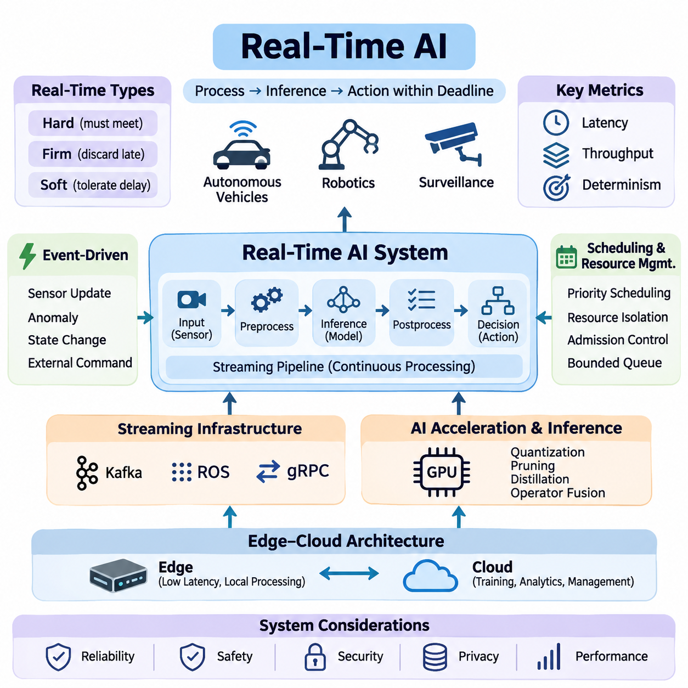
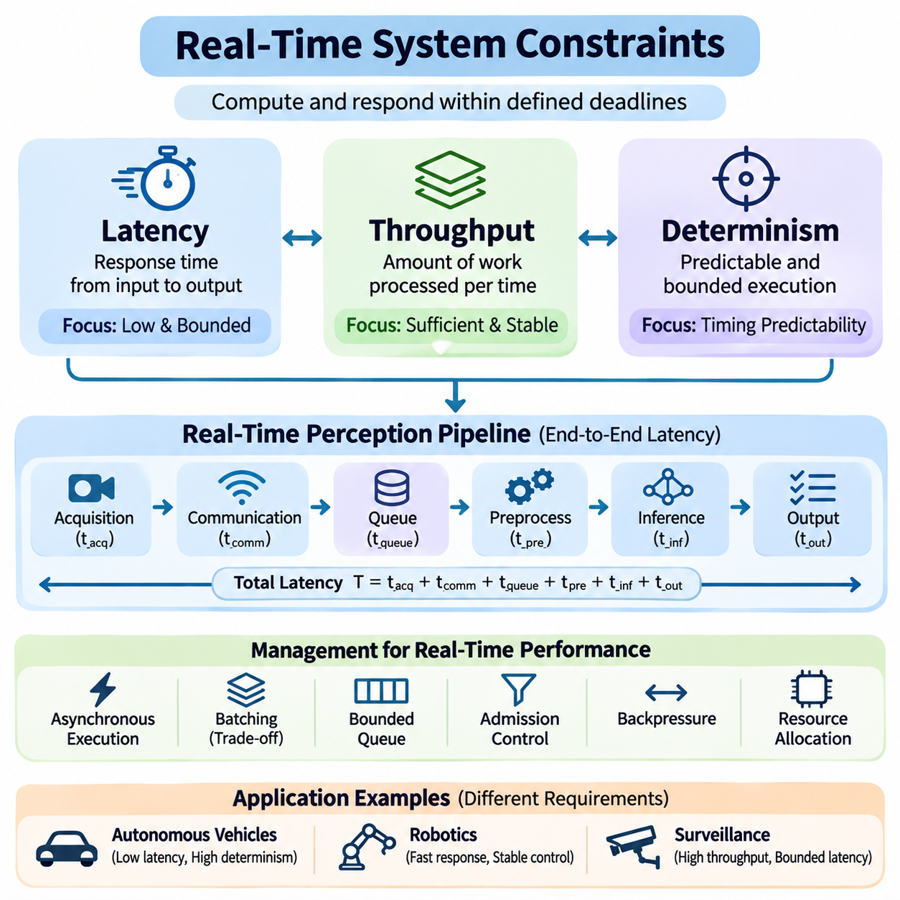
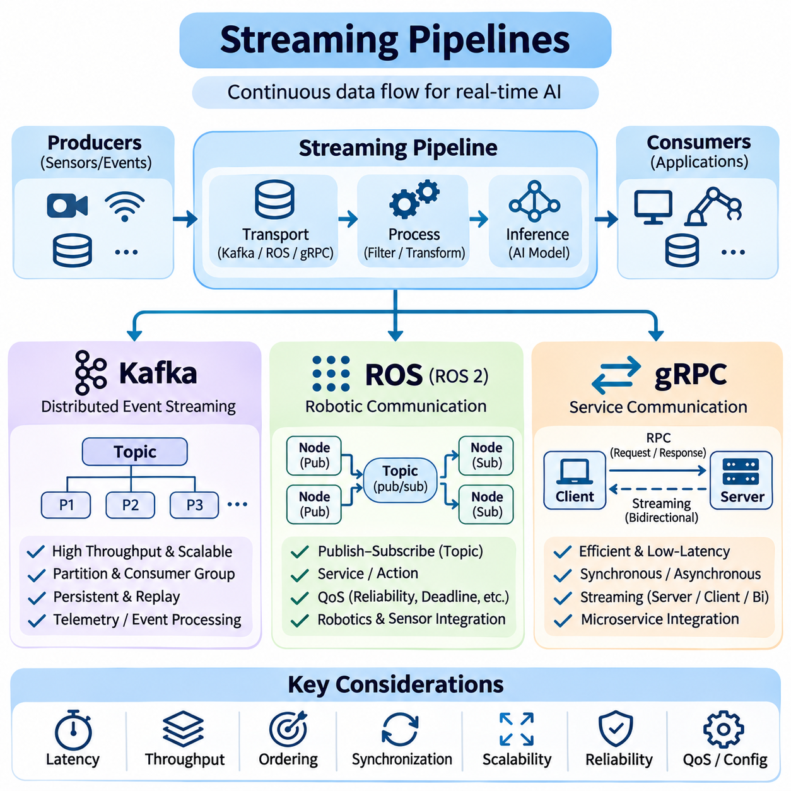
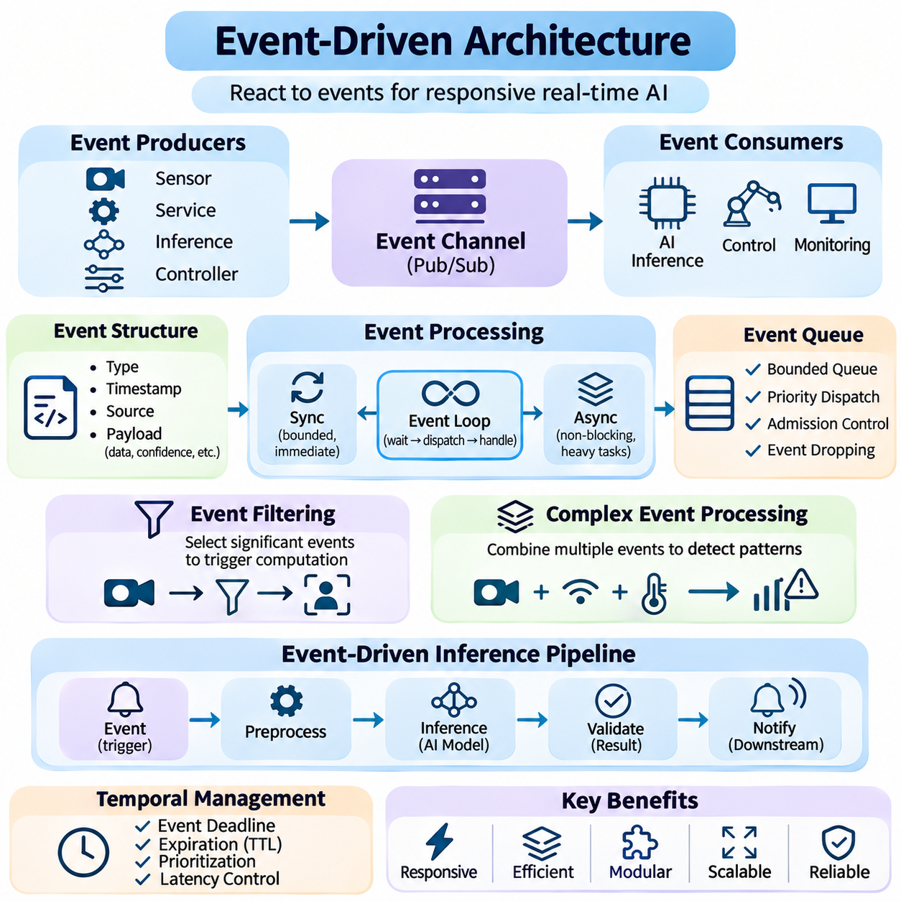
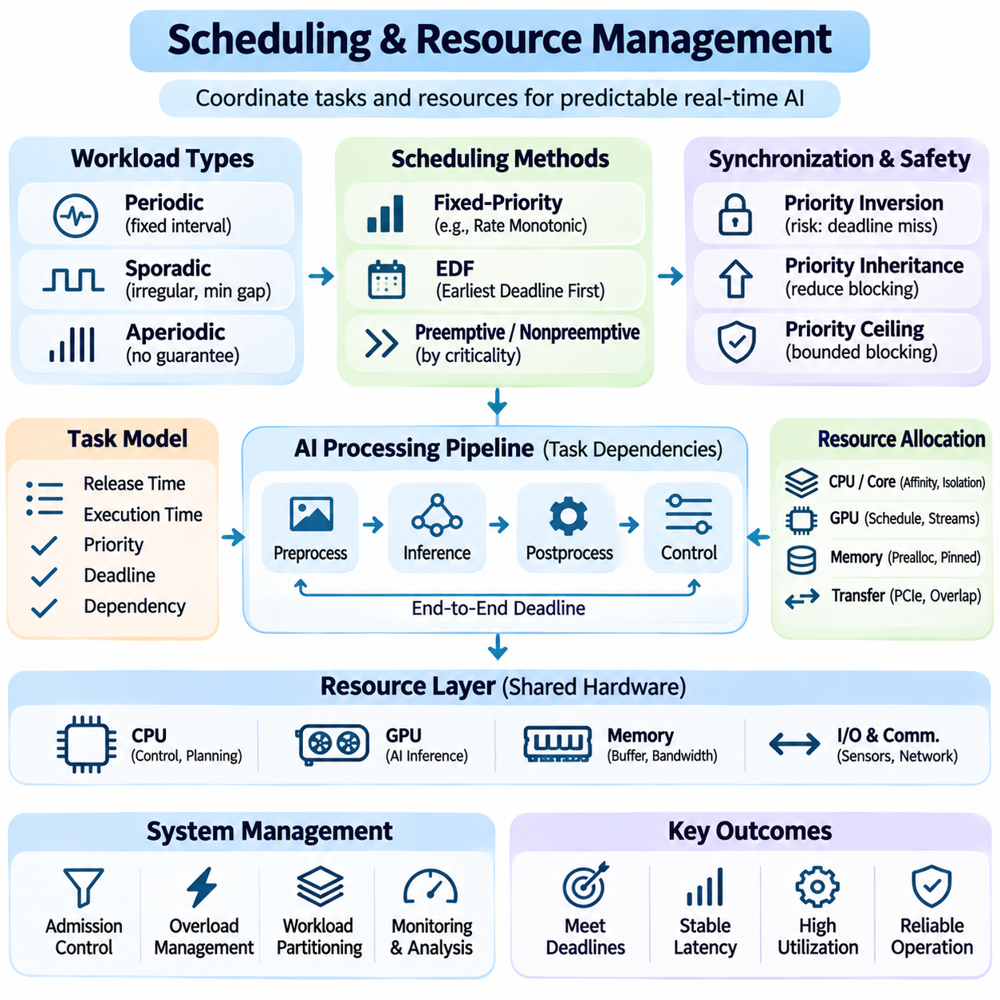
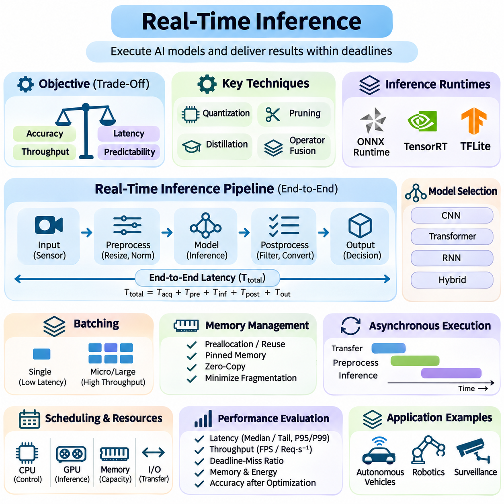
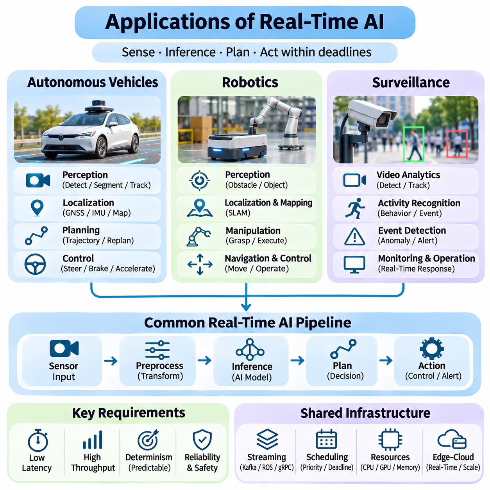

**Volume 38. AI Systems Architecture**

# 04. Real Time AI

## 04.00 Overview

{width="7.268055555555556in" height="7.268055555555556in"}

Real-time artificial intelligence refers to AI systems that process incoming information, perform inference, and produce actionable outputs within defined timing constraints. Unlike conventional AI applications that prioritize computational accuracy or aggregate throughput, real-time AI must deliver results before their usefulness expires. This requirement is essential in autonomous vehicles, robotics, industrial automation, and intelligent surveillance systems.

The defining characteristic of real-time AI is the relationship between computational execution and physical or operational deadlines. A prediction may be mathematically correct but practically useless if it arrives after the required decision point. Consequently, real-time AI architecture must consider not only model accuracy but also execution latency, scheduling behavior, communication delays, resource availability, and the consequences of missed deadlines.

Real-time systems are commonly classified into hard, firm, and soft real-time categories. Hard real-time systems require deadlines to be satisfied because violations may create unacceptable safety or operational consequences. Firm real-time systems discard results that arrive too late, while soft real-time systems tolerate occasional delays with reduced service quality. AI workloads must be integrated according to the timing guarantees required by their applications.

Latency represents the elapsed time between receiving an input and producing a corresponding output. In real-time AI, end-to-end latency includes sensor acquisition, preprocessing, data transfer, model execution, postprocessing, and decision delivery. Optimizing neural network inference alone is therefore insufficient. Every component of the processing pipeline contributes to the total response time and must be evaluated under realistic operating conditions.

Throughput measures the amount of information processed within a given period, such as frames per second, sensor messages per second, or inference requests per second. Although high throughput improves processing capacity, it does not necessarily guarantee low latency. Large batches may increase accelerator utilization while delaying individual predictions. Real-time architectures must balance throughput, responsiveness, and available computational resources.

Determinism describes the predictability of system execution time and behavior. A deterministic processing architecture aims to provide bounded execution times under specified operating conditions. This property becomes particularly important when AI components interact with control systems. Variations caused by operating system scheduling, memory allocation, accelerator contention, and communication congestion can undermine timing reliability.

Real-time AI commonly operates through continuous streaming pipelines rather than isolated batch-processing workflows. Sensor measurements, video frames, telemetry, and operational events enter the system as ongoing data streams. Processing components transform these streams into intermediate representations, predictions, and decisions. Pipeline architecture must minimize unnecessary buffering, control queue growth, and preserve temporal consistency across processing stages.

Streaming infrastructure provides communication mechanisms for connecting distributed processing components. Apache Kafka supports scalable event streaming and persistent message distribution, while the Robot Operating System provides communication abstractions for robotic applications. gRPC enables efficient service-to-service communication through structured remote procedure calls. Their suitability depends on latency requirements, delivery semantics, and deployment architecture.

Event-driven architecture provides another foundation for responsive AI systems. Instead of executing every operation at fixed intervals, components may react to sensor updates, detected anomalies, state transitions, or external commands. Events can trigger inference, activate specialized processing modules, or initiate safety responses. This approach reduces unnecessary computation when workloads are sparse or irregular, although event bursts require careful management.

Scheduling and resource management determine how processing tasks compete for CPU time, GPU execution capacity, memory bandwidth, and communication resources. Real-time workloads often combine periodic control operations with asynchronous perception and analytics tasks. Priority-aware scheduling, resource isolation, admission control, and bounded queues help protect critical operations from interference caused by less urgent computational activities.

Modern AI accelerators provide substantial parallel processing capability, but their execution characteristics introduce additional timing challenges. GPU kernels, memory transfers, synchronization operations, and concurrent inference workloads may produce variable execution delays. Efficient implementations reduce data movement, reuse allocated memory, and avoid unnecessary synchronization. Predictable accelerator behavior requires measurement under representative workloads.

Real-time inference focuses on executing trained models within application-specific response deadlines. Techniques such as quantization, pruning, knowledge distillation, operator fusion, and optimized inference runtimes can reduce computational requirements. However, model compression may affect prediction accuracy and robustness. Deployment decisions must therefore evaluate the relationship between inference speed, resource consumption, and acceptable model performance.

Edge computing plays a central role in real-time AI because local processing can eliminate network round trips to remote cloud infrastructure. Embedded accelerators and industrial computing platforms allow sensor data to be interpreted near its source. Cloud services remain valuable for model training, historical analysis, fleet coordination, and long-term optimization. Hybrid architectures separate time-critical local decisions from less urgent centralized operations.

Reliable real-time AI requires synchronization between heterogeneous data sources. Cameras, LiDAR sensors, radar systems, inertial measurement units, and positioning devices may operate at different sampling frequencies. Accurate timestamps and coordinated clocks allow measurements to be associated with the correct physical events. Without temporal alignment, sensor fusion may produce inconsistent environmental representations even when individual models perform accurately.

Temporal data management must also account for delayed, duplicated, missing, and out-of-order messages. A processing system should distinguish the time at which a measurement was acquired from the time at which it was received or processed. Timestamp-aware buffering, sequence tracking, expiration policies, and bounded waiting intervals help maintain valid state estimates. These mechanisms are especially important when communication conditions fluctuate.

Fault tolerance is essential because real-time AI systems operate under unpredictable environmental and computational conditions. Sensor failures, overloaded processors, network interruptions, and inference errors can disrupt normal operation. Robust architectures incorporate health monitoring, timeout detection, fallback processing, and degraded operating modes. Safety-critical decisions should not depend exclusively on an AI model whose timing or reliability cannot be guaranteed.

In autonomous vehicles, real-time AI supports environmental perception, object tracking, localization, trajectory planning, and interaction with vehicle control systems. Cameras, radar, and LiDAR generate continuous observations that must be interpreted within appropriate decision intervals. Perception delays can reduce the time available for braking or obstacle avoidance. System design must therefore connect inference deadlines with vehicle dynamics and operational safety requirements.

Robotic systems introduce additional challenges because perception and action occur within continuously changing physical environments. Mobile robots must interpret obstacles, estimate position, update navigation decisions, and coordinate motion controllers. Manipulation systems require timely feedback about object contact, force, and movement. AI processing must coexist with deterministic low-level control, which may require separate execution environments and scheduling priorities.

Intelligent surveillance systems apply real-time AI to continuous video analysis, object detection, tracking, behavior recognition, and event identification. Multiple camera streams may share computing resources while generating different processing demands. Event prioritization and adaptive inference can reduce computational pressure. Critical alerts require controlled delivery latency, while historical video analysis can operate through asynchronous processing pipelines.

Performance evaluation must consider more than average inference time. Relevant measurements include median latency, tail latency, deadline-miss ratio, throughput, jitter, queue occupancy, and resource utilization. Stress testing should examine simultaneous sensor activity, burst traffic, processor contention, and degraded communication conditions. These measurements reveal whether the architecture remains responsive when operating conditions differ from ideal benchmarks.

Real-time AI engineering ultimately requires coordinated design across machine learning, operating systems, networking, hardware acceleration, and application control. The objective is not simply to execute increasingly powerful models at higher speed, but to deliver trustworthy intelligence within meaningful temporal boundaries. Successful systems integrate predictable processing, efficient communication, resource-aware scheduling, and reliable operational behavior into a unified architecture.

## 04.01 Real Time System Constraints

{width="7.268055555555556in" height="7.268055555555556in"}

Real-time system constraints define the temporal and computational boundaries within which an artificial intelligence system must operate. Unlike conventional computing environments, where performance is often evaluated through average execution speed, real-time systems must produce valid results within specified deadlines. These constraints influence architecture, hardware selection, software scheduling, communication mechanisms, and operational reliability.

Three fundamental dimensions characterize real-time system performance: latency, throughput, and determinism. Latency measures how quickly an individual operation completes, throughput measures how much work a system processes over time, and determinism describes the predictability of execution behavior. These dimensions are closely related but cannot be optimized independently without considering their effects on overall system performance.

Latency represents the elapsed time between an initiating event and the completion of its corresponding response. In AI systems, this interval may include sensor acquisition, data preprocessing, memory transfers, neural network inference, postprocessing, and command delivery. End-to-end latency is particularly important because optimizing an individual processing stage does not necessarily improve the responsiveness of the complete application.

A real-time perception pipeline can be represented as a sequence of processing delays. Total response time consists of acquisition latency, communication latency, queueing delay, preprocessing time, inference execution time, and output delivery latency. Each component contributes to the overall timing budget. Engineers must measure these components separately to identify bottlenecks and determine where optimization provides the greatest benefit.

Latency requirements depend on the physical dynamics and operational characteristics of an application. Autonomous vehicles require timely obstacle detection and motion planning, while industrial inspection systems may tolerate longer processing intervals. High-speed robotic manipulation often demands rapid feedback updates. Consequently, latency targets should be derived from application-level safety, control stability, and operational requirements rather than arbitrary computational benchmarks.

Average latency alone cannot adequately characterize real-time performance. A system may exhibit excellent average response times while occasionally producing severe delays. Tail latency, commonly measured at the 95th, 99th, or 99.9th percentile, reveals the behavior of unusually slow operations. These measurements are important for identifying scheduling interference, memory contention, communication congestion, and other sources of unpredictable execution delays.

Latency optimization involves reducing computational overhead and eliminating unnecessary waiting between processing stages. Techniques include asynchronous execution, memory preallocation, zero-copy data transfer, optimized inference runtimes, and pipeline parallelism. However, aggressive optimization can introduce additional complexity or resource contention. Every improvement must be validated through end-to-end measurements under representative operating conditions.

Throughput describes the quantity of computational work completed within a defined time interval. Depending on the application, throughput may be expressed as frames per second, inference requests per second, processed sensor messages, or completed transactions. High throughput is essential for systems handling multiple cameras, distributed sensors, or concurrent inference workloads. Nevertheless, processing capacity alone does not establish real-time responsiveness.

The relationship between latency and throughput is influenced by batching, concurrency, and resource utilization. Larger batches can improve GPU efficiency by distributing execution overhead across multiple inputs. However, collecting enough inputs to form a batch introduces additional waiting time. Real-time applications must therefore select batching strategies that balance accelerator efficiency against individual request deadlines and temporal freshness requirements.

Queueing behavior becomes critical when incoming data rates approach or exceed available processing capacity. If messages arrive faster than they can be processed, queues grow and response latency increases. Even when average throughput appears sufficient, temporary workload bursts can create substantial delays. Bounded queues, admission control, backpressure mechanisms, and selective frame dropping help prevent uncontrolled accumulation of outdated information.

Throughput requirements should be evaluated alongside the sampling rates of connected sensors. A system processing several camera streams, LiDAR measurements, radar observations, and control messages must allocate sufficient capacity to each workload. Different processing stages may operate at different frequencies. Proper architecture prevents high-volume data sources from monopolizing computational resources needed by time-critical operations.

Resource utilization provides another important perspective on throughput efficiency. Maximizing GPU or CPU utilization may improve aggregate processing capacity but reduce the available headroom for unexpected workload increases. Real-time systems often reserve computational capacity to accommodate transient demand, emergency processing, and scheduling variability. This deliberate resource margin supports predictable operation rather than maximum benchmark performance.

Determinism refers to the ability of a system to execute operations within predictable timing boundaries. In real-time computing, deterministic behavior does not necessarily mean every operation requires exactly the same execution time. Instead, it emphasizes bounded execution variability and reliable deadline satisfaction. A system with slightly slower but predictable execution may be more suitable for critical applications than one with faster average performance and occasional extreme delays.

Worst-case execution time provides an important basis for deterministic system design. It represents an upper bound on the time required to complete a task under specified assumptions and operating conditions. Establishing credible execution bounds requires consideration of processor scheduling, cache behavior, memory access, synchronization, and competing workloads. For complex AI accelerators, rigorous worst-case guarantees can be difficult to establish.

Operating system scheduling strongly influences execution predictability. General-purpose operating systems prioritize overall responsiveness and resource sharing, which can introduce variable task delays. Real-time scheduling policies assign execution priorities according to timing requirements. Techniques such as CPU affinity, priority-based scheduling, interrupt management, and real-time operating system configurations can reduce interference affecting critical processing tasks.

GPU execution introduces additional challenges for deterministic AI processing. Kernel launch overhead, memory allocation, asynchronous execution, and concurrent workloads may produce variable completion times. GPU scheduling mechanisms do not always provide the same timing guarantees as dedicated real-time controllers. Consequently, safety-critical architectures frequently separate neural network inference from deterministic low-level control and establish explicit deadlines for communication between them.

Determinism also depends on predictable communication and synchronization. Distributed AI components exchange messages through networks, middleware, and shared-memory interfaces. Network congestion, retransmissions, buffering, and clock drift can affect message arrival times. Timestamp synchronization, bounded communication queues, priority-aware transport, and carefully designed timeout policies help maintain temporal consistency across distributed processing components.

Latency, throughput, and determinism create important engineering tradeoffs. Increasing batch sizes may improve throughput while increasing latency. Running additional inference tasks may improve hardware utilization but introduce execution variability. Reserving processor capacity may reduce maximum throughput while improving deadline reliability. Real-time architecture therefore requires multi-objective optimization based on application priorities rather than a single performance metric.

Scheduling policies must account for different levels of task criticality. Safety monitoring, actuator control, perception, logging, and cloud communication do not necessarily require identical timing guarantees. Critical tasks should receive protected execution resources and well-defined deadlines. Lower-priority workloads may be delayed, reduced, or suspended when resources become constrained, allowing the system to preserve essential operational functions.

Real-time performance evaluation requires measurements across realistic workload conditions. Engineers should examine end-to-end latency distributions, sustained throughput, deadline-miss ratios, execution jitter, queue occupancy, and resource utilization. Testing should include simultaneous sensor activity, computational bursts, communication degradation, and competing processing tasks. Such experiments reveal timing weaknesses that isolated inference benchmarks may overlook.

System-level timing budgets provide a practical method for coordinating performance requirements. Each processing stage receives an allocated execution interval based on the overall response deadline. These allocations should include margins for scheduling variability and communication overhead. Monitoring actual execution against assigned budgets allows engineers to identify emerging bottlenecks and determine whether the architecture can maintain required operating performance.

Ultimately, real-time system constraints establish the relationship between computational intelligence and dependable operational behavior. Latency determines response speed, throughput determines sustainable processing capacity, and determinism determines timing predictability. Successful real-time AI systems balance these characteristics through coordinated hardware selection, software optimization, scheduling design, communication management, and continuous performance validation.

## 04.02 Streaming Pipelines [w/Code]

{width="7.268055555555556in" height="7.268055555555556in"}

Streaming pipelines form the communication foundation of real-time artificial intelligence systems by continuously transferring data between sensors, processing components, inference engines, and downstream applications. Unlike batch-oriented architectures, streaming systems process information as it becomes available. Their design must address message delivery, processing latency, data ordering, synchronization, scalability, and operational reliability under changing workloads.

A typical streaming pipeline consists of data producers, transport mechanisms, processing stages, and consumers. Producers generate sensor measurements, video frames, telemetry, or application events. Transport layers distribute these messages to processing components, which perform filtering, transformation, inference, or aggregation. Consumers use the resulting information for visualization, decision-making, control, or persistent storage.

Real-time streaming architecture must distinguish between data transport and computation. A communication framework determines how messages move between components, while processing services determine how those messages are interpreted. Separating these responsibilities improves modularity and maintainability. However, excessive service boundaries introduce serialization, network transfers, queueing delays, and synchronization overhead that can reduce responsiveness.

Apache Kafka is a distributed event-streaming platform designed for high-throughput data ingestion, durable storage, and scalable message distribution. It organizes records into topics divided into partitions, allowing producers and consumers to operate independently. Kafka is particularly suitable for telemetry collection, event processing, monitoring, and integration between distributed AI services requiring persistent streams.

Kafka producers publish records to designated topics, while consumers retrieve records according to their assigned partitions and offsets. Consumer groups distribute partition processing across multiple instances, enabling horizontal scaling. Ordering is preserved within individual partitions rather than across an entire topic. Partition-key design therefore determines which events can be processed consistently while maintaining parallel execution.

Kafka durability relies on replicated logs and configurable acknowledgment policies. Records can remain available after consumers process them, supporting replay, recovery, and retrospective analysis. Retention policies control how long information remains stored, while replication improves resilience against broker failures. These capabilities are valuable for AI systems requiring historical event reconstruction, auditing, and reliable asynchronous processing.

Kafka performance depends on partition counts, producer batching, compression, broker resources, and consumer processing capacity. Larger batches improve throughput but may increase message delivery latency. Consumer lag indicates how far processing falls behind incoming records. Monitoring lag, partition distribution, request latency, and broker utilization helps identify bottlenecks before they affect downstream inference and operational monitoring.

Although Kafka supports responsive event processing, it does not inherently guarantee strict deterministic deadlines. Broker persistence, network communication, replication, and consumer scheduling introduce timing variability. Consequently, Kafka is generally more appropriate for supervisory data pipelines than tightly constrained actuator control loops. Safety-critical control should remain within architectures that provide independently verified timing guarantees.

The Robot Operating System, particularly ROS 2, provides communication infrastructure for distributed robotic applications. ROS organizes software into nodes that exchange information through topics, services, and actions. This structure supports modular integration of perception, localization, navigation, planning, and hardware interfaces. Its communication model is well suited to robotic systems combining heterogeneous sensors and computational components.

ROS topics implement publish-subscribe communication for continuously updated information such as camera images, LiDAR scans, odometry, and robot state estimates. Publishers transmit messages without requiring direct knowledge of individual subscribers. Subscribers receive information through middleware-managed communication channels. This separation allows robotic components to evolve independently while maintaining standardized message interfaces.

ROS 2 commonly uses Data Distribution Service middleware to support decentralized communication and configurable Quality of Service policies. Reliability, durability, history depth, and deadline settings influence message delivery behavior. Best-effort communication may suit high-frequency sensor streams where occasional losses are acceptable, while reliable delivery may be preferable for important state updates and coordination messages.

ROS services support request-response interactions, while actions represent longer-running operations that require progress feedback and cancellation capabilities. Services are useful for configuration requests or short operations, whereas actions support navigation goals and complex robotic tasks. Selecting the appropriate communication pattern prevents unnecessary blocking and helps maintain responsiveness across distributed robotic software components.

Real-time ROS performance depends on executor scheduling, callback execution time, middleware configuration, and memory management. Long-running callbacks can delay unrelated operations when execution resources are shared. Callback groups, multithreaded executors, controlled allocation, and carefully selected Quality of Service settings can reduce interference. Nevertheless, deterministic guarantees require validation of the complete hardware and software configuration.

ROS pipelines frequently integrate sensors operating at different update frequencies. Camera images, inertial measurements, odometry, and point clouds must be associated with consistent timestamps. Clock synchronization and message synchronization mechanisms help align observations before sensor fusion. Processing stale or temporally inconsistent information can degrade localization, obstacle detection, and motion planning even when individual algorithms remain accurate.

gRPC is a remote procedure call framework commonly used for communication between distributed services. It typically uses HTTP/2 and Protocol Buffers to provide structured interfaces and efficient serialization. In AI architectures, gRPC connects inference servers, orchestration services, edge gateways, and application backends. Strongly defined service contracts simplify integration across programming languages and deployment environments.

gRPC supports unary requests and several streaming communication patterns, including server streaming, client streaming, and bidirectional streaming. Unary calls suit isolated inference requests, while streaming interfaces support continuous data exchange over persistent connections. Bidirectional streams allow clients and servers to transmit messages independently, making them useful for interactive inference, telemetry exchange, and remote supervisory operations.

Protocol Buffers define compact message schemas that can be shared across independently developed services. Schema evolution supports compatible interface changes when fields are managed carefully. Binary serialization generally reduces payload overhead compared with verbose text formats. However, serialization, copying, and network transport still contribute to end-to-end latency, especially when large tensors or image frames are transferred frequently.

gRPC performance depends on connection management, message size, flow control, concurrency, and server processing capacity. Persistent connections reduce repeated setup costs, while asynchronous handling improves responsiveness under concurrent workloads. Deadlines and cancellation mechanisms prevent requests from waiting indefinitely. Proper timeout selection must account for network variability and inference execution time without allowing obsolete results to accumulate.

Security is an important consideration for distributed streaming pipelines. Kafka supports authentication and access-control mechanisms, while ROS deployments require appropriate network isolation and security configuration. gRPC can use Transport Layer Security to protect communication channels. Authentication, authorization, encryption, and credential management should be designed according to deployment risks without introducing uncontrolled latency into critical processing paths.

Kafka, ROS, and gRPC address different communication requirements rather than serving as interchangeable technologies. Kafka emphasizes durable event distribution and scalable asynchronous processing. ROS emphasizes modular robotic communication and sensor-oriented workflows. gRPC emphasizes structured service interactions and streaming between distributed applications. Their complementary characteristics allow them to coexist within larger AI system architectures.

A hybrid architecture may use ROS 2 for local robot perception and navigation, gRPC for communication with remote inference or supervisory services, and Kafka for centralized telemetry collection and event analytics. This separation keeps time-sensitive robotic operations close to their execution environment while supporting distributed monitoring and historical analysis. Network failures should not compromise essential local safety and control functions.

Pipeline reliability requires explicit policies for overload, message expiration, recovery, and component failure. Backpressure mechanisms limit uncontrolled queue growth, while bounded buffers prevent excessive memory consumption. Retry policies must avoid duplicating operations with irreversible effects. Monitoring should capture message age, delivery latency, processing throughput, queue depth, and failure rates to reveal operational degradation.

Ultimately, streaming pipeline engineering requires coordinated decisions about communication semantics, timing requirements, scalability, and fault tolerance. Kafka provides durable event infrastructure, ROS supports distributed robotic processing, and gRPC enables structured service communication. Successful real-time AI systems combine these technologies selectively, preserving data freshness, predictable responsiveness, and reliable information flow across the complete processing architecture.

## 04.03 Event Driven Architecture

{width="7.268055555555556in" height="7.268055555555556in"}

Event-driven architecture is a software design approach in which system components respond to events rather than relying exclusively on sequential execution or fixed processing cycles. An event represents a meaningful change in system state, sensor observation, user interaction, or operational condition. In real-time AI systems, event-driven processing enables responsive behavior by activating computational tasks when relevant information becomes available.

The fundamental components of event-driven architecture include event producers, event channels, event consumers, and event handlers. Producers generate notifications when significant conditions occur, while communication channels distribute these notifications to interested components. Consumers receive events and invoke appropriate processing logic. This separation reduces direct dependencies between components and supports modular, extensible system design.

Events may originate from physical sensors, software services, inference engines, communication interfaces, or operational controllers. A camera may generate a frame acquisition event, while an object detection model may produce an obstacle detection event. Similarly, a monitoring service may emit an equipment failure notification. Each event provides contextual information that allows downstream components to determine the appropriate response.

An event generally contains a type identifier, timestamp, source information, and application-specific payload. The event type describes what occurred, while the timestamp indicates when the underlying condition was observed. Source identifiers support traceability across distributed components. Payload fields may include sensor measurements, prediction confidence, object identifiers, or operational parameters required for subsequent processing.

Event-driven systems commonly use publish-subscribe communication to distribute information among independent components. Publishers emit events without explicitly addressing individual consumers, while subscribers register interest in particular event categories. Message brokers or middleware manage delivery and routing. This architecture supports flexible integration because additional processing services can subscribe to existing events without modifying their producers.

Event processing may follow synchronous or asynchronous execution models depending on application requirements. Synchronous handlers execute within the initiating control flow and may delay subsequent operations until completion. Asynchronous handlers execute independently, allowing other activities to continue. Real-time AI systems frequently combine both approaches, reserving synchronous execution for bounded operations and asynchronous processing for computationally intensive workloads.

Event loops provide a common execution mechanism for handling incoming notifications. An event loop waits for available events, dispatches them to registered handlers, and coordinates processing completion. Efficient implementations minimize blocking operations and unnecessary context switching. However, a single overloaded handler can delay unrelated events, making execution-time limits and workload isolation important architectural considerations.

Event queues temporarily store notifications awaiting processing. Queue capacity, ordering policies, and dispatch priorities directly influence response latency. Unbounded queues can accumulate outdated information when event generation exceeds processing capacity. Bounded queues, admission control, and selective event dropping prevent uncontrolled memory growth. Queue management policies must reflect whether events represent replaceable observations or essential operations.

Event ordering becomes important when processing depends on the sequence of state transitions. Distributed components may generate events concurrently, and network delays can change their arrival order. Sequence numbers, timestamps, and partition-specific ordering mechanisms help reconstruct meaningful execution sequences. Nevertheless, timestamps alone cannot guarantee a globally consistent event order without appropriate clock synchronization and coordination mechanisms.

Event-driven AI architectures frequently use event filtering to reduce unnecessary computation. Instead of executing expensive inference for every incoming measurement, lightweight processing stages identify conditions requiring deeper analysis. Motion detection may activate object recognition, while abnormal vibration measurements may trigger predictive maintenance inference. Such selective execution can improve computational efficiency when event frequency remains manageable.

Complex event processing combines multiple observations to identify higher-level conditions. Individual sensor readings may be insufficient to determine whether an operational anomaly exists. By evaluating event sequences, temporal relationships, and correlated measurements, the system can detect meaningful patterns. This approach supports industrial monitoring, intelligent surveillance, robotic coordination, and automated operational decision-making.

Event-driven inference pipelines connect event detection with machine learning execution. A triggering event initiates preprocessing, model inference, result validation, and downstream notification. Each processing stage may emit additional events representing intermediate or completed operations. This architecture supports composability and observability, but excessive event chaining can increase latency and complicate failure diagnosis.

Temporal constraints must be incorporated into event handling because not every event remains useful indefinitely. An obstacle detection event may require immediate processing, while a diagnostic notification can tolerate additional delay. Event deadlines and expiration policies help distinguish urgent information from obsolete data. Processing priorities should reflect the consequences of delayed responses rather than simply the order in which events arrive.

Priority-aware event scheduling allows critical notifications to receive preferential processing. Emergency stop requests, collision warnings, and safety interlock changes may require immediate attention, while logging and statistical analysis can operate at lower priorities. However, software event priorities alone do not establish safety guarantees. Safety-critical actions require independently validated control paths and appropriate hardware protection mechanisms.

Backpressure is essential when event producers generate information faster than consumers can process it. Without flow control, queue growth increases latency and can exhaust system resources. Backpressure mechanisms may reduce production rates, limit outstanding requests, or reject nonessential events. For continuous sensor streams, retaining the newest observation can be more useful than processing every outdated message.

Reliability mechanisms address event loss, duplication, and processing failures. Message delivery policies may provide at-most-once, at-least-once, or effectively exactly-once processing under specified conditions. At-least-once delivery can produce duplicates, requiring idempotent event handlers. Exactly-once effects across external systems generally require additional coordination, transactional mechanisms, or application-specific safeguards.

State management presents another challenge because independent event handlers may operate on shared or distributed information. Stateless handlers are easier to scale, but many AI applications require persistent context, object histories, or operational state. State stores, version identifiers, and concurrency controls help maintain consistency. Event sourcing can preserve sequences of state changes, supporting recovery, auditing, and historical reconstruction.

Fault tolerance requires detecting failed handlers, unavailable services, and interrupted communication paths. Retry mechanisms can recover transient failures, while dead-letter queues isolate events that repeatedly fail processing. Circuit breakers and timeout policies prevent unhealthy services from blocking unrelated operations. Recovery procedures must also consider whether delayed events remain valid when normal processing resumes.

Observability is essential for understanding event-driven execution across distributed AI components. Event identifiers, correlation identifiers, timestamps, and structured logs allow engineers to trace processing paths. Metrics such as event arrival rate, queue depth, handler execution time, delivery latency, and deadline violations reveal system behavior. Distributed tracing helps identify bottlenecks that may not be visible through isolated component measurements.

Event-driven architectures integrate naturally with streaming technologies such as Kafka, ROS 2, and gRPC. Kafka supports durable event distribution and asynchronous analytics, while ROS 2 enables sensor-driven communication between robotic nodes. gRPC streaming connects distributed services through structured interfaces. Selecting the appropriate transport depends on delivery semantics, communication topology, timing constraints, and persistence requirements.

In autonomous vehicles, events may represent newly detected obstacles, changes in traffic conditions, localization failures, or unexpected vehicle behavior. These notifications activate perception updates, planning adjustments, and supervisory responses. Robotic systems similarly use events for obstacle detection, docking completion, manipulation feedback, and task transitions. Time-critical motion control must remain protected from unpredictable event-processing delays.

Industrial AI applications use event-driven architectures to monitor machinery, detect abnormal operating conditions, and coordinate automated responses. Sensor thresholds may trigger diagnostic inference, while inspection results can initiate maintenance workflows. Event-driven processing reduces unnecessary computation when operational conditions remain stable. However, event storms during widespread failures require prioritization, overload protection, and reliable escalation mechanisms.

Ultimately, event-driven architecture provides a flexible foundation for responsive and scalable real-time AI systems. Its effectiveness depends on controlled event generation, predictable dispatch behavior, reliable communication, and appropriate state management. By combining asynchronous processing with explicit timing constraints and fault-handling policies, engineers can construct AI applications that respond efficiently to changing environments while preserving operational reliability.

## 04.04 Scheduling and Resource Management

{width="7.268055555555556in" height="7.268055555555556in"}

Scheduling and resource management are fundamental to real-time artificial intelligence systems because computational tasks must share limited hardware resources while satisfying application-specific deadlines. Unlike conventional workload scheduling, which often emphasizes average utilization, real-time scheduling prioritizes predictable execution. Effective resource management coordinates processors, accelerators, memory, and communication channels to maintain reliable system responsiveness.

Real-time AI workloads typically combine periodic, sporadic, and aperiodic tasks. Periodic tasks execute at fixed intervals, such as motion control updates or sensor sampling. Sporadic tasks occur irregularly but have a defined minimum separation between arrivals, while aperiodic tasks have no guaranteed arrival pattern. Scheduling policies must accommodate these workload characteristics without allowing unpredictable activities to disrupt critical operations.

Task scheduling determines when computational operations begin, how long they execute, and which processing resources they receive. Each task may have a release time, execution requirement, priority, and deadline. The scheduler must coordinate these constraints while accounting for dependencies between processing stages. In AI pipelines, preprocessing, inference, postprocessing, and control decisions frequently form interconnected execution sequences.

Fixed-priority scheduling assigns each task a priority that remains constant during execution. Rate Monotonic Scheduling commonly assigns higher priorities to tasks with shorter periods, assuming suitable periodic task models. This approach offers relatively simple implementation and established schedulability analysis. However, shared resources, blocking operations, and execution variability must be included when evaluating whether deadlines can be satisfied.

Earliest Deadline First scheduling dynamically prioritizes tasks according to their absolute deadlines. Tasks approaching their deadlines receive higher scheduling priority, potentially improving processor utilization under appropriate assumptions. Nevertheless, overload conditions can produce widespread deadline violations. Practical implementations require admission control, overload management, and careful treatment of shared resources to maintain predictable operational behavior.

Preemptive scheduling allows higher-priority tasks to interrupt lower-priority execution when urgent processing becomes necessary. This improves responsiveness for critical operations but introduces context-switching overhead and possible interference. Nonpreemptive execution avoids interruption during selected operations, which can simplify resource coordination. Real-time architectures often combine both approaches according to task criticality and execution characteristics.

Priority inversion occurs when a high-priority task waits for a resource held by a lower-priority task while intermediate-priority tasks delay resource release. This situation can produce unexpected deadline violations. Priority inheritance and priority ceiling protocols reduce certain forms of blocking caused by shared locks. Proper synchronization design is therefore essential when perception, planning, and control components access common resources.

CPU resource management involves allocating processing cores, execution priorities, and scheduling budgets to competing tasks. CPU affinity can bind selected workloads to particular cores, reducing migration overhead and limiting interference. Core isolation may protect time-critical operations from background services. However, isolation also reduces resource flexibility, requiring careful capacity planning and validation under realistic workloads.

GPU scheduling presents additional challenges because accelerators execute many operations asynchronously and share computational resources across workloads. Neural network inference, image processing, and tensor operations may compete for execution capacity and memory bandwidth. Kernel launch delays and synchronization overhead introduce timing variability. GPU utilization must therefore be managed according to deadline requirements rather than maximum throughput alone.

Concurrent GPU workloads can improve accelerator efficiency but may increase tail latency when execution resources become saturated. Techniques such as workload partitioning, controlled concurrency, stream prioritization, and inference admission control help manage contention. Their effectiveness depends on accelerator architecture and runtime behavior. Critical inference deadlines must be measured under simultaneous workloads rather than isolated benchmarks.

Memory management strongly influences real-time execution predictability. Dynamic allocation, page faults, cache misses, and memory fragmentation can introduce unpredictable delays. Memory preallocation, buffer reuse, pinned memory, and bounded data structures reduce execution variability. Systems should also consider memory bandwidth contention between CPU, GPU, and peripheral devices, particularly when processing high-resolution sensor streams.

Data transfer scheduling is important when inference pipelines move information between sensors, host memory, and accelerators. Transfers over PCIe or other interconnects may compete with computational operations and communication traffic. Asynchronous transfers and overlapping computation can improve utilization, but synchronization dependencies must remain controlled. Excessive buffering can increase data age even when computational throughput appears sufficient.

Resource allocation must account for dependencies between processing stages. A perception result may be required before planning begins, while a planning decision must be completed before control commands are updated. These dependencies create end-to-end execution chains with cumulative timing constraints. Scheduling individual tasks independently may therefore fail to guarantee the deadline of the complete AI processing pipeline.

Admission control determines whether additional workloads can execute without violating existing timing commitments. Before accepting a new inference request or sensor stream, the system evaluates available processing capacity and expected resource demand. Requests that cannot be accommodated may be delayed, rejected, or assigned reduced processing quality. This mechanism prevents overload from compromising established real-time operations.

Overload management becomes essential when incoming computational demand exceeds available resources. Instead of allowing queues to grow indefinitely, systems can apply bounded buffering, frame dropping, task cancellation, and adaptive inference frequency. Lower-priority analytics may be suspended to preserve critical functions. Such policies should distinguish replaceable sensor observations from commands or events that require reliable execution.

Mixed-criticality systems execute tasks with different safety and timing requirements on shared computing platforms. Low-level motion control may require strict deadlines, while AI perception and monitoring can tolerate greater variability. Resource partitioning and scheduling isolation help prevent less critical workloads from interfering with essential operations. Safety-related control functions may require independent processors or dedicated execution environments.

Distributed resource management extends scheduling decisions across edge devices, local servers, and cloud infrastructure. Edge processors execute latency-sensitive inference, while remote systems perform computationally intensive analytics or model training. Task placement must consider communication delays, network availability, processing capacity, and data transfer costs. Time-critical control should not depend on remote resources without suitable fallback mechanisms.

Energy and thermal constraints also influence scheduling decisions, particularly in embedded AI platforms. Sustained accelerator utilization can increase power consumption and trigger thermal throttling, reducing available processing performance. Dynamic voltage and frequency scaling may improve energy efficiency but introduce timing variability. Real-time systems must evaluate scheduling behavior under sustained thermal conditions rather than relying only on short-duration benchmarks.

Adaptive scheduling adjusts execution policies according to workload intensity, resource availability, and operational priorities. An autonomous robot may increase perception frequency near obstacles while reducing nonessential analytics during normal navigation. Such adaptation improves resource efficiency when operating conditions change. However, adaptation mechanisms must preserve mandatory deadlines and avoid unstable transitions between scheduling configurations.

Monitoring provides the information required to evaluate scheduling effectiveness and resource utilization. Important metrics include task response time, deadline-miss ratio, execution jitter, CPU utilization, GPU occupancy, memory bandwidth, queue depth, and thermal conditions. Tracing tools reveal scheduling delays and resource contention across processing stages. Continuous measurement helps identify degradation before it affects operational reliability.

Scheduling analysis should consider worst-case execution behavior rather than relying exclusively on average performance. Stress tests must include simultaneous sensor activity, competing inference workloads, memory pressure, and communication disturbances. Execution-time distributions and deadline violations reveal whether the system maintains acceptable behavior under load. Hardware-specific measurements are especially important when formal timing bounds cannot be established.

Ultimately, scheduling and resource management connect computational efficiency with dependable real-time behavior. Successful architectures combine priority-aware execution, bounded resource allocation, workload isolation, overload protection, and continuous monitoring. The objective is not simply to maximize processor utilization, but to ensure that critical AI and control operations receive sufficient resources to complete within meaningful temporal constraints.

## 04.05 Real Time Inference [w/Code]

{width="7.268055555555556in" height="7.268055555555556in"}

Real-time inference refers to the execution of trained artificial intelligence models within predefined temporal constraints. Unlike offline inference, where processing delays may be acceptable, real-time inference must produce predictions before application-specific deadlines expire. Its performance depends on model complexity, hardware acceleration, memory efficiency, scheduling behavior, and the integration of inference with surrounding processing stages.

The primary objective of real-time inference is to balance prediction accuracy, execution latency, throughput, and timing predictability. A highly accurate model may be unsuitable if its response time exceeds operational requirements. Conversely, a faster model may introduce unacceptable prediction errors. System designers must therefore evaluate inference performance against application-level constraints rather than optimizing computational speed in isolation.

An inference pipeline typically includes input acquisition, preprocessing, model execution, postprocessing, and output delivery. Each stage contributes to end-to-end response latency. Camera frames may require resizing and normalization, while LiDAR observations may undergo filtering and geometric transformation. After inference, predictions often require confidence filtering, coordinate conversion, or integration with downstream decision-making modules.

Inference latency is commonly measured as the time required to process an individual input, but this measurement does not fully describe real-time behavior. Queueing delays, data transfers, synchronization, and scheduling interference may dominate total response time. Engineers should measure both isolated model execution and complete pipeline latency, including percentile distributions and deadline violations under representative workloads.

Model architecture strongly influences real-time inference efficiency. Convolutional neural networks, transformers, recurrent models, and hybrid architectures exhibit different computational and memory characteristics. Parameter count alone does not determine execution speed because operator structure, memory access patterns, tensor dimensions, and hardware support also matter. Model selection must consider the characteristics of the target inference platform.

Quantization reduces numerical precision to decrease memory consumption and computational requirements. Converting supported operations from floating-point formats to lower-precision representations such as INT8 can improve inference efficiency on compatible accelerators. However, quantization may introduce numerical errors and reduce model accuracy. Calibration and representative validation datasets are essential for assessing the resulting performance tradeoffs.

Pruning removes selected parameters, channels, or computational structures that contribute relatively little to model performance. Structured pruning can reduce actual execution costs when supported by the inference runtime, while unstructured sparsity may require specialized hardware or kernels. Pruning should be followed by fine-tuning and validation because aggressive removal of model components can degrade prediction quality and robustness.

Knowledge distillation transfers useful behavior from a larger teacher model to a smaller student model. The student learns from training labels and teacher-generated outputs, potentially preserving important predictive capabilities with fewer computational resources. This approach is valuable for edge inference, where memory capacity and power consumption are constrained. The resulting model must still be evaluated under realistic deployment conditions.

Operator fusion combines compatible computational operations to reduce intermediate memory transfers and execution overhead. For example, convolution, normalization, and activation operations may be optimized into more efficient execution patterns. Graph optimization can eliminate redundant computations, simplify tensor transformations, and improve memory reuse. Actual performance gains depend on compiler capabilities and accelerator-specific kernel implementations.

Inference runtimes provide optimized execution environments for trained models. Frameworks such as ONNX Runtime, TensorRT, and TensorFlow Lite support different combinations of graph optimization, hardware acceleration, and numerical precision. Selecting an appropriate runtime requires examining supported operators, deployment compatibility, memory consumption, and measured latency. Unsupported operations may introduce costly execution fallbacks.

Batching improves accelerator utilization by processing multiple inputs together, but it can conflict with strict response deadlines. Larger batches often increase throughput while introducing waiting time before execution begins. Real-time applications may prefer single-request inference or bounded microbatching. Dynamic batching policies should limit queueing delays and prevent older observations from remaining in the pipeline after their operational relevance has expired.

Memory allocation is another important source of inference latency variability. Repeated tensor allocation, memory fragmentation, and host-device transfers can introduce unpredictable delays. Preallocated buffers, reusable execution contexts, pinned memory, and zero-copy interfaces can reduce overhead where supported. Memory optimization must also account for concurrent models competing for accelerator memory and bandwidth.

Asynchronous execution allows data transfers, preprocessing, and inference operations to overlap when hardware dependencies permit. GPU streams and nonblocking interfaces can improve pipeline utilization by reducing idle periods. However, excessive concurrency may increase resource contention and tail latency. Synchronization points must be carefully placed to ensure that predictions correspond to valid input data and completed computational operations.

Real-time inference scheduling determines how model execution competes with perception, planning, communication, and control tasks. Priority-aware execution and admission control can protect critical workloads from overload. GPU execution timing may remain variable because of shared resources and runtime behavior. Consequently, inference components should communicate through bounded interfaces with deterministic controllers rather than directly replacing safety-critical control mechanisms.

Edge inference reduces dependence on remote communication by executing models near sensors and actuators. Embedded GPUs, neural processing units, and specialized accelerators support local perception and decision-making. This architecture improves resilience against network interruptions and reduces data transmission requirements. Nevertheless, thermal limits, energy consumption, and restricted memory capacity constrain sustainable inference performance.

Adaptive inference adjusts computational effort according to operational conditions. A robotic system may increase perception frequency near obstacles while reducing inference activity in stable environments. Models may also use multiple execution paths, resolutions, or complexity levels. Such adaptation can improve resource efficiency, but switching policies must preserve required deadlines and avoid unstable changes in prediction quality.

Temporal consistency is essential when inference processes continuous sensor streams. Predictions must be associated with acquisition timestamps rather than only their completion times. Processing outdated frames can produce incorrect environmental interpretations even when model accuracy is high. Frame skipping, timestamp-aware buffering, and sequence tracking help maintain relevant state estimates while preventing excessive pipeline latency.

Multi-model inference introduces additional resource management challenges. Object detection, semantic segmentation, depth estimation, and tracking models may execute concurrently on shared accelerators. Their combined memory requirements and execution interference can exceed individual benchmark estimates. Resource partitioning, workload scheduling, and selective model activation help maintain responsiveness when multiple AI functions operate simultaneously.

Fault handling is necessary because inference can fail through invalid inputs, resource exhaustion, runtime errors, or excessive execution delays. Timeout mechanisms should detect missed deadlines, while health monitoring identifies degraded accelerator behavior. Fallback strategies may use simpler models, cached state estimates, or conservative operational modes. Safety-critical systems must retain independently validated mechanisms for responding to unreliable inference results.

Performance evaluation should measure median latency, tail latency, sustained throughput, deadline-miss ratio, memory consumption, and energy efficiency. Testing must include concurrent workloads, sensor bursts, thermal saturation, and communication disturbances. Accuracy should also be evaluated after quantization, pruning, or runtime conversion. Reliable deployment requires evidence that computational improvements do not compromise application-level performance.

Real-time inference engineering ultimately combines model optimization, accelerator-aware execution, memory management, and system-level timing control. The goal is not merely to maximize inference speed, but to deliver accurate and operationally useful predictions within predictable temporal boundaries. Successful architectures integrate efficient models, optimized runtimes, bounded processing pipelines, and continuous validation to support dependable intelligent behavior.

## 04.06 Applications

{width="7.268055555555556in" height="7.268055555555556in"}

Real-time artificial intelligence plays a fundamental role in autonomous vehicles, robotics, and intelligent surveillance, where computational decisions must respond to continuously changing environments. These applications combine sensor acquisition, perception, inference, planning, and action under strict timing constraints. Although their operational objectives differ, they share requirements for low latency, predictable execution, reliable communication, and robust handling of unexpected events.

Autonomous vehicles depend on real-time AI to interpret road conditions and generate safe driving decisions. Cameras, LiDAR, radar, ultrasonic sensors, and positioning systems provide complementary environmental observations. Their outputs must be synchronized and processed to identify vehicles, pedestrians, road boundaries, and obstacles. Delayed or inconsistent sensor information can degrade situational awareness and compromise subsequent planning decisions.

Perception pipelines in autonomous vehicles commonly perform object detection, semantic segmentation, lane recognition, and object tracking. These operations transform raw sensor measurements into structured representations of the driving environment. Multi-sensor fusion improves robustness by combining complementary information sources. However, fusion introduces synchronization requirements and additional computation that must remain compatible with real-time deadlines.

Vehicle localization estimates position and orientation using satellite navigation, inertial measurements, wheel odometry, and environmental observations. Real-time localization algorithms continuously update the vehicle state while compensating for sensor noise and uncertainty. Localization errors can propagate into path planning and control. Consequently, localization systems require timestamp consistency, bounded processing delays, and mechanisms for detecting degraded estimation quality.

Motion planning converts environmental understanding into feasible vehicle trajectories. Planning algorithms evaluate road geometry, obstacle motion, traffic rules, and vehicle dynamics before selecting appropriate actions. Their computational requirements vary with scene complexity and the number of candidate trajectories. Real-time scheduling must preserve sufficient processing capacity for urgent replanning when unexpected obstacles or hazardous conditions appear.

Vehicle control translates planned trajectories into steering, braking, and acceleration commands. Unlike computationally intensive perception tasks, low-level control typically operates at fixed frequencies with stringent timing requirements. Control execution should remain isolated from unpredictable inference workloads. Safety mechanisms must provide reliable responses when perception becomes unavailable, communication fails, or planning deadlines are missed.

Autonomous driving systems frequently employ heterogeneous computing architectures that combine CPUs, GPUs, dedicated accelerators, and automotive controllers. GPUs execute perception networks, while CPUs coordinate planning and supervisory functions. Dedicated controllers manage time-critical vehicle interfaces. Resource partitioning and priority-aware scheduling reduce interference, while redundancy and health monitoring support dependable operation under component failures.

Robotics presents similar real-time requirements but introduces additional diversity in physical interaction and task execution. Mobile robots, industrial manipulators, collaborative robots, and autonomous inspection systems operate under different mechanical constraints. Their AI pipelines must connect perception with localization, motion planning, manipulation, and actuator control. Effective integration requires consistent timing across sensing, computation, and physical movement.

Autonomous mobile robots use real-time perception to detect obstacles, recognize traversable regions, and update local navigation plans. LiDAR, depth cameras, wheel encoders, and inertial sensors provide complementary measurements. Localization and mapping algorithms maintain environmental representations, while navigation controllers generate motion commands. Delayed obstacle detection or outdated maps can reduce navigation reliability in dynamic environments.

Robotic manipulation requires coordinated perception, object localization, grasp planning, and trajectory execution. Vision models identify target objects and estimate their positions, while motion planners evaluate reachability and collision constraints. Feedback from cameras, force sensors, and joint encoders supports corrective actions. Real-time performance becomes especially important when objects move or manipulation occurs near humans and other equipment.

Human-robot collaboration requires continuous monitoring of shared workspaces and appropriate responses to changing human behavior. AI models may estimate human poses, recognize gestures, or predict movement intentions. These capabilities improve interaction and task coordination but cannot independently guarantee safety. Safety-rated sensing, protective control functions, and validated stopping mechanisms remain necessary for hazardous operating conditions.

Distributed robotic systems often use ROS 2 communication to exchange sensor observations, robot states, and task commands. Publish-subscribe messaging supports modular components, while configurable quality-of-service policies influence delivery behavior. However, middleware communication alone does not guarantee deterministic execution. Critical control loops require appropriate scheduling, bounded communication delays, and careful separation from nonessential workloads.

Intelligent surveillance applies real-time AI to continuous video and sensor streams for monitoring environments, detecting abnormal events, and supporting operational awareness. Applications include industrial facilities, transportation infrastructure, public spaces, and restricted areas. Surveillance pipelines typically combine object detection, tracking, activity recognition, and event classification. Their effectiveness depends on processing relevant observations before operational response windows expire.

Video analytics systems must manage high data rates generated by multiple cameras operating simultaneously. Decoding, resizing, inference, tracking, and event generation compete for processing resources. Edge computing can reduce network bandwidth requirements by analyzing video near acquisition points. Adaptive frame sampling and selective inference help maintain throughput, although excessive frame dropping may cause important events to be missed.

Object tracking associates detections across successive video frames to estimate movement and maintain object identities. Tracking algorithms depend on temporal consistency, spatial relationships, and reliable detection results. Delayed frames or irregular processing intervals can reduce association accuracy. Timestamp-aware processing and bounded queues help preserve meaningful trajectories when camera streams experience variable computational delays.

Event-driven surveillance architectures activate additional processing when significant conditions are detected. Motion detection may trigger object recognition, while unusual movement patterns may initiate activity analysis. This selective execution reduces unnecessary computation during stable conditions. However, simultaneous events across many cameras can create workload bursts, requiring admission control, prioritization, and overload protection.

Surveillance systems must also address privacy, security, and responsible data handling. Continuous monitoring can expose sensitive information, making access control, encryption, retention limits, and auditability important design requirements. Automated alerts should account for false positives and uncertainty. Human review and clearly defined operational procedures are particularly important when AI-generated classifications could lead to consequential interventions.

Across autonomous vehicles, robotics, and surveillance, edge-cloud architectures distribute computation according to timing and resource requirements. Latency-sensitive perception and control generally remain close to physical devices, while centralized infrastructure supports model training, fleet analytics, and historical analysis. Communication interruptions must not disable essential local functions. Deployment decisions should reflect network reliability and operational risk.

Performance evaluation must extend beyond isolated model accuracy and inference speed. Autonomous vehicles require measurements of perception-to-control latency, trajectory stability, and deadline violations. Robotics applications additionally evaluate localization accuracy, manipulation success, and control responsiveness. Surveillance systems measure detection delay, tracking continuity, event recognition accuracy, and alert delivery performance under sustained workloads.

Realistic validation requires testing under environmental and computational disturbances. Autonomous vehicles encounter adverse weather, sensor degradation, and unpredictable road users. Robots face dynamic obstacles, changing payloads, and uncertain physical interactions. Surveillance systems experience illumination changes, occlusion, and crowded scenes. Stress testing must combine these conditions with resource contention, communication failures, and prolonged operation.

Ultimately, real-time AI applications demonstrate that reliable intelligence requires more than accurate machine learning models. Autonomous vehicles, robotic platforms, and surveillance systems must integrate perception, inference, communication, scheduling, and operational safeguards into coordinated architectures. Their success depends on delivering timely, contextually relevant decisions while maintaining predictable behavior, resilience, and appropriate safety controls.
