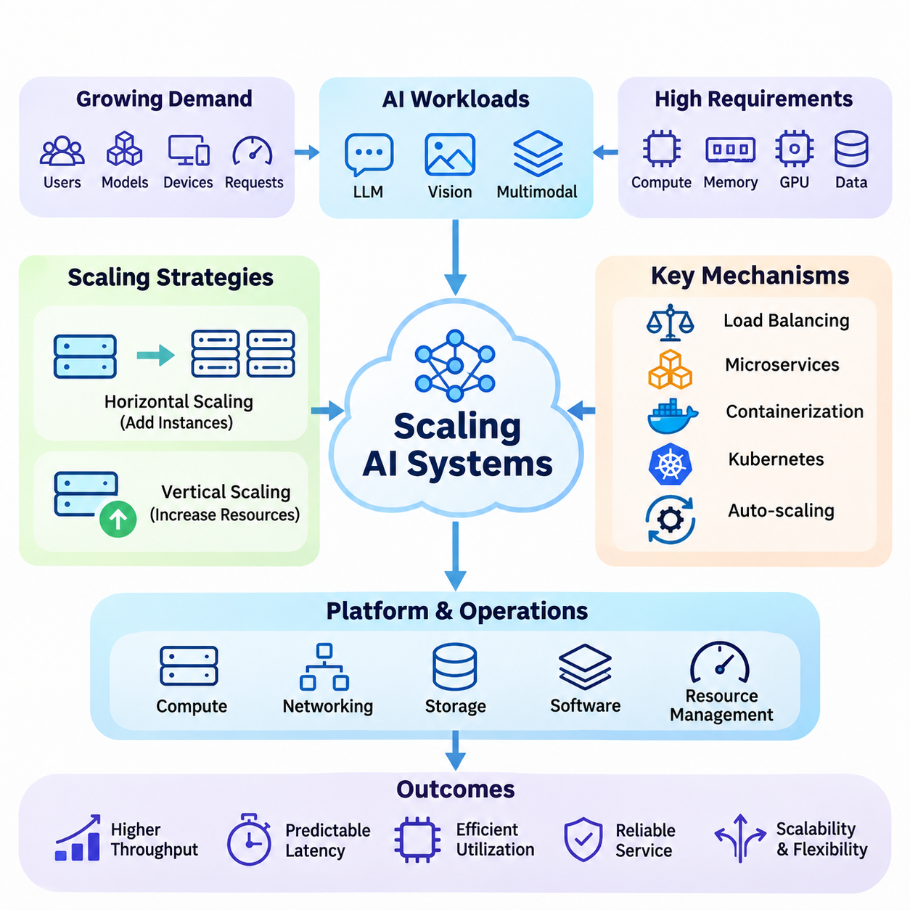
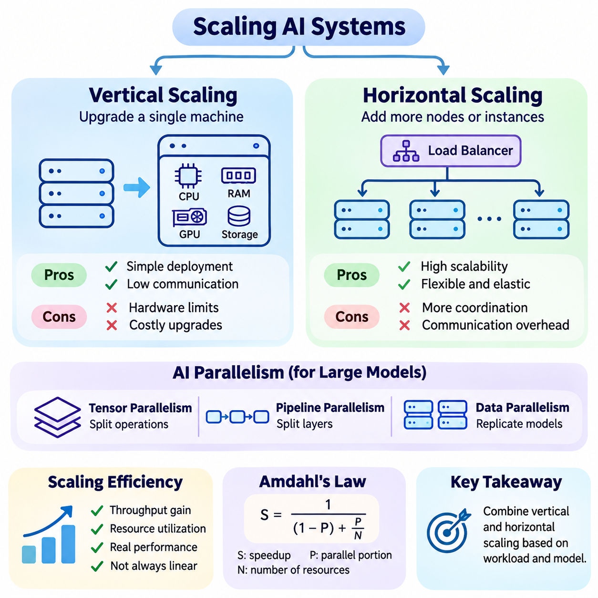
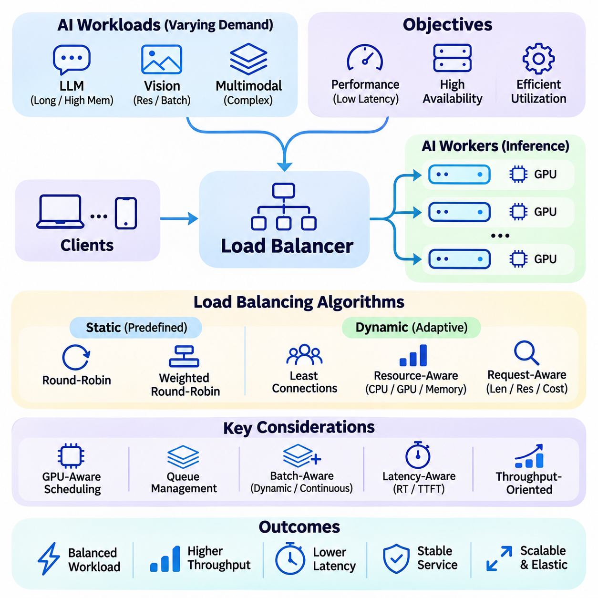
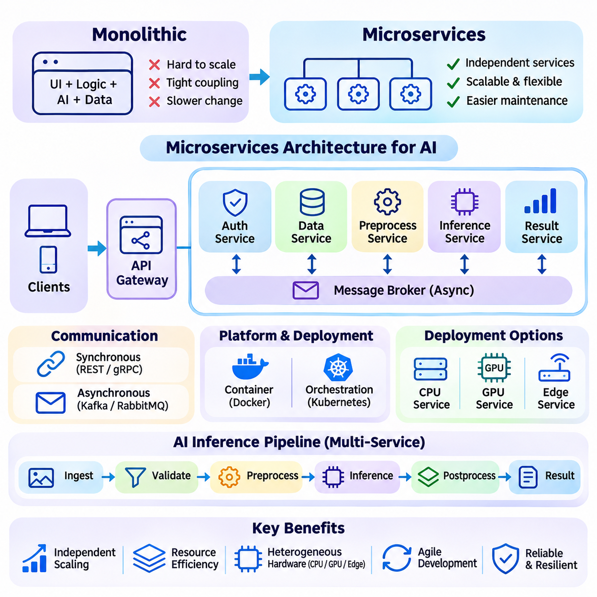
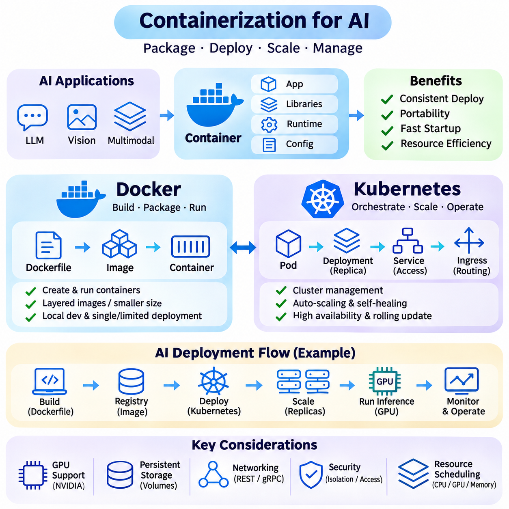
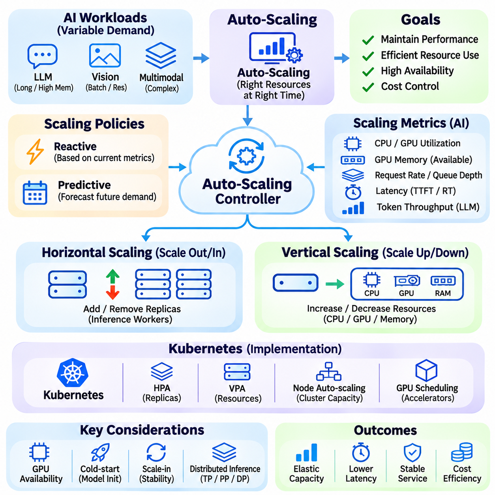
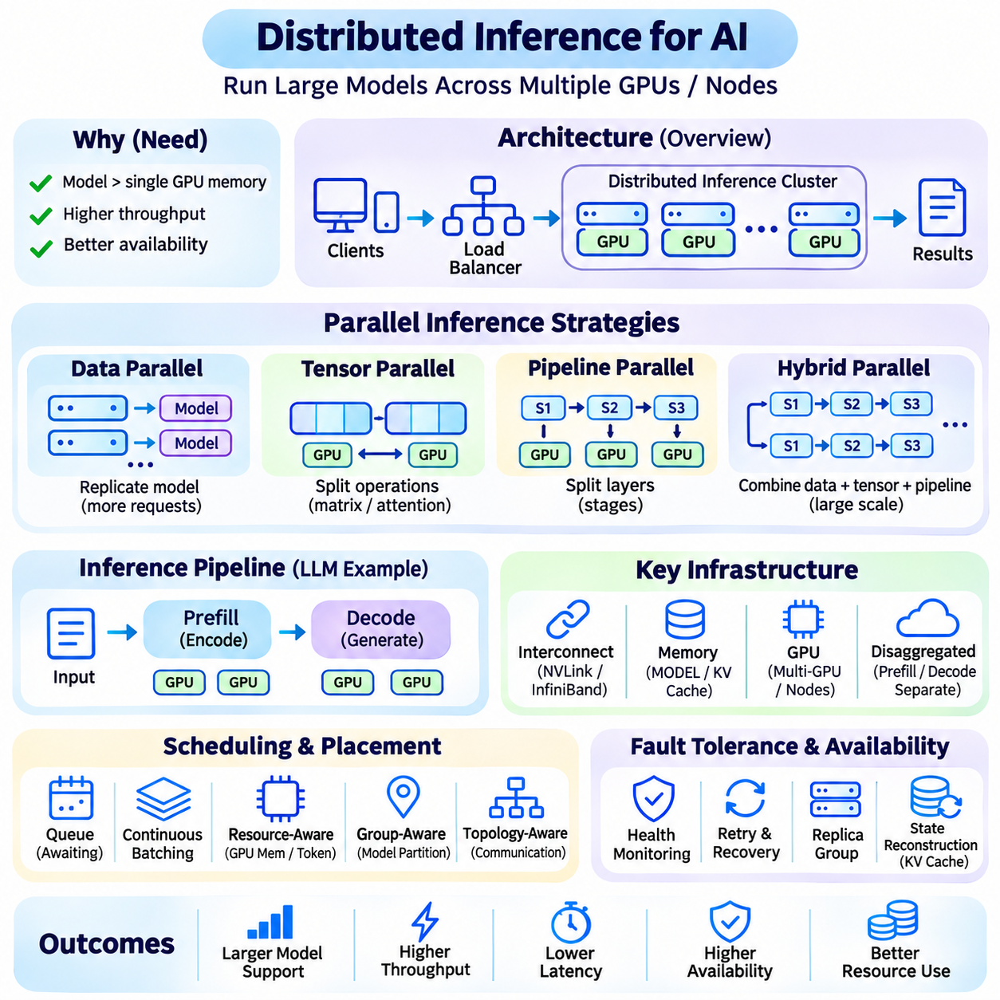
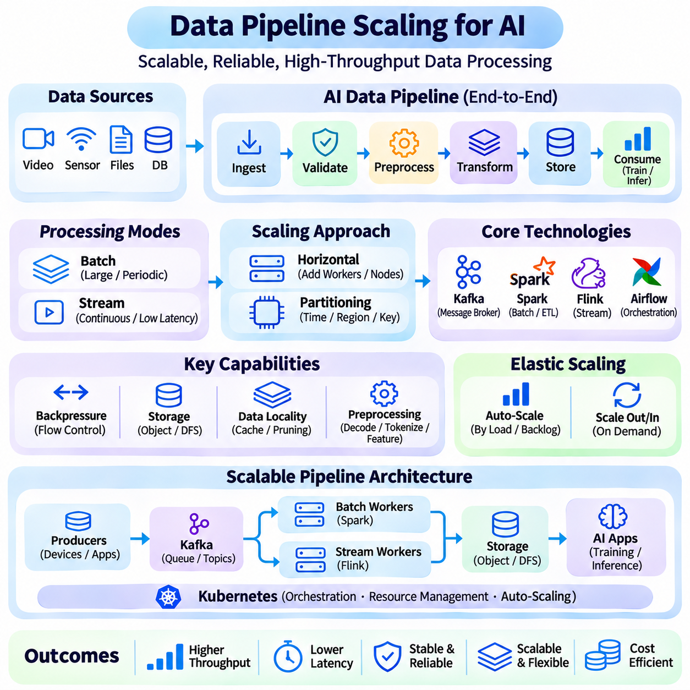
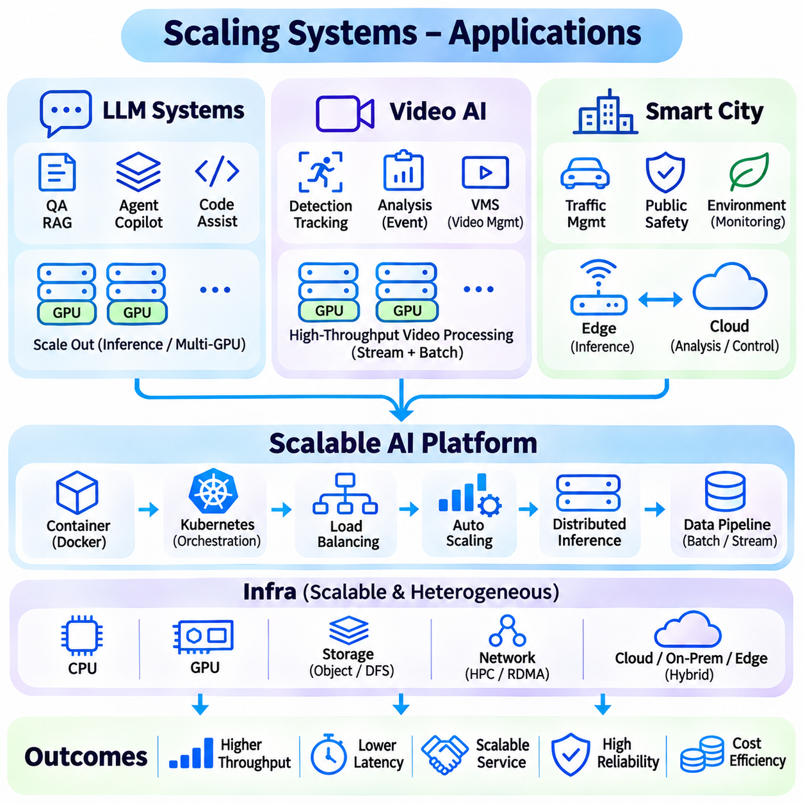

**Volume 38. AI Systems Architecture**

# 05. Scaling Systems

## 05.00 Overview

{width="7.268055555555556in" height="7.268055555555556in"}

Scaling AI systems is the process of expanding computational capacity, service throughput, data processing capability, and operational reliability as workloads increase. A scalable architecture must accommodate growing numbers of users, models, devices, and requests without unacceptable degradation in performance. Effective scaling requires coordinated decisions across computing infrastructure, networking, storage, software architecture, and resource management.

Unlike conventional software services, AI systems introduce substantial computational and memory demands through model inference, data preprocessing, and accelerator execution. Large language models, computer vision pipelines, and multimodal applications may require multiple GPUs and distributed processing environments. Scaling these systems involves managing heterogeneous resources while maintaining predictable latency, efficient utilization, and consistent service quality.

Scalability is commonly evaluated through horizontal and vertical scaling strategies. Horizontal scaling increases capacity by adding servers, containers, or processing nodes, while vertical scaling expands the resources available to an existing machine. Each approach introduces different constraints involving memory capacity, communication overhead, deployment complexity, and hardware utilization. Practical architectures often combine both strategies to balance flexibility and efficiency.

Vertical scaling can improve performance by increasing CPU cores, GPU capacity, system memory, or storage bandwidth within a computing node. This approach can simplify software deployment because applications may continue operating within a single execution environment. However, hardware expansion eventually encounters physical, financial, and architectural limits, making vertical scaling insufficient for workloads requiring sustained growth across distributed environments.

Horizontal scaling distributes workloads across multiple computing instances, enabling systems to increase capacity through additional resources. Stateless inference services are particularly suitable for replication because independent requests can be processed by separate workers. Stateful AI applications require additional coordination to preserve session information, cached model states, and processing continuity across instances while avoiding unnecessary communication overhead.

Load balancing is a fundamental mechanism for distributing incoming requests among available computing resources. Effective load balancers consider server availability, current utilization, request characteristics, and expected processing duration. AI workloads introduce additional scheduling challenges because inference requests may differ significantly in sequence length, image resolution, batch size, and computational complexity, producing uneven resource consumption.

Traditional load balancing algorithms include round-robin scheduling, weighted distribution, and least-connections routing. AI-oriented systems may extend these approaches with GPU memory awareness, queue depth monitoring, model availability, and estimated execution time. Intelligent request routing reduces resource contention and improves throughput, particularly when multiple models share heterogeneous accelerators or requests require different processing configurations.

Microservices architecture separates complex AI platforms into independently deployable functional components. Model inference, data ingestion, preprocessing, authentication, monitoring, and result delivery can operate as distinct services with clearly defined interfaces. This modular organization allows individual components to scale according to their workloads, reducing unnecessary duplication of resources and supporting independent development, testing, and maintenance.

Service decomposition must account for communication overhead and data dependencies between components. Excessive fragmentation can increase network traffic, serialization costs, and operational complexity. AI pipelines that transfer large tensors, images, or video streams between services may experience substantial latency penalties. Effective architectural boundaries therefore reflect computational locality, data movement requirements, fault isolation, and independently scalable workloads.

Containerization provides a standardized execution environment for packaging AI applications and their dependencies. Docker containers encapsulate inference runtimes, libraries, application logic, and configuration while improving deployment consistency across development and production systems. Container-based deployment also supports reproducibility and service isolation, although GPU drivers, accelerator compatibility, persistent storage, and host-level dependencies require careful coordination.

Kubernetes extends containerization by coordinating deployment, scheduling, networking, and lifecycle management across computing clusters. It supports replicated services, rolling updates, health checks, and resource allocation policies. GPU-enabled Kubernetes environments require specialized device management and scheduling configurations to ensure that accelerator workloads receive suitable resources without creating excessive fragmentation or competition between services.

Auto-scaling dynamically adjusts computing capacity according to changing demand. Reactive approaches monitor metrics such as CPU utilization, GPU activity, queue length, and request latency before adding or removing service instances. Predictive approaches estimate future workloads from historical patterns and anticipated demand. Both methods seek to maintain service-level objectives while reducing unnecessary infrastructure expenditure during periods of low activity.

AI auto-scaling differs from conventional web-service scaling because model initialization and accelerator allocation can require substantial time. Loading large model weights, allocating GPU memory, and preparing inference engines may delay the availability of newly created instances. Consequently, scaling policies must account for startup latency, warm capacity, request batching, and resource reservation rather than relying exclusively on instantaneous utilization measurements.

Distributed inference enables computational workloads to execute across multiple accelerators or machines when a model cannot fit within a single device or when additional processing capacity is required. Data parallelism replicates models across workers, while tensor and pipeline parallelism partition model computation. These techniques introduce communication and synchronization requirements that must be balanced against the benefits of additional computational resources.

Large language model serving illustrates the complexity of distributed inference. Transformer models require significant memory for parameters, intermediate activations, and key-value caches during generation. Continuous batching, efficient attention implementations, cache management, and request-aware scheduling can improve accelerator utilization. However, longer context windows and variable output lengths create dynamic memory demands that complicate capacity planning and latency prediction.

Scaling data pipelines is equally important because inference performance depends on the timely delivery of usable input data. Distributed ingestion systems must process growing volumes of structured records, images, video streams, and sensor measurements. Partitioning, buffering, parallel preprocessing, and asynchronous communication help prevent bottlenecks, while backpressure mechanisms protect downstream services from overload when incoming data exceeds processing capacity.

Streaming architectures frequently combine message brokers, distributed processing engines, and persistent storage systems. Kafka-based pipelines can partition event streams across consumers, enabling parallel processing and controlled data retention. However, partition distribution, message ordering, delivery guarantees, and consumer coordination influence system behavior. Reliable scaling requires explicit consideration of duplication, replay, failure recovery, and end-to-end processing consistency.

Storage architecture also determines the scalability of AI infrastructure. Model repositories, feature stores, vector databases, and distributed object storage support different access patterns and consistency requirements. Frequently accessed model parameters and intermediate results benefit from caching, while large training datasets and archived inference outputs require economical persistent storage. Storage bandwidth and metadata operations can become limiting factors even when sufficient computing capacity exists.

Networking becomes increasingly important as AI services expand across nodes, clusters, and geographical regions. Distributed inference may require frequent communication between accelerators, while video analytics platforms transmit substantial volumes of sensor data. Network bandwidth, latency, topology, and congestion directly influence processing efficiency. Data locality and communication-aware placement can reduce unnecessary transfers and improve overall system performance.

Reliability and fault tolerance are essential properties of scalable AI platforms. As the number of components increases, the probability of individual failures also grows. Replication, health monitoring, retry policies, circuit breakers, and graceful degradation help maintain availability. Nevertheless, recovery mechanisms must prevent cascading failures, duplicated expensive computations, and uncontrolled retry traffic during periods of infrastructure instability.

Observability provides the information needed to understand system behavior under changing workloads. Metrics, logs, and distributed traces reveal interactions between request routing, inference execution, storage access, and network communication. GPU utilization alone is insufficient for evaluating efficiency because memory pressure, batching behavior, queue delays, and synchronization overhead may dominate performance. Comprehensive monitoring connects infrastructure measurements with application-level outcomes.

Performance evaluation should distinguish throughput, average latency, tail latency, resource utilization, and cost efficiency. A system processing more requests per second may still provide an unacceptable experience when high-percentile response times increase. Capacity testing must therefore examine realistic request distributions, concurrent workloads, model configurations, and failure scenarios. Scaling efficiency measures how effectively additional resources translate into useful processing capacity.

Economic considerations influence every scaling decision because computational expansion does not guarantee proportional performance improvements. GPU acquisition, cloud rental, networking, storage, electricity, and operational labor contribute to total ownership cost. Overprovisioning wastes resources, while aggressive consolidation increases contention and service risk. Cost-aware scaling seeks an appropriate balance among utilization, reliability, latency requirements, and anticipated workload growth.

Security requirements become more complex as services are distributed across multiple environments. Authentication, authorization, encryption, network segmentation, and secret management must remain consistent as new instances are introduced. Multi-tenant AI platforms require workload isolation and resource quotas to prevent interference between customers. Secure scaling also demands controlled model access, protected data pipelines, and auditable infrastructure changes.

Large language model platforms represent an important application of scalable AI architecture. Such platforms may serve thousands of concurrent requests with varying context lengths, output requirements, and model configurations. Distributed inference, request batching, caching, and workload-aware routing support efficient operation. The architecture must also coordinate retrieval services, application interfaces, and monitoring systems without allowing auxiliary components to become bottlenecks.

Video AI systems present different scaling challenges because continuous streams generate sustained computational and networking demands. Multi-camera analytics platforms must decode video, perform inference, track objects, and aggregate events across distributed processing nodes. Edge filtering can reduce unnecessary cloud transmission, while centralized services support cross-camera analysis and long-term storage. Scaling decisions depend on frame rates, resolutions, detection complexity, and required response times.

Smart city applications integrate large numbers of cameras, environmental sensors, transportation systems, and connected devices. Their architectures frequently combine edge computing, regional processing infrastructure, and centralized cloud platforms. Distributed services must accommodate geographically dispersed workloads while preserving data consistency and operational visibility. Event-driven processing and adaptive resource allocation support expansion without requiring every data stream to undergo centralized analysis.

Ultimately, scalable AI systems emerge from coordinated architectural decisions rather than the simple addition of computing hardware. Horizontal and vertical scaling, load balancing, microservices, container orchestration, auto-scaling, distributed inference, and data pipeline expansion address complementary requirements. Their integration enables AI infrastructure to support increasing demand while preserving performance, reliability, security, and economic sustainability across diverse deployment environments.

## 05.01 Horizontal vs Vertical Scaling

{width="7.268055555555556in" height="7.268055555555556in"}

Horizontal and vertical scaling represent two fundamental strategies for increasing the computational capacity of AI systems. Horizontal scaling expands infrastructure by adding computing nodes or service instances, while vertical scaling increases the processing capabilities of existing machines. Both approaches address growing workloads, but they differ in resource allocation, architectural complexity, operational flexibility, and performance limitations.

Vertical scaling improves system capacity by upgrading hardware resources within a single computing environment. Additional CPU cores, larger system memory, more powerful GPUs, and faster storage devices can increase processing performance without fundamentally changing application architecture. This approach is particularly suitable for workloads requiring tightly coupled computation, shared memory access, or minimal communication between processing components.

In AI applications, vertical scaling is frequently used to accommodate larger neural networks and computationally intensive inference workloads. Increasing GPU memory allows larger models or batches to execute on a single accelerator, while adding compatible GPUs can expand available computing resources. However, multi-GPU execution may require explicit parallelization and introduces communication overhead even when accelerators share the same server.

One advantage of vertical scaling is its relatively straightforward deployment and management. Applications may continue operating within a familiar execution environment without requiring extensive distributed coordination. Data exchange between components can remain local, reducing network communication requirements. Nevertheless, hardware upgrades may involve downtime, software compatibility adjustments, and substantial capital expenditure.

Vertical scaling eventually encounters hardware and architectural limitations. Processor socket counts, memory channels, accelerator slots, power delivery, and cooling capacity restrict expansion within a single machine. Even when additional resources are available, applications may not utilize them efficiently because of sequential execution, memory bandwidth constraints, or software bottlenecks. These limitations establish practical ceilings on performance improvements.

Horizontal scaling addresses capacity limitations by distributing workloads across multiple independent computing nodes. Instead of relying on increasingly powerful machines, organizations add servers, containers, or inference workers to increase aggregate processing capacity. This strategy is especially effective when workloads can be partitioned into independent tasks that execute concurrently without extensive synchronization or shared-state requirements.

Stateless AI inference services are well suited to horizontal scaling because individual requests can often be processed independently. Multiple replicas of the same model can serve incoming requests through a load balancer, allowing aggregate throughput to increase as additional workers become available. However, achievable scaling efficiency depends on request distribution, accelerator utilization, model loading overhead, and the capacity of shared infrastructure.

Horizontal scaling introduces communication and coordination requirements that are less prominent in single-node environments. Distributed applications must manage service discovery, request routing, network failures, and consistency across multiple instances. Stateful workloads require additional mechanisms for maintaining sessions, shared caches, and intermediate processing states. These requirements increase software complexity and create potential sources of latency and operational instability.

The distinction between horizontal and vertical scaling becomes especially important for large language models. A model that fits within one GPU may achieve higher serving throughput through replication across several devices. In contrast, a model exceeding the memory capacity of an individual accelerator may require tensor parallelism or pipeline parallelism. Such model partitioning distributes computation but does not necessarily provide the same scaling behavior as independent inference replicas.

Tensor parallelism divides neural network operations across multiple accelerators, allowing individual layers to use distributed computational resources. Pipeline parallelism assigns different groups of layers to separate devices and processes microbatches through successive stages. These techniques support models exceeding single-device capacity, but synchronization, communication bandwidth, pipeline bubbles, and workload imbalance can limit their effectiveness.

Data parallelism provides another mechanism for expanding AI processing capacity. During inference, independent model replicas process different requests or batches, increasing aggregate throughput when sufficient demand exists. During training, workers process separate data partitions and synchronize gradients according to the training algorithm. Although both approaches use replicated models, their communication requirements and performance characteristics differ substantially.

Scaling efficiency describes how effectively additional computing resources improve useful system performance. Ideal linear scaling would double throughput when computational resources are doubled under comparable conditions. Real systems rarely achieve perfect linear scaling because of synchronization costs, shared resource contention, communication delays, and workload imbalance. Evaluating efficiency therefore requires measuring actual performance rather than assuming proportional gains.

Amdahl\'s Law provides a theoretical explanation for limitations caused by sequential processing. When a fraction of an application cannot execute in parallel, increasing the number of processors produces diminishing performance improvements. Gustafson\'s Law offers a complementary perspective by considering larger workloads as computing capacity increases. Together, these principles demonstrate why scalability depends on workload structure as well as available hardware.

Memory architecture strongly influences the selection of scaling strategies. Vertical scaling can provide larger local memory capacity and lower-latency access to shared data, although nonuniform memory access and accelerator interconnect limitations may affect performance. Horizontal scaling distributes memory across machines, requiring explicit data placement and communication. Large AI models, embedding tables, and inference caches must therefore be organized according to memory locality and access patterns.

Storage and networking infrastructure can constrain both scaling approaches. Increasing compute capacity without expanding storage throughput may create data loading bottlenecks. Similarly, horizontally distributed services may saturate network links when transferring tensors, images, or intermediate results. Effective scaling requires balanced provisioning across processors, accelerators, memory, storage, and communication systems rather than isolated upgrades to computational hardware.

Load balancing is particularly important in horizontally scaled AI platforms. Requests must be distributed among available workers according to capacity, current utilization, and processing requirements. Simple round-robin scheduling may perform poorly when requests have highly variable execution times. GPU-aware routing, queue monitoring, and workload prediction can improve distribution efficiency while reducing tail latency and preventing individual nodes from becoming overloaded.

Auto-scaling extends horizontal scaling by dynamically changing the number of active service instances. Monitoring systems evaluate workload indicators such as request rate, queue depth, GPU utilization, and response latency. When demand increases, additional instances can be deployed, while unnecessary capacity can be removed during quieter periods. AI workloads require special consideration because model initialization and GPU allocation can delay instance readiness.

Vertical scaling can also be automated in certain virtualized environments through resource resizing or migration. However, changing CPU, memory, or accelerator allocations may require application restarts or infrastructure reconfiguration. Horizontal scaling generally provides greater flexibility for independently adjusting service capacity, although resource availability and orchestration policies impose practical constraints. The appropriate strategy depends on workload behavior and operational requirements.

Reliability represents another major difference between scaling strategies. A vertically scaled system may concentrate substantial computational capacity within a single failure domain. Hardware failure can therefore interrupt a large portion of the workload unless redundancy is provided separately. Horizontal scaling enables replicated services to operate across independent nodes, improving resilience when failures are detected and requests can be redirected successfully.

Horizontal scaling does not automatically guarantee fault tolerance. Shared databases, centralized storage, network gateways, and orchestration components may remain single points of failure. Replication also introduces consistency challenges and additional recovery requirements. Reliable distributed architectures must combine redundant infrastructure with health monitoring, failure isolation, controlled retries, and recovery procedures that prevent cascading disruptions.

Cost considerations significantly influence scaling decisions. Vertical scaling may offer operational simplicity but can require expensive high-end processors, accelerators, and memory configurations. Horizontal scaling permits incremental expansion using additional machines, although networking, orchestration, licensing, and operational management increase total expenditure. Cost efficiency must be evaluated using actual workload performance and total ownership costs rather than hardware prices alone.

Energy consumption and thermal constraints also affect infrastructure design. High-density GPU servers require substantial power delivery and cooling capacity, particularly when multiple accelerators operate continuously. Distributed deployments may spread power requirements across additional machines but introduce networking and idle-resource overhead. Energy-efficient scaling therefore considers performance per watt, accelerator utilization, workload scheduling, and infrastructure cooling efficiency.

Hybrid scaling combines vertical and horizontal approaches to exploit their complementary advantages. Individual nodes can be equipped with sufficient memory and accelerator capacity to execute demanding models efficiently, while additional nodes provide throughput expansion and service redundancy. This architecture supports flexible resource allocation without requiring every workload to use the same hardware configuration or distributed execution strategy.

Large-scale video analytics illustrates the practical benefits of hybrid scaling. Individual processing nodes may use powerful GPUs to decode and analyze multiple camera streams, while additional nodes accommodate growing camera populations. Edge devices can perform preliminary filtering before forwarding selected information to centralized services. This arrangement reduces unnecessary network traffic and allows computational capacity to expand according to regional demand.

Smart city platforms similarly require scalable architectures capable of supporting geographically distributed sensors, cameras, and intelligent services. Vertical scaling improves the capabilities of regional processing nodes, while horizontal scaling expands coverage across districts and infrastructure facilities. Distributed orchestration, event-driven communication, and centralized monitoring coordinate these resources while maintaining operational visibility and consistent service behavior.

Selecting between horizontal and vertical scaling requires systematic analysis of computational intensity, memory requirements, communication patterns, workload variability, reliability objectives, and financial constraints. Benchmarking should compare throughput, latency, utilization, energy consumption, and cost under realistic conditions. The most effective architecture is not necessarily the largest configuration, but the one that delivers sustainable performance as operational demand increases.

## 05.02 Load Balancing

{width="7.268055555555556in" height="7.268055555555556in"}

Load balancing is a fundamental mechanism for distributing incoming workloads across multiple computing resources to maintain performance, availability, and efficient utilization. In scalable AI systems, load balancing coordinates requests among inference servers, GPU workers, containers, and distributed services. Its primary objective is to prevent individual components from becoming overloaded while ensuring that available computational capacity is used effectively.

Unlike conventional web applications, AI workloads exhibit substantial variation in computational requirements, memory consumption, and execution duration. Image classification requests may complete rapidly, while large language model inference can require extensive GPU memory and prolonged token generation. Consequently, AI load balancing must consider workload characteristics rather than relying exclusively on the number of incoming requests or active connections.

A load balancer operates as an intermediary between clients and backend processing resources. It receives requests, evaluates available service instances, selects appropriate destinations, and forwards workloads for execution. Depending on the architecture, load balancing can occur at the network, transport, application, or orchestration layer. Each level provides different capabilities for inspecting requests, managing connections, and controlling resource allocation.

Static load balancing uses predefined distribution policies without continuously adapting to changing resource conditions. Round-robin scheduling assigns requests sequentially among available servers, while weighted round-robin allocates larger shares to more capable instances. These approaches are simple and predictable, but they may produce inefficient assignments when AI requests differ significantly in processing time, memory demand, or accelerator requirements.

Dynamic load balancing adjusts request distribution according to observed system conditions. Algorithms may consider active connections, queue lengths, CPU utilization, GPU memory availability, or estimated execution times. Least-connections scheduling directs requests toward instances with fewer active sessions, although connection counts alone may not represent computational demand accurately. More advanced policies combine multiple metrics to estimate available processing capacity.

GPU-aware load balancing is particularly important for AI inference infrastructure because accelerator resources are expensive and frequently shared among multiple models. A GPU may exhibit moderate compute utilization while having insufficient memory for another inference request. Effective scheduling therefore considers memory allocation, active model instances, batch occupancy, and execution characteristics to avoid out-of-memory failures and unnecessary resource contention.

Request-aware scheduling improves distribution by examining the computational characteristics of incoming workloads. For language models, input sequence length, expected output length, and context window requirements influence processing cost. For computer vision systems, image resolution, batch size, and model complexity affect execution time. Estimating these requirements enables more informed routing decisions, although prediction errors must be handled gracefully.

Queue-based load balancing introduces intermediate buffers between incoming requests and inference workers. Requests wait until suitable processing resources become available, allowing the system to absorb temporary traffic fluctuations. Queue management policies determine processing order, maximum waiting time, and admission limits. Properly configured queues improve utilization, but excessive buffering increases response latency and can conceal sustained capacity shortages.

Batch-aware load balancing coordinates request distribution with inference batching strategies. Combining compatible requests into batches can improve GPU throughput by increasing parallel execution efficiency. However, larger batches may increase waiting time and memory consumption. Dynamic batching systems balance these competing effects by considering queue depth, request deadlines, model characteristics, and available accelerator capacity before forming execution groups.

Continuous batching is especially useful for autoregressive language model serving because requests generate tokens over different durations. Instead of waiting for an entire batch to finish, the scheduler can admit new requests as existing sequences complete. This approach improves accelerator utilization and reduces idle execution capacity. Load balancing must coordinate with continuous batching to account for active sequences, token budgets, and key-value cache availability.

Latency-aware load balancing attempts to minimize response delays by directing requests toward workers with favorable execution conditions. Measurements may include average response time, queue waiting time, time to first token, and high-percentile latency. These indicators reveal different aspects of system performance. Routing policies must avoid excessive reactions to temporary fluctuations because frequent redistribution can create instability and additional communication overhead.

Throughput-oriented load balancing prioritizes the number of requests or tokens processed within a given period. This objective may favor larger batches and high accelerator occupancy, particularly in offline inference or asynchronous processing environments. Interactive applications require a different balance because excessive batching can degrade responsiveness. Effective scheduling policies therefore reflect application-specific service-level objectives rather than optimizing throughput alone.

Heterogeneous computing environments introduce additional scheduling complexity because available nodes may contain different GPU models, memory capacities, CPU configurations, and inference runtimes. A request suitable for one accelerator may perform poorly or fail on another. Capability-aware routing matches workloads to compatible resources while considering performance differences, model placement, and operational constraints across the computing cluster.

Model-aware load balancing becomes essential when an AI platform serves multiple neural networks simultaneously. Not every inference worker necessarily hosts every model, particularly when model weights consume substantial memory. Routing decisions must identify instances with the required model already loaded or determine whether loading another model is justified. Intelligent model placement reduces initialization overhead and avoids repeated transfers of large parameter files.

Distributed inference introduces dependencies that differ from independent model replication. Tensor-parallel and pipeline-parallel deployments may require several accelerators to cooperate on a single request. In such environments, the load balancer routes work toward an available inference group rather than treating every GPU as an independent destination. Scheduling must preserve communication topology and coordinate capacity across participating devices.

Stateful inference services require special handling because requests may depend on previously generated information. Conversational AI applications can maintain session context, cached attention states, or intermediate computation results. Session affinity directs related requests toward appropriate workers when necessary. However, excessive affinity can produce uneven utilization, making shared state management and controlled session migration important architectural considerations.

Health monitoring enables load balancers to identify unavailable or degraded service instances. Periodic health checks may evaluate network connectivity, application responsiveness, model readiness, and accelerator status. Unhealthy instances can be removed from active routing until recovery conditions are satisfied. Readiness checks are particularly important for AI services because a running container may not yet have completed model loading or GPU initialization.

Fault tolerance requires coordinated behavior between load balancing, service replication, and recovery mechanisms. When an inference worker fails, pending requests may need to be retried or redirected to healthy instances. However, uncontrolled retries can amplify overload and cause cascading failures. Retry budgets, circuit breakers, timeouts, and admission controls help preserve system stability during partial infrastructure failures or sudden workload increases.

Geographical load balancing distributes requests across data centers, cloud regions, or edge computing locations. Routing decisions may consider network proximity, regional capacity, data residency requirements, and service availability. Edge AI systems benefit from local processing when latency or bandwidth constraints are significant. Centralized infrastructure can handle computationally demanding requests when network conditions and application requirements permit remote execution.

Auto-scaling and load balancing operate as complementary mechanisms within scalable AI infrastructure. Load balancing distributes existing workloads among available resources, while auto-scaling changes the number of resources according to demand. Monitoring signals such as queue depth, request rate, GPU utilization, and response latency can inform scaling decisions. Coordination is necessary because newly created inference instances may require substantial initialization time before accepting traffic.

Backpressure and admission control protect overloaded AI services from accepting more work than they can process reliably. Backpressure propagates congestion information toward upstream components, while admission control limits incoming requests according to available capacity. These mechanisms can prevent excessive queue growth and memory exhaustion. Depending on application requirements, systems may delay, reject, prioritize, or redirect requests during overload conditions.

Priority-aware load balancing supports applications with different service requirements. Safety-critical inference, interactive user requests, and background analytics may require distinct scheduling priorities. Resource reservations and weighted queues can protect high-priority workloads from interference. Nevertheless, priority policies must address starvation risks and ensure that lower-priority tasks receive sufficient processing opportunities when system conditions permit.

Observability is essential for evaluating load balancing effectiveness in production environments. Monitoring systems should capture request distribution, worker utilization, queue occupancy, routing failures, and latency variations. GPU metrics alone are insufficient because memory pressure, synchronization delays, and model-specific execution characteristics influence performance. Distributed tracing helps identify bottlenecks across gateways, inference services, storage systems, and downstream applications.

Performance benchmarking should evaluate load balancing under realistic traffic patterns rather than uniform synthetic requests alone. Experiments may include bursty arrivals, variable sequence lengths, heterogeneous model requests, worker failures, and changing resource availability. Relevant measurements include throughput, tail latency, fairness, rejection rate, and cost per request. Comparing policies under identical workloads reveals whether scheduling improvements provide measurable operational benefits.

Large language model platforms, video analytics services, and smart city infrastructure illustrate the importance of workload-aware load balancing. Language model serving must account for token generation and memory-intensive caches, while video systems distribute continuous streams across processing nodes. Smart city platforms coordinate geographically dispersed workloads with different latency requirements. Each application requires scheduling policies aligned with its computational and operational characteristics.

Effective load balancing is therefore more than a mechanism for evenly distributing requests. It is an adaptive resource management function that connects workload characteristics, accelerator capabilities, service availability, and performance objectives. By combining intelligent routing, queue management, batching, health monitoring, and auto-scaling coordination, scalable AI architectures can maintain reliable operation while improving throughput, latency, resource utilization, and economic efficiency.

## 05.03 Microservices Architecture

{width="7.268055555555556in" height="7.268055555555556in"}

Microservices architecture is a software design approach that organizes complex applications into independently deployable services with clearly defined responsibilities. In scalable AI systems, microservices separate functions such as data ingestion, preprocessing, model inference, authentication, and monitoring. This modular structure enables individual components to evolve and scale without requiring the entire application to be modified or redeployed.

Traditional monolithic architectures combine application functions within a single deployment unit. Although this approach simplifies initial development and communication between components, it can become difficult to maintain as AI platforms expand. Microservices address these limitations by dividing systems into smaller functional units that communicate through standardized interfaces, allowing independent development, deployment, and resource allocation.

Service decomposition is a central architectural decision in microservices design. Each service should represent a coherent business capability or computational responsibility while minimizing unnecessary dependencies. AI platforms may distinguish model serving, feature extraction, vector retrieval, data transformation, and result aggregation as separate services. Appropriate boundaries improve maintainability without creating excessive communication overhead.

Loose coupling allows microservices to operate independently while exchanging information through well-defined contracts. Services expose interfaces using REST APIs, gRPC, or asynchronous messaging protocols. These contracts specify request formats, response structures, error handling, and compatibility requirements. Stable interfaces reduce integration complexity and allow internal implementations to change without disrupting dependent components.

Synchronous communication is commonly used when one service requires an immediate response from another. REST and gRPC provide mechanisms for invoking remote operations, with gRPC supporting efficient binary serialization and strongly defined service interfaces. However, synchronous dependencies can increase end-to-end latency and propagate failures across services. Timeout policies, retries, and circuit breakers help manage these risks.

Asynchronous communication decouples service execution by exchanging messages through queues or event brokers. A data ingestion service can publish events that preprocessing or inference services consume independently. Technologies such as Kafka and RabbitMQ support message distribution and buffering. This approach improves flexibility and workload isolation, although delivery guarantees, ordering, and duplicate processing require careful management.

API gateways provide centralized entry points for external clients accessing microservices. They can perform authentication, authorization, request routing, rate limiting, and protocol translation before forwarding traffic to backend services. In AI platforms, gateways may direct requests toward different inference models or service versions. Proper gateway design reduces client complexity while avoiding centralized performance bottlenecks.

Service discovery enables dynamically deployed microservices to locate one another without relying on fixed network addresses. Container orchestration platforms maintain service registries and update routing information as instances are created or removed. This capability is essential for horizontally scaled AI workloads where inference workers may change frequently. Discovery mechanisms must remain reliable during scaling events and infrastructure failures.

Containerization provides a practical deployment foundation for microservices architecture. Docker packages application code, runtime libraries, and dependencies into portable containers. Each AI service can use an execution environment appropriate for its computational requirements. However, GPU-enabled containers must maintain compatibility with host drivers, accelerator libraries, and hardware resource allocation mechanisms.

Kubernetes coordinates containerized microservices across distributed computing clusters. It supports deployment management, service discovery, health checks, resource scheduling, and horizontal scaling. AI workloads may require specialized GPU scheduling, persistent storage, and node placement policies. Effective orchestration ensures that inference services receive compatible accelerators while preventing excessive contention for shared infrastructure.

Independent scaling is a major advantage of microservices in AI systems. Computationally intensive inference services can be replicated without increasing the capacity of lightweight authentication or logging components. Similarly, data preprocessing workers may scale according to incoming stream volume. This selective allocation reduces unnecessary infrastructure expenditure and aligns computing resources with actual service demand.

Microservices also support heterogeneous hardware configurations. Model inference services may execute on GPU servers, while metadata processing and authentication run on CPU-based nodes. Edge AI components can operate on embedded accelerators while centralized services perform computationally demanding analysis. Hardware-aware deployment enables each service to use suitable resources without imposing identical requirements on the entire platform.

AI inference pipelines often involve multiple services connected through sequential processing stages. Incoming data may pass through validation, preprocessing, model execution, postprocessing, and result delivery. Separating these functions improves modularity, but each network boundary introduces communication and serialization costs. Architects must balance service independence against the performance advantages of local computation.

Large tensors, images, and video streams can make interservice communication expensive. Repeatedly transferring high-volume data between microservices may increase network utilization and processing latency. Shared memory, efficient serialization, data locality, and selective service consolidation can reduce these costs. Service boundaries should therefore reflect data movement patterns as well as organizational responsibilities.

State management presents additional challenges because microservices are preferably designed to minimize local persistent state. Stateless services can be replicated and replaced easily, while stateful services require coordinated storage and recovery. Conversational AI systems may maintain session histories, attention caches, or intermediate results. External state stores and controlled session affinity can preserve continuity across distributed instances.

Database ownership is an important principle in microservices architecture. Individual services should manage their own data responsibilities rather than directly modifying another service\'s internal storage. This separation improves autonomy and reduces hidden dependencies. However, distributed data ownership introduces consistency challenges, particularly when workflows require coordinated updates across multiple services or databases.

Eventual consistency is often used when immediate synchronization across services is unnecessary. Updates propagate through asynchronous events, allowing components to maintain independent processing schedules. This approach improves availability and reduces coordination overhead, but applications must tolerate temporary differences between service states. Strong consistency may still be necessary for critical operations requiring immediate correctness.

Fault isolation is a significant benefit of well-designed microservices. A failure in one component should not automatically terminate unrelated services. Replication, health monitoring, circuit breakers, and graceful degradation help contain disruptions. Nevertheless, tightly coupled request chains can still produce cascading failures. Dependency analysis and controlled recovery policies are necessary to preserve system availability.

Observability becomes increasingly important as applications are divided into distributed services. Centralized logging, metrics collection, and distributed tracing provide visibility into requests crossing multiple components. Monitoring should capture service latency, error rates, queue depth, resource utilization, and dependency behavior. Correlation identifiers help trace individual AI requests from external interfaces through inference and downstream processing.

Security in microservices architecture requires protection at both external and internal communication boundaries. Authentication, authorization, encrypted connections, and service identities prevent unauthorized access. Secrets management and network policies limit exposure between components. AI platforms must also protect model artifacts, training data, inference inputs, and generated outputs while maintaining consistent security controls across deployments.

Continuous integration and continuous deployment enable individual microservices to evolve through automated testing and controlled releases. Container images can be built, validated, scanned, and deployed independently. Canary deployments and rolling updates reduce the risk of introducing new service versions. For AI inference, release pipelines should also verify model compatibility, runtime dependencies, performance regressions, and output quality.

Version management is essential when multiple services evolve independently. API contracts, message schemas, and model interfaces must remain compatible during transitions. Backward-compatible changes allow gradual deployment without requiring simultaneous upgrades. Contract testing and schema validation reduce integration failures. Model versioning also enables controlled comparisons between inference implementations and supports rollback when performance or accuracy deteriorates.

Microservices architecture introduces operational costs that must be justified by its benefits. Distributed communication, orchestration, monitoring, security, and deployment automation increase system complexity. Excessive service fragmentation can produce difficult debugging conditions and unnecessary latency. A modular monolith may be more appropriate for smaller AI applications, while microservices become valuable when independent scaling and organizational autonomy are important.

Large language model platforms demonstrate the practical value of microservices. Separate components can manage authentication, prompt processing, retrieval, model inference, caching, and response delivery. Retrieval-augmented generation systems may integrate embedding services, vector databases, and document processing pipelines. Independent scaling allows expensive inference resources to be allocated according to demand while supporting flexible application development.

Video analytics and smart city systems also benefit from distributed microservices. Camera ingestion, object detection, tracking, event recognition, and alert generation can operate as specialized services across edge and cloud infrastructure. Regional processing reduces unnecessary data transmission, while centralized coordination supports broader analytics. Event-driven communication enables geographically distributed components to exchange information without requiring continuous synchronous execution.

Effective microservices architecture requires careful coordination between modularity, performance, reliability, and operational complexity. Service boundaries should reflect computational responsibilities, data dependencies, and scaling requirements rather than arbitrary code divisions. By combining independent deployment, standardized communication, container orchestration, observability, and fault isolation, microservices provide a flexible foundation for scalable AI systems across diverse computing environments.

## 05.04 Containerization

{width="7.268055555555556in" height="7.268055555555556in"}

Containerization is a deployment approach that packages applications, runtime libraries, dependencies, and configuration into isolated execution environments called containers. In scalable AI systems, it provides consistent deployment across development workstations, GPU servers, edge devices, and cloud infrastructure. Docker and Kubernetes play complementary roles by supporting container creation, application packaging, orchestration, and distributed resource management.

Unlike traditional virtual machines, containers generally share the host operating system kernel while maintaining isolated processes, filesystems, and networking environments. This design reduces virtualization overhead and enables relatively fast startup. However, containers do not provide the same isolation boundary as full virtual machines, and their security depends on kernel protections, runtime configuration, and access restrictions.

Docker provides tools for building, packaging, distributing, and running containerized applications. A Docker image contains application code, required libraries, runtime components, and configuration instructions. Images are commonly defined through Dockerfiles, which describe reproducible build steps. Container registries store versioned images, allowing development and production environments to deploy consistent application configurations.

Docker images use layered filesystems to improve storage efficiency and accelerate distribution. Shared layers can be reused across multiple images, reducing unnecessary downloads and duplication. Multi-stage builds separate compilation dependencies from runtime components, producing smaller deployment images. For AI applications, careful image design is important because machine learning frameworks and accelerator libraries can significantly increase image size.

AI containers frequently require access to specialized hardware such as NVIDIA GPUs. The NVIDIA Container Toolkit enables compatible container runtimes to expose GPU devices and required driver interfaces. CUDA libraries and deep learning frameworks must remain compatible with the host driver environment. Containerization improves dependency isolation, but it does not eliminate hardware compatibility requirements or accelerator resource limitations.

Docker simplifies the deployment of inference services by encapsulating model-serving applications and their software dependencies. A container may include an HTTP or gRPC server, preprocessing logic, inference runtime, and postprocessing components. Model weights can be packaged within images or mounted from external storage. External model storage often improves deployment flexibility by separating large model artifacts from application releases.

Persistent data management requires special attention because container filesystems are generally treated as disposable. Docker volumes and bind mounts allow applications to access data outside the container lifecycle. AI workloads may require persistent model repositories, cached datasets, logs, and intermediate results. Storage permissions, throughput, and consistency must be configured appropriately to prevent data loss and performance bottlenecks.

Container networking enables communication between independently deployed services through virtual networks and exposed ports. AI pipelines may connect ingestion, preprocessing, inference, and monitoring components using REST, gRPC, or messaging protocols. Network isolation improves service organization, but repeated transfers of large tensors or video streams can increase latency. Data locality and efficient communication remain essential architectural considerations.

Docker Compose supports defining and running multiple related containers through declarative configuration. It is useful for local development, integration testing, and smaller AI deployments involving inference servers, databases, message brokers, and monitoring services. However, large production environments typically require orchestration capabilities beyond those provided by a single-host Compose deployment.

Kubernetes extends container management across clusters of computing nodes. It provides declarative mechanisms for deploying, scheduling, scaling, and recovering containerized workloads. Applications are organized into Pods, which contain one or more closely related containers sharing networking and selected resources. Kubernetes controllers continuously reconcile actual cluster conditions with the desired configuration defined by administrators.

Deployments manage replicated stateless applications and support controlled updates, while StatefulSets provide stable identities and storage associations for stateful workloads. Services expose groups of Pods through stable network endpoints, and Ingress or Gateway mechanisms support external traffic routing. These abstractions allow AI platforms to separate application identity from individual container instances and physical machines.

Kubernetes scheduling assigns Pods to nodes according to resource requests, constraints, and placement policies. CPU and memory requirements influence scheduling decisions, while node selectors, affinity rules, and taints help control workload placement. AI applications may require GPU-equipped nodes, high-memory servers, or specialized edge hardware. Accurate resource declarations improve placement efficiency and reduce contention.

GPU scheduling requires additional integration because accelerators are specialized resources rather than ordinary CPU allocations. Kubernetes device plugins advertise supported GPU resources to the scheduler. Depending on hardware capabilities and configuration, GPU sharing may involve time slicing or hardware-supported partitioning. These approaches require careful isolation and performance evaluation because concurrent workloads can interfere with one another.

Horizontal Pod Autoscaling adjusts the number of application replicas according to observed metrics. CPU utilization and custom workload indicators can guide scaling decisions, while external metrics may represent request queues or inference demand. AI systems often benefit from GPU utilization, token throughput, and queue depth measurements. Scaling policies must account for model initialization delays and avoid unstable reactions to short traffic bursts.

Node-level scaling complements application scaling by changing the available cluster capacity. When additional inference Pods cannot be scheduled, compatible compute nodes may need to be provisioned. Conversely, underutilized nodes can potentially be removed after workloads are relocated. GPU node provisioning may take substantial time, making capacity planning, resource reservations, and warm instances important for latency-sensitive applications.

Kubernetes readiness, liveness, and startup probes support automated application health management. Readiness probes determine whether containers can receive traffic, while liveness probes identify processes requiring restart. Startup probes accommodate applications with lengthy initialization periods. AI inference services should report readiness only after essential models, accelerator resources, and serving components are available.

Configuration management separates deployment-specific settings from application images. ConfigMaps provide nonsecret configuration values, while Secrets hold sensitive information requiring appropriate access controls and encryption policies. AI services may need model endpoints, runtime parameters, credentials, and storage configuration. Externalized configuration improves portability and enables controlled changes without rebuilding application images.

PersistentVolumes and PersistentVolumeClaims provide storage abstractions for Kubernetes workloads. AI systems may use network-attached storage, distributed filesystems, or cloud-backed storage services for model artifacts and datasets. Storage selection influences model loading time, throughput, and reliability. Frequently accessed models may benefit from local caching, while shared repositories simplify centralized artifact management.

Observability is essential when containerized AI applications operate across many nodes. Kubernetes exposes workload status and resource information, while monitoring systems collect application metrics, logs, and distributed traces. GPU utilization, memory consumption, inference latency, queue occupancy, and container restart frequency help identify bottlenecks. Correlating infrastructure events with model-serving performance supports effective troubleshooting.

Security requires controls at the image, container, cluster, and network levels. Image scanning, signed artifacts, restricted privileges, and least-privilege access reduce deployment risks. Kubernetes role-based access control and network policies limit unauthorized operations and communication. GPU-enabled containers should avoid unnecessary host privileges, and sensitive training data or inference inputs require appropriate protection.

Continuous integration and deployment pipelines automate container image creation, testing, validation, and release. Updated inference services can be introduced through rolling deployments or controlled canary strategies. Model compatibility and output quality should be verified alongside software functionality. Rollback procedures provide recovery when new images, runtime libraries, or model versions introduce regressions.

Containerization introduces operational tradeoffs despite its portability and flexibility. Excessive container fragmentation increases network communication, monitoring complexity, and orchestration overhead. Large AI images can slow deployment, while accelerator scarcity may limit scheduling flexibility. Effective architectures balance service modularity with computational locality, infrastructure cost, and practical operational requirements.

Large language model platforms benefit from Docker-based runtime consistency and Kubernetes-based orchestration. Separate containers may host inference engines, retrieval services, API gateways, and monitoring components. Kubernetes distributes workloads across GPU nodes and adjusts service replicas according to demand. Model placement, key-value cache management, and accelerator communication remain important beyond basic container orchestration.

Video analytics and smart city systems extend these principles across edge and cloud environments. Containers package camera ingestion, object detection, tracking, and event processing services, while orchestration coordinates distributed execution. Regional processing nodes can reduce network traffic through local inference. Deployment policies must consider connectivity limitations, hardware diversity, and the reliability requirements of continuous sensor workloads.

Docker and Kubernetes therefore provide complementary foundations for scalable AI deployment. Docker standardizes application packaging and execution, while Kubernetes coordinates distributed scheduling, scaling, recovery, and service management. Their effectiveness depends on careful integration with GPU resources, storage systems, networking, monitoring, and security. Together, they support reproducible, maintainable, and adaptable AI infrastructure across heterogeneous computing environments.

## 05.05 Auto Scaling

{width="7.268055555555556in" height="7.268055555555556in"}

Auto-scaling is a resource management mechanism that automatically adjusts computing capacity according to changing workload demand. In scalable AI systems, it increases or decreases inference replicas, processing workers, and infrastructure nodes to maintain performance and control operating costs. Effective auto-scaling balances service responsiveness, resource utilization, availability, and the time required to provision additional computational capacity.

AI workloads present distinctive scaling challenges because resource consumption depends on model architecture, input complexity, batch size, and accelerator memory requirements. A short classification request may complete quickly, while long-context language generation can occupy substantial GPU resources. Consequently, request counts alone cannot reliably represent demand, and scaling decisions should consider the computational characteristics of active workloads.

Horizontal auto-scaling changes the number of service instances operating simultaneously. When incoming inference demand increases, additional replicas can distribute requests across available computing resources. When demand decreases, unnecessary replicas may be removed. This approach supports elasticity and fault tolerance, but its effectiveness depends on sufficient cluster capacity, efficient load balancing, and the ability to initialize new model instances.

Vertical auto-scaling adjusts the resources assigned to an existing application instance, such as CPU capacity or memory allocation. It can improve performance without increasing the number of replicas, although changes may require workload restarts or migration. GPU-based AI applications face additional limitations because accelerator memory and compute resources cannot always be resized dynamically. Vertical scaling therefore depends on hardware capabilities and orchestration support.

Reactive auto-scaling responds to observed workload conditions through predefined metrics and thresholds. Common indicators include CPU utilization, GPU utilization, memory consumption, request rate, and queue depth. When measurements exceed configured thresholds, the system increases capacity. However, reactive policies may respond too slowly to sudden traffic increases, particularly when model loading and accelerator provisioning require substantial initialization time.

Predictive auto-scaling estimates future demand using historical measurements, periodic traffic patterns, and forecasting models. It can provision resources before anticipated workload increases, reducing the delay associated with reactive scaling. Prediction is particularly useful for recurring business cycles or scheduled processing jobs. Nevertheless, inaccurate forecasts can produce unnecessary costs or insufficient capacity, requiring continuous evaluation and fallback mechanisms.

Metric selection strongly influences auto-scaling effectiveness. CPU utilization is convenient for general services but may poorly represent GPU-intensive inference workloads. GPU utilization alone can also be misleading when memory saturation or data transfer delays limit throughput. More informative measurements include available accelerator memory, active inference sequences, token generation rates, queue waiting time, and service-level latency indicators.

Queue-based auto-scaling uses pending work as an indicator of unmet processing demand. Increasing queue depth or waiting time may signal that existing workers cannot process incoming requests quickly enough. Scaling policies can estimate required replicas from backlog size and expected processing capacity. However, queues must distinguish temporary traffic bursts from sustained demand, and admission control may be necessary when infrastructure cannot expand sufficiently.

Kubernetes provides mechanisms for implementing automated scaling in containerized environments. The Horizontal Pod Autoscaler adjusts application replicas using resource or supported custom metrics. Vertical Pod Autoscaler components can recommend or modify resource requests, while node auto-scaling mechanisms adjust cluster capacity. These mechanisms operate at different infrastructure levels and require coordinated configuration to avoid conflicting resource decisions.

GPU-aware auto-scaling must consider accelerator availability, memory capacity, model placement, and scheduling constraints. Adding inference replicas does not increase useful capacity when compatible GPUs are unavailable. Some deployments support GPU partitioning or controlled sharing, but interference between workloads can affect performance. Scaling policies should therefore evaluate actual accelerator capacity rather than assuming that every additional container provides equivalent throughput.

Cold-start latency is a major consideration for large AI models. New inference instances may require container startup, model weight retrieval, GPU memory allocation, and runtime initialization before accepting requests. Large language models can introduce substantial startup delays, making purely reactive scaling insufficient for strict latency objectives. Warm replicas, model caching, and advance provisioning can reduce these delays at additional infrastructure cost.

Scale-out and scale-in operations require different control strategies. Rapid scale-out may protect service performance during demand increases, while aggressive scale-in can interrupt active inference sessions or trigger repeated restarts. Cooldown periods, stabilization windows, and gradual capacity reduction help prevent oscillation. Stateful workloads also require connection draining, session preservation, and completion of in-flight requests before instances are terminated.

Distributed inference introduces additional scaling complexity because a single model may span multiple GPUs or computing nodes. Tensor parallelism and pipeline parallelism require coordinated groups of accelerators with suitable communication links. Scaling individual containers independently may not increase throughput if the required execution group remains incomplete. Group-aware scaling must preserve topology, synchronization requirements, and balanced computational capacity.

Cost-aware auto-scaling considers the economic impact of resource allocation alongside performance objectives. GPU instances may have substantial operating costs, particularly when expensive accelerators remain idle. Policies can balance reserved capacity, dynamically provisioned resources, and workload priorities. Cost optimization should account for provisioning delays, utilization efficiency, and service-level commitments rather than simply minimizing the number of active instances.

Reliable auto-scaling requires continuous monitoring, controlled experimentation, and protection against unstable behavior. Evaluation should include burst traffic, sustained demand, model initialization delays, resource shortages, and partial infrastructure failures. Important measurements include throughput, tail latency, scaling response time, resource utilization, and cost per inference. By coordinating forecasting, workload-aware metrics, orchestration, and load balancing, auto-scaling enables AI systems to adapt efficiently to changing operational demands.

## 05.06 Distributed Inference [w/Code]

{width="7.268055555555556in" height="7.268055555555556in"}

Distributed inference is an architectural approach that executes AI models across multiple computing devices, servers, or geographically separated nodes. Its primary objectives are to overcome individual hardware limitations, increase processing throughput, and improve service availability. Unlike distributed training, which coordinates parameter updates, distributed inference focuses on efficient execution of pretrained models under practical latency and resource constraints.

Distributed inference becomes necessary when model parameters, intermediate activations, or attention caches exceed the memory capacity of a single accelerator. Large language models and multimodal architectures can require substantial memory even without training-related gradients. By partitioning computation and storage across multiple GPUs, systems can execute models that would otherwise exceed the capabilities of individual devices.

Data parallel inference replicates a complete model across multiple workers and distributes independent requests among them. Each replica processes its assigned inputs without requiring synchronization of model parameters during execution. This approach increases aggregate throughput and supports horizontal scaling. However, every replica requires sufficient memory to store the model, making replication expensive for very large neural networks.

Tensor parallel inference partitions individual neural network operations across multiple accelerators. Large matrix multiplications and attention computations can be divided into smaller operations executed concurrently. Participating devices exchange intermediate results through collective communication mechanisms. Performance depends on communication bandwidth, synchronization efficiency, and the balance between computational savings and data transfer overhead.

Pipeline parallel inference divides a neural network into sequential stages assigned to different devices. Each stage processes intermediate activations and forwards results to the next stage. Multiple requests or microbatches can occupy different stages simultaneously, improving device utilization. However, uneven stage execution times and pipeline bubbles can reduce efficiency, requiring careful partitioning and scheduling.

Hybrid parallelism combines data, tensor, and pipeline parallel strategies to support large-scale inference deployments. Tensor parallelism may distribute computation within a tightly connected GPU group, while pipeline parallelism spans model layers across groups. Data parallelism then replicates these execution groups to handle additional requests. Effective hybrid configurations depend on model structure, available accelerators, and network topology.

Communication infrastructure strongly influences distributed inference performance. High-bandwidth interconnects such as NVLink and InfiniBand can reduce data exchange delays between participating accelerators. Ethernet-based communication may be sufficient for loosely coupled services but can limit tightly synchronized tensor parallel operations. Architecture design must consider bandwidth, latency, collective communication patterns, and hardware placement.

Memory management is a central challenge because model weights, intermediate tensors, and key-value caches compete for limited accelerator capacity. Partitioning model parameters reduces per-device storage requirements, but communication buffers and temporary activations introduce additional overhead. Efficient memory allocation, cache management, and selective offloading can improve utilization while avoiding out-of-memory failures during concurrent inference.

Autoregressive language generation introduces dynamic execution requirements because requests have different prompt lengths and output durations. Prefill processing computes representations for input tokens, while decoding generates subsequent tokens incrementally. These phases exhibit different computational and memory characteristics. Distributed schedulers must coordinate active sequences, token budgets, cache placement, and device synchronization.

Disaggregated inference separates computational phases or responsibilities across specialized resources. For example, prefill and decoding may execute on different GPU groups optimized for their respective workloads. Intermediate attention states must be transferred between these groups, creating additional communication requirements. The benefits depend on workload composition, transfer efficiency, and whether improved resource specialization outweighs data movement costs.

Request scheduling determines how incoming inference tasks are assigned to available execution groups. Policies may consider queue depth, model availability, accelerator memory, expected token generation, and latency objectives. Continuous batching allows active generation sequences to share computational resources dynamically. Effective scheduling must balance throughput and responsiveness while preventing long requests from monopolizing shared capacity.

Distributed inference requires coordination between load balancing and model placement. A request must reach a compatible execution group containing the necessary model partitions and runtime resources. Randomly distributing requests across individual GPUs can violate parallel execution requirements. Group-aware routing preserves device relationships, while topology-aware placement reduces unnecessary communication between distant nodes.

Fault tolerance becomes more complicated when a single inference request depends on several devices. Failure of one participating accelerator may interrupt the entire execution group. Health monitoring, controlled retries, replica groups, and recovery procedures help maintain availability. Stateful generation may require cache reconstruction or request replay, so recovery policies must account for computational cost and possible output differences.

Edge-cloud distributed inference extends computation across devices with different processing capabilities and network conditions. Lightweight preprocessing or feature extraction may execute locally, while computationally demanding model stages run on centralized accelerators. Network interruptions, privacy requirements, and transmission latency influence partitioning decisions. Real-time applications may require local fallback behavior when remote services become unavailable.

Performance evaluation must measure distributed inference as an integrated system rather than examining accelerator utilization alone. Important metrics include time to first token, inter-token latency, requests per second, tokens per second, communication overhead, and tail latency. Scaling efficiency should be evaluated as additional devices are introduced. Reliable benchmarking reveals whether distributed execution improves practical performance enough to justify its infrastructure complexity.

## 05.07 Data Pipeline Scaling

{width="7.268055555555556in" height="7.268055555555556in"}

Data pipeline scaling is the process of expanding data ingestion, transformation, storage, and delivery capabilities to accommodate increasing workload demands. In scalable AI systems, data pipelines connect raw information sources with training platforms, inference services, and analytical applications. Effective scaling ensures that growing data volumes can be processed reliably without introducing excessive latency, resource contention, or operational complexity.

AI data pipelines commonly consist of ingestion, validation, preprocessing, transformation, storage, and consumption stages. Each stage has different computational and I/O characteristics, making uniform scaling inefficient. Data ingestion may depend on network bandwidth, while preprocessing can require substantial CPU or GPU capacity. Pipeline architecture must identify individual bottlenecks and allocate resources according to the requirements of each processing stage.

Horizontal scaling increases processing capacity by distributing pipeline workloads across multiple workers or computing nodes. Independent data partitions can be processed concurrently, improving aggregate throughput. Distributed frameworks such as Apache Spark and Apache Flink support parallel execution across clusters. However, performance improvements depend on balanced partitioning, efficient coordination, and the avoidance of excessive communication between workers.

Data partitioning is fundamental to distributed pipeline performance. Large datasets can be divided according to file ranges, timestamps, geographic regions, or logical identifiers. Effective partitioning enables parallel processing while preserving required data relationships. Uneven partitions create processing skew, where a small number of workers handle disproportionately large workloads. Adaptive partitioning and workload redistribution help reduce these inefficiencies.

Batch processing handles accumulated datasets through scheduled or triggered execution. It is suitable for large-scale model training preparation, historical analysis, and periodic feature generation. Distributed batch systems optimize throughput by processing substantial data volumes together. Nevertheless, large batches may increase completion latency and temporary storage requirements, making scheduling and resource allocation important for predictable operation.

Stream processing handles continuously arriving data with limited delay. Applications such as video analytics, industrial monitoring, and autonomous systems require timely processing of sensor observations and operational events. Streaming frameworks maintain persistent execution pipelines and process records incrementally. Scaling these systems requires careful management of event ordering, state consistency, processing latency, and sustained input rates.

Message brokers decouple data producers from downstream consumers and support scalable ingestion. Platforms such as Apache Kafka distribute events across partitions that can be consumed by parallel processing workers. Consumer groups enable workload sharing, while retained messages support replay and recovery. Throughput depends on partition counts, broker capacity, message size, and consumer performance, requiring coordinated scaling across the messaging infrastructure.

Backpressure is essential when downstream processing cannot keep pace with incoming data. Without flow control, queues may grow indefinitely, consuming memory and increasing end-to-end latency. Backpressure mechanisms regulate upstream production or consumption rates according to available capacity. Bounded queues, admission control, and workload prioritization help maintain stability, although sustained overload ultimately requires additional capacity or controlled data reduction.

Storage architecture strongly influences pipeline scalability. Object storage supports large datasets and model artifacts, while distributed filesystems provide shared access to processing clusters. Databases may store metadata, structured records, or real-time features. Storage selection must consider throughput, access patterns, consistency, durability, and cost. Poorly designed storage layouts can limit performance even when substantial compute capacity is available.

Data locality reduces unnecessary movement between storage and computing resources. Processing data near its storage location can decrease network traffic and improve execution efficiency. Columnar formats such as Parquet support selective reads and compression for analytical workloads. Partition pruning and caching further reduce repeated I/O operations. However, caching policies must consider memory limitations, data freshness, and consistency requirements.

AI preprocessing pipelines often include decoding, resizing, normalization, tokenization, filtering, and feature extraction. These operations may become bottlenecks when accelerators consume data faster than CPU workers can prepare it. Parallel preprocessing, asynchronous prefetching, and optimized data loaders help maintain accelerator utilization. GPU-accelerated transformations may improve throughput when computation outweighs transfer overhead and available GPU resources justify their use.

Workflow orchestration coordinates dependencies between pipeline stages and manages scheduled execution. Systems such as Apache Airflow represent workflows as directed acyclic graphs, enabling task scheduling, retries, and monitoring. Container orchestration platforms can allocate resources to individual processing jobs. Reliable orchestration requires clear dependency definitions, idempotent tasks, failure recovery, and visibility into execution progress.

Elastic scaling adjusts pipeline resources according to workload intensity and processing backlog. Batch workloads may expand temporarily during large ingestion events, while streaming applications may scale consumers when event rates increase. Scaling decisions can use queue depth, processing lag, CPU utilization, and task completion rates. Stateful stream processors require coordinated redistribution of state, which may introduce temporary latency during scaling operations.

Reliability becomes increasingly important as pipelines span distributed infrastructure. Network interruptions, worker failures, malformed records, and storage errors can disrupt processing. Checkpointing, retries, durable messaging, and idempotent operations support recovery. Exactly-once processing guarantees depend on framework capabilities and transactional integration, while practical systems must carefully distinguish processing guarantees from downstream side effects.

Observability and benchmarking provide the evidence needed to improve pipeline performance. Important measurements include ingestion throughput, processing latency, queue lag, data quality failures, resource utilization, and cost per processed record. End-to-end monitoring reveals bottlenecks that isolated component metrics may miss. By combining partitioning, parallel execution, storage optimization, backpressure, and elastic orchestration, scalable data pipelines provide reliable foundations for large AI workloads.

## 05.08 Applications

{width="7.268055555555556in" height="7.268055555555556in"}

Scaling architectures become essential when AI applications must serve large populations, process continuous data streams, and maintain predictable performance under fluctuating demand. Large language model systems, video AI platforms, and smart city infrastructures illustrate different scaling requirements. Although these applications share distributed computing principles, their architectures must accommodate distinct latency constraints, data characteristics, computational patterns, and operational priorities.

Large language model systems require scalable inference infrastructure because user requests vary significantly in prompt length, output size, and computational complexity. Interactive applications must maintain low response latency while supporting thousands of concurrent sessions. Horizontal scaling distributes requests among model replicas, while model parallelism enables execution across multiple accelerators. Effective architectures coordinate both approaches according to model size and traffic demand.

LLM serving platforms commonly employ request routing, dynamic batching, and distributed inference engines to improve accelerator utilization. Continuous batching allows new requests to enter execution while existing sequences generate tokens. Scheduling mechanisms consider available memory, active sequences, and token generation capacity. These techniques improve throughput, although excessive batching can increase waiting time and reduce responsiveness for latency-sensitive users.

Memory management strongly influences LLM system scalability because model weights and key-value attention caches consume substantial GPU memory. Long-context requests may reduce the number of concurrent sequences that an accelerator can support. Techniques such as quantization, paged attention, and cache-aware scheduling improve memory efficiency. Distributed execution further extends capacity, but communication overhead and synchronization requirements must be carefully controlled.

Auto-scaling in LLM systems must consider more than incoming request counts. Token arrival rates, prefill workloads, decoding throughput, queue depth, and time to first token provide more informative scaling signals. New model replicas may require substantial initialization time, creating temporary capacity shortages during traffic surges. Warm instances, predictive scaling, and admission control help maintain service quality while limiting unnecessary GPU expenditure.

Video AI platforms process continuous streams from cameras, drones, vehicles, and industrial sensors. Their workloads combine video decoding, frame preprocessing, object detection, tracking, classification, and event analysis. Scaling requirements depend on stream count, resolution, frame rate, model complexity, and acceptable processing delay. Unlike isolated inference requests, video streams often require persistent state and temporal continuity across successive frames.

Distributed video processing architectures assign streams or processing stages to multiple computing nodes. Stream-level partitioning allows independent cameras to operate on separate workers, while pipeline parallelism distributes decoding, inference, and postprocessing tasks. GPU acceleration improves performance for demanding vision models, but video decoding and memory transfers can become bottlenecks. Balanced scheduling must consider the complete processing pipeline rather than inference speed alone.

Real-time video AI systems frequently combine edge computing and centralized infrastructure. Edge devices perform time-sensitive detection and filtering, reducing the volume of video transmitted to remote servers. Centralized platforms aggregate events, perform complex analytics, and support long-term storage. This architecture reduces bandwidth consumption and can improve responsiveness, but requires reliable synchronization, secure communication, and consistent model deployment across distributed locations.

Elastic scaling for video AI must account for persistent streams and variable scene complexity. A crowded environment may increase detection and tracking workloads even when camera count remains unchanged. Scaling decisions can use frame processing latency, dropped-frame rates, GPU utilization, and stream backlog. When capacity becomes insufficient, systems may apply controlled frame sampling or prioritize critical streams while preserving essential monitoring functions.

Smart city platforms integrate AI services across transportation, public infrastructure, environmental monitoring, energy management, and urban operations. These applications combine heterogeneous sensors, distributed communication networks, and centralized decision-support systems. Their scaling requirements extend beyond computational throughput to include geographic coverage, service continuity, interoperability, and the ability to process events originating from many independent infrastructure domains.

A scalable smart city architecture typically combines edge nodes, regional processing facilities, and cloud platforms. Edge nodes support local sensing and immediate responses, while regional systems coordinate nearby infrastructure and aggregate operational information. Cloud services provide large-scale analytics, historical data processing, and centralized management. Workload placement depends on latency requirements, connectivity, privacy constraints, and the computational capabilities available at each architectural layer.

Smart transportation illustrates the importance of distributed processing and low-latency coordination. Roadside cameras, traffic sensors, and connected infrastructure generate continuous observations requiring local interpretation and regional aggregation. AI services can estimate traffic conditions, detect incidents, and support adaptive signal control. Scaling mechanisms must accommodate changing traffic density while ensuring that communication failures do not compromise essential local control functions.

Data pipeline scaling is especially important for smart city systems because sensor networks generate large volumes of heterogeneous information. Streaming platforms ingest operational events, while distributed storage systems retain historical records for analysis and model improvement. Data validation, timestamp synchronization, and schema management help maintain consistency across sources. Scalable pipelines must also enforce access controls and retention policies appropriate to sensitive urban information.

Reliability and security are shared priorities across LLM systems, video AI, and smart city applications. Distributed architectures introduce failure points involving networks, storage, accelerators, and orchestration services. Replication, health monitoring, controlled failover, and observability improve resilience. Security mechanisms must protect model interfaces, transmitted data, and infrastructure components while maintaining service availability under changing operational conditions.

Performance evaluation must reflect the operational objectives of each application domain. LLM platforms emphasize token throughput, response latency, and inference cost, while video AI systems prioritize processed frames, detection delay, and stream continuity. Smart city platforms additionally require geographic service coverage and infrastructure resilience. By combining horizontal scaling, distributed inference, elastic resource allocation, and scalable data pipelines, these applications can support expanding demand without sacrificing operational reliability.
