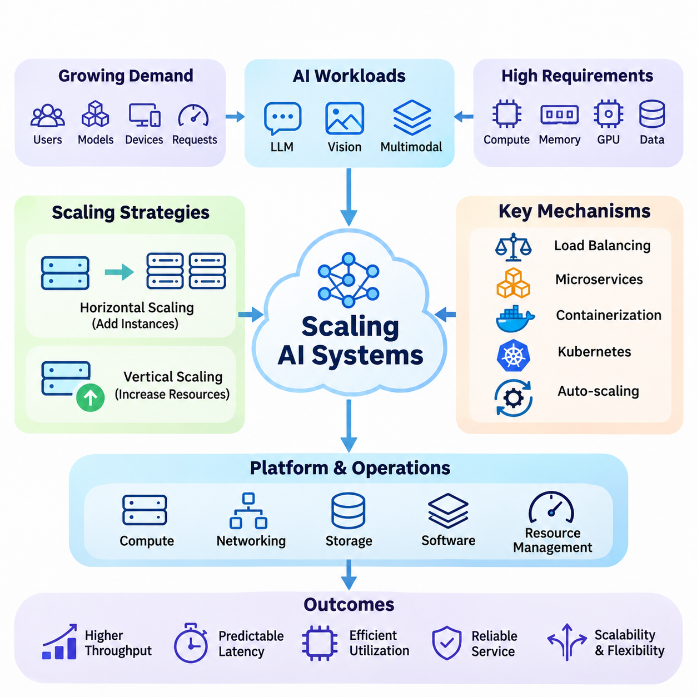
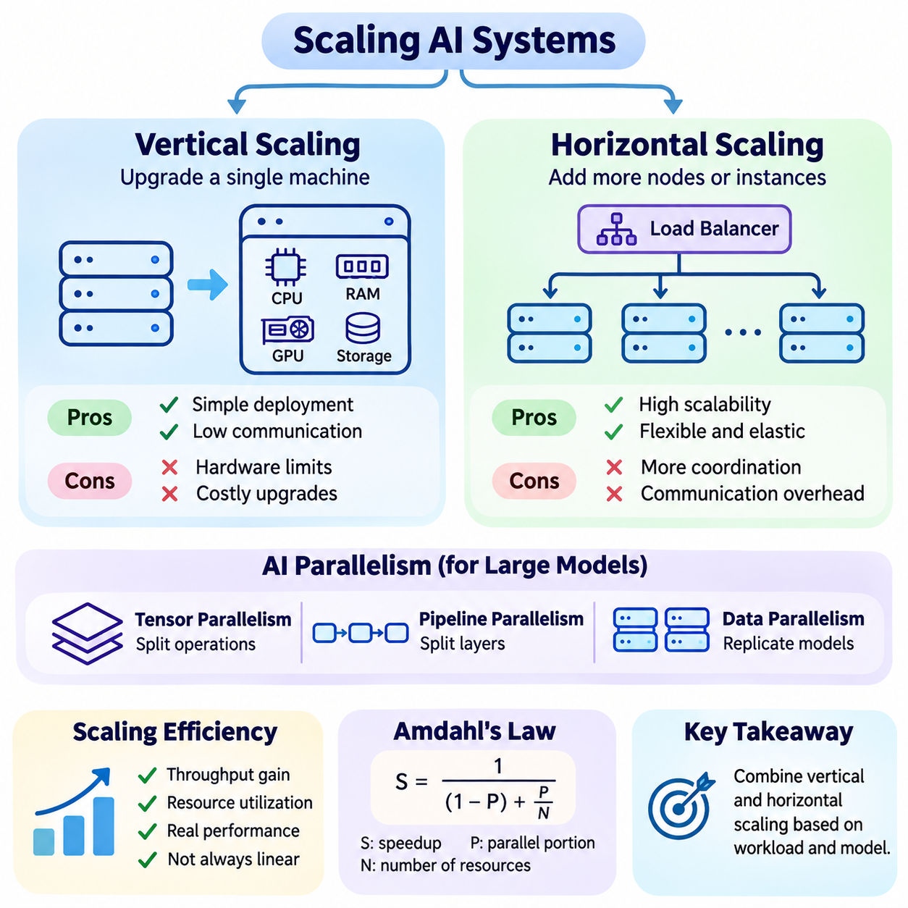
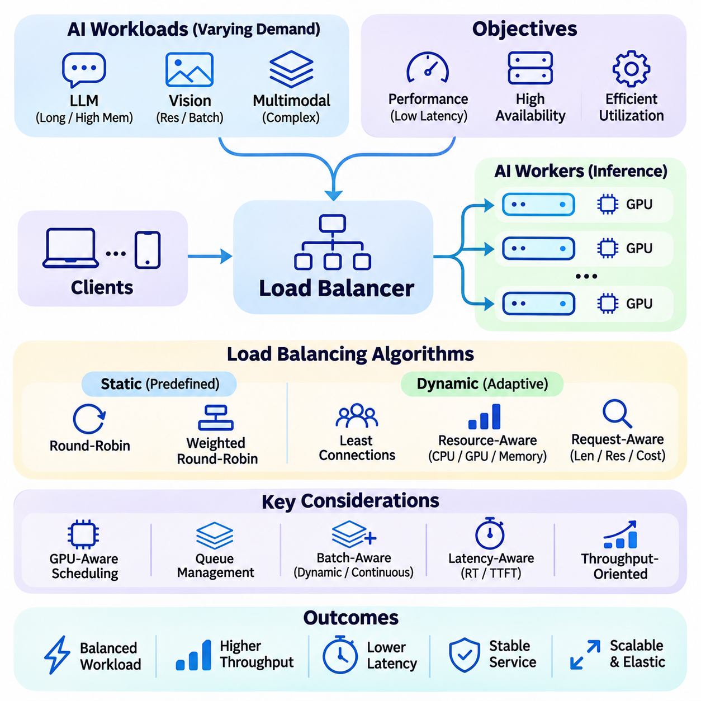
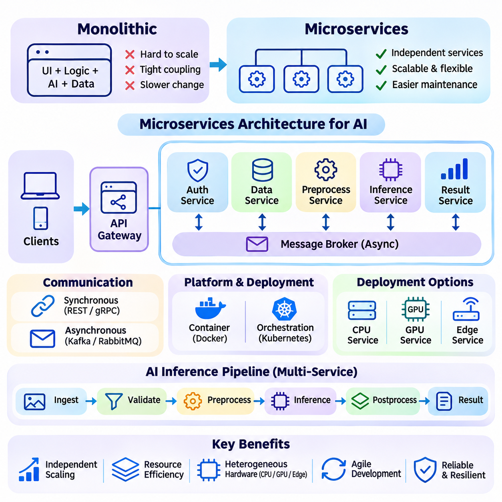
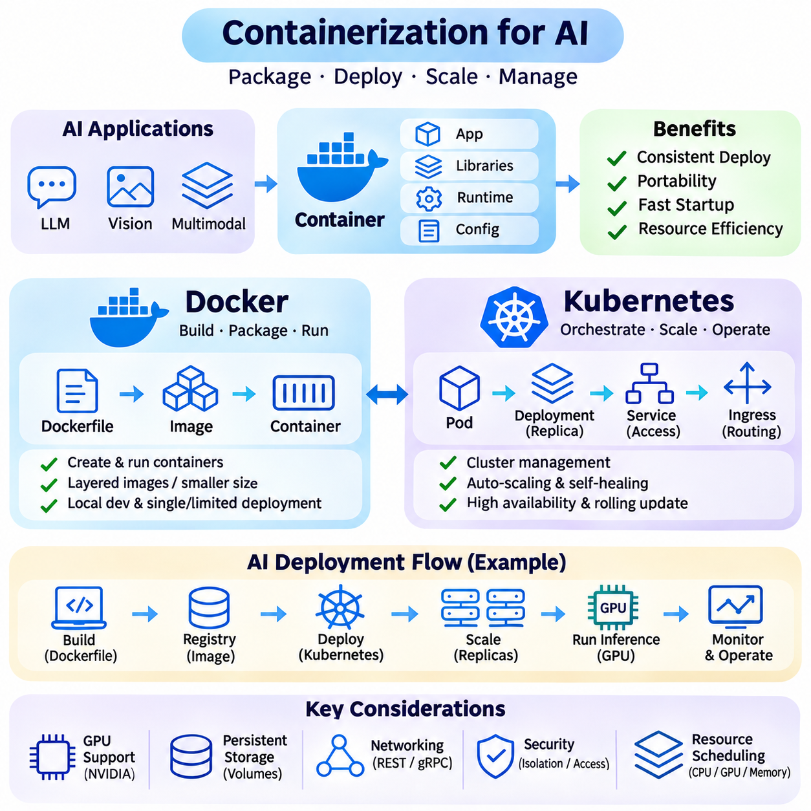
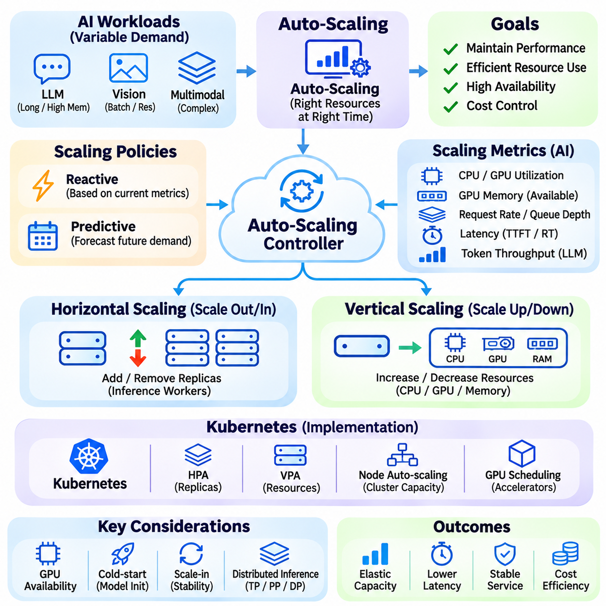
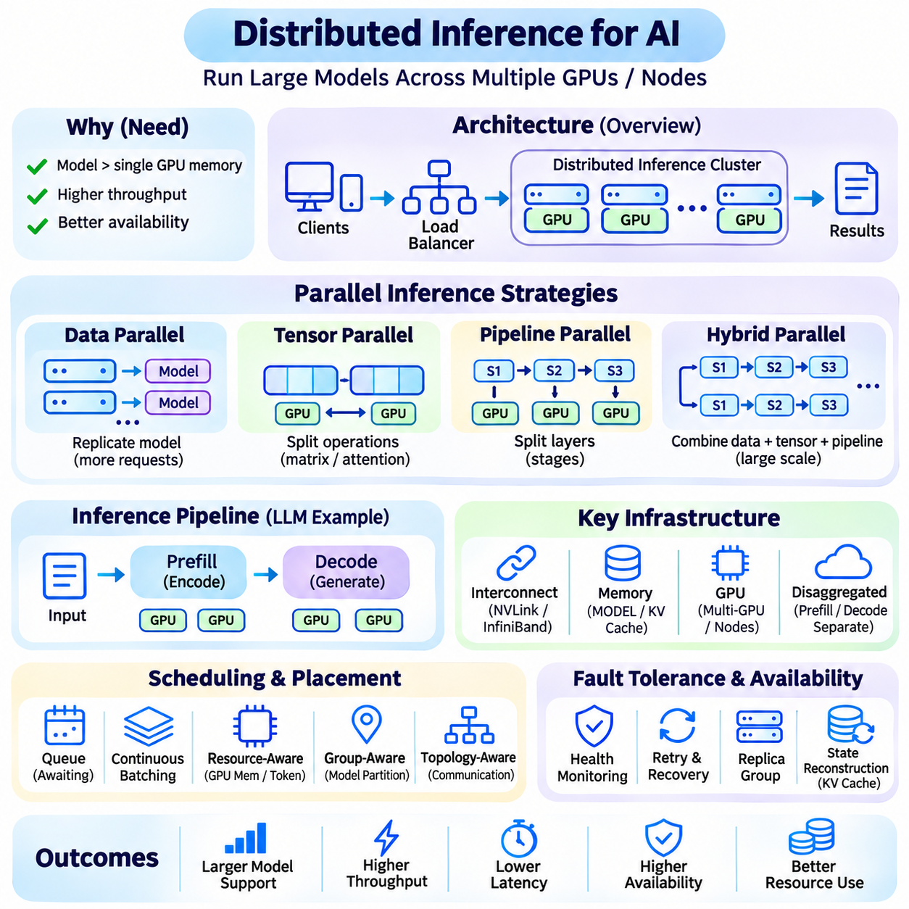
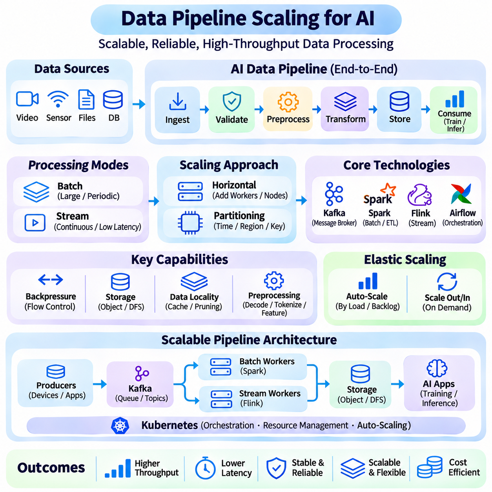
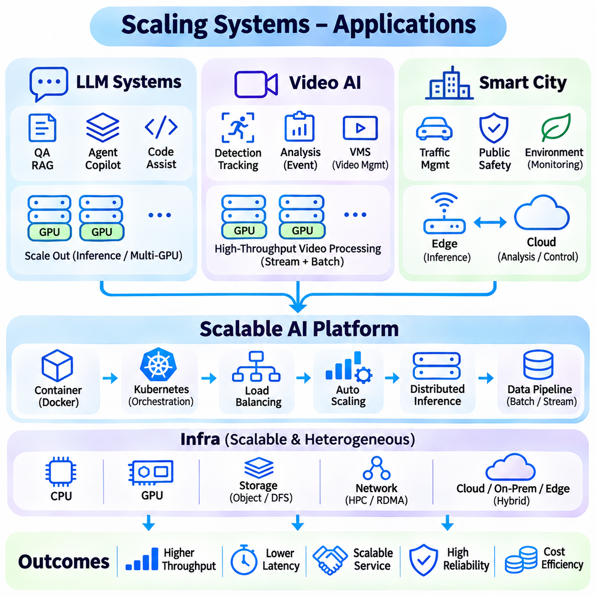

**Volume 38. AI Systems Architecture**

# 05. Scaling Systems

## 05.00 Overview

{width="7.268055555555556in" height="7.268055555555556in"}

인공지능 시스템의 확장(Scaling AI Systems)은 작업 부하(Workload)가 증가함에 따라 컴퓨팅 용량(Computational Capacity), 서비스 처리량(Service Throughput), 데이터 처리 능력(Data Processing Capability), 운영 신뢰성(Operational Reliability)을 확대하는 과정이다. 확장 가능한 아키텍처(Scalable Architecture)는 사용자, 모델, 장치, 요청의 수가 증가하더라도 허용할 수 없는 성능 저하 없이 대응할 수 있어야 한다. 효과적인 확장을 위해서는 컴퓨팅 인프라, 네트워킹, 저장소, 소프트웨어 아키텍처, 자원 관리 전반에 걸친 통합적인 설계가 필요하다.

기존 소프트웨어 서비스와 달리 인공지능 시스템(AI Systems)은 모델 추론(Model Inference), 데이터 전처리(Data Preprocessing), 가속기 실행(Accelerator Execution) 과정에서 상당한 연산량과 메모리 자원을 요구한다. 대규모 언어 모델(LLM), 컴퓨터 비전 파이프라인(Computer Vision Pipeline), 멀티모달 응용 시스템(Multimodal Applications)은 여러 GPU와 분산 처리 환경(Distributed Processing Environment)을 필요로 할 수 있다. 이러한 시스템의 확장에는 이기종 자원(Heterogeneous Resources)을 관리하면서 예측 가능한 지연시간(Latency), 효율적인 자원 활용률(Resource Utilization), 일관된 서비스 품질(Service Quality)을 유지하는 작업이 포함된다.

확장성(Scalability)은 일반적으로 수평 확장(Horizontal Scaling)과 수직 확장(Vertical Scaling) 전략을 통해 평가된다. 수평 확장은 서버, 컨테이너(Container), 처리 노드(Processing Node)를 추가하여 시스템 용량을 증가시키는 방식이며, 수직 확장은 기존 컴퓨팅 장비의 자원을 증설하는 방식이다. 두 접근법은 메모리 용량, 통신 오버헤드(Communication Overhead), 배포 복잡성(Deployment Complexity), 하드웨어 활용률 측면에서 서로 다른 제약조건을 가진다. 실제 아키텍처에서는 유연성과 효율성의 균형을 위해 두 전략을 결합하는 경우가 많다.

수직 확장(Vertical Scaling)은 단일 컴퓨팅 노드(Computing Node) 내에서 CPU 코어, GPU 성능, 시스템 메모리 또는 저장소 대역폭(Storage Bandwidth)을 증가시켜 성능을 개선할 수 있다. 이 방식은 애플리케이션이 단일 실행 환경(Execution Environment)에서 계속 동작할 수 있으므로 소프트웨어 배포를 단순화할 수 있다. 그러나 하드웨어 증설은 궁극적으로 물리적, 경제적, 아키텍처적 한계에 도달하므로 지속적인 성장이 필요한 분산 작업 부하(Distributed Workload)에는 수직 확장만으로 충분하지 않다.

수평 확장(Horizontal Scaling)은 작업 부하를 여러 컴퓨팅 인스턴스(Computing Instance)에 분산하여 추가 자원을 통해 시스템 용량을 증가시키는 방식이다. 무상태 추론 서비스(Stateless Inference Service)는 독립적인 요청을 서로 다른 작업자(Worker)가 처리할 수 있으므로 복제에 적합하다. 반면 상태 유지형 인공지능 애플리케이션(Stateful AI Application)은 인스턴스 간 세션 정보(Session Information), 캐시된 모델 상태(Cached Model State), 처리 연속성(Processing Continuity)을 보존하기 위한 추가적인 조정이 필요하며, 불필요한 통신 오버헤드를 방지해야 한다.

부하 분산(Load Balancing)은 들어오는 요청을 사용 가능한 컴퓨팅 자원에 분배하는 핵심 메커니즘이다. 효과적인 부하 분산기는 서버 가용성(Server Availability), 현재 자원 활용률(Current Utilization), 요청 특성(Request Characteristics), 예상 처리 시간(Expected Processing Duration)을 고려한다. 인공지능 작업 부하는 추론 요청마다 시퀀스 길이(Sequence Length), 이미지 해상도(Image Resolution), 배치 크기(Batch Size), 연산 복잡도(Computational Complexity)가 크게 달라질 수 있으므로 자원 소비가 불균등해지는 추가적인 스케줄링 문제가 발생한다.

전통적인 부하 분산 알고리즘(Load Balancing Algorithms)에는 라운드 로빈 스케줄링(Round-Robin Scheduling), 가중치 기반 분배(Weighted Distribution), 최소 연결 라우팅(Least-Connections Routing)이 포함된다. 인공지능 시스템에서는 GPU 메모리 인식(GPU Memory Awareness), 대기열 깊이 모니터링(Queue Depth Monitoring), 모델 가용성(Model Availability), 예상 실행 시간(Estimated Execution Time)을 활용하여 이러한 방식을 확장할 수 있다. 지능형 요청 라우팅(Intelligent Request Routing)은 여러 모델이 이기종 가속기를 공유하거나 요청별 처리 구성이 다른 환경에서 자원 경합(Resource Contention)을 줄이고 처리량을 개선한다.

마이크로서비스 아키텍처(Microservices Architecture)는 복잡한 인공지능 플랫폼을 독립적으로 배포할 수 있는 기능적 구성요소로 분리한다. 모델 추론, 데이터 수집(Data Ingestion), 전처리, 인증(Authentication), 모니터링(Monitoring), 결과 전달(Result Delivery)을 명확하게 정의된 인터페이스를 가진 별도 서비스로 운영할 수 있다. 이러한 모듈형 구성(Modular Organization)은 개별 구성요소를 작업 부하에 따라 확장할 수 있도록 하며, 불필요한 자원 중복을 줄이고 독립적인 개발, 시험, 유지보수를 지원한다.

서비스 분리(Service Decomposition)를 설계할 때는 구성요소 간 통신 오버헤드와 데이터 의존성(Data Dependency)을 고려해야 한다. 지나치게 세분화된 서비스 구조는 네트워크 트래픽(Network Traffic), 직렬화 비용(Serialization Cost), 운영 복잡성을 증가시킬 수 있다. 대형 텐서(Tensor), 이미지 또는 비디오 스트림(Video Stream)을 서비스 사이에서 전송하는 인공지능 파이프라인은 상당한 지연시간 증가를 경험할 수 있다. 따라서 효과적인 아키텍처 경계는 연산 지역성(Computational Locality), 데이터 이동 요구사항(Data Movement Requirements), 장애 격리(Fault Isolation), 독립적으로 확장 가능한 작업 부하를 반영해야 한다.

컨테이너화(Containerization)는 인공지능 애플리케이션과 의존성을 패키징하기 위한 표준화된 실행 환경을 제공한다. 도커 컨테이너(Docker Container)는 추론 런타임(Inference Runtime), 라이브러리(Library), 애플리케이션 로직(Application Logic), 설정(Configuration)을 캡슐화하여 개발 환경과 운영 환경 사이의 배포 일관성(Deployment Consistency)을 향상시킨다. 컨테이너 기반 배포는 재현성(Reproducibility)과 서비스 격리(Service Isolation)를 지원하지만 GPU 드라이버, 가속기 호환성(Accelerator Compatibility), 영구 저장소(Persistent Storage), 호스트 수준 의존성(Host-Level Dependencies)에 대한 세심한 조정이 필요하다.

쿠버네티스(Kubernetes)는 컴퓨팅 클러스터(Computing Cluster) 전반에서 배포, 스케줄링, 네트워킹, 수명주기 관리(Lifecycle Management)를 조정하여 컨테이너화 기능을 확장한다. 복제 서비스(Replicated Service), 순차적 업데이트(Rolling Update), 상태 검사(Health Check), 자원 할당 정책(Resource Allocation Policy)을 지원한다. GPU 기반 쿠버네티스 환경에서는 가속기 작업 부하에 적절한 자원을 제공하면서 과도한 자원 단편화(Resource Fragmentation)와 서비스 간 경합을 방지하기 위해 특수한 장치 관리(Device Management) 및 스케줄링 설정이 필요하다.

자동 확장(Auto-Scaling)은 변화하는 수요에 따라 컴퓨팅 용량을 동적으로 조정하는 기술이다. 반응형 접근법(Reactive Approach)은 CPU 활용률, GPU 활동량, 대기열 길이(Queue Length), 요청 지연시간(Request Latency) 등의 지표를 관찰한 후 서비스 인스턴스를 추가하거나 제거한다. 예측형 접근법(Predictive Approach)은 과거 패턴(Historical Patterns)과 예상 수요(Anticipated Demand)를 기반으로 미래 작업 부하를 추정한다. 두 방식 모두 서비스 수준 목표(Service-Level Objectives)를 유지하면서 수요가 낮은 기간의 불필요한 인프라 비용을 줄이는 것을 목표로 한다.

인공지능 자동 확장(AI Auto-Scaling)은 모델 초기화(Model Initialization)와 가속기 할당(Accelerator Allocation)에 상당한 시간이 필요할 수 있다는 점에서 기존 웹 서비스 확장과 다르다. 대규모 모델 가중치(Model Weights)를 불러오고 GPU 메모리를 할당하며 추론 엔진(Inference Engine)을 준비하는 과정은 새 인스턴스의 서비스 투입을 지연시킬 수 있다. 따라서 확장 정책은 순간적인 자원 활용률에만 의존하지 않고 시작 지연시간(Startup Latency), 사전 준비 용량(Warm Capacity), 요청 배치 처리(Request Batching), 자원 예약(Resource Reservation)을 고려해야 한다.

분산 추론(Distributed Inference)은 모델이 단일 장치의 메모리에 적재되지 않거나 추가 처리 용량이 필요한 경우 여러 가속기 또는 컴퓨터에 걸쳐 연산 작업을 수행하도록 한다. 데이터 병렬화(Data Parallelism)는 작업자 간 모델을 복제하며, 텐서 병렬화(Tensor Parallelism)와 파이프라인 병렬화(Pipeline Parallelism)는 모델 연산을 분할한다. 이러한 기술은 통신 및 동기화 요구사항을 발생시키므로 추가 연산 자원이 제공하는 이점과 통신 비용 사이의 균형을 고려해야 한다.

대규모 언어 모델 서빙(Large Language Model Serving)은 분산 추론의 복잡성을 보여주는 대표적인 사례이다. 트랜스포머 모델(Transformer Model)은 생성 과정에서 모델 매개변수(Model Parameters), 중간 활성화 값(Intermediate Activations), 키-값 캐시(Key-Value Cache)를 저장하기 위해 상당한 메모리를 요구한다. 연속 배치 처리(Continuous Batching), 효율적인 어텐션 구현(Efficient Attention Implementation), 캐시 관리(Cache Management), 요청 인식 스케줄링(Request-Aware Scheduling)은 가속기 활용률을 개선할 수 있다. 그러나 긴 문맥 창(Context Window)과 가변적인 출력 길이(Output Length)는 동적인 메모리 요구를 발생시켜 용량 계획(Capacity Planning)과 지연시간 예측을 복잡하게 만든다.

데이터 파이프라인 확장(Data Pipeline Scaling) 역시 중요하다. 추론 성능은 사용 가능한 입력 데이터가 적시에 전달되는지에 따라 달라지기 때문이다. 분산 데이터 수집 시스템(Distributed Ingestion System)은 증가하는 정형 데이터(Structured Records), 이미지, 비디오 스트림, 센서 측정값을 처리해야 한다. 데이터 분할(Partitioning), 버퍼링(Buffering), 병렬 전처리(Parallel Preprocessing), 비동기 통신(Asynchronous Communication)은 병목현상(Bottleneck)을 방지하며, 역압력 메커니즘(Backpressure Mechanism)은 유입 데이터가 처리 용량을 초과할 때 하위 서비스를 과부하로부터 보호한다.

스트리밍 아키텍처(Streaming Architecture)는 메시지 브로커(Message Broker), 분산 처리 엔진(Distributed Processing Engine), 영구 저장 시스템(Persistent Storage System)을 결합하는 경우가 많다. 카프카 기반 파이프라인(Kafka-Based Pipeline)은 이벤트 스트림(Event Stream)을 여러 소비자(Consumer)에 분할하여 병렬 처리와 제어된 데이터 보존(Data Retention)을 지원한다. 그러나 파티션 분배(Partition Distribution), 메시지 순서(Message Ordering), 전달 보장(Delivery Guarantees), 소비자 조정(Consumer Coordination)은 시스템 동작에 영향을 준다. 신뢰성 있는 확장을 위해서는 중복 처리(Duplication), 재생(Replay), 장애 복구(Failure Recovery), 종단 간 처리 일관성(End-to-End Processing Consistency)을 명시적으로 고려해야 한다.

저장소 아키텍처(Storage Architecture) 역시 인공지능 인프라의 확장성을 결정한다. 모델 저장소(Model Repository), 특징 저장소(Feature Store), 벡터 데이터베이스(Vector Database), 분산 객체 저장소(Distributed Object Storage)는 서로 다른 접근 패턴(Access Pattern)과 일관성 요구사항(Consistency Requirements)을 지원한다. 자주 접근하는 모델 매개변수와 중간 결과는 캐싱(Caching)의 이점을 얻으며, 대규모 학습 데이터셋(Training Dataset)과 보관된 추론 결과는 경제적인 영구 저장소가 필요하다. 충분한 컴퓨팅 용량이 확보되더라도 저장소 대역폭과 메타데이터 연산(Metadata Operations)이 시스템 성능을 제한할 수 있다.

네트워킹(Networking)은 인공지능 서비스가 여러 노드, 클러스터, 지리적 지역으로 확장됨에 따라 더욱 중요해진다. 분산 추론은 가속기 간 빈번한 통신을 요구할 수 있으며, 비디오 분석 플랫폼(Video Analytics Platform)은 상당한 양의 센서 데이터를 전송한다. 네트워크 대역폭(Network Bandwidth), 지연시간, 토폴로지(Topology), 혼잡(Congestion)은 처리 효율에 직접적인 영향을 준다. 데이터 지역성(Data Locality)과 통신 인식 배치(Communication-Aware Placement)는 불필요한 데이터 전송을 줄이고 전체 시스템 성능을 개선할 수 있다.

신뢰성(Reliability)과 장애 허용성(Fault Tolerance)은 확장 가능한 인공지능 플랫폼의 필수 속성이다. 구성요소의 수가 증가하면 개별 장애가 발생할 가능성도 높아진다. 복제(Replication), 상태 모니터링(Health Monitoring), 재시도 정책(Retry Policy), 회로 차단기(Circuit Breaker), 단계적 성능 저하(Graceful Degradation)는 서비스 가용성(Availability)을 유지하는 데 도움이 된다. 그러나 복구 메커니즘은 인프라가 불안정한 기간에 연쇄 장애(Cascading Failure), 비용이 높은 연산의 중복 실행, 통제되지 않는 재시도 트래픽(Retry Traffic)을 방지해야 한다.

관측 가능성(Observability)은 변화하는 작업 부하에서 시스템 동작을 이해하는 데 필요한 정보를 제공한다. 메트릭(Metrics), 로그(Logs), 분산 추적(Distributed Traces)은 요청 라우팅, 추론 실행, 저장소 접근, 네트워크 통신 사이의 상호작용을 보여준다. GPU 활용률만으로는 효율성을 충분히 평가할 수 없다. 메모리 압박(Memory Pressure), 배치 처리 동작(Batching Behavior), 대기열 지연(Queue Delay), 동기화 오버헤드(Synchronization Overhead)가 성능을 지배할 수 있기 때문이다. 포괄적인 모니터링은 인프라 측정값과 애플리케이션 수준의 결과를 연결한다.

성능 평가(Performance Evaluation)에서는 처리량(Throughput), 평균 지연시간(Average Latency), 꼬리 지연시간(Tail Latency), 자원 활용률(Resource Utilization), 비용 효율성(Cost Efficiency)을 구분해야 한다. 초당 더 많은 요청을 처리하는 시스템이라도 높은 백분위 응답시간(High-Percentile Response Time)이 증가하면 허용할 수 없는 사용자 경험을 제공할 수 있다. 따라서 용량 시험(Capacity Testing)은 실제 요청 분포(Realistic Request Distribution), 동시 작업 부하(Concurrent Workload), 모델 구성(Model Configuration), 장애 시나리오(Failure Scenario)를 검토해야 한다. 확장 효율성(Scaling Efficiency)은 추가 자원이 실제로 유용한 처리 용량으로 얼마나 효과적으로 전환되는지를 측정한다.

경제적 고려사항(Economic Considerations)은 모든 확장 결정에 영향을 미친다. 컴퓨팅 자원을 추가한다고 해서 성능이 반드시 비례적으로 향상되는 것은 아니기 때문이다. GPU 구매, 클라우드 임대(Cloud Rental), 네트워킹, 저장소, 전력, 운영 인력 비용은 총소유비용(Total Cost of Ownership)에 포함된다. 과도한 자원 할당(Overprovisioning)은 자원을 낭비하며, 지나치게 공격적인 자원 통합(Resource Consolidation)은 경합과 서비스 위험을 증가시킨다. 비용 인식 확장(Cost-Aware Scaling)은 활용률, 신뢰성, 지연시간 요구사항, 예상 작업 부하 증가 사이에서 적절한 균형을 추구한다.

보안 요구사항(Security Requirements)은 서비스가 여러 환경에 분산됨에 따라 더욱 복잡해진다. 인증(Authentication), 인가(Authorization), 암호화(Encryption), 네트워크 분할(Network Segmentation), 비밀정보 관리(Secret Management)는 새로운 인스턴스가 추가되더라도 일관되게 유지되어야 한다. 다중 테넌트 인공지능 플랫폼(Multi-Tenant AI Platform)은 고객 간 간섭을 방지하기 위해 작업 부하 격리(Workload Isolation)와 자원 할당량(Resource Quotas)을 필요로 한다. 안전한 확장(Secure Scaling)을 위해서는 모델 접근 제어(Model Access Control), 보호된 데이터 파이프라인(Protected Data Pipeline), 감사 가능한 인프라 변경(Auditable Infrastructure Changes)도 필요하다.

대규모 언어 모델 플랫폼(Large Language Model Platform)은 확장 가능한 인공지능 아키텍처의 중요한 응용 분야이다. 이러한 플랫폼은 서로 다른 문맥 길이(Context Length), 출력 요구사항(Output Requirements), 모델 구성(Model Configuration)을 가진 수천 개의 동시 요청을 처리할 수 있다. 분산 추론, 요청 배치 처리, 캐싱, 작업 부하 인식 라우팅(Workload-Aware Routing)은 효율적인 운영을 지원한다. 또한 아키텍처는 검색 서비스(Retrieval Service), 애플리케이션 인터페이스(Application Interface), 모니터링 시스템을 조정하면서 보조 구성요소가 병목현상이 되지 않도록 해야 한다.

비디오 인공지능 시스템(Video AI Systems)은 연속적인 스트림이 지속적인 연산 및 네트워크 수요를 발생시키므로 다른 확장 문제를 가진다. 다중 카메라 분석 플랫폼(Multi-Camera Analytics Platform)은 분산 처리 노드에서 비디오 디코딩(Video Decoding), 추론, 객체 추적(Object Tracking), 이벤트 집계(Event Aggregation)를 수행해야 한다. 엣지 필터링(Edge Filtering)은 불필요한 클라우드 전송을 줄일 수 있으며, 중앙 집중형 서비스(Centralized Service)는 카메라 간 분석(Cross-Camera Analysis)과 장기 저장(Long-Term Storage)을 지원한다. 확장 결정은 프레임 속도(Frame Rate), 해상도, 객체 탐지 복잡도(Detection Complexity), 요구 응답시간(Required Response Time)에 따라 달라진다.

스마트시티 응용 시스템(Smart City Applications)은 다수의 카메라, 환경 센서(Environmental Sensors), 교통 시스템(Transportation Systems), 연결 장치(Connected Devices)를 통합한다. 이러한 아키텍처는 엣지 컴퓨팅(Edge Computing), 지역 처리 인프라(Regional Processing Infrastructure), 중앙 클라우드 플랫폼(Centralized Cloud Platform)을 결합하는 경우가 많다. 분산 서비스는 지리적으로 분산된 작업 부하를 수용하면서 데이터 일관성(Data Consistency)과 운영 가시성(Operational Visibility)을 유지해야 한다. 이벤트 기반 처리(Event-Driven Processing)와 적응형 자원 할당(Adaptive Resource Allocation)은 모든 데이터 스트림을 중앙에서 분석하지 않고도 시스템 확장을 지원한다.

궁극적으로 확장 가능한 인공지능 시스템(Scalable AI Systems)은 단순히 컴퓨팅 하드웨어를 추가하는 것이 아니라 통합적으로 조정된 아키텍처 설계 결정(Coordinated Architectural Decisions)을 통해 구현된다. 수평 확장, 수직 확장, 부하 분산, 마이크로서비스, 컨테이너 오케스트레이션(Container Orchestration), 자동 확장, 분산 추론, 데이터 파이프라인 확장은 서로 보완적인 요구사항을 해결한다. 이러한 기술의 통합은 다양한 배포 환경(Deployment Environments)에서 성능, 신뢰성, 보안, 경제적 지속가능성(Economic Sustainability)을 유지하면서 증가하는 수요를 지원하는 인공지능 인프라를 가능하게 한다.

## 05.01 Horizontal vs Vertical Scaling

{width="7.268055555555556in" height="7.268055555555556in"}

수평 확장(Horizontal Scaling)과 수직 확장(Vertical Scaling)은 인공지능 시스템(AI Systems)의 컴퓨팅 용량(Computational Capacity)을 증가시키기 위한 두 가지 기본 전략이다. 수평 확장은 컴퓨팅 노드(Computing Node) 또는 서비스 인스턴스(Service Instance)를 추가하여 인프라를 확장하는 방식이며, 수직 확장은 기존 장비의 처리 능력을 향상시키는 방식이다. 두 접근법 모두 증가하는 작업 부하(Workload)에 대응하지만 자원 할당(Resource Allocation), 아키텍처 복잡성(Architectural Complexity), 운영 유연성(Operational Flexibility), 성능 한계(Performance Limitations)에서 차이가 있다.

수직 확장(Vertical Scaling)은 단일 컴퓨팅 환경(Single Computing Environment) 내에서 하드웨어 자원을 증설하여 시스템 용량을 향상시킨다. CPU 코어 추가, 시스템 메모리 확장, 고성능 GPU 도입, 고속 저장장치 적용을 통해 애플리케이션 아키텍처(Application Architecture)를 근본적으로 변경하지 않고도 처리 성능을 높일 수 있다. 이러한 접근법은 긴밀하게 결합된 연산(Tightly Coupled Computation), 공유 메모리 접근(Shared Memory Access), 처리 구성요소 간 최소한의 통신이 필요한 작업 부하에 특히 적합하다.

인공지능 응용 시스템(AI Applications)에서 수직 확장은 대규모 신경망(Neural Networks)과 연산 집약적인 추론 작업(Computationally Intensive Inference Workloads)을 처리하기 위해 자주 사용된다. GPU 메모리를 확장하면 더 큰 모델이나 배치(Batch)를 단일 가속기(Accelerator)에서 실행할 수 있으며, 호환되는 GPU를 추가하면 사용 가능한 컴퓨팅 자원을 확대할 수 있다. 그러나 다중 GPU 실행(Multi-GPU Execution)은 명시적인 병렬화(Parallelization)가 필요할 수 있으며, 가속기가 동일한 서버에 있더라도 통신 오버헤드(Communication Overhead)가 발생한다.

수직 확장의 장점 중 하나는 상대적으로 간단한 배포(Deployment)와 관리(Management)이다. 애플리케이션은 광범위한 분산 조정(Distributed Coordination) 없이 기존 실행 환경(Execution Environment)에서 계속 동작할 수 있다. 구성요소 간 데이터 교환(Data Exchange)을 로컬 환경에서 수행할 수 있으므로 네트워크 통신 요구사항(Network Communication Requirements)이 감소한다. 그러나 하드웨어 업그레이드에는 서비스 중단 시간(Downtime), 소프트웨어 호환성 조정(Software Compatibility Adjustments), 상당한 자본 지출(Capital Expenditure)이 수반될 수 있다.

수직 확장은 결국 하드웨어 및 아키텍처의 한계에 도달한다. 프로세서 소켓 수(Processor Socket Counts), 메모리 채널(Memory Channels), 가속기 슬롯(Accelerator Slots), 전력 공급 능력(Power Delivery), 냉각 용량(Cooling Capacity)은 단일 장비 내 확장을 제한한다. 추가 자원을 확보하더라도 순차 실행(Sequential Execution), 메모리 대역폭 제약(Memory Bandwidth Constraints), 소프트웨어 병목현상(Software Bottlenecks)으로 인해 자원을 효율적으로 활용하지 못할 수 있다. 이러한 제약은 성능 향상에 실질적인 상한선을 형성한다.

수평 확장(Horizontal Scaling)은 작업 부하를 여러 독립적인 컴퓨팅 노드에 분산하여 용량 한계를 해결한다. 점점 더 강력한 단일 장비에 의존하는 대신 서버, 컨테이너(Container), 추론 작업자(Inference Worker)를 추가하여 전체 처리 용량(Aggregate Processing Capacity)을 증가시킨다. 이 전략은 광범위한 동기화(Synchronization)나 공유 상태(Shared State) 요구 없이 동시에 실행할 수 있는 독립적인 작업으로 작업 부하를 분할할 수 있을 때 특히 효과적이다.

무상태 인공지능 추론 서비스(Stateless AI Inference Services)는 개별 요청을 독립적으로 처리할 수 있으므로 수평 확장에 적합하다. 동일한 모델의 여러 복제본(Model Replicas)이 부하 분산기(Load Balancer)를 통해 들어오는 요청을 처리할 수 있으며, 추가 작업자가 투입되면 전체 처리량(Aggregate Throughput)이 증가한다. 그러나 실제 확장 효율성(Scaling Efficiency)은 요청 분포(Request Distribution), 가속기 활용률(Accelerator Utilization), 모델 로딩 오버헤드(Model Loading Overhead), 공유 인프라(Shared Infrastructure)의 처리 용량에 따라 달라진다.

수평 확장은 단일 노드 환경(Single-Node Environment)에서는 상대적으로 중요성이 낮았던 통신 및 조정 요구사항을 발생시킨다. 분산 애플리케이션(Distributed Applications)은 서비스 검색(Service Discovery), 요청 라우팅(Request Routing), 네트워크 장애(Network Failures), 여러 인스턴스 간 일관성(Consistency)을 관리해야 한다. 상태 유지형 작업 부하(Stateful Workloads)는 세션(Session), 공유 캐시(Shared Cache), 중간 처리 상태(Intermediate Processing State)를 유지하기 위한 추가 메커니즘이 필요하다. 이러한 요구사항은 소프트웨어 복잡성을 증가시키고 지연시간 및 운영 불안정성의 원인이 될 수 있다.

수평 확장과 수직 확장의 차이는 대규모 언어 모델(Large Language Models, LLM)에서 특히 중요하다. 단일 GPU에 적재할 수 있는 모델은 여러 장치에 복제하여 서비스 처리량(Serving Throughput)을 높일 수 있다. 반면 개별 가속기의 메모리 용량을 초과하는 모델은 텐서 병렬화(Tensor Parallelism) 또는 파이프라인 병렬화(Pipeline Parallelism)가 필요할 수 있다. 이러한 모델 분할(Model Partitioning)은 연산을 분산하지만 독립적인 추론 복제본(Inference Replicas)과 반드시 동일한 확장 특성을 제공하지는 않는다.

텐서 병렬화(Tensor Parallelism)는 신경망 연산(Neural Network Operations)을 여러 가속기에 분할하여 개별 계층(Layer)이 분산 컴퓨팅 자원(Distributed Computational Resources)을 활용하도록 한다. 파이프라인 병렬화(Pipeline Parallelism)는 서로 다른 계층 그룹을 별도 장치에 할당하고 마이크로배치(Microbatch)를 연속적인 단계로 처리한다. 이러한 기술은 단일 장치의 용량을 초과하는 모델을 지원하지만 동기화, 통신 대역폭(Communication Bandwidth), 파이프라인 유휴 구간(Pipeline Bubbles), 작업 부하 불균형(Workload Imbalance)이 효율성을 제한할 수 있다.

데이터 병렬화(Data Parallelism)는 인공지능 처리 용량을 확장하기 위한 또 다른 메커니즘이다. 추론 과정에서는 독립적인 모델 복제본이 서로 다른 요청이나 배치를 처리하여 충분한 수요가 존재할 때 전체 처리량을 증가시킨다. 학습 과정에서는 작업자들이 서로 다른 데이터 분할(Data Partitions)을 처리하고 학습 알고리즘(Training Algorithm)에 따라 기울기(Gradients)를 동기화한다. 두 접근법 모두 복제된 모델을 사용하지만 통신 요구사항과 성능 특성은 상당히 다르다.

확장 효율성(Scaling Efficiency)은 추가 컴퓨팅 자원이 실제 시스템 성능을 얼마나 효과적으로 향상시키는지를 나타낸다. 이상적인 선형 확장(Linear Scaling)에서는 동일한 조건에서 컴퓨팅 자원을 두 배로 늘리면 처리량도 두 배로 증가한다. 그러나 실제 시스템에서는 동기화 비용(Synchronization Costs), 공유 자원 경합(Shared Resource Contention), 통신 지연(Communication Delays), 작업 부하 불균형으로 인해 완벽한 선형 확장을 달성하기 어렵다. 따라서 확장 효율성은 비례적인 성능 향상을 가정하기보다 실제 성능 측정을 통해 평가해야 한다.

암달의 법칙(Amdahl\'s Law)은 순차 처리(Sequential Processing)로 인해 발생하는 성능 한계를 이론적으로 설명한다. 애플리케이션의 일부를 병렬로 실행할 수 없다면 프로세서 수를 늘리더라도 성능 향상 폭은 점차 감소한다. 구스타프슨의 법칙(Gustafson\'s Law)은 컴퓨팅 용량이 증가함에 따라 더 큰 작업 부하를 처리하는 관점에서 이를 보완한다. 두 원리는 확장성이 사용 가능한 하드웨어뿐 아니라 작업 부하의 구조(Workload Structure)에도 의존한다는 사실을 보여준다.

메모리 아키텍처(Memory Architecture)는 확장 전략 선택에 큰 영향을 미친다. 수직 확장은 더 큰 로컬 메모리 용량(Local Memory Capacity)과 공유 데이터에 대한 낮은 지연시간 접근(Low-Latency Access)을 제공할 수 있지만, 비균일 메모리 접근(Nonuniform Memory Access, NUMA)과 가속기 상호연결(Accelerator Interconnect)의 한계가 성능에 영향을 줄 수 있다. 수평 확장은 메모리를 여러 장비에 분산하므로 명시적인 데이터 배치(Data Placement)와 통신이 필요하다. 따라서 대규모 인공지능 모델, 임베딩 테이블(Embedding Tables), 추론 캐시(Inference Caches)는 메모리 지역성(Memory Locality)과 접근 패턴(Access Patterns)에 따라 구성해야 한다.

저장소(Storage)와 네트워킹 인프라(Networking Infrastructure)는 두 확장 방식 모두에서 제약요인이 될 수 있다. 저장소 처리량(Storage Throughput)을 확대하지 않고 컴퓨팅 용량만 증가시키면 데이터 로딩 병목현상(Data Loading Bottlenecks)이 발생할 수 있다. 마찬가지로 수평 분산 서비스(Horizontally Distributed Services)는 텐서, 이미지, 중간 결과(Intermediate Results)를 전송하면서 네트워크 링크(Network Links)를 포화시킬 수 있다. 효과적인 확장을 위해서는 컴퓨팅 하드웨어만 개별적으로 업그레이드하기보다 프로세서, 가속기, 메모리, 저장소, 통신 시스템 전반에 걸친 균형 잡힌 자원 구성이 필요하다.

부하 분산(Load Balancing)은 수평 확장된 인공지능 플랫폼에서 특히 중요하다. 요청은 처리 용량(Capacity), 현재 활용률(Current Utilization), 처리 요구사항(Processing Requirements)에 따라 사용 가능한 작업자에게 분배되어야 한다. 요청별 실행 시간이 크게 달라지는 경우 단순한 라운드 로빈 스케줄링(Round-Robin Scheduling)은 비효율적일 수 있다. GPU 인식 라우팅(GPU-Aware Routing), 대기열 모니터링(Queue Monitoring), 작업 부하 예측(Workload Prediction)은 분배 효율성을 개선하고 꼬리 지연시간(Tail Latency)을 줄이며 특정 노드의 과부하를 방지할 수 있다.

자동 확장(Auto-Scaling)은 활성 서비스 인스턴스의 수를 동적으로 변경하여 수평 확장을 확장한 기술이다. 모니터링 시스템(Monitoring Systems)은 요청 속도(Request Rate), 대기열 깊이(Queue Depth), GPU 활용률(GPU Utilization), 응답 지연시간(Response Latency) 등의 작업 부하 지표를 평가한다. 수요가 증가하면 추가 인스턴스를 배포하고, 수요가 낮은 기간에는 불필요한 용량을 제거할 수 있다. 인공지능 작업 부하는 모델 초기화(Model Initialization)와 GPU 할당(GPU Allocation)으로 인해 인스턴스 준비가 지연될 수 있으므로 특별한 고려가 필요하다.

수직 확장도 일부 가상화 환경(Virtualized Environments)에서는 자원 크기 조정(Resource Resizing)이나 마이그레이션(Migration)을 통해 자동화할 수 있다. 그러나 CPU, 메모리, 가속기 할당을 변경하려면 애플리케이션 재시작(Application Restart)이나 인프라 재구성(Infrastructure Reconfiguration)이 필요할 수 있다. 수평 확장은 일반적으로 서비스 용량을 독립적으로 조정하는 데 더 높은 유연성을 제공하지만 자원 가용성(Resource Availability)과 오케스트레이션 정책(Orchestration Policies)에 따른 실질적인 제약이 존재한다. 적절한 전략은 작업 부하 특성과 운영 요구사항에 따라 결정된다.

신뢰성(Reliability)은 두 확장 전략 사이의 또 다른 주요 차이점이다. 수직 확장 시스템은 상당한 컴퓨팅 용량을 단일 장애 영역(Single Failure Domain)에 집중시킬 수 있다. 따라서 별도의 이중화(Redundancy)가 제공되지 않으면 하드웨어 장애로 인해 작업 부하의 상당 부분이 중단될 수 있다. 수평 확장은 복제된 서비스가 독립적인 노드에서 동작하도록 하여 장애가 감지되고 요청을 성공적으로 재전달할 수 있을 때 복원력(Resilience)을 향상시킨다.

수평 확장이 자동으로 장애 허용성(Fault Tolerance)을 보장하는 것은 아니다. 공유 데이터베이스(Shared Database), 중앙 집중형 저장소(Centralized Storage), 네트워크 게이트웨이(Network Gateway), 오케스트레이션 구성요소(Orchestration Components)는 여전히 단일 장애점(Single Point of Failure)으로 남을 수 있다. 복제는 일관성 문제(Consistency Challenges)와 추가적인 복구 요구사항(Recovery Requirements)도 발생시킨다. 신뢰성 있는 분산 아키텍처는 이중화된 인프라와 상태 모니터링(Health Monitoring), 장애 격리(Failure Isolation), 제어된 재시도(Controlled Retries), 연쇄적인 서비스 중단을 방지하는 복구 절차(Recovery Procedures)를 결합해야 한다.

비용 고려사항(Cost Considerations)은 확장 전략 결정에 상당한 영향을 미친다. 수직 확장은 운영 단순성(Operational Simplicity)을 제공할 수 있지만 고성능 프로세서, 가속기, 메모리 구성에 높은 비용이 필요할 수 있다. 수평 확장은 장비를 추가하여 점진적으로 확장할 수 있지만 네트워킹, 오케스트레이션, 라이선스(Licensing), 운영 관리(Operational Management)로 인해 총비용이 증가한다. 비용 효율성(Cost Efficiency)은 하드웨어 가격만이 아니라 실제 작업 부하 성능과 총소유비용(Total Cost of Ownership)을 기준으로 평가해야 한다.

에너지 소비(Energy Consumption)와 열적 제약(Thermal Constraints)도 인프라 설계에 영향을 미친다. 고밀도 GPU 서버(High-Density GPU Servers)는 특히 여러 가속기가 지속적으로 동작할 때 상당한 전력 공급 및 냉각 용량을 요구한다. 분산 배포(Distributed Deployment)는 전력 요구량을 여러 장비에 분산할 수 있지만 네트워킹과 유휴 자원 오버헤드(Idle-Resource Overhead)를 증가시킨다. 따라서 에너지 효율적인 확장(Energy-Efficient Scaling)은 와트당 성능(Performance per Watt), 가속기 활용률, 작업 부하 스케줄링(Workload Scheduling), 인프라 냉각 효율(Infrastructure Cooling Efficiency)을 고려해야 한다.

하이브리드 확장(Hybrid Scaling)은 수직 확장과 수평 확장을 결합하여 두 방식의 상호 보완적인 장점을 활용한다. 개별 노드에는 높은 연산 요구를 가진 모델을 효율적으로 실행할 수 있도록 충분한 메모리와 가속기 용량을 제공하고, 추가 노드를 통해 처리량 확장(Throughput Expansion)과 서비스 이중화(Service Redundancy)를 구현할 수 있다. 이러한 아키텍처는 모든 작업 부하에 동일한 하드웨어 구성이나 분산 실행 전략(Distributed Execution Strategy)을 적용하지 않고도 유연한 자원 할당을 지원한다.

대규모 비디오 분석(Large-Scale Video Analytics)은 하이브리드 확장의 실질적인 이점을 보여준다. 개별 처리 노드(Processing Node)는 고성능 GPU를 사용하여 여러 카메라 스트림(Camera Streams)을 디코딩하고 분석할 수 있으며, 추가 노드는 증가하는 카메라 수를 수용한다. 엣지 장치(Edge Devices)는 선택된 정보만 중앙 집중형 서비스(Centralized Services)로 전달하기 전에 예비 필터링(Preliminary Filtering)을 수행할 수 있다. 이러한 구성은 불필요한 네트워크 트래픽을 줄이고 지역별 수요(Regional Demand)에 따라 컴퓨팅 용량을 확장할 수 있도록 한다.

스마트시티 플랫폼(Smart City Platforms) 역시 지리적으로 분산된 센서, 카메라, 지능형 서비스(Intelligent Services)를 지원할 수 있는 확장 가능한 아키텍처를 필요로 한다. 수직 확장은 지역 처리 노드(Regional Processing Nodes)의 성능을 향상시키며, 수평 확장은 도시 구역과 인프라 시설 전반으로 서비스 범위를 확대한다. 분산 오케스트레이션(Distributed Orchestration), 이벤트 기반 통신(Event-Driven Communication), 중앙 집중형 모니터링(Centralized Monitoring)은 이러한 자원을 조정하면서 운영 가시성(Operational Visibility)과 일관된 서비스 동작(Consistent Service Behavior)을 유지한다.

수평 확장과 수직 확장 중 적절한 방식을 선택하려면 연산 집약도(Computational Intensity), 메모리 요구사항(Memory Requirements), 통신 패턴(Communication Patterns), 작업 부하 변동성(Workload Variability), 신뢰성 목표(Reliability Objectives), 재무적 제약(Financial Constraints)을 체계적으로 분석해야 한다. 벤치마킹(Benchmarking)은 실제 운영 조건에서 처리량, 지연시간, 활용률, 에너지 소비, 비용을 비교해야 한다. 가장 효과적인 아키텍처는 반드시 가장 큰 하드웨어 구성이 아니라 운영 수요가 증가하더라도 지속 가능한 성능(Sustainable Performance)을 제공하는 구조이다.

## 05.02 Load Balancing

{width="7.268055555555556in" height="7.268055555555556in"}

부하 분산(Load Balancing)은 성능(Performance), 가용성(Availability), 효율적인 자원 활용(Resource Utilization)을 유지하기 위해 들어오는 작업 부하(Workload)를 여러 컴퓨팅 자원(Computing Resources)에 분배하는 핵심 메커니즘이다. 확장 가능한 인공지능 시스템(Scalable AI Systems)에서 부하 분산은 추론 서버(Inference Servers), GPU 작업자(GPU Workers), 컨테이너(Containers), 분산 서비스(Distributed Services) 사이의 요청을 조정한다. 주요 목적은 개별 구성요소의 과부하(Overload)를 방지하면서 사용 가능한 연산 용량(Computational Capacity)을 효과적으로 활용하는 것이다.

기존 웹 애플리케이션(Conventional Web Applications)과 달리 인공지능 작업 부하(AI Workloads)는 연산 요구사항(Computational Requirements), 메모리 소비량(Memory Consumption), 실행 시간(Execution Duration)에서 상당한 차이를 보인다. 이미지 분류(Image Classification) 요청은 빠르게 완료될 수 있지만 대규모 언어 모델 추론(Large Language Model Inference)은 많은 GPU 메모리와 긴 토큰 생성 시간(Token Generation Time)을 요구할 수 있다. 따라서 인공지능 부하 분산은 단순히 들어오는 요청 수나 활성 연결 수(Active Connections)에 의존하지 않고 작업 부하의 특성을 고려해야 한다.

부하 분산기(Load Balancer)는 클라이언트(Clients)와 백엔드 처리 자원(Backend Processing Resources) 사이에서 중개자(Intermediary) 역할을 수행한다. 요청을 수신하고 사용 가능한 서비스 인스턴스(Service Instances)를 평가한 후 적절한 목적지를 선택하여 작업 부하를 전달한다. 아키텍처에 따라 부하 분산은 네트워크 계층(Network Layer), 전송 계층(Transport Layer), 애플리케이션 계층(Application Layer), 오케스트레이션 계층(Orchestration Layer)에서 수행될 수 있다. 각 계층은 요청 검사(Request Inspection), 연결 관리(Connection Management), 자원 할당 제어(Resource Allocation Control)에 서로 다른 기능을 제공한다.

정적 부하 분산(Static Load Balancing)은 변화하는 자원 상태에 지속적으로 적응하지 않고 미리 정의된 분배 정책(Distribution Policies)을 사용한다. 라운드 로빈 스케줄링(Round-Robin Scheduling)은 사용 가능한 서버에 요청을 순차적으로 할당하며, 가중 라운드 로빈(Weighted Round-Robin)은 처리 능력이 높은 인스턴스에 더 많은 요청을 배분한다. 이러한 접근법은 단순하고 예측 가능하지만 인공지능 요청의 처리 시간, 메모리 요구량, 가속기 요구사항(Accelerator Requirements)이 크게 다를 경우 비효율적인 할당이 발생할 수 있다.

동적 부하 분산(Dynamic Load Balancing)은 관측된 시스템 상태(System Conditions)에 따라 요청 분배를 조정한다. 알고리즘은 활성 연결 수, 대기열 길이(Queue Length), CPU 활용률(CPU Utilization), GPU 메모리 가용성(GPU Memory Availability), 예상 실행 시간(Estimated Execution Time)을 고려할 수 있다. 최소 연결 스케줄링(Least-Connections Scheduling)은 활성 세션(Active Sessions)이 적은 인스턴스로 요청을 전달하지만 연결 수만으로는 실제 연산 요구량을 정확하게 표현하지 못할 수 있다. 고급 정책은 여러 지표를 결합하여 사용 가능한 처리 용량을 추정한다.

GPU 인식 부하 분산(GPU-Aware Load Balancing)은 가속기 자원이 비싸고 여러 모델 사이에서 공유되는 경우가 많기 때문에 인공지능 추론 인프라(AI Inference Infrastructure)에서 특히 중요하다. GPU의 연산 활용률(Compute Utilization)이 보통 수준이더라도 추가 추론 요청을 처리할 메모리가 부족할 수 있다. 따라서 효과적인 스케줄링(Scheduling)은 메모리 할당(Memory Allocation), 활성 모델 인스턴스(Active Model Instances), 배치 점유율(Batch Occupancy), 실행 특성(Execution Characteristics)을 고려하여 메모리 부족 오류(Out-of-Memory Failures)와 불필요한 자원 경합(Resource Contention)을 방지한다.

요청 인식 스케줄링(Request-Aware Scheduling)은 들어오는 작업 부하의 연산 특성(Computational Characteristics)을 분석하여 분배 효율성을 향상시킨다. 언어 모델(Language Models)에서는 입력 시퀀스 길이(Input Sequence Length), 예상 출력 길이(Expected Output Length), 문맥 창 요구사항(Context Window Requirements)이 처리 비용에 영향을 미친다. 컴퓨터 비전 시스템(Computer Vision Systems)에서는 이미지 해상도(Image Resolution), 배치 크기(Batch Size), 모델 복잡도(Model Complexity)가 실행 시간에 영향을 준다. 이러한 요구사항을 추정하면 더욱 합리적인 라우팅 결정(Routing Decisions)이 가능하지만 예측 오류에도 안정적으로 대응해야 한다.

대기열 기반 부하 분산(Queue-Based Load Balancing)은 들어오는 요청과 추론 작업자(Inference Workers) 사이에 중간 버퍼(Intermediate Buffers)를 도입한다. 요청은 적절한 처리 자원이 사용 가능해질 때까지 대기하며, 이를 통해 시스템은 일시적인 트래픽 변동(Traffic Fluctuations)을 흡수할 수 있다. 대기열 관리 정책(Queue Management Policies)은 처리 순서(Processing Order), 최대 대기 시간(Maximum Waiting Time), 수용 한도(Admission Limits)를 결정한다. 적절하게 구성된 대기열은 자원 활용률을 향상시키지만 과도한 버퍼링(Buffering)은 응답 지연시간(Response Latency)을 증가시키고 지속적인 용량 부족(Capacity Shortages)을 감출 수 있다.

배치 인식 부하 분산(Batch-Aware Load Balancing)은 요청 분배를 추론 배치 처리 전략(Inference Batching Strategies)과 조정한다. 호환되는 요청을 배치로 결합하면 병렬 실행 효율성(Parallel Execution Efficiency)을 높여 GPU 처리량(GPU Throughput)을 개선할 수 있다. 그러나 배치가 커지면 대기 시간과 메모리 소비량도 증가할 수 있다. 동적 배치 처리 시스템(Dynamic Batching Systems)은 실행 그룹(Execution Groups)을 구성하기 전에 대기열 깊이(Queue Depth), 요청 마감시간(Request Deadlines), 모델 특성(Model Characteristics), 가용 가속기 용량(Available Accelerator Capacity)을 고려하여 이러한 상충관계를 조정한다.

연속 배치 처리(Continuous Batching)는 요청마다 서로 다른 시간 동안 토큰을 생성하는 자기회귀 언어 모델 서빙(Autoregressive Language Model Serving)에 특히 유용하다. 스케줄러(Scheduler)는 전체 배치가 완료될 때까지 기다리는 대신 기존 시퀀스(Sequences)가 완료되면 새로운 요청을 수용할 수 있다. 이러한 방식은 가속기 활용률을 높이고 유휴 실행 용량(Idle Execution Capacity)을 줄인다. 부하 분산은 활성 시퀀스(Active Sequences), 토큰 예산(Token Budgets), 키-값 캐시 가용성(Key-Value Cache Availability)을 고려하여 연속 배치 처리와 조정되어야 한다.

지연시간 인식 부하 분산(Latency-Aware Load Balancing)은 실행 조건이 유리한 작업자로 요청을 전달하여 응답 지연을 최소화하려고 한다. 측정 지표에는 평균 응답시간(Average Response Time), 대기열 대기 시간(Queue Waiting Time), 첫 토큰 생성 시간(Time to First Token), 높은 백분위 지연시간(High-Percentile Latency)이 포함될 수 있다. 이러한 지표는 시스템 성능의 서로 다른 측면을 보여준다. 라우팅 정책은 일시적인 변동에 과도하게 반응하지 않아야 하며, 빈번한 재분배(Frequent Redistribution)는 불안정성과 추가 통신 오버헤드를 발생시킬 수 있다.

처리량 중심 부하 분산(Throughput-Oriented Load Balancing)은 일정 기간 동안 처리되는 요청 또는 토큰 수를 우선시한다. 이러한 목표는 특히 오프라인 추론(Offline Inference)이나 비동기 처리 환경(Asynchronous Processing Environments)에서 더 큰 배치와 높은 가속기 점유율(Accelerator Occupancy)을 선호할 수 있다. 대화형 애플리케이션(Interactive Applications)은 과도한 배치 처리가 응답성을 저하시킬 수 있으므로 다른 균형이 필요하다. 따라서 효과적인 스케줄링 정책은 처리량만 최적화하기보다 애플리케이션별 서비스 수준 목표(Service-Level Objectives)를 반영해야 한다.

이기종 컴퓨팅 환경(Heterogeneous Computing Environments)은 사용 가능한 노드마다 GPU 모델, 메모리 용량, CPU 구성, 추론 런타임(Inference Runtimes)이 다를 수 있으므로 추가적인 스케줄링 복잡성을 발생시킨다. 특정 가속기에 적합한 요청이 다른 가속기에서는 성능이 낮거나 실행에 실패할 수 있다. 기능 인식 라우팅(Capability-Aware Routing)은 컴퓨팅 클러스터(Computing Cluster) 전반의 성능 차이(Performance Differences), 모델 배치(Model Placement), 운영 제약조건(Operational Constraints)을 고려하면서 작업 부하를 호환 가능한 자원에 연결한다.

모델 인식 부하 분산(Model-Aware Load Balancing)은 인공지능 플랫폼이 여러 신경망(Neural Networks)을 동시에 제공할 때 필수적이다. 특히 모델 가중치(Model Weights)가 상당한 메모리를 소비하는 경우 모든 추론 작업자가 모든 모델을 보유하지는 않는다. 라우팅 결정은 필요한 모델이 이미 적재된 인스턴스를 식별하거나 다른 모델을 추가로 적재하는 것이 타당한지 판단해야 한다. 지능형 모델 배치(Intelligent Model Placement)는 초기화 오버헤드(Initialization Overhead)를 줄이고 대규모 매개변수 파일(Parameter Files)의 반복적인 전송을 방지한다.

분산 추론(Distributed Inference)은 독립적인 모델 복제(Model Replication)와 다른 의존성을 발생시킨다. 텐서 병렬(Tensor-Parallel) 및 파이프라인 병렬(Pipeline-Parallel) 배포에서는 하나의 요청을 처리하기 위해 여러 가속기가 협력해야 할 수 있다. 이러한 환경에서 부하 분산기는 각 GPU를 독립적인 목적지로 취급하지 않고 사용 가능한 추론 그룹(Inference Group)으로 작업을 전달한다. 스케줄링은 통신 토폴로지(Communication Topology)를 유지하고 참여 장치(Participating Devices) 간 처리 용량을 조정해야 한다.

상태 유지형 추론 서비스(Stateful Inference Services)는 요청이 이전에 생성된 정보에 의존할 수 있으므로 특별한 처리가 필요하다. 대화형 인공지능 애플리케이션(Conversational AI Applications)은 세션 문맥(Session Context), 캐시된 어텐션 상태(Cached Attention States), 중간 연산 결과(Intermediate Computation Results)를 유지할 수 있다. 세션 고정(Session Affinity)은 필요한 경우 관련 요청을 적절한 작업자로 전달한다. 그러나 과도한 세션 고정은 불균등한 자원 활용을 발생시킬 수 있으므로 공유 상태 관리(Shared State Management)와 제어된 세션 마이그레이션(Controlled Session Migration)이 중요한 아키텍처 고려사항이 된다.

상태 모니터링(Health Monitoring)은 부하 분산기가 사용 불가능하거나 성능이 저하된 서비스 인스턴스를 식별하도록 한다. 주기적인 상태 검사(Health Checks)는 네트워크 연결성(Network Connectivity), 애플리케이션 응답성(Application Responsiveness), 모델 준비 상태(Model Readiness), 가속기 상태(Accelerator Status)를 평가할 수 있다. 비정상 인스턴스(Unhealthy Instances)는 복구 조건이 충족될 때까지 활성 라우팅(Active Routing)에서 제외할 수 있다. 인공지능 서비스에서는 실행 중인 컨테이너가 아직 모델 로딩이나 GPU 초기화를 완료하지 않았을 수 있으므로 준비 상태 검사(Readiness Checks)가 특히 중요하다.

장애 허용성(Fault Tolerance)은 부하 분산, 서비스 복제(Service Replication), 복구 메커니즘(Recovery Mechanisms) 사이의 조정된 동작을 요구한다. 추론 작업자에 장애가 발생하면 대기 중인 요청을 재시도하거나 정상 인스턴스로 재전달해야 할 수 있다. 그러나 제어되지 않은 재시도(Uncontrolled Retries)는 과부하를 증폭시키고 연쇄 장애(Cascading Failures)를 발생시킬 수 있다. 재시도 예산(Retry Budgets), 회로 차단기(Circuit Breakers), 시간 초과(Timeouts), 수용 제어(Admission Controls)는 부분적인 인프라 장애나 갑작스러운 작업 부하 증가 상황에서 시스템 안정성을 유지하는 데 도움이 된다.

지리적 부하 분산(Geographical Load Balancing)은 데이터 센터(Data Centers), 클라우드 리전(Cloud Regions), 엣지 컴퓨팅 위치(Edge Computing Locations) 전반에 요청을 분배한다. 라우팅 결정은 네트워크 근접성(Network Proximity), 지역별 처리 용량(Regional Capacity), 데이터 거주성 요구사항(Data Residency Requirements), 서비스 가용성을 고려할 수 있다. 엣지 인공지능 시스템(Edge AI Systems)은 지연시간이나 대역폭 제약(Bandwidth Constraints)이 중요한 경우 로컬 처리(Local Processing)의 이점을 얻는다. 네트워크 상태와 애플리케이션 요구사항이 원격 실행(Remote Execution)을 허용하면 중앙 집중형 인프라(Centralized Infrastructure)가 연산 집약적인 요청을 처리할 수 있다.

자동 확장(Auto-Scaling)과 부하 분산은 확장 가능한 인공지능 인프라(Scalable AI Infrastructure)에서 상호 보완적인 메커니즘으로 동작한다. 부하 분산은 사용 가능한 자원 사이에 기존 작업 부하를 분배하며, 자동 확장은 수요에 따라 자원 수를 변경한다. 대기열 깊이, 요청 속도(Request Rate), GPU 활용률, 응답 지연시간 등의 모니터링 신호(Monitoring Signals)는 확장 결정을 지원할 수 있다. 새로 생성된 추론 인스턴스는 트래픽을 수용하기 전에 상당한 초기화 시간(Initialization Time)이 필요할 수 있으므로 두 기능 사이의 조정이 필요하다.

역압력(Backpressure)과 수용 제어(Admission Control)는 과부하 상태의 인공지능 서비스가 안정적으로 처리할 수 있는 양보다 많은 작업을 수용하지 않도록 보호한다. 역압력은 혼잡 정보(Congestion Information)를 상위 구성요소(Upstream Components)로 전달하며, 수용 제어는 사용 가능한 용량에 따라 들어오는 요청을 제한한다. 이러한 메커니즘은 과도한 대기열 증가(Queue Growth)와 메모리 고갈(Memory Exhaustion)을 방지할 수 있다. 애플리케이션 요구사항에 따라 시스템은 과부하 상황에서 요청을 지연, 거부, 우선 처리하거나 다른 곳으로 전달할 수 있다.

우선순위 인식 부하 분산(Priority-Aware Load Balancing)은 서로 다른 서비스 요구사항(Service Requirements)을 가진 애플리케이션을 지원한다. 안전 필수 추론(Safety-Critical Inference), 대화형 사용자 요청(Interactive User Requests), 백그라운드 분석(Background Analytics)은 서로 다른 스케줄링 우선순위(Scheduling Priorities)를 필요로 할 수 있다. 자원 예약(Resource Reservations)과 가중 대기열(Weighted Queues)은 높은 우선순위의 작업 부하를 간섭으로부터 보호할 수 있다. 그러나 우선순위 정책은 기아 상태 위험(Starvation Risks)을 해결하고 시스템 상태가 허용할 때 낮은 우선순위 작업에도 충분한 처리 기회를 제공해야 한다.

관측 가능성(Observability)은 운영 환경(Production Environments)에서 부하 분산의 효과를 평가하는 데 필수적이다. 모니터링 시스템은 요청 분포(Request Distribution), 작업자 활용률(Worker Utilization), 대기열 점유율(Queue Occupancy), 라우팅 장애(Routing Failures), 지연시간 변동(Latency Variations)을 수집해야 한다. GPU 지표만으로는 충분하지 않으며 메모리 압박(Memory Pressure), 동기화 지연(Synchronization Delays), 모델별 실행 특성(Model-Specific Execution Characteristics)도 성능에 영향을 미친다. 분산 추적(Distributed Tracing)은 게이트웨이(Gateways), 추론 서비스, 저장소 시스템, 하위 애플리케이션(Downstream Applications) 전반의 병목현상(Bottlenecks)을 식별하는 데 도움이 된다.

성능 벤치마킹(Performance Benchmarking)은 균일한 합성 요청(Uniform Synthetic Requests)에만 의존하지 않고 실제적인 트래픽 패턴(Realistic Traffic Patterns)에서 부하 분산을 평가해야 한다. 실험에는 폭발적인 요청 유입(Bursty Arrivals), 가변적인 시퀀스 길이(Variable Sequence Lengths), 이기종 모델 요청(Heterogeneous Model Requests), 작업자 장애(Worker Failures), 변화하는 자원 가용성(Changing Resource Availability)이 포함될 수 있다. 주요 측정 지표에는 처리량, 꼬리 지연시간, 공정성(Fairness), 요청 거부율(Rejection Rate), 요청당 비용(Cost per Request)이 포함된다. 동일한 작업 부하에서 정책을 비교하면 스케줄링 개선이 측정 가능한 운영상 이점을 제공하는지 확인할 수 있다.

대규모 언어 모델 플랫폼(Large Language Model Platforms), 비디오 분석 서비스(Video Analytics Services), 스마트시티 인프라(Smart City Infrastructure)는 작업 부하 인식 부하 분산(Workload-Aware Load Balancing)의 중요성을 보여준다. 언어 모델 서빙(Language Model Serving)은 토큰 생성(Token Generation)과 메모리 집약적인 캐시(Memory-Intensive Caches)를 고려해야 하며, 비디오 시스템은 연속적인 스트림(Continuous Streams)을 여러 처리 노드에 분산한다. 스마트시티 플랫폼은 서로 다른 지연시간 요구사항을 가진 지리적으로 분산된 작업 부하를 조정한다. 각 응용 분야에는 연산 특성과 운영 특성에 부합하는 스케줄링 정책이 필요하다.

따라서 효과적인 부하 분산(Effective Load Balancing)은 단순히 요청을 균등하게 분배하는 메커니즘 이상의 의미를 가진다. 이는 작업 부하 특성, 가속기 성능(Accelerator Capabilities), 서비스 가용성, 성능 목표(Performance Objectives)를 연결하는 적응형 자원 관리 기능(Adaptive Resource Management Function)이다. 지능형 라우팅(Intelligent Routing), 대기열 관리(Queue Management), 배치 처리(Batching), 상태 모니터링, 자동 확장 조정(Auto-Scaling Coordination)을 결합함으로써 확장 가능한 인공지능 아키텍처는 처리량, 지연시간, 자원 활용률, 경제적 효율성(Economic Efficiency)을 개선하면서 신뢰성 있는 운영을 유지할 수 있다.

## 05.03 Microservices Architecture

{width="7.268055555555556in" height="7.268055555555556in"}

마이크로서비스 아키텍처(Microservices Architecture)는 복잡한 애플리케이션을 명확하게 정의된 책임을 가진 독립적으로 배포 가능한 서비스(Independently Deployable Services)로 구성하는 소프트웨어 설계 접근법(Software Design Approach)이다. 확장 가능한 인공지능 시스템(Scalable AI Systems)에서 마이크로서비스는 데이터 수집(Data Ingestion), 전처리(Preprocessing), 모델 추론(Model Inference), 인증(Authentication), 모니터링(Monitoring) 등의 기능을 분리한다. 이러한 모듈형 구조(Modular Structure)는 전체 애플리케이션을 수정하거나 재배포하지 않고도 개별 구성요소를 발전시키고 확장할 수 있도록 한다.

기존 모놀리식 아키텍처(Monolithic Architecture)는 애플리케이션 기능을 단일 배포 단위(Single Deployment Unit)로 결합한다. 이러한 접근법은 초기 개발과 구성요소 간 통신을 단순화하지만 인공지능 플랫폼이 확장됨에 따라 유지보수가 어려워질 수 있다. 마이크로서비스는 시스템을 표준화된 인터페이스(Standardized Interfaces)를 통해 통신하는 더 작은 기능 단위(Functional Units)로 분할하여 이러한 한계를 해결한다. 이를 통해 독립적인 개발(Independent Development), 배포(Deployment), 자원 할당(Resource Allocation)이 가능해진다.

서비스 분해(Service Decomposition)는 마이크로서비스 설계에서 핵심적인 아키텍처 결정(Architectural Decision)이다. 각 서비스는 불필요한 의존성(Dependencies)을 최소화하면서 일관된 비즈니스 기능(Business Capability)이나 연산 책임(Computational Responsibility)을 담당해야 한다. 인공지능 플랫폼은 모델 서빙(Model Serving), 특징 추출(Feature Extraction), 벡터 검색(Vector Retrieval), 데이터 변환(Data Transformation), 결과 집계(Result Aggregation)를 별도 서비스로 구분할 수 있다. 적절한 서비스 경계(Service Boundaries)는 과도한 통신 오버헤드(Communication Overhead)를 발생시키지 않으면서 유지보수성(Maintainability)을 향상시킨다.

느슨한 결합(Loose Coupling)은 마이크로서비스가 명확하게 정의된 계약(Well-Defined Contracts)을 통해 정보를 교환하면서 독립적으로 동작하도록 한다. 서비스는 REST API, gRPC 또는 비동기 메시징 프로토콜(Asynchronous Messaging Protocols)을 사용하여 인터페이스를 제공한다. 이러한 계약은 요청 형식(Request Formats), 응답 구조(Response Structures), 오류 처리(Error Handling), 호환성 요구사항(Compatibility Requirements)을 정의한다. 안정적인 인터페이스(Stable Interfaces)는 통합 복잡성(Integration Complexity)을 줄이고 종속 구성요소에 영향을 주지 않으면서 내부 구현을 변경할 수 있도록 한다.

동기식 통신(Synchronous Communication)은 하나의 서비스가 다른 서비스로부터 즉각적인 응답을 필요로 할 때 일반적으로 사용된다. REST와 gRPC는 원격 작업(Remote Operations)을 호출하는 메커니즘을 제공하며, gRPC는 효율적인 바이너리 직렬화(Binary Serialization)와 명확하게 정의된 서비스 인터페이스를 지원한다. 그러나 동기식 의존성(Synchronous Dependencies)은 종단 간 지연시간(End-to-End Latency)을 증가시키고 서비스 간 장애를 전파할 수 있다. 시간 초과 정책(Timeout Policies), 재시도(Retries), 회로 차단기(Circuit Breakers)는 이러한 위험을 관리하는 데 도움이 된다.

비동기식 통신(Asynchronous Communication)은 대기열(Queues)이나 이벤트 브로커(Event Brokers)를 통해 메시지를 교환함으로써 서비스 실행을 분리한다. 데이터 수집 서비스(Data Ingestion Service)는 전처리 서비스나 추론 서비스가 독립적으로 소비할 수 있는 이벤트를 발행할 수 있다. 카프카(Kafka)와 래빗엠큐(RabbitMQ) 같은 기술은 메시지 분배(Message Distribution)와 버퍼링(Buffering)을 지원한다. 이러한 접근법은 유연성(Flexibility)과 작업 부하 격리(Workload Isolation)를 향상시키지만 전달 보장(Delivery Guarantees), 메시지 순서(Ordering), 중복 처리(Duplicate Processing)를 신중하게 관리해야 한다.

API 게이트웨이(API Gateway)는 마이크로서비스에 접근하는 외부 클라이언트(External Clients)를 위한 중앙 집중형 진입점(Centralized Entry Point)을 제공한다. 백엔드 서비스(Backend Services)로 트래픽을 전달하기 전에 인증(Authentication), 인가(Authorization), 요청 라우팅(Request Routing), 속도 제한(Rate Limiting), 프로토콜 변환(Protocol Translation)을 수행할 수 있다. 인공지능 플랫폼에서 게이트웨이는 서로 다른 추론 모델(Inference Models)이나 서비스 버전(Service Versions)으로 요청을 전달할 수 있다. 적절한 게이트웨이 설계는 중앙 집중형 성능 병목현상(Centralized Performance Bottlenecks)을 방지하면서 클라이언트 복잡성(Client Complexity)을 줄인다.

서비스 검색(Service Discovery)은 동적으로 배포된 마이크로서비스가 고정된 네트워크 주소(Fixed Network Addresses)에 의존하지 않고 서로를 찾을 수 있도록 한다. 컨테이너 오케스트레이션 플랫폼(Container Orchestration Platforms)은 서비스 레지스트리(Service Registries)를 유지하고 인스턴스가 생성되거나 제거될 때 라우팅 정보(Routing Information)를 갱신한다. 이러한 기능은 추론 작업자(Inference Workers)가 자주 변경되는 수평 확장형 인공지능 작업 부하(Horizontally Scaled AI Workloads)에 필수적이다. 검색 메커니즘(Discovery Mechanisms)은 확장 이벤트(Scaling Events)와 인프라 장애(Infrastructure Failures) 중에도 신뢰성을 유지해야 한다.

컨테이너화(Containerization)는 마이크로서비스 아키텍처를 위한 실용적인 배포 기반(Deployment Foundation)을 제공한다. 도커(Docker)는 애플리케이션 코드(Application Code), 런타임 라이브러리(Runtime Libraries), 의존성(Dependencies)을 이식 가능한 컨테이너(Portable Containers)로 패키징한다. 각 인공지능 서비스는 자체 연산 요구사항(Computational Requirements)에 적합한 실행 환경(Execution Environment)을 사용할 수 있다. 그러나 GPU 지원 컨테이너(GPU-Enabled Containers)는 호스트 드라이버(Host Drivers), 가속기 라이브러리(Accelerator Libraries), 하드웨어 자원 할당 메커니즘(Hardware Resource Allocation Mechanisms)과의 호환성을 유지해야 한다.

쿠버네티스(Kubernetes)는 분산 컴퓨팅 클러스터(Distributed Computing Clusters) 전반에서 컨테이너화된 마이크로서비스(Containerized Microservices)를 조정한다. 배포 관리(Deployment Management), 서비스 검색(Service Discovery), 상태 검사(Health Checks), 자원 스케줄링(Resource Scheduling), 수평 확장(Horizontal Scaling)을 지원한다. 인공지능 작업 부하는 특수한 GPU 스케줄링(GPU Scheduling), 영구 저장소(Persistent Storage), 노드 배치 정책(Node Placement Policies)을 필요로 할 수 있다. 효과적인 오케스트레이션(Orchestration)은 공유 인프라(Shared Infrastructure)에 대한 과도한 경합을 방지하면서 추론 서비스가 호환 가능한 가속기를 할당받도록 한다.

독립적인 확장(Independent Scaling)은 인공지능 시스템에서 마이크로서비스가 제공하는 주요 장점이다. 연산 집약적인 추론 서비스(Computationally Intensive Inference Services)는 경량 인증(Lightweight Authentication)이나 로깅 구성요소(Logging Components)의 용량을 증가시키지 않고도 복제할 수 있다. 마찬가지로 데이터 전처리 작업자(Data Preprocessing Workers)는 들어오는 스트림의 양(Stream Volume)에 따라 확장할 수 있다. 이러한 선택적 자원 할당(Selective Resource Allocation)은 불필요한 인프라 비용(Infrastructure Expenditure)을 줄이고 컴퓨팅 자원을 실제 서비스 수요(Service Demand)에 맞춘다.

마이크로서비스는 이기종 하드웨어 구성(Heterogeneous Hardware Configurations)도 지원한다. 모델 추론 서비스는 GPU 서버(GPU Servers)에서 실행하고 메타데이터 처리(Metadata Processing)와 인증은 CPU 기반 노드(CPU-Based Nodes)에서 실행할 수 있다. 엣지 인공지능 구성요소(Edge AI Components)는 임베디드 가속기(Embedded Accelerators)에서 동작하는 반면 중앙 집중형 서비스(Centralized Services)는 연산 요구량이 높은 분석을 수행할 수 있다. 하드웨어 인식 배포(Hardware-Aware Deployment)는 전체 플랫폼에 동일한 요구사항을 적용하지 않고 각 서비스가 적절한 자원을 활용하도록 한다.

인공지능 추론 파이프라인(AI Inference Pipelines)은 순차적인 처리 단계(Sequential Processing Stages)로 연결된 여러 서비스를 포함하는 경우가 많다. 들어오는 데이터는 검증(Validation), 전처리(Preprocessing), 모델 실행(Model Execution), 후처리(Postprocessing), 결과 전달(Result Delivery)을 거칠 수 있다. 이러한 기능을 분리하면 모듈성(Modularity)이 향상되지만 각 네트워크 경계(Network Boundary)는 통신 비용(Communication Costs)과 직렬화 비용(Serialization Costs)을 발생시킨다. 아키텍트는 서비스 독립성(Service Independence)과 로컬 연산(Local Computation)의 성능상 이점 사이에서 균형을 유지해야 한다.

대형 텐서(Large Tensors), 이미지(Images), 비디오 스트림(Video Streams)은 서비스 간 통신(Interservice Communication)에 상당한 비용을 발생시킬 수 있다. 대용량 데이터(High-Volume Data)를 마이크로서비스 사이에서 반복적으로 전송하면 네트워크 활용률(Network Utilization)과 처리 지연시간(Processing Latency)이 증가할 수 있다. 공유 메모리(Shared Memory), 효율적인 직렬화(Efficient Serialization), 데이터 지역성(Data Locality), 선택적 서비스 통합(Selective Service Consolidation)은 이러한 비용을 줄일 수 있다. 따라서 서비스 경계는 조직적 책임(Organizational Responsibilities)뿐 아니라 데이터 이동 패턴(Data Movement Patterns)도 반영해야 한다.

상태 관리(State Management)는 마이크로서비스가 로컬 영구 상태(Local Persistent State)를 최소화하도록 설계되는 것이 바람직하기 때문에 추가적인 문제를 발생시킨다. 무상태 서비스(Stateless Services)는 쉽게 복제하거나 교체할 수 있지만 상태 유지형 서비스(Stateful Services)는 조정된 저장소(Coordinated Storage)와 복구(Recovery)가 필요하다. 대화형 인공지능 시스템(Conversational AI Systems)은 세션 기록(Session Histories), 어텐션 캐시(Attention Caches), 중간 결과(Intermediate Results)를 유지할 수 있다. 외부 상태 저장소(External State Stores)와 제어된 세션 고정(Controlled Session Affinity)은 분산 인스턴스 간 연속성(Continuity)을 보존할 수 있다.

데이터베이스 소유권(Database Ownership)은 마이크로서비스 아키텍처의 중요한 원칙이다. 개별 서비스는 다른 서비스의 내부 저장소(Internal Storage)를 직접 수정하기보다 자체 데이터 책임(Data Responsibilities)을 관리해야 한다. 이러한 분리는 자율성(Autonomy)을 향상시키고 숨겨진 의존성(Hidden Dependencies)을 줄인다. 그러나 분산 데이터 소유권(Distributed Data Ownership)은 특히 여러 서비스나 데이터베이스에 걸쳐 조정된 갱신(Coordinated Updates)이 필요한 워크플로(Workflows)에서 일관성 문제(Consistency Challenges)를 발생시킨다.

최종적 일관성(Eventual Consistency)은 서비스 간 즉각적인 동기화(Immediate Synchronization)가 필요하지 않은 경우에 자주 사용된다. 갱신 내용(Updates)은 비동기 이벤트(Asynchronous Events)를 통해 전파되므로 구성요소가 독립적인 처리 일정(Processing Schedules)을 유지할 수 있다. 이러한 접근법은 가용성(Availability)을 향상시키고 조정 오버헤드(Coordination Overhead)를 줄이지만 애플리케이션은 서비스 상태(Service States) 사이의 일시적인 차이를 허용해야 한다. 즉각적인 정확성(Immediate Correctness)이 요구되는 중요한 작업에는 여전히 강한 일관성(Strong Consistency)이 필요할 수 있다.

장애 격리(Fault Isolation)는 잘 설계된 마이크로서비스의 중요한 장점이다. 하나의 구성요소에서 발생한 장애가 관련 없는 서비스까지 자동으로 중단시켜서는 안 된다. 복제(Replication), 상태 모니터링(Health Monitoring), 회로 차단기(Circuit Breakers), 단계적 성능 저하(Graceful Degradation)는 장애의 영향을 제한하는 데 도움이 된다. 그러나 긴밀하게 결합된 요청 체인(Tightly Coupled Request Chains)은 여전히 연쇄 장애(Cascading Failures)를 발생시킬 수 있다. 시스템 가용성을 유지하려면 의존성 분석(Dependency Analysis)과 제어된 복구 정책(Controlled Recovery Policies)이 필요하다.

관측 가능성(Observability)은 애플리케이션이 여러 분산 서비스(Distributed Services)로 분할될수록 더욱 중요해진다. 중앙 집중형 로깅(Centralized Logging), 메트릭 수집(Metrics Collection), 분산 추적(Distributed Tracing)은 여러 구성요소를 통과하는 요청의 동작을 파악할 수 있도록 한다. 모니터링은 서비스 지연시간(Service Latency), 오류율(Error Rates), 대기열 깊이(Queue Depth), 자원 활용률(Resource Utilization), 의존성 동작(Dependency Behavior)을 수집해야 한다. 상관관계 식별자(Correlation Identifiers)는 외부 인터페이스부터 추론 및 후속 처리(Downstream Processing)에 이르기까지 개별 인공지능 요청을 추적하는 데 도움이 된다.

마이크로서비스 아키텍처의 보안(Security)은 외부 및 내부 통신 경계(Communication Boundaries) 모두에서 보호가 필요하다. 인증(Authentication), 인가(Authorization), 암호화된 연결(Encrypted Connections), 서비스 식별자(Service Identities)는 무단 접근(Unauthorized Access)을 방지한다. 비밀정보 관리(Secrets Management)와 네트워크 정책(Network Policies)은 구성요소 간 노출을 제한한다. 인공지능 플랫폼은 배포 전반에서 일관된 보안 제어(Security Controls)를 유지하면서 모델 아티팩트(Model Artifacts), 학습 데이터(Training Data), 추론 입력(Inference Inputs), 생성된 출력(Generated Outputs)도 보호해야 한다.

지속적 통합(Continuous Integration, CI)과 지속적 배포(Continuous Deployment, CD)는 자동화된 테스트(Automated Testing)와 제어된 릴리스(Controlled Releases)를 통해 개별 마이크로서비스가 발전할 수 있도록 한다. 컨테이너 이미지(Container Images)는 독립적으로 빌드(Build), 검증(Validation), 보안 검사(Security Scanning), 배포할 수 있다. 카나리 배포(Canary Deployments)와 롤링 업데이트(Rolling Updates)는 새로운 서비스 버전 도입에 따른 위험을 줄인다. 인공지능 추론의 경우 릴리스 파이프라인(Release Pipelines)은 모델 호환성(Model Compatibility), 런타임 의존성(Runtime Dependencies), 성능 회귀(Performance Regressions), 출력 품질(Output Quality)도 검증해야 한다.

버전 관리(Version Management)는 여러 서비스가 독립적으로 발전하는 환경에서 필수적이다. API 계약(API Contracts), 메시지 스키마(Message Schemas), 모델 인터페이스(Model Interfaces)는 전환 과정에서 호환성을 유지해야 한다. 하위 호환성을 유지하는 변경(Backward-Compatible Changes)은 동시 업그레이드(Simultaneous Upgrades) 없이 점진적인 배포를 가능하게 한다. 계약 테스트(Contract Testing)와 스키마 검증(Schema Validation)은 통합 장애(Integration Failures)를 줄인다. 모델 버전 관리(Model Versioning)는 추론 구현(Inference Implementations) 간 제어된 비교를 가능하게 하고 성능이나 정확도가 저하될 경우 롤백(Rollback)을 지원한다.

마이크로서비스 아키텍처는 그 이점에 상응하는 정당성이 필요한 운영 비용(Operational Costs)을 발생시킨다. 분산 통신(Distributed Communication), 오케스트레이션, 모니터링, 보안, 배포 자동화(Deployment Automation)는 시스템 복잡성을 증가시킨다. 과도한 서비스 분할(Excessive Service Fragmentation)은 디버깅(Debugging)을 어렵게 하고 불필요한 지연시간을 발생시킬 수 있다. 소규모 인공지능 애플리케이션에는 모듈형 모놀리스(Modular Monolith)가 더 적합할 수 있으며, 독립적인 확장과 조직적 자율성(Organizational Autonomy)이 중요해질 때 마이크로서비스의 가치가 커진다.

대규모 언어 모델 플랫폼(Large Language Model Platforms)은 마이크로서비스의 실질적인 가치를 보여준다. 별도 구성요소가 인증, 프롬프트 처리(Prompt Processing), 검색(Retrieval), 모델 추론, 캐싱(Caching), 응답 전달(Response Delivery)을 관리할 수 있다. 검색 증강 생성 시스템(Retrieval-Augmented Generation Systems, RAG)은 임베딩 서비스(Embedding Services), 벡터 데이터베이스(Vector Databases), 문서 처리 파이프라인(Document Processing Pipelines)을 통합할 수 있다. 독립적인 확장은 비용이 높은 추론 자원을 수요에 따라 할당하면서 유연한 애플리케이션 개발을 지원한다.

비디오 분석(Video Analytics)과 스마트시티 시스템(Smart City Systems)도 분산 마이크로서비스(Distributed Microservices)의 이점을 얻는다. 카메라 데이터 수집(Camera Ingestion), 객체 탐지(Object Detection), 객체 추적(Tracking), 이벤트 인식(Event Recognition), 경보 생성(Alert Generation)은 엣지 및 클라우드 인프라(Edge and Cloud Infrastructure) 전반에서 특화된 서비스로 동작할 수 있다. 지역 처리(Regional Processing)는 불필요한 데이터 전송을 줄이고 중앙 집중형 조정(Centralized Coordination)은 더 광범위한 분석을 지원한다. 이벤트 기반 통신(Event-Driven Communication)은 지리적으로 분산된 구성요소가 지속적인 동기식 실행 없이 정보를 교환하도록 한다.

효과적인 마이크로서비스 아키텍처(Effective Microservices Architecture)는 모듈성(Modularity), 성능(Performance), 신뢰성(Reliability), 운영 복잡성(Operational Complexity) 사이의 신중한 조정을 요구한다. 서비스 경계(Service Boundaries)는 임의적인 코드 분할(Arbitrary Code Divisions)이 아니라 연산 책임(Computational Responsibilities), 데이터 의존성(Data Dependencies), 확장 요구사항(Scaling Requirements)을 반영해야 한다. 독립적인 배포(Independent Deployment), 표준화된 통신(Standardized Communication), 컨테이너 오케스트레이션(Container Orchestration), 관측 가능성(Observability), 장애 격리(Fault Isolation)를 결합함으로써 마이크로서비스는 다양한 컴퓨팅 환경(Computing Environments)에서 확장 가능한 인공지능 시스템을 위한 유연한 기반을 제공한다.

## 05.04 Containerization

{width="7.268055555555556in" height="7.268055555555556in"}

컨테이너화(Containerization)는 애플리케이션(Application), 런타임 라이브러리(Runtime Libraries), 의존성(Dependencies), 설정(Configuration)을 컨테이너(Containers)라고 하는 격리된 실행 환경(Isolated Execution Environments)으로 패키징하는 배포 방식(Deployment Approach)이다. 확장 가능한 인공지능 시스템(Scalable AI Systems)에서는 개발 워크스테이션(Development Workstations), GPU 서버(GPU Servers), 엣지 장치(Edge Devices), 클라우드 인프라(Cloud Infrastructure) 전반에서 일관된 배포 환경을 제공한다. 도커(Docker)와 쿠버네티스(Kubernetes)는 컨테이너 생성, 애플리케이션 패키징, 오케스트레이션(Orchestration), 분산 자원 관리(Distributed Resource Management)를 지원하는 상호 보완적인 역할을 수행한다.

기존 가상 머신(Virtual Machines)과 달리 컨테이너는 일반적으로 호스트 운영체제 커널(Host Operating System Kernel)을 공유하면서 프로세스(Processes), 파일 시스템(Filesystems), 네트워킹 환경(Networking Environments)을 격리한다. 이러한 설계는 가상화 오버헤드(Virtualization Overhead)를 줄이고 상대적으로 빠른 시작을 가능하게 한다. 그러나 컨테이너는 완전한 가상 머신과 동일한 격리 경계(Isolation Boundary)를 제공하지 않으며, 보안(Security)은 커널 보호 기능(Kernel Protections), 런타임 설정(Runtime Configuration), 접근 제한(Access Restrictions)에 따라 달라진다.

도커(Docker)는 컨테이너화된 애플리케이션(Containerized Applications)을 빌드(Build), 패키징(Packaging), 배포(Distribution), 실행(Running)하기 위한 도구를 제공한다. 도커 이미지(Docker Image)에는 애플리케이션 코드(Application Code), 필수 라이브러리(Required Libraries), 런타임 구성요소(Runtime Components), 설정 지침(Configuration Instructions)이 포함된다. 이미지는 일반적으로 재현 가능한 빌드 단계(Reproducible Build Steps)를 정의하는 도커파일(Dockerfile)을 통해 생성된다. 컨테이너 레지스트리(Container Registries)는 버전이 관리되는 이미지(Versioned Images)를 저장하여 개발 및 운영 환경에서 일관된 애플리케이션 구성을 배포할 수 있도록 한다.

도커 이미지는 계층형 파일 시스템(Layered Filesystems)을 사용하여 저장 효율성(Storage Efficiency)을 높이고 배포 속도를 향상시킨다. 공유 계층(Shared Layers)은 여러 이미지에서 재사용할 수 있으므로 불필요한 다운로드와 중복을 줄인다. 다단계 빌드(Multi-Stage Builds)는 컴파일 의존성(Compilation Dependencies)을 런타임 구성요소와 분리하여 더 작은 배포 이미지(Deployment Images)를 생성한다. 인공지능 애플리케이션에서는 머신러닝 프레임워크(Machine Learning Frameworks)와 가속기 라이브러리(Accelerator Libraries)가 이미지 크기를 크게 증가시킬 수 있으므로 신중한 이미지 설계(Image Design)가 중요하다.

인공지능 컨테이너(AI Containers)는 NVIDIA GPU와 같은 특수 하드웨어(Specialized Hardware)에 접근해야 하는 경우가 많다. 엔비디아 컨테이너 툴킷(NVIDIA Container Toolkit)은 호환 가능한 컨테이너 런타임(Container Runtimes)이 GPU 장치와 필요한 드라이버 인터페이스(Driver Interfaces)를 사용할 수 있도록 한다. CUDA 라이브러리와 딥러닝 프레임워크(Deep Learning Frameworks)는 호스트 드라이버 환경(Host Driver Environment)과 호환성을 유지해야 한다. 컨테이너화는 의존성 격리(Dependency Isolation)를 개선하지만 하드웨어 호환성 요구사항(Hardware Compatibility Requirements)이나 가속기 자원 한계(Accelerator Resource Limitations)를 제거하지는 않는다.

도커는 모델 서빙 애플리케이션(Model-Serving Applications)과 소프트웨어 의존성을 캡슐화(Encapsulation)하여 추론 서비스(Inference Services)의 배포를 단순화한다. 컨테이너에는 HTTP 또는 gRPC 서버, 전처리 로직(Preprocessing Logic), 추론 런타임(Inference Runtime), 후처리 구성요소(Postprocessing Components)가 포함될 수 있다. 모델 가중치(Model Weights)는 이미지 내부에 패키징하거나 외부 저장소(External Storage)에서 마운트(Mount)할 수 있다. 외부 모델 저장소(External Model Storage)는 대규모 모델 아티팩트(Model Artifacts)를 애플리케이션 릴리스(Application Releases)와 분리하여 배포 유연성(Deployment Flexibility)을 향상시키는 경우가 많다.

영구 데이터 관리(Persistent Data Management)는 컨테이너 파일 시스템(Container Filesystems)이 일반적으로 폐기 가능한 것으로 취급되므로 특별한 주의가 필요하다. 도커 볼륨(Docker Volumes)과 바인드 마운트(Bind Mounts)를 사용하면 애플리케이션이 컨테이너 수명주기(Container Lifecycle) 외부의 데이터에 접근할 수 있다. 인공지능 작업 부하(AI Workloads)는 영구 모델 저장소(Persistent Model Repositories), 캐시된 데이터셋(Cached Datasets), 로그(Logs), 중간 결과(Intermediate Results)를 필요로 할 수 있다. 데이터 손실(Data Loss)과 성능 병목현상(Performance Bottlenecks)을 방지하려면 저장소 권한(Storage Permissions), 처리량(Throughput), 일관성(Consistency)을 적절하게 구성해야 한다.

컨테이너 네트워킹(Container Networking)은 가상 네트워크(Virtual Networks)와 노출된 포트(Exposed Ports)를 통해 독립적으로 배포된 서비스 사이의 통신을 가능하게 한다. 인공지능 파이프라인(AI Pipelines)은 REST, gRPC 또는 메시징 프로토콜(Messaging Protocols)을 사용하여 데이터 수집(Ingestion), 전처리(Preprocessing), 추론(Inference), 모니터링(Monitoring) 구성요소를 연결할 수 있다. 네트워크 격리(Network Isolation)는 서비스 구성을 개선하지만 대형 텐서(Large Tensors)나 비디오 스트림(Video Streams)을 반복적으로 전송하면 지연시간(Latency)이 증가할 수 있다. 데이터 지역성(Data Locality)과 효율적인 통신(Efficient Communication)은 여전히 중요한 아키텍처 고려사항이다.

도커 컴포즈(Docker Compose)는 선언적 설정(Declarative Configuration)을 통해 서로 관련된 여러 컨테이너를 정의하고 실행하도록 지원한다. 추론 서버(Inference Servers), 데이터베이스(Databases), 메시지 브로커(Message Brokers), 모니터링 서비스(Monitoring Services)를 포함하는 로컬 개발(Local Development), 통합 테스트(Integration Testing), 소규모 인공지능 배포(Smaller AI Deployments)에 유용하다. 그러나 대규모 운영 환경(Large Production Environments)에서는 일반적으로 단일 호스트 기반 컴포즈 배포(Single-Host Compose Deployment)가 제공하는 기능을 넘어서는 오케스트레이션 기능(Orchestration Capabilities)이 필요하다.

쿠버네티스(Kubernetes)는 컴퓨팅 노드 클러스터(Clusters of Computing Nodes) 전반으로 컨테이너 관리를 확장한다. 컨테이너화된 작업 부하(Containerized Workloads)의 배포(Deployment), 스케줄링(Scheduling), 확장(Scaling), 복구(Recovery)를 위한 선언적 메커니즘(Declarative Mechanisms)을 제공한다. 애플리케이션은 네트워킹과 선택된 자원을 공유하는 하나 이상의 밀접하게 관련된 컨테이너를 포함하는 파드(Pods)로 구성된다. 쿠버네티스 컨트롤러(Kubernetes Controllers)는 실제 클러스터 상태(Actual Cluster Conditions)를 관리자가 정의한 목표 구성(Desired Configuration)과 지속적으로 일치시킨다.

디플로이먼트(Deployments)는 복제된 무상태 애플리케이션(Replicated Stateless Applications)을 관리하고 제어된 업데이트(Controlled Updates)를 지원하며, 스테이트풀셋(StatefulSets)은 상태 유지형 작업 부하(Stateful Workloads)에 안정적인 식별자(Stable Identities)와 저장소 연결(Storage Associations)을 제공한다. 서비스(Services)는 안정적인 네트워크 엔드포인트(Stable Network Endpoints)를 통해 파드 그룹을 노출하며, 인그레스(Ingress) 또는 게이트웨이(Gateway) 메커니즘은 외부 트래픽 라우팅(External Traffic Routing)을 지원한다. 이러한 추상화(Abstractions)는 인공지능 플랫폼이 애플리케이션 식별자(Application Identity)를 개별 컨테이너 인스턴스 및 물리적 장비와 분리하도록 한다.

쿠버네티스 스케줄링(Kubernetes Scheduling)은 자원 요청(Resource Requests), 제약조건(Constraints), 배치 정책(Placement Policies)에 따라 파드를 노드에 할당한다. CPU 및 메모리 요구사항은 스케줄링 결정에 영향을 주며, 노드 선택자(Node Selectors), 어피니티 규칙(Affinity Rules), 테인트(Taints)는 작업 부하 배치를 제어하는 데 도움이 된다. 인공지능 애플리케이션은 GPU 장착 노드(GPU-Equipped Nodes), 대용량 메모리 서버(High-Memory Servers), 특수 엣지 하드웨어(Specialized Edge Hardware)를 필요로 할 수 있다. 정확한 자원 선언(Resource Declarations)은 배치 효율성(Placement Efficiency)을 개선하고 자원 경합(Resource Contention)을 줄인다.

GPU 스케줄링(GPU Scheduling)은 가속기가 일반적인 CPU 할당과 다른 특수 자원(Specialized Resources)이므로 추가적인 통합이 필요하다. 쿠버네티스 장치 플러그인(Kubernetes Device Plugins)은 지원되는 GPU 자원을 스케줄러(Scheduler)에 알린다. 하드웨어 기능과 설정에 따라 GPU 공유(GPU Sharing)는 시간 분할(Time Slicing) 또는 하드웨어 지원 분할(Hardware-Supported Partitioning)을 활용할 수 있다. 이러한 접근법은 동시 작업 부하(Concurrent Workloads)가 서로 간섭할 수 있으므로 격리(Isolation)와 성능 평가(Performance Evaluation)를 신중하게 수행해야 한다.

수평 파드 자동 확장(Horizontal Pod Autoscaling)은 관측된 지표(Observed Metrics)에 따라 애플리케이션 복제본(Application Replicas)의 수를 조정한다. CPU 활용률(CPU Utilization)과 사용자 정의 작업 부하 지표(Custom Workload Indicators)는 확장 결정을 지원하며, 외부 지표(External Metrics)는 요청 대기열(Request Queues)이나 추론 수요(Inference Demand)를 나타낼 수 있다. 인공지능 시스템은 GPU 활용률(GPU Utilization), 토큰 처리량(Token Throughput), 대기열 깊이(Queue Depth) 측정값을 활용하는 경우가 많다. 확장 정책(Scaling Policies)은 모델 초기화 지연(Model Initialization Delays)을 고려하고 짧은 트래픽 급증(Traffic Bursts)에 불안정하게 반응하지 않도록 해야 한다.

노드 수준 확장(Node-Level Scaling)은 사용 가능한 클러스터 용량(Cluster Capacity)을 변경하여 애플리케이션 확장(Application Scaling)을 보완한다. 추가 추론 파드(Inference Pods)를 스케줄링할 수 없는 경우 호환 가능한 컴퓨팅 노드(Compute Nodes)를 프로비저닝(Provisioning)해야 할 수 있다. 반대로 활용률이 낮은 노드는 작업 부하를 재배치한 후 제거할 수 있다. GPU 노드 프로비저닝(GPU Node Provisioning)에는 상당한 시간이 소요될 수 있으므로 지연시간에 민감한 애플리케이션(Latency-Sensitive Applications)에서는 용량 계획(Capacity Planning), 자원 예약(Resource Reservations), 사전 준비된 인스턴스(Warm Instances)가 중요하다.

쿠버네티스의 준비 상태 검사(Readiness Probes), 활성 상태 검사(Liveness Probes), 시작 상태 검사(Startup Probes)는 자동화된 애플리케이션 상태 관리(Automated Application Health Management)를 지원한다. 준비 상태 검사는 컨테이너가 트래픽을 수신할 수 있는지 판단하고, 활성 상태 검사는 재시작이 필요한 프로세스를 식별한다. 시작 상태 검사는 초기화 시간이 긴 애플리케이션을 지원한다. 인공지능 추론 서비스는 필수 모델(Essential Models), 가속기 자원(Accelerator Resources), 서빙 구성요소(Serving Components)가 사용 가능한 상태가 된 후에만 준비 완료 상태(Readiness)를 보고해야 한다.

설정 관리(Configuration Management)는 배포 환경별 설정(Deployment-Specific Settings)을 애플리케이션 이미지(Application Images)와 분리한다. 컨피그맵(ConfigMaps)은 비밀정보가 아닌 설정값(Nonsecret Configuration Values)을 제공하며, 시크릿(Secrets)은 적절한 접근 제어(Access Controls)와 암호화 정책(Encryption Policies)이 필요한 민감한 정보를 보관한다. 인공지능 서비스는 모델 엔드포인트(Model Endpoints), 런타임 매개변수(Runtime Parameters), 인증정보(Credentials), 저장소 설정(Storage Configuration)을 필요로 할 수 있다. 외부화된 설정(Externalized Configuration)은 이식성(Portability)을 높이고 애플리케이션 이미지를 다시 빌드하지 않고도 제어된 변경을 가능하게 한다.

영구 볼륨(PersistentVolumes)과 영구 볼륨 클레임(PersistentVolumeClaims)은 쿠버네티스 작업 부하를 위한 저장소 추상화(Storage Abstractions)를 제공한다. 인공지능 시스템은 모델 아티팩트와 데이터셋을 위해 네트워크 연결 저장소(Network-Attached Storage), 분산 파일 시스템(Distributed Filesystems), 클라우드 기반 저장소 서비스(Cloud-Backed Storage Services)를 사용할 수 있다. 저장소 선택(Storage Selection)은 모델 로딩 시간(Model Loading Time), 처리량, 신뢰성(Reliability)에 영향을 미친다. 자주 접근하는 모델은 로컬 캐싱(Local Caching)의 이점을 얻을 수 있으며, 공유 저장소(Shared Repositories)는 중앙 집중형 아티팩트 관리(Centralized Artifact Management)를 단순화한다.

관측 가능성(Observability)은 컨테이너화된 인공지능 애플리케이션이 여러 노드에서 동작할 때 필수적이다. 쿠버네티스는 작업 부하 상태(Workload Status)와 자원 정보(Resource Information)를 제공하며, 모니터링 시스템(Monitoring Systems)은 애플리케이션 메트릭(Application Metrics), 로그(Logs), 분산 추적(Distributed Traces)을 수집한다. GPU 활용률, 메모리 소비량(Memory Consumption), 추론 지연시간(Inference Latency), 대기열 점유율(Queue Occupancy), 컨테이너 재시작 빈도(Container Restart Frequency)는 병목현상(Bottlenecks)을 식별하는 데 도움이 된다. 인프라 이벤트(Infrastructure Events)를 모델 서빙 성능(Model-Serving Performance)과 연관시키면 효과적인 문제 해결(Troubleshooting)이 가능하다.

보안(Security)은 이미지(Image), 컨테이너(Container), 클러스터(Cluster), 네트워크(Network) 수준에서 제어가 필요하다. 이미지 검사(Image Scanning), 서명된 아티팩트(Signed Artifacts), 제한된 권한(Restricted Privileges), 최소 권한 접근(Least-Privilege Access)은 배포 위험(Deployment Risks)을 줄인다. 쿠버네티스 역할 기반 접근 제어(Role-Based Access Control)와 네트워크 정책(Network Policies)은 무단 작업(Unauthorized Operations)과 통신을 제한한다. GPU 지원 컨테이너는 불필요한 호스트 권한(Host Privileges)을 피해야 하며, 민감한 학습 데이터(Training Data)나 추론 입력(Inference Inputs)은 적절한 보호가 필요하다.

지속적 통합 및 배포 파이프라인(Continuous Integration and Deployment Pipelines)은 컨테이너 이미지 생성(Container Image Creation), 테스트(Testing), 검증(Validation), 릴리스(Release)를 자동화한다. 업데이트된 추론 서비스는 롤링 배포(Rolling Deployments) 또는 제어된 카나리 전략(Controlled Canary Strategies)을 통해 도입할 수 있다. 소프트웨어 기능(Software Functionality)과 함께 모델 호환성(Model Compatibility) 및 출력 품질(Output Quality)도 검증해야 한다. 롤백 절차(Rollback Procedures)는 새로운 이미지, 런타임 라이브러리 또는 모델 버전이 성능 저하나 기능 회귀(Regressions)를 발생시킬 때 복구 수단을 제공한다.

컨테이너화는 이식성(Portability)과 유연성(Flexibility)을 제공하지만 운영상의 상충관계(Operational Tradeoffs)도 발생시킨다. 과도한 컨테이너 분할(Excessive Container Fragmentation)은 네트워크 통신, 모니터링 복잡성(Monitoring Complexity), 오케스트레이션 오버헤드(Orchestration Overhead)를 증가시킨다. 대규모 인공지능 이미지(Large AI Images)는 배포 속도를 늦출 수 있으며, 가속기 부족(Accelerator Scarcity)은 스케줄링 유연성(Scheduling Flexibility)을 제한할 수 있다. 효과적인 아키텍처는 서비스 모듈성(Service Modularity), 연산 지역성(Computational Locality), 인프라 비용(Infrastructure Cost), 실제 운영 요구사항(Practical Operational Requirements) 사이에서 균형을 유지해야 한다.

대규모 언어 모델 플랫폼(Large Language Model Platforms)은 도커 기반 런타임 일관성(Docker-Based Runtime Consistency)과 쿠버네티스 기반 오케스트레이션(Kubernetes-Based Orchestration)의 이점을 얻는다. 별도 컨테이너가 추론 엔진(Inference Engines), 검색 서비스(Retrieval Services), API 게이트웨이(API Gateways), 모니터링 구성요소(Monitoring Components)를 호스팅할 수 있다. 쿠버네티스는 GPU 노드 전반에 작업 부하를 분산하고 수요에 따라 서비스 복제본(Service Replicas)을 조정한다. 모델 배치(Model Placement), 키-값 캐시 관리(Key-Value Cache Management), 가속기 통신(Accelerator Communication)은 기본적인 컨테이너 오케스트레이션을 넘어서는 중요한 고려사항으로 남는다.

비디오 분석(Video Analytics)과 스마트시티 시스템(Smart City Systems)은 이러한 원리를 엣지 및 클라우드 환경(Edge and Cloud Environments) 전반으로 확장한다. 컨테이너는 카메라 데이터 수집(Camera Ingestion), 객체 탐지(Object Detection), 객체 추적(Tracking), 이벤트 처리(Event Processing) 서비스를 패키징하며, 오케스트레이션은 분산 실행(Distributed Execution)을 조정한다. 지역 처리 노드(Regional Processing Nodes)는 로컬 추론(Local Inference)을 통해 네트워크 트래픽(Network Traffic)을 줄일 수 있다. 배포 정책(Deployment Policies)은 연결성 제약(Connectivity Limitations), 하드웨어 다양성(Hardware Diversity), 연속적인 센서 작업 부하(Continuous Sensor Workloads)의 신뢰성 요구사항을 고려해야 한다.

따라서 도커(Docker)와 쿠버네티스(Kubernetes)는 확장 가능한 인공지능 배포(Scalable AI Deployment)를 위한 상호 보완적인 기반을 제공한다. 도커는 애플리케이션 패키징(Application Packaging)과 실행(Execution)을 표준화하며, 쿠버네티스는 분산 스케줄링(Distributed Scheduling), 확장(Scaling), 복구(Recovery), 서비스 관리(Service Management)를 조정한다. 이들의 효과는 GPU 자원(GPU Resources), 저장소 시스템(Storage Systems), 네트워킹(Networking), 모니터링(Monitoring), 보안(Security)과의 신중한 통합에 달려 있다. 두 기술을 결합하면 이기종 컴퓨팅 환경(Heterogeneous Computing Environments) 전반에서 재현 가능하고(Reproducible), 유지보수가 용이하며(Maintainable), 적응 가능한(Adaptable) 인공지능 인프라(AI Infrastructure)를 구현할 수 있다.

## 05.05 Auto Scaling

{width="7.268055555555556in" height="7.268055555555556in"}

자동 확장(Auto-Scaling)은 변화하는 작업 부하 수요(Workload Demand)에 따라 컴퓨팅 용량(Computing Capacity)을 자동으로 조정하는 자원 관리 메커니즘(Resource Management Mechanism)이다. 확장 가능한 인공지능 시스템(Scalable AI Systems)에서는 성능을 유지하고 운영 비용(Operating Costs)을 제어하기 위해 추론 복제본(Inference Replicas), 처리 작업자(Processing Workers), 인프라 노드(Infrastructure Nodes)의 수를 증가시키거나 감소시킨다. 효과적인 자동 확장은 서비스 응답성(Service Responsiveness), 자원 활용률(Resource Utilization), 가용성(Availability), 추가 연산 용량을 프로비저닝(Provisioning)하는 데 필요한 시간 사이에서 균형을 유지한다.

인공지능 작업 부하(AI Workloads)는 자원 소비량(Resource Consumption)이 모델 아키텍처(Model Architecture), 입력 복잡도(Input Complexity), 배치 크기(Batch Size), 가속기 메모리 요구사항(Accelerator Memory Requirements)에 따라 달라지므로 고유한 확장 문제(Scaling Challenges)를 가진다. 짧은 분류 요청(Classification Request)은 빠르게 완료될 수 있지만 긴 문맥 기반 언어 생성(Long-Context Language Generation)은 상당한 GPU 자원을 점유할 수 있다. 따라서 요청 수(Request Counts)만으로는 수요를 신뢰성 있게 표현할 수 없으며, 확장 결정(Scaling Decisions)은 활성 작업 부하(Active Workloads)의 연산 특성(Computational Characteristics)을 고려해야 한다.

수평 자동 확장(Horizontal Auto-Scaling)은 동시에 실행되는 서비스 인스턴스(Service Instances)의 수를 변경한다. 들어오는 추론 수요(Inference Demand)가 증가하면 추가 복제본(Additional Replicas)을 통해 사용 가능한 컴퓨팅 자원(Computing Resources) 전반에 요청을 분산할 수 있다. 수요가 감소하면 불필요한 복제본을 제거할 수 있다. 이러한 접근법은 탄력성(Elasticity)과 장애 허용성(Fault Tolerance)을 지원하지만 효과는 충분한 클러스터 용량(Cluster Capacity), 효율적인 부하 분산(Load Balancing), 새로운 모델 인스턴스(Model Instances)의 초기화 능력에 따라 달라진다.

수직 자동 확장(Vertical Auto-Scaling)은 CPU 용량(CPU Capacity)이나 메모리 할당(Memory Allocation)과 같이 기존 애플리케이션 인스턴스(Application Instance)에 할당된 자원을 조정한다. 복제본 수를 늘리지 않고도 성능을 개선할 수 있지만 변경 과정에서 작업 부하 재시작(Workload Restarts)이나 마이그레이션(Migration)이 필요할 수 있다. GPU 기반 인공지능 애플리케이션(GPU-Based AI Applications)은 가속기 메모리(Accelerator Memory)와 연산 자원(Compute Resources)을 항상 동적으로 조정할 수 없으므로 추가적인 제약을 가진다. 따라서 수직 확장은 하드웨어 기능(Hardware Capabilities)과 오케스트레이션 지원(Orchestration Support)에 따라 달라진다.

반응형 자동 확장(Reactive Auto-Scaling)은 사전에 정의된 지표(Metrics)와 임계값(Thresholds)을 사용하여 관측된 작업 부하 상태(Observed Workload Conditions)에 대응한다. 일반적인 지표에는 CPU 활용률(CPU Utilization), GPU 활용률(GPU Utilization), 메모리 소비량(Memory Consumption), 요청 속도(Request Rate), 대기열 깊이(Queue Depth)가 포함된다. 측정값이 설정된 임계값을 초과하면 시스템은 용량을 증가시킨다. 그러나 반응형 정책(Reactive Policies)은 특히 모델 로딩(Model Loading)과 가속기 프로비저닝(Accelerator Provisioning)에 상당한 초기화 시간이 필요한 경우 갑작스러운 트래픽 증가에 너무 늦게 대응할 수 있다.

예측형 자동 확장(Predictive Auto-Scaling)은 과거 측정값(Historical Measurements), 주기적인 트래픽 패턴(Periodic Traffic Patterns), 예측 모델(Forecasting Models)을 사용하여 미래 수요(Future Demand)를 추정한다. 예상되는 작업 부하 증가 전에 자원을 프로비저닝하여 반응형 확장(Reactive Scaling)과 관련된 지연을 줄일 수 있다. 예측은 반복적인 비즈니스 주기(Recurring Business Cycles)나 예약된 처리 작업(Scheduled Processing Jobs)에 특히 유용하다. 그러나 부정확한 예측(Inaccurate Forecasts)은 불필요한 비용이나 용량 부족(Insufficient Capacity)을 발생시킬 수 있으므로 지속적인 평가(Continuous Evaluation)와 대체 메커니즘(Fallback Mechanisms)이 필요하다.

지표 선택(Metric Selection)은 자동 확장의 효과에 큰 영향을 미친다. CPU 활용률은 일반적인 서비스에서 편리하게 사용할 수 있지만 GPU 집약적인 추론 작업 부하(GPU-Intensive Inference Workloads)를 정확하게 나타내지 못할 수 있다. GPU 활용률만으로도 메모리 포화(Memory Saturation)나 데이터 전송 지연(Data Transfer Delays)이 처리량(Throughput)을 제한하는 상황을 잘못 판단할 수 있다. 보다 유용한 측정값에는 사용 가능한 가속기 메모리(Available Accelerator Memory), 활성 추론 시퀀스(Active Inference Sequences), 토큰 생성 속도(Token Generation Rates), 대기열 대기 시간(Queue Waiting Time), 서비스 수준 지연시간 지표(Service-Level Latency Indicators)가 포함된다.

대기열 기반 자동 확장(Queue-Based Auto-Scaling)은 대기 중인 작업(Pending Work)을 충족되지 않은 처리 수요(Unmet Processing Demand)의 지표로 사용한다. 대기열 깊이나 대기 시간(Waiting Time)이 증가하면 기존 작업자(Workers)가 들어오는 요청을 충분히 빠르게 처리하지 못하고 있음을 나타낼 수 있다. 확장 정책(Scaling Policies)은 백로그 크기(Backlog Size)와 예상 처리 용량(Expected Processing Capacity)을 기반으로 필요한 복제본 수를 추정할 수 있다. 그러나 대기열은 일시적인 트래픽 급증(Temporary Traffic Bursts)과 지속적인 수요(Sustained Demand)를 구분해야 하며, 인프라를 충분히 확장할 수 없는 경우 수용 제어(Admission Control)가 필요할 수 있다.

쿠버네티스(Kubernetes)는 컨테이너화된 환경(Containerized Environments)에서 자동 확장을 구현하기 위한 메커니즘을 제공한다. 수평 파드 자동 확장기(Horizontal Pod Autoscaler)는 자원 지표(Resource Metrics) 또는 지원되는 사용자 정의 지표(Custom Metrics)를 사용하여 애플리케이션 복제본(Application Replicas)을 조정한다. 수직 파드 자동 확장기(Vertical Pod Autoscaler)의 구성요소는 자원 요청(Resource Requests)을 권고하거나 수정할 수 있으며, 노드 자동 확장 메커니즘(Node Auto-Scaling Mechanisms)은 클러스터 용량(Cluster Capacity)을 조정한다. 이러한 메커니즘은 서로 다른 인프라 수준(Infrastructure Levels)에서 동작하므로 자원 결정(Resource Decisions)이 충돌하지 않도록 조정된 설정(Coordinated Configuration)이 필요하다.

GPU 인식 자동 확장(GPU-Aware Auto-Scaling)은 가속기 가용성(Accelerator Availability), 메모리 용량(Memory Capacity), 모델 배치(Model Placement), 스케줄링 제약조건(Scheduling Constraints)을 고려해야 한다. 호환 가능한 GPU가 없는 경우 추론 복제본(Inference Replicas)을 추가하더라도 실제 처리 용량(Useful Capacity)은 증가하지 않는다. 일부 배포 환경은 GPU 분할(GPU Partitioning)이나 제어된 공유(Controlled Sharing)를 지원하지만 작업 부하 간 간섭(Interference Between Workloads)이 성능에 영향을 줄 수 있다. 따라서 확장 정책은 추가되는 모든 컨테이너가 동일한 처리량을 제공한다고 가정하지 않고 실제 가속기 용량(Actual Accelerator Capacity)을 평가해야 한다.

콜드 스타트 지연시간(Cold-Start Latency)은 대규모 인공지능 모델(Large AI Models)에서 중요한 고려사항이다. 새로운 추론 인스턴스(Inference Instances)는 요청을 수신하기 전에 컨테이너 시작(Container Startup), 모델 가중치 검색(Model Weight Retrieval), GPU 메모리 할당(GPU Memory Allocation), 런타임 초기화(Runtime Initialization)를 수행해야 할 수 있다. 대규모 언어 모델(Large Language Models)은 상당한 시작 지연(Startup Delays)을 발생시킬 수 있으므로 엄격한 지연시간 목표(Strict Latency Objectives)를 가진 환경에서는 순수한 반응형 확장만으로 충분하지 않을 수 있다. 사전 준비된 복제본(Warm Replicas), 모델 캐싱(Model Caching), 사전 프로비저닝(Advance Provisioning)은 추가적인 인프라 비용을 감수하는 대신 이러한 지연을 줄일 수 있다.

확장 증가(Scale-Out)와 확장 축소(Scale-In)는 서로 다른 제어 전략(Control Strategies)을 필요로 한다. 빠른 확장 증가는 수요 증가 시 서비스 성능(Service Performance)을 보호할 수 있지만 공격적인 확장 축소(Aggressive Scale-In)는 활성 추론 세션(Active Inference Sessions)을 중단하거나 반복적인 재시작(Repeated Restarts)을 유발할 수 있다. 냉각 기간(Cooldown Periods), 안정화 구간(Stabilization Windows), 점진적인 용량 감소(Gradual Capacity Reduction)는 진동 현상(Oscillation)을 방지하는 데 도움이 된다. 상태 유지형 작업 부하(Stateful Workloads)는 인스턴스를 종료하기 전에 연결 드레이닝(Connection Draining), 세션 보존(Session Preservation), 진행 중인 요청(In-Flight Requests)의 완료도 필요로 한다.

분산 추론(Distributed Inference)은 하나의 모델이 여러 GPU 또는 컴퓨팅 노드(Computing Nodes)에 걸쳐 배치될 수 있으므로 추가적인 확장 복잡성(Scaling Complexity)을 발생시킨다. 텐서 병렬화(Tensor Parallelism)와 파이프라인 병렬화(Pipeline Parallelism)는 적절한 통신 연결(Communication Links)을 갖춘 가속기 그룹(Accelerator Groups)의 조정된 동작을 필요로 한다. 필요한 실행 그룹(Execution Group)이 완성되지 않은 경우 개별 컨테이너를 독립적으로 확장하더라도 처리량이 증가하지 않을 수 있다. 그룹 인식 확장(Group-Aware Scaling)은 토폴로지(Topology), 동기화 요구사항(Synchronization Requirements), 균형 잡힌 연산 용량(Balanced Computational Capacity)을 유지해야 한다.

비용 인식 자동 확장(Cost-Aware Auto-Scaling)은 성능 목표(Performance Objectives)와 함께 자원 할당(Resource Allocation)의 경제적 영향(Economic Impact)을 고려한다. GPU 인스턴스(GPU Instances)는 특히 고가의 가속기(Expensive Accelerators)가 유휴 상태(Idle State)로 유지되는 경우 상당한 운영 비용(Operating Costs)을 발생시킬 수 있다. 정책은 예약된 용량(Reserved Capacity), 동적으로 프로비저닝된 자원(Dynamically Provisioned Resources), 작업 부하 우선순위(Workload Priorities) 사이에서 균형을 유지할 수 있다. 비용 최적화(Cost Optimization)는 단순히 활성 인스턴스 수를 최소화하기보다 프로비저닝 지연(Provisioning Delays), 활용 효율성(Utilization Efficiency), 서비스 수준 약정(Service-Level Commitments)을 고려해야 한다.

신뢰성 있는 자동 확장(Reliable Auto-Scaling)은 지속적인 모니터링(Continuous Monitoring), 제어된 실험(Controlled Experimentation), 불안정한 동작(Unstable Behavior)에 대한 보호를 필요로 한다. 평가에는 폭발적인 트래픽(Burst Traffic), 지속적인 수요(Sustained Demand), 모델 초기화 지연(Model Initialization Delays), 자원 부족(Resource Shortages), 부분적인 인프라 장애(Partial Infrastructure Failures)가 포함되어야 한다. 중요한 측정 지표에는 처리량(Throughput), 꼬리 지연시간(Tail Latency), 확장 응답시간(Scaling Response Time), 자원 활용률(Resource Utilization), 추론당 비용(Cost per Inference)이 포함된다. 예측(Forecasting), 작업 부하 인식 지표(Workload-Aware Metrics), 오케스트레이션(Orchestration), 부하 분산(Load Balancing)을 조정함으로써 자동 확장은 인공지능 시스템이 변화하는 운영 수요(Operational Demands)에 효율적으로 적응할 수 있도록 한다.

## 05.06 Distributed Inference [w/Code]

{width="7.268055555555556in" height="7.268055555555556in"}

분산 추론(Distributed Inference)은 여러 컴퓨팅 장치(Computing Devices), 서버(Servers) 또는 지리적으로 분리된 노드(Geographically Separated Nodes) 전반에서 인공지능 모델(AI Models)을 실행하는 아키텍처 접근법(Architectural Approach)이다. 주요 목적은 개별 하드웨어의 한계(Hardware Limitations)를 극복하고 처리량(Throughput)을 증가시키며 서비스 가용성(Service Availability)을 향상시키는 것이다. 매개변수 갱신(Parameter Updates)을 조정하는 분산 학습(Distributed Training)과 달리 분산 추론은 실제 지연시간(Latency)과 자원 제약(Resource Constraints) 아래에서 사전 학습된 모델(Pretrained Models)을 효율적으로 실행하는 데 중점을 둔다.

분산 추론은 모델 매개변수(Model Parameters), 중간 활성화 값(Intermediate Activations) 또는 어텐션 캐시(Attention Caches)가 단일 가속기(Single Accelerator)의 메모리 용량(Memory Capacity)을 초과할 때 필요해진다. 대규모 언어 모델(Large Language Models)과 멀티모달 아키텍처(Multimodal Architectures)는 학습 관련 그래디언트(Training-Related Gradients)가 없어도 상당한 메모리를 요구할 수 있다. 연산(Computation)과 저장 공간(Storage)을 여러 GPU에 분할함으로써 개별 장치의 처리 능력을 초과하는 모델도 실행할 수 있다.

데이터 병렬 추론(Data Parallel Inference)은 완전한 모델(Complete Model)을 여러 작업자(Workers)에 복제하고 독립적인 요청(Independent Requests)을 분배한다. 각 복제본(Replica)은 실행 중 모델 매개변수를 동기화할 필요 없이 할당된 입력(Assigned Inputs)을 처리한다. 이러한 접근법은 전체 처리량(Aggregate Throughput)을 증가시키고 수평 확장(Horizontal Scaling)을 지원한다. 그러나 모든 복제본은 모델을 저장하기에 충분한 메모리를 필요로 하므로 매우 큰 신경망(Neural Networks)에서는 복제 비용이 높아진다.

텐서 병렬 추론(Tensor Parallel Inference)은 개별 신경망 연산(Neural Network Operations)을 여러 가속기에 분할한다. 대규모 행렬 곱셈(Matrix Multiplications)과 어텐션 연산(Attention Computations)을 더 작은 연산으로 나누어 동시에 실행할 수 있다. 참여 장치(Participating Devices)는 집합 통신 메커니즘(Collective Communication Mechanisms)을 통해 중간 결과(Intermediate Results)를 교환한다. 성능은 통신 대역폭(Communication Bandwidth), 동기화 효율성(Synchronization Efficiency), 연산 절감 효과(Computational Savings)와 데이터 전송 오버헤드(Data Transfer Overhead) 사이의 균형에 따라 달라진다.

파이프라인 병렬 추론(Pipeline Parallel Inference)은 신경망(Neural Network)을 서로 다른 장치에 할당되는 순차적인 단계(Sequential Stages)로 분할한다. 각 단계는 중간 활성화 값(Intermediate Activations)을 처리하고 그 결과를 다음 단계로 전달한다. 여러 요청 또는 마이크로배치(Microbatches)가 서로 다른 단계를 동시에 점유할 수 있으므로 장치 활용률(Device Utilization)이 향상된다. 그러나 단계별 실행 시간(Stage Execution Times)이 불균등하거나 파이프라인 버블(Pipeline Bubbles)이 발생하면 효율성이 감소하므로 신중한 분할(Partitioning)과 스케줄링(Scheduling)이 필요하다.

하이브리드 병렬화(Hybrid Parallelism)는 데이터 병렬화(Data Parallelism), 텐서 병렬화(Tensor Parallelism), 파이프라인 병렬화(Pipeline Parallelism)를 결합하여 대규모 추론 배포(Large-Scale Inference Deployments)를 지원한다. 텐서 병렬화는 긴밀하게 연결된 GPU 그룹 내부에서 연산을 분산하고, 파이프라인 병렬화는 모델 계층(Model Layers)을 여러 그룹에 걸쳐 분할할 수 있다. 이후 데이터 병렬화는 이러한 실행 그룹(Execution Groups)을 복제하여 추가 요청을 처리한다. 효과적인 하이브리드 구성(Hybrid Configurations)은 모델 구조(Model Structure), 사용 가능한 가속기(Available Accelerators), 네트워크 토폴로지(Network Topology)에 따라 달라진다.

통신 인프라(Communication Infrastructure)는 분산 추론 성능(Distributed Inference Performance)에 큰 영향을 미친다. NVLink와 인피니밴드(InfiniBand) 같은 고대역폭 인터커넥트(High-Bandwidth Interconnects)는 참여 가속기 사이의 데이터 교환 지연(Data Exchange Delays)을 줄일 수 있다. 이더넷 기반 통신(Ethernet-Based Communication)은 느슨하게 결합된 서비스(Loosely Coupled Services)에는 충분할 수 있지만 긴밀한 동기화가 필요한 텐서 병렬 연산(Tensor Parallel Operations)에는 제약이 될 수 있다. 아키텍처 설계는 대역폭(Bandwidth), 지연시간(Latency), 집합 통신 패턴(Collective Communication Patterns), 하드웨어 배치(Hardware Placement)를 고려해야 한다.

메모리 관리(Memory Management)는 모델 가중치(Model Weights), 중간 텐서(Intermediate Tensors), 키-값 캐시(Key-Value Caches)가 제한된 가속기 용량(Accelerator Capacity)을 두고 경쟁하기 때문에 핵심적인 과제이다. 모델 매개변수(Model Parameters)를 분할하면 장치당 저장 공간 요구사항(Per-Device Storage Requirements)이 감소하지만 통신 버퍼(Communication Buffers)와 임시 활성화 값(Temporary Activations)은 추가적인 오버헤드를 발생시킨다. 효율적인 메모리 할당(Memory Allocation), 캐시 관리(Cache Management), 선택적 오프로딩(Selective Offloading)은 동시 추론(Concurrent Inference) 중 메모리 부족 오류(Out-of-Memory Failures)를 방지하면서 활용률을 향상시킬 수 있다.

자기회귀 언어 생성(Autoregressive Language Generation)은 요청마다 프롬프트 길이(Prompt Lengths)와 출력 지속 시간(Output Durations)이 다르므로 동적인 실행 요구사항(Dynamic Execution Requirements)을 발생시킨다. 프리필 처리(Prefill Processing)는 입력 토큰(Input Tokens)의 표현(Representations)을 계산하고, 디코딩(Decoding)은 후속 토큰(Subsequent Tokens)을 점진적으로 생성한다. 이러한 단계는 서로 다른 연산 및 메모리 특성(Computational and Memory Characteristics)을 가진다. 분산 스케줄러(Distributed Schedulers)는 활성 시퀀스(Active Sequences), 토큰 예산(Token Budgets), 캐시 배치(Cache Placement), 장치 동기화(Device Synchronization)를 조정해야 한다.

분리형 추론(Disaggregated Inference)은 연산 단계(Computational Phases) 또는 처리 책임(Responsibilities)을 특화된 자원(Specialized Resources)으로 분리한다. 예를 들어 프리필(Prefill)과 디코딩(Decoding)은 각각의 작업 부하에 최적화된 서로 다른 GPU 그룹에서 실행될 수 있다. 이때 중간 어텐션 상태(Intermediate Attention States)를 그룹 사이에서 전송해야 하므로 추가적인 통신 요구사항(Communication Requirements)이 발생한다. 이러한 방식의 이점은 작업 부하 구성(Workload Composition), 전송 효율성(Transfer Efficiency), 자원 특화(Resource Specialization)에 따른 개선 효과가 데이터 이동 비용(Data Movement Costs)을 얼마나 상쇄하는지에 따라 달라진다.

요청 스케줄링(Request Scheduling)은 들어오는 추론 작업(Inference Tasks)을 사용 가능한 실행 그룹(Execution Groups)에 어떻게 할당할지 결정한다. 정책은 대기열 깊이(Queue Depth), 모델 가용성(Model Availability), 가속기 메모리(Accelerator Memory), 예상 토큰 생성량(Expected Token Generation), 지연시간 목표(Latency Objectives)를 고려할 수 있다. 연속 배치 처리(Continuous Batching)는 활성 생성 시퀀스(Active Generation Sequences)가 연산 자원(Computational Resources)을 동적으로 공유하도록 한다. 효과적인 스케줄링은 긴 요청(Long Requests)이 공유 용량(Shared Capacity)을 독점하지 못하도록 하면서 처리량(Throughput)과 응답성(Responsiveness) 사이에서 균형을 유지해야 한다.

분산 추론은 부하 분산(Load Balancing)과 모델 배치(Model Placement) 사이의 조정이 필요하다. 요청은 필요한 모델 분할(Model Partitions)과 런타임 자원(Runtime Resources)을 갖춘 호환 가능한 실행 그룹(Compatible Execution Groups)에 전달되어야 한다. 개별 GPU에 요청을 무작위로 분배하면 병렬 실행 요구사항(Parallel Execution Requirements)을 위반할 수 있다. 그룹 인식 라우팅(Group-Aware Routing)은 장치 간 관계(Device Relationships)를 유지하며, 토폴로지 인식 배치(Topology-Aware Placement)는 멀리 떨어진 노드 사이의 불필요한 통신을 줄인다.

장애 허용성(Fault Tolerance)은 하나의 추론 요청(Single Inference Request)이 여러 장치에 의존할 때 더욱 복잡해진다. 참여 가속기(Participating Accelerator) 중 하나에서 장애가 발생하면 전체 실행 그룹(Execution Group)이 중단될 수 있다. 상태 모니터링(Health Monitoring), 제어된 재시도(Controlled Retries), 복제 실행 그룹(Replica Groups), 복구 절차(Recovery Procedures)는 가용성을 유지하는 데 도움이 된다. 상태 유지형 생성(Stateful Generation)은 캐시 재구성(Cache Reconstruction)이나 요청 재실행(Request Replay)이 필요할 수 있으므로 복구 정책(Recovery Policies)은 연산 비용(Computational Cost)과 출력 차이(Output Differences)의 가능성을 고려해야 한다.

엣지-클라우드 분산 추론(Edge-Cloud Distributed Inference)은 서로 다른 처리 능력(Processing Capabilities)과 네트워크 상태(Network Conditions)를 가진 장치 전반으로 연산을 확장한다. 경량 전처리(Lightweight Preprocessing)나 특징 추출(Feature Extraction)은 로컬에서 실행하고, 연산 요구량이 높은 모델 단계(Computationally Demanding Model Stages)는 중앙 집중형 가속기(Centralized Accelerators)에서 실행할 수 있다. 네트워크 중단(Network Interruptions), 개인정보 보호 요구사항(Privacy Requirements), 전송 지연시간(Transmission Latency)은 분할 결정(Partitioning Decisions)에 영향을 미친다. 실시간 애플리케이션(Real-Time Applications)은 원격 서비스(Remote Services)를 사용할 수 없을 때 로컬 대체 동작(Local Fallback Behavior)이 필요할 수 있다.

성능 평가(Performance Evaluation)는 가속기 활용률(Accelerator Utilization)만 조사하는 것이 아니라 분산 추론을 통합 시스템(Integrated System)으로 측정해야 한다. 중요한 지표에는 첫 토큰 생성 시간(Time to First Token), 토큰 간 지연시간(Inter-Token Latency), 초당 요청 수(Requests per Second), 초당 토큰 수(Tokens per Second), 통신 오버헤드(Communication Overhead), 꼬리 지연시간(Tail Latency)이 포함된다. 장치가 추가됨에 따라 확장 효율성(Scaling Efficiency)을 평가해야 한다. 신뢰성 있는 벤치마킹(Reliable Benchmarking)은 분산 실행(Distributed Execution)이 인프라 복잡성(Infrastructure Complexity)을 정당화할 만큼 실제 성능을 향상시키는지 확인할 수 있도록 한다.

## 05.07 Data Pipeline Scaling

{width="7.268055555555556in" height="7.268055555555556in"}

데이터 파이프라인 확장(Data Pipeline Scaling)은 증가하는 작업 부하 수요(Workload Demands)에 대응하기 위해 데이터 수집(Data Ingestion), 변환(Transformation), 저장(Storage), 전달(Delivery) 능력을 확대하는 과정이다. 확장 가능한 인공지능 시스템(Scalable AI Systems)에서 데이터 파이프라인(Data Pipelines)은 원시 정보 소스(Raw Information Sources)를 학습 플랫폼(Training Platforms), 추론 서비스(Inference Services), 분석 애플리케이션(Analytical Applications)과 연결한다. 효과적인 확장은 데이터 양(Data Volumes)이 증가하더라도 과도한 지연시간(Latency), 자원 경합(Resource Contention), 운영 복잡성(Operational Complexity)을 발생시키지 않으면서 안정적으로 처리할 수 있도록 보장한다.

인공지능 데이터 파이프라인(AI Data Pipelines)은 일반적으로 데이터 수집(Ingestion), 검증(Validation), 전처리(Preprocessing), 변환(Transformation), 저장(Storage), 소비(Consumption) 단계로 구성된다. 각 단계는 서로 다른 연산 및 입출력 특성(Computational and I/O Characteristics)을 가지므로 모든 단계를 동일하게 확장하는 것은 비효율적이다. 데이터 수집은 네트워크 대역폭(Network Bandwidth)에 의존할 수 있지만 전처리는 상당한 CPU 또는 GPU 용량을 요구할 수 있다. 파이프라인 아키텍처(Pipeline Architecture)는 개별 병목 지점(Bottlenecks)을 식별하고 각 처리 단계(Processing Stage)의 요구사항에 따라 자원을 할당해야 한다.

수평 확장(Horizontal Scaling)은 파이프라인 작업 부하(Pipeline Workloads)를 여러 작업자(Workers) 또는 컴퓨팅 노드(Computing Nodes)에 분산하여 처리 용량(Processing Capacity)을 증가시킨다. 독립적인 데이터 파티션(Data Partitions)을 동시에 처리함으로써 전체 처리량(Aggregate Throughput)을 향상시킬 수 있다. Apache Spark와 Apache Flink 같은 분산 프레임워크(Distributed Frameworks)는 클러스터(Clusters) 전반에서 병렬 실행(Parallel Execution)을 지원한다. 그러나 성능 향상은 균형 잡힌 파티셔닝(Balanced Partitioning), 효율적인 조정(Efficient Coordination), 작업자 간 과도한 통신(Excessive Communication)의 방지에 따라 달라진다.

데이터 파티셔닝(Data Partitioning)은 분산 파이프라인 성능(Distributed Pipeline Performance)의 기본 요소이다. 대규모 데이터셋(Large Datasets)은 파일 범위(File Ranges), 타임스탬프(Timestamps), 지리적 영역(Geographic Regions), 논리적 식별자(Logical Identifiers)에 따라 분할할 수 있다. 효과적인 파티셔닝은 필요한 데이터 관계(Data Relationships)를 유지하면서 병렬 처리(Parallel Processing)를 가능하게 한다. 불균등한 파티션(Uneven Partitions)은 일부 작업자가 지나치게 많은 작업 부하를 처리하는 처리 편향(Processing Skew)을 발생시킨다. 적응형 파티셔닝(Adaptive Partitioning)과 작업 부하 재분배(Workload Redistribution)는 이러한 비효율성을 줄이는 데 도움이 된다.

배치 처리(Batch Processing)는 누적된 데이터셋(Accumulated Datasets)을 예약된 실행(Scheduled Execution) 또는 특정 조건에 의해 시작되는 실행(Triggered Execution)을 통해 처리한다. 대규모 모델 학습 준비(Large-Scale Model Training Preparation), 과거 데이터 분석(Historical Analysis), 주기적인 특징 생성(Periodic Feature Generation)에 적합하다. 분산 배치 시스템(Distributed Batch Systems)은 상당한 데이터 양을 함께 처리하여 처리량(Throughput)을 최적화한다. 그러나 대규모 배치(Large Batches)는 완료 지연시간(Completion Latency)과 임시 저장 공간 요구사항(Temporary Storage Requirements)을 증가시킬 수 있으므로 예측 가능한 운영을 위해 스케줄링(Scheduling)과 자원 할당(Resource Allocation)이 중요하다.

스트림 처리(Stream Processing)는 지속적으로 유입되는 데이터(Continuously Arriving Data)를 짧은 지연시간으로 처리한다. 영상 분석(Video Analytics), 산업 모니터링(Industrial Monitoring), 자율 시스템(Autonomous Systems)과 같은 애플리케이션은 센서 관측값(Sensor Observations)과 운영 이벤트(Operational Events)를 적시에 처리해야 한다. 스트리밍 프레임워크(Streaming Frameworks)는 지속적으로 실행되는 파이프라인(Persistent Execution Pipelines)을 유지하면서 레코드(Records)를 점진적으로 처리한다. 이러한 시스템을 확장하려면 이벤트 순서(Event Ordering), 상태 일관성(State Consistency), 처리 지연시간(Processing Latency), 지속적인 입력 속도(Sustained Input Rates)를 신중하게 관리해야 한다.

메시지 브로커(Message Brokers)는 데이터 생산자(Data Producers)와 하위 소비자(Downstream Consumers)를 분리하여 확장 가능한 데이터 수집(Scalable Ingestion)을 지원한다. Apache Kafka와 같은 플랫폼은 이벤트(Events)를 여러 파티션(Partitions)에 분산하고 병렬 처리 작업자(Parallel Processing Workers)가 이를 소비하도록 한다. 소비자 그룹(Consumer Groups)은 작업 부하 공유(Workload Sharing)를 가능하게 하며, 보존된 메시지(Retained Messages)는 재실행(Replay)과 복구(Recovery)를 지원한다. 처리량은 파티션 수(Partition Counts), 브로커 용량(Broker Capacity), 메시지 크기(Message Size), 소비자 성능(Consumer Performance)에 따라 달라지므로 메시징 인프라(Messaging Infrastructure) 전반에서 조정된 확장이 필요하다.

역압력(Backpressure)은 하위 처리 단계(Downstream Processing)가 유입되는 데이터의 속도를 따라가지 못할 때 필수적이다. 흐름 제어(Flow Control)가 없으면 대기열(Queues)이 무한정 증가하여 메모리를 소비하고 종단 간 지연시간(End-to-End Latency)을 증가시킬 수 있다. 역압력 메커니즘(Backpressure Mechanisms)은 사용 가능한 용량(Available Capacity)에 따라 상위 단계의 데이터 생성 속도(Upstream Production Rate) 또는 소비 속도(Consumption Rate)를 조절한다. 제한된 크기의 대기열(Bounded Queues), 수용 제어(Admission Control), 작업 부하 우선순위 지정(Workload Prioritization)은 안정성을 유지하는 데 도움이 된다. 그러나 지속적인 과부하(Sustained Overload)는 궁극적으로 추가 용량(Additional Capacity)이나 제어된 데이터 감소(Controlled Data Reduction)를 필요로 한다.

저장소 아키텍처(Storage Architecture)는 파이프라인 확장성(Pipeline Scalability)에 큰 영향을 미친다. 객체 저장소(Object Storage)는 대규모 데이터셋과 모델 산출물(Model Artifacts)을 지원하며, 분산 파일 시스템(Distributed Filesystems)은 처리 클러스터(Processing Clusters)에 공유 접근(Shared Access)을 제공한다. 데이터베이스(Databases)는 메타데이터(Metadata), 구조화된 레코드(Structured Records), 실시간 특징(Real-Time Features)을 저장할 수 있다. 저장소 선택(Storage Selection)은 처리량(Throughput), 접근 패턴(Access Patterns), 일관성(Consistency), 내구성(Durability), 비용(Cost)을 고려해야 한다. 저장소 구조(Storage Layouts)가 부적절하게 설계되면 충분한 연산 용량(Compute Capacity)이 있더라도 성능이 제한될 수 있다.

데이터 지역성(Data Locality)은 저장소와 컴퓨팅 자원(Computing Resources) 사이의 불필요한 데이터 이동(Data Movement)을 줄인다. 데이터를 저장된 위치 가까이에서 처리하면 네트워크 트래픽(Network Traffic)을 감소시키고 실행 효율성(Execution Efficiency)을 향상시킬 수 있다. Parquet와 같은 열 지향 형식(Columnar Formats)은 분석 작업 부하(Analytical Workloads)에서 선택적 읽기(Selective Reads)와 압축(Compression)을 지원한다. 파티션 가지치기(Partition Pruning)와 캐싱(Caching)은 반복적인 입출력 작업(I/O Operations)을 추가로 줄인다. 그러나 캐싱 정책(Caching Policies)은 메모리 제한(Memory Limitations), 데이터 최신성(Data Freshness), 일관성 요구사항(Consistency Requirements)을 고려해야 한다.

인공지능 전처리 파이프라인(AI Preprocessing Pipelines)에는 디코딩(Decoding), 크기 조정(Resizing), 정규화(Normalization), 토큰화(Tokenization), 필터링(Filtering), 특징 추출(Feature Extraction)이 포함되는 경우가 많다. 가속기(Accelerators)가 CPU 작업자(CPU Workers)의 데이터 준비 속도보다 빠르게 데이터를 소비하면 이러한 연산이 병목 지점(Bottlenecks)이 될 수 있다. 병렬 전처리(Parallel Preprocessing), 비동기 사전 가져오기(Asynchronous Prefetching), 최적화된 데이터 로더(Optimized Data Loaders)는 가속기 활용률(Accelerator Utilization)을 유지하는 데 도움이 된다. GPU 가속 변환(GPU-Accelerated Transformations)은 연산 비용이 전송 오버헤드(Transfer Overhead)보다 크고 사용 가능한 GPU 자원(GPU Resources)이 이를 정당화하는 경우 처리량을 향상시킬 수 있다.

워크플로 오케스트레이션(Workflow Orchestration)은 파이프라인 단계 간 의존성(Dependencies)을 조정하고 예약된 실행(Scheduled Execution)을 관리한다. Apache Airflow와 같은 시스템은 워크플로를 방향성 비순환 그래프(Directed Acyclic Graphs, DAGs)로 표현하여 작업 스케줄링(Task Scheduling), 재시도(Retries), 모니터링(Monitoring)을 가능하게 한다. 컨테이너 오케스트레이션 플랫폼(Container Orchestration Platforms)은 개별 처리 작업(Processing Jobs)에 자원을 할당할 수 있다. 신뢰성 있는 오케스트레이션(Reliable Orchestration)을 위해서는 명확한 의존성 정의(Dependency Definitions), 멱등성을 갖춘 작업(Idempotent Tasks), 장애 복구(Failure Recovery), 실행 진행 상황에 대한 가시성(Execution Progress Visibility)이 필요하다.

탄력적 확장(Elastic Scaling)은 작업 부하 강도(Workload Intensity)와 처리 백로그(Processing Backlog)에 따라 파이프라인 자원을 조정한다. 배치 작업 부하(Batch Workloads)는 대규모 데이터 수집 이벤트(Large Ingestion Events) 동안 일시적으로 확장할 수 있으며, 스트리밍 애플리케이션(Streaming Applications)은 이벤트 속도(Event Rates)가 증가할 때 소비자(Consumers)를 확장할 수 있다. 확장 결정(Scaling Decisions)에는 대기열 깊이(Queue Depth), 처리 지연 누적량(Processing Lag), CPU 활용률(CPU Utilization), 작업 완료율(Task Completion Rates)을 사용할 수 있다. 상태 유지형 스트림 처리기(Stateful Stream Processors)는 상태 재분배(State Redistribution)를 조정해야 하므로 확장 작업 중 일시적인 지연시간 증가가 발생할 수 있다.

파이프라인이 분산 인프라(Distributed Infrastructure) 전반으로 확장될수록 신뢰성(Reliability)은 더욱 중요해진다. 네트워크 중단(Network Interruptions), 작업자 장애(Worker Failures), 잘못된 형식의 레코드(Malformed Records), 저장소 오류(Storage Errors)는 처리를 방해할 수 있다. 체크포인팅(Checkpointing), 재시도(Retries), 내구성 있는 메시징(Durable Messaging), 멱등성 연산(Idempotent Operations)은 복구를 지원한다. 정확히 한 번 처리 보장(Exactly-Once Processing Guarantees)은 프레임워크 기능(Framework Capabilities)과 트랜잭션 통합(Transactional Integration)에 따라 달라지며, 실제 시스템에서는 처리 보장(Processing Guarantees)과 하위 시스템에서 발생하는 부작용(Downstream Side Effects)을 신중하게 구분해야 한다.

관측 가능성(Observability)과 벤치마킹(Benchmarking)은 파이프라인 성능(Pipeline Performance)을 개선하는 데 필요한 근거를 제공한다. 중요한 측정값에는 데이터 수집 처리량(Ingestion Throughput), 처리 지연시간(Processing Latency), 대기열 지연 누적량(Queue Lag), 데이터 품질 오류(Data Quality Failures), 자원 활용률(Resource Utilization), 레코드당 처리 비용(Cost per Processed Record)이 포함된다. 종단 간 모니터링(End-to-End Monitoring)은 개별 구성요소 지표(Isolated Component Metrics)만으로는 발견하기 어려운 병목 지점을 드러낸다. 파티셔닝(Partitioning), 병렬 실행(Parallel Execution), 저장소 최적화(Storage Optimization), 역압력(Backpressure), 탄력적 오케스트레이션(Elastic Orchestration)을 결합함으로써 확장 가능한 데이터 파이프라인(Scalable Data Pipelines)은 대규모 인공지능 작업 부하(Large AI Workloads)를 위한 신뢰성 있는 기반을 제공한다.

## 05.08 Applications

{width="7.268055555555556in" height="7.268055555555556in"}

확장 아키텍처(Scaling Architectures)는 인공지능 애플리케이션(AI Applications)이 대규모 사용자 집단에 서비스를 제공하고, 연속적인 데이터 스트림(Continuous Data Streams)을 처리하며, 변동하는 수요(Fluctuating Demand)에서도 예측 가능한 성능(Predictable Performance)을 유지해야 할 때 필수적이다. 대규모 언어 모델 시스템(Large Language Model Systems), 영상 인공지능 플랫폼(Video AI Platforms), 스마트 시티 인프라(Smart City Infrastructures)는 서로 다른 확장 요구사항(Scaling Requirements)을 보여준다. 이러한 애플리케이션은 분산 컴퓨팅 원리(Distributed Computing Principles)를 공유하지만, 각각의 아키텍처는 서로 다른 지연시간 제약(Latency Constraints), 데이터 특성(Data Characteristics), 연산 패턴(Computational Patterns), 운영 우선순위(Operational Priorities)를 수용해야 한다.

대규모 언어 모델 시스템(Large Language Model Systems)은 사용자 요청(User Requests)이 프롬프트 길이(Prompt Length), 출력 크기(Output Size), 연산 복잡도(Computational Complexity) 측면에서 크게 달라지므로 확장 가능한 추론 인프라(Scalable Inference Infrastructure)를 필요로 한다. 대화형 애플리케이션(Interactive Applications)은 수천 개의 동시 세션(Concurrent Sessions)을 지원하면서 낮은 응답 지연시간(Response Latency)을 유지해야 한다. 수평 확장(Horizontal Scaling)은 모델 복제본(Model Replicas) 사이에 요청을 분산하며, 모델 병렬화(Model Parallelism)는 여러 가속기(Accelerators)에 걸친 실행을 가능하게 한다. 효과적인 아키텍처는 모델 크기(Model Size)와 트래픽 수요(Traffic Demand)에 따라 두 접근법을 조정한다.

대규모 언어 모델 서비스 플랫폼(LLM Serving Platforms)은 일반적으로 요청 라우팅(Request Routing), 동적 배치 처리(Dynamic Batching), 분산 추론 엔진(Distributed Inference Engines)을 활용하여 가속기 활용률(Accelerator Utilization)을 향상시킨다. 연속 배치 처리(Continuous Batching)는 기존 시퀀스(Existing Sequences)가 토큰을 생성하는 동안 새로운 요청이 실행 과정에 참여할 수 있도록 한다. 스케줄링 메커니즘(Scheduling Mechanisms)은 사용 가능한 메모리(Available Memory), 활성 시퀀스(Active Sequences), 토큰 생성 용량(Token Generation Capacity)을 고려한다. 이러한 기술은 처리량(Throughput)을 향상시키지만, 과도한 배치 처리는 대기 시간(Waiting Time)을 증가시키고 지연시간에 민감한 사용자(Latency-Sensitive Users)의 응답성(Responsiveness)을 저하시킬 수 있다.

메모리 관리(Memory Management)는 모델 가중치(Model Weights)와 키-값 어텐션 캐시(Key-Value Attention Caches)가 상당한 GPU 메모리를 소비하므로 대규모 언어 모델 시스템의 확장성(LLM System Scalability)에 큰 영향을 미친다. 긴 문맥 요청(Long-Context Requests)은 가속기가 지원할 수 있는 동시 시퀀스(Concurrent Sequences)의 수를 감소시킬 수 있다. 양자화(Quantization), 페이지 기반 어텐션(Paged Attention), 캐시 인식 스케줄링(Cache-Aware Scheduling)과 같은 기술은 메모리 효율성(Memory Efficiency)을 향상시킨다. 분산 실행(Distributed Execution)은 처리 용량을 추가로 확장하지만, 통신 오버헤드(Communication Overhead)와 동기화 요구사항(Synchronization Requirements)을 신중하게 제어해야 한다.

대규모 언어 모델 시스템의 자동 확장(Auto-Scaling)은 유입되는 요청 수(Incoming Request Counts) 이상의 요소를 고려해야 한다. 토큰 유입 속도(Token Arrival Rates), 프리필 작업 부하(Prefill Workloads), 디코딩 처리량(Decoding Throughput), 대기열 깊이(Queue Depth), 첫 토큰 생성 시간(Time to First Token)은 더욱 유용한 확장 지표(Scaling Signals)를 제공한다. 새로운 모델 복제본(Model Replicas)은 상당한 초기화 시간(Initialization Time)을 필요로 할 수 있으므로 트래픽 급증(Traffic Surges) 중 일시적인 용량 부족(Capacity Shortages)이 발생할 수 있다. 사전 준비된 인스턴스(Warm Instances), 예측형 확장(Predictive Scaling), 수용 제어(Admission Control)는 불필요한 GPU 비용(GPU Expenditure)을 제한하면서 서비스 품질(Service Quality)을 유지하는 데 도움이 된다.

영상 인공지능 플랫폼(Video AI Platforms)은 카메라(Cameras), 드론(Drones), 차량(Vehicles), 산업용 센서(Industrial Sensors)에서 발생하는 연속적인 스트림(Continuous Streams)을 처리한다. 이러한 작업 부하(Workloads)는 영상 디코딩(Video Decoding), 프레임 전처리(Frame Preprocessing), 객체 탐지(Object Detection), 추적(Tracking), 분류(Classification), 이벤트 분석(Event Analysis)을 결합한다. 확장 요구사항(Scaling Requirements)은 스트림 수(Stream Count), 해상도(Resolution), 프레임 속도(Frame Rate), 모델 복잡도(Model Complexity), 허용 가능한 처리 지연(Acceptable Processing Delay)에 따라 달라진다. 독립적인 추론 요청(Isolated Inference Requests)과 달리 영상 스트림(Video Streams)은 연속 프레임(Successive Frames) 사이에서 지속적인 상태(Persistent State)와 시간적 연속성(Temporal Continuity)을 필요로 하는 경우가 많다.

분산 영상 처리 아키텍처(Distributed Video Processing Architectures)는 스트림 또는 처리 단계(Processing Stages)를 여러 컴퓨팅 노드(Computing Nodes)에 할당한다. 스트림 수준 파티셔닝(Stream-Level Partitioning)은 독립적인 카메라를 서로 다른 작업자(Workers)에서 실행하도록 하며, 파이프라인 병렬화(Pipeline Parallelism)는 디코딩(Decoding), 추론(Inference), 후처리(Postprocessing) 작업을 분산한다. GPU 가속(GPU Acceleration)은 연산 요구량이 높은 비전 모델(Vision Models)의 성능을 향상시키지만, 영상 디코딩과 메모리 전송(Memory Transfers)이 병목 지점(Bottlenecks)이 될 수 있다. 균형 잡힌 스케줄링(Balanced Scheduling)은 추론 속도(Inference Speed)만이 아니라 전체 처리 파이프라인(Complete Processing Pipeline)을 고려해야 한다.

실시간 영상 인공지능 시스템(Real-Time Video AI Systems)은 엣지 컴퓨팅(Edge Computing)과 중앙 집중형 인프라(Centralized Infrastructure)를 결합하는 경우가 많다. 엣지 장치(Edge Devices)는 시간에 민감한 탐지(Time-Sensitive Detection)와 필터링(Filtering)을 수행하여 원격 서버(Remote Servers)로 전송되는 영상 데이터의 양을 줄인다. 중앙 집중형 플랫폼(Centralized Platforms)은 이벤트를 집계(Aggregation)하고 복잡한 분석(Complex Analytics)을 수행하며 장기 저장(Long-Term Storage)을 지원한다. 이러한 아키텍처는 대역폭 소비(Bandwidth Consumption)를 줄이고 응답성(Responsiveness)을 향상시킬 수 있지만, 분산된 위치 전반에서 신뢰성 있는 동기화(Reliable Synchronization), 보안 통신(Secure Communication), 일관된 모델 배포(Consistent Model Deployment)가 필요하다.

영상 인공지능의 탄력적 확장(Elastic Scaling)은 지속적인 스트림(Persistent Streams)과 변화하는 장면 복잡도(Variable Scene Complexity)를 고려해야 한다. 혼잡한 환경(Crowded Environment)에서는 카메라 수(Camera Count)가 동일하더라도 탐지 및 추적 작업 부하(Detection and Tracking Workloads)가 증가할 수 있다. 확장 결정(Scaling Decisions)에는 프레임 처리 지연시간(Frame Processing Latency), 프레임 손실률(Dropped-Frame Rates), GPU 활용률(GPU Utilization), 스트림 백로그(Stream Backlog)를 사용할 수 있다. 처리 용량(Capacity)이 부족해지면 시스템은 필수적인 모니터링 기능(Essential Monitoring Functions)을 유지하면서 제어된 프레임 샘플링(Controlled Frame Sampling)을 적용하거나 중요 스트림(Critical Streams)에 우선순위를 부여할 수 있다.

스마트 시티 플랫폼(Smart City Platforms)은 교통(Transportation), 공공 인프라(Public Infrastructure), 환경 모니터링(Environmental Monitoring), 에너지 관리(Energy Management), 도시 운영(Urban Operations) 전반에서 인공지능 서비스(AI Services)를 통합한다. 이러한 애플리케이션은 이기종 센서(Heterogeneous Sensors), 분산 통신 네트워크(Distributed Communication Networks), 중앙 집중형 의사결정 지원 시스템(Centralized Decision-Support Systems)을 결합한다. 확장 요구사항은 연산 처리량(Computational Throughput)을 넘어 지리적 서비스 범위(Geographic Coverage), 서비스 연속성(Service Continuity), 상호운용성(Interoperability), 다수의 독립적인 인프라 영역(Infrastructure Domains)에서 발생하는 이벤트를 처리하는 능력까지 포함한다.

확장 가능한 스마트 시티 아키텍처(Scalable Smart City Architecture)는 일반적으로 엣지 노드(Edge Nodes), 지역 처리 시설(Regional Processing Facilities), 클라우드 플랫폼(Cloud Platforms)을 결합한다. 엣지 노드는 로컬 센싱(Local Sensing)과 즉각적인 대응(Immediate Responses)을 지원하고, 지역 시스템(Regional Systems)은 인근 인프라를 조정하며 운영 정보(Operational Information)를 집계한다. 클라우드 서비스(Cloud Services)는 대규모 분석(Large-Scale Analytics), 과거 데이터 처리(Historical Data Processing), 중앙 집중형 관리(Centralized Management)를 제공한다. 작업 부하 배치(Workload Placement)는 지연시간 요구사항(Latency Requirements), 연결성(Connectivity), 개인정보 보호 제약(Privacy Constraints), 각 아키텍처 계층(Architectural Layer)에서 사용 가능한 연산 능력(Computational Capabilities)에 따라 달라진다.

스마트 교통(Smart Transportation)은 분산 처리(Distributed Processing)와 저지연 조정(Low-Latency Coordination)의 중요성을 보여준다. 도로변 카메라(Roadside Cameras), 교통 센서(Traffic Sensors), 연결형 인프라(Connected Infrastructure)는 로컬 해석(Local Interpretation)과 지역 집계(Regional Aggregation)가 필요한 연속적인 관측 데이터(Continuous Observations)를 생성한다. 인공지능 서비스는 교통 상태(Traffic Conditions)를 추정하고 사고(Incidents)를 탐지하며 적응형 신호 제어(Adaptive Signal Control)를 지원할 수 있다. 확장 메커니즘(Scaling Mechanisms)은 변화하는 교통 밀도(Traffic Density)에 대응하면서 통신 장애(Communication Failures)가 필수적인 로컬 제어 기능(Essential Local Control Functions)을 손상시키지 않도록 보장해야 한다.

데이터 파이프라인 확장(Data Pipeline Scaling)은 센서 네트워크(Sensor Networks)가 대량의 이기종 정보(Heterogeneous Information)를 생성하므로 스마트 시티 시스템에서 특히 중요하다. 스트리밍 플랫폼(Streaming Platforms)은 운영 이벤트(Operational Events)를 수집하고, 분산 저장 시스템(Distributed Storage Systems)은 분석(Analysis)과 모델 개선(Model Improvement)을 위한 과거 기록(Historical Records)을 보존한다. 데이터 검증(Data Validation), 타임스탬프 동기화(Timestamp Synchronization), 스키마 관리(Schema Management)는 서로 다른 데이터 소스(Data Sources) 사이의 일관성(Consistency)을 유지하는 데 도움이 된다. 확장 가능한 파이프라인(Scalable Pipelines)은 민감한 도시 정보(Sensitive Urban Information)에 적합한 접근 제어(Access Controls)와 보존 정책(Retention Policies)도 적용해야 한다.

신뢰성(Reliability)과 보안(Security)은 대규모 언어 모델 시스템(LLM Systems), 영상 인공지능(Video AI), 스마트 시티 애플리케이션(Smart City Applications) 전반에서 공통적으로 중요한 우선순위이다. 분산 아키텍처(Distributed Architectures)는 네트워크(Networks), 저장소(Storage), 가속기(Accelerators), 오케스트레이션 서비스(Orchestration Services)와 관련된 장애 발생 지점(Failure Points)을 추가한다. 복제(Replication), 상태 모니터링(Health Monitoring), 제어된 장애 조치(Controlled Failover), 관측 가능성(Observability)은 복원력(Resilience)을 향상시킨다. 보안 메커니즘(Security Mechanisms)은 변화하는 운영 조건(Operational Conditions)에서도 서비스 가용성(Service Availability)을 유지하면서 모델 인터페이스(Model Interfaces), 전송 데이터(Transmitted Data), 인프라 구성요소(Infrastructure Components)를 보호해야 한다.

성능 평가(Performance Evaluation)는 각 애플리케이션 영역(Application Domain)의 운영 목표(Operational Objectives)를 반영해야 한다. 대규모 언어 모델 플랫폼(LLM Platforms)은 토큰 처리량(Token Throughput), 응답 지연시간(Response Latency), 추론 비용(Inference Cost)을 중시하는 반면, 영상 인공지능 시스템(Video AI Systems)은 처리된 프레임 수(Processed Frames), 탐지 지연시간(Detection Delay), 스트림 연속성(Stream Continuity)을 우선시한다. 스마트 시티 플랫폼(Smart City Platforms)은 지리적 서비스 범위(Geographic Service Coverage)와 인프라 복원력(Infrastructure Resilience)도 추가로 요구한다. 수평 확장(Horizontal Scaling), 분산 추론(Distributed Inference), 탄력적 자원 할당(Elastic Resource Allocation), 확장 가능한 데이터 파이프라인(Scalable Data Pipelines)을 결합함으로써 이러한 애플리케이션은 운영 신뢰성(Operational Reliability)을 희생하지 않으면서 증가하는 수요(Expanding Demand)를 지원할 수 있다.
