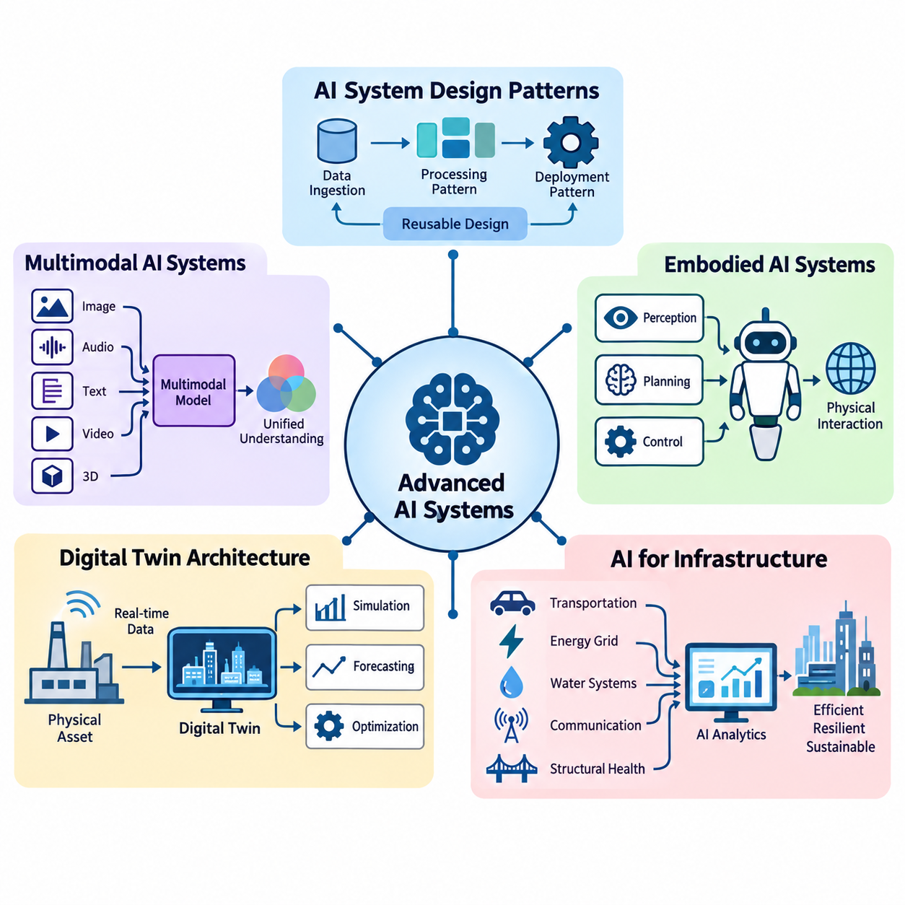
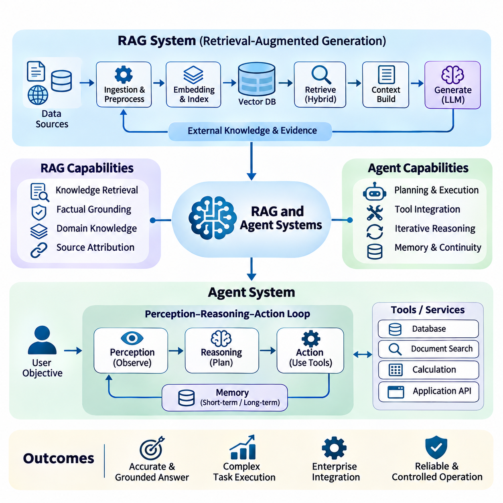
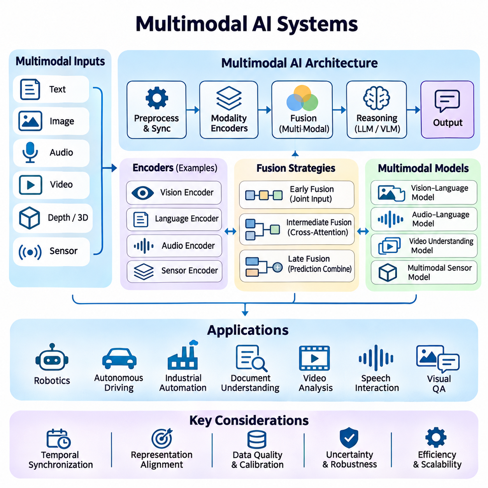
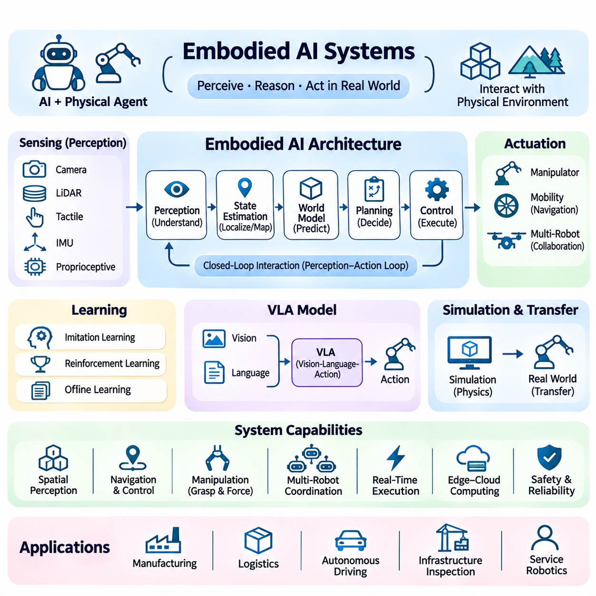
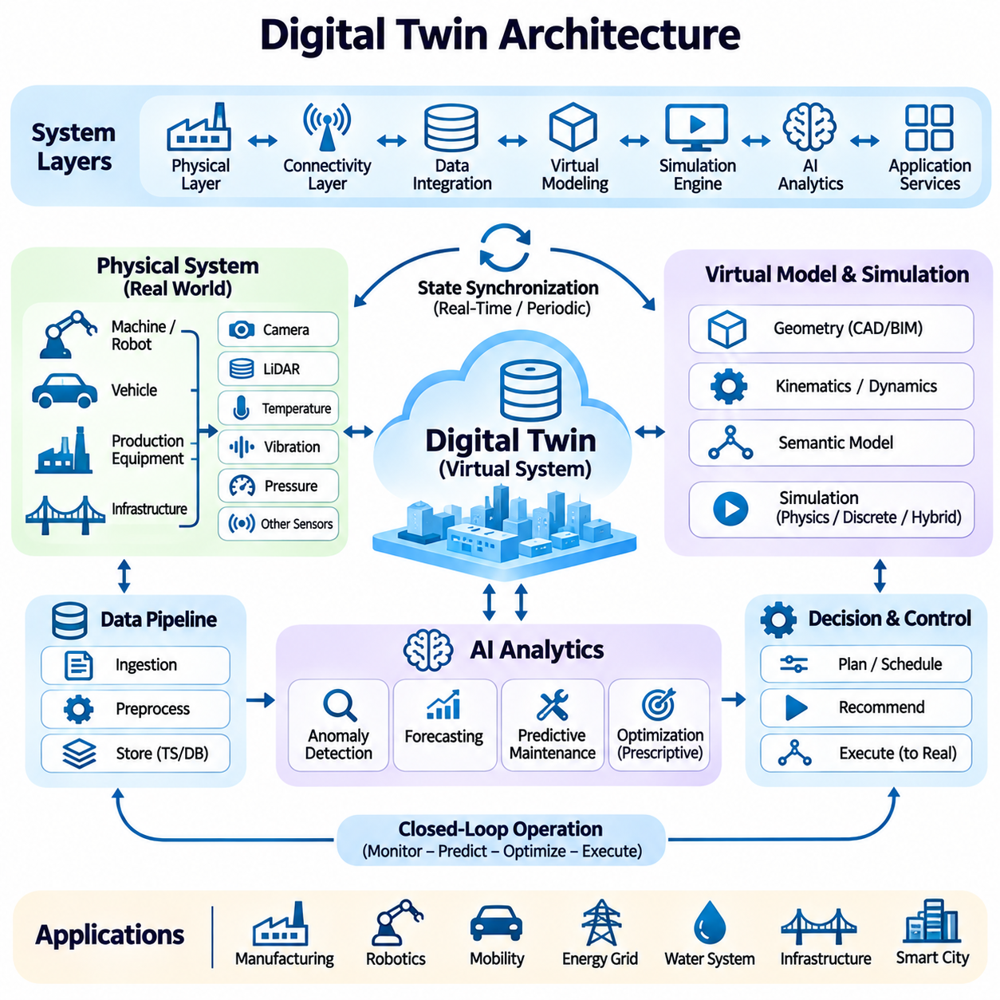
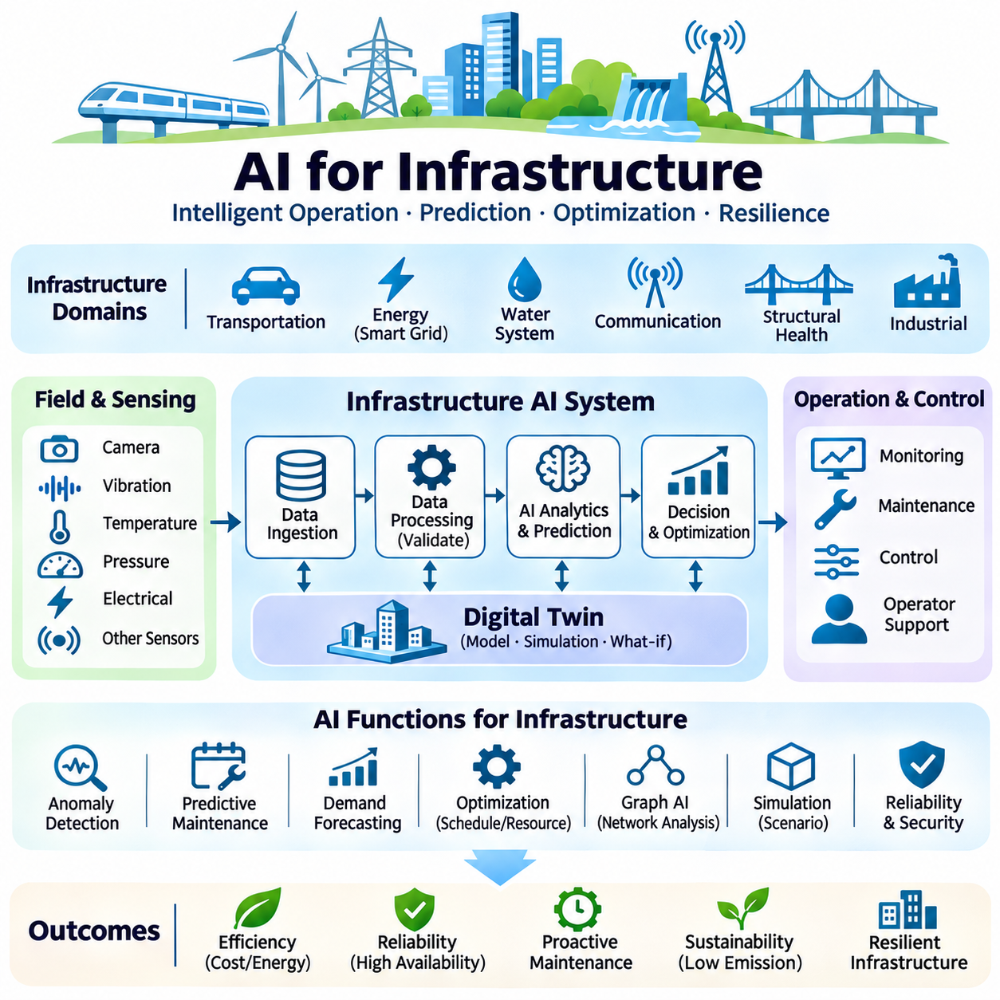

**Volume 38. AI Systems Architecture**


# 06. Advanced AI Systems

## 06.01 AI System Design Patterns

{width="7.268055555555556in" height="7.268055555555556in"}

Advanced AI systems require architectural approaches that extend beyond the design of individual machine learning models. AI system design patterns provide reusable solutions for organizing computation, data processing, inference, communication, and decision-making across complex environments. These patterns help engineers develop systems that remain scalable, reliable, maintainable, and adaptable as operational requirements evolve.

An AI system architecture defines how data sources, preprocessing components, learning models, inference engines, application services, and infrastructure interact. Unlike conventional software systems, AI applications must accommodate probabilistic outputs, changing data distributions, computationally intensive workloads, and continuous model updates. Effective design patterns address these characteristics while maintaining predictable system behavior.

The layered architecture pattern separates an AI system into distinct functional levels, typically including data acquisition, data processing, model execution, decision logic, and application interfaces. Each layer exposes well-defined interfaces to adjacent components, allowing engineers to modify implementations without redesigning the entire system. This separation improves maintainability, testing, security, and independent component development.

A pipeline architecture organizes AI computation as a sequence of processing stages in which the output of one stage becomes the input of another. A computer vision pipeline may perform image acquisition, preprocessing, object detection, tracking, and semantic interpretation. Pipeline stages can execute sequentially or concurrently, depending on data dependencies and available computing resources. Proper buffering and scheduling improve throughput.

The microservices pattern decomposes an AI application into independently deployable services responsible for specific capabilities. Model inference, feature extraction, data retrieval, authentication, and monitoring can operate as separate services communicating through defined APIs. This approach enables independent scaling and deployment, although network communication, distributed state management, and service coordination introduce additional complexity.

Event-driven architecture enables AI components to respond asynchronously to changes in system state or incoming observations. Sensors, applications, and inference services publish events through message brokers or streaming platforms, while subscribed components process relevant information. This pattern is particularly useful for industrial monitoring, autonomous robotics, and smart infrastructure where numerous asynchronous signals require coordinated responses.

The publish-subscribe pattern reduces direct dependencies between AI producers and consumers. A perception module may publish detected objects, allowing navigation, safety monitoring, visualization, and logging components to consume the same information independently. Message schemas, delivery guarantees, ordering policies, and timestamps must be carefully designed to prevent inconsistent interpretations of shared observations.

The request-response pattern remains important when AI services must return results for explicit application requests. A client submits an inference request through an API gateway, which routes the request to an appropriate model-serving instance. Synchronous execution simplifies application integration but may increase response latency under heavy workloads. Timeouts, admission control, and asynchronous alternatives help manage unpredictable processing delays.

The model-serving pattern separates model development from production inference. Trained models are registered, validated, packaged, and deployed through standardized serving interfaces. Inference engines manage model loading, request batching, hardware acceleration, and output serialization. This separation allows data scientists to improve models while platform engineers optimize operational performance, resource allocation, and deployment reliability.

The edge-cloud collaboration pattern distributes AI workloads between local devices and centralized infrastructure. Edge processors execute latency-sensitive perception and control tasks, while cloud platforms provide large-scale training, historical analysis, and fleet-wide coordination. Decisions about workload placement depend on network reliability, privacy requirements, computational capacity, energy consumption, and acceptable response times.

Adaptive workload placement extends edge-cloud collaboration by dynamically selecting execution locations according to current operating conditions. A system may execute lightweight inference locally and offload computationally expensive analysis when sufficient bandwidth is available. However, safety-critical functions should not depend on uncertain network connectivity. Placement policies must account for transfer costs, model availability, and deadline constraints.

The hierarchical decision-making pattern separates strategic reasoning, tactical planning, and low-level execution. A robotic system may use a high-level AI model to interpret objectives, a planning module to generate feasible trajectories, and deterministic controllers to execute motion commands. This hierarchy combines flexible intelligence with predictable physical behavior while maintaining explicit boundaries between probabilistic decisions and safety-critical control.

The blackboard architecture provides a shared representation through which specialized AI modules exchange intermediate knowledge. Perception, localization, prediction, and planning components contribute information to a common state repository. Other modules retrieve relevant observations and update their reasoning accordingly. Consistency mechanisms, timestamp management, and access controls are necessary when multiple components modify shared information concurrently.

The ensemble architecture combines predictions from multiple models to improve robustness or predictive performance. Models may differ in training data, architecture, sensor modality, or specialization. Their outputs can be aggregated through voting, weighted averaging, stacking, or confidence-aware fusion. Although ensembles can reduce certain individual model errors, correlated failures and additional computational requirements must be considered.

The fallback pattern improves system resilience by providing alternative execution paths when primary AI components become unavailable or unreliable. A complex perception model may be replaced temporarily by a simpler model, while an autonomous platform may transition to a restricted operating mode. Fallback behavior should be explicitly defined, tested under representative failures, and designed to preserve essential safety requirements rather than merely maintain availability.

The circuit breaker pattern protects distributed AI services from cascading failures. When an inference service repeatedly fails or exceeds its response deadline, the circuit breaker temporarily rejects additional requests or redirects them toward alternative services. After a recovery interval, controlled requests determine whether normal operation can resume. This mechanism prevents overloaded dependencies from exhausting resources throughout the system.

The caching pattern reduces repeated computation by storing previously generated embeddings, retrieved information, model outputs, or intermediate features. Caching can substantially improve response latency and reduce accelerator utilization when workloads contain repeated requests. However, cache keys must incorporate relevant model and data versions, while expiration and invalidation policies prevent obsolete results from influencing current decisions.

The asynchronous processing pattern separates request submission from computational completion. Long-running training, batch inference, document processing, and simulation workloads can be placed in task queues and executed by background workers. Applications receive task identifiers and retrieve results after processing finishes. Durable queues, retry policies, idempotent operations, and failure tracking are essential for dependable execution.

The stateful processing pattern maintains contextual information across successive observations or interactions. Autonomous systems preserve object tracks and environmental estimates, while conversational AI applications maintain session context and selected memory. State management must distinguish temporary operational context from persistent knowledge. Checkpointing, synchronization, and recovery procedures become especially important when stateful components operate across distributed nodes.

The human-in-the-loop pattern incorporates human judgment into AI workflows when uncertainty, operational risk, or regulatory requirements demand additional oversight. AI components may generate recommendations while human operators approve consequential actions or correct ambiguous predictions. Feedback can subsequently improve datasets and models. Effective interfaces must communicate uncertainty, relevant evidence, and the consequences of available decisions.

The policy enforcement pattern places explicit constraints around AI-generated actions. Model outputs pass through validation components that verify permissions, operating boundaries, safety rules, and application-specific requirements. In physical systems, independent safety controllers may override unsafe commands. This architecture recognizes that statistical model confidence does not guarantee compliance with operational constraints or deterministic safety requirements.

Observability patterns integrate metrics, logs, traces, and model-specific monitoring into the system architecture. Engineers track latency distributions, throughput, accelerator utilization, prediction quality, data drift, and service failures. Correlation identifiers connect requests across distributed components, enabling root-cause analysis. Operational monitoring should distinguish infrastructure failures from degraded model behavior and changing environmental conditions.

The continuous deployment pattern connects model training, validation, registration, release, and monitoring through controlled automation. Candidate models undergo functional, performance, robustness, and compatibility testing before production deployment. Canary releases, shadow evaluation, and rollback mechanisms reduce operational risk. Model versioning and dataset lineage support reproducibility while enabling systematic comparison between deployed configurations.

Security-by-design patterns protect AI systems through authentication, authorization, encryption, network segmentation, and controlled access to models and data. AI-specific threats include adversarial inputs, model extraction, training-data poisoning, and unauthorized tool execution. Security controls must therefore extend across data pipelines, inference endpoints, orchestration services, and deployment infrastructure rather than being concentrated at the application boundary.

Selecting an appropriate AI system design pattern requires balancing performance, complexity, scalability, reliability, and operational cost. No single architecture is optimal for every workload. Real-time robotics may prioritize deterministic control and edge execution, while enterprise AI services may emphasize elastic scaling and distributed retrieval. Successful architectures combine complementary patterns, validate their tradeoffs experimentally, and evolve through measurable operational evidence.

고급 인공지능 시스템(Advanced AI Systems)은 개별 기계학습 모델(Machine Learning Model)의 설계를 넘어서는 아키텍처 접근 방식(Architectural Approach)을 필요로 한다. 인공지능 시스템 설계 패턴(AI System Design Patterns)은 복잡한 환경에서 연산, 데이터 처리, 추론, 통신 및 의사결정을 체계적으로 구성하기 위한 재사용 가능한 해결 방법을 제공한다. 이러한 패턴은 운영 요구사항이 변화하더라도 확장성(Scalability), 신뢰성(Reliability), 유지보수성(Maintainability) 및 적응성(Adaptability)을 유지할 수 있도록 지원한다.

인공지능 시스템 아키텍처(AI System Architecture)는 데이터 소스(Data Source), 전처리 구성요소(Preprocessing Component), 학습 모델(Training Model), 추론 엔진(Inference Engine), 응용 서비스(Application Service) 및 인프라(Infrastructure)가 상호작용하는 방식을 정의한다. 기존 소프트웨어 시스템과 달리 인공지능 응용 시스템은 확률적 출력(Probabilistic Output), 변화하는 데이터 분포(Data Distribution), 높은 연산 부하 및 지속적인 모델 업데이트를 처리해야 한다. 효과적인 설계 패턴은 이러한 특성을 수용하면서 예측 가능한 시스템 동작을 유지하도록 한다.

계층형 아키텍처 패턴(Layered Architecture Pattern)은 인공지능 시스템을 데이터 수집(Data Acquisition), 데이터 처리(Data Processing), 모델 실행(Model Execution), 의사결정 논리(Decision Logic) 및 응용 인터페이스(Application Interface)와 같은 기능적 계층으로 분리한다. 각 계층은 인접한 구성요소에 명확하게 정의된 인터페이스를 제공하므로 전체 시스템을 재설계하지 않고도 개별 구현을 변경할 수 있다. 이러한 분리는 유지보수, 시험, 보안 및 독립적인 구성요소 개발을 개선한다.

파이프라인 아키텍처(Pipeline Architecture)는 한 처리 단계의 출력이 다음 단계의 입력이 되는 연속적인 처리 구조로 인공지능 연산을 구성한다. 컴퓨터 비전 파이프라인(Computer Vision Pipeline)은 영상 획득, 전처리, 객체 탐지(Object Detection), 추적(Tracking) 및 의미 해석(Semantic Interpretation)을 수행할 수 있다. 각 단계는 데이터 의존성과 가용 연산 자원에 따라 순차적 또는 병렬로 실행된다. 적절한 버퍼링(Buffering)과 스케줄링(Scheduling)은 처리량(Throughput)을 향상시킨다.

마이크로서비스 패턴(Microservices Pattern)은 인공지능 응용 시스템을 특정 기능을 담당하는 독립적으로 배포 가능한 서비스로 분해한다. 모델 추론, 특징 추출(Feature Extraction), 데이터 검색(Data Retrieval), 인증(Authentication) 및 모니터링(Monitoring)은 정의된 응용 프로그래밍 인터페이스(API)를 통해 통신하는 별도 서비스로 운영될 수 있다. 이러한 접근 방식은 독립적인 확장과 배포를 가능하게 하지만 네트워크 통신, 분산 상태 관리 및 서비스 조정에 따른 추가적인 복잡성을 발생시킨다.

이벤트 기반 아키텍처(Event-Driven Architecture)는 인공지능 구성요소가 시스템 상태 변화나 새로운 관측 정보에 비동기적으로 반응하도록 한다. 센서, 응용 프로그램 및 추론 서비스는 메시지 브로커(Message Broker)나 스트리밍 플랫폼(Streaming Platform)을 통해 이벤트를 발행하고, 구독한 구성요소는 관련 정보를 처리한다. 이 패턴은 다수의 비동기 신호를 조정해야 하는 산업 모니터링, 자율주행 로봇 및 스마트 인프라(Smart Infrastructure)에 특히 유용하다.

발행-구독 패턴(Publish-Subscribe Pattern)은 인공지능 데이터 생산자와 소비자 사이의 직접적인 의존성을 줄인다. 인지 모듈(Perception Module)이 탐지된 객체 정보를 발행하면 내비게이션, 안전 모니터링, 시각화 및 로깅 구성요소가 동일한 정보를 독립적으로 사용할 수 있다. 공유된 관측 정보에 대한 일관되지 않은 해석을 방지하려면 메시지 스키마(Message Schema), 전달 보장(Delivery Guarantee), 순서 정책(Ordering Policy) 및 타임스탬프(Timestamp)를 신중하게 설계해야 한다.

요청-응답 패턴(Request-Response Pattern)은 인공지능 서비스가 명시적인 응용 요청에 대한 결과를 반환해야 할 때 중요하다. 클라이언트(Client)는 API 게이트웨이(API Gateway)를 통해 추론 요청을 제출하고, 게이트웨이는 적절한 모델 서빙 인스턴스(Model-Serving Instance)로 요청을 전달한다. 동기식 실행(Synchronous Execution)은 응용 시스템 통합을 단순화하지만 높은 부하에서는 응답 지연시간(Latency)을 증가시킬 수 있다. 시간 초과(Timeout), 요청 수용 제어(Admission Control) 및 비동기 대안은 예측하기 어려운 처리 지연을 관리하는 데 도움이 된다.

모델 서빙 패턴(Model-Serving Pattern)은 모델 개발과 운영 환경의 추론을 분리한다. 학습된 모델은 표준화된 서빙 인터페이스를 통해 등록, 검증, 패키징 및 배포된다. 추론 엔진은 모델 로딩(Model Loading), 요청 배치 처리(Request Batching), 하드웨어 가속(Hardware Acceleration) 및 출력 직렬화(Output Serialization)를 관리한다. 이러한 분리는 데이터 과학자가 모델을 개선하는 동안 플랫폼 엔지니어가 운영 성능, 자원 할당 및 배포 신뢰성을 최적화할 수 있도록 한다.

엣지-클라우드 협업 패턴(Edge-Cloud Collaboration Pattern)은 인공지능 작업 부하(Workload)를 로컬 장치와 중앙 집중식 인프라에 분산한다. 엣지 프로세서(Edge Processor)는 지연시간에 민감한 인지 및 제어 작업을 실행하고, 클라우드 플랫폼(Cloud Platform)은 대규모 학습, 과거 데이터 분석 및 전체 로봇군의 조정을 담당한다. 작업 배치 결정은 네트워크 신뢰성, 개인정보 보호 요구사항, 연산 능력, 에너지 소비 및 허용 가능한 응답시간에 따라 달라진다.

적응형 작업 부하 배치(Adaptive Workload Placement)는 현재 운영 조건에 따라 실행 위치를 동적으로 선택함으로써 엣지-클라우드 협업을 확장한다. 시스템은 경량 추론을 로컬에서 수행하고 충분한 대역폭이 확보되면 연산량이 많은 분석을 외부로 오프로딩(Offloading)할 수 있다. 그러나 안전 필수 기능(Safety-Critical Function)은 불확실한 네트워크 연결에 의존해서는 안 된다. 배치 정책은 데이터 전송 비용, 모델 가용성 및 실행 기한 제약을 고려해야 한다.

계층적 의사결정 패턴(Hierarchical Decision-Making Pattern)은 전략적 추론(Strategic Reasoning), 전술적 계획(Tactical Planning) 및 저수준 실행(Low-Level Execution)을 분리한다. 로봇 시스템은 상위 인공지능 모델로 목표를 해석하고, 계획 모듈로 실행 가능한 궤적을 생성하며, 결정론적 제어기(Deterministic Controller)로 운동 명령을 실행할 수 있다. 이러한 계층 구조는 유연한 지능과 예측 가능한 물리적 동작을 결합하면서 확률적 의사결정과 안전 필수 제어 사이에 명확한 경계를 유지한다.

블랙보드 아키텍처(Blackboard Architecture)는 전문화된 인공지능 모듈이 중간 지식을 교환할 수 있는 공유 표현(Shared Representation)을 제공한다. 인지, 위치 추정(Localization), 예측 및 계획 구성요소는 공통 상태 저장소(Common State Repository)에 정보를 제공한다. 다른 모듈은 관련 관측 정보를 검색하고 추론 결과를 갱신한다. 여러 구성요소가 공유 정보를 동시에 수정하는 경우 일관성 메커니즘(Consistency Mechanism), 타임스탬프 관리 및 접근 제어가 필요하다.

앙상블 아키텍처(Ensemble Architecture)는 여러 모델의 예측을 결합하여 강건성(Robustness) 또는 예측 성능을 개선한다. 모델들은 학습 데이터, 아키텍처, 센서 모달리티(Sensor Modality) 또는 전문화 영역에서 차이를 가질 수 있다. 출력은 투표(Voting), 가중 평균(Weighted Averaging), 스태킹(Stacking) 또는 신뢰도 기반 융합(Confidence-Aware Fusion)을 통해 통합된다. 앙상블은 개별 모델의 특정 오류를 줄일 수 있지만 상관된 실패(Correlated Failure)와 추가 연산 요구사항을 고려해야 한다.

대체 실행 패턴(Fallback Pattern)은 주요 인공지능 구성요소를 사용할 수 없거나 신뢰하기 어려운 경우 대체 실행 경로를 제공하여 시스템 복원력(Resilience)을 향상시킨다. 복잡한 인지 모델을 일시적으로 단순한 모델로 대체하거나 자율주행 플랫폼을 제한된 운용 모드(Restricted Operating Mode)로 전환할 수 있다. 대체 동작은 명시적으로 정의하고 대표적인 고장 조건에서 시험해야 하며, 단순히 가용성을 유지하는 것이 아니라 필수 안전 요구사항을 보존하도록 설계해야 한다.

회로 차단기 패턴(Circuit Breaker Pattern)은 분산 인공지능 서비스에서 연쇄 장애(Cascading Failure)가 발생하는 것을 방지한다. 추론 서비스가 반복적으로 실패하거나 응답 기한을 초과하면 회로 차단기는 추가 요청을 일시적으로 거부하거나 대체 서비스로 전달한다. 복구 대기시간 이후에는 제한된 요청을 통해 정상 운영 재개 가능성을 판단한다. 이러한 메커니즘은 과부하된 종속 서비스가 전체 시스템의 자원을 소진하는 상황을 방지한다.

캐싱 패턴(Caching Pattern)은 이전에 생성한 임베딩(Embedding), 검색 정보, 모델 출력 또는 중간 특징을 저장하여 반복 연산을 줄인다. 작업 부하에 반복적인 요청이 포함되면 캐싱은 응답 지연시간을 크게 줄이고 가속기 사용률(Accelerator Utilization)을 낮출 수 있다. 그러나 캐시 키(Cache Key)에는 관련 모델과 데이터 버전이 반영되어야 하며, 만료 및 무효화 정책(Invalidation Policy)을 통해 오래된 결과가 현재 의사결정에 영향을 미치지 않도록 해야 한다.

비동기 처리 패턴(Asynchronous Processing Pattern)은 요청 제출과 연산 완료를 분리한다. 장시간 실행되는 학습, 배치 추론(Batch Inference), 문서 처리 및 시뮬레이션 작업은 작업 큐(Task Queue)에 배치되어 백그라운드 작업자(Background Worker)가 실행할 수 있다. 응용 프로그램은 작업 식별자를 수신하고 처리가 완료된 이후 결과를 조회한다. 안정적인 실행을 위해서는 영속적 큐(Durable Queue), 재시도 정책(Retry Policy), 멱등 연산(Idempotent Operation) 및 장애 추적이 필수적이다.

상태 유지 처리 패턴(Stateful Processing Pattern)은 연속적인 관측이나 상호작용에 걸쳐 문맥 정보(Contextual Information)를 유지한다. 자율 시스템은 객체 추적 정보와 환경 추정값을 보존하고, 대화형 인공지능은 세션 문맥(Session Context)과 선택된 메모리를 유지한다. 상태 관리는 일시적인 운영 문맥과 영구적인 지식을 구분해야 한다. 상태 유지 구성요소가 분산 노드에서 실행될 때는 체크포인팅(Checkpointing), 동기화(Synchronization) 및 복구 절차가 특히 중요하다.

인간 참여형 패턴(Human-in-the-Loop Pattern)은 불확실성, 운영 위험 또는 규제 요구사항으로 인해 추가 감독이 필요한 경우 인간의 판단을 인공지능 작업 흐름에 통합한다. 인공지능 구성요소는 권고안을 생성하고 인간 운영자는 중요한 조치를 승인하거나 모호한 예측을 수정할 수 있다. 이후 피드백(Feedback)은 데이터셋과 모델 개선에 활용된다. 효과적인 인터페이스는 불확실성, 관련 근거 및 선택 가능한 의사결정의 결과를 명확하게 전달해야 한다.

정책 시행 패턴(Policy Enforcement Pattern)은 인공지능이 생성한 행동에 명시적인 제약조건을 적용한다. 모델 출력은 권한, 운영 경계, 안전 규칙 및 응용 분야별 요구사항을 검증하는 구성요소를 통과한다. 물리적 시스템에서는 독립적인 안전 제어기(Safety Controller)가 위험한 명령을 무효화할 수 있다. 이러한 아키텍처는 통계적 모델 신뢰도(Model Confidence)가 운영 제약조건 준수나 결정론적 안전 요구사항 충족을 보장하지 않는다는 점을 반영한다.

관측 가능성 패턴(Observability Pattern)은 메트릭(Metrics), 로그(Logs), 추적 정보(Traces) 및 모델별 모니터링을 시스템 아키텍처에 통합한다. 엔지니어는 지연시간 분포, 처리량, 가속기 사용률, 예측 품질, 데이터 드리프트(Data Drift) 및 서비스 장애를 추적한다. 상관관계 식별자(Correlation Identifier)는 분산 구성요소의 요청을 연결하여 근본 원인 분석(Root-Cause Analysis)을 가능하게 한다. 운영 모니터링은 인프라 장애와 모델 성능 저하 및 환경 조건 변화를 구분해야 한다.

지속적 배포 패턴(Continuous Deployment Pattern)은 모델 학습, 검증, 등록, 출시 및 모니터링을 제어된 자동화 과정으로 연결한다. 후보 모델은 운영 환경에 배포되기 전에 기능, 성능, 강건성 및 호환성 시험을 거친다. 카나리 배포(Canary Release), 섀도 평가(Shadow Evaluation) 및 롤백(Rollback) 메커니즘은 운영 위험을 줄인다. 모델 버전 관리(Model Versioning)와 데이터셋 계보(Dataset Lineage)는 재현성(Reproducibility)을 지원하고 배포된 구성 사이의 체계적인 비교를 가능하게 한다.

설계 단계부터 보안을 고려하는 패턴(Security-by-Design Pattern)은 인증, 인가(Authorization), 암호화(Encryption), 네트워크 분할(Network Segmentation) 및 모델과 데이터에 대한 접근 제어를 통해 인공지능 시스템을 보호한다. 인공지능 특유의 위협에는 적대적 입력(Adversarial Input), 모델 추출(Model Extraction), 학습 데이터 오염(Training-Data Poisoning) 및 승인되지 않은 도구 실행이 포함된다. 따라서 보안 통제는 응용 계층에만 집중되지 않고 데이터 파이프라인, 추론 엔드포인트(Inference Endpoint), 오케스트레이션 서비스(Orchestration Service) 및 배포 인프라 전반에 적용되어야 한다.

적절한 인공지능 시스템 설계 패턴을 선택하려면 성능, 복잡성, 확장성, 신뢰성 및 운영 비용 사이의 균형을 고려해야 한다. 모든 작업 부하에 최적인 단일 아키텍처는 존재하지 않는다. 실시간 로봇 시스템은 결정론적 제어와 엣지 실행을 우선할 수 있으며, 기업용 인공지능 서비스는 탄력적 확장(Elastic Scaling)과 분산 검색(Distributed Retrieval)을 강조할 수 있다. 성공적인 아키텍처는 상호 보완적인 패턴을 결합하고 실험적으로 설계상의 절충관계(Tradeoff)를 검증하며 측정 가능한 운영 근거를 바탕으로 지속적으로 발전한다.

## 06.02 RAG and Agent Systems

{width="7.268055555555556in" height="7.268055555555556in"}

Retrieval-Augmented Generation (RAG) and agent systems represent advanced AI architectures that combine language models with external knowledge, reasoning workflows, and executable tools. RAG improves factual grounding by retrieving relevant information before generating responses, while agent systems extend model capabilities through planning and action execution. Together, these approaches enable AI applications to interact with dynamic environments and complex enterprise resources.

A RAG architecture typically consists of document ingestion, preprocessing, embedding generation, indexing, retrieval, context construction, and response generation. External information is transformed into searchable representations and stored in specialized repositories. During inference, a user query triggers retrieval operations that identify relevant evidence, which is incorporated into the language model prompt to support contextually appropriate responses.

Document ingestion pipelines collect information from databases, technical manuals, websites, application interfaces, and enterprise repositories. Preprocessing operations normalize text, extract metadata, remove irrelevant content, and divide documents into manageable chunks. Chunk size and overlap influence retrieval precision and contextual completeness. Preserving document identifiers, timestamps, and source relationships supports traceability and reliable evidence attribution.

Embedding-based retrieval transforms queries and document passages into numerical vectors representing semantic relationships. Vector databases organize these representations using approximate nearest-neighbor indexing to accelerate similarity searches. Retrieval effectiveness depends on embedding quality, domain alignment, indexing configuration, and query formulation. Semantic similarity alone does not guarantee factual relevance, making additional filtering and evaluation necessary.

Hybrid retrieval combines dense vector search with lexical methods such as BM25 to capture both semantic relationships and exact terminology. This approach is particularly useful for technical documentation containing identifiers, equipment specifications, abbreviations, and specialized vocabulary. Retrieved candidates may be merged and reranked using cross-encoder models, metadata constraints, or application-specific relevance functions.

Context construction determines how retrieved information is presented to the generation model. Relevant passages must fit within the available context window while preserving sufficient evidence for accurate reasoning. Deduplication, relevance ranking, source attribution, and token-budget allocation help reduce unnecessary information. Poorly selected context can increase computational cost and introduce contradictions or misleading evidence.

The generation stage combines user instructions, retrieved evidence, conversation context, and application policies into a structured prompt. The language model produces an answer based on the supplied information while respecting task-specific constraints. Reliable implementations distinguish supported claims from unsupported assumptions and provide source references when appropriate. Retrieval improves grounding but does not eliminate hallucinations or reasoning errors.

Advanced RAG systems incorporate query rewriting, decomposition, and iterative retrieval to address complex information needs. A broad question may be divided into smaller queries targeting different documents or knowledge sources. Retrieved evidence can reveal missing information, triggering additional searches before final synthesis. These mechanisms improve coverage but introduce additional latency, computational expense, and orchestration complexity.

Agent systems extend language model applications by enabling structured interaction with tools, services, and external environments. An agent receives an objective, interprets available context, selects actions, observes results, and updates its subsequent decisions. Unlike a fixed inference pipeline, agent execution may involve multiple conditional steps. Nevertheless, agent autonomy must remain bounded by explicit permissions and operational constraints.

The perception-reasoning-action loop provides a conceptual foundation for agent architectures. An agent observes the current environment through messages, tool outputs, or sensor information, then evaluates possible actions relative to its objectives. After executing an authorized action, the system incorporates resulting observations into its working context. This iterative process supports adaptive behavior under changing conditions.

Tool integration allows agents to access databases, execute calculations, search documents, invoke application services, and interact with external software. Tools should expose clearly defined input schemas, output formats, permissions, and error conditions. Structured function calling reduces ambiguity between natural-language reasoning and executable operations. Tool results must be treated as potentially untrusted information rather than authoritative instructions.

Planning architectures organize complex objectives into manageable subtasks and execution dependencies. An agent may generate an initial plan, execute individual steps, evaluate intermediate outcomes, and revise its strategy when necessary. Planning can be implemented through explicit workflows, hierarchical task decomposition, or model-guided decision processes. Reliable systems validate planned actions against available resources, constraints, and completion criteria.

Agent memory supports continuity across interactions and multi-step workflows. Short-term memory maintains immediate observations, active objectives, and intermediate results, while long-term memory stores selected knowledge or reusable experience. Memory systems may combine structured databases, vector retrieval, and summarized interaction histories. Retention policies, access controls, and relevance filtering prevent outdated or sensitive information from contaminating decisions.

Multi-agent architectures distribute responsibilities among specialized agents with different capabilities or operational roles. One agent may retrieve evidence, another analyze technical constraints, and a third validate the resulting recommendations. Coordination can follow hierarchical supervision, sequential handoffs, or collaborative task execution. However, communication overhead, conflicting decisions, and shared-state consistency must be managed explicitly.

Orchestration frameworks coordinate retrieval components, language models, tools, memory services, and agent execution states. Workflow engines can represent execution dependencies, conditional branches, retries, and human approval requirements. Persistent checkpoints support recovery after interruptions, while execution traces provide visibility into intermediate decisions. Deterministic orchestration is often preferable when predictable operations matter more than unrestricted agent flexibility.

Combining RAG with agent systems enables knowledge-grounded planning and action execution. An agent can retrieve technical documentation, identify relevant procedures, evaluate operating constraints, and invoke appropriate tools. Retrieval supplies evidence, while agent orchestration determines how that evidence influences subsequent actions. Separating information retrieval from execution authority helps prevent retrieved content from directly controlling sensitive operations.

Security is particularly important because retrieved documents and tool responses may contain malicious instructions or misleading information. Prompt injection can attempt to redirect agent behavior through untrusted content. Defensive architectures enforce instruction boundaries, validate tool arguments, restrict privileges, and require authorization for consequential actions. Sensitive operations should use independent policy checks rather than relying solely on language model judgments.

Reliability mechanisms address failures caused by unavailable tools, incomplete retrieval, malformed responses, and inconsistent intermediate states. Agents should apply bounded retries, execution timeouts, idempotency controls, and explicit termination conditions. Critical workflows benefit from deterministic fallback procedures and human escalation paths. Without these safeguards, repeated reasoning or tool invocation can produce excessive costs and unpredictable behavior.

Performance optimization requires balancing retrieval accuracy, generation latency, context length, and tool execution overhead. Caching embeddings, retrieved passages, and reusable intermediate results can reduce repeated computation. Parallel retrieval and asynchronous tool execution may improve throughput when dependencies permit. System designers must evaluate end-to-end response times rather than optimizing isolated components without considering their interactions.

Evaluation of RAG systems examines retrieval relevance, evidence coverage, answer faithfulness, factual correctness, and citation accuracy. Agent evaluation additionally measures task completion, action validity, tool-use efficiency, recovery behavior, and policy compliance. Representative benchmarks should include ambiguous requests, conflicting evidence, missing documents, unavailable tools, and adversarial inputs. Automated metrics should be supplemented with targeted human review.

Production monitoring records retrieval quality, model versions, tool execution traces, latency distributions, token consumption, and operational failures. Changes in document collections or embedding models may alter retrieval behavior even when generation models remain unchanged. Continuous evaluation and controlled deployment procedures help detect regressions. Observability across the complete workflow is essential for identifying whether failures originate in retrieval, reasoning, or execution.

Enterprise applications use RAG and agents for knowledge management, technical support, document analysis, software engineering, and operational decision assistance. Industrial AI systems may integrate equipment manuals, maintenance records, sensor observations, and diagnostic services. In robotics, knowledge-grounded agents can support high-level task interpretation and supervisory planning, while deterministic controllers and independent safety mechanisms retain authority over physical execution.

The architectural value of RAG and agent systems lies in combining external knowledge access with controlled reasoning and execution capabilities. Effective implementations require carefully designed retrieval pipelines, explicit tool interfaces, bounded autonomy, persistent state management, security enforcement, and measurable evaluation procedures. As system complexity increases, reliable orchestration and operational governance become as important as the capabilities of the underlying language models.

검색 증강 생성(Retrieval-Augmented Generation, RAG)과 에이전트 시스템(Agent Systems)은 언어 모델(Language Model)을 외부 지식(External Knowledge), 추론 워크플로(Reasoning Workflow) 및 실행 가능한 도구(Executable Tools)와 결합하는 고급 인공지능 아키텍처(Advanced AI Architecture)를 나타낸다. RAG는 응답 생성 전에 관련 정보를 검색하여 사실적 근거(Factual Grounding)를 강화하고, 에이전트 시스템은 계획 수립(Planning)과 행동 실행(Action Execution)을 통해 모델의 기능을 확장한다. 이러한 접근 방식은 인공지능 응용 시스템이 동적인 환경 및 복잡한 기업 자원과 상호작용할 수 있도록 한다.

RAG 아키텍처(RAG Architecture)는 일반적으로 문서 수집(Document Ingestion), 전처리(Preprocessing), 임베딩 생성(Embedding Generation), 인덱싱(Indexing), 검색(Retrieval), 문맥 구성(Context Construction) 및 응답 생성(Response Generation)으로 구성된다. 외부 정보는 검색 가능한 표현(Searchable Representation)으로 변환되어 전문 저장소에 보관된다. 추론 과정에서 사용자 질의(User Query)는 관련 근거를 식별하는 검색 작업을 실행하며, 검색된 정보는 언어 모델 프롬프트(Language Model Prompt)에 포함되어 문맥에 적합한 응답 생성을 지원한다.

문서 수집 파이프라인(Document Ingestion Pipeline)은 데이터베이스(Database), 기술 매뉴얼(Technical Manual), 웹사이트(Website), 응용 프로그램 인터페이스(Application Interface) 및 기업 저장소(Enterprise Repository)에서 정보를 수집한다. 전처리 과정에서는 텍스트 정규화(Text Normalization), 메타데이터 추출(Metadata Extraction), 불필요한 내용 제거 및 문서 청크 분할(Document Chunking)을 수행한다. 청크 크기(Chunk Size)와 중첩(Overlap)은 검색 정밀도(Retrieval Precision)와 문맥 완전성(Contextual Completeness)에 영향을 미친다. 문서 식별자, 타임스탬프 및 출처 관계를 보존하면 추적 가능성(Traceability)과 신뢰할 수 있는 근거 출처 표시(Evidence Attribution)를 지원할 수 있다.

임베딩 기반 검색(Embedding-Based Retrieval)은 질의와 문서 구절을 의미적 관계(Semantic Relationship)를 표현하는 수치 벡터(Numerical Vector)로 변환한다. 벡터 데이터베이스(Vector Database)는 근사 최근접 이웃 인덱싱(Approximate Nearest-Neighbor Indexing)을 사용하여 이러한 표현을 구성하고 유사도 검색(Similarity Search)을 가속한다. 검색 효과는 임베딩 품질(Embedding Quality), 도메인 정렬(Domain Alignment), 인덱싱 설정(Indexing Configuration) 및 질의 구성(Query Formulation)에 따라 달라진다. 의미적 유사성만으로 사실적 관련성이 보장되지는 않으므로 추가적인 필터링과 평가가 필요하다.

하이브리드 검색(Hybrid Retrieval)은 밀집 벡터 검색(Dense Vector Search)과 BM25 같은 어휘 기반 검색(Lexical Search)을 결합하여 의미적 관계와 정확한 용어 일치를 모두 활용한다. 이러한 접근 방식은 식별자, 장비 사양, 약어 및 전문 용어가 포함된 기술 문서에서 특히 유용하다. 검색된 후보 문서는 교차 인코더 모델(Cross-Encoder Model), 메타데이터 제약조건(Metadata Constraint) 또는 응용 분야별 관련성 함수(Relevance Function)를 사용하여 병합하고 재순위화(Reranking)할 수 있다.

문맥 구성(Context Construction)은 검색된 정보가 생성 모델(Generation Model)에 제공되는 방식을 결정한다. 관련 문서 구절은 정확한 추론에 필요한 충분한 근거를 유지하면서 사용 가능한 문맥 창(Context Window) 안에 포함되어야 한다. 중복 제거(Deduplication), 관련성 순위화(Relevance Ranking), 출처 표시(Source Attribution) 및 토큰 예산 할당(Token-Budget Allocation)은 불필요한 정보를 줄이는 데 도움이 된다. 부적절하게 선택된 문맥은 연산 비용을 증가시키고 모순되거나 잘못된 근거를 포함할 수 있다.

생성 단계(Generation Stage)는 사용자 지시사항(User Instructions), 검색된 근거(Retrieved Evidence), 대화 문맥(Conversation Context) 및 응용 정책(Application Policy)을 구조화된 프롬프트(Structured Prompt)로 결합한다. 언어 모델은 제공된 정보를 바탕으로 작업별 제약조건(Task-Specific Constraints)을 준수하면서 응답을 생성한다. 신뢰할 수 있는 구현은 근거가 뒷받침되는 주장과 검증되지 않은 가정을 구분하고 필요한 경우 출처를 제공한다. 검색은 사실적 근거를 강화하지만 환각(Hallucination)이나 추론 오류(Reasoning Error)를 완전히 제거하지는 못한다.

고급 RAG 시스템(Advanced RAG Systems)은 복잡한 정보 요구사항을 처리하기 위해 질의 재작성(Query Rewriting), 질의 분해(Query Decomposition) 및 반복 검색(Iterative Retrieval)을 통합한다. 광범위한 질문은 서로 다른 문서나 지식 소스를 대상으로 하는 작은 질의로 분할될 수 있다. 검색된 근거에서 누락된 정보가 발견되면 최종 응답을 종합하기 전에 추가 검색을 수행할 수 있다. 이러한 메커니즘은 정보 포괄성(Coverage)을 개선하지만 추가적인 지연시간, 연산 비용 및 오케스트레이션 복잡성(Orchestration Complexity)을 발생시킨다.

에이전트 시스템(Agent Systems)은 도구, 서비스 및 외부 환경과 구조적으로 상호작용할 수 있도록 언어 모델 응용 시스템을 확장한다. 에이전트(Agent)는 목표를 수신하고 사용 가능한 문맥을 해석하며 행동을 선택하고 결과를 관측한 다음 후속 의사결정을 갱신한다. 고정된 추론 파이프라인(Fixed Inference Pipeline)과 달리 에이전트 실행은 여러 조건부 단계(Conditional Steps)를 포함할 수 있다. 그러나 에이전트의 자율성(Agent Autonomy)은 명시적인 권한과 운영 제약조건에 의해 제한되어야 한다.

인지-추론-행동 순환 구조(Perception-Reasoning-Action Loop)는 에이전트 아키텍처(Agent Architecture)의 개념적 기반을 제공한다. 에이전트는 메시지, 도구 출력 또는 센서 정보를 통해 현재 환경을 관측하고 목표에 따라 가능한 행동을 평가한다. 승인된 행동을 실행한 이후에는 결과 관측 정보를 작업 문맥(Working Context)에 반영한다. 이러한 반복 과정은 변화하는 조건에서 적응형 동작(Adaptive Behavior)을 지원한다.

도구 통합(Tool Integration)은 에이전트가 데이터베이스에 접근하고 계산을 실행하며 문서를 검색하고 응용 서비스를 호출하고 외부 소프트웨어와 상호작용할 수 있도록 한다. 도구는 명확하게 정의된 입력 스키마(Input Schema), 출력 형식(Output Format), 권한(Permission) 및 오류 조건(Error Condition)을 제공해야 한다. 구조화된 함수 호출(Structured Function Calling)은 자연어 추론과 실행 가능한 작업 사이의 모호성을 줄인다. 도구 결과는 권위 있는 지시사항이 아니라 잠재적으로 신뢰할 수 없는 정보(Untrusted Information)로 취급해야 한다.

계획 아키텍처(Planning Architecture)는 복잡한 목표를 관리 가능한 하위 작업(Subtask)과 실행 의존성(Execution Dependency)으로 구성한다. 에이전트는 초기 계획을 생성하고 개별 단계를 실행하며 중간 결과를 평가하고 필요에 따라 전략을 수정할 수 있다. 계획 수립은 명시적 워크플로(Explicit Workflow), 계층적 작업 분해(Hierarchical Task Decomposition) 또는 모델 기반 의사결정 과정(Model-Guided Decision Process)을 통해 구현할 수 있다. 신뢰할 수 있는 시스템은 계획된 행동을 사용 가능한 자원, 제약조건 및 완료 기준(Completion Criteria)에 따라 검증한다.

에이전트 메모리(Agent Memory)는 여러 상호작용과 다단계 워크플로(Multi-Step Workflow)에 걸쳐 연속성을 지원한다. 단기 메모리(Short-Term Memory)는 즉각적인 관측 정보, 활성 목표 및 중간 결과를 유지하고, 장기 메모리(Long-Term Memory)는 선택된 지식이나 재사용 가능한 경험을 저장한다. 메모리 시스템은 구조화된 데이터베이스(Structured Database), 벡터 검색(Vector Retrieval) 및 요약된 상호작용 기록을 결합할 수 있다. 보존 정책(Retention Policy), 접근 제어(Access Control) 및 관련성 필터링(Relevance Filtering)은 오래되거나 민감한 정보가 의사결정에 부정적인 영향을 미치지 않도록 한다.

다중 에이전트 아키텍처(Multi-Agent Architecture)는 서로 다른 기능이나 운영 역할을 가진 전문 에이전트(Specialized Agent)에게 책임을 분산한다. 하나의 에이전트는 근거를 검색하고 다른 에이전트는 기술적 제약조건을 분석하며 또 다른 에이전트는 도출된 권고사항을 검증할 수 있다. 조정 방식은 계층적 감독(Hierarchical Supervision), 순차적 인계(Sequential Handoff) 또는 협업적 작업 실행(Collaborative Task Execution)을 따를 수 있다. 그러나 통신 오버헤드(Communication Overhead), 상충되는 의사결정 및 공유 상태 일관성(Shared-State Consistency)은 명시적으로 관리해야 한다.

오케스트레이션 프레임워크(Orchestration Framework)는 검색 구성요소, 언어 모델, 도구, 메모리 서비스 및 에이전트 실행 상태(Agent Execution State)를 조정한다. 워크플로 엔진(Workflow Engine)은 실행 의존성, 조건부 분기(Conditional Branch), 재시도(Retry) 및 인간 승인 요구사항(Human Approval Requirement)을 표현할 수 있다. 영속적 체크포인트(Persistent Checkpoint)는 중단 이후 복구를 지원하며 실행 추적(Execution Trace)은 중간 의사결정에 대한 가시성을 제공한다. 예측 가능한 운영이 제한 없는 에이전트 유연성보다 중요한 경우 결정론적 오케스트레이션(Deterministic Orchestration)이 선호된다.

RAG와 에이전트 시스템을 결합하면 지식 기반 계획(Knowledge-Grounded Planning)과 행동 실행(Action Execution)이 가능해진다. 에이전트는 기술 문서를 검색하고 관련 절차를 식별하며 운영 제약조건을 평가하고 적절한 도구를 호출할 수 있다. 검색은 근거를 제공하고 에이전트 오케스트레이션(Agent Orchestration)은 해당 근거가 후속 행동에 미치는 영향을 결정한다. 정보 검색과 실행 권한(Execution Authority)을 분리하면 검색된 내용이 민감한 작업을 직접 제어하는 상황을 방지하는 데 도움이 된다.

검색된 문서와 도구 응답에는 악의적인 지시사항(Malicious Instructions)이나 오해를 유발하는 정보가 포함될 수 있으므로 보안(Security)은 특히 중요하다. 프롬프트 주입(Prompt Injection)은 신뢰할 수 없는 콘텐츠를 통해 에이전트의 동작을 변경하려고 시도할 수 있다. 방어적 아키텍처(Defensive Architecture)는 지시사항 경계(Instruction Boundary)를 강제하고 도구 인수(Tool Argument)를 검증하며 권한을 제한하고 중요한 행동에 대한 승인을 요구한다. 민감한 작업에는 언어 모델의 판단에만 의존하지 않는 독립적인 정책 검사(Independent Policy Check)를 적용해야 한다.

신뢰성 메커니즘(Reliability Mechanism)은 사용할 수 없는 도구, 불완전한 검색, 잘못된 형식의 응답 및 일관되지 않은 중간 상태로 인해 발생하는 장애를 처리한다. 에이전트는 제한된 재시도(Bounded Retry), 실행 시간 초과(Execution Timeout), 멱등성 제어(Idempotency Control) 및 명시적인 종료 조건(Termination Condition)을 적용해야 한다. 중요한 워크플로는 결정론적 대체 절차(Deterministic Fallback Procedure)와 인간 개입 경로(Human Escalation Path)를 통해 안정성을 높일 수 있다. 이러한 보호장치가 없으면 반복적인 추론이나 도구 호출로 인해 과도한 비용과 예측하기 어려운 동작이 발생할 수 있다.

성능 최적화(Performance Optimization)는 검색 정확도(Retrieval Accuracy), 생성 지연시간(Generation Latency), 문맥 길이(Context Length) 및 도구 실행 오버헤드(Tool Execution Overhead) 사이의 균형을 요구한다. 임베딩, 검색된 문서 구절 및 재사용 가능한 중간 결과를 캐싱(Caching)하면 반복 연산을 줄일 수 있다. 의존성이 허용되는 경우 병렬 검색(Parallel Retrieval)과 비동기 도구 실행(Asynchronous Tool Execution)은 처리량(Throughput)을 개선할 수 있다. 시스템 설계자는 개별 구성요소만 최적화하기보다 구성요소 사이의 상호작용을 고려한 종단 간 응답시간(End-to-End Response Time)을 평가해야 한다.

RAG 시스템의 평가(Evaluation)는 검색 관련성(Retrieval Relevance), 근거 포괄성(Evidence Coverage), 응답 충실도(Answer Faithfulness), 사실적 정확성(Factual Correctness) 및 인용 정확성(Citation Accuracy)을 검토한다. 에이전트 평가는 추가적으로 작업 완료율(Task Completion), 행동 유효성(Action Validity), 도구 사용 효율성(Tool-Use Efficiency), 복구 동작(Recovery Behavior) 및 정책 준수(Policy Compliance)를 측정한다. 대표적인 벤치마크(Benchmark)에는 모호한 요청, 상충되는 근거, 누락된 문서, 사용할 수 없는 도구 및 적대적 입력(Adversarial Input)이 포함되어야 한다. 자동화된 평가 지표는 목적에 맞는 인간 검토(Human Review)로 보완해야 한다.

운영 환경 모니터링(Production Monitoring)은 검색 품질, 모델 버전(Model Version), 도구 실행 추적, 지연시간 분포(Latency Distribution), 토큰 소비량(Token Consumption) 및 운영 장애를 기록한다. 문서 컬렉션(Document Collection)이나 임베딩 모델(Embedding Model)의 변경은 생성 모델이 그대로 유지되더라도 검색 동작에 영향을 줄 수 있다. 지속적 평가(Continuous Evaluation)와 통제된 배포 절차(Controlled Deployment Procedure)는 성능 회귀(Regression)를 탐지하는 데 도움이 된다. 전체 워크플로에 대한 관측 가능성(Observability)은 장애가 검색, 추론 또는 실행 중 어디에서 발생했는지 식별하는 데 필수적이다.

기업용 응용 시스템(Enterprise Applications)은 지식 관리(Knowledge Management), 기술 지원(Technical Support), 문서 분석(Document Analysis), 소프트웨어 엔지니어링(Software Engineering) 및 운영 의사결정 지원(Operational Decision Assistance)에 RAG와 에이전트를 활용한다. 산업용 인공지능 시스템(Industrial AI Systems)은 장비 매뉴얼, 유지보수 기록(Maintenance Records), 센서 관측 정보 및 진단 서비스를 통합할 수 있다. 로봇 분야에서는 지식 기반 에이전트(Knowledge-Grounded Agent)가 상위 수준의 작업 해석과 감독형 계획(Supervisory Planning)을 지원하고, 결정론적 제어기(Deterministic Controller)와 독립적인 안전 메커니즘(Independent Safety Mechanism)이 물리적 실행에 대한 제어 권한을 유지한다.

RAG와 에이전트 시스템의 아키텍처적 가치(Architectural Value)는 외부 지식 접근(External Knowledge Access)을 통제된 추론 및 실행 기능(Controlled Reasoning and Execution Capabilities)과 결합하는 데 있다. 효과적인 구현을 위해서는 신중하게 설계된 검색 파이프라인(Retrieval Pipeline), 명시적인 도구 인터페이스(Tool Interface), 제한된 자율성(Bounded Autonomy), 영속적 상태 관리(Persistent State Management), 보안 정책 시행(Security Enforcement) 및 측정 가능한 평가 절차(Measurable Evaluation Procedure)가 필요하다. 시스템 복잡성이 증가할수록 신뢰할 수 있는 오케스트레이션(Reliable Orchestration)과 운영 거버넌스(Operational Governance)는 기반 언어 모델의 기능만큼 중요한 요소가 된다.

## 06.03 Multimodal AI Systems

{width="7.268055555555556in" height="7.268055555555556in"}

Multimodal AI systems integrate information from multiple data modalities, including text, images, audio, video, depth measurements, and sensor signals, to produce unified representations and intelligent decisions. Unlike single-modality systems, multimodal architectures exploit complementary information across heterogeneous sources. Their design requires coordinated data acquisition, feature extraction, temporal synchronization, fusion, reasoning, and output generation.

A multimodal AI architecture typically consists of modality-specific input pipelines, preprocessing modules, encoders, fusion mechanisms, reasoning components, and task-specific output interfaces. Each input modality has distinct characteristics regarding sampling frequency, dimensionality, noise, and semantic structure. Architectural design must preserve these characteristics while enabling meaningful interactions between representations derived from different sources.

Modality-specific encoders transform raw observations into machine-readable feature representations. Vision encoders extract spatial and semantic information from images, while language encoders represent textual meaning and contextual relationships. Audio encoders capture acoustic patterns, speech characteristics, and temporal structures. Sensor encoders process measurements such as acceleration, distance, temperature, and position into representations suitable for multimodal integration.

Representation alignment establishes relationships between features extracted from different modalities. Contrastive learning can encourage corresponding image and text embeddings to occupy nearby regions of a shared representation space. Cross-modal alignment enables retrieval, classification, and reasoning across heterogeneous inputs. However, alignment quality depends on paired training data, semantic consistency, and the ability to preserve modality-specific information.

Early fusion combines information from different modalities before substantial task-specific processing. Raw measurements or low-level features may be concatenated, projected, or jointly encoded to capture direct interactions. This approach can preserve detailed cross-modal relationships but requires compatible representations and careful synchronization. Differences in dimensionality, noise characteristics, and missing inputs can significantly affect performance.

Late fusion processes each modality independently and combines predictions or high-level representations near the final decision stage. Separate vision, language, and sensor models may generate confidence scores that are aggregated through weighted averaging or learned decision functions. Late fusion offers modularity and robustness when individual modalities become unavailable, although it may overlook interactions that require joint low-level interpretation.

Intermediate fusion integrates modality-specific features after independent encoding but before final prediction. Cross-attention mechanisms allow information from one modality to influence the interpretation of another. For example, textual instructions can guide visual feature selection, while visual observations can refine language-based reasoning. Intermediate fusion balances representational flexibility with computational complexity and is widely used in modern multimodal architectures.

Transformer-based multimodal systems employ attention mechanisms to model relationships among heterogeneous input tokens. Images may be represented as visual patches, audio as temporal embeddings, and text as token sequences. Shared or interconnected transformer layers enable cross-modal interaction and contextual reasoning. Architectural choices influence memory consumption, attention complexity, alignment quality, and the ability to process long sequences.

Vision-language models combine visual perception with natural-language understanding to perform image description, visual question answering, document interpretation, and grounded reasoning. A visual encoder extracts image representations that are connected to a language model through projection layers or cross-attention modules. These systems can interpret visual evidence within linguistic contexts, although accurate spatial reasoning and fine-grained object relationships remain challenging.

Audio-language systems integrate speech recognition, acoustic understanding, and language generation. Audio inputs may contain spoken instructions, environmental sounds, speaker characteristics, and contextual cues. Streaming architectures process incoming audio incrementally to reduce response delays. Effective systems must handle background noise, overlapping speakers, variable recording conditions, and synchronization between recognized speech and other observations.

Video understanding introduces temporal dependencies that extend beyond individual image interpretation. Video encoders analyze sequences of frames to identify motion, events, object interactions, and evolving environmental conditions. Temporal attention, recurrent memory, and hierarchical sampling can reduce redundant computation. Long-duration video processing requires careful management of frame selection, memory capacity, and temporal context preservation.

Multimodal sensor fusion is particularly important in robotics, autonomous vehicles, and industrial automation. Cameras provide visual appearance, LiDAR supplies geometric measurements, radar contributes motion-sensitive observations, and inertial sensors estimate movement. Fusion architectures combine these signals to improve environmental perception and state estimation. Calibration, timestamp consistency, and uncertainty modeling are essential for reliable integration.

Temporal synchronization ensures that observations from different modalities correspond to compatible moments in time. Cameras, microphones, LiDAR devices, and control systems often operate at different sampling frequencies and experience different communication delays. Timestamp alignment, interpolation, buffering, and clock synchronization reduce inconsistencies. Poor synchronization can introduce incorrect associations and degrade downstream perception or control decisions.

Spatial calibration establishes geometric relationships among sensors and coordinate systems. Extrinsic calibration determines relative sensor positions and orientations, while intrinsic calibration characterizes individual sensor measurement properties. Accurate transformations enable visual features, depth measurements, and motion estimates to be interpreted within a common spatial reference. Calibration drift and mechanical changes require periodic verification.

Missing-modality handling allows multimodal systems to continue operating when certain inputs are unavailable or unreliable. Training strategies may include modality dropout, masked inputs, or uncertainty-aware fusion to improve resilience. Runtime systems can adjust fusion weights or activate alternative processing paths according to sensor availability. However, degraded operation must remain within validated performance and safety boundaries.

Uncertainty-aware fusion considers the reliability of individual observations rather than treating every modality as equally trustworthy. Sensor noise, environmental conditions, model confidence, and measurement quality influence the contribution of each information source. Probabilistic methods and learned weighting mechanisms can support adaptive integration. Reliable systems must distinguish calibrated uncertainty from confidence scores that may be misleading.

Multimodal reasoning combines evidence across modalities to infer relationships that cannot be determined from isolated observations. An industrial inspection system may correlate camera images, vibration signals, temperature measurements, and maintenance records to identify abnormal operating conditions. Such reasoning requires both semantic integration and causal awareness. Conflicting evidence should trigger uncertainty handling rather than unsupported conclusions.

Multimodal generation produces outputs across text, images, speech, or structured actions based on integrated input information. A system may interpret visual observations and spoken instructions before generating a textual explanation or machine-readable command. Output architectures must preserve consistency between modalities and respect application constraints. In safety-critical environments, generated actions require independent validation before execution.

Real-time multimodal AI systems must coordinate computationally expensive perception and reasoning processes under strict latency constraints. Parallel encoders, asynchronous pipelines, hardware acceleration, and selective processing can improve responsiveness. Scheduling policies should prioritize time-sensitive information while allowing less urgent analysis to execute separately. End-to-end latency must include acquisition, synchronization, inference, fusion, and communication.

Distributed multimodal architectures allocate processing tasks across edge devices, local servers, and cloud infrastructure. Edge processors may perform sensor preprocessing and immediate perception, while centralized resources execute complex reasoning or large-scale analytics. Network bandwidth, privacy requirements, and operational reliability determine suitable placement. Communication failures should not compromise functions requiring continuous local execution.

Training multimodal systems requires datasets that preserve meaningful relationships among modalities. Paired image-text examples, synchronized audio-video recordings, and calibrated sensor sequences support cross-modal learning. Data augmentation must maintain semantic and temporal consistency. Dataset quality depends not only on individual modality accuracy but also on correct correspondence, representative coverage, and reliable annotation.

Evaluation must examine both individual modality performance and the effectiveness of integrated reasoning. Relevant measurements include task accuracy, cross-modal retrieval quality, temporal alignment error, robustness to missing inputs, latency, and computational efficiency. Testing should include noisy observations, contradictory signals, sensor failures, and distribution shifts. Benchmark results must reflect realistic deployment conditions rather than isolated laboratory performance.

Multimodal AI systems provide a foundation for intelligent applications that perceive, interpret, and interact with complex environments. Their effectiveness depends on coordinated representation learning, fusion strategies, synchronization, uncertainty management, and reliable deployment architecture. As multimodal models become more capable, system-level engineering remains essential for converting heterogeneous information into accurate, efficient, and operationally trustworthy intelligence.

다중모달 인공지능 시스템(Multimodal AI Systems)은 텍스트(Text), 이미지(Image), 오디오(Audio), 비디오(Video), 깊이 측정값(Depth Measurements) 및 센서 신호(Sensor Signals)를 포함한 여러 데이터 모달리티(Data Modalities)의 정보를 통합하여 통일된 표현(Unified Representation)과 지능적인 의사결정(Intelligent Decision)을 생성한다. 단일 모달리티 시스템(Single-Modality Systems)과 달리 다중모달 아키텍처(Multimodal Architecture)는 이질적인 데이터 소스 사이의 상호 보완적인 정보를 활용한다. 이를 설계하려면 데이터 수집, 특징 추출(Feature Extraction), 시간 동기화(Temporal Synchronization), 융합(Fusion), 추론(Reasoning) 및 출력 생성(Output Generation)을 체계적으로 조정해야 한다.

다중모달 인공지능 아키텍처(Multimodal AI Architecture)는 일반적으로 모달리티별 입력 파이프라인(Modality-Specific Input Pipeline), 전처리 모듈(Preprocessing Module), 인코더(Encoder), 융합 메커니즘(Fusion Mechanism), 추론 구성요소(Reasoning Component) 및 작업별 출력 인터페이스(Task-Specific Output Interface)로 구성된다. 각 입력 모달리티는 샘플링 주파수(Sampling Frequency), 차원성(Dimensionality), 잡음(Noise) 및 의미적 구조(Semantic Structure) 측면에서 서로 다른 특성을 가진다. 아키텍처 설계는 이러한 특성을 보존하면서 서로 다른 데이터 소스에서 추출한 표현 사이의 의미 있는 상호작용을 가능하게 해야 한다.

모달리티별 인코더(Modality-Specific Encoder)는 원시 관측 데이터(Raw Observation)를 기계가 처리할 수 있는 특징 표현(Feature Representation)으로 변환한다. 비전 인코더(Vision Encoder)는 이미지에서 공간적 정보(Spatial Information)와 의미적 정보(Semantic Information)를 추출하고, 언어 인코더(Language Encoder)는 텍스트의 의미와 문맥적 관계(Contextual Relationship)를 표현한다. 오디오 인코더(Audio Encoder)는 음향 패턴(Acoustic Pattern), 음성 특성(Speech Characteristics) 및 시간적 구조(Temporal Structure)를 포착한다. 센서 인코더(Sensor Encoder)는 가속도, 거리, 온도 및 위치와 같은 측정값을 다중모달 통합에 적합한 표현으로 처리한다.

표현 정렬(Representation Alignment)은 서로 다른 모달리티에서 추출한 특징 사이의 관계를 형성한다. 대조 학습(Contrastive Learning)은 서로 대응하는 이미지 임베딩(Image Embedding)과 텍스트 임베딩(Text Embedding)이 공유 표현 공간(Shared Representation Space)에서 가까운 위치를 차지하도록 학습할 수 있다. 교차 모달 정렬(Cross-Modal Alignment)은 이질적인 입력 사이의 검색, 분류 및 추론을 가능하게 한다. 그러나 정렬 품질은 쌍을 이루는 학습 데이터(Paired Training Data), 의미적 일관성(Semantic Consistency) 및 모달리티 고유 정보의 보존 능력에 따라 달라진다.

초기 융합(Early Fusion)은 작업별 처리가 본격적으로 수행되기 전에 서로 다른 모달리티의 정보를 결합한다. 원시 측정값이나 저수준 특징(Low-Level Features)은 직접적인 상호작용을 포착하기 위해 연결(Concatenation), 투영(Projection) 또는 공동 인코딩(Joint Encoding)될 수 있다. 이러한 접근 방식은 세부적인 교차 모달 관계(Cross-Modal Relationship)를 보존할 수 있지만 호환 가능한 표현과 정밀한 동기화가 필요하다. 차원성, 잡음 특성 및 누락된 입력의 차이는 성능에 상당한 영향을 미칠 수 있다.

후기 융합(Late Fusion)은 각 모달리티를 독립적으로 처리한 다음 최종 의사결정 단계에 가까운 위치에서 예측 결과나 고수준 표현(High-Level Representation)을 결합한다. 별도의 비전, 언어 및 센서 모델은 신뢰도 점수(Confidence Score)를 생성하고, 이를 가중 평균(Weighted Averaging)이나 학습된 의사결정 함수(Learned Decision Function)를 통해 통합할 수 있다. 후기 융합은 개별 모달리티를 사용할 수 없는 상황에서 모듈성(Modularity)과 강건성(Robustness)을 제공하지만, 저수준의 공동 해석이 필요한 상호작용을 놓칠 수 있다.

중간 융합(Intermediate Fusion)은 독립적인 인코딩 이후이면서 최종 예측 이전 단계에서 모달리티별 특징을 통합한다. 교차 어텐션 메커니즘(Cross-Attention Mechanism)은 한 모달리티의 정보가 다른 모달리티의 해석에 영향을 미치도록 한다. 예를 들어 텍스트 지시사항은 시각적 특징 선택(Visual Feature Selection)을 안내하고, 시각적 관측 정보는 언어 기반 추론(Language-Based Reasoning)을 정교하게 만들 수 있다. 중간 융합은 표현의 유연성(Representational Flexibility)과 연산 복잡성(Computational Complexity) 사이의 균형을 제공하며 현대 다중모달 아키텍처에서 널리 사용된다.

트랜스포머 기반 다중모달 시스템(Transformer-Based Multimodal Systems)은 어텐션 메커니즘(Attention Mechanism)을 활용하여 이질적인 입력 토큰(Input Token) 사이의 관계를 모델링한다. 이미지는 시각적 패치(Visual Patch), 오디오는 시간적 임베딩(Temporal Embedding), 텍스트는 토큰 시퀀스(Token Sequence)로 표현될 수 있다. 공유되거나 상호 연결된 트랜스포머 계층(Transformer Layer)은 교차 모달 상호작용과 문맥적 추론(Contextual Reasoning)을 가능하게 한다. 아키텍처 선택은 메모리 소비량(Memory Consumption), 어텐션 복잡성(Attention Complexity), 정렬 품질 및 긴 시퀀스 처리 능력에 영향을 미친다.

비전-언어 모델(Vision-Language Model, VLM)은 시각적 인지(Visual Perception)와 자연어 이해(Natural Language Understanding)를 결합하여 이미지 설명(Image Description), 시각적 질의응답(Visual Question Answering), 문서 해석(Document Interpretation) 및 근거 기반 추론(Grounded Reasoning)을 수행한다. 비전 인코더는 이미지 표현을 추출하고 이를 투영 계층(Projection Layer)이나 교차 어텐션 모듈(Cross-Attention Module)을 통해 언어 모델과 연결한다. 이러한 시스템은 언어적 문맥에서 시각적 근거를 해석할 수 있지만 정확한 공간 추론(Spatial Reasoning)과 세밀한 객체 관계(Fine-Grained Object Relationship)를 이해하는 데는 여전히 어려움이 존재한다.

오디오-언어 시스템(Audio-Language Systems)은 음성 인식(Speech Recognition), 음향 이해(Acoustic Understanding) 및 언어 생성(Language Generation)을 통합한다. 오디오 입력에는 음성 명령(Spoken Instructions), 환경 소리(Environmental Sounds), 화자 특성(Speaker Characteristics) 및 문맥적 단서(Contextual Cues)가 포함될 수 있다. 스트리밍 아키텍처(Streaming Architecture)는 입력되는 오디오를 점진적으로 처리하여 응답 지연을 줄인다. 효과적인 시스템은 배경 잡음(Background Noise), 중첩된 화자(Overlapping Speakers), 다양한 녹음 조건 및 인식된 음성과 다른 관측 정보 사이의 동기화를 처리해야 한다.

비디오 이해(Video Understanding)는 개별 이미지 해석을 넘어서는 시간적 의존성(Temporal Dependency)을 포함한다. 비디오 인코더(Video Encoder)는 프레임 시퀀스(Frame Sequence)를 분석하여 움직임(Motion), 이벤트(Event), 객체 상호작용(Object Interaction) 및 변화하는 환경 조건을 식별한다. 시간적 어텐션(Temporal Attention), 순환 메모리(Recurrent Memory) 및 계층적 샘플링(Hierarchical Sampling)은 중복 연산을 줄일 수 있다. 장시간 비디오 처리(Long-Duration Video Processing)에는 프레임 선택(Frame Selection), 메모리 용량(Memory Capacity) 및 시간적 문맥 보존(Temporal Context Preservation)에 대한 신중한 관리가 필요하다.

다중모달 센서 융합(Multimodal Sensor Fusion)은 로봇공학(Robotics), 자율주행 차량(Autonomous Vehicles) 및 산업 자동화(Industrial Automation)에서 특히 중요하다. 카메라는 시각적 외형(Visual Appearance)을 제공하고, 라이다(LiDAR)는 기하학적 측정값(Geometric Measurements)을 제공하며, 레이더(Radar)는 움직임에 민감한 관측 정보(Motion-Sensitive Observations)를 제공한다. 관성 센서(Inertial Sensor)는 운동 상태를 추정한다. 융합 아키텍처는 이러한 신호를 결합하여 환경 인지(Environmental Perception)와 상태 추정(State Estimation)을 개선한다. 신뢰할 수 있는 통합을 위해서는 보정(Calibration), 타임스탬프 일관성(Timestamp Consistency) 및 불확실성 모델링(Uncertainty Modeling)이 필수적이다.

시간 동기화(Temporal Synchronization)는 서로 다른 모달리티의 관측 정보가 서로 대응하는 시점에 수집되도록 보장한다. 카메라, 마이크로폰(Microphone), 라이다 장치 및 제어 시스템은 서로 다른 샘플링 주파수로 동작하고 통신 지연(Communication Delay)도 다르게 발생할 수 있다. 타임스탬프 정렬(Timestamp Alignment), 보간(Interpolation), 버퍼링(Buffering) 및 시계 동기화(Clock Synchronization)는 불일치를 줄인다. 부정확한 동기화는 잘못된 연관 관계(Incorrect Association)를 발생시키고 후속 인지 또는 제어 의사결정의 성능을 저하시킬 수 있다.

공간 보정(Spatial Calibration)은 센서와 좌표계(Coordinate System) 사이의 기하학적 관계(Geometric Relationship)를 설정한다. 외부 보정(Extrinsic Calibration)은 센서 사이의 상대적 위치와 방향을 결정하고, 내부 보정(Intrinsic Calibration)은 개별 센서의 측정 특성을 정의한다. 정확한 좌표 변환(Coordinate Transformation)을 통해 시각적 특징, 깊이 측정값 및 운동 추정값을 공통 공간 기준(Common Spatial Reference)에서 해석할 수 있다. 보정 드리프트(Calibration Drift)와 기계적 변화(Mechanical Changes)에 대응하려면 주기적인 검증이 필요하다.

모달리티 누락 처리(Missing-Modality Handling)는 특정 입력을 사용할 수 없거나 신뢰할 수 없는 상황에서도 다중모달 시스템이 계속 동작하도록 한다. 학습 전략에는 강건성을 개선하기 위한 모달리티 드롭아웃(Modality Dropout), 마스킹된 입력(Masked Inputs) 또는 불확실성 인식 융합(Uncertainty-Aware Fusion)이 포함될 수 있다. 실행 시점의 시스템(Runtime System)은 센서 가용성(Sensor Availability)에 따라 융합 가중치(Fusion Weight)를 조정하거나 대체 처리 경로(Alternative Processing Path)를 활성화할 수 있다. 그러나 성능이 저하된 상태의 운용은 검증된 성능 및 안전 경계(Safety Boundary) 내에서 유지되어야 한다.

불확실성 인식 융합(Uncertainty-Aware Fusion)은 모든 모달리티를 동일하게 신뢰하는 대신 개별 관측 정보의 신뢰성을 고려한다. 센서 잡음(Sensor Noise), 환경 조건(Environmental Conditions), 모델 신뢰도(Model Confidence) 및 측정 품질(Measurement Quality)은 각 정보 소스의 기여도에 영향을 미친다. 확률적 방법(Probabilistic Methods)과 학습 기반 가중치 메커니즘(Learned Weighting Mechanism)은 적응형 통합(Adaptive Integration)을 지원할 수 있다. 신뢰할 수 있는 시스템은 보정된 불확실성(Calibrated Uncertainty)과 잘못된 판단을 유도할 수 있는 신뢰도 점수를 구분해야 한다.

다중모달 추론(Multimodal Reasoning)은 여러 모달리티의 근거를 결합하여 개별 관측 정보만으로는 판단할 수 없는 관계를 추론한다. 산업 검사 시스템(Industrial Inspection System)은 카메라 이미지, 진동 신호(Vibration Signal), 온도 측정값 및 유지보수 기록(Maintenance Records)을 연관시켜 비정상적인 운영 조건(Abnormal Operating Conditions)을 식별할 수 있다. 이러한 추론에는 의미적 통합(Semantic Integration)과 인과적 인식(Causal Awareness)이 모두 필요하다. 서로 상충하는 근거가 발견되면 검증되지 않은 결론을 생성하기보다 불확실성 처리(Uncertainty Handling)를 수행해야 한다.

다중모달 생성(Multimodal Generation)은 통합된 입력 정보를 기반으로 텍스트, 이미지, 음성 또는 구조화된 행동(Structured Actions) 형태의 출력을 생성한다. 시스템은 시각적 관측 정보와 음성 지시사항을 해석한 후 텍스트 설명이나 기계가 읽을 수 있는 명령(Machine-Readable Command)을 생성할 수 있다. 출력 아키텍처(Output Architecture)는 모달리티 사이의 일관성을 유지하고 응용 시스템의 제약조건을 준수해야 한다. 안전 필수 환경(Safety-Critical Environment)에서는 생성된 행동을 실행하기 전에 독립적인 검증(Independent Validation)이 필요하다.

실시간 다중모달 인공지능 시스템(Real-Time Multimodal AI Systems)은 엄격한 지연시간 제약(Latency Constraints) 아래에서 연산량이 많은 인지 및 추론 과정을 조정해야 한다. 병렬 인코더(Parallel Encoder), 비동기 파이프라인(Asynchronous Pipeline), 하드웨어 가속(Hardware Acceleration) 및 선택적 처리(Selective Processing)는 응답성을 향상시킬 수 있다. 스케줄링 정책(Scheduling Policy)은 시간에 민감한 정보를 우선 처리하면서 긴급성이 낮은 분석은 별도로 실행할 수 있도록 해야 한다. 종단 간 지연시간(End-to-End Latency)에는 데이터 수집, 동기화, 추론, 융합 및 통신 시간이 모두 포함되어야 한다.

분산 다중모달 아키텍처(Distributed Multimodal Architecture)는 처리 작업을 엣지 장치(Edge Device), 로컬 서버(Local Server) 및 클라우드 인프라(Cloud Infrastructure)에 분산한다. 엣지 프로세서(Edge Processor)는 센서 전처리(Sensor Preprocessing)와 즉각적인 인지 작업을 수행하고, 중앙 집중식 자원(Centralized Resources)은 복잡한 추론이나 대규모 분석을 실행할 수 있다. 네트워크 대역폭(Network Bandwidth), 개인정보 보호 요구사항(Privacy Requirements) 및 운영 신뢰성(Operational Reliability)은 적절한 작업 배치에 영향을 미친다. 통신 장애가 발생하더라도 지속적인 로컬 실행이 필요한 기능은 영향을 받지 않아야 한다.

다중모달 시스템의 학습(Training Multimodal Systems)에는 모달리티 사이의 의미 있는 관계를 보존하는 데이터셋(Dataset)이 필요하다. 쌍을 이루는 이미지-텍스트 예제(Paired Image-Text Examples), 동기화된 오디오-비디오 기록(Synchronized Audio-Video Recordings) 및 보정된 센서 시퀀스(Calibrated Sensor Sequences)는 교차 모달 학습(Cross-Modal Learning)을 지원한다. 데이터 증강(Data Augmentation)은 의미적 일관성과 시간적 일관성을 유지해야 한다. 데이터셋 품질은 개별 모달리티의 정확성뿐 아니라 올바른 대응 관계(Correspondence), 대표성 있는 데이터 범위(Representative Coverage) 및 신뢰할 수 있는 주석(Annotation)에 따라 결정된다.

평가(Evaluation)는 개별 모달리티의 성능과 통합 추론(Integrated Reasoning)의 효과를 모두 검토해야 한다. 관련 측정 지표에는 작업 정확도(Task Accuracy), 교차 모달 검색 품질(Cross-Modal Retrieval Quality), 시간 정렬 오차(Temporal Alignment Error), 입력 누락에 대한 강건성(Robustness to Missing Inputs), 지연시간 및 연산 효율성(Computational Efficiency)이 포함된다. 시험에는 잡음이 포함된 관측 정보(Noisy Observations), 상충하는 신호(Contradictory Signals), 센서 장애(Sensor Failures) 및 데이터 분포 변화(Distribution Shifts)를 포함해야 한다. 벤치마크 결과(Benchmark Results)는 제한된 실험실 성능이 아니라 실제 배포 환경(Realistic Deployment Conditions)을 반영해야 한다.

다중모달 인공지능 시스템(Multimodal AI Systems)은 복잡한 환경을 인지하고 해석하며 상호작용하는 지능형 응용 시스템(Intelligent Applications)의 기반을 제공한다. 시스템의 효과는 체계적으로 조정된 표현 학습(Representation Learning), 융합 전략(Fusion Strategies), 동기화(Synchronization), 불확실성 관리(Uncertainty Management) 및 신뢰할 수 있는 배포 아키텍처(Reliable Deployment Architecture)에 따라 달라진다. 다중모달 모델의 능력이 발전할수록 이질적인 정보를 정확하고 효율적이며 운영상 신뢰할 수 있는 지능(Operationally Trustworthy Intelligence)으로 전환하기 위한 시스템 수준 엔지니어링(System-Level Engineering)의 중요성은 더욱 커진다.

## 06.04 Embodied AI Systems

{width="7.268055555555556in" height="7.268055555555556in"}

Embodied AI systems integrate artificial intelligence with physical agents that perceive, reason, and act within real-world environments. Unlike purely digital AI applications, embodied systems must continuously interact with physical objects, spatial constraints, and changing environmental conditions. Their architecture combines perception, state estimation, planning, learning, control, and feedback to support intelligent behavior through closed-loop interaction.

An embodied AI architecture connects sensing, computation, decision-making, and actuation within a unified operational framework. Cameras, LiDAR, tactile sensors, inertial measurement units, and proprioceptive sensors provide observations of the environment and the agent itself. Processing modules transform these observations into useful state representations, while planning and control components generate actions that satisfy objectives and physical constraints.

Embodied intelligence depends on the continuous perception-action loop, where an agent observes environmental conditions, selects an action, executes it, and evaluates the resulting changes. Unlike static prediction tasks, actions influence subsequent observations and future decision opportunities. This interaction requires real-time feedback, uncertainty management, and mechanisms for correcting errors before they accumulate into unsafe or ineffective behavior.

Spatial perception provides the geometric and semantic understanding necessary for physical interaction. Depth cameras, stereo vision, and LiDAR generate information about object locations, surfaces, obstacles, and free space. Semantic perception identifies meaningful entities and their relationships. Combining geometric reconstruction with semantic interpretation enables robots to navigate environments, manipulate objects, and reason about physically feasible actions.

State estimation maintains an evolving representation of the robot and its surroundings. Localization, mapping, object tracking, and sensor fusion combine measurements from multiple sources to estimate position, orientation, velocity, and environmental structure. Probabilistic estimation methods account for measurement noise and uncertainty. Reliable state estimation is essential because planning and control depend on accurate knowledge of current operating conditions.

World models provide internal representations of environmental dynamics, object relationships, and possible future states. An embodied agent can use a world model to predict the consequences of candidate actions before executing them. Learned dynamics models and physics-based simulators support this predictive capability. However, model inaccuracies must be considered, particularly when predictions influence high-risk physical interactions.

Hierarchical planning separates abstract objectives from executable motion commands. High-level planners interpret tasks and select behavioral strategies, while task planners determine action sequences and motion planners generate collision-free trajectories. Low-level controllers convert planned trajectories into actuator commands. This hierarchy enables flexible reasoning while preserving explicit interfaces between probabilistic intelligence and deterministic control.

Vision-language-action models connect visual observations and natural-language instructions with robot actions. These models may learn relationships among images, textual goals, proprioceptive states, and action sequences through large-scale training. Their outputs can represent discrete skills, motion targets, or continuous control parameters. Practical deployment requires compatibility with robot kinematics, actuator limits, execution frequency, and safety constraints.

Robot learning enables embodied agents to acquire behaviors through demonstrations, interaction, and optimization. Imitation learning uses expert trajectories to reproduce desired actions, while reinforcement learning improves policies through reward-guided experience. Offline learning can exploit recorded datasets without direct environmental interaction. Each approach must address distribution shifts, exploration costs, sample efficiency, and the risks associated with physical experimentation.

Sim-to-real transfer reduces the need for extensive physical training by developing policies in simulated environments. Physics engines model robot dynamics, contacts, friction, and environmental interactions. Domain randomization introduces variations in lighting, geometry, mass, and sensor noise to improve generalization. Nevertheless, discrepancies between simulated and real conditions require validation, calibration, and controlled deployment.

Manipulation systems combine object recognition, pose estimation, grasp planning, force control, and motion execution. Robots must account for object geometry, material properties, contact conditions, and uncertainty during interaction. Visual feedback supports alignment, while tactile and force sensors detect contact and slippage. Effective manipulation requires coordination between high-level task objectives and low-level physical control.

Mobile embodied agents must integrate navigation, obstacle avoidance, localization, and motion control. Global planners determine routes toward objectives, while local planners respond to dynamic obstacles and immediate constraints. Predictive control can account for vehicle dynamics and actuator limitations. Reliable navigation also requires recovery behaviors for localization failure, blocked paths, unexpected terrain, and changing environmental conditions.

Multi-robot embodied systems coordinate perception, planning, and action across multiple physical agents. Shared maps, task allocation, communication protocols, and distributed decision-making enable cooperative operations. Centralized orchestration may optimize fleet-level objectives, while local autonomy maintains responsiveness when communication is delayed. Coordination mechanisms must prevent conflicting actions, resource contention, and unsafe interactions.

Real-time execution is a fundamental architectural requirement because physical environments continue evolving while computation occurs. Perception, planning, and control components operate at different update frequencies and computational costs. Scheduling policies prioritize time-critical tasks, while asynchronous pipelines handle less urgent reasoning. End-to-end latency, jitter, and deadline violations must be measured against the physical dynamics of the system.

Edge computing supports embodied AI by executing perception and control near physical sensors and actuators. Onboard accelerators process visual observations and neural network inference, while dedicated controllers maintain deterministic motion execution. Cloud infrastructure can support large-scale training, simulation, and fleet analytics. Safety-critical operations should remain functional without continuous network connectivity or remote inference availability.

Safety architecture separates intelligent decision-making from independently enforced physical constraints. Emergency stopping, collision prevention, speed limitations, workspace boundaries, and actuator monitoring must remain effective even when AI predictions are incorrect. Runtime assurance mechanisms can validate proposed actions before execution. Safety engineering requires systematic hazard analysis, fault handling, verification, and testing under representative operating conditions.

Uncertainty-aware embodied AI recognizes that observations, predictions, and action outcomes are inherently imperfect. Sensor failures, occlusions, calibration drift, and unfamiliar environments can reduce decision reliability. Systems may respond by gathering additional observations, reducing speed, selecting conservative actions, or requesting human intervention. Confidence estimates should be calibrated and evaluated against operational risk rather than treated as guarantees.

Human-robot interaction enables people to communicate objectives, provide demonstrations, supervise operations, and intervene when necessary. Natural-language interfaces can simplify task specification, while visual and spatial feedback communicate robot intentions. Shared autonomy combines human guidance with automated planning and execution. Effective interfaces must clarify system capabilities, uncertainty, authority boundaries, and intervention procedures.

Data infrastructure for embodied AI manages synchronized sensor recordings, robot states, action trajectories, task annotations, and environmental metadata. Training datasets must preserve temporal relationships and coordinate transformations across modalities. Data collection should capture successful operations, failures, and diverse environmental conditions. Versioning and traceability support reproducible training, evaluation, and systematic improvement of embodied policies.

Evaluation of embodied AI extends beyond prediction accuracy to measure task completion, motion efficiency, collision frequency, recovery capability, and operational reliability. Benchmarks should include environmental changes, sensor degradation, unseen objects, and unexpected disturbances. Simulation testing provides broad scenario coverage, while physical validation establishes real-world performance. Long-duration trials are essential for identifying accumulated errors and rare failures.

Continuous improvement requires feedback from deployed robots to inform data selection, model refinement, and system updates. Operational logs can identify failure patterns, difficult environments, and limitations in learned policies. Updated models should undergo regression testing, compatibility verification, and staged deployment. Separating training infrastructure from onboard inference reduces operational disruption while supporting systematic model evolution.

Embodied AI systems provide the architectural foundation for autonomous robots, intelligent manufacturing, logistics automation, inspection platforms, and service robotics. Their effectiveness depends on integrating learned intelligence with geometric reasoning, physical dynamics, deterministic control, and operational safeguards. Successful deployment requires not only capable models but also reliable hardware-software coordination, measurable performance, and sustained safety throughout real-world interaction.

체화 인공지능 시스템(Embodied AI Systems)은 인공지능(Artificial Intelligence)을 실제 환경에서 인지(Perception), 추론(Reasoning) 및 행동(Action)을 수행하는 물리적 에이전트(Physical Agent)와 통합한다. 순수한 디지털 인공지능 응용 시스템과 달리 체화 인공지능 시스템은 물리적 객체(Physical Object), 공간적 제약조건(Spatial Constraints) 및 변화하는 환경 조건(Environmental Conditions)과 지속적으로 상호작용해야 한다. 이러한 아키텍처는 인지, 상태 추정(State Estimation), 계획(Planning), 학습(Learning), 제어(Control) 및 피드백(Feedback)을 결합하여 폐루프 상호작용(Closed-Loop Interaction)을 통한 지능적 행동을 지원한다.

체화 인공지능 아키텍처(Embodied AI Architecture)는 감지(Sensing), 연산(Computation), 의사결정(Decision-Making) 및 구동(Actuation)을 통합된 운영 프레임워크(Unified Operational Framework) 내에서 연결한다. 카메라(Camera), 라이다(LiDAR), 촉각 센서(Tactile Sensor), 관성 측정 장치(Inertial Measurement Unit, IMU) 및 고유수용감각 센서(Proprioceptive Sensor)는 환경과 에이전트 자체에 대한 관측 정보를 제공한다. 처리 모듈(Processing Module)은 이러한 관측 정보를 유용한 상태 표현(State Representation)으로 변환하고, 계획 및 제어 구성요소는 목표와 물리적 제약조건을 충족하는 행동을 생성한다.

체화 지능(Embodied Intelligence)은 에이전트가 환경 조건을 관측하고 행동을 선택하며 이를 실행한 다음 결과로 발생한 변화를 평가하는 지속적인 인지-행동 순환 구조(Perception-Action Loop)에 의존한다. 정적인 예측 작업(Static Prediction Task)과 달리 행동은 이후의 관측 정보와 미래의 의사결정 기회에 영향을 미친다. 이러한 상호작용에는 실시간 피드백(Real-Time Feedback), 불확실성 관리(Uncertainty Management) 및 오류가 누적되어 위험하거나 비효율적인 행동으로 이어지기 전에 이를 수정하는 메커니즘이 필요하다.

공간 인지(Spatial Perception)는 물리적 상호작용에 필요한 기하학적 이해(Geometric Understanding)와 의미적 이해(Semantic Understanding)를 제공한다. 깊이 카메라(Depth Camera), 스테레오 비전(Stereo Vision) 및 라이다는 객체 위치(Object Location), 표면(Surface), 장애물(Obstacle) 및 자유 공간(Free Space)에 관한 정보를 생성한다. 의미적 인지(Semantic Perception)는 의미 있는 개체와 그 관계를 식별한다. 기하학적 재구성(Geometric Reconstruction)과 의미적 해석(Semantic Interpretation)을 결합하면 로봇이 환경을 탐색하고 객체를 조작하며 물리적으로 실행 가능한 행동을 추론할 수 있다.

상태 추정(State Estimation)은 로봇과 주변 환경에 대한 지속적으로 변화하는 표현을 유지한다. 위치 추정(Localization), 지도 작성(Mapping), 객체 추적(Object Tracking) 및 센서 융합(Sensor Fusion)은 여러 소스의 측정값을 결합하여 위치(Position), 자세(Orientation), 속도(Velocity) 및 환경 구조(Environmental Structure)를 추정한다. 확률적 추정 방법(Probabilistic Estimation Methods)은 측정 잡음(Measurement Noise)과 불확실성(Uncertainty)을 고려한다. 계획과 제어는 현재 운영 조건에 대한 정확한 정보에 의존하므로 신뢰할 수 있는 상태 추정이 필수적이다.

월드 모델(World Model)은 환경 동역학(Environmental Dynamics), 객체 관계(Object Relationships) 및 가능한 미래 상태(Future States)에 대한 내부 표현(Internal Representation)을 제공한다. 체화 에이전트(Embodied Agent)는 월드 모델을 사용하여 후보 행동(Candidate Action)을 실행하기 전에 그 결과를 예측할 수 있다. 학습 기반 동역학 모델(Learned Dynamics Model)과 물리 기반 시뮬레이터(Physics-Based Simulator)는 이러한 예측 기능을 지원한다. 그러나 특히 예측 결과가 위험도가 높은 물리적 상호작용에 영향을 미치는 경우 모델의 부정확성을 반드시 고려해야 한다.

계층적 계획(Hierarchical Planning)은 추상적인 목표(Abstract Objective)를 실행 가능한 운동 명령(Executable Motion Command)과 분리한다. 상위 수준 계획기(High-Level Planner)는 작업을 해석하고 행동 전략(Behavioral Strategy)을 선택하며, 작업 계획기(Task Planner)는 행동 순서(Action Sequence)를 결정하고, 운동 계획기(Motion Planner)는 충돌 없는 궤적(Collision-Free Trajectory)을 생성한다. 저수준 제어기(Low-Level Controller)는 계획된 궤적을 액추에이터 명령(Actuator Command)으로 변환한다. 이러한 계층 구조는 확률적 지능(Probabilistic Intelligence)과 결정론적 제어(Deterministic Control) 사이의 명확한 인터페이스를 유지하면서 유연한 추론을 가능하게 한다.

비전-언어-행동 모델(Vision-Language-Action Model, VLA)은 시각적 관측 정보(Visual Observation)와 자연어 지시사항(Natural-Language Instruction)을 로봇 행동(Robot Action)과 연결한다. 이러한 모델은 대규모 학습(Large-Scale Training)을 통해 이미지, 텍스트 목표(Textual Goal), 고유수용감각 상태(Proprioceptive State) 및 행동 시퀀스(Action Sequence) 사이의 관계를 학습할 수 있다. 출력은 이산적 기술(Discrete Skill), 운동 목표(Motion Target) 또는 연속 제어 매개변수(Continuous Control Parameter)를 표현할 수 있다. 실제 배포에서는 로봇 운동학(Robot Kinematics), 액추에이터 제한(Actuator Limits), 실행 주파수(Execution Frequency) 및 안전 제약조건(Safety Constraints)과의 호환성이 필요하다.

로봇 학습(Robot Learning)은 체화 에이전트가 시연(Demonstration), 상호작용(Interaction) 및 최적화(Optimization)를 통해 행동을 습득하도록 한다. 모방 학습(Imitation Learning)은 전문가 궤적(Expert Trajectory)을 사용하여 원하는 행동을 재현하고, 강화학습(Reinforcement Learning)은 보상 기반 경험(Reward-Guided Experience)을 통해 정책(Policy)을 개선한다. 오프라인 학습(Offline Learning)은 환경과 직접 상호작용하지 않고도 기록된 데이터셋을 활용할 수 있다. 각 접근 방식은 데이터 분포 변화(Distribution Shift), 탐색 비용(Exploration Cost), 샘플 효율성(Sample Efficiency) 및 물리적 실험에 수반되는 위험을 해결해야 한다.

시뮬레이션-현실 전이(Sim-to-Real Transfer)는 시뮬레이션 환경(Simulated Environment)에서 정책을 개발함으로써 광범위한 실제 환경 학습의 필요성을 줄인다. 물리 엔진(Physics Engine)은 로봇 동역학(Robot Dynamics), 접촉(Contact), 마찰(Friction) 및 환경과의 상호작용을 모델링한다. 도메인 무작위화(Domain Randomization)는 조명(Lighting), 기하학적 구조(Geometry), 질량(Mass) 및 센서 잡음(Sensor Noise)에 변화를 도입하여 일반화 성능(Generalization Performance)을 개선한다. 그러나 시뮬레이션과 실제 조건 사이의 차이에는 검증(Validation), 보정(Calibration) 및 통제된 배포(Controlled Deployment)가 필요하다.

조작 시스템(Manipulation System)은 객체 인식(Object Recognition), 자세 추정(Pose Estimation), 파지 계획(Grasp Planning), 힘 제어(Force Control) 및 운동 실행(Motion Execution)을 결합한다. 로봇은 상호작용 과정에서 객체의 기하학적 구조(Object Geometry), 재료 특성(Material Properties), 접촉 조건(Contact Conditions) 및 불확실성을 고려해야 한다. 시각적 피드백(Visual Feedback)은 정렬(Alignment)을 지원하고, 촉각 센서(Tactile Sensor)와 힘 센서(Force Sensor)는 접촉과 미끄러짐(Slippage)을 감지한다. 효과적인 조작에는 상위 수준의 작업 목표와 저수준의 물리적 제어 사이의 조정이 필요하다.

이동형 체화 에이전트(Mobile Embodied Agent)는 내비게이션(Navigation), 장애물 회피(Obstacle Avoidance), 위치 추정(Localization) 및 운동 제어(Motion Control)를 통합해야 한다. 전역 계획기(Global Planner)는 목표까지의 경로를 결정하고, 지역 계획기(Local Planner)는 동적 장애물(Dynamic Obstacle)과 즉각적인 제약조건에 대응한다. 예측 제어(Predictive Control)는 차량 동역학(Vehicle Dynamics)과 액추에이터 제한을 고려할 수 있다. 신뢰할 수 있는 내비게이션에는 위치 추정 실패, 경로 차단, 예상하지 못한 지형 및 변화하는 환경 조건에 대응하기 위한 복구 동작(Recovery Behavior)도 필요하다.

다중 로봇 체화 시스템(Multi-Robot Embodied Systems)은 여러 물리적 에이전트 사이에서 인지, 계획 및 행동을 조정한다. 공유 지도(Shared Map), 작업 할당(Task Allocation), 통신 프로토콜(Communication Protocol) 및 분산 의사결정(Distributed Decision-Making)은 협력 작업(Cooperative Operation)을 가능하게 한다. 중앙 집중식 오케스트레이션(Centralized Orchestration)은 로봇군 수준의 목표(Fleet-Level Objective)를 최적화할 수 있으며, 로컬 자율성(Local Autonomy)은 통신이 지연되는 상황에서도 응답성을 유지한다. 조정 메커니즘은 상충되는 행동, 자원 경합(Resource Contention) 및 위험한 상호작용을 방지해야 한다.

실시간 실행(Real-Time Execution)은 연산이 수행되는 동안에도 물리적 환경이 계속 변화하기 때문에 필수적인 아키텍처 요구사항이다. 인지, 계획 및 제어 구성요소는 서로 다른 갱신 주파수(Update Frequency)와 연산 비용(Computational Cost)으로 동작한다. 스케줄링 정책(Scheduling Policy)은 시간에 민감한 작업(Time-Critical Task)을 우선 처리하고, 비동기 파이프라인(Asynchronous Pipeline)은 긴급성이 낮은 추론을 처리한다. 종단 간 지연시간(End-to-End Latency), 지터(Jitter) 및 실행 기한 위반(Deadline Violation)은 시스템의 물리적 동역학(Physical Dynamics)을 기준으로 측정해야 한다.

엣지 컴퓨팅(Edge Computing)은 물리적 센서와 액추에이터 가까이에서 인지 및 제어를 실행함으로써 체화 인공지능을 지원한다. 온보드 가속기(Onboard Accelerator)는 시각적 관측 정보와 신경망 추론(Neural Network Inference)을 처리하고, 전용 제어기(Dedicated Controller)는 결정론적 운동 실행(Deterministic Motion Execution)을 유지한다. 클라우드 인프라(Cloud Infrastructure)는 대규모 학습, 시뮬레이션 및 로봇군 분석(Fleet Analytics)을 지원할 수 있다. 안전 필수 작업(Safety-Critical Operation)은 지속적인 네트워크 연결이나 원격 추론(Remote Inference)의 가용성 없이도 정상적으로 기능해야 한다.

안전 아키텍처(Safety Architecture)는 지능적 의사결정(Intelligent Decision-Making)을 독립적으로 강제되는 물리적 제약조건(Physical Constraints)과 분리한다. 비상 정지(Emergency Stopping), 충돌 방지(Collision Prevention), 속도 제한(Speed Limitation), 작업 공간 경계(Workspace Boundary) 및 액추에이터 모니터링(Actuator Monitoring)은 인공지능 예측이 잘못된 경우에도 유효하게 작동해야 한다. 실행 시점 보증 메커니즘(Runtime Assurance Mechanism)은 제안된 행동을 실행 전에 검증할 수 있다. 안전 엔지니어링(Safety Engineering)에는 체계적인 위험 분석(Hazard Analysis), 고장 처리(Fault Handling), 검증(Verification) 및 대표적인 운영 조건에서의 시험이 필요하다.

불확실성 인식 체화 인공지능(Uncertainty-Aware Embodied AI)은 관측, 예측 및 행동 결과가 본질적으로 불완전하다는 사실을 인식한다. 센서 장애(Sensor Failure), 가려짐(Occlusion), 보정 드리프트(Calibration Drift) 및 익숙하지 않은 환경(Unfamiliar Environment)은 의사결정의 신뢰성을 저하시킬 수 있다. 시스템은 추가 관측 정보를 수집하거나 속도를 줄이고 보수적인 행동(Conservative Action)을 선택하거나 인간의 개입(Human Intervention)을 요청하는 방식으로 대응할 수 있다. 신뢰도 추정값(Confidence Estimate)은 안전을 보장하는 값으로 취급하기보다 운영 위험(Operational Risk)을 기준으로 보정하고 평가해야 한다.

인간-로봇 상호작용(Human-Robot Interaction, HRI)은 사람이 목표를 전달하고 시연을 제공하며 작업을 감독하고 필요한 경우 개입할 수 있도록 한다. 자연어 인터페이스(Natural-Language Interface)는 작업 명세(Task Specification)를 단순화할 수 있으며, 시각적 및 공간적 피드백(Visual and Spatial Feedback)은 로봇의 의도(Robot Intention)를 전달한다. 공유 자율성(Shared Autonomy)은 인간의 지침(Human Guidance)을 자동화된 계획 및 실행과 결합한다. 효과적인 인터페이스는 시스템 기능(System Capability), 불확실성, 권한 경계(Authority Boundary) 및 개입 절차(Intervention Procedure)를 명확히 해야 한다.

체화 인공지능을 위한 데이터 인프라(Data Infrastructure)는 동기화된 센서 기록(Synchronized Sensor Recording), 로봇 상태(Robot State), 행동 궤적(Action Trajectory), 작업 주석(Task Annotation) 및 환경 메타데이터(Environmental Metadata)를 관리한다. 학습 데이터셋(Training Dataset)은 모달리티 사이의 시간적 관계(Temporal Relationship)와 좌표 변환(Coordinate Transformation)을 보존해야 한다. 데이터 수집(Data Collection)은 성공적인 작업, 실패 사례 및 다양한 환경 조건을 포함해야 한다. 버전 관리(Versioning)와 추적 가능성(Traceability)은 재현 가능한 학습(Reproducible Training), 평가 및 체화 정책(Embodied Policy)의 체계적인 개선을 지원한다.

체화 인공지능의 평가(Evaluation of Embodied AI)는 예측 정확도(Prediction Accuracy)를 넘어 작업 완료율(Task Completion), 운동 효율성(Motion Efficiency), 충돌 빈도(Collision Frequency), 복구 능력(Recovery Capability) 및 운영 신뢰성(Operational Reliability)을 측정한다. 벤치마크(Benchmark)에는 환경 변화, 센서 성능 저하(Sensor Degradation), 학습되지 않은 객체(Unseen Object) 및 예상하지 못한 외란(Unexpected Disturbance)이 포함되어야 한다. 시뮬레이션 시험(Simulation Testing)은 광범위한 시나리오를 검증하고, 물리적 검증(Physical Validation)은 실제 환경에서의 성능을 확인한다. 장시간 시험(Long-Duration Trial)은 누적 오류(Accumulated Error)와 드물게 발생하는 장애(Rare Failure)를 식별하는 데 필수적이다.

지속적 개선(Continuous Improvement)은 배포된 로봇의 피드백을 활용하여 데이터 선택(Data Selection), 모델 개선(Model Refinement) 및 시스템 업데이트(System Update)에 반영하는 과정을 필요로 한다. 운영 로그(Operational Log)는 장애 패턴(Failure Pattern), 어려운 환경 조건 및 학습된 정책(Learned Policy)의 한계를 식별할 수 있다. 업데이트된 모델은 회귀 시험(Regression Testing), 호환성 검증(Compatibility Verification) 및 단계적 배포(Staged Deployment)를 거쳐야 한다. 학습 인프라(Training Infrastructure)와 온보드 추론(Onboard Inference)을 분리하면 운영 중단을 줄이면서 체계적인 모델 발전을 지원할 수 있다.

체화 인공지능 시스템(Embodied AI Systems)은 자율 로봇(Autonomous Robot), 지능형 제조(Intelligent Manufacturing), 물류 자동화(Logistics Automation), 검사 플랫폼(Inspection Platform) 및 서비스 로봇공학(Service Robotics)을 위한 아키텍처적 기반을 제공한다. 그 효과는 학습된 지능(Learned Intelligence)을 기하학적 추론(Geometric Reasoning), 물리적 동역학(Physical Dynamics), 결정론적 제어(Deterministic Control) 및 운영 안전장치(Operational Safeguards)와 통합하는 데 달려 있다. 성공적인 배포를 위해서는 뛰어난 모델뿐 아니라 신뢰할 수 있는 하드웨어-소프트웨어 협력(Hardware-Software Coordination), 측정 가능한 성능(Measurable Performance) 및 실제 환경과의 상호작용 전반에 걸쳐 지속적으로 유지되는 안전성(Sustained Safety)이 필요하다.

## 06.05 Digital Twin Architecture

{width="7.268055555555556in" height="7.268055555555556in"}

Digital twin architecture establishes a continuously updated virtual representation of a physical asset, process, or environment through connected data, simulation, and analytical models. Unlike a static digital model, a digital twin reflects changing operational conditions and supports monitoring, prediction, and decision-making. Its effectiveness depends on reliable synchronization between physical systems and their computational counterparts.

A digital twin system typically integrates physical assets, sensing infrastructure, communication networks, data platforms, simulation engines, AI models, and application services. Sensors capture operational measurements, while data pipelines transform observations into structured information. The virtual environment maintains asset states and predicted behavior, enabling engineers to analyze performance, identify abnormalities, and evaluate operational alternatives.

The physical layer contains machines, robots, production equipment, vehicles, and environmental infrastructure represented by the digital twin. Sensors measure position, velocity, vibration, temperature, pressure, energy consumption, and equipment status. Actuators execute commands within physical constraints. Accurate identification of assets, components, and measurement sources is necessary to maintain correspondence between physical objects and virtual entities.

The connectivity layer transfers information between physical equipment and digital services through industrial networks and communication protocols. Technologies such as OPC UA, MQTT, Ethernet, and wireless communication support heterogeneous devices. Data acquisition systems must address transmission latency, packet loss, clock synchronization, and network security. Critical control functions should remain operational when remote connectivity becomes unavailable.

The data integration layer collects streaming telemetry, historical records, configuration parameters, and maintenance information. Time-series databases store evolving measurements, while relational and object repositories preserve structured metadata and engineering artifacts. Data normalization, schema validation, and timestamp alignment establish consistent representations. Provenance tracking helps determine the origin, reliability, and transformation history of observations.

The virtual modeling layer represents asset geometry, physical properties, operational states, and relationships among components. Computer-aided design models provide geometric structure, while kinematic and dynamic models describe movement and physical behavior. Semantic models connect technical attributes with operational meaning. Model fidelity should reflect the intended application rather than maximizing geometric or computational complexity unnecessarily.

Simulation engines reproduce physical processes and estimate how systems respond to changing conditions. Physics-based models can describe motion, contact, heat transfer, fluid behavior, and structural deformation. Discrete-event simulation represents operational sequences, resource utilization, and production workflows. Hybrid simulation combines different modeling approaches to capture interactions between equipment dynamics and higher-level operational processes.

State synchronization updates the digital twin using measurements from the physical system. Incoming observations may modify position estimates, equipment conditions, process variables, and environmental representations. Synchronization frequency depends on application requirements and sensor availability. A monitoring twin may update periodically, while a robotic twin may require substantially faster state updates to support motion planning and coordination.

State estimation techniques reconcile incomplete or noisy measurements with model predictions. Kalman filtering, Bayesian estimation, and learned estimators can infer hidden states from available observations. Data assimilation combines sensor evidence with simulated behavior to maintain coherent virtual states. Estimation uncertainty must be represented explicitly because inaccurate synchronization can produce misleading predictions and inappropriate operational decisions.

AI models extend digital twins beyond visualization by enabling anomaly detection, forecasting, classification, and predictive maintenance. Historical operating data and real-time telemetry support the identification of emerging equipment faults. Machine learning models may estimate remaining useful life or predict process deviations. These predictions should be evaluated against operating conditions, uncertainty, and the consequences of incorrect recommendations.

Predictive digital twins simulate potential future conditions based on current states and candidate interventions. Engineers can evaluate maintenance schedules, production adjustments, and operating parameters before applying changes to physical equipment. Scenario analysis helps identify performance tradeoffs and operational risks. Prediction reliability depends on model validity, input quality, and whether simulated conditions adequately represent real operating environments.

Prescriptive digital twins extend prediction into optimization and decision support. Optimization algorithms can compare alternative control settings, resource allocations, or maintenance strategies against defined objectives. Recommendations may consider productivity, energy consumption, equipment wear, and operational constraints. Physical execution should remain subject to authorization, independent safety checks, and validation of proposed changes.

Digital twins for robotics integrate geometric environments, robot kinematics, sensor representations, and task execution states. A virtual robot can evaluate reachability, collision risks, navigation routes, and manipulation sequences before physical execution. Updated observations help align the simulated scene with actual conditions. However, simulation results must account for localization errors, calibration uncertainty, and discrepancies between modeled and real dynamics.

Fleet-level digital twins represent multiple robots or machines operating within shared environments. Centralized services maintain information about asset locations, task assignments, charging status, and resource availability. Simulation can evaluate congestion, scheduling policies, and operational bottlenecks. Local controllers preserve real-time autonomy, while fleet-level models support coordination and optimization across the broader system.

Industrial digital twins connect production equipment, process measurements, quality information, and maintenance records. Manufacturing systems can simulate production capacity, equipment utilization, and process disturbances. AI-based analytics identify patterns associated with defects or inefficient operation. Integration with manufacturing execution systems and enterprise platforms enables digital twin insights to support operational planning and continuous improvement.

Real-time digital twin architectures must balance model complexity with computational deadlines. High-fidelity simulation may provide detailed predictions but require substantial processing resources. Reduced-order models and surrogate models can approximate complex behavior with lower latency. Adaptive execution strategies select appropriate model fidelity according to available resources, prediction requirements, and the urgency of operational decisions.

Edge-cloud collaboration distributes digital twin computation across local controllers, edge servers, and centralized infrastructure. Edge systems handle time-sensitive data acquisition, filtering, and state estimation, while cloud resources support extensive simulation, historical analytics, and model training. Communication policies determine which information must be transmitted. Network interruptions should not compromise local safety or essential equipment control.

Model calibration and validation are essential for maintaining correspondence between virtual and physical systems. Calibration adjusts model parameters using measured operating data, while validation evaluates prediction accuracy against independent observations. Mechanical wear, equipment modifications, and environmental changes can introduce model drift. Periodic recalibration and continuous error monitoring help preserve the operational usefulness of the digital twin.

Lifecycle management connects digital twin models with engineering design, commissioning, operation, maintenance, and eventual asset retirement. Configuration management tracks changes in hardware, software, calibration parameters, and simulation models. Versioned records support traceability and reproducibility. A digital twin must reflect the actual configuration of its corresponding physical asset to prevent decisions based on obsolete engineering assumptions.

Interoperability enables digital twins to exchange information across equipment vendors, simulation platforms, and enterprise applications. Standardized interfaces, semantic schemas, and consistent asset identifiers reduce integration complexity. APIs expose operational states and analytical results to authorized services. Without effective interoperability, isolated digital twins may provide local benefits but fail to support coordinated system-wide analysis.

Security and governance protect digital twin platforms from unauthorized access, manipulated telemetry, and unsafe command execution. Authentication, encryption, network segmentation, and role-based permissions restrict sensitive operations. Data integrity checks help detect corrupted observations, while audit logs preserve decision histories. Connections from virtual recommendations to physical actuators require particularly strong authorization and safety enforcement.

Evaluation of digital twin architectures includes synchronization accuracy, prediction error, simulation latency, computational cost, availability, and operational impact. Testing should examine sensor failures, communication delays, unexpected disturbances, and model mismatch. Long-duration monitoring reveals drift and accumulated estimation errors. Performance metrics must be selected according to whether the twin supports visualization, prediction, optimization, or physical control.

Digital twin architecture provides a foundation for intelligent manufacturing, autonomous robotics, infrastructure monitoring, energy management, and predictive maintenance. Its value emerges from integrating physical observations, computational models, AI analytics, and controlled operational feedback. Reliable deployment requires accurate synchronization, validated simulation, scalable infrastructure, secure interfaces, and continuous verification of the relationship between virtual predictions and physical reality.

디지털 트윈 아키텍처(Digital Twin Architecture)는 연결된 데이터(Connected Data), 시뮬레이션(Simulation) 및 분석 모델(Analytical Model)을 통해 물리적 자산(Physical Asset), 프로세스(Process) 또는 환경(Environment)을 지속적으로 갱신하는 가상 표현(Virtual Representation)을 구축한다. 정적인 디지털 모델(Static Digital Model)과 달리 디지털 트윈(Digital Twin)은 변화하는 운영 조건(Operational Conditions)을 반영하며 모니터링(Monitoring), 예측(Prediction) 및 의사결정(Decision-Making)을 지원한다. 그 효과는 물리적 시스템(Physical System)과 이에 대응하는 컴퓨팅 시스템(Computational Counterpart) 사이의 신뢰할 수 있는 동기화(Synchronization)에 달려 있다.

디지털 트윈 시스템(Digital Twin System)은 일반적으로 물리적 자산, 센싱 인프라(Sensing Infrastructure), 통신 네트워크(Communication Network), 데이터 플랫폼(Data Platform), 시뮬레이션 엔진(Simulation Engine), 인공지능 모델(AI Model) 및 응용 서비스(Application Service)를 통합한다. 센서는 운영 측정값(Operational Measurement)을 수집하고 데이터 파이프라인(Data Pipeline)은 관측 정보를 구조화된 정보(Structured Information)로 변환한다. 가상 환경(Virtual Environment)은 자산 상태(Asset State)와 예측된 동작(Predicted Behavior)을 유지하여 엔지니어가 성능을 분석하고 이상 상태를 식별하며 운영 대안을 평가할 수 있도록 한다.

물리 계층(Physical Layer)은 디지털 트윈으로 표현되는 기계(Machine), 로봇(Robot), 생산 장비(Production Equipment), 차량(Vehicle) 및 환경 인프라(Environmental Infrastructure)를 포함한다. 센서는 위치(Position), 속도(Velocity), 진동(Vibration), 온도(Temperature), 압력(Pressure), 에너지 소비량(Energy Consumption) 및 장비 상태(Equipment Status)를 측정한다. 액추에이터(Actuator)는 물리적 제약조건(Physical Constraints) 내에서 명령을 실행한다. 물리적 객체와 가상 개체(Virtual Entity) 사이의 대응 관계를 유지하려면 자산, 구성요소 및 측정 소스를 정확하게 식별해야 한다.

연결 계층(Connectivity Layer)은 산업용 네트워크(Industrial Network)와 통신 프로토콜(Communication Protocol)을 통해 물리적 장비와 디지털 서비스 사이에서 정보를 전송한다. OPC UA, MQTT, 이더넷(Ethernet) 및 무선 통신(Wireless Communication)과 같은 기술은 이기종 장치(Heterogeneous Device)를 지원한다. 데이터 수집 시스템(Data Acquisition System)은 전송 지연시간(Transmission Latency), 패킷 손실(Packet Loss), 시계 동기화(Clock Synchronization) 및 네트워크 보안(Network Security)을 처리해야 한다. 원격 연결(Remote Connectivity)을 사용할 수 없는 경우에도 핵심 제어 기능(Critical Control Function)은 정상적으로 작동해야 한다.

데이터 통합 계층(Data Integration Layer)은 스트리밍 원격 측정 데이터(Streaming Telemetry), 과거 기록(Historical Records), 구성 매개변수(Configuration Parameters) 및 유지보수 정보(Maintenance Information)를 수집한다. 시계열 데이터베이스(Time-Series Database)는 시간에 따라 변화하는 측정값을 저장하고, 관계형 저장소(Relational Repository)와 객체 저장소(Object Repository)는 구조화된 메타데이터(Structured Metadata)와 엔지니어링 산출물(Engineering Artifacts)을 보존한다. 데이터 정규화(Data Normalization), 스키마 검증(Schema Validation) 및 타임스탬프 정렬(Timestamp Alignment)은 일관된 데이터 표현을 확립한다. 데이터 출처 추적(Provenance Tracking)은 관측 정보의 출처, 신뢰성 및 변환 이력을 확인하는 데 도움이 된다.

가상 모델링 계층(Virtual Modeling Layer)은 자산의 기하학적 구조(Asset Geometry), 물리적 특성(Physical Properties), 운영 상태(Operational States) 및 구성요소 사이의 관계를 표현한다. 컴퓨터 지원 설계 모델(Computer-Aided Design Model, CAD Model)은 기하학적 구조를 제공하고, 운동학 모델(Kinematic Model)과 동역학 모델(Dynamic Model)은 움직임과 물리적 동작을 설명한다. 의미 모델(Semantic Model)은 기술적 속성을 운영상의 의미와 연결한다. 모델 충실도(Model Fidelity)는 불필요하게 기하학적 또는 연산적 복잡성을 극대화하기보다 의도된 응용 목적에 맞게 설정해야 한다.

시뮬레이션 엔진(Simulation Engine)은 물리적 프로세스를 재현하고 시스템이 변화하는 조건에 어떻게 반응하는지 추정한다. 물리 기반 모델(Physics-Based Model)은 운동(Motion), 접촉(Contact), 열전달(Heat Transfer), 유체 거동(Fluid Behavior) 및 구조 변형(Structural Deformation)을 설명할 수 있다. 이산 사건 시뮬레이션(Discrete-Event Simulation)은 운영 순서(Operational Sequence), 자원 활용(Resource Utilization) 및 생산 워크플로(Production Workflow)를 표현한다. 하이브리드 시뮬레이션(Hybrid Simulation)은 서로 다른 모델링 접근 방식을 결합하여 장비 동역학과 상위 수준 운영 프로세스 사이의 상호작용을 포착한다.

상태 동기화(State Synchronization)는 물리적 시스템에서 수집한 측정값을 사용하여 디지털 트윈을 갱신한다. 입력되는 관측 정보는 위치 추정값(Position Estimate), 장비 상태(Equipment Condition), 공정 변수(Process Variable) 및 환경 표현(Environmental Representation)을 변경할 수 있다. 동기화 주파수(Synchronization Frequency)는 응용 요구사항과 센서 가용성(Sensor Availability)에 따라 달라진다. 모니터링 디지털 트윈(Monitoring Twin)은 주기적으로 갱신될 수 있지만 로봇 디지털 트윈(Robotic Twin)은 운동 계획(Motion Planning)과 협업(Coordination)을 지원하기 위해 훨씬 빠른 상태 갱신이 필요할 수 있다.

상태 추정 기법(State Estimation Techniques)은 불완전하거나 잡음이 포함된 측정값을 모델 예측(Model Prediction)과 조정한다. 칼만 필터링(Kalman Filtering), 베이지안 추정(Bayesian Estimation) 및 학습 기반 추정기(Learned Estimator)는 사용 가능한 관측 정보로부터 숨겨진 상태(Hidden State)를 추론할 수 있다. 데이터 동화(Data Assimilation)는 센서 근거(Sensor Evidence)와 시뮬레이션된 동작(Simulated Behavior)을 결합하여 일관된 가상 상태(Virtual State)를 유지한다. 부정확한 동기화는 잘못된 예측과 부적절한 운영 의사결정을 초래할 수 있으므로 추정 불확실성(Estimation Uncertainty)을 명시적으로 표현해야 한다.

인공지능 모델(AI Model)은 이상 탐지(Anomaly Detection), 예측(Forecasting), 분류(Classification) 및 예지보전(Predictive Maintenance)을 가능하게 하여 디지털 트윈의 기능을 시각화(Visualization) 이상으로 확장한다. 과거 운영 데이터(Historical Operating Data)와 실시간 원격 측정 데이터(Real-Time Telemetry)는 발생 가능성이 높아지는 장비 고장(Emerging Equipment Fault)을 식별하는 데 활용된다. 기계학습 모델(Machine Learning Model)은 잔여 유효 수명(Remaining Useful Life, RUL)을 추정하거나 공정 편차(Process Deviation)를 예측할 수 있다. 이러한 예측은 운영 조건, 불확실성 및 잘못된 권고사항이 초래할 결과를 기준으로 평가해야 한다.

예측형 디지털 트윈(Predictive Digital Twin)은 현재 상태(Current State)와 후보 개입 조치(Candidate Intervention)를 기반으로 잠재적인 미래 조건(Future Conditions)을 시뮬레이션한다. 엔지니어는 물리적 장비에 변경사항을 적용하기 전에 유지보수 일정(Maintenance Schedule), 생산 조정(Production Adjustment) 및 운영 매개변수(Operating Parameter)를 평가할 수 있다. 시나리오 분석(Scenario Analysis)은 성능상의 절충관계(Performance Tradeoff)와 운영 위험(Operational Risk)을 식별하는 데 도움이 된다. 예측 신뢰성(Prediction Reliability)은 모델 유효성(Model Validity), 입력 품질(Input Quality) 및 시뮬레이션 조건이 실제 운영 환경을 충분히 반영하는지에 따라 달라진다.

처방형 디지털 트윈(Prescriptive Digital Twin)은 예측 기능을 최적화(Optimization)와 의사결정 지원(Decision Support)으로 확장한다. 최적화 알고리즘(Optimization Algorithm)은 정의된 목표에 따라 대체 제어 설정(Control Setting), 자원 할당(Resource Allocation) 또는 유지보수 전략(Maintenance Strategy)을 비교할 수 있다. 권고사항은 생산성(Productivity), 에너지 소비(Energy Consumption), 장비 마모(Equipment Wear) 및 운영 제약조건을 고려할 수 있다. 물리적 실행(Physical Execution)은 승인(Authorization), 독립적인 안전 검사(Independent Safety Check) 및 제안된 변경사항의 검증(Validation)을 거쳐야 한다.

로봇용 디지털 트윈(Digital Twin for Robotics)은 기하학적 환경(Geometric Environment), 로봇 운동학(Robot Kinematics), 센서 표현(Sensor Representation) 및 작업 실행 상태(Task Execution State)를 통합한다. 가상 로봇(Virtual Robot)은 실제 실행 전에 도달 가능성(Reachability), 충돌 위험(Collision Risk), 내비게이션 경로(Navigation Route) 및 조작 순서(Manipulation Sequence)를 평가할 수 있다. 갱신된 관측 정보는 시뮬레이션 장면(Simulated Scene)을 실제 조건과 정렬하는 데 도움이 된다. 그러나 시뮬레이션 결과는 위치 추정 오차(Localization Error), 보정 불확실성(Calibration Uncertainty) 및 모델링된 동역학과 실제 동역학 사이의 차이를 고려해야 한다.

로봇군 수준의 디지털 트윈(Fleet-Level Digital Twin)은 공유 환경(Shared Environment)에서 작동하는 여러 로봇이나 기계를 표현한다. 중앙 집중식 서비스(Centralized Service)는 자산 위치(Asset Location), 작업 할당(Task Assignment), 충전 상태(Charging Status) 및 자원 가용성(Resource Availability)에 관한 정보를 유지한다. 시뮬레이션은 혼잡(Congestion), 스케줄링 정책(Scheduling Policy) 및 운영 병목현상(Operational Bottleneck)을 평가할 수 있다. 로컬 제어기(Local Controller)는 실시간 자율성(Real-Time Autonomy)을 유지하고, 로봇군 수준의 모델은 전체 시스템의 조정과 최적화를 지원한다.

산업용 디지털 트윈(Industrial Digital Twin)은 생산 장비(Production Equipment), 공정 측정값(Process Measurement), 품질 정보(Quality Information) 및 유지보수 기록(Maintenance Record)을 연결한다. 제조 시스템(Manufacturing System)은 생산 능력(Production Capacity), 장비 활용률(Equipment Utilization) 및 공정 외란(Process Disturbance)을 시뮬레이션할 수 있다. 인공지능 기반 분석(AI-Based Analytics)은 결함(Defect)이나 비효율적인 운영과 관련된 패턴을 식별한다. 제조 실행 시스템(Manufacturing Execution System, MES) 및 기업 플랫폼(Enterprise Platform)과의 통합은 디지털 트윈의 분석 결과가 운영 계획과 지속적 개선(Continuous Improvement)을 지원하도록 한다.

실시간 디지털 트윈 아키텍처(Real-Time Digital Twin Architecture)는 모델 복잡성(Model Complexity)과 연산 기한(Computational Deadline) 사이의 균형을 유지해야 한다. 고충실도 시뮬레이션(High-Fidelity Simulation)은 상세한 예측을 제공할 수 있지만 상당한 연산 자원을 필요로 한다. 축소 차수 모델(Reduced-Order Model)과 대리 모델(Surrogate Model)은 더 낮은 지연시간(Latency)으로 복잡한 동작을 근사할 수 있다. 적응형 실행 전략(Adaptive Execution Strategy)은 사용 가능한 자원, 예측 요구사항 및 운영 의사결정의 긴급성에 따라 적절한 모델 충실도를 선택한다.

엣지-클라우드 협업(Edge-Cloud Collaboration)은 디지털 트윈 연산을 로컬 제어기(Local Controller), 엣지 서버(Edge Server) 및 중앙 집중식 인프라(Centralized Infrastructure)에 분산한다. 엣지 시스템(Edge System)은 시간에 민감한 데이터 수집(Data Acquisition), 필터링(Filtering) 및 상태 추정(State Estimation)을 처리하고, 클라우드 자원(Cloud Resource)은 광범위한 시뮬레이션, 과거 데이터 분석(Historical Analytics) 및 모델 학습(Model Training)을 지원한다. 통신 정책(Communication Policy)은 전송해야 하는 정보를 결정한다. 네트워크 중단(Network Interruption)이 로컬 안전(Local Safety)이나 필수 장비 제어(Essential Equipment Control)를 저해해서는 안 된다.

모델 보정(Model Calibration)과 검증(Model Validation)은 가상 시스템과 물리적 시스템 사이의 대응 관계를 유지하는 데 필수적이다. 보정은 측정된 운영 데이터를 사용하여 모델 매개변수(Model Parameter)를 조정하고, 검증은 독립적인 관측 정보(Independent Observation)를 기준으로 예측 정확도(Prediction Accuracy)를 평가한다. 기계적 마모(Mechanical Wear), 장비 변경(Equipment Modification) 및 환경 변화(Environmental Change)는 모델 드리프트(Model Drift)를 발생시킬 수 있다. 주기적인 재보정(Recalibration)과 지속적인 오류 모니터링(Error Monitoring)은 디지털 트윈의 운영상 유용성을 유지하는 데 도움이 된다.

수명주기 관리(Lifecycle Management)는 디지털 트윈 모델을 엔지니어링 설계(Engineering Design), 시운전(Commissioning), 운영(Operation), 유지보수(Maintenance) 및 최종 자산 폐기(Asset Retirement)와 연결한다. 구성 관리(Configuration Management)는 하드웨어(Hardware), 소프트웨어(Software), 보정 매개변수(Calibration Parameter) 및 시뮬레이션 모델(Simulation Model)의 변경사항을 추적한다. 버전이 관리되는 기록(Versioned Record)은 추적 가능성(Traceability)과 재현성(Reproducibility)을 지원한다. 오래된 엔지니어링 가정(Obsolete Engineering Assumption)에 기반한 의사결정을 방지하려면 디지털 트윈이 대응하는 물리적 자산의 실제 구성을 반영해야 한다.

상호운용성(Interoperability)은 디지털 트윈이 장비 공급업체(Equipment Vendor), 시뮬레이션 플랫폼(Simulation Platform) 및 기업 응용 시스템(Enterprise Application) 사이에서 정보를 교환할 수 있도록 한다. 표준화된 인터페이스(Standardized Interface), 의미적 스키마(Semantic Schema) 및 일관된 자산 식별자(Asset Identifier)는 통합 복잡성(Integration Complexity)을 줄인다. 응용 프로그래밍 인터페이스(Application Programming Interface, API)는 운영 상태와 분석 결과를 승인된 서비스에 제공한다. 효과적인 상호운용성이 없으면 개별 디지털 트윈은 국지적인 이점을 제공할 수 있지만 시스템 전체의 통합 분석을 지원하지 못할 수 있다.

보안 및 거버넌스(Security and Governance)는 무단 접근(Unauthorized Access), 조작된 원격 측정 데이터(Manipulated Telemetry) 및 안전하지 않은 명령 실행(Unsafe Command Execution)으로부터 디지털 트윈 플랫폼을 보호한다. 인증(Authentication), 암호화(Encryption), 네트워크 분할(Network Segmentation) 및 역할 기반 권한(Role-Based Permission)은 민감한 작업을 제한한다. 데이터 무결성 검사(Data Integrity Check)는 손상된 관측 정보를 탐지하는 데 도움이 되고, 감사 로그(Audit Log)는 의사결정 이력(Decision History)을 보존한다. 가상 권고사항(Virtual Recommendation)을 물리적 액추에이터에 연결하는 경우 특히 강력한 승인 절차와 안전 정책 시행(Safety Enforcement)이 필요하다.

디지털 트윈 아키텍처의 평가(Evaluation)는 동기화 정확도(Synchronization Accuracy), 예측 오차(Prediction Error), 시뮬레이션 지연시간(Simulation Latency), 연산 비용(Computational Cost), 가용성(Availability) 및 운영 영향(Operational Impact)을 포함한다. 시험에서는 센서 장애(Sensor Failure), 통신 지연(Communication Delay), 예상하지 못한 외란(Unexpected Disturbance) 및 모델 불일치(Model Mismatch)를 검토해야 한다. 장시간 모니터링(Long-Duration Monitoring)은 드리프트(Drift)와 누적 추정 오차(Accumulated Estimation Error)를 드러낸다. 성능 지표(Performance Metrics)는 디지털 트윈이 시각화, 예측, 최적화 또는 물리적 제어 중 어떤 기능을 지원하는지에 따라 선택해야 한다.

디지털 트윈 아키텍처(Digital Twin Architecture)는 지능형 제조(Intelligent Manufacturing), 자율 로봇공학(Autonomous Robotics), 인프라 모니터링(Infrastructure Monitoring), 에너지 관리(Energy Management) 및 예지보전(Predictive Maintenance)을 위한 기반을 제공한다. 그 가치는 물리적 관측 정보(Physical Observation), 컴퓨팅 모델(Computational Model), 인공지능 분석(AI Analytics) 및 통제된 운영 피드백(Controlled Operational Feedback)을 통합하는 데서 발생한다. 신뢰할 수 있는 배포(Reliable Deployment)를 위해서는 정확한 동기화, 검증된 시뮬레이션(Validated Simulation), 확장 가능한 인프라(Scalable Infrastructure), 안전한 인터페이스(Secure Interface) 및 가상 예측(Virtual Prediction)과 물리적 현실(Physical Reality) 사이의 관계에 대한 지속적인 검증(Continuous Verification)이 필요하다.

## 06.06 AI for Infrastructure

{width="7.268055555555556in" height="7.268055555555556in"}

AI for infrastructure integrates intelligent sensing, predictive analytics, optimization, and automated decision support into the operation of essential physical and digital systems. Infrastructure includes transportation networks, energy grids, water facilities, communication networks, and industrial installations. AI architectures must accommodate geographically distributed assets, continuous data streams, operational constraints, and demanding requirements for reliability and safety.

Infrastructure AI systems combine field sensors, supervisory controllers, communication networks, data platforms, analytical models, and operational applications. Measurements from distributed equipment are collected, validated, and transformed into representations of system conditions. AI services analyze these observations to identify abnormalities, forecast demand, and recommend interventions. Their outputs must integrate with established engineering and operational procedures.

Intelligent monitoring architectures continuously evaluate equipment status, environmental conditions, and infrastructure performance. Sensors measure vibration, temperature, pressure, electrical characteristics, structural displacement, and resource consumption. Data processing pipelines remove noise, align timestamps, and detect inconsistent measurements. Reliable monitoring requires sensor calibration, redundancy, and mechanisms for distinguishing genuine anomalies from instrumentation failures.

Predictive maintenance uses historical operating records and real-time measurements to estimate equipment degradation and failure risk. Machine learning models identify patterns associated with wear, abnormal vibration, thermal stress, and declining efficiency. Remaining useful life estimates can support maintenance scheduling and spare-parts planning. Predictions must include uncertainty because unexpected failures and changing operating conditions can invalidate learned relationships.

Anomaly detection identifies deviations from expected infrastructure behavior before they develop into serious operational problems. Statistical methods, autoencoders, forecasting models, and graph-based algorithms can recognize unusual patterns across distributed measurements. Detection thresholds should reflect equipment characteristics and operational risk. Excessive false alarms reduce operator confidence, while missed anomalies may delay necessary interventions.

Energy infrastructure applications use AI to forecast electricity demand, renewable generation, and equipment loading. Predictive models incorporate weather conditions, historical consumption, operational schedules, and distributed energy resources. Optimization algorithms can support generation scheduling, storage management, and demand response. Grid protection and stability constraints must remain governed by validated control systems and established operating limits.

Smart grid architectures integrate substations, distributed sensors, advanced metering infrastructure, energy storage, and supervisory control platforms. AI analytics can detect abnormal consumption, estimate network conditions, and identify potential equipment faults. Distributed computation supports localized monitoring, while centralized services coordinate broader optimization. Cybersecurity and communication reliability are essential because grid operations involve interconnected critical assets.

Transportation infrastructure benefits from AI-based traffic prediction, congestion analysis, incident detection, and adaptive scheduling. Cameras, roadway sensors, vehicle telemetry, and historical traffic records provide complementary information. Predictive models estimate traffic flows and identify emerging bottlenecks. Operational systems can recommend signal adjustments or routing changes, subject to safety constraints, transportation regulations, and human oversight.

Water infrastructure applies AI to monitor distribution networks, treatment processes, pumping stations, and storage facilities. Pressure, flow, water quality, and equipment measurements support leakage detection and process optimization. Predictive models can identify unusual consumption patterns or deteriorating equipment performance. Automated recommendations must respect water quality requirements, hydraulic constraints, and established procedures for protecting public health.

Communication infrastructure uses AI to analyze network traffic, predict congestion, identify equipment faults, and optimize resource allocation. Telemetry from routers, switches, wireless access points, and computing facilities supports operational visibility. Learning models can recognize abnormal traffic patterns and forecast capacity requirements. Network management systems must preserve service availability and avoid destabilizing changes during automated optimization.

Structural health monitoring evaluates the condition of bridges, tunnels, buildings, pipelines, and other engineered structures. Sensors measure strain, vibration, displacement, temperature, and environmental exposure. AI models can detect changes associated with damage or progressive deterioration. However, predictions require validation against structural engineering principles, inspection evidence, and uncertainty in measurements rather than relying exclusively on learned correlations.

Infrastructure digital twins maintain virtual representations of physical assets and their operational states. Sensor updates synchronize models with observed conditions, while simulation engines estimate future behavior under alternative scenarios. AI analytics enhance anomaly detection, forecasting, and maintenance planning. Digital twins can support infrastructure management when model calibration, data quality, and correspondence with actual asset configurations are continuously maintained.

Graph-based AI models represent infrastructure as interconnected nodes and relationships. Electrical networks, transportation systems, pipelines, and communication networks naturally exhibit graph structures. Graph neural networks can learn dependencies among components and support fault localization, demand forecasting, and network-level analysis. Their effectiveness depends on accurate topology, meaningful node features, and adaptation to changing network configurations.

Distributed AI architectures allocate computation across field devices, edge servers, regional platforms, and centralized data centers. Edge processing reduces communication delays and supports local anomaly detection, while centralized infrastructure enables large-scale forecasting and optimization. Workload placement depends on bandwidth, energy consumption, data sensitivity, and operational deadlines. Essential functions should remain available during communication disruptions.

Real-time infrastructure systems require predictable execution under continuous operating conditions. Monitoring, estimation, optimization, and control tasks may have different timing requirements. Time-critical functions must receive computational priority, while long-running analytics can execute asynchronously. System designers should measure end-to-end latency, scheduling jitter, and recovery time to ensure that AI integration does not interfere with established operational guarantees.

Reliability engineering introduces redundancy, fault isolation, fallback operation, and graceful degradation into infrastructure AI architectures. When sensors fail or models become unavailable, systems should preserve essential monitoring and control capabilities. Circuit breakers, health checks, and controlled recovery procedures prevent cascading failures. AI recommendations must not create new dependencies that compromise the resilience of critical infrastructure.

Cybersecurity protects infrastructure AI against unauthorized access, manipulated sensor data, malicious commands, and compromised software components. Authentication, encryption, network segmentation, and least-privilege access reduce exposure. AI-specific threats include data poisoning, adversarial inputs, and model manipulation. Security monitoring should correlate cyber events with physical operating conditions because digital attacks can produce real-world consequences.

Data governance ensures that infrastructure measurements, maintenance records, engineering models, and operational decisions remain traceable and appropriately controlled. Data pipelines require quality validation, access permissions, retention policies, and version management. Asset identifiers and standardized schemas support interoperability across equipment vendors and organizations. Reliable data lineage enables engineers to investigate model behavior and reproduce analytical results.

Human oversight remains essential when AI recommendations influence infrastructure operations. Operators must understand predicted conditions, supporting evidence, uncertainty, and potential consequences before approving consequential actions. Decision-support interfaces should communicate operational priorities and provide clear intervention procedures. Human authority must be preserved for actions requiring engineering judgment, regulatory approval, or emergency response coordination.

Evaluation of infrastructure AI requires measurements of prediction accuracy, anomaly detection quality, system availability, response latency, and operational impact. Testing should include sensor failures, communication loss, abnormal demand, environmental disturbances, and cyber incidents. Simulation and historical replay provide broad scenario coverage, while controlled field trials establish practical reliability. Long-term monitoring reveals drift and changing operational conditions.

Continuous improvement combines operational feedback, updated datasets, model retraining, and controlled deployment procedures. Changes in infrastructure configuration, seasonal conditions, equipment aging, and usage patterns can degrade model performance. Monitoring systems should detect these shifts and initiate evaluation before updated models are released. Version control, regression testing, and rollback capabilities support dependable lifecycle management.

AI for infrastructure creates opportunities to improve efficiency, resilience, maintenance planning, and resource utilization across complex engineered systems. Successful architectures integrate intelligent analytics with physical models, distributed computing, secure communication, and established control practices. Their long-term value depends on measurable operational benefits, transparent decision processes, and the preservation of safety and reliability under changing real-world conditions.

인프라를 위한 인공지능(AI for Infrastructure)은 지능형 센싱(Intelligent Sensing), 예측 분석(Predictive Analytics), 최적화(Optimization) 및 자동화된 의사결정 지원(Automated Decision Support)을 필수적인 물리적 및 디지털 시스템의 운영에 통합한다. 인프라(Infrastructure)에는 교통 네트워크(Transportation Network), 전력망(Energy Grid), 수자원 시설(Water Facility), 통신 네트워크(Communication Network) 및 산업 설비(Industrial Installation)가 포함된다. 인공지능 아키텍처(AI Architecture)는 지리적으로 분산된 자산(Geographically Distributed Assets), 연속적인 데이터 스트림(Continuous Data Stream), 운영 제약조건(Operational Constraints) 및 신뢰성과 안전성에 대한 엄격한 요구사항을 충족해야 한다.

인프라 인공지능 시스템(Infrastructure AI System)은 현장 센서(Field Sensor), 감시 제어기(Supervisory Controller), 통신 네트워크(Communication Network), 데이터 플랫폼(Data Platform), 분석 모델(Analytical Model) 및 운영 응용 프로그램(Operational Application)을 결합한다. 분산 장비(Distributed Equipment)에서 수집된 측정값은 검증 과정을 거쳐 시스템 상태(System Condition)를 표현하는 정보로 변환된다. 인공지능 서비스(AI Service)는 이러한 관측 정보를 분석하여 이상 상태(Abnormality)를 식별하고 수요를 예측하며 개입 조치(Intervention)를 권고한다. 이러한 출력은 기존의 엔지니어링 및 운영 절차와 통합되어야 한다.

지능형 모니터링 아키텍처(Intelligent Monitoring Architecture)는 장비 상태(Equipment Status), 환경 조건(Environmental Conditions) 및 인프라 성능(Infrastructure Performance)을 지속적으로 평가한다. 센서는 진동(Vibration), 온도(Temperature), 압력(Pressure), 전기적 특성(Electrical Characteristics), 구조적 변위(Structural Displacement) 및 자원 소비량(Resource Consumption)을 측정한다. 데이터 처리 파이프라인(Data Processing Pipeline)은 잡음(Noise)을 제거하고 타임스탬프(Timestamp)를 정렬하며 일관성이 없는 측정값을 탐지한다. 신뢰할 수 있는 모니터링에는 센서 보정(Sensor Calibration), 이중화(Redundancy) 및 실제 이상 현상과 계측 장치 고장(Instrumentation Failure)을 구별하는 메커니즘이 필요하다.

예지보전(Predictive Maintenance)은 과거 운영 기록(Historical Operating Records)과 실시간 측정값(Real-Time Measurements)을 활용하여 장비 열화(Equipment Degradation)와 고장 위험(Failure Risk)을 추정한다. 기계학습 모델(Machine Learning Model)은 마모(Wear), 비정상 진동(Abnormal Vibration), 열응력(Thermal Stress) 및 효율 저하(Declining Efficiency)와 관련된 패턴을 식별한다. 잔여 유효 수명(Remaining Useful Life, RUL) 추정은 유지보수 일정(Maintenance Scheduling)과 예비 부품 계획(Spare-Parts Planning)을 지원할 수 있다. 예상하지 못한 고장과 변화하는 운영 조건은 학습된 관계를 무효화할 수 있으므로 예측에는 불확실성(Uncertainty)이 포함되어야 한다.

이상 탐지(Anomaly Detection)는 인프라의 예상 동작(Expected Infrastructure Behavior)에서 벗어나는 편차를 심각한 운영 문제로 발전하기 전에 식별한다. 통계적 방법(Statistical Methods), 오토인코더(Autoencoder), 예측 모델(Forecasting Model) 및 그래프 기반 알고리즘(Graph-Based Algorithm)은 분산 측정값에서 비정상적인 패턴을 인식할 수 있다. 탐지 임계값(Detection Threshold)은 장비 특성(Equipment Characteristics)과 운영 위험(Operational Risk)을 반영해야 한다. 과도한 오경보(False Alarm)는 운영자의 신뢰를 떨어뜨리고, 탐지 누락(Missed Anomaly)은 필요한 개입 조치를 지연시킬 수 있다.

에너지 인프라(Energy Infrastructure) 응용 분야에서는 인공지능을 사용하여 전력 수요(Electricity Demand), 재생에너지 발전량(Renewable Generation) 및 장비 부하(Equipment Loading)를 예측한다. 예측 모델(Predictive Model)은 기상 조건(Weather Conditions), 과거 소비량(Historical Consumption), 운영 일정(Operational Schedule) 및 분산 에너지 자원(Distributed Energy Resources)을 반영한다. 최적화 알고리즘(Optimization Algorithm)은 발전 일정 계획(Generation Scheduling), 에너지 저장 관리(Storage Management) 및 수요 반응(Demand Response)을 지원할 수 있다. 전력망 보호(Grid Protection)와 안정성 제약조건(Stability Constraints)은 검증된 제어 시스템(Validated Control System)과 확립된 운영 한계(Operating Limits)에 따라 관리되어야 한다.

스마트 그리드 아키텍처(Smart Grid Architecture)는 변전소(Substation), 분산 센서(Distributed Sensor), 첨단 계량 인프라(Advanced Metering Infrastructure), 에너지 저장 장치(Energy Storage) 및 감시 제어 플랫폼(Supervisory Control Platform)을 통합한다. 인공지능 분석(AI Analytics)은 비정상적인 소비량을 탐지하고 네트워크 상태(Network Condition)를 추정하며 잠재적인 장비 고장을 식별할 수 있다. 분산 컴퓨팅(Distributed Computing)은 지역별 모니터링을 지원하고 중앙 집중식 서비스(Centralized Service)는 광범위한 최적화를 조정한다. 전력망 운영은 상호 연결된 핵심 자산(Critical Assets)을 포함하므로 사이버보안(Cybersecurity)과 통신 신뢰성(Communication Reliability)이 필수적이다.

교통 인프라(Transportation Infrastructure)는 인공지능 기반 교통 예측(AI-Based Traffic Prediction), 혼잡 분석(Congestion Analysis), 사고 탐지(Incident Detection) 및 적응형 일정 관리(Adaptive Scheduling)의 이점을 활용할 수 있다. 카메라(Camera), 도로 센서(Roadway Sensor), 차량 원격 측정 데이터(Vehicle Telemetry) 및 과거 교통 기록(Historical Traffic Records)은 상호 보완적인 정보를 제공한다. 예측 모델은 교통 흐름(Traffic Flow)을 추정하고 새롭게 발생하는 병목현상(Emerging Bottleneck)을 식별한다. 운영 시스템은 안전 제약조건(Safety Constraints), 교통 규정(Transportation Regulations) 및 인간 감독(Human Oversight)을 전제로 신호 조정(Signal Adjustment)이나 경로 변경(Routing Change)을 권고할 수 있다.

수자원 인프라(Water Infrastructure)는 인공지능을 적용하여 배수 네트워크(Distribution Network), 수처리 공정(Treatment Process), 펌프장(Pumping Station) 및 저장 시설(Storage Facility)을 모니터링한다. 압력(Pressure), 유량(Flow), 수질(Water Quality) 및 장비 측정값은 누수 탐지(Leakage Detection)와 공정 최적화(Process Optimization)를 지원한다. 예측 모델(Predictive Model)은 비정상적인 소비 패턴(Unusual Consumption Pattern)이나 장비 성능 저하(Deteriorating Equipment Performance)를 식별할 수 있다. 자동화된 권고사항(Automated Recommendation)은 수질 요구사항(Water Quality Requirements), 수리학적 제약조건(Hydraulic Constraints) 및 공중보건(Public Health)을 보호하기 위한 확립된 절차를 준수해야 한다.

통신 인프라(Communication Infrastructure)는 인공지능을 사용하여 네트워크 트래픽(Network Traffic)을 분석하고 혼잡(Congestion)을 예측하며 장비 고장(Equipment Fault)을 식별하고 자원 할당(Resource Allocation)을 최적화한다. 라우터(Router), 스위치(Switch), 무선 액세스 포인트(Wireless Access Point) 및 컴퓨팅 시설(Computing Facility)의 원격 측정 데이터(Telemetry)는 운영 가시성(Operational Visibility)을 제공한다. 학습 모델(Learning Model)은 비정상적인 트래픽 패턴(Abnormal Traffic Pattern)을 인식하고 용량 요구사항(Capacity Requirements)을 예측할 수 있다. 네트워크 관리 시스템(Network Management System)은 서비스 가용성(Service Availability)을 유지하고 자동화된 최적화 과정에서 시스템을 불안정하게 만드는 변경을 방지해야 한다.

구조 건전성 모니터링(Structural Health Monitoring, SHM)은 교량(Bridge), 터널(Tunnel), 건물(Building), 파이프라인(Pipeline) 및 기타 공학적 구조물(Engineered Structure)의 상태를 평가한다. 센서는 변형률(Strain), 진동(Vibration), 변위(Displacement), 온도(Temperature) 및 환경 노출(Environmental Exposure)을 측정한다. 인공지능 모델(AI Model)은 손상(Damage)이나 점진적인 열화(Progressive Deterioration)와 관련된 변화를 탐지할 수 있다. 그러나 학습된 상관관계(Learned Correlation)에만 의존하기보다 구조공학 원리(Structural Engineering Principles), 검사 증거(Inspection Evidence) 및 측정 불확실성(Measurement Uncertainty)을 기준으로 예측을 검증해야 한다.

인프라 디지털 트윈(Infrastructure Digital Twin)은 물리적 자산(Physical Asset)과 그 운영 상태(Operational State)에 대한 가상 표현(Virtual Representation)을 유지한다. 센서 갱신(Sensor Update)은 모델을 관측된 조건과 동기화하고, 시뮬레이션 엔진(Simulation Engine)은 대체 시나리오(Alternative Scenario)에서의 미래 동작을 추정한다. 인공지능 분석(AI Analytics)은 이상 탐지, 예측 및 유지보수 계획(Maintenance Planning)을 강화한다. 모델 보정(Model Calibration), 데이터 품질(Data Quality) 및 실제 자산 구성(Actual Asset Configuration)과의 대응 관계가 지속적으로 유지될 때 디지털 트윈은 인프라 관리를 효과적으로 지원할 수 있다.

그래프 기반 인공지능 모델(Graph-Based AI Model)은 인프라를 상호 연결된 노드(Node)와 관계(Relationship)로 표현한다. 전력 네트워크(Electrical Network), 교통 시스템(Transportation System), 파이프라인(Pipeline) 및 통신 네트워크(Communication Network)는 자연스럽게 그래프 구조(Graph Structure)를 형성한다. 그래프 신경망(Graph Neural Network, GNN)은 구성요소 사이의 의존성(Dependency)을 학습하고 고장 위치 추정(Fault Localization), 수요 예측(Demand Forecasting) 및 네트워크 수준 분석(Network-Level Analysis)을 지원할 수 있다. 그 효과는 정확한 토폴로지(Topology), 의미 있는 노드 특성(Node Features) 및 변화하는 네트워크 구성(Network Configuration)에 대한 적응 능력에 달려 있다.

분산 인공지능 아키텍처(Distributed AI Architecture)는 현장 장치(Field Device), 엣지 서버(Edge Server), 지역 플랫폼(Regional Platform) 및 중앙 집중식 데이터센터(Centralized Data Center)에 연산을 분배한다. 엣지 처리(Edge Processing)는 통신 지연(Communication Delay)을 줄이고 로컬 이상 탐지(Local Anomaly Detection)를 지원하며, 중앙 집중식 인프라는 대규모 예측(Large-Scale Forecasting)과 최적화를 가능하게 한다. 워크로드 배치(Workload Placement)는 대역폭(Bandwidth), 에너지 소비(Energy Consumption), 데이터 민감도(Data Sensitivity) 및 운영 기한(Operational Deadline)에 따라 결정된다. 통신 장애(Communication Disruption)가 발생하더라도 필수 기능(Essential Function)은 계속 사용할 수 있어야 한다.

실시간 인프라 시스템(Real-Time Infrastructure System)은 지속적인 운영 조건에서 예측 가능한 실행(Predictable Execution)을 요구한다. 모니터링(Monitoring), 추정(Estimation), 최적화(Optimization) 및 제어(Control) 작업은 서로 다른 시간 요구사항(Timing Requirements)을 가질 수 있다. 시간에 민감한 기능(Time-Critical Function)은 연산 우선순위(Computational Priority)를 부여받아야 하며, 장시간 실행되는 분석(Long-Running Analytics)은 비동기적으로 수행될 수 있다. 시스템 설계자는 종단 간 지연시간(End-to-End Latency), 스케줄링 지터(Scheduling Jitter) 및 복구 시간(Recovery Time)을 측정하여 인공지능 통합이 기존 운영 보장 조건(Operational Guarantees)을 방해하지 않도록 해야 한다.

신뢰성 엔지니어링(Reliability Engineering)은 이중화(Redundancy), 고장 격리(Fault Isolation), 대체 운영(Fallback Operation) 및 점진적 성능 저하(Graceful Degradation)를 인프라 인공지능 아키텍처에 도입한다. 센서가 고장 나거나 모델을 사용할 수 없게 되더라도 시스템은 필수 모니터링 및 제어 기능을 유지해야 한다. 회로 차단기(Circuit Breaker), 상태 검사(Health Check) 및 통제된 복구 절차(Controlled Recovery Procedure)는 연쇄 장애(Cascading Failure)를 방지한다. 인공지능 권고사항(AI Recommendation)은 핵심 인프라(Critical Infrastructure)의 복원력(Resilience)을 저해하는 새로운 의존성을 만들어서는 안 된다.

사이버보안(Cybersecurity)은 무단 접근(Unauthorized Access), 조작된 센서 데이터(Manipulated Sensor Data), 악의적인 명령(Malicious Command) 및 손상된 소프트웨어 구성요소(Compromised Software Component)로부터 인프라 인공지능을 보호한다. 인증(Authentication), 암호화(Encryption), 네트워크 분할(Network Segmentation) 및 최소 권한 접근(Least-Privilege Access)은 보안 노출을 줄인다. 인공지능에 특화된 위협(AI-Specific Threat)에는 데이터 오염(Data Poisoning), 적대적 입력(Adversarial Input) 및 모델 조작(Model Manipulation)이 포함된다. 디지털 공격(Digital Attack)이 실제 물리적 결과를 초래할 수 있으므로 보안 모니터링(Security Monitoring)은 사이버 이벤트(Cyber Event)와 물리적 운영 조건(Physical Operating Conditions)을 연관 지어 분석해야 한다.

데이터 거버넌스(Data Governance)는 인프라 측정값(Infrastructure Measurement), 유지보수 기록(Maintenance Record), 엔지니어링 모델(Engineering Model) 및 운영 의사결정(Operational Decision)의 추적 가능성과 적절한 통제를 보장한다. 데이터 파이프라인(Data Pipeline)에는 품질 검증(Quality Validation), 접근 권한(Access Permission), 보존 정책(Retention Policy) 및 버전 관리(Version Management)가 필요하다. 자산 식별자(Asset Identifier)와 표준화된 스키마(Standardized Schema)는 장비 공급업체와 조직 사이의 상호운용성(Interoperability)을 지원한다. 신뢰할 수 있는 데이터 계보(Data Lineage)는 엔지니어가 모델 동작(Model Behavior)을 조사하고 분석 결과(Analytical Result)를 재현할 수 있도록 한다.

인공지능 권고사항이 인프라 운영에 영향을 미치는 경우 인간 감독(Human Oversight)은 필수적이다. 운영자(Operator)는 중요한 조치를 승인하기 전에 예측된 조건(Predicted Conditions), 근거 자료(Supporting Evidence), 불확실성(Uncertainty) 및 잠재적 결과(Potential Consequences)를 이해해야 한다. 의사결정 지원 인터페이스(Decision-Support Interface)는 운영 우선순위(Operational Priorities)를 전달하고 명확한 개입 절차(Intervention Procedure)를 제공해야 한다. 엔지니어링 판단(Engineering Judgment), 규제 승인(Regulatory Approval) 또는 비상 대응 조정(Emergency Response Coordination)이 필요한 작업에서는 인간의 권한(Human Authority)이 유지되어야 한다.

인프라 인공지능의 평가(Evaluation of Infrastructure AI)에는 예측 정확도(Prediction Accuracy), 이상 탐지 품질(Anomaly Detection Quality), 시스템 가용성(System Availability), 응답 지연시간(Response Latency) 및 운영 영향(Operational Impact)의 측정이 필요하다. 시험에는 센서 고장(Sensor Failure), 통신 손실(Communication Loss), 비정상적인 수요(Abnormal Demand), 환경 외란(Environmental Disturbance) 및 사이버 사고(Cyber Incident)가 포함되어야 한다. 시뮬레이션(Simulation)과 과거 데이터 재생(Historical Replay)은 광범위한 시나리오를 검증하고, 통제된 현장 시험(Controlled Field Trial)은 실제 운영 신뢰성을 확인한다. 장기 모니터링(Long-Term Monitoring)은 드리프트(Drift)와 변화하는 운영 조건을 드러낸다.

지속적 개선(Continuous Improvement)은 운영 피드백(Operational Feedback), 갱신된 데이터셋(Updated Dataset), 모델 재학습(Model Retraining) 및 통제된 배포 절차(Controlled Deployment Procedure)를 결합한다. 인프라 구성(Infrastructure Configuration), 계절적 조건(Seasonal Conditions), 장비 노후화(Equipment Aging) 및 사용 패턴(Usage Pattern)의 변화는 모델 성능(Model Performance)을 저하시킬 수 있다. 모니터링 시스템(Monitoring System)은 이러한 변화를 탐지하고 갱신된 모델이 배포되기 전에 평가를 시작해야 한다. 버전 관리(Version Control), 회귀 시험(Regression Testing) 및 롤백 기능(Rollback Capability)은 신뢰할 수 있는 수명주기 관리(Lifecycle Management)를 지원한다.

인프라를 위한 인공지능(AI for Infrastructure)은 복잡한 공학 시스템(Engineered Systems) 전반에서 효율성(Efficiency), 복원력(Resilience), 유지보수 계획(Maintenance Planning) 및 자원 활용(Resource Utilization)을 개선할 기회를 제공한다. 성공적인 아키텍처는 지능형 분석(Intelligent Analytics)을 물리 모델(Physical Model), 분산 컴퓨팅(Distributed Computing), 보안 통신(Secure Communication) 및 확립된 제어 관행(Established Control Practices)과 통합한다. 장기적인 가치는 측정 가능한 운영상 이점(Measurable Operational Benefits), 투명한 의사결정 과정(Transparent Decision Process) 및 변화하는 실제 환경 조건에서 안전성(Safety)과 신뢰성(Reliability)을 지속적으로 유지하는 능력에 달려 있다.
