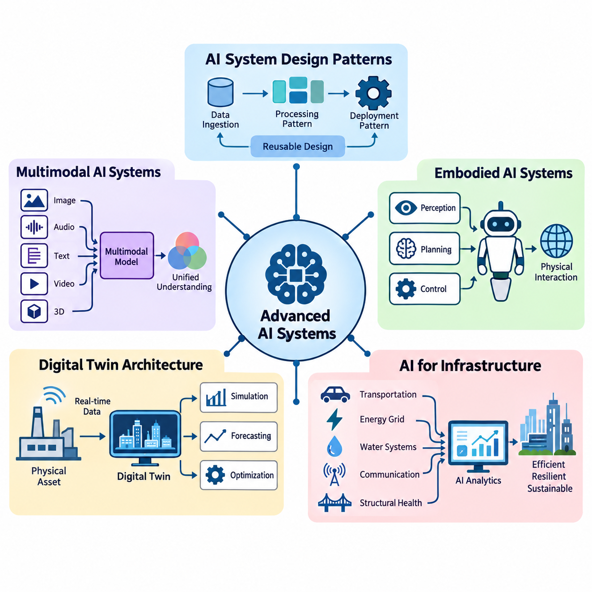
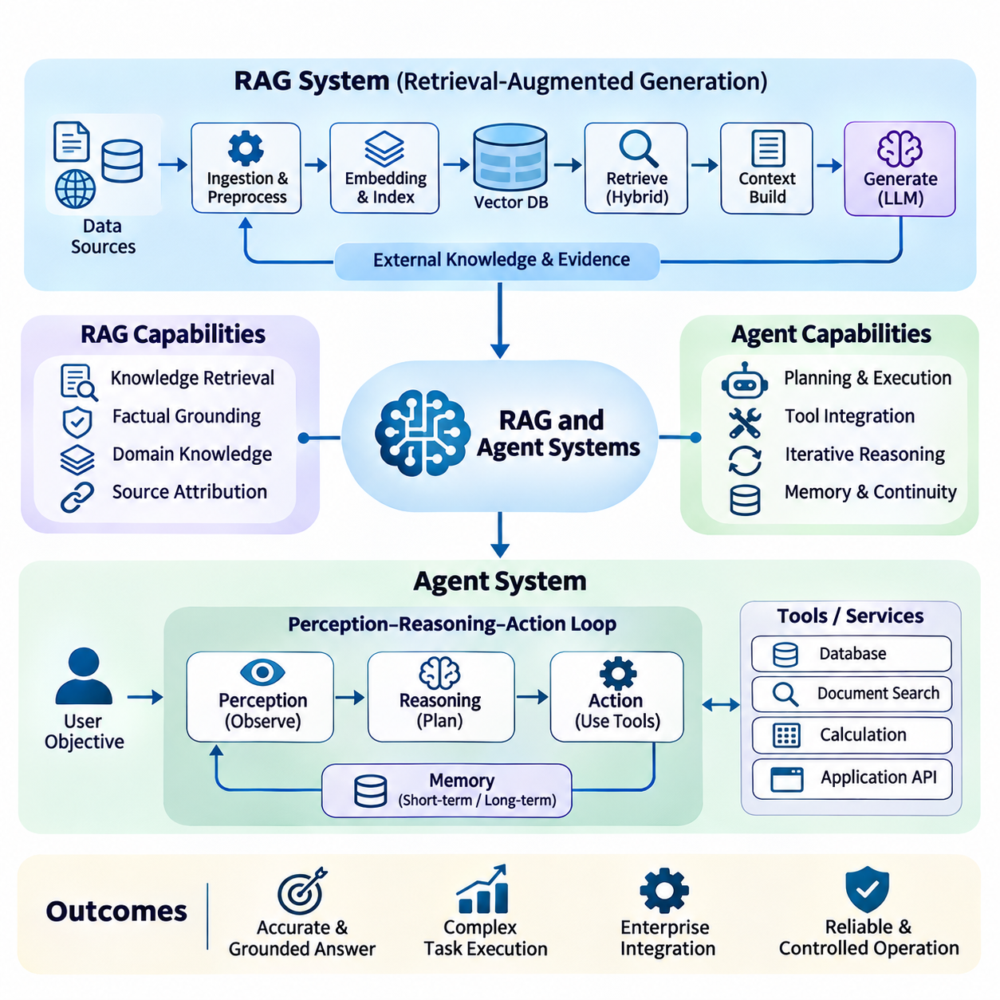
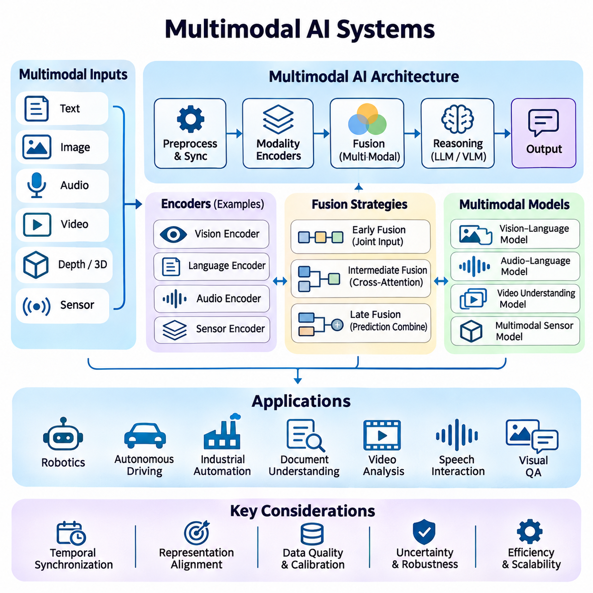
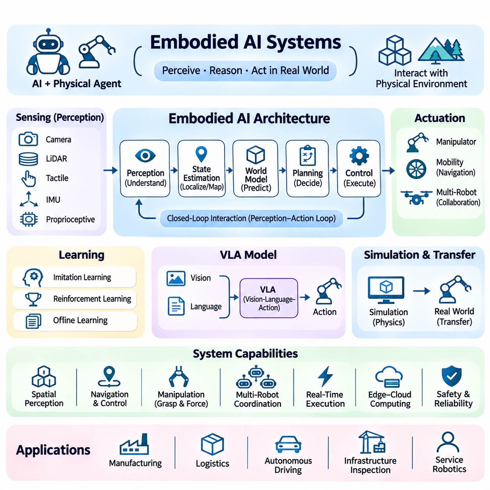
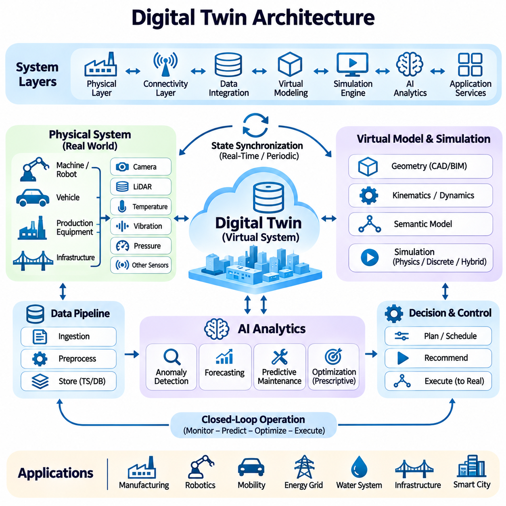
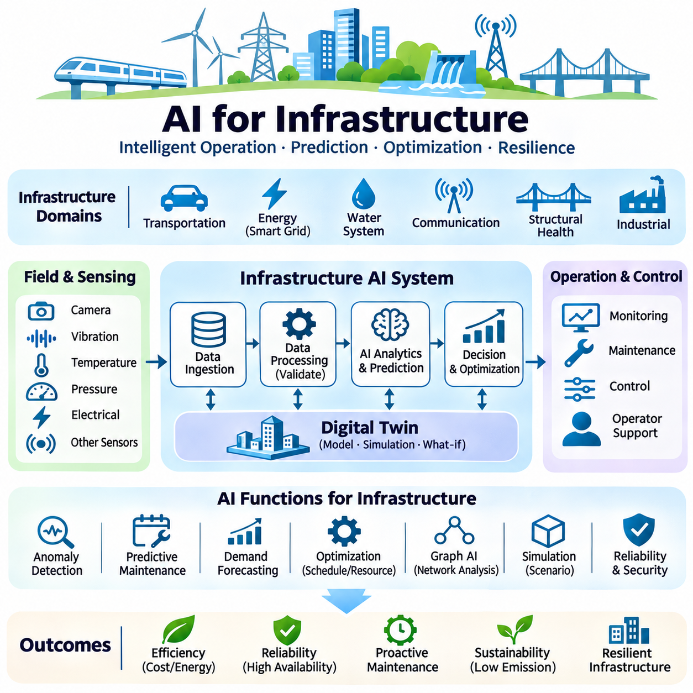

**Volume 38. AI Systems Architecture**

# 06. Advanced AI Systems

## 06.01 AI System Design Patterns

{width="7.268055555555556in" height="7.268055555555556in"}

Advanced AI systems require architectural approaches that extend beyond the design of individual machine learning models. AI system design patterns provide reusable solutions for organizing computation, data processing, inference, communication, and decision-making across complex environments. These patterns help engineers develop systems that remain scalable, reliable, maintainable, and adaptable as operational requirements evolve.

An AI system architecture defines how data sources, preprocessing components, learning models, inference engines, application services, and infrastructure interact. Unlike conventional software systems, AI applications must accommodate probabilistic outputs, changing data distributions, computationally intensive workloads, and continuous model updates. Effective design patterns address these characteristics while maintaining predictable system behavior.

The layered architecture pattern separates an AI system into distinct functional levels, typically including data acquisition, data processing, model execution, decision logic, and application interfaces. Each layer exposes well-defined interfaces to adjacent components, allowing engineers to modify implementations without redesigning the entire system. This separation improves maintainability, testing, security, and independent component development.

A pipeline architecture organizes AI computation as a sequence of processing stages in which the output of one stage becomes the input of another. A computer vision pipeline may perform image acquisition, preprocessing, object detection, tracking, and semantic interpretation. Pipeline stages can execute sequentially or concurrently, depending on data dependencies and available computing resources. Proper buffering and scheduling improve throughput.

The microservices pattern decomposes an AI application into independently deployable services responsible for specific capabilities. Model inference, feature extraction, data retrieval, authentication, and monitoring can operate as separate services communicating through defined APIs. This approach enables independent scaling and deployment, although network communication, distributed state management, and service coordination introduce additional complexity.

Event-driven architecture enables AI components to respond asynchronously to changes in system state or incoming observations. Sensors, applications, and inference services publish events through message brokers or streaming platforms, while subscribed components process relevant information. This pattern is particularly useful for industrial monitoring, autonomous robotics, and smart infrastructure where numerous asynchronous signals require coordinated responses.

The publish-subscribe pattern reduces direct dependencies between AI producers and consumers. A perception module may publish detected objects, allowing navigation, safety monitoring, visualization, and logging components to consume the same information independently. Message schemas, delivery guarantees, ordering policies, and timestamps must be carefully designed to prevent inconsistent interpretations of shared observations.

The request-response pattern remains important when AI services must return results for explicit application requests. A client submits an inference request through an API gateway, which routes the request to an appropriate model-serving instance. Synchronous execution simplifies application integration but may increase response latency under heavy workloads. Timeouts, admission control, and asynchronous alternatives help manage unpredictable processing delays.

The model-serving pattern separates model development from production inference. Trained models are registered, validated, packaged, and deployed through standardized serving interfaces. Inference engines manage model loading, request batching, hardware acceleration, and output serialization. This separation allows data scientists to improve models while platform engineers optimize operational performance, resource allocation, and deployment reliability.

The edge-cloud collaboration pattern distributes AI workloads between local devices and centralized infrastructure. Edge processors execute latency-sensitive perception and control tasks, while cloud platforms provide large-scale training, historical analysis, and fleet-wide coordination. Decisions about workload placement depend on network reliability, privacy requirements, computational capacity, energy consumption, and acceptable response times.

Adaptive workload placement extends edge-cloud collaboration by dynamically selecting execution locations according to current operating conditions. A system may execute lightweight inference locally and offload computationally expensive analysis when sufficient bandwidth is available. However, safety-critical functions should not depend on uncertain network connectivity. Placement policies must account for transfer costs, model availability, and deadline constraints.

The hierarchical decision-making pattern separates strategic reasoning, tactical planning, and low-level execution. A robotic system may use a high-level AI model to interpret objectives, a planning module to generate feasible trajectories, and deterministic controllers to execute motion commands. This hierarchy combines flexible intelligence with predictable physical behavior while maintaining explicit boundaries between probabilistic decisions and safety-critical control.

The blackboard architecture provides a shared representation through which specialized AI modules exchange intermediate knowledge. Perception, localization, prediction, and planning components contribute information to a common state repository. Other modules retrieve relevant observations and update their reasoning accordingly. Consistency mechanisms, timestamp management, and access controls are necessary when multiple components modify shared information concurrently.

The ensemble architecture combines predictions from multiple models to improve robustness or predictive performance. Models may differ in training data, architecture, sensor modality, or specialization. Their outputs can be aggregated through voting, weighted averaging, stacking, or confidence-aware fusion. Although ensembles can reduce certain individual model errors, correlated failures and additional computational requirements must be considered.

The fallback pattern improves system resilience by providing alternative execution paths when primary AI components become unavailable or unreliable. A complex perception model may be replaced temporarily by a simpler model, while an autonomous platform may transition to a restricted operating mode. Fallback behavior should be explicitly defined, tested under representative failures, and designed to preserve essential safety requirements rather than merely maintain availability.

The circuit breaker pattern protects distributed AI services from cascading failures. When an inference service repeatedly fails or exceeds its response deadline, the circuit breaker temporarily rejects additional requests or redirects them toward alternative services. After a recovery interval, controlled requests determine whether normal operation can resume. This mechanism prevents overloaded dependencies from exhausting resources throughout the system.

The caching pattern reduces repeated computation by storing previously generated embeddings, retrieved information, model outputs, or intermediate features. Caching can substantially improve response latency and reduce accelerator utilization when workloads contain repeated requests. However, cache keys must incorporate relevant model and data versions, while expiration and invalidation policies prevent obsolete results from influencing current decisions.

The asynchronous processing pattern separates request submission from computational completion. Long-running training, batch inference, document processing, and simulation workloads can be placed in task queues and executed by background workers. Applications receive task identifiers and retrieve results after processing finishes. Durable queues, retry policies, idempotent operations, and failure tracking are essential for dependable execution.

The stateful processing pattern maintains contextual information across successive observations or interactions. Autonomous systems preserve object tracks and environmental estimates, while conversational AI applications maintain session context and selected memory. State management must distinguish temporary operational context from persistent knowledge. Checkpointing, synchronization, and recovery procedures become especially important when stateful components operate across distributed nodes.

The human-in-the-loop pattern incorporates human judgment into AI workflows when uncertainty, operational risk, or regulatory requirements demand additional oversight. AI components may generate recommendations while human operators approve consequential actions or correct ambiguous predictions. Feedback can subsequently improve datasets and models. Effective interfaces must communicate uncertainty, relevant evidence, and the consequences of available decisions.

The policy enforcement pattern places explicit constraints around AI-generated actions. Model outputs pass through validation components that verify permissions, operating boundaries, safety rules, and application-specific requirements. In physical systems, independent safety controllers may override unsafe commands. This architecture recognizes that statistical model confidence does not guarantee compliance with operational constraints or deterministic safety requirements.

Observability patterns integrate metrics, logs, traces, and model-specific monitoring into the system architecture. Engineers track latency distributions, throughput, accelerator utilization, prediction quality, data drift, and service failures. Correlation identifiers connect requests across distributed components, enabling root-cause analysis. Operational monitoring should distinguish infrastructure failures from degraded model behavior and changing environmental conditions.

The continuous deployment pattern connects model training, validation, registration, release, and monitoring through controlled automation. Candidate models undergo functional, performance, robustness, and compatibility testing before production deployment. Canary releases, shadow evaluation, and rollback mechanisms reduce operational risk. Model versioning and dataset lineage support reproducibility while enabling systematic comparison between deployed configurations.

Security-by-design patterns protect AI systems through authentication, authorization, encryption, network segmentation, and controlled access to models and data. AI-specific threats include adversarial inputs, model extraction, training-data poisoning, and unauthorized tool execution. Security controls must therefore extend across data pipelines, inference endpoints, orchestration services, and deployment infrastructure rather than being concentrated at the application boundary.

Selecting an appropriate AI system design pattern requires balancing performance, complexity, scalability, reliability, and operational cost. No single architecture is optimal for every workload. Real-time robotics may prioritize deterministic control and edge execution, while enterprise AI services may emphasize elastic scaling and distributed retrieval. Successful architectures combine complementary patterns, validate their tradeoffs experimentally, and evolve through measurable operational evidence.

## 06.02 RAG and Agent Systems

{width="7.268055555555556in" height="7.268055555555556in"}

Retrieval-Augmented Generation (RAG) and agent systems represent advanced AI architectures that combine language models with external knowledge, reasoning workflows, and executable tools. RAG improves factual grounding by retrieving relevant information before generating responses, while agent systems extend model capabilities through planning and action execution. Together, these approaches enable AI applications to interact with dynamic environments and complex enterprise resources.

A RAG architecture typically consists of document ingestion, preprocessing, embedding generation, indexing, retrieval, context construction, and response generation. External information is transformed into searchable representations and stored in specialized repositories. During inference, a user query triggers retrieval operations that identify relevant evidence, which is incorporated into the language model prompt to support contextually appropriate responses.

Document ingestion pipelines collect information from databases, technical manuals, websites, application interfaces, and enterprise repositories. Preprocessing operations normalize text, extract metadata, remove irrelevant content, and divide documents into manageable chunks. Chunk size and overlap influence retrieval precision and contextual completeness. Preserving document identifiers, timestamps, and source relationships supports traceability and reliable evidence attribution.

Embedding-based retrieval transforms queries and document passages into numerical vectors representing semantic relationships. Vector databases organize these representations using approximate nearest-neighbor indexing to accelerate similarity searches. Retrieval effectiveness depends on embedding quality, domain alignment, indexing configuration, and query formulation. Semantic similarity alone does not guarantee factual relevance, making additional filtering and evaluation necessary.

Hybrid retrieval combines dense vector search with lexical methods such as BM25 to capture both semantic relationships and exact terminology. This approach is particularly useful for technical documentation containing identifiers, equipment specifications, abbreviations, and specialized vocabulary. Retrieved candidates may be merged and reranked using cross-encoder models, metadata constraints, or application-specific relevance functions.

Context construction determines how retrieved information is presented to the generation model. Relevant passages must fit within the available context window while preserving sufficient evidence for accurate reasoning. Deduplication, relevance ranking, source attribution, and token-budget allocation help reduce unnecessary information. Poorly selected context can increase computational cost and introduce contradictions or misleading evidence.

The generation stage combines user instructions, retrieved evidence, conversation context, and application policies into a structured prompt. The language model produces an answer based on the supplied information while respecting task-specific constraints. Reliable implementations distinguish supported claims from unsupported assumptions and provide source references when appropriate. Retrieval improves grounding but does not eliminate hallucinations or reasoning errors.

Advanced RAG systems incorporate query rewriting, decomposition, and iterative retrieval to address complex information needs. A broad question may be divided into smaller queries targeting different documents or knowledge sources. Retrieved evidence can reveal missing information, triggering additional searches before final synthesis. These mechanisms improve coverage but introduce additional latency, computational expense, and orchestration complexity.

Agent systems extend language model applications by enabling structured interaction with tools, services, and external environments. An agent receives an objective, interprets available context, selects actions, observes results, and updates its subsequent decisions. Unlike a fixed inference pipeline, agent execution may involve multiple conditional steps. Nevertheless, agent autonomy must remain bounded by explicit permissions and operational constraints.

The perception-reasoning-action loop provides a conceptual foundation for agent architectures. An agent observes the current environment through messages, tool outputs, or sensor information, then evaluates possible actions relative to its objectives. After executing an authorized action, the system incorporates resulting observations into its working context. This iterative process supports adaptive behavior under changing conditions.

Tool integration allows agents to access databases, execute calculations, search documents, invoke application services, and interact with external software. Tools should expose clearly defined input schemas, output formats, permissions, and error conditions. Structured function calling reduces ambiguity between natural-language reasoning and executable operations. Tool results must be treated as potentially untrusted information rather than authoritative instructions.

Planning architectures organize complex objectives into manageable subtasks and execution dependencies. An agent may generate an initial plan, execute individual steps, evaluate intermediate outcomes, and revise its strategy when necessary. Planning can be implemented through explicit workflows, hierarchical task decomposition, or model-guided decision processes. Reliable systems validate planned actions against available resources, constraints, and completion criteria.

Agent memory supports continuity across interactions and multi-step workflows. Short-term memory maintains immediate observations, active objectives, and intermediate results, while long-term memory stores selected knowledge or reusable experience. Memory systems may combine structured databases, vector retrieval, and summarized interaction histories. Retention policies, access controls, and relevance filtering prevent outdated or sensitive information from contaminating decisions.

Multi-agent architectures distribute responsibilities among specialized agents with different capabilities or operational roles. One agent may retrieve evidence, another analyze technical constraints, and a third validate the resulting recommendations. Coordination can follow hierarchical supervision, sequential handoffs, or collaborative task execution. However, communication overhead, conflicting decisions, and shared-state consistency must be managed explicitly.

Orchestration frameworks coordinate retrieval components, language models, tools, memory services, and agent execution states. Workflow engines can represent execution dependencies, conditional branches, retries, and human approval requirements. Persistent checkpoints support recovery after interruptions, while execution traces provide visibility into intermediate decisions. Deterministic orchestration is often preferable when predictable operations matter more than unrestricted agent flexibility.

Combining RAG with agent systems enables knowledge-grounded planning and action execution. An agent can retrieve technical documentation, identify relevant procedures, evaluate operating constraints, and invoke appropriate tools. Retrieval supplies evidence, while agent orchestration determines how that evidence influences subsequent actions. Separating information retrieval from execution authority helps prevent retrieved content from directly controlling sensitive operations.

Security is particularly important because retrieved documents and tool responses may contain malicious instructions or misleading information. Prompt injection can attempt to redirect agent behavior through untrusted content. Defensive architectures enforce instruction boundaries, validate tool arguments, restrict privileges, and require authorization for consequential actions. Sensitive operations should use independent policy checks rather than relying solely on language model judgments.

Reliability mechanisms address failures caused by unavailable tools, incomplete retrieval, malformed responses, and inconsistent intermediate states. Agents should apply bounded retries, execution timeouts, idempotency controls, and explicit termination conditions. Critical workflows benefit from deterministic fallback procedures and human escalation paths. Without these safeguards, repeated reasoning or tool invocation can produce excessive costs and unpredictable behavior.

Performance optimization requires balancing retrieval accuracy, generation latency, context length, and tool execution overhead. Caching embeddings, retrieved passages, and reusable intermediate results can reduce repeated computation. Parallel retrieval and asynchronous tool execution may improve throughput when dependencies permit. System designers must evaluate end-to-end response times rather than optimizing isolated components without considering their interactions.

Evaluation of RAG systems examines retrieval relevance, evidence coverage, answer faithfulness, factual correctness, and citation accuracy. Agent evaluation additionally measures task completion, action validity, tool-use efficiency, recovery behavior, and policy compliance. Representative benchmarks should include ambiguous requests, conflicting evidence, missing documents, unavailable tools, and adversarial inputs. Automated metrics should be supplemented with targeted human review.

Production monitoring records retrieval quality, model versions, tool execution traces, latency distributions, token consumption, and operational failures. Changes in document collections or embedding models may alter retrieval behavior even when generation models remain unchanged. Continuous evaluation and controlled deployment procedures help detect regressions. Observability across the complete workflow is essential for identifying whether failures originate in retrieval, reasoning, or execution.

Enterprise applications use RAG and agents for knowledge management, technical support, document analysis, software engineering, and operational decision assistance. Industrial AI systems may integrate equipment manuals, maintenance records, sensor observations, and diagnostic services. In robotics, knowledge-grounded agents can support high-level task interpretation and supervisory planning, while deterministic controllers and independent safety mechanisms retain authority over physical execution.

The architectural value of RAG and agent systems lies in combining external knowledge access with controlled reasoning and execution capabilities. Effective implementations require carefully designed retrieval pipelines, explicit tool interfaces, bounded autonomy, persistent state management, security enforcement, and measurable evaluation procedures. As system complexity increases, reliable orchestration and operational governance become as important as the capabilities of the underlying language models.

## 06.03 Multimodal AI Systems

{width="7.268055555555556in" height="7.268055555555556in"}

Multimodal AI systems integrate information from multiple data modalities, including text, images, audio, video, depth measurements, and sensor signals, to produce unified representations and intelligent decisions. Unlike single-modality systems, multimodal architectures exploit complementary information across heterogeneous sources. Their design requires coordinated data acquisition, feature extraction, temporal synchronization, fusion, reasoning, and output generation.

A multimodal AI architecture typically consists of modality-specific input pipelines, preprocessing modules, encoders, fusion mechanisms, reasoning components, and task-specific output interfaces. Each input modality has distinct characteristics regarding sampling frequency, dimensionality, noise, and semantic structure. Architectural design must preserve these characteristics while enabling meaningful interactions between representations derived from different sources.

Modality-specific encoders transform raw observations into machine-readable feature representations. Vision encoders extract spatial and semantic information from images, while language encoders represent textual meaning and contextual relationships. Audio encoders capture acoustic patterns, speech characteristics, and temporal structures. Sensor encoders process measurements such as acceleration, distance, temperature, and position into representations suitable for multimodal integration.

Representation alignment establishes relationships between features extracted from different modalities. Contrastive learning can encourage corresponding image and text embeddings to occupy nearby regions of a shared representation space. Cross-modal alignment enables retrieval, classification, and reasoning across heterogeneous inputs. However, alignment quality depends on paired training data, semantic consistency, and the ability to preserve modality-specific information.

Early fusion combines information from different modalities before substantial task-specific processing. Raw measurements or low-level features may be concatenated, projected, or jointly encoded to capture direct interactions. This approach can preserve detailed cross-modal relationships but requires compatible representations and careful synchronization. Differences in dimensionality, noise characteristics, and missing inputs can significantly affect performance.

Late fusion processes each modality independently and combines predictions or high-level representations near the final decision stage. Separate vision, language, and sensor models may generate confidence scores that are aggregated through weighted averaging or learned decision functions. Late fusion offers modularity and robustness when individual modalities become unavailable, although it may overlook interactions that require joint low-level interpretation.

Intermediate fusion integrates modality-specific features after independent encoding but before final prediction. Cross-attention mechanisms allow information from one modality to influence the interpretation of another. For example, textual instructions can guide visual feature selection, while visual observations can refine language-based reasoning. Intermediate fusion balances representational flexibility with computational complexity and is widely used in modern multimodal architectures.

Transformer-based multimodal systems employ attention mechanisms to model relationships among heterogeneous input tokens. Images may be represented as visual patches, audio as temporal embeddings, and text as token sequences. Shared or interconnected transformer layers enable cross-modal interaction and contextual reasoning. Architectural choices influence memory consumption, attention complexity, alignment quality, and the ability to process long sequences.

Vision-language models combine visual perception with natural-language understanding to perform image description, visual question answering, document interpretation, and grounded reasoning. A visual encoder extracts image representations that are connected to a language model through projection layers or cross-attention modules. These systems can interpret visual evidence within linguistic contexts, although accurate spatial reasoning and fine-grained object relationships remain challenging.

Audio-language systems integrate speech recognition, acoustic understanding, and language generation. Audio inputs may contain spoken instructions, environmental sounds, speaker characteristics, and contextual cues. Streaming architectures process incoming audio incrementally to reduce response delays. Effective systems must handle background noise, overlapping speakers, variable recording conditions, and synchronization between recognized speech and other observations.

Video understanding introduces temporal dependencies that extend beyond individual image interpretation. Video encoders analyze sequences of frames to identify motion, events, object interactions, and evolving environmental conditions. Temporal attention, recurrent memory, and hierarchical sampling can reduce redundant computation. Long-duration video processing requires careful management of frame selection, memory capacity, and temporal context preservation.

Multimodal sensor fusion is particularly important in robotics, autonomous vehicles, and industrial automation. Cameras provide visual appearance, LiDAR supplies geometric measurements, radar contributes motion-sensitive observations, and inertial sensors estimate movement. Fusion architectures combine these signals to improve environmental perception and state estimation. Calibration, timestamp consistency, and uncertainty modeling are essential for reliable integration.

Temporal synchronization ensures that observations from different modalities correspond to compatible moments in time. Cameras, microphones, LiDAR devices, and control systems often operate at different sampling frequencies and experience different communication delays. Timestamp alignment, interpolation, buffering, and clock synchronization reduce inconsistencies. Poor synchronization can introduce incorrect associations and degrade downstream perception or control decisions.

Spatial calibration establishes geometric relationships among sensors and coordinate systems. Extrinsic calibration determines relative sensor positions and orientations, while intrinsic calibration characterizes individual sensor measurement properties. Accurate transformations enable visual features, depth measurements, and motion estimates to be interpreted within a common spatial reference. Calibration drift and mechanical changes require periodic verification.

Missing-modality handling allows multimodal systems to continue operating when certain inputs are unavailable or unreliable. Training strategies may include modality dropout, masked inputs, or uncertainty-aware fusion to improve resilience. Runtime systems can adjust fusion weights or activate alternative processing paths according to sensor availability. However, degraded operation must remain within validated performance and safety boundaries.

Uncertainty-aware fusion considers the reliability of individual observations rather than treating every modality as equally trustworthy. Sensor noise, environmental conditions, model confidence, and measurement quality influence the contribution of each information source. Probabilistic methods and learned weighting mechanisms can support adaptive integration. Reliable systems must distinguish calibrated uncertainty from confidence scores that may be misleading.

Multimodal reasoning combines evidence across modalities to infer relationships that cannot be determined from isolated observations. An industrial inspection system may correlate camera images, vibration signals, temperature measurements, and maintenance records to identify abnormal operating conditions. Such reasoning requires both semantic integration and causal awareness. Conflicting evidence should trigger uncertainty handling rather than unsupported conclusions.

Multimodal generation produces outputs across text, images, speech, or structured actions based on integrated input information. A system may interpret visual observations and spoken instructions before generating a textual explanation or machine-readable command. Output architectures must preserve consistency between modalities and respect application constraints. In safety-critical environments, generated actions require independent validation before execution.

Real-time multimodal AI systems must coordinate computationally expensive perception and reasoning processes under strict latency constraints. Parallel encoders, asynchronous pipelines, hardware acceleration, and selective processing can improve responsiveness. Scheduling policies should prioritize time-sensitive information while allowing less urgent analysis to execute separately. End-to-end latency must include acquisition, synchronization, inference, fusion, and communication.

Distributed multimodal architectures allocate processing tasks across edge devices, local servers, and cloud infrastructure. Edge processors may perform sensor preprocessing and immediate perception, while centralized resources execute complex reasoning or large-scale analytics. Network bandwidth, privacy requirements, and operational reliability determine suitable placement. Communication failures should not compromise functions requiring continuous local execution.

Training multimodal systems requires datasets that preserve meaningful relationships among modalities. Paired image-text examples, synchronized audio-video recordings, and calibrated sensor sequences support cross-modal learning. Data augmentation must maintain semantic and temporal consistency. Dataset quality depends not only on individual modality accuracy but also on correct correspondence, representative coverage, and reliable annotation.

Evaluation must examine both individual modality performance and the effectiveness of integrated reasoning. Relevant measurements include task accuracy, cross-modal retrieval quality, temporal alignment error, robustness to missing inputs, latency, and computational efficiency. Testing should include noisy observations, contradictory signals, sensor failures, and distribution shifts. Benchmark results must reflect realistic deployment conditions rather than isolated laboratory performance.

Multimodal AI systems provide a foundation for intelligent applications that perceive, interpret, and interact with complex environments. Their effectiveness depends on coordinated representation learning, fusion strategies, synchronization, uncertainty management, and reliable deployment architecture. As multimodal models become more capable, system-level engineering remains essential for converting heterogeneous information into accurate, efficient, and operationally trustworthy intelligence.

## 06.04 Embodied AI Systems

{width="7.268055555555556in" height="7.268055555555556in"}

Embodied AI systems integrate artificial intelligence with physical agents that perceive, reason, and act within real-world environments. Unlike purely digital AI applications, embodied systems must continuously interact with physical objects, spatial constraints, and changing environmental conditions. Their architecture combines perception, state estimation, planning, learning, control, and feedback to support intelligent behavior through closed-loop interaction.

An embodied AI architecture connects sensing, computation, decision-making, and actuation within a unified operational framework. Cameras, LiDAR, tactile sensors, inertial measurement units, and proprioceptive sensors provide observations of the environment and the agent itself. Processing modules transform these observations into useful state representations, while planning and control components generate actions that satisfy objectives and physical constraints.

Embodied intelligence depends on the continuous perception-action loop, where an agent observes environmental conditions, selects an action, executes it, and evaluates the resulting changes. Unlike static prediction tasks, actions influence subsequent observations and future decision opportunities. This interaction requires real-time feedback, uncertainty management, and mechanisms for correcting errors before they accumulate into unsafe or ineffective behavior.

Spatial perception provides the geometric and semantic understanding necessary for physical interaction. Depth cameras, stereo vision, and LiDAR generate information about object locations, surfaces, obstacles, and free space. Semantic perception identifies meaningful entities and their relationships. Combining geometric reconstruction with semantic interpretation enables robots to navigate environments, manipulate objects, and reason about physically feasible actions.

State estimation maintains an evolving representation of the robot and its surroundings. Localization, mapping, object tracking, and sensor fusion combine measurements from multiple sources to estimate position, orientation, velocity, and environmental structure. Probabilistic estimation methods account for measurement noise and uncertainty. Reliable state estimation is essential because planning and control depend on accurate knowledge of current operating conditions.

World models provide internal representations of environmental dynamics, object relationships, and possible future states. An embodied agent can use a world model to predict the consequences of candidate actions before executing them. Learned dynamics models and physics-based simulators support this predictive capability. However, model inaccuracies must be considered, particularly when predictions influence high-risk physical interactions.

Hierarchical planning separates abstract objectives from executable motion commands. High-level planners interpret tasks and select behavioral strategies, while task planners determine action sequences and motion planners generate collision-free trajectories. Low-level controllers convert planned trajectories into actuator commands. This hierarchy enables flexible reasoning while preserving explicit interfaces between probabilistic intelligence and deterministic control.

Vision-language-action models connect visual observations and natural-language instructions with robot actions. These models may learn relationships among images, textual goals, proprioceptive states, and action sequences through large-scale training. Their outputs can represent discrete skills, motion targets, or continuous control parameters. Practical deployment requires compatibility with robot kinematics, actuator limits, execution frequency, and safety constraints.

Robot learning enables embodied agents to acquire behaviors through demonstrations, interaction, and optimization. Imitation learning uses expert trajectories to reproduce desired actions, while reinforcement learning improves policies through reward-guided experience. Offline learning can exploit recorded datasets without direct environmental interaction. Each approach must address distribution shifts, exploration costs, sample efficiency, and the risks associated with physical experimentation.

Sim-to-real transfer reduces the need for extensive physical training by developing policies in simulated environments. Physics engines model robot dynamics, contacts, friction, and environmental interactions. Domain randomization introduces variations in lighting, geometry, mass, and sensor noise to improve generalization. Nevertheless, discrepancies between simulated and real conditions require validation, calibration, and controlled deployment.

Manipulation systems combine object recognition, pose estimation, grasp planning, force control, and motion execution. Robots must account for object geometry, material properties, contact conditions, and uncertainty during interaction. Visual feedback supports alignment, while tactile and force sensors detect contact and slippage. Effective manipulation requires coordination between high-level task objectives and low-level physical control.

Mobile embodied agents must integrate navigation, obstacle avoidance, localization, and motion control. Global planners determine routes toward objectives, while local planners respond to dynamic obstacles and immediate constraints. Predictive control can account for vehicle dynamics and actuator limitations. Reliable navigation also requires recovery behaviors for localization failure, blocked paths, unexpected terrain, and changing environmental conditions.

Multi-robot embodied systems coordinate perception, planning, and action across multiple physical agents. Shared maps, task allocation, communication protocols, and distributed decision-making enable cooperative operations. Centralized orchestration may optimize fleet-level objectives, while local autonomy maintains responsiveness when communication is delayed. Coordination mechanisms must prevent conflicting actions, resource contention, and unsafe interactions.

Real-time execution is a fundamental architectural requirement because physical environments continue evolving while computation occurs. Perception, planning, and control components operate at different update frequencies and computational costs. Scheduling policies prioritize time-critical tasks, while asynchronous pipelines handle less urgent reasoning. End-to-end latency, jitter, and deadline violations must be measured against the physical dynamics of the system.

Edge computing supports embodied AI by executing perception and control near physical sensors and actuators. Onboard accelerators process visual observations and neural network inference, while dedicated controllers maintain deterministic motion execution. Cloud infrastructure can support large-scale training, simulation, and fleet analytics. Safety-critical operations should remain functional without continuous network connectivity or remote inference availability.

Safety architecture separates intelligent decision-making from independently enforced physical constraints. Emergency stopping, collision prevention, speed limitations, workspace boundaries, and actuator monitoring must remain effective even when AI predictions are incorrect. Runtime assurance mechanisms can validate proposed actions before execution. Safety engineering requires systematic hazard analysis, fault handling, verification, and testing under representative operating conditions.

Uncertainty-aware embodied AI recognizes that observations, predictions, and action outcomes are inherently imperfect. Sensor failures, occlusions, calibration drift, and unfamiliar environments can reduce decision reliability. Systems may respond by gathering additional observations, reducing speed, selecting conservative actions, or requesting human intervention. Confidence estimates should be calibrated and evaluated against operational risk rather than treated as guarantees.

Human-robot interaction enables people to communicate objectives, provide demonstrations, supervise operations, and intervene when necessary. Natural-language interfaces can simplify task specification, while visual and spatial feedback communicate robot intentions. Shared autonomy combines human guidance with automated planning and execution. Effective interfaces must clarify system capabilities, uncertainty, authority boundaries, and intervention procedures.

Data infrastructure for embodied AI manages synchronized sensor recordings, robot states, action trajectories, task annotations, and environmental metadata. Training datasets must preserve temporal relationships and coordinate transformations across modalities. Data collection should capture successful operations, failures, and diverse environmental conditions. Versioning and traceability support reproducible training, evaluation, and systematic improvement of embodied policies.

Evaluation of embodied AI extends beyond prediction accuracy to measure task completion, motion efficiency, collision frequency, recovery capability, and operational reliability. Benchmarks should include environmental changes, sensor degradation, unseen objects, and unexpected disturbances. Simulation testing provides broad scenario coverage, while physical validation establishes real-world performance. Long-duration trials are essential for identifying accumulated errors and rare failures.

Continuous improvement requires feedback from deployed robots to inform data selection, model refinement, and system updates. Operational logs can identify failure patterns, difficult environments, and limitations in learned policies. Updated models should undergo regression testing, compatibility verification, and staged deployment. Separating training infrastructure from onboard inference reduces operational disruption while supporting systematic model evolution.

Embodied AI systems provide the architectural foundation for autonomous robots, intelligent manufacturing, logistics automation, inspection platforms, and service robotics. Their effectiveness depends on integrating learned intelligence with geometric reasoning, physical dynamics, deterministic control, and operational safeguards. Successful deployment requires not only capable models but also reliable hardware-software coordination, measurable performance, and sustained safety throughout real-world interaction.

## 06.05 Digital Twin Architecture

{width="7.268055555555556in" height="7.268055555555556in"}

Digital twin architecture establishes a continuously updated virtual representation of a physical asset, process, or environment through connected data, simulation, and analytical models. Unlike a static digital model, a digital twin reflects changing operational conditions and supports monitoring, prediction, and decision-making. Its effectiveness depends on reliable synchronization between physical systems and their computational counterparts.

A digital twin system typically integrates physical assets, sensing infrastructure, communication networks, data platforms, simulation engines, AI models, and application services. Sensors capture operational measurements, while data pipelines transform observations into structured information. The virtual environment maintains asset states and predicted behavior, enabling engineers to analyze performance, identify abnormalities, and evaluate operational alternatives.

The physical layer contains machines, robots, production equipment, vehicles, and environmental infrastructure represented by the digital twin. Sensors measure position, velocity, vibration, temperature, pressure, energy consumption, and equipment status. Actuators execute commands within physical constraints. Accurate identification of assets, components, and measurement sources is necessary to maintain correspondence between physical objects and virtual entities.

The connectivity layer transfers information between physical equipment and digital services through industrial networks and communication protocols. Technologies such as OPC UA, MQTT, Ethernet, and wireless communication support heterogeneous devices. Data acquisition systems must address transmission latency, packet loss, clock synchronization, and network security. Critical control functions should remain operational when remote connectivity becomes unavailable.

The data integration layer collects streaming telemetry, historical records, configuration parameters, and maintenance information. Time-series databases store evolving measurements, while relational and object repositories preserve structured metadata and engineering artifacts. Data normalization, schema validation, and timestamp alignment establish consistent representations. Provenance tracking helps determine the origin, reliability, and transformation history of observations.

The virtual modeling layer represents asset geometry, physical properties, operational states, and relationships among components. Computer-aided design models provide geometric structure, while kinematic and dynamic models describe movement and physical behavior. Semantic models connect technical attributes with operational meaning. Model fidelity should reflect the intended application rather than maximizing geometric or computational complexity unnecessarily.

Simulation engines reproduce physical processes and estimate how systems respond to changing conditions. Physics-based models can describe motion, contact, heat transfer, fluid behavior, and structural deformation. Discrete-event simulation represents operational sequences, resource utilization, and production workflows. Hybrid simulation combines different modeling approaches to capture interactions between equipment dynamics and higher-level operational processes.

State synchronization updates the digital twin using measurements from the physical system. Incoming observations may modify position estimates, equipment conditions, process variables, and environmental representations. Synchronization frequency depends on application requirements and sensor availability. A monitoring twin may update periodically, while a robotic twin may require substantially faster state updates to support motion planning and coordination.

State estimation techniques reconcile incomplete or noisy measurements with model predictions. Kalman filtering, Bayesian estimation, and learned estimators can infer hidden states from available observations. Data assimilation combines sensor evidence with simulated behavior to maintain coherent virtual states. Estimation uncertainty must be represented explicitly because inaccurate synchronization can produce misleading predictions and inappropriate operational decisions.

AI models extend digital twins beyond visualization by enabling anomaly detection, forecasting, classification, and predictive maintenance. Historical operating data and real-time telemetry support the identification of emerging equipment faults. Machine learning models may estimate remaining useful life or predict process deviations. These predictions should be evaluated against operating conditions, uncertainty, and the consequences of incorrect recommendations.

Predictive digital twins simulate potential future conditions based on current states and candidate interventions. Engineers can evaluate maintenance schedules, production adjustments, and operating parameters before applying changes to physical equipment. Scenario analysis helps identify performance tradeoffs and operational risks. Prediction reliability depends on model validity, input quality, and whether simulated conditions adequately represent real operating environments.

Prescriptive digital twins extend prediction into optimization and decision support. Optimization algorithms can compare alternative control settings, resource allocations, or maintenance strategies against defined objectives. Recommendations may consider productivity, energy consumption, equipment wear, and operational constraints. Physical execution should remain subject to authorization, independent safety checks, and validation of proposed changes.

Digital twins for robotics integrate geometric environments, robot kinematics, sensor representations, and task execution states. A virtual robot can evaluate reachability, collision risks, navigation routes, and manipulation sequences before physical execution. Updated observations help align the simulated scene with actual conditions. However, simulation results must account for localization errors, calibration uncertainty, and discrepancies between modeled and real dynamics.

Fleet-level digital twins represent multiple robots or machines operating within shared environments. Centralized services maintain information about asset locations, task assignments, charging status, and resource availability. Simulation can evaluate congestion, scheduling policies, and operational bottlenecks. Local controllers preserve real-time autonomy, while fleet-level models support coordination and optimization across the broader system.

Industrial digital twins connect production equipment, process measurements, quality information, and maintenance records. Manufacturing systems can simulate production capacity, equipment utilization, and process disturbances. AI-based analytics identify patterns associated with defects or inefficient operation. Integration with manufacturing execution systems and enterprise platforms enables digital twin insights to support operational planning and continuous improvement.

Real-time digital twin architectures must balance model complexity with computational deadlines. High-fidelity simulation may provide detailed predictions but require substantial processing resources. Reduced-order models and surrogate models can approximate complex behavior with lower latency. Adaptive execution strategies select appropriate model fidelity according to available resources, prediction requirements, and the urgency of operational decisions.

Edge-cloud collaboration distributes digital twin computation across local controllers, edge servers, and centralized infrastructure. Edge systems handle time-sensitive data acquisition, filtering, and state estimation, while cloud resources support extensive simulation, historical analytics, and model training. Communication policies determine which information must be transmitted. Network interruptions should not compromise local safety or essential equipment control.

Model calibration and validation are essential for maintaining correspondence between virtual and physical systems. Calibration adjusts model parameters using measured operating data, while validation evaluates prediction accuracy against independent observations. Mechanical wear, equipment modifications, and environmental changes can introduce model drift. Periodic recalibration and continuous error monitoring help preserve the operational usefulness of the digital twin.

Lifecycle management connects digital twin models with engineering design, commissioning, operation, maintenance, and eventual asset retirement. Configuration management tracks changes in hardware, software, calibration parameters, and simulation models. Versioned records support traceability and reproducibility. A digital twin must reflect the actual configuration of its corresponding physical asset to prevent decisions based on obsolete engineering assumptions.

Interoperability enables digital twins to exchange information across equipment vendors, simulation platforms, and enterprise applications. Standardized interfaces, semantic schemas, and consistent asset identifiers reduce integration complexity. APIs expose operational states and analytical results to authorized services. Without effective interoperability, isolated digital twins may provide local benefits but fail to support coordinated system-wide analysis.

Security and governance protect digital twin platforms from unauthorized access, manipulated telemetry, and unsafe command execution. Authentication, encryption, network segmentation, and role-based permissions restrict sensitive operations. Data integrity checks help detect corrupted observations, while audit logs preserve decision histories. Connections from virtual recommendations to physical actuators require particularly strong authorization and safety enforcement.

Evaluation of digital twin architectures includes synchronization accuracy, prediction error, simulation latency, computational cost, availability, and operational impact. Testing should examine sensor failures, communication delays, unexpected disturbances, and model mismatch. Long-duration monitoring reveals drift and accumulated estimation errors. Performance metrics must be selected according to whether the twin supports visualization, prediction, optimization, or physical control.

Digital twin architecture provides a foundation for intelligent manufacturing, autonomous robotics, infrastructure monitoring, energy management, and predictive maintenance. Its value emerges from integrating physical observations, computational models, AI analytics, and controlled operational feedback. Reliable deployment requires accurate synchronization, validated simulation, scalable infrastructure, secure interfaces, and continuous verification of the relationship between virtual predictions and physical reality.

## 06.06 AI for Infrastructure

{width="7.268055555555556in" height="7.268055555555556in"}

AI for infrastructure integrates intelligent sensing, predictive analytics, optimization, and automated decision support into the operation of essential physical and digital systems. Infrastructure includes transportation networks, energy grids, water facilities, communication networks, and industrial installations. AI architectures must accommodate geographically distributed assets, continuous data streams, operational constraints, and demanding requirements for reliability and safety.

Infrastructure AI systems combine field sensors, supervisory controllers, communication networks, data platforms, analytical models, and operational applications. Measurements from distributed equipment are collected, validated, and transformed into representations of system conditions. AI services analyze these observations to identify abnormalities, forecast demand, and recommend interventions. Their outputs must integrate with established engineering and operational procedures.

Intelligent monitoring architectures continuously evaluate equipment status, environmental conditions, and infrastructure performance. Sensors measure vibration, temperature, pressure, electrical characteristics, structural displacement, and resource consumption. Data processing pipelines remove noise, align timestamps, and detect inconsistent measurements. Reliable monitoring requires sensor calibration, redundancy, and mechanisms for distinguishing genuine anomalies from instrumentation failures.

Predictive maintenance uses historical operating records and real-time measurements to estimate equipment degradation and failure risk. Machine learning models identify patterns associated with wear, abnormal vibration, thermal stress, and declining efficiency. Remaining useful life estimates can support maintenance scheduling and spare-parts planning. Predictions must include uncertainty because unexpected failures and changing operating conditions can invalidate learned relationships.

Anomaly detection identifies deviations from expected infrastructure behavior before they develop into serious operational problems. Statistical methods, autoencoders, forecasting models, and graph-based algorithms can recognize unusual patterns across distributed measurements. Detection thresholds should reflect equipment characteristics and operational risk. Excessive false alarms reduce operator confidence, while missed anomalies may delay necessary interventions.

Energy infrastructure applications use AI to forecast electricity demand, renewable generation, and equipment loading. Predictive models incorporate weather conditions, historical consumption, operational schedules, and distributed energy resources. Optimization algorithms can support generation scheduling, storage management, and demand response. Grid protection and stability constraints must remain governed by validated control systems and established operating limits.

Smart grid architectures integrate substations, distributed sensors, advanced metering infrastructure, energy storage, and supervisory control platforms. AI analytics can detect abnormal consumption, estimate network conditions, and identify potential equipment faults. Distributed computation supports localized monitoring, while centralized services coordinate broader optimization. Cybersecurity and communication reliability are essential because grid operations involve interconnected critical assets.

Transportation infrastructure benefits from AI-based traffic prediction, congestion analysis, incident detection, and adaptive scheduling. Cameras, roadway sensors, vehicle telemetry, and historical traffic records provide complementary information. Predictive models estimate traffic flows and identify emerging bottlenecks. Operational systems can recommend signal adjustments or routing changes, subject to safety constraints, transportation regulations, and human oversight.

Water infrastructure applies AI to monitor distribution networks, treatment processes, pumping stations, and storage facilities. Pressure, flow, water quality, and equipment measurements support leakage detection and process optimization. Predictive models can identify unusual consumption patterns or deteriorating equipment performance. Automated recommendations must respect water quality requirements, hydraulic constraints, and established procedures for protecting public health.

Communication infrastructure uses AI to analyze network traffic, predict congestion, identify equipment faults, and optimize resource allocation. Telemetry from routers, switches, wireless access points, and computing facilities supports operational visibility. Learning models can recognize abnormal traffic patterns and forecast capacity requirements. Network management systems must preserve service availability and avoid destabilizing changes during automated optimization.

Structural health monitoring evaluates the condition of bridges, tunnels, buildings, pipelines, and other engineered structures. Sensors measure strain, vibration, displacement, temperature, and environmental exposure. AI models can detect changes associated with damage or progressive deterioration. However, predictions require validation against structural engineering principles, inspection evidence, and uncertainty in measurements rather than relying exclusively on learned correlations.

Infrastructure digital twins maintain virtual representations of physical assets and their operational states. Sensor updates synchronize models with observed conditions, while simulation engines estimate future behavior under alternative scenarios. AI analytics enhance anomaly detection, forecasting, and maintenance planning. Digital twins can support infrastructure management when model calibration, data quality, and correspondence with actual asset configurations are continuously maintained.

Graph-based AI models represent infrastructure as interconnected nodes and relationships. Electrical networks, transportation systems, pipelines, and communication networks naturally exhibit graph structures. Graph neural networks can learn dependencies among components and support fault localization, demand forecasting, and network-level analysis. Their effectiveness depends on accurate topology, meaningful node features, and adaptation to changing network configurations.

Distributed AI architectures allocate computation across field devices, edge servers, regional platforms, and centralized data centers. Edge processing reduces communication delays and supports local anomaly detection, while centralized infrastructure enables large-scale forecasting and optimization. Workload placement depends on bandwidth, energy consumption, data sensitivity, and operational deadlines. Essential functions should remain available during communication disruptions.

Real-time infrastructure systems require predictable execution under continuous operating conditions. Monitoring, estimation, optimization, and control tasks may have different timing requirements. Time-critical functions must receive computational priority, while long-running analytics can execute asynchronously. System designers should measure end-to-end latency, scheduling jitter, and recovery time to ensure that AI integration does not interfere with established operational guarantees.

Reliability engineering introduces redundancy, fault isolation, fallback operation, and graceful degradation into infrastructure AI architectures. When sensors fail or models become unavailable, systems should preserve essential monitoring and control capabilities. Circuit breakers, health checks, and controlled recovery procedures prevent cascading failures. AI recommendations must not create new dependencies that compromise the resilience of critical infrastructure.

Cybersecurity protects infrastructure AI against unauthorized access, manipulated sensor data, malicious commands, and compromised software components. Authentication, encryption, network segmentation, and least-privilege access reduce exposure. AI-specific threats include data poisoning, adversarial inputs, and model manipulation. Security monitoring should correlate cyber events with physical operating conditions because digital attacks can produce real-world consequences.

Data governance ensures that infrastructure measurements, maintenance records, engineering models, and operational decisions remain traceable and appropriately controlled. Data pipelines require quality validation, access permissions, retention policies, and version management. Asset identifiers and standardized schemas support interoperability across equipment vendors and organizations. Reliable data lineage enables engineers to investigate model behavior and reproduce analytical results.

Human oversight remains essential when AI recommendations influence infrastructure operations. Operators must understand predicted conditions, supporting evidence, uncertainty, and potential consequences before approving consequential actions. Decision-support interfaces should communicate operational priorities and provide clear intervention procedures. Human authority must be preserved for actions requiring engineering judgment, regulatory approval, or emergency response coordination.

Evaluation of infrastructure AI requires measurements of prediction accuracy, anomaly detection quality, system availability, response latency, and operational impact. Testing should include sensor failures, communication loss, abnormal demand, environmental disturbances, and cyber incidents. Simulation and historical replay provide broad scenario coverage, while controlled field trials establish practical reliability. Long-term monitoring reveals drift and changing operational conditions.

Continuous improvement combines operational feedback, updated datasets, model retraining, and controlled deployment procedures. Changes in infrastructure configuration, seasonal conditions, equipment aging, and usage patterns can degrade model performance. Monitoring systems should detect these shifts and initiate evaluation before updated models are released. Version control, regression testing, and rollback capabilities support dependable lifecycle management.

AI for infrastructure creates opportunities to improve efficiency, resilience, maintenance planning, and resource utilization across complex engineered systems. Successful architectures integrate intelligent analytics with physical models, distributed computing, secure communication, and established control practices. Their long-term value depends on measurable operational benefits, transparent decision processes, and the preservation of safety and reliability under changing real-world conditions.
