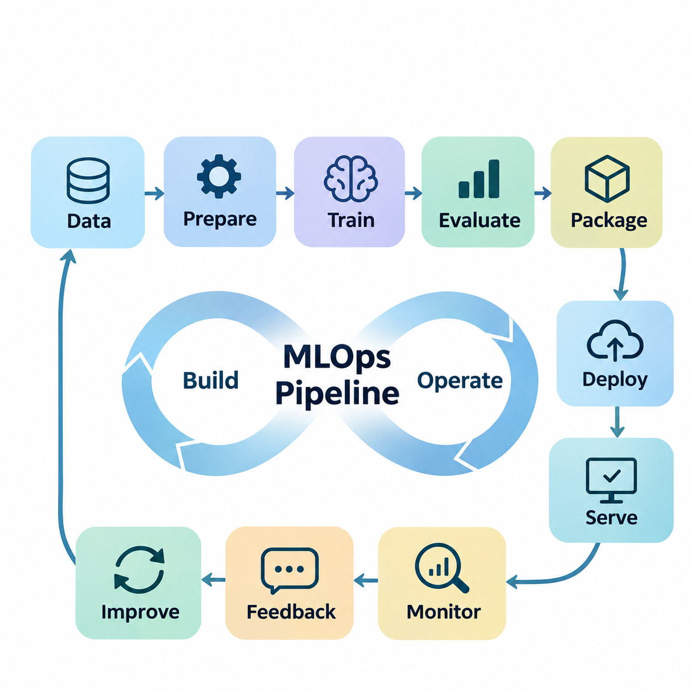
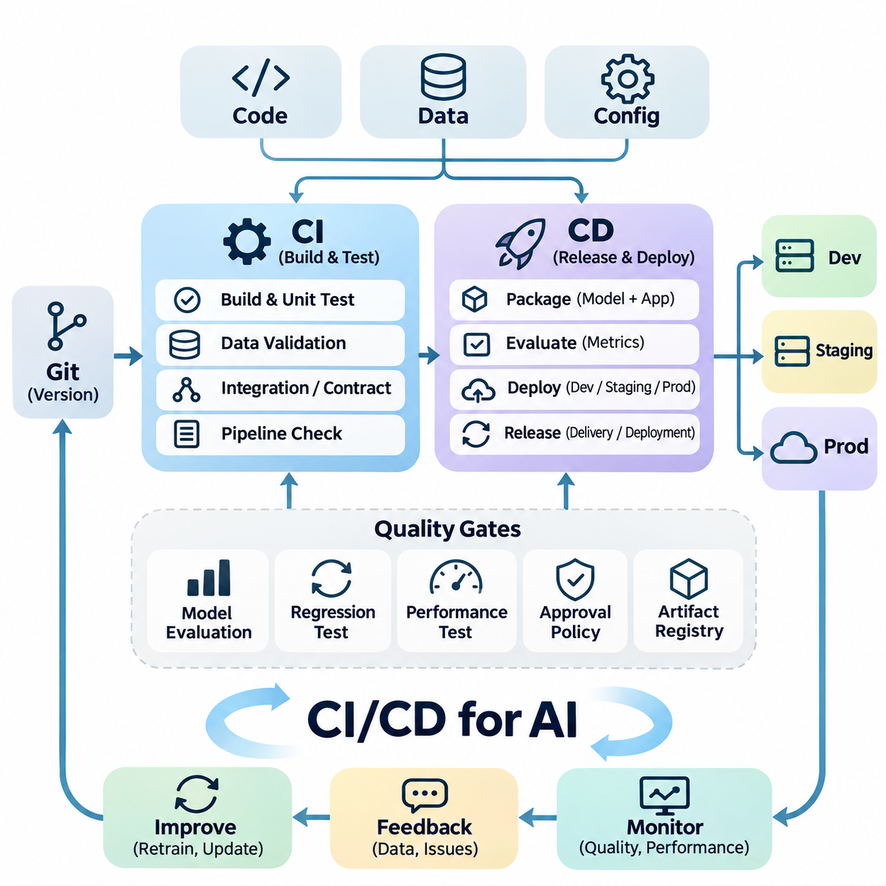
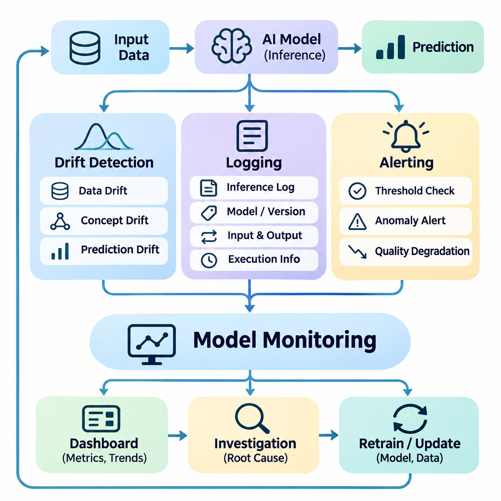
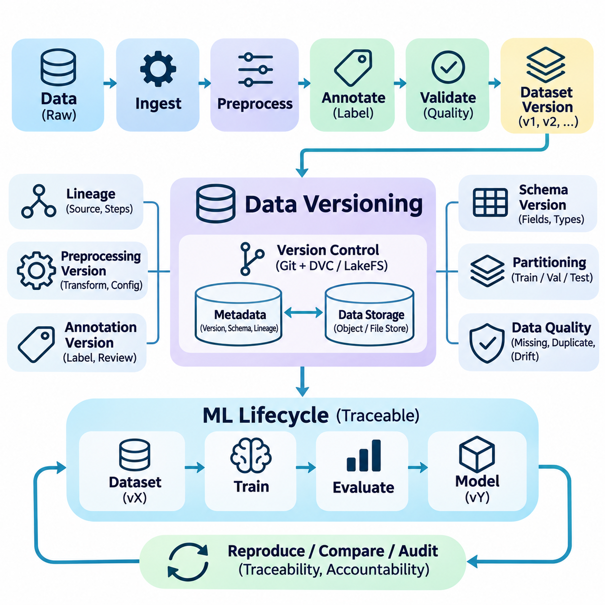
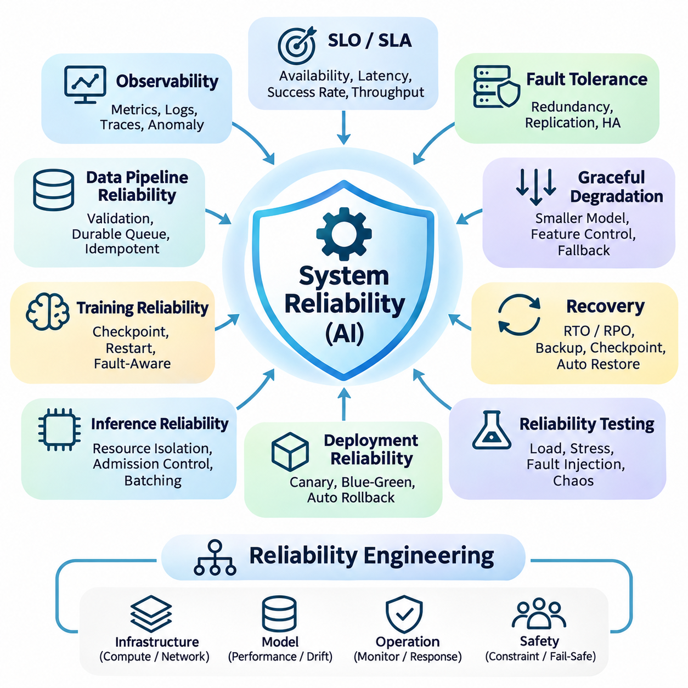
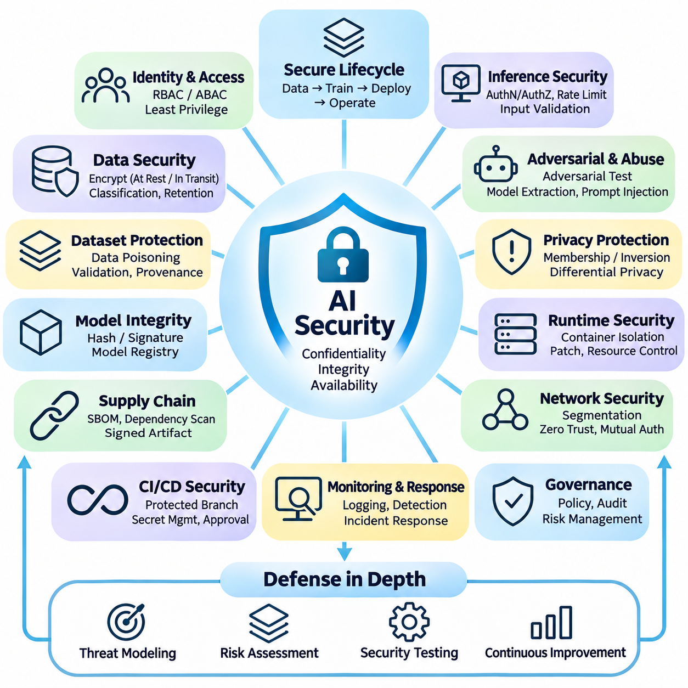
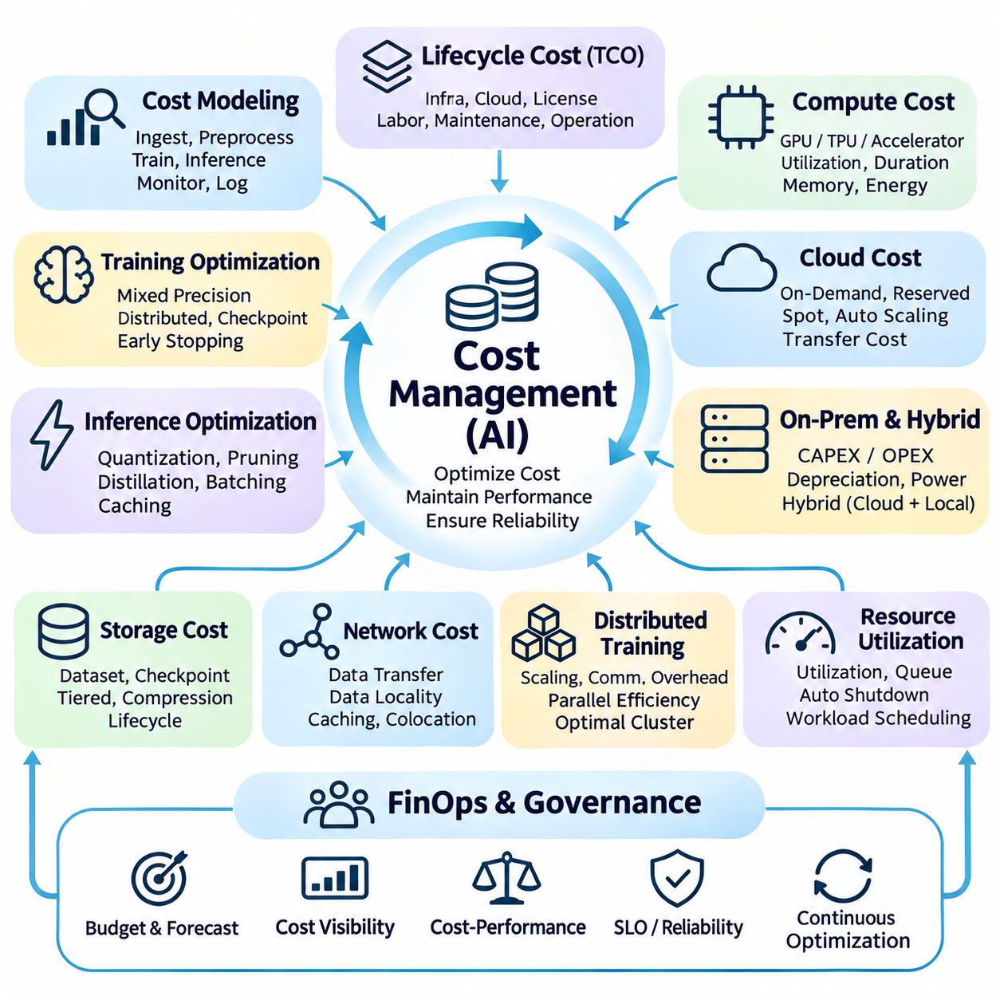

**Volume 38. AI Systems Architecture**

# 07. Engineering and Operations

## 07.01 MLOps Pipeline [w/Code]

{width="7.268055555555556in" height="7.268055555555556in"}

Machine Learning Operations (MLOps) provides the engineering framework required to transform experimental machine learning models into reliable, maintainable, and scalable production systems. An MLOps pipeline integrates data engineering, model training, validation, deployment, monitoring, and continuous improvement into a coordinated operational lifecycle. Its primary objective is to ensure that AI systems remain reproducible, observable, and dependable throughout their operation.

Unlike conventional software pipelines, MLOps must manage both executable code and continuously evolving data. Model behavior depends on training datasets, preprocessing transformations, hyperparameters, computational environments, and learned parameters. Consequently, a change in any component may alter system performance. Effective pipeline engineering establishes explicit dependencies among these components and maintains traceability across the complete machine learning lifecycle.

The architecture of an MLOps pipeline typically separates data processing, model development, artifact management, deployment orchestration, and operational monitoring. Each stage receives defined inputs, performs controlled transformations, and produces verifiable outputs. Workflow orchestration coordinates execution order, resource allocation, retries, and failure recovery. This modular architecture allows individual components to evolve without destabilizing the entire production system.

Data ingestion represents the initial operational stage, where information enters the pipeline from databases, object storage, streaming platforms, sensors, or external services. Incoming records must be validated against expected schemas, data types, temporal constraints, and quality requirements. In distributed AI systems, ingestion mechanisms must also accommodate asynchronous arrivals, network interruptions, duplicate records, and variations in source reliability.

Data preparation transforms raw observations into consistent representations suitable for machine learning. Typical operations include missing-value handling, normalization, feature extraction, categorical encoding, and dataset partitioning. These transformations should be implemented as reproducible pipeline components rather than undocumented manual procedures. Maintaining identical preprocessing semantics during training and inference is essential for preventing training-serving skew.

Dataset versioning provides a foundation for experimental reproducibility and operational accountability. Every training run should reference an identifiable dataset snapshot, preprocessing configuration, and labeling specification. Systems such as Data Version Control can associate large datasets with source-code revisions, while object storage preserves immutable artifacts. Dataset lineage enables engineers to investigate performance changes and reconstruct earlier model configurations.

Model training is executed as a managed computational workload rather than an isolated research activity. Training jobs consume versioned datasets, configuration parameters, container images, and allocated computing resources. Their outputs include model weights, optimizer states, evaluation results, and execution metadata. Distributed training may employ data parallelism, mixed precision, checkpointing, and scheduled GPU allocation to improve computational efficiency.

Experiment tracking records the relationship between model configurations and observed results. Frameworks such as MLflow can capture hyperparameters, metrics, artifacts, and model versions, allowing systematic comparisons across training runs. Tracking should include software dependencies, random seeds, hardware characteristics, and source-code revisions. These records support reproducibility, debugging, and evidence-based selection of candidate models.

Automated validation determines whether a trained model satisfies predefined acceptance criteria before deployment. Validation may include predictive accuracy, precision, recall, calibration, robustness, inference latency, and memory consumption. Evaluation datasets should remain appropriately isolated from training procedures to avoid misleading performance estimates. Production-oriented validation must also examine behavior under realistic operating conditions and representative workload distributions.

A model registry provides centralized governance over trained artifacts and their deployment status. Each registered model can be associated with a unique version, evaluation evidence, ownership information, and compatibility requirements. Promotion between development, staging, and production environments should follow explicit approval policies. Registry-based management prevents ambiguous model selection and supports controlled rollback when operational problems emerge.

Continuous Integration and Continuous Delivery extend conventional software automation into machine learning engineering. Continuous Integration verifies source code, data contracts, pipeline components, and model interfaces through automated testing. Continuous Delivery packages validated models and prepares them for controlled release. Continuous Training can additionally initiate retraining when new datasets, performance degradation, or scheduled operational policies justify model updates.

Containerization establishes consistent execution environments across development, training, and deployment infrastructure. Docker images can package model runtimes, libraries, preprocessing dependencies, and application services into reproducible units. Kubernetes provides orchestration capabilities for scheduling, scaling, service discovery, and recovery. However, container consistency alone does not guarantee reproducibility unless datasets, configurations, and model artifacts are also controlled.

Workflow orchestration platforms coordinate the execution of complex machine learning processes. Tools such as Apache Airflow, Kubeflow Pipelines, and Argo Workflows can represent dependencies among ingestion, preprocessing, training, evaluation, and deployment tasks. Their execution engines manage scheduling, retries, resource assignments, and operational visibility. Proper orchestration reduces manual intervention while making failures easier to isolate and diagnose.

Deployment architecture depends on application requirements, infrastructure constraints, and expected inference patterns. Cloud services may support centralized model serving, dynamic scaling, and shared GPU resources, whereas edge systems prioritize local responsiveness and operational independence. Hybrid deployments combine cloud-based training with edge inference. MLOps pipelines must preserve compatibility between training environments and heterogeneous production hardware.

Model release strategies reduce operational risk by introducing changes gradually. Blue-green deployment maintains separate production environments, while canary deployment directs a limited portion of traffic toward a new model. Shadow deployment evaluates candidate predictions without allowing them to influence production decisions. These strategies enable comparative assessment before full activation, although stateful and safety-critical applications may require additional safeguards.

Operational monitoring extends beyond conventional infrastructure metrics because an AI service can remain technically available while producing degraded predictions. Monitoring systems should observe inference latency, throughput, error rates, GPU utilization, prediction distributions, and model quality indicators. Where ground-truth labels become available later, delayed evaluation can estimate actual predictive performance. Monitoring thresholds should reflect application-specific reliability requirements.

Data drift and concept drift represent distinct causes of model degradation. Data drift occurs when production input distributions differ from those observed during training, while concept drift involves changes in the relationship between inputs and target outcomes. Statistical tests, feature-distribution comparisons, and performance measurements can identify potential changes. Drift detection should initiate investigation rather than automatically assume that retraining will improve the system.

Continuous learning closes the operational feedback loop by connecting production observations with future model improvements. Selected inference records, failure cases, and human-reviewed annotations can enter controlled data-curation workflows. Retraining candidates are evaluated against established baselines before promotion. This process enables adaptation to changing environments while reducing the risk of uncontrolled model updates, catastrophic forgetting, or performance regression.

Reliability engineering introduces fault tolerance, recovery procedures, and service-level objectives into the MLOps architecture. Pipelines should distinguish transient infrastructure failures from persistent data or model defects. Checkpointing supports training recovery, while idempotent processing prevents repeated operations from corrupting results. Health checks, circuit breakers, fallback models, and rollback mechanisms improve operational resilience when production components fail.

Security must be integrated throughout the pipeline rather than applied only at deployment. Data access controls, encryption, credential management, artifact signing, and vulnerability scanning protect sensitive information and computational infrastructure. Model supply-chain security requires verification of dependencies, training artifacts, and container provenance. Audit trails establish accountability for changes to datasets, model configurations, deployment permissions, and production releases.

Cost management connects technical performance with economic sustainability. Training and inference workloads consume GPU time, storage capacity, network bandwidth, and operational engineering resources. Pipeline optimization can reduce expenses through caching, incremental processing, resource scheduling, and appropriate hardware selection. Cost evaluation should consider the complete model lifecycle rather than comparing training expenditure or inference cost in isolation.

In autonomous robotics and industrial AI, MLOps must accommodate physical operating conditions and safety constraints. Sensor configurations, calibration parameters, firmware versions, and environmental conditions influence model behavior alongside software artifacts. Edge deployment requires verification of inference deadlines, computational utilization, and integration with control systems. Field observations can support retraining, but model promotion should remain subject to controlled validation.

A mature MLOps pipeline ultimately establishes a continuous connection between experimental development and dependable production operation. Its effectiveness depends on reproducible data processing, automated validation, traceable model artifacts, controlled deployment, and measurable operational feedback. By treating machine learning as an engineered system rather than a standalone algorithm, organizations can scale AI capabilities while maintaining reliability, transparency, and long-term operational efficiency.

## 07.02 CI CD for AI

{width="7.268055555555556in" height="7.268055555555556in"}

Continuous Integration and Continuous Delivery (CI/CD) for Artificial Intelligence extends conventional software engineering automation to systems whose behavior depends on source code, training data, model parameters, and computational environments. Unlike deterministic software applications, AI systems can change their predictions even when application code remains unchanged. CI/CD therefore establishes coordinated validation and release processes that address both software correctness and model quality.

Continuous Integration (CI) automatically verifies changes introduced into a shared development repository. Every code commit or pull request can trigger syntax checks, unit tests, dependency validation, interface tests, and pipeline compatibility assessments. In AI engineering, these procedures also examine preprocessing logic, feature transformations, training configurations, and inference interfaces to detect defects before they propagate into production environments.

Continuous Delivery (CD) prepares validated AI components for controlled deployment across development, staging, and production environments. The delivery process packages model artifacts, runtime dependencies, configuration files, and serving applications into reproducible releases. Automated deployment gates verify compatibility and operational readiness, while approval policies determine whether a candidate model can advance toward production activation.

Continuous Deployment differs from Continuous Delivery because validated releases may be activated automatically without a separate manual approval step. This approach is suitable when automated verification provides sufficient confidence and operational risks are manageable. Safety-critical AI applications often require additional authorization, simulation testing, or supervised acceptance procedures before new models can influence physical systems or consequential decisions.

An effective AI CI/CD architecture separates software integration, data validation, model evaluation, artifact packaging, and deployment orchestration into interconnected stages. Each stage produces measurable outputs and records execution metadata. Pipeline dependencies ensure that downstream operations begin only after required validations succeed. This structure supports modular development, failure isolation, reproducibility, and consistent engineering practices across distributed teams.

Version control provides the foundation for automated integration by maintaining traceable histories of source code and configuration changes. Git repositories commonly contain application logic, training scripts, preprocessing definitions, infrastructure specifications, and automated test configurations. Pull request reviews establish collaborative quality controls, while protected branches and required checks prevent unverified modifications from entering approved release paths.

AI pipelines additionally require explicit relationships between code versions, dataset versions, and trained model artifacts. A successful software build does not guarantee that a model was trained using the intended dataset or preprocessing configuration. Dataset identifiers, model checksums, experiment metadata, and environment manifests establish artifact lineage. These records allow engineers to reconstruct releases and investigate unexpected changes in prediction behavior.

Data validation represents an essential integration gate because corrupted or incompatible datasets can compromise otherwise correct training code. Automated checks examine schemas, missing values, feature ranges, class distributions, duplicate records, and labeling consistency. Validation rules should reflect expected domain characteristics rather than arbitrary statistical assumptions. Detected anomalies can block training, request investigation, or initiate controlled data-quality remediation.

Unit testing verifies individual AI pipeline components such as data loaders, feature transformations, loss functions, and inference adapters. Integration testing examines interactions among storage services, training frameworks, model registries, and deployment interfaces. Contract testing ensures that connected services agree on tensor shapes, data types, serialization formats, and response schemas. Together, these tests reduce failures caused by incompatible system components.

Model evaluation introduces probabilistic acceptance criteria that distinguish AI CI/CD from conventional software delivery. Candidate models are assessed using representative validation datasets and task-specific metrics such as accuracy, recall, precision, calibration, or regression error. Evaluation should include comparisons with approved baseline models. Promotion rules may reject candidates that improve aggregate accuracy while degrading important operational scenarios.

Regression testing protects established model capabilities against unintended deterioration. Reference datasets containing representative, difficult, and previously failed examples provide consistent comparison points across releases. Automated evaluation identifies changes in prediction quality, robustness, and numerical behavior. Because stochastic training can produce variable results, acceptance thresholds should account for statistical uncertainty and repeatability rather than assuming identical outputs.

Performance testing determines whether a model satisfies deployment constraints beyond predictive quality. Automated benchmarks measure inference latency, throughput, memory consumption, initialization time, and accelerator utilization. Tests should execute on representative hardware whenever practical because development workstations may differ substantially from production devices. Performance gates prevent computationally expensive models from violating operational service requirements.

Containerization enables reproducible packaging of AI services and their dependencies. Docker images can contain inference runtimes, model-serving applications, preprocessing libraries, and compatible accelerator software. Immutable image references help ensure that validated components remain unchanged during deployment. Container registries provide controlled artifact distribution, while vulnerability scanning and dependency verification strengthen release security.

CI/CD orchestration platforms such as GitHub Actions, GitLab CI/CD, Jenkins, and Argo CD automate integration and delivery workflows. Pipeline definitions describe execution triggers, validation stages, artifact dependencies, and deployment conditions. Specialized MLOps platforms can coordinate model training and evaluation alongside conventional software automation. Integration between these systems establishes consistent release management across application and machine learning components.

Model registries serve as controlled interfaces between experimentation and production delivery. Validated training outputs are registered with unique identifiers, evaluation results, dependency specifications, and deployment eligibility information. Release pipelines retrieve approved artifacts rather than selecting arbitrary training outputs. This separation ensures that model development remains flexible while production deployment follows documented governance and compatibility requirements.

Infrastructure as Code (IaC) extends reproducibility to the environments hosting AI workloads. Declarative specifications define computing instances, networking, storage, access policies, and orchestration resources. Tools such as Terraform and Kubernetes manifests allow infrastructure changes to undergo review and automated validation. Consistent infrastructure definitions reduce configuration drift between staging and production environments.

Deployment strategies should minimize disruption when introducing new AI models. Blue-green deployment maintains parallel environments, while canary deployment gradually exposes a candidate model to limited production traffic. Shadow deployment evaluates predictions without changing active decisions. These methods enable controlled comparison of model versions, although stateful applications require careful handling of sessions, cached features, and downstream dependencies.

Rollback mechanisms provide recovery when a newly deployed model exhibits unexpected behavior. A release should retain references to the previous approved model, compatible runtime image, and relevant configuration settings. Automated monitoring can detect threshold violations and initiate rollback where policies permit. Recovery procedures must also account for schema changes and persistent state that may prevent straightforward restoration of an earlier version.

Continuous Training (CT) complements CI/CD by automating model retraining under controlled conditions. Training may be triggered by scheduled updates, newly approved datasets, or evidence of performance degradation. Retraining outputs must pass the same evaluation and release gates as manually developed models. Automatic retraining should not imply automatic production promotion, particularly when data drift or feedback quality remains uncertain.

Observability connects deployment automation with production performance through structured logging, metrics, and tracing. Monitoring systems track service availability, inference latency, error rates, prediction distributions, and resource utilization. When reliable ground-truth labels become available, model-quality monitoring can identify degradation that infrastructure metrics cannot reveal. Operational feedback supports release investigations and future validation improvements.

Security controls must protect CI/CD workflows from compromised dependencies, unauthorized modifications, and malicious artifacts. Secrets management prevents credentials from appearing in repositories or build logs. Role-based access control limits deployment permissions, while artifact signing and provenance verification establish release authenticity. Isolated build environments and software supply-chain checks reduce risks associated with untrusted code and external packages.

For edge AI and robotics, CI/CD must account for heterogeneous processors, intermittent connectivity, and physical safety requirements. Release validation may include hardware-in-the-loop testing, sensor compatibility checks, inference deadline verification, and simulation-based scenario evaluation. Over-the-air updates require integrity verification and recovery mechanisms. Safety-related control functions should remain protected from unvalidated model behavior during deployment transitions.

CI/CD effectiveness can be evaluated through deployment frequency, change lead time, failure rate, recovery time, and automated test coverage. AI-specific indicators additionally include model acceptance rates, reproducibility, evaluation consistency, and performance regression frequency. These measurements reveal bottlenecks across engineering workflows. Optimization should prioritize dependable delivery and operational quality rather than maximizing release frequency alone.

A mature AI CI/CD system establishes a traceable progression from source changes and validated datasets to approved models and monitored production releases. Its architecture combines automated testing, model evaluation, reproducible packaging, controlled deployment, security enforcement, and operational feedback. By integrating software engineering discipline with machine learning lifecycle management, organizations can deliver evolving AI capabilities while maintaining reliability, accountability, and long-term system stability.

## 07.03 Model Monitoring

{width="7.268055555555556in" height="7.268055555555556in"}

Model monitoring is a fundamental operational capability that ensures deployed artificial intelligence systems continue to satisfy performance, reliability, and safety requirements. Unlike conventional software monitoring, which primarily observes service availability and infrastructure behavior, model monitoring examines prediction quality, input distributions, and evolving relationships between data and outcomes. It establishes continuous visibility into model behavior throughout the production lifecycle.

A comprehensive model monitoring architecture integrates drift detection, structured logging, and automated alerting into a unified operational framework. These components collect evidence about incoming data, inference execution, prediction results, and system conditions. Monitoring services correlate observations with model versions and deployment environments, allowing engineers to distinguish infrastructure failures from statistical changes and genuine model degradation.

Drift detection identifies changes that may invalidate assumptions established during model training. Data drift occurs when production input distributions differ from the reference training distribution, while concept drift arises when relationships between input features and target outcomes change. Prediction drift describes changes in model output distributions, although such changes do not necessarily indicate reduced accuracy. These distinctions are essential for selecting appropriate diagnostic responses.

Statistical drift detection compares reference and production data using quantitative measures. Common techniques include the Kolmogorov-Smirnov test, Population Stability Index, Jensen-Shannon divergence, and Wasserstein distance. Numerical features, categorical variables, embeddings, and temporal signals require different comparison strategies. Detection thresholds should account for sample size, natural variability, seasonality, and the consequences of false alarms.

Reference dataset selection strongly influences drift detection reliability. A fixed training baseline supports long-term comparisons, while rolling reference windows capture recent operating conditions. However, continuously updating reference distributions can conceal gradual degradation. Effective monitoring may therefore maintain both stable historical baselines and adaptive operational references, enabling engineers to distinguish expected environmental variation from persistent distribution shifts.

Concept drift is particularly challenging because changes in the relationship between inputs and correct outputs cannot always be inferred from unlabeled observations. Reliable detection generally requires delayed ground-truth labels, performance measurements, or domain-specific feedback. Techniques such as ADWIN, Page-Hinkley tests, and change-point detection can identify changes in monitored signals. Their usefulness depends on the availability and statistical properties of those signals.

Model performance monitoring evaluates whether predictive behavior continues to meet operational requirements. Classification systems may track precision, recall, calibration, and confusion patterns, while regression systems examine absolute error, squared error, and residual distributions. Detection and segmentation applications require task-specific quality indicators. Performance should also be evaluated across meaningful data segments to identify failures hidden by aggregate metrics.

Monitoring infrastructure must distinguish statistical changes from operational failures. Increased inference latency may result from GPU contention, excessive batching, memory pressure, or network congestion rather than model degradation. Conversely, prediction quality may deteriorate while service availability remains normal. Correlating application metrics, hardware telemetry, input characteristics, and model outputs enables more accurate root-cause analysis and operational decision-making.

Logging provides the persistent evidence required to reconstruct inference events and investigate abnormal behavior. Structured logs typically record timestamps, request identifiers, model versions, processing stages, execution duration, and error information. Depending on privacy and storage policies, they may also include selected input characteristics and prediction summaries. Consistent schemas allow logs from distributed components to be searched, aggregated, and analyzed efficiently.

Inference logging should support traceability without creating unnecessary computational overhead. Recording every raw input may be impractical for high-throughput video analytics, large language models, or embedded systems. Sampling, aggregation, selective retention, and asynchronous transmission can reduce storage and network consumption. Logging policies should prioritize diagnostic value while respecting latency constraints, confidentiality, and operational cost limitations.

Distributed tracing extends conventional logging by connecting related operations across multiple services. A single inference request may involve data ingestion, preprocessing, feature retrieval, model execution, postprocessing, and response delivery. Trace identifiers associate these stages with a common execution context. This visibility helps identify bottlenecks, failed dependencies, and unexpected delays within complex cloud, edge, and hybrid AI architectures.

Model-specific metadata is essential for reliable operational investigations. Logs should associate predictions with model artifact identifiers, preprocessing versions, configuration hashes, and deployment revisions. Where applicable, sensor calibration identifiers and hardware configurations provide additional context. These records allow engineers to determine whether observed behavior originated from changes in data, model parameters, runtime software, or physical operating conditions.

Logging architecture must incorporate security and privacy controls from the beginning. Sensitive inputs, personal information, authentication credentials, and proprietary model data should not be indiscriminately recorded. Access restrictions, encryption, retention limits, and audit trails reduce exposure risks. Data minimization and appropriate anonymization techniques help preserve diagnostic usefulness while supporting regulatory compliance and responsible information management.

Alerting transforms monitoring observations into actionable operational responses. Alert rules evaluate predefined conditions involving performance degradation, distribution shifts, service failures, resource exhaustion, or abnormal prediction behavior. Notifications may be delivered through monitoring dashboards, messaging platforms, incident management systems, or operational control interfaces. Effective alerting emphasizes meaningful deviations rather than generating notifications for every statistical fluctuation.

Alert thresholds should reflect application requirements, baseline variability, and operational consequences. Static thresholds are straightforward to implement but may generate false positives when workloads or environments change. Adaptive thresholds can account for historical patterns, seasonal variation, and contextual conditions. Hysteresis, minimum-duration requirements, and repeated observations help prevent unstable alert behavior caused by transient fluctuations.

Alert severity classification supports proportional incident response. Informational events may require only historical recording, while warnings can initiate investigation or additional validation. Critical alerts may trigger traffic reduction, fallback model activation, deployment rollback, or human intervention. Escalation policies should identify responsible operators and expected response times. Automated corrective actions must remain bounded by verified safety and operational constraints.

Alert correlation reduces noise by combining related symptoms into coherent incidents. A sudden increase in inference latency, GPU memory utilization, and request failures may share a common infrastructure cause. Similarly, simultaneous changes in sensor distributions and prediction confidence may indicate an environmental or calibration problem. Correlation mechanisms help operators prioritize root causes instead of responding independently to every secondary symptom.

Monitoring pipelines themselves require reliability engineering because missing telemetry can conceal production failures. Health checks should verify data collection, timestamp consistency, metric ingestion, storage availability, and alert delivery. Buffering and retry mechanisms can tolerate temporary network interruptions. Monitoring systems should explicitly distinguish healthy operation from unavailable observations, preventing missing measurements from being interpreted as evidence of normal behavior.

For edge AI and autonomous robotics, monitoring must accommodate limited bandwidth, intermittent connectivity, and strict real-time constraints. Local agents can calculate summary statistics, detect anomalies, and retain diagnostic records without relying on continuous cloud access. Critical safety responses should execute locally through validated mechanisms. Centralized platforms can aggregate fleet-level observations for trend analysis, maintenance planning, and model improvement.

Monitoring information also supports controlled continuous learning. Drift reports, prediction failures, uncertain samples, and operator feedback can identify valuable candidates for data curation and retraining. However, detecting drift does not automatically justify replacing a deployed model. Candidate updates should undergo independent validation, regression testing, and controlled deployment before production activation. This separation prevents unstable feedback loops and uncontrolled adaptation.

The effectiveness of model monitoring can be evaluated through detection delay, false-alert frequency, incident resolution time, telemetry completeness, and monitoring overhead. Additional measures include the ability to identify performance regressions before they cause significant operational impact. Monitoring quality depends on both statistical sensitivity and practical diagnostic usefulness. Excessive alerts or incomplete logs can undermine operational reliability despite sophisticated detection algorithms.

A mature model monitoring system integrates drift detection, logging, and alerting into a continuous feedback mechanism connecting production behavior with engineering decisions. Statistical analysis identifies emerging changes, structured records preserve diagnostic evidence, and actionable alerts coordinate appropriate responses. Together, these capabilities support reliable AI operations, reproducible investigations, controlled model evolution, and long-term system stability across cloud, edge, and distributed environments.

## 07.04 Data Versioning

{width="7.268055555555556in" height="7.268055555555556in"}

Data versioning is a foundational capability of modern AI engineering that enables organizations to track, reproduce, and govern datasets throughout the machine learning lifecycle. Unlike conventional software systems, where source code largely determines application behavior, AI systems depend heavily on the characteristics of training data. Changes in data composition, labeling, preprocessing, or collection conditions can significantly alter model performance even when the underlying algorithms remain unchanged.

The primary objective of data versioning is to establish a reliable relationship between datasets, processing operations, model artifacts, and experimental results. Every training run should reference an identifiable dataset state that can be reconstructed independently of subsequent modifications. This traceability allows engineers to reproduce experiments, compare model versions, investigate unexpected performance changes, and maintain accountability across collaborative development environments.

Traditional source control systems such as Git are optimized for relatively small text-based files and do not efficiently manage large collections of images, videos, sensor recordings, or numerical arrays. AI datasets frequently contain millions of samples and occupy terabytes of storage. Data versioning architectures therefore separate lightweight metadata from large binary objects, allowing source repositories to track dataset references while dedicated storage systems preserve the underlying content.

A dataset version should represent more than a directory name or timestamp. Reliable identification requires information about file contents, record membership, schema definitions, labeling conventions, preprocessing parameters, and data provenance. Content-based hashing can detect changes even when filenames remain identical. Immutable dataset snapshots preserve exact historical states, ensuring that subsequent updates do not silently modify the evidence associated with completed experiments.

Data Version Control (DVC) provides one approach for connecting large datasets and machine learning artifacts to Git-based development workflows. DVC maintains metadata files that reference externally stored content, allowing dataset changes to be associated with source code revisions. Remote storage can include object stores, network file systems, or local repositories. This separation enables collaborative experimentation without requiring every large data object to reside directly inside the Git repository.

LakeFS and similar data management systems extend version-control concepts to object storage environments. They can provide branching, commits, and reproducible data references for large-scale data processing workflows. Such systems are particularly useful when multiple teams prepare datasets concurrently or when experimental changes must remain isolated from approved production data. Their effectiveness depends on consistent metadata management, access controls, and storage policies.

Dataset lineage describes the sequence of operations through which raw observations become validated training resources. A lineage record may identify original sources, ingestion timestamps, filtering rules, annotation procedures, transformation scripts, and resulting dataset versions. This information allows engineers to determine how individual samples entered a training dataset and which processing steps influenced their representation. Lineage also supports auditing, debugging, and compliance investigations.

Preprocessing versioning is essential because identical raw data can produce different model inputs when transformation logic changes. Image resizing, normalization, tokenization, feature scaling, and sensor synchronization can alter the information presented to a model. Each dataset release should therefore reference the preprocessing implementation and configuration used to generate it. Reproducible preprocessing prevents hidden inconsistencies between historical experiments and current production pipelines.

Annotation management introduces additional complexity because labels may evolve through human review, automated labeling, or revised classification standards. A corrected bounding box, updated segmentation mask, or changed class definition can affect training outcomes. Versioning systems should record annotation revisions, reviewer decisions, labeling guidelines, and quality assessments. Separating raw observations from annotation versions enables corrections without destroying the original evidence.

Dataset partitioning must also be reproducible. Training, validation, and test subsets should be generated using documented rules and persistent identifiers rather than uncontrolled random operations. Random seeds alone may be insufficient when source records change or ordering differs. Stable partition manifests help prevent data leakage and preserve fair comparisons across experiments. Temporal and entity-based partitioning may be necessary for realistic evaluation.

Schema versioning defines how dataset structures evolve as new attributes, sensors, or application requirements emerge. Changes to feature names, data types, units, coordinate systems, or missing-value conventions can break downstream pipelines. Compatibility checks should distinguish backward-compatible extensions from changes requiring migration. Explicit schema contracts enable training, inference, and analytics services to interpret data consistently across different software and dataset versions.

Data quality validation should accompany every significant dataset revision. Automated checks can examine missing values, duplicate samples, corrupted files, class imbalance, outliers, timestamp consistency, and distribution changes. Quality reports should be linked to the corresponding dataset version rather than maintained as disconnected documents. This approach ensures that model developers can evaluate both dataset contents and the evidence supporting their suitability for training.

Large-scale data versioning requires storage-efficient strategies because duplicating complete datasets for every modification is economically impractical. Content-addressable storage, deduplication, incremental snapshots, and copy-on-write mechanisms can reduce unnecessary replication. Storage policies should balance reproducibility requirements against capacity and retrieval costs. Frequently accessed datasets may remain on high-performance storage, while older immutable versions can be archived.

Distributed training environments require consistent dataset access across multiple workers and computing nodes. A versioned dataset manifest can specify the exact objects or records expected during execution. Data loaders should detect missing or corrupted content rather than silently substituting alternative samples. When streaming datasets are used, reproducibility may require fixed manifests, source offsets, ordering policies, and documented sampling behavior to preserve experimental comparability.

Data versioning becomes especially important when training pipelines operate continuously. Newly collected observations may be added through scheduled ingestion, active learning, or production feedback. These additions should create identifiable dataset revisions rather than overwrite previously approved training resources. Automated validation gates can determine whether a new revision is eligible for retraining. Dataset promotion should remain separate from model promotion because acceptable data changes do not guarantee improved model performance.

In multimodal AI systems, versioning must preserve relationships among images, audio, text, video, and sensor measurements. Individual files may be synchronized through timestamps, sequence identifiers, calibration parameters, or shared annotations. Updating one modality without preserving its associations can corrupt training examples. Version manifests should therefore describe cross-modal dependencies and synchronization rules, enabling reliable reconstruction of complete multimodal observations.

Robotics and physical AI applications introduce additional provenance requirements involving sensor calibration, robot configuration, operating environment, and collection procedures. Camera intrinsics, coordinate transformations, firmware versions, and synchronization settings can influence the interpretation of recorded observations. Dataset metadata should capture these conditions when relevant. Such records support reproducible perception training, simulation comparisons, and investigations of field performance differences.

Security and governance are integral to trustworthy data versioning. Access permissions should restrict modification of approved datasets, while audit logs identify who introduced changes and when they occurred. Encryption and retention policies protect sensitive information. Immutable references improve accountability but must be coordinated with legal deletion requirements and privacy obligations. Governance procedures should define ownership, approval authority, and lifecycle policies for each dataset category.

Data versioning also supports incident response and controlled rollback. When a deployed model exhibits unexpected behavior, engineers can identify the exact dataset used during training and compare it with earlier approved versions. Suspected labeling errors, corrupted ingestion batches, or distribution shifts can then be isolated. Restoring a previous dataset reference enables reproducible investigation, although any resulting model replacement still requires validation and controlled deployment.

The operational value of data versioning can be assessed through experiment reproducibility, dataset retrieval time, lineage completeness, storage efficiency, and the frequency of undetected data inconsistencies. Teams should also measure how quickly they can identify the source of problematic samples and reconstruct historical training conditions. These indicators reveal whether versioning infrastructure genuinely improves engineering reliability rather than merely accumulating metadata.

A mature data versioning strategy establishes datasets as governed, traceable, and reproducible engineering artifacts. It integrates immutable snapshots, lineage tracking, preprocessing records, annotation histories, quality validation, and controlled storage management. By maintaining explicit relationships between data revisions and model development activities, organizations can support continuous learning, reliable experimentation, regulatory accountability, and long-term AI system stability.

## 07.05 System Reliability

{width="7.268055555555556in" height="7.268055555555556in"}

System reliability is a fundamental engineering requirement for artificial intelligence platforms that must operate consistently under changing workloads, uncertain data conditions, and infrastructure failures. Reliable AI systems must maintain acceptable functionality even when individual components degrade or become unavailable. This objective extends beyond model accuracy to include service availability, fault tolerance, recovery capability, operational predictability, and the preservation of safety constraints.

Reliability engineering begins by defining measurable operational expectations. Service Level Indicators (SLIs) quantify observable characteristics such as availability, inference latency, request success rate, and processing throughput. Service Level Objectives (SLOs) establish acceptable performance targets, while Service Level Agreements (SLAs) formalize external commitments. These measures translate abstract reliability requirements into verifiable operational criteria.

AI system reliability differs from conventional software reliability because statistical model behavior introduces additional uncertainty. An inference service may remain technically available while producing inaccurate or unstable predictions. Conversely, a high-quality model may become unusable because of resource exhaustion or communication failures. Reliability assessment must therefore integrate infrastructure health, software correctness, predictive performance, and application-level outcomes.

Fault tolerance enables systems to continue operating when selected components fail. Redundant services, replicated storage, alternative communication paths, and distributed execution resources can reduce dependence on individual failure points. However, redundancy must be designed around realistic failure scenarios, including correlated failures and shared infrastructure dependencies. Replication alone cannot guarantee reliability when identical defects affect every replica.

High availability architectures distribute workloads across independent computing resources and provide mechanisms for detecting and replacing failed instances. Load balancers route requests toward healthy services, while orchestration platforms restart failed containers and reschedule workloads. Health checks should distinguish temporary initialization delays from persistent failures. Effective recovery policies prevent repeated restarts from creating additional instability during incidents.

Graceful degradation allows an AI application to preserve essential functions when computational resources or supporting services become constrained. A system may reduce inference frequency, select a smaller model, disable nonessential features, or switch to a validated fallback mechanism. Degraded operation must remain within explicitly defined functional and safety limits. In safety-critical environments, entering a controlled safe state may be preferable to continuing unreliable predictions.

Recovery engineering focuses on restoring services after disruptions while minimizing data loss and operational interruption. Recovery Time Objective (RTO) defines the maximum acceptable restoration interval, while Recovery Point Objective (RPO) specifies tolerable data loss. Backup strategies, checkpointing, replicated metadata, and automated restoration procedures support these objectives. Recovery plans should be tested regularly because documented procedures may fail under actual operating conditions.

Distributed AI architectures introduce network-related reliability challenges. Communication delays, packet loss, service discovery failures, and temporary partitions can interrupt coordinated execution. Timeouts, bounded retries, circuit breakers, and idempotent operations reduce cascading failures. Retry policies must incorporate backoff and resource limits to avoid amplifying congestion. Systems should explicitly define behavior when remote dependencies become unreachable.

Data pipeline reliability is essential because corrupted or incomplete inputs can undermine otherwise healthy models. Ingestion services should validate schemas, timestamps, record integrity, and expected data availability. Durable queues and transactional processing can prevent unintended data loss or duplication. Where exactly-once processing is impractical, idempotent consumers and explicit deduplication rules can provide dependable behavior under repeated delivery.

Training reliability becomes particularly important for long-running and distributed workloads. Hardware faults, memory exhaustion, process crashes, and network interruptions may terminate expensive experiments. Periodic checkpoints preserve model parameters, optimizer states, scheduler configurations, and training progress. Restart procedures should restore compatible execution states and verify data continuity. Fault-aware scheduling can reduce wasted computation without compromising experiment reproducibility.

Inference reliability requires predictable response behavior under variable workloads. Resource isolation, admission control, batching policies, and concurrency limits help prevent overload. Latency budgets should account for preprocessing, model execution, postprocessing, and communication overhead. Tail latency is often more important than average latency for interactive and real-time applications. Capacity planning must consider peak demand rather than relying exclusively on typical utilization.

Observability provides the operational evidence needed to identify reliability problems before they become widespread failures. Metrics, structured logs, and distributed traces reveal service behavior across application and infrastructure layers. Monitoring should include error rates, resource saturation, queue depth, model execution time, and prediction anomalies. Correlating these signals helps distinguish computational bottlenecks from data quality problems and unexpected model behavior.

Automated incident detection converts monitoring signals into actionable reliability responses. Alert thresholds should reflect operational objectives and meaningful failure conditions rather than arbitrary metric fluctuations. Incident classification, escalation procedures, and response ownership support timely intervention. Automated remediation may restart services, isolate unhealthy nodes, or activate fallback configurations. Such actions require safeguards against repeated or conflicting recovery attempts.

Reliability testing evaluates whether systems behave correctly under realistic disturbances. Load testing measures performance under increasing demand, while stress testing explores behavior beyond expected capacity. Fault injection introduces controlled failures involving processes, storage, networking, or computing resources. Chaos engineering examines resilience under representative disruptions. Experiments should have defined safety boundaries and recovery procedures, particularly when production systems are involved.

Dependency management is another critical reliability concern because AI services frequently rely on databases, feature stores, message brokers, model registries, and external APIs. Failure propagation can occur when one unavailable dependency blocks multiple downstream components. Dependency isolation, caching, timeout policies, and fallback responses reduce these risks. Architecture reviews should identify shared dependencies that could create hidden single points of failure.

Reliable deployment processes must prevent software and model updates from introducing uncontrolled operational regressions. Canary releases, blue-green deployment, shadow evaluation, and staged activation provide opportunities to observe candidate versions before full adoption. Automated rollback can restore previously validated artifacts when release health deteriorates. Compatibility checks must include data schemas, runtime dependencies, model interfaces, and persistent application state.

Model reliability also depends on maintaining predictive quality as operating conditions evolve. Data drift, concept drift, sensor degradation, and changes in user behavior may reduce accuracy without causing conventional software errors. Monitoring should compare production observations against validated reference conditions and evaluate performance when ground-truth feedback becomes available. Retraining decisions should follow controlled investigation rather than assuming every detected change requires immediate model replacement.

Security and reliability are closely connected because malicious activity can disrupt availability, corrupt data, or compromise model execution. Access control, dependency verification, network segmentation, and secure artifact distribution reduce exposure to operational attacks. Resource quotas and rate limiting can protect inference services against excessive demand. Incident recovery procedures should distinguish accidental failures from security-related events requiring containment and forensic investigation.

Edge AI and autonomous robotics introduce physical reliability requirements involving sensors, actuators, power systems, thermal limits, and intermittent connectivity. Local inference must remain functional when cloud services become unavailable, provided operation remains safe. Watchdog mechanisms, sensor plausibility checks, redundant measurements, and deterministic safety controllers can support resilience. Critical protective functions should not depend exclusively on probabilistic model outputs.

Reliability engineering for real-time AI must consider deadlines as well as computational correctness. A prediction delivered after its control deadline may be operationally useless even when mathematically accurate. Scheduling policies, bounded execution times, resource reservations, and overload handling help maintain predictable timing. Worst-case execution characteristics and end-to-end latency distributions should be evaluated against application-specific requirements.

Reliability metrics should support continuous improvement rather than merely report historical uptime. Mean Time Between Failures (MTBF), Mean Time To Recovery (MTTR), incident frequency, error-budget consumption, and recovery success rates provide complementary perspectives. AI-specific measures may include prediction failure rates, fallback activation frequency, and deadline violations. These indicators help prioritize engineering investments according to operational impact.

A mature system reliability architecture combines fault tolerance, observability, controlled recovery, resilient data processing, reliable deployment, and continuous validation. Its effectiveness depends on clearly defined service objectives, realistic failure testing, and coordinated operational procedures. By treating predictive quality and infrastructure dependability as interconnected engineering responsibilities, organizations can sustain trustworthy AI services across cloud, edge, and distributed physical environments.

## 07.06 Security

{width="7.268055555555556in" height="7.268055555555556in"}

Security is a fundamental requirement of AI systems engineering because modern intelligent applications process valuable data, execute complex software, and interact with distributed infrastructure. Security architecture must protect confidentiality, integrity, and availability throughout the AI lifecycle. Unlike conventional applications, AI systems also expose learned parameters, training datasets, inference interfaces, and automated decision processes to potential attacks.

A comprehensive AI security strategy applies defense in depth across data ingestion, model development, deployment, and production operations. Each architectural layer requires explicit trust boundaries, access policies, and verification mechanisms. Threat modeling identifies valuable assets, potential adversaries, attack surfaces, and plausible failure scenarios. Security controls should be selected according to operational risk rather than relying on isolated protective technologies.

Identity and access management establishes who can interact with AI resources and which operations they may perform. Role-Based Access Control and Attribute-Based Access Control restrict permissions according to responsibilities and contextual conditions. Least-privilege policies limit unnecessary access to datasets, model registries, computing clusters, and deployment pipelines. Strong authentication and periodic permission reviews reduce the consequences of compromised accounts.

Data security begins with protecting information during collection, storage, processing, and transmission. Encryption at rest safeguards stored datasets and model artifacts, while encryption in transit protects communication between services. Key management systems control cryptographic credentials and rotation policies. Data classification, retention limits, and access auditing help organizations manage sensitive information without unnecessarily expanding its exposure.

Training datasets introduce distinctive security risks because malicious or corrupted samples can influence learned model behavior. Data poisoning attacks manipulate training examples, labels, or collection pipelines to degrade accuracy or introduce targeted behavior. Defensive measures include provenance verification, anomaly detection, dataset validation, and controlled annotation workflows. High-risk data changes should undergo independent review before entering approved training resources.

Model integrity requires protecting learned parameters, architecture definitions, and configuration artifacts against unauthorized modification. Cryptographic hashes and digital signatures can verify that deployed models match approved releases. Model registries should maintain immutable identifiers, ownership information, evaluation records, and promotion histories. These controls establish a traceable connection between validated training outputs and the models executing in production.

AI software supply chains include training frameworks, numerical libraries, container images, pretrained models, and external dependencies. Compromised components can introduce vulnerabilities even when application code appears correct. Software bills of materials, dependency scanning, artifact signing, and reproducible builds improve supply-chain visibility. External model artifacts should be treated as untrusted until their provenance and execution risks have been evaluated.

Continuous integration and deployment pipelines represent critical security boundaries because they often possess permissions to access data, build artifacts, and modify production infrastructure. Protected branches, isolated build environments, secret management, and approval gates reduce unauthorized changes. Short-lived credentials and workload identities limit credential exposure. Deployment automation should verify artifact authenticity before activating new model versions.

Inference interfaces require protection against unauthorized access, excessive requests, and malicious inputs. Authentication, authorization, rate limiting, request validation, and resource quotas reduce common service-level threats. Input filtering should enforce structural constraints without assuming that syntactically valid inputs are harmless. Monitoring abnormal request patterns helps identify automated probing, denial-of-service attempts, and unexpected workload behavior.

Adversarial machine learning introduces threats that exploit the statistical behavior of trained models. Carefully manipulated inputs may cause incorrect predictions without visibly changing the underlying object or message. Defensive strategies include adversarial testing, robustness evaluation, input consistency checks, and uncertainty-aware handling. No single defense guarantees immunity, so operational safeguards must account for residual model vulnerabilities.

Model extraction attacks attempt to reconstruct model behavior through repeated queries to an inference service. Attackers may use observed outputs to approximate proprietary decision boundaries or reproduce valuable capabilities. Query monitoring, access controls, response restrictions, and usage limits can increase attack difficulty. Protection strategies should balance confidentiality requirements against legitimate application functionality and user experience.

Privacy attacks can reveal information about data used during training. Membership inference attempts to determine whether a particular record contributed to model development, while model inversion may seek sensitive characteristics associated with learned representations. Data minimization, privacy-preserving training, controlled output exposure, and appropriate regularization can reduce risks. Differential privacy provides formal guarantees when correctly implemented and configured.

Large language models and agent systems introduce additional security challenges involving prompt injection, untrusted retrieved content, and tool misuse. Malicious instructions embedded in documents or external responses may attempt to override authorized workflows. Secure architectures separate trusted system instructions from untrusted data and restrict tool permissions. Sensitive actions should require explicit authorization and independent validation rather than relying solely on generated model responses.

Network security protects communication among training nodes, storage services, inference servers, and management platforms. Segmentation limits lateral movement when individual components become compromised. Mutual authentication, encrypted channels, firewall policies, and service identity verification strengthen distributed communication. Zero-trust principles require continuous verification of access requests instead of assuming that internal network locations are inherently trustworthy.

Runtime security focuses on protecting active AI workloads against exploitation and unauthorized resource access. Container isolation, restricted system privileges, secure configuration, and vulnerability patching reduce exposure. GPU workloads may share computational resources, requiring careful consideration of isolation and multi-tenant risks. Runtime monitoring should detect unexpected processes, suspicious network activity, configuration changes, and abnormal resource consumption.

Logging and security monitoring provide evidence for identifying attacks and reconstructing incidents. Audit records should capture authentication events, privileged operations, dataset modifications, model promotions, and deployment changes. Centralized analysis can correlate suspicious activity across distributed services. Logs must be protected against unauthorized modification and unnecessary disclosure, particularly when inference requests contain sensitive information.

Incident response procedures should define how security events are detected, contained, investigated, and resolved. Compromised credentials may require immediate revocation, while suspicious model artifacts may require quarantine and deployment rollback. Forensic preservation supports investigation without unnecessarily disrupting essential services. Recovery should restore verified components and confirm that the original vulnerability has been addressed before normal operations resume.

Security governance establishes organizational responsibilities for protecting AI assets throughout their lifecycle. Policies should define data ownership, access approval, model release authority, vulnerability management, and incident reporting. Risk assessments should consider technical threats alongside legal, contractual, and operational obligations. Regular audits and security reviews help maintain consistency as models, infrastructure, and application requirements evolve.

Edge AI and robotics require security controls that account for physical access, constrained computing resources, and intermittent connectivity. Secure boot, signed firmware, authenticated updates, and protected device credentials reduce the risk of unauthorized modification. Local systems should continue essential operations safely when remote security services are unavailable. Hardware interfaces, sensor communications, and maintenance ports require explicit protection against physical and network-based attacks.

Physical AI systems introduce additional consequences when compromised predictions influence motion, manipulation, or industrial equipment. Security architecture should separate probabilistic AI decisions from independently enforced safety constraints. Command authorization, operational boundaries, emergency-stop mechanisms, and validated fallback behavior reduce the potential impact of malicious inputs or compromised software. Security incidents must not disable essential protective functions.

Security testing should combine conventional vulnerability assessment with AI-specific adversarial evaluation. Penetration testing examines infrastructure and application weaknesses, while red-team exercises investigate model manipulation, data poisoning, and workflow abuse. Tests should include realistic threat scenarios and measurable acceptance criteria. Findings must feed into controlled remediation, regression testing, and deployment processes to prevent recurring vulnerabilities.

A mature AI security architecture integrates data protection, identity management, model integrity, supply-chain verification, adversarial robustness, runtime monitoring, and incident response. Its effectiveness depends on continuous risk assessment and coordinated controls across development and production environments. By treating security as an architectural property rather than an isolated feature, organizations can sustain trustworthy AI operations across cloud, edge, and physical systems.

## 07.07 Cost Management

{width="7.268055555555556in" height="7.268055555555556in"}

Cost management is a fundamental discipline in AI systems engineering because intelligent applications consume substantial computational, storage, networking, and operational resources. Unlike conventional software, AI workloads often involve expensive model training, continuous inference, and large-scale data processing. Effective cost management ensures that technical performance, system reliability, and business value remain economically sustainable throughout the AI lifecycle.

The total cost of ownership of an AI system includes infrastructure acquisition, cloud services, software licensing, engineering labor, maintenance, and operational support. Initial development expenses represent only part of the financial commitment. Organizations must also consider recurring inference workloads, data retention, model updates, monitoring, and hardware replacement. Lifecycle-based accounting prevents short-term optimization from creating excessive long-term expenditure.

Cost modeling begins by identifying the resources consumed by each stage of an AI pipeline. Data ingestion requires network bandwidth and storage, preprocessing consumes CPU or GPU capacity, and training demands accelerated computation. Inference introduces recurring execution costs, while monitoring and logging generate additional storage requirements. Separating these categories enables engineers to identify major cost drivers and evaluate architectural alternatives.

Compute cost is strongly influenced by accelerator selection, utilization, execution duration, and memory requirements. GPUs, TPUs, and specialized AI accelerators provide different performance characteristics and pricing structures. A device with higher theoretical throughput may not offer better economic efficiency for a particular workload. Hardware selection should therefore consider measured application performance, memory capacity, energy consumption, and total operating cost.

Training cost optimization requires balancing computational efficiency against model quality and development time. Mixed-precision training, gradient accumulation, distributed execution, and optimized data loading can improve resource utilization. Checkpointing reduces losses from interrupted experiments, while early stopping can avoid unnecessary training. However, aggressive optimization should not compromise numerical stability, reproducibility, or required predictive performance.

Inference cost becomes especially important when AI services operate continuously or process large request volumes. Model quantization, pruning, knowledge distillation, and efficient runtime compilation can reduce computational requirements. Dynamic batching improves accelerator utilization, while caching avoids repeated calculations. These techniques must be evaluated against latency, accuracy, memory consumption, and service-level objectives rather than cost reduction alone.

Cloud infrastructure provides flexible resource allocation but introduces variable operating expenses. On-demand instances support unpredictable workloads, while reserved capacity may reduce costs for stable demand. Spot or preemptible resources can be economical for interruption-tolerant tasks. Effective cloud cost management requires workload classification, automated resource scheduling, usage monitoring, and careful consideration of data transfer charges.

On-premises infrastructure involves substantial initial investment but can provide predictable capacity for sustained workloads. Financial evaluation should include hardware depreciation, electricity, cooling, networking, maintenance, and administrative labor. Dedicated accelerators may become economically attractive when utilization remains consistently high. Hybrid architectures combine local capacity with cloud resources to accommodate temporary demand without excessive permanent investment.

Storage cost management must account for dataset size, access frequency, redundancy, retention periods, and retrieval requirements. Training datasets, checkpoints, experiment artifacts, and operational logs can accumulate rapidly. Tiered storage places frequently accessed information on high-performance systems while moving older resources to economical archival services. Deduplication, compression, and lifecycle policies reduce unnecessary storage consumption without eliminating essential reproducibility records.

Network and data movement costs are frequently underestimated in distributed AI architectures. Transferring large datasets between regions, cloud providers, and local facilities can create substantial expenses. Repeated movement also increases latency and operational complexity. Data locality, caching, efficient serialization, and colocated computation reduce unnecessary transfers. Architecture decisions should evaluate the economic impact of communication alongside computational performance.

Distributed training introduces cost tradeoffs involving accelerator scaling, communication overhead, and parallel efficiency. Increasing the number of devices does not guarantee proportional reductions in training duration. Synchronization delays, network congestion, and inefficient workload partitioning can reduce utilization. Scaling efficiency should be measured using actual training throughput and total expenditure. The economically optimal cluster may be smaller than the technically fastest configuration.

Resource utilization is a central indicator of infrastructure cost efficiency. Idle accelerators, oversized instances, excessive memory reservations, and poorly scheduled jobs create avoidable expenses. Monitoring should capture utilization, queue waiting time, execution efficiency, and resource allocation patterns. Automated shutdown, workload consolidation, and scheduling policies can reduce waste. Cost optimization should preserve sufficient spare capacity for reliability and unexpected demand.

Financial observability connects infrastructure consumption to applications, teams, experiments, and business outcomes. Resource tagging, project-level accounting, and workload-specific metrics enable accurate cost attribution. Dashboards can display expenditure by model, environment, department, or processing stage. Budget thresholds and anomaly detection identify unexpected spending. Transparent allocation encourages responsible resource consumption and supports evidence-based investment decisions.

FinOps practices integrate engineering, finance, and operations into a continuous process of cost visibility and optimization. Teams establish budgets, forecast demand, evaluate resource commitments, and review actual expenditure against expectations. Cost decisions become part of architecture reviews and deployment approvals. This collaborative approach avoids treating financial management as an isolated administrative activity disconnected from technical design.

Cost-performance evaluation requires metrics that reflect useful system output rather than raw hardware capacity. Training expenditure per completed experiment, cost per inference request, cost per processed sample, and energy per prediction provide practical comparisons. These measures should be interpreted alongside accuracy, throughput, latency, and reliability. A cheaper model is not necessarily more economical if its lower quality creates additional operational work or business losses.

Edge AI introduces distinctive cost considerations involving device acquisition, power consumption, thermal management, maintenance, and deployment scale. Local inference can reduce cloud communication and recurring service expenses, but increases hardware management responsibilities. Battery-powered systems must consider energy efficiency and operational endurance. Fleet-level analysis should include device replacement, software updates, field servicing, and connectivity costs across the expected service lifetime.

Cost management for real-time and safety-critical AI systems must respect operational constraints. Redundant hardware, reserved computing capacity, and validated fallback mechanisms increase expenditure but may be necessary for dependable operation. Eliminating these resources solely to improve utilization can create unacceptable risks. Economic optimization should therefore distinguish discretionary overhead from infrastructure required to satisfy safety, availability, and timing guarantees.

Model lifecycle management also affects long-term expenditure. Frequent retraining, repeated evaluation, artifact storage, and deployment validation can generate substantial cumulative costs. Retraining should be triggered by measurable performance degradation, meaningful data changes, or justified business requirements. Reusing validated components and maintaining reproducible experiments reduces duplicated effort. Automated evaluation pipelines help control operational costs while preserving quality standards.

Cost forecasting must account for uncertainty in user demand, dataset growth, model complexity, and hardware availability. Scenario analysis can estimate expenditure under expected, optimistic, and high-demand conditions. Sensitivity analysis identifies assumptions that most strongly influence financial outcomes. Capacity forecasts should incorporate growth margins without encouraging excessive overprovisioning. Regular revisions keep financial plans aligned with observed workload behavior.

Economic governance establishes decision-making rules for resource allocation, procurement, and operational expenditure. Approval thresholds, spending limits, ownership assignments, and periodic reviews improve accountability. Engineering teams should document the expected benefits of expensive training runs or infrastructure upgrades. Procurement decisions must consider vendor dependence, licensing restrictions, support availability, and migration costs rather than comparing purchase prices alone.

A mature AI cost management strategy integrates lifecycle accounting, infrastructure optimization, financial observability, workload scheduling, and continuous performance evaluation. Its objective is not simply to minimize expenditure but to maximize useful outcomes within defined quality, reliability, and safety constraints. By connecting architectural decisions with measurable economic consequences, organizations can build scalable and financially sustainable AI systems across cloud, edge, and distributed environments.
