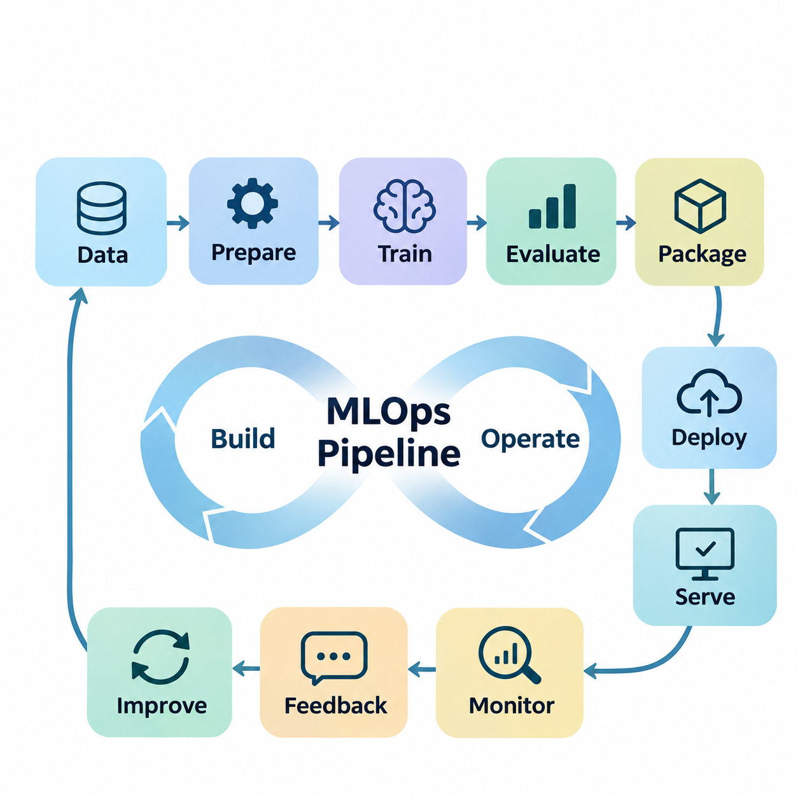
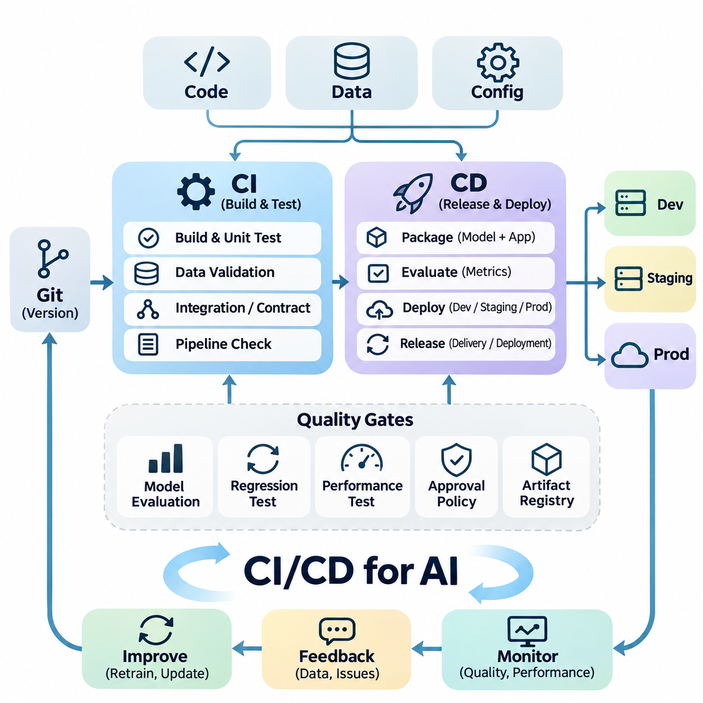
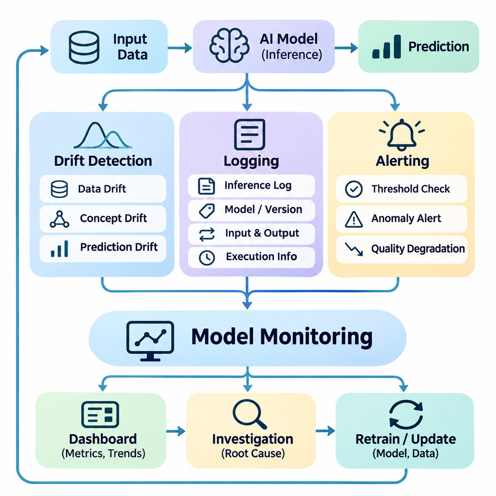
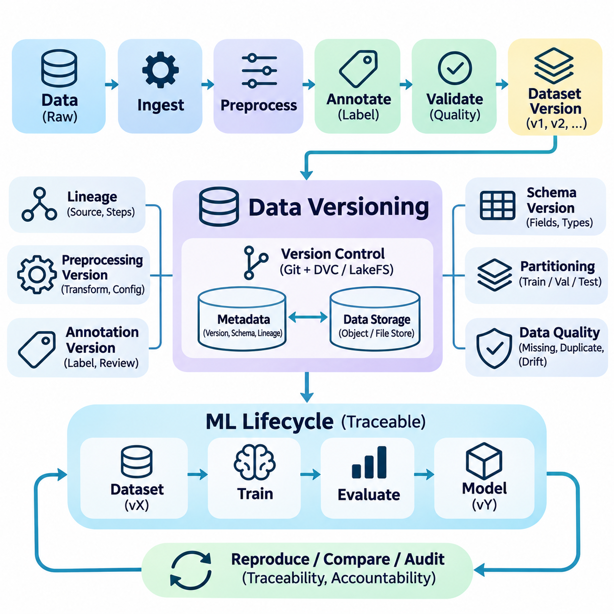
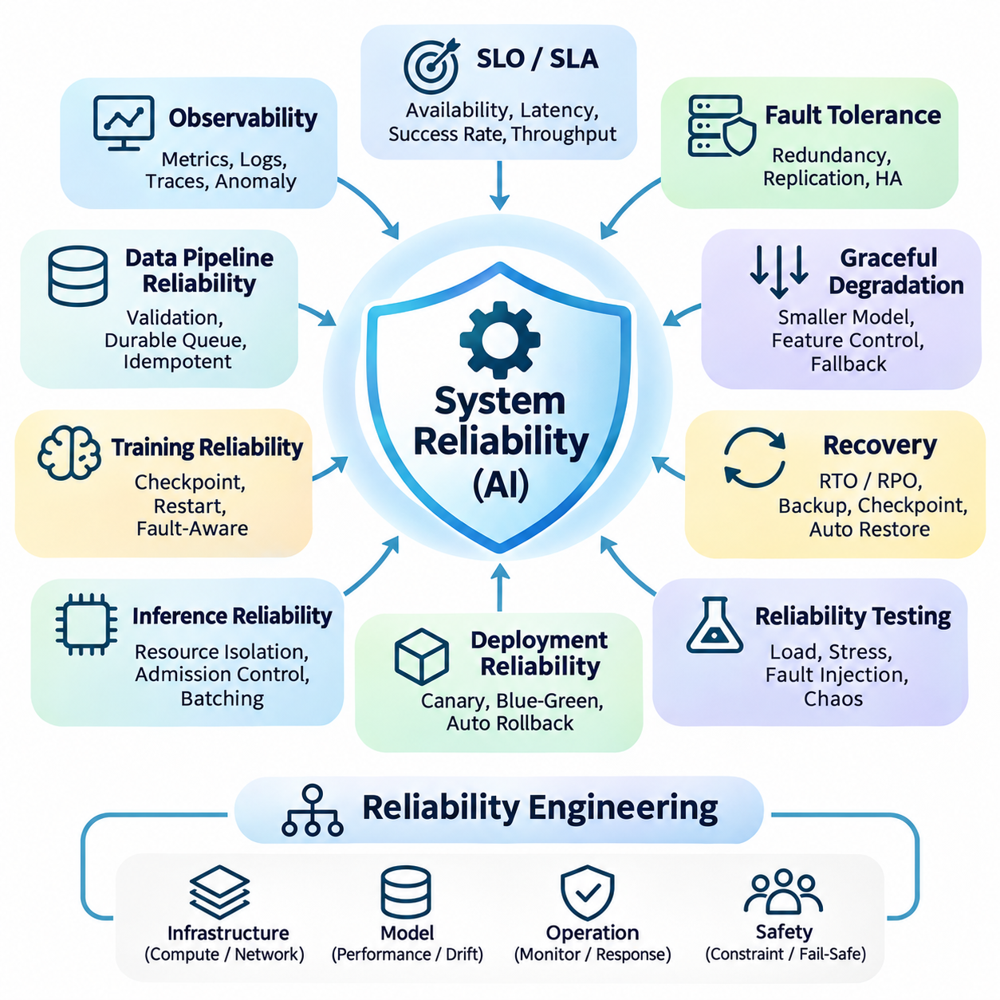
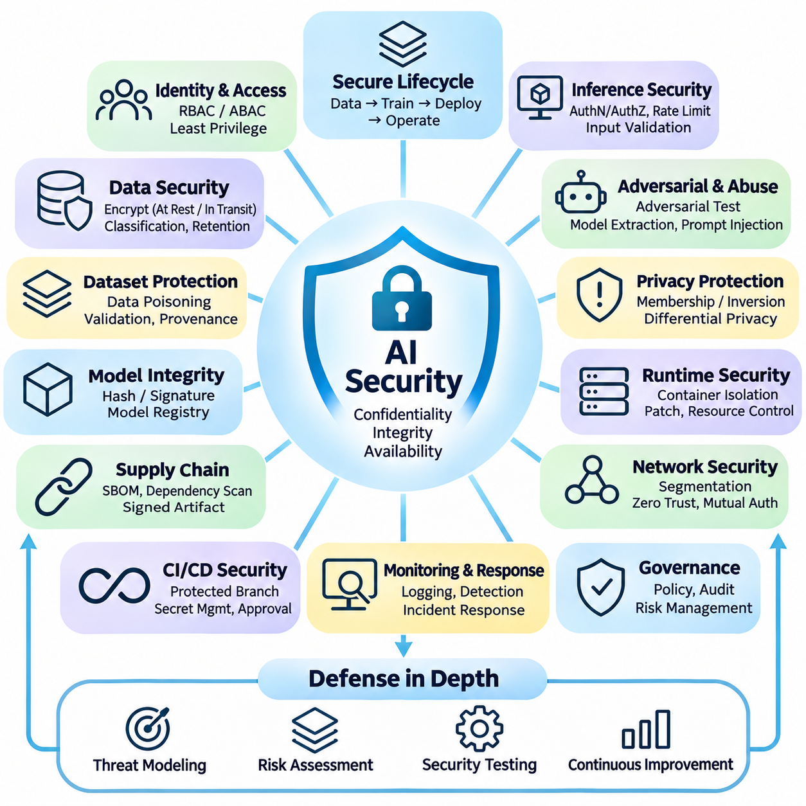
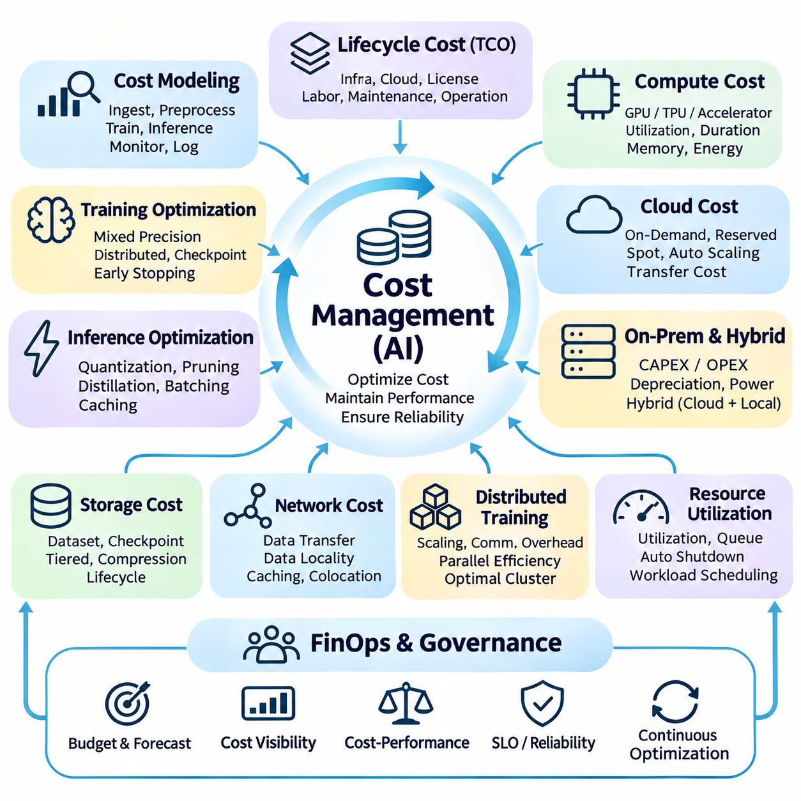

**Volume 38. AI Systems Architecture**

# 07. Engineering and Operations

## 07.01 MLOps Pipeline [w/Code]

{width="7.268055555555556in" height="7.268055555555556in"}

기계학습 운영(Machine Learning Operations, MLOps)은 실험적인 기계학습(Machine Learning) 모델을 신뢰성과 유지보수성, 확장성을 갖춘 운영 시스템(Production System)으로 전환하기 위한 엔지니어링 프레임워크(Engineering Framework)를 제공한다. MLOps 파이프라인(MLOps Pipeline)은 데이터 엔지니어링(Data Engineering), 모델 학습(Model Training), 검증(Validation), 배포(Deployment), 모니터링(Monitoring), 지속적 개선(Continuous Improvement)을 통합된 운영 생명주기(Operational Lifecycle)로 연결한다. 주요 목표는 인공지능 시스템의 재현성(Reproducibility), 관측 가능성(Observability), 신뢰성(Reliability)을 지속적으로 보장하는 것이다.

기존 소프트웨어 파이프라인(Software Pipeline)과 달리 MLOps는 실행 코드(Executable Code)뿐 아니라 지속적으로 변화하는 데이터(Data)까지 관리해야 한다. 모델의 동작은 학습 데이터셋(Training Dataset), 전처리 변환(Preprocessing Transformation), 하이퍼파라미터(Hyperparameter), 컴퓨팅 환경(Computing Environment), 학습된 매개변수(Learned Parameters)에 따라 달라진다. 따라서 어느 하나의 구성요소가 변경되어도 시스템 성능에 영향을 줄 수 있다. 효과적인 파이프라인 엔지니어링(Pipeline Engineering)은 이러한 구성요소 사이의 의존성(Dependency)을 명확히 정의하고 전체 기계학습 생명주기에 걸친 추적 가능성(Traceability)을 유지한다.

MLOps 파이프라인의 아키텍처(Architecture)는 일반적으로 데이터 처리(Data Processing), 모델 개발(Model Development), 산출물 관리(Artifact Management), 배포 오케스트레이션(Deployment Orchestration), 운영 모니터링(Operational Monitoring)을 분리한다. 각 단계는 정의된 입력(Input)을 받아 제어된 변환(Controlled Transformation)을 수행하고 검증 가능한 출력(Output)을 생성한다. 워크플로 오케스트레이션(Workflow Orchestration)은 실행 순서, 자원 할당(Resource Allocation), 재시도(Retry), 장애 복구(Failure Recovery)를 조정한다. 이러한 모듈형 아키텍처(Modular Architecture)는 전체 운영 시스템의 안정성을 유지하면서 개별 구성요소를 개선할 수 있도록 한다.

데이터 수집(Data Ingestion)은 데이터베이스(Database), 객체 저장소(Object Storage), 스트리밍 플랫폼(Streaming Platform), 센서(Sensor), 외부 서비스(External Service)에서 정보가 파이프라인으로 유입되는 최초의 운영 단계이다. 입력 데이터는 예상되는 스키마(Schema), 데이터 유형(Data Type), 시간적 제약(Temporal Constraint), 품질 요구사항(Quality Requirement)에 따라 검증되어야 한다. 분산 인공지능 시스템(Distributed AI System)에서는 비동기 데이터 도착(Asynchronous Arrival), 네트워크 중단(Network Interruption), 중복 레코드(Duplicate Record), 데이터 출처별 신뢰성 차이까지 처리할 수 있어야 한다.

데이터 준비(Data Preparation)는 원시 관측 데이터(Raw Observation)를 기계학습에 적합한 일관된 표현(Consistent Representation)으로 변환하는 과정이다. 대표적인 작업에는 결측값 처리(Missing-Value Handling), 정규화(Normalization), 특징 추출(Feature Extraction), 범주형 인코딩(Categorical Encoding), 데이터셋 분할(Dataset Partitioning)이 포함된다. 이러한 변환은 문서화되지 않은 수작업이 아니라 재현 가능한 파이프라인 구성요소로 구현해야 한다. 특히 학습과 추론(Inference) 과정에서 동일한 전처리 의미와 규칙을 유지해야 학습-서빙 불일치(Training-Serving Skew)를 방지할 수 있다.

데이터셋 버전 관리(Dataset Versioning)는 실험 재현성(Experimental Reproducibility)과 운영 책임성(Operational Accountability)의 기반을 제공한다. 모든 학습 실행(Training Run)은 식별 가능한 데이터셋 스냅샷(Dataset Snapshot), 전처리 설정(Preprocessing Configuration), 라벨링 명세(Labeling Specification)를 참조해야 한다. 데이터 버전 관리(Data Version Control, DVC)와 같은 시스템은 대규모 데이터셋을 소스 코드 버전(Source-Code Revision)과 연결하며, 객체 저장소(Object Storage)는 변경 불가능한 산출물(Immutable Artifact)을 보존한다. 데이터 계보(Data Lineage)는 성능 변화의 원인을 조사하고 이전 모델 구성을 재구성할 수 있도록 지원한다.

모델 학습(Model Training)은 독립적인 연구 활동이 아니라 관리되는 컴퓨팅 작업(Managed Computational Workload)으로 실행된다. 학습 작업은 버전이 지정된 데이터셋, 설정 매개변수(Configuration Parameter), 컨테이너 이미지(Container Image), 할당된 컴퓨팅 자원(Computing Resource)을 사용한다. 결과물에는 모델 가중치(Model Weight), 옵티마이저 상태(Optimizer State), 평가 결과(Evaluation Result), 실행 메타데이터(Execution Metadata)가 포함된다. 분산 학습(Distributed Training)은 데이터 병렬화(Data Parallelism), 혼합 정밀도(Mixed Precision), 체크포인팅(Checkpointing), GPU 자원 스케줄링(Resource Scheduling)을 활용하여 계산 효율성을 향상시킬 수 있다.

실험 추적(Experiment Tracking)은 모델 설정(Model Configuration)과 관측된 결과 사이의 관계를 기록한다. MLflow와 같은 프레임워크(Framework)는 하이퍼파라미터(Hyperparameter), 평가 지표(Metric), 산출물(Artifact), 모델 버전(Model Version)을 기록하여 여러 학습 실행을 체계적으로 비교할 수 있도록 한다. 추적 정보에는 소프트웨어 의존성(Software Dependency), 난수 시드(Random Seed), 하드웨어 특성(Hardware Characteristics), 소스 코드 버전(Source-Code Revision)도 포함해야 한다. 이러한 기록은 재현성, 디버깅(Debugging), 근거 기반 모델 선택(Evidence-Based Model Selection)을 지원한다.

자동 검증(Automated Validation)은 학습된 모델이 배포 전에 정의된 승인 기준(Acceptance Criteria)을 충족하는지 판단한다. 검증에는 예측 정확도(Predictive Accuracy), 정밀도(Precision), 재현율(Recall), 보정도(Calibration), 강건성(Robustness), 추론 지연시간(Inference Latency), 메모리 사용량(Memory Consumption)이 포함될 수 있다. 평가 데이터셋(Evaluation Dataset)은 오해를 유발하는 성능 추정을 방지하기 위해 학습 절차와 적절히 분리해야 한다. 운영 환경 중심의 검증은 실제 동작 조건(Operating Conditions)과 대표적인 작업 부하 분포(Workload Distribution)도 고려해야 한다.

모델 레지스트리(Model Registry)는 학습된 산출물과 배포 상태(Deployment Status)에 대한 중앙 집중형 거버넌스(Centralized Governance)를 제공한다. 등록된 각 모델은 고유 버전(Unique Version), 평가 근거(Evaluation Evidence), 소유권 정보(Ownership Information), 호환성 요구사항(Compatibility Requirement)과 연결될 수 있다. 개발(Development), 스테이징(Staging), 운영(Production) 환경 사이의 모델 승격(Model Promotion)은 명확한 승인 정책(Approval Policy)을 따라야 한다. 레지스트리 기반 관리(Registry-Based Management)는 모델 선택의 모호성을 방지하고 운영 문제가 발생했을 때 제어된 롤백(Rollback)을 지원한다.

지속적 통합(Continuous Integration, CI)과 지속적 전달(Continuous Delivery, CD)은 기존 소프트웨어 자동화를 기계학습 엔지니어링으로 확장한다. 지속적 통합은 자동화된 테스트(Automated Testing)를 통해 소스 코드, 데이터 계약(Data Contract), 파이프라인 구성요소, 모델 인터페이스(Model Interface)를 검증한다. 지속적 전달은 검증된 모델을 패키징(Packaging)하고 제어된 배포를 준비한다. 지속적 학습(Continuous Training, CT)은 새로운 데이터셋, 성능 저하(Performance Degradation), 정기적인 운영 정책에 따라 재학습(Retraining)을 시작할 수 있다.

컨테이너화(Containerization)는 개발, 학습, 배포 인프라(Infrastructure) 전반에서 일관된 실행 환경(Execution Environment)을 구축한다. 도커(Docker) 이미지에는 모델 런타임(Model Runtime), 라이브러리(Library), 전처리 의존성(Preprocessing Dependency), 애플리케이션 서비스(Application Service)를 재현 가능한 단위로 패키징할 수 있다. 쿠버네티스(Kubernetes)는 스케줄링(Scheduling), 확장(Scaling), 서비스 탐색(Service Discovery), 복구(Recovery)를 위한 오케스트레이션 기능을 제공한다. 그러나 데이터셋, 설정, 모델 산출물이 함께 관리되지 않으면 컨테이너의 일관성만으로 전체 시스템의 재현성을 보장할 수 없다.

워크플로 오케스트레이션 플랫폼(Workflow Orchestration Platform)은 복잡한 기계학습 프로세스의 실행을 조정한다. 아파치 에어플로(Apache Airflow), 쿠브플로 파이프라인(Kubeflow Pipelines), 아르고 워크플로(Argo Workflows)와 같은 도구는 데이터 수집, 전처리, 학습, 평가, 배포 작업 사이의 의존성을 표현할 수 있다. 실행 엔진(Execution Engine)은 일정 관리(Scheduling), 재시도(Retry), 자원 할당(Resource Assignment), 운영 가시성(Operational Visibility)을 담당한다. 적절한 오케스트레이션은 수동 개입을 줄이고 장애 원인을 보다 쉽게 분리하고 진단할 수 있도록 한다.

배포 아키텍처(Deployment Architecture)는 애플리케이션 요구사항(Application Requirement), 인프라 제약(Infrastructure Constraint), 예상 추론 패턴(Inference Pattern)에 따라 달라진다. 클라우드 서비스(Cloud Service)는 중앙 집중형 모델 서빙(Centralized Model Serving), 동적 확장(Dynamic Scaling), 공유 GPU 자원(Shared GPU Resource)을 지원할 수 있으며, 엣지 시스템(Edge System)은 로컬 응답성(Local Responsiveness)과 운영 독립성(Operational Independence)을 우선한다. 하이브리드 배포(Hybrid Deployment)는 클라우드 기반 학습(Cloud-Based Training)과 엣지 추론(Edge Inference)을 결합한다. MLOps 파이프라인은 학습 환경과 이기종 운영 하드웨어(Heterogeneous Production Hardware) 사이의 호환성을 유지해야 한다.

모델 릴리스 전략(Model Release Strategy)은 변경 사항을 점진적으로 도입하여 운영 위험(Operational Risk)을 줄인다. 블루-그린 배포(Blue-Green Deployment)는 별도의 운영 환경을 유지하며, 카나리 배포(Canary Deployment)는 제한된 트래픽(Traffic)을 새로운 모델로 전달한다. 섀도 배포(Shadow Deployment)는 후보 모델의 예측이 실제 운영 결정에 영향을 주지 않도록 하면서 성능을 평가한다. 이러한 전략은 전체 활성화(Full Activation) 이전에 비교 평가(Comparative Evaluation)를 가능하게 하지만, 상태 유지형(Stateful) 및 안전 필수(Safety-Critical) 애플리케이션에서는 추가적인 보호 조치가 필요할 수 있다.

운영 모니터링(Operational Monitoring)은 인공지능 서비스가 기술적으로 정상 작동하면서도 예측 품질(Prediction Quality)이 저하될 수 있기 때문에 기존 인프라 지표(Infrastructure Metric)를 넘어 확장되어야 한다. 모니터링 시스템은 추론 지연시간(Inference Latency), 처리량(Throughput), 오류율(Error Rate), GPU 사용률(GPU Utilization), 예측 분포(Prediction Distribution), 모델 품질 지표(Model Quality Indicator)를 관찰해야 한다. 정답 레이블(Ground-Truth Label)이 나중에 확보되는 경우 지연 평가(Delayed Evaluation)를 통해 실제 예측 성능을 추정할 수 있다. 모니터링 임계값(Monitoring Threshold)은 애플리케이션별 신뢰성 요구사항을 반영해야 한다.

데이터 드리프트(Data Drift)와 개념 드리프트(Concept Drift)는 모델 성능 저하(Model Degradation)를 유발하는 서로 다른 원인이다. 데이터 드리프트는 운영 입력 분포(Production Input Distribution)가 학습 중 관측된 분포와 달라질 때 발생하며, 개념 드리프트는 입력과 목표 출력(Target Outcome) 사이의 관계가 변화할 때 발생한다. 통계적 검정(Statistical Test), 특징 분포 비교(Feature-Distribution Comparison), 성능 측정(Performance Measurement)을 통해 잠재적인 변화를 탐지할 수 있다. 드리프트 탐지(Drift Detection)는 재학습이 반드시 성능을 개선한다고 가정하기보다 원인 조사를 시작하는 근거로 활용해야 한다.

지속적 학습(Continuous Learning)은 운영 관측 결과(Production Observation)를 향후 모델 개선과 연결하여 운영 피드백 루프(Operational Feedback Loop)를 완성한다. 선별된 추론 기록(Inference Record), 실패 사례(Failure Case), 사람이 검토한 주석(Human-Reviewed Annotation)은 통제된 데이터 큐레이션(Data Curation) 워크플로로 전달될 수 있다. 재학습 후보 모델(Retraining Candidate Model)은 승격 전에 기존 기준 모델(Baseline Model)과 비교 평가된다. 이러한 과정은 통제되지 않은 모델 업데이트(Model Update), 파국적 망각(Catastrophic Forgetting), 성능 회귀(Performance Regression)의 위험을 줄이면서 변화하는 환경에 적응할 수 있도록 한다.

신뢰성 엔지니어링(Reliability Engineering)은 내결함성(Fault Tolerance), 복구 절차(Recovery Procedure), 서비스 수준 목표(Service-Level Objective, SLO)를 MLOps 아키텍처에 도입한다. 파이프라인은 일시적인 인프라 장애(Transient Infrastructure Failure)와 지속적인 데이터 또는 모델 결함(Persistent Defect)을 구분해야 한다. 체크포인팅(Checkpointing)은 학습 복구를 지원하고, 멱등 처리(Idempotent Processing)는 반복 실행으로 인한 결과 손상을 방지한다. 상태 확인(Health Check), 회로 차단기(Circuit Breaker), 대체 모델(Fallback Model), 롤백 메커니즘(Rollback Mechanism)은 운영 구성요소에 장애가 발생했을 때 시스템 복원력(Operational Resilience)을 향상시킨다.

보안(Security)은 배포 단계에만 적용하는 것이 아니라 파이프라인 전체에 통합되어야 한다. 데이터 접근 제어(Data Access Control), 암호화(Encryption), 자격 증명 관리(Credential Management), 산출물 서명(Artifact Signing), 취약점 검사(Vulnerability Scanning)는 민감한 정보와 컴퓨팅 인프라를 보호한다. 모델 공급망 보안(Model Supply-Chain Security)은 의존성, 학습 산출물, 컨테이너 출처(Container Provenance)에 대한 검증을 요구한다. 감사 추적(Audit Trail)은 데이터셋, 모델 설정, 배포 권한, 운영 릴리스의 변경 사항에 대한 책임성과 추적 가능성을 확보한다.

비용 관리(Cost Management)는 기술적 성능(Technical Performance)과 경제적 지속 가능성(Economic Sustainability)을 연결한다. 학습과 추론 작업은 GPU 사용 시간(GPU Time), 저장 용량(Storage Capacity), 네트워크 대역폭(Network Bandwidth), 운영 엔지니어링 자원(Engineering Resource)을 소비한다. 파이프라인 최적화(Pipeline Optimization)는 캐싱(Caching), 증분 처리(Incremental Processing), 자원 스케줄링(Resource Scheduling), 적절한 하드웨어 선택(Hardware Selection)을 통해 비용을 절감할 수 있다. 비용 평가는 학습 비용이나 추론 비용만 개별적으로 비교하는 것이 아니라 전체 모델 생명주기(Model Lifecycle)를 고려해야 한다.

자율주행 로보틱스(Autonomous Robotics)와 산업용 인공지능(Industrial AI)에서 MLOps는 물리적 운영 조건(Physical Operating Condition)과 안전 제약(Safety Constraint)을 수용해야 한다. 센서 구성(Sensor Configuration), 보정 매개변수(Calibration Parameter), 펌웨어 버전(Firmware Version), 환경 조건(Environmental Condition)은 소프트웨어 산출물과 함께 모델 동작에 영향을 준다. 엣지 배포(Edge Deployment)는 추론 마감시간(Inference Deadline), 계산 자원 사용률(Computational Utilization), 제어 시스템 통합(Control System Integration)에 대한 검증을 요구한다. 현장 관측(Field Observation)은 재학습에 활용될 수 있지만, 모델 승격은 통제된 검증 절차를 따라야 한다.

성숙한 MLOps 파이프라인(Mature MLOps Pipeline)은 궁극적으로 실험적 개발(Experimental Development)과 신뢰할 수 있는 운영 환경(Production Operation) 사이에 지속적인 연결을 구축한다. 그 효과는 재현 가능한 데이터 처리(Reproducible Data Processing), 자동 검증(Automated Validation), 추적 가능한 모델 산출물(Traceable Model Artifact), 제어된 배포(Controlled Deployment), 측정 가능한 운영 피드백(Measurable Operational Feedback)에 달려 있다. 기계학습을 독립적인 알고리즘(Standalone Algorithm)이 아니라 엔지니어링 시스템(Engineered System)으로 다룸으로써 조직은 신뢰성, 투명성(Transparency), 장기적인 운영 효율성(Operational Efficiency)을 유지하면서 인공지능 역량을 확장할 수 있다.

## 07.02 CI CD for AI

{width="7.268055555555556in" height="7.268055555555556in"}

인공지능을 위한 지속적 통합(Continuous Integration, CI)과 지속적 전달(Continuous Delivery, CD)은 기존 소프트웨어 엔지니어링 자동화(Software Engineering Automation)를 소스 코드(Source Code), 학습 데이터(Training Data), 모델 매개변수(Model Parameters), 컴퓨팅 환경(Computational Environment)에 따라 동작이 결정되는 시스템으로 확장한다. 결정론적 소프트웨어 애플리케이션(Deterministic Software Application)과 달리 인공지능 시스템은 애플리케이션 코드가 변경되지 않아도 예측 결과가 달라질 수 있다. 따라서 CI/CD는 소프트웨어 정확성(Software Correctness)과 모델 품질(Model Quality)을 모두 다루는 통합된 검증 및 릴리스 프로세스(Release Process)를 구축한다.

지속적 통합(Continuous Integration, CI)은 공유 개발 저장소(Shared Development Repository)에 도입되는 변경 사항을 자동으로 검증한다. 모든 코드 커밋(Code Commit)이나 풀 리퀘스트(Pull Request)는 구문 검사(Syntax Check), 단위 테스트(Unit Test), 의존성 검증(Dependency Validation), 인터페이스 테스트(Interface Test), 파이프라인 호환성 평가(Pipeline Compatibility Assessment)를 실행할 수 있다. 인공지능 엔지니어링에서는 전처리 로직(Preprocessing Logic), 특징 변환(Feature Transformation), 학습 설정(Training Configuration), 추론 인터페이스(Inference Interface)까지 검사하여 결함이 운영 환경(Production Environment)으로 전파되기 전에 탐지한다.

지속적 전달(Continuous Delivery, CD)은 검증된 인공지능 구성요소를 개발(Development), 스테이징(Staging), 운영(Production) 환경에 제어된 방식으로 배포할 수 있도록 준비한다. 전달 프로세스는 모델 산출물(Model Artifact), 런타임 의존성(Runtime Dependency), 설정 파일(Configuration File), 서빙 애플리케이션(Serving Application)을 재현 가능한 릴리스(Reproducible Release)로 패키징한다. 자동화된 배포 게이트(Deployment Gate)는 호환성과 운영 준비 상태(Operational Readiness)를 검증하며, 승인 정책(Approval Policy)은 후보 모델이 운영 활성화 단계로 진행할 수 있는지를 결정한다.

지속적 배포(Continuous Deployment)는 검증된 릴리스가 별도의 수동 승인(Manual Approval) 없이 자동으로 활성화될 수 있다는 점에서 지속적 전달(Continuous Delivery)과 구별된다. 이러한 접근 방식은 자동화된 검증(Automated Verification)이 충분한 신뢰성을 제공하고 운영 위험(Operational Risk)을 관리할 수 있는 경우에 적합하다. 안전 필수 인공지능 애플리케이션(Safety-Critical AI Application)은 새로운 모델이 물리적 시스템(Physical System)이나 중대한 의사결정(Consequential Decision)에 영향을 미치기 전에 추가 승인(Authorization), 시뮬레이션 테스트(Simulation Testing), 감독하의 인수 절차(Supervised Acceptance Procedure)를 요구하는 경우가 많다.

효과적인 인공지능 CI/CD 아키텍처(CI/CD Architecture)는 소프트웨어 통합(Software Integration), 데이터 검증(Data Validation), 모델 평가(Model Evaluation), 산출물 패키징(Artifact Packaging), 배포 오케스트레이션(Deployment Orchestration)을 상호 연결된 단계로 분리한다. 각 단계는 측정 가능한 출력(Measurable Output)을 생성하고 실행 메타데이터(Execution Metadata)를 기록한다. 파이프라인 의존성(Pipeline Dependency)은 필요한 검증이 성공한 이후에만 후속 작업이 시작되도록 보장한다. 이러한 구조는 모듈형 개발(Modular Development), 장애 격리(Failure Isolation), 재현성(Reproducibility), 분산 개발팀(Distributed Team) 전반의 일관된 엔지니어링 관행을 지원한다.

버전 관리(Version Control)는 소스 코드와 설정 변경 사항에 대한 추적 가능한 이력(Traceable History)을 유지함으로써 자동화된 통합의 기반을 제공한다. 깃(Git) 저장소에는 일반적으로 애플리케이션 로직(Application Logic), 학습 스크립트(Training Script), 전처리 정의(Preprocessing Definition), 인프라 명세(Infrastructure Specification), 자동화 테스트 설정(Automated Test Configuration)이 포함된다. 풀 리퀘스트 검토(Pull Request Review)는 협업 기반 품질 관리(Collaborative Quality Control)를 수행하며, 보호된 브랜치(Protected Branch)와 필수 검사(Required Check)는 검증되지 않은 변경 사항이 승인된 릴리스 경로로 유입되는 것을 방지한다.

인공지능 파이프라인은 코드 버전(Code Version), 데이터셋 버전(Dataset Version), 학습된 모델 산출물(Trained Model Artifact) 사이의 명시적인 관계도 필요로 한다. 소프트웨어 빌드(Software Build)가 성공했다고 해서 모델이 의도한 데이터셋이나 전처리 설정으로 학습되었다는 사실이 보장되지는 않는다. 데이터셋 식별자(Dataset Identifier), 모델 체크섬(Model Checksum), 실험 메타데이터(Experiment Metadata), 환경 명세서(Environment Manifest)는 산출물 계보(Artifact Lineage)를 구축한다. 이러한 기록을 통해 엔지니어는 릴리스를 재구성하고 예측 동작(Prediction Behavior)의 예상치 못한 변화를 조사할 수 있다.

데이터 검증(Data Validation)은 손상되거나 호환되지 않는 데이터셋이 올바르게 작성된 학습 코드의 결과까지 훼손할 수 있기 때문에 필수적인 통합 게이트(Integration Gate)이다. 자동화된 검사는 스키마(Schema), 결측값(Missing Value), 특징 범위(Feature Range), 클래스 분포(Class Distribution), 중복 레코드(Duplicate Record), 라벨링 일관성(Labeling Consistency)을 검사한다. 검증 규칙(Validation Rule)은 임의의 통계적 가정(Statistical Assumption)이 아니라 해당 도메인(Domain)의 예상 특성을 반영해야 한다. 탐지된 이상(Anomaly)은 학습을 차단하거나 원인 조사를 요청하거나 통제된 데이터 품질 개선(Data-Quality Remediation)을 시작하도록 할 수 있다.

단위 테스트(Unit Testing)는 데이터 로더(Data Loader), 특징 변환(Feature Transformation), 손실 함수(Loss Function), 추론 어댑터(Inference Adapter)와 같은 개별 인공지능 파이프라인 구성요소를 검증한다. 통합 테스트(Integration Testing)는 저장소 서비스(Storage Service), 학습 프레임워크(Training Framework), 모델 레지스트리(Model Registry), 배포 인터페이스(Deployment Interface) 사이의 상호작용을 검사한다. 계약 테스트(Contract Testing)는 연결된 서비스가 텐서 형상(Tensor Shape), 데이터 유형(Data Type), 직렬화 형식(Serialization Format), 응답 스키마(Response Schema)에 대해 일치하는지 확인한다. 이러한 테스트는 시스템 구성요소 간 비호환성으로 발생하는 장애를 줄인다.

모델 평가(Model Evaluation)는 인공지능 CI/CD를 기존 소프트웨어 전달과 구별하는 확률적 승인 기준(Probabilistic Acceptance Criteria)을 도입한다. 후보 모델(Candidate Model)은 대표적인 검증 데이터셋(Validation Dataset)과 정확도(Accuracy), 재현율(Recall), 정밀도(Precision), 보정도(Calibration), 회귀 오차(Regression Error)와 같은 작업별 평가 지표(Task-Specific Metric)를 사용하여 평가된다. 평가에는 승인된 기준 모델(Baseline Model)과의 비교가 포함되어야 한다. 모델 승격 규칙(Model Promotion Rule)은 전체 정확도가 개선되더라도 중요한 운영 시나리오(Operational Scenario)의 성능이 저하되는 후보 모델을 거부할 수 있다.

회귀 테스트(Regression Testing)는 의도하지 않은 성능 저하로부터 기존 모델의 기능을 보호한다. 대표적인 사례, 어려운 사례, 이전에 실패한 사례를 포함하는 참조 데이터셋(Reference Dataset)은 릴리스 간 일관된 비교 기준을 제공한다. 자동화된 평가(Automated Evaluation)는 예측 품질(Prediction Quality), 강건성(Robustness), 수치적 동작(Numerical Behavior)의 변화를 식별한다. 확률적 학습(Stochastic Training)은 결과의 변동성을 발생시킬 수 있으므로 승인 임계값(Acceptance Threshold)은 동일한 출력을 가정하기보다 통계적 불확실성(Statistical Uncertainty)과 반복 가능성(Repeatability)을 고려해야 한다.

성능 테스트(Performance Testing)는 모델이 예측 품질 이외의 배포 제약(Deployment Constraint)을 충족하는지 판단한다. 자동화된 벤치마크(Automated Benchmark)는 추론 지연시간(Inference Latency), 처리량(Throughput), 메모리 사용량(Memory Consumption), 초기화 시간(Initialization Time), 가속기 사용률(Accelerator Utilization)을 측정한다. 개발 워크스테이션(Development Workstation)은 실제 운영 장치(Production Device)와 크게 다를 수 있으므로 가능한 경우 대표적인 하드웨어에서 테스트를 실행해야 한다. 성능 게이트(Performance Gate)는 계산 비용이 높은 모델이 운영 서비스 요구사항(Operational Service Requirement)을 위반하는 것을 방지한다.

컨테이너화(Containerization)는 인공지능 서비스와 의존성(Dependency)을 재현 가능한 형태로 패키징할 수 있도록 한다. 도커(Docker) 이미지는 추론 런타임(Inference Runtime), 모델 서빙 애플리케이션(Model-Serving Application), 전처리 라이브러리(Preprocessing Library), 호환 가능한 가속기 소프트웨어(Accelerator Software)를 포함할 수 있다. 변경 불가능한 이미지 참조(Immutable Image Reference)는 검증된 구성요소가 배포 중 변경되지 않도록 지원한다. 컨테이너 레지스트리(Container Registry)는 통제된 산출물 배포(Artifact Distribution)를 제공하며, 취약점 검사(Vulnerability Scanning)와 의존성 검증(Dependency Verification)은 릴리스 보안(Release Security)을 강화한다.

깃허브 액션스(GitHub Actions), 깃랩 CI/CD(GitLab CI/CD), 젠킨스(Jenkins), 아르고 CD(Argo CD)와 같은 CI/CD 오케스트레이션 플랫폼(Orchestration Platform)은 통합 및 전달 워크플로(Workflow)를 자동화한다. 파이프라인 정의(Pipeline Definition)는 실행 트리거(Execution Trigger), 검증 단계(Validation Stage), 산출물 의존성(Artifact Dependency), 배포 조건(Deployment Condition)을 기술한다. 전문화된 기계학습 운영 플랫폼(MLOps Platform)은 기존 소프트웨어 자동화와 함께 모델 학습 및 평가를 조정할 수 있다. 이러한 시스템 간 통합은 애플리케이션과 기계학습 구성요소 전반에서 일관된 릴리스 관리(Release Management)를 구축한다.

모델 레지스트리(Model Registry)는 실험(Experimentation)과 운영 배포(Production Delivery) 사이에서 통제된 인터페이스(Controlled Interface) 역할을 수행한다. 검증된 학습 결과물은 고유 식별자(Unique Identifier), 평가 결과(Evaluation Result), 의존성 명세(Dependency Specification), 배포 적격성 정보(Deployment Eligibility Information)와 함께 등록된다. 릴리스 파이프라인(Release Pipeline)은 임의의 학습 결과물을 선택하는 대신 승인된 산출물을 가져온다. 이러한 분리는 모델 개발의 유연성을 유지하면서 운영 배포가 문서화된 거버넌스(Governance)와 호환성 요구사항(Compatibility Requirement)을 따르도록 보장한다.

코드형 인프라(Infrastructure as Code, IaC)는 재현성을 인공지능 작업을 실행하는 인프라 환경까지 확장한다. 선언적 명세(Declarative Specification)는 컴퓨팅 인스턴스(Computing Instance), 네트워킹(Networking), 저장소(Storage), 접근 정책(Access Policy), 오케스트레이션 자원(Orchestration Resource)을 정의한다. 테라폼(Terraform)과 쿠버네티스 매니페스트(Kubernetes Manifest) 같은 도구는 인프라 변경 사항에 대한 검토와 자동화된 검증을 가능하게 한다. 일관된 인프라 정의(Infrastructure Definition)는 스테이징 환경과 운영 환경 사이의 설정 드리프트(Configuration Drift)를 줄인다.

배포 전략(Deployment Strategy)은 새로운 인공지능 모델을 도입할 때 서비스 중단을 최소화해야 한다. 블루-그린 배포(Blue-Green Deployment)는 병렬 운영 환경(Parallel Environment)을 유지하며, 카나리 배포(Canary Deployment)는 제한된 운영 트래픽(Production Traffic)에 후보 모델을 점진적으로 노출한다. 섀도 배포(Shadow Deployment)는 실제 활성화된 의사결정(Active Decision)을 변경하지 않으면서 예측 결과를 평가한다. 이러한 방법은 모델 버전 간 통제된 비교를 가능하게 하지만, 상태 유지형 애플리케이션(Stateful Application)에서는 세션(Session), 캐시된 특징(Cached Feature), 하위 시스템 의존성(Downstream Dependency)을 신중하게 처리해야 한다.

롤백 메커니즘(Rollback Mechanism)은 새롭게 배포된 모델이 예상하지 못한 동작을 보일 때 복구 수단을 제공한다. 릴리스는 이전에 승인된 모델(Approved Model), 호환 가능한 런타임 이미지(Runtime Image), 관련 설정(Configuration)에 대한 참조를 유지해야 한다. 자동화된 모니터링(Automated Monitoring)은 임계값 위반(Threshold Violation)을 탐지하고 정책이 허용하는 경우 롤백을 시작할 수 있다. 복구 절차(Recovery Procedure)는 이전 버전으로 단순하게 복원하는 것을 방해할 수 있는 스키마 변경(Schema Change)과 영속 상태(Persistent State)도 고려해야 한다.

지속적 학습(Continuous Training, CT)은 통제된 조건에서 모델 재학습(Model Retraining)을 자동화함으로써 CI/CD를 보완한다. 학습은 정기적인 업데이트(Scheduled Update), 새롭게 승인된 데이터셋(Approved Dataset), 성능 저하(Performance Degradation)의 증거에 따라 시작될 수 있다. 재학습 결과물은 수동으로 개발된 모델과 동일한 평가 및 릴리스 게이트(Evaluation and Release Gate)를 통과해야 한다. 특히 데이터 드리프트(Data Drift)나 피드백 품질(Feedback Quality)이 불확실한 경우 자동 재학습이 자동 운영 승격(Automatic Production Promotion)을 의미해서는 안 된다.

관측 가능성(Observability)은 구조화된 로깅(Structured Logging), 메트릭(Metric), 추적(Tracing)을 통해 배포 자동화(Deployment Automation)와 운영 성능(Production Performance)을 연결한다. 모니터링 시스템(Monitoring System)은 서비스 가용성(Service Availability), 추론 지연시간(Inference Latency), 오류율(Error Rate), 예측 분포(Prediction Distribution), 자원 사용률(Resource Utilization)을 추적한다. 신뢰할 수 있는 정답 레이블(Ground-Truth Label)이 확보되면 모델 품질 모니터링(Model-Quality Monitoring)은 인프라 지표만으로 식별할 수 없는 성능 저하를 탐지할 수 있다. 운영 피드백(Operational Feedback)은 릴리스 문제 조사와 향후 검증 절차의 개선을 지원한다.

보안 제어(Security Control)는 손상된 의존성(Compromised Dependency), 승인되지 않은 수정(Unauthorized Modification), 악성 산출물(Malicious Artifact)로부터 CI/CD 워크플로를 보호해야 한다. 비밀정보 관리(Secrets Management)는 자격 증명(Credential)이 저장소나 빌드 로그(Build Log)에 노출되는 것을 방지한다. 역할 기반 접근 제어(Role-Based Access Control, RBAC)는 배포 권한을 제한하며, 산출물 서명(Artifact Signing)과 출처 검증(Provenance Verification)은 릴리스의 진위성(Release Authenticity)을 확립한다. 격리된 빌드 환경(Isolated Build Environment)과 소프트웨어 공급망 검사(Software Supply-Chain Check)는 신뢰할 수 없는 코드와 외부 패키지(External Package)로 인한 위험을 줄인다.

엣지 인공지능(Edge AI)과 로보틱스(Robotics)에서 CI/CD는 이기종 프로세서(Heterogeneous Processor), 간헐적 연결(Intermittent Connectivity), 물리적 안전 요구사항(Physical Safety Requirement)을 고려해야 한다. 릴리스 검증(Release Validation)에는 하드웨어 인 더 루프 테스트(Hardware-in-the-Loop Testing), 센서 호환성 검사(Sensor Compatibility Check), 추론 마감시간 검증(Inference Deadline Verification), 시뮬레이션 기반 시나리오 평가(Simulation-Based Scenario Evaluation)가 포함될 수 있다. 무선 업데이트(Over-the-Air Update, OTA)는 무결성 검증(Integrity Verification)과 복구 메커니즘(Recovery Mechanism)을 요구한다. 안전 관련 제어 기능(Safety-Related Control Function)은 배포 전환 과정에서 검증되지 않은 모델 동작으로부터 보호되어야 한다.

CI/CD의 효과는 배포 빈도(Deployment Frequency), 변경 리드타임(Change Lead Time), 장애율(Failure Rate), 복구 시간(Recovery Time), 자동화 테스트 범위(Automated Test Coverage)를 통해 평가할 수 있다. 인공지능 특화 지표(AI-Specific Indicator)에는 모델 승인율(Model Acceptance Rate), 재현성(Reproducibility), 평가 일관성(Evaluation Consistency), 성능 회귀 발생 빈도(Performance Regression Frequency)가 추가로 포함된다. 이러한 측정은 엔지니어링 워크플로 전반의 병목현상(Bottleneck)을 드러낸다. 최적화는 단순히 릴리스 빈도를 극대화하는 것보다 신뢰할 수 있는 전달(Dependable Delivery)과 운영 품질(Operational Quality)을 우선해야 한다.

성숙한 인공지능 CI/CD 시스템(Mature AI CI/CD System)은 소스 코드 변경(Source Change)과 검증된 데이터셋(Validated Dataset)에서 승인된 모델(Approved Model)과 모니터링되는 운영 릴리스(Monitored Production Release)에 이르는 추적 가능한 진행 과정(Traceable Progression)을 구축한다. 그 아키텍처는 자동화된 테스트(Automated Testing), 모델 평가(Model Evaluation), 재현 가능한 패키징(Reproducible Packaging), 통제된 배포(Controlled Deployment), 보안 정책 적용(Security Enforcement), 운영 피드백(Operational Feedback)을 결합한다. 소프트웨어 엔지니어링 원칙(Software Engineering Discipline)과 기계학습 생명주기 관리(Machine Learning Lifecycle Management)를 통합함으로써 조직은 신뢰성(Reliability), 책임성(Accountability), 장기적인 시스템 안정성(Long-Term System Stability)을 유지하면서 발전하는 인공지능 기능을 지속적으로 제공할 수 있다.

## 07.03 Model Monitoring

{width="7.268055555555556in" height="7.268055555555556in"}

모델 모니터링(Model Monitoring)은 배포된 인공지능 시스템(Artificial Intelligence System)이 성능(Performance), 신뢰성(Reliability), 안전성(Safety) 요구사항을 지속적으로 충족하도록 보장하는 핵심 운영 기능이다. 주로 서비스 가용성(Service Availability)과 인프라 동작(Infrastructure Behavior)을 관찰하는 기존 소프트웨어 모니터링(Software Monitoring)과 달리, 모델 모니터링은 예측 품질(Prediction Quality), 입력 데이터 분포(Input Distribution), 데이터와 결과 사이에서 변화하는 관계를 분석한다. 이를 통해 전체 운영 생명주기(Production Lifecycle)에 걸쳐 모델 동작에 대한 지속적인 가시성(Visibility)을 확보한다.

포괄적인 모델 모니터링 아키텍처(Model Monitoring Architecture)는 드리프트 탐지(Drift Detection), 구조화된 로깅(Structured Logging), 자동 경고(Automated Alerting)를 통합된 운영 프레임워크(Operational Framework)로 결합한다. 이러한 구성요소는 입력 데이터(Incoming Data), 추론 실행(Inference Execution), 예측 결과(Prediction Result), 시스템 상태(System Condition)에 관한 증거를 수집한다. 모니터링 서비스(Monitoring Service)는 관측 결과를 모델 버전(Model Version) 및 배포 환경(Deployment Environment)과 연관시켜 엔지니어가 인프라 장애(Infrastructure Failure), 통계적 변화(Statistical Change), 실제 모델 성능 저하(Model Degradation)를 구분할 수 있도록 한다.

드리프트 탐지(Drift Detection)는 모델 학습(Model Training) 과정에서 설정된 가정을 무효화할 수 있는 변화를 식별한다. 데이터 드리프트(Data Drift)는 운영 입력 분포(Production Input Distribution)가 기준 학습 분포(Reference Training Distribution)와 달라질 때 발생하며, 개념 드리프트(Concept Drift)는 입력 특징(Input Feature)과 목표 결과(Target Outcome) 사이의 관계가 변화할 때 발생한다. 예측 드리프트(Prediction Drift)는 모델 출력 분포(Model Output Distribution)의 변화를 의미하지만, 이러한 변화가 반드시 정확도 저하를 나타내는 것은 아니다. 이러한 구분은 적절한 진단 대응(Diagnostic Response)을 선택하는 데 필수적이다.

통계적 드리프트 탐지(Statistical Drift Detection)는 정량적 측정 방법(Quantitative Measure)을 사용하여 기준 데이터(Reference Data)와 운영 데이터(Production Data)를 비교한다. 대표적인 기법에는 콜모고로프-스미르노프 검정(Kolmogorov-Smirnov Test), 모집단 안정성 지수(Population Stability Index, PSI), 젠슨-섀넌 발산(Jensen-Shannon Divergence), 바서슈타인 거리(Wasserstein Distance)가 포함된다. 수치형 특징(Numerical Feature), 범주형 변수(Categorical Variable), 임베딩(Embedding), 시계열 신호(Temporal Signal)는 서로 다른 비교 전략이 필요하다. 탐지 임계값(Detection Threshold)은 표본 크기(Sample Size), 자연적 변동성(Natural Variability), 계절성(Seasonality), 오경보(False Alarm)의 영향을 고려해야 한다.

기준 데이터셋 선택(Reference Dataset Selection)은 드리프트 탐지의 신뢰성에 큰 영향을 미친다. 고정된 학습 기준선(Fixed Training Baseline)은 장기적인 비교를 지원하며, 이동 기준 구간(Rolling Reference Window)은 최근 운영 조건(Operating Condition)을 반영한다. 그러나 기준 분포(Reference Distribution)를 지속적으로 갱신하면 점진적인 성능 저하(Gradual Degradation)가 감춰질 수 있다. 따라서 효과적인 모니터링은 안정적인 과거 기준선(Historical Baseline)과 적응형 운영 기준(Adaptive Operational Reference)을 함께 유지하여 예상 가능한 환경 변화와 지속적인 분포 변화(Distribution Shift)를 구분할 수 있도록 한다.

개념 드리프트(Concept Drift)는 입력과 정답 출력(Correct Output) 사이의 관계 변화가 레이블이 없는 관측 데이터(Unlabeled Observation)만으로 항상 추론될 수 없기 때문에 특히 탐지하기 어렵다. 신뢰할 수 있는 탐지를 위해서는 일반적으로 지연된 정답 레이블(Delayed Ground-Truth Label), 성능 측정(Performance Measurement), 도메인별 피드백(Domain-Specific Feedback)이 필요하다. ADWIN, 페이지-힌클리 검정(Page-Hinkley Test), 변화점 탐지(Change-Point Detection)와 같은 기법은 모니터링 신호(Monitored Signal)의 변화를 식별할 수 있다. 이러한 기법의 유용성은 신호의 가용성(Availability)과 통계적 특성(Statistical Property)에 따라 달라진다.

모델 성능 모니터링(Model Performance Monitoring)은 예측 동작(Predictive Behavior)이 운영 요구사항(Operational Requirement)을 지속적으로 충족하는지 평가한다. 분류 시스템(Classification System)은 정밀도(Precision), 재현율(Recall), 보정도(Calibration), 혼동 패턴(Confusion Pattern)을 추적할 수 있으며, 회귀 시스템(Regression System)은 절대 오차(Absolute Error), 제곱 오차(Squared Error), 잔차 분포(Residual Distribution)를 분석한다. 객체 탐지(Object Detection)와 분할(Segmentation) 애플리케이션에는 작업별 품질 지표(Task-Specific Quality Indicator)가 필요하다. 전체 평가 지표(Aggregate Metric)에 가려진 장애를 식별하기 위해 의미 있는 데이터 세그먼트(Data Segment)별 성능도 평가해야 한다.

모니터링 인프라(Monitoring Infrastructure)는 통계적 변화(Statistical Change)와 운영 장애(Operational Failure)를 구분해야 한다. 추론 지연시간(Inference Latency)의 증가는 모델 성능 저하가 아니라 GPU 자원 경합(GPU Contention), 과도한 배칭(Excessive Batching), 메모리 압박(Memory Pressure), 네트워크 혼잡(Network Congestion)으로 발생할 수 있다. 반대로 서비스 가용성(Service Availability)이 정상적으로 유지되는 동안에도 예측 품질(Prediction Quality)은 저하될 수 있다. 애플리케이션 지표(Application Metric), 하드웨어 원격 측정 정보(Hardware Telemetry), 입력 특성(Input Characteristic), 모델 출력(Model Output)을 연관 분석하면 근본 원인 분석(Root-Cause Analysis)과 운영 의사결정(Operational Decision-Making)의 정확성을 높일 수 있다.

로깅(Logging)은 추론 이벤트(Inference Event)를 재구성하고 비정상 동작(Abnormal Behavior)을 조사하는 데 필요한 지속적인 증거를 제공한다. 구조화된 로그(Structured Log)는 일반적으로 타임스탬프(Timestamp), 요청 식별자(Request Identifier), 모델 버전(Model Version), 처리 단계(Processing Stage), 실행 시간(Execution Duration), 오류 정보(Error Information)를 기록한다. 개인정보 보호(Privacy)와 저장 정책(Storage Policy)에 따라 선택된 입력 특성(Input Characteristic)과 예측 요약(Prediction Summary)도 포함할 수 있다. 일관된 스키마(Consistent Schema)는 분산 구성요소(Distributed Component)의 로그를 효율적으로 검색, 집계, 분석할 수 있도록 한다.

추론 로깅(Inference Logging)은 불필요한 계산 오버헤드(Computational Overhead)를 발생시키지 않으면서 추적 가능성(Traceability)을 지원해야 한다. 높은 처리량(High Throughput)을 요구하는 비디오 분석(Video Analytics), 대규모 언어 모델(Large Language Model), 임베디드 시스템(Embedded System)에서는 모든 원시 입력(Raw Input)을 기록하는 것이 비현실적일 수 있다. 샘플링(Sampling), 집계(Aggregation), 선택적 보존(Selective Retention), 비동기 전송(Asynchronous Transmission)은 저장 공간과 네트워크 사용량을 줄일 수 있다. 로깅 정책(Logging Policy)은 지연시간 제약(Latency Constraint), 기밀성(Confidentiality), 운영 비용(Operational Cost)을 고려하면서 진단 가치(Diagnostic Value)를 우선해야 한다.

분산 추적(Distributed Tracing)은 여러 서비스에 걸친 관련 작업을 연결하여 기존 로깅 기능을 확장한다. 하나의 추론 요청(Inference Request)에는 데이터 수집(Data Ingestion), 전처리(Preprocessing), 특징 검색(Feature Retrieval), 모델 실행(Model Execution), 후처리(Postprocessing), 응답 전달(Response Delivery)이 포함될 수 있다. 추적 식별자(Trace Identifier)는 이러한 단계를 공통 실행 컨텍스트(Execution Context)와 연결한다. 이러한 가시성(Visibility)은 복잡한 클라우드(Cloud), 엣지(Edge), 하이브리드 인공지능 아키텍처(Hybrid AI Architecture)에서 병목현상(Bottleneck), 의존성 장애(Dependency Failure), 예상하지 못한 지연(Unexpected Delay)을 식별하는 데 도움이 된다.

모델별 메타데이터(Model-Specific Metadata)는 신뢰할 수 있는 운영 문제 조사(Operational Investigation)에 필수적이다. 로그는 예측 결과를 모델 산출물 식별자(Model Artifact Identifier), 전처리 버전(Preprocessing Version), 설정 해시(Configuration Hash), 배포 리비전(Deployment Revision)과 연결해야 한다. 필요한 경우 센서 보정 식별자(Sensor Calibration Identifier)와 하드웨어 구성(Hardware Configuration)이 추가적인 맥락을 제공한다. 이러한 기록을 통해 엔지니어는 관측된 동작이 데이터, 모델 매개변수(Model Parameter), 런타임 소프트웨어(Runtime Software), 물리적 운영 조건(Physical Operating Condition) 중 어느 요소의 변화에서 비롯되었는지 판단할 수 있다.

로깅 아키텍처(Logging Architecture)는 설계 초기부터 보안(Security)과 개인정보 보호 제어(Privacy Control)를 통합해야 한다. 민감한 입력(Sensitive Input), 개인정보(Personal Information), 인증 자격 증명(Authentication Credential), 독점 모델 데이터(Proprietary Model Data)를 무분별하게 기록해서는 안 된다. 접근 제한(Access Restriction), 암호화(Encryption), 보존 기간 제한(Retention Limit), 감사 추적(Audit Trail)은 정보 노출 위험(Exposure Risk)을 줄인다. 데이터 최소화(Data Minimization)와 적절한 익명화 기법(Anonymization Technique)은 진단 유용성(Diagnostic Usefulness)을 유지하면서 규제 준수(Regulatory Compliance)와 책임 있는 정보 관리(Responsible Information Management)를 지원한다.

경고(Alerting)는 모니터링 관측 결과(Monitoring Observation)를 실행 가능한 운영 대응(Actionable Operational Response)으로 전환한다. 경고 규칙(Alert Rule)은 성능 저하(Performance Degradation), 분포 변화(Distribution Shift), 서비스 장애(Service Failure), 자원 고갈(Resource Exhaustion), 비정상 예측 동작(Abnormal Prediction Behavior)과 관련된 사전 정의 조건(Predefined Condition)을 평가한다. 알림(Notification)은 모니터링 대시보드(Monitoring Dashboard), 메시징 플랫폼(Messaging Platform), 사고 관리 시스템(Incident Management System), 운영 제어 인터페이스(Operational Control Interface)를 통해 전달될 수 있다. 효과적인 경고 체계는 모든 통계적 변동에 알림을 생성하기보다 의미 있는 이상 변화(Meaningful Deviation)에 집중한다.

경고 임계값(Alert Threshold)은 애플리케이션 요구사항(Application Requirement), 기준 변동성(Baseline Variability), 운영상 결과(Operational Consequence)를 반영해야 한다. 정적 임계값(Static Threshold)은 구현하기 쉽지만 작업 부하(Workload)나 환경이 변화하면 오탐(False Positive)이 발생할 수 있다. 적응형 임계값(Adaptive Threshold)은 과거 패턴(Historical Pattern), 계절적 변화(Seasonal Variation), 상황별 조건(Contextual Condition)을 고려할 수 있다. 히스테리시스(Hysteresis), 최소 지속시간 요구사항(Minimum-Duration Requirement), 반복 관측(Repeated Observation)은 일시적인 변동(Transient Fluctuation)으로 인한 불안정한 경고 동작을 방지하는 데 도움이 된다.

경고 심각도 분류(Alert Severity Classification)는 상황에 비례하는 사고 대응(Incident Response)을 지원한다. 정보성 이벤트(Informational Event)는 이력 기록(Historical Recording)만 필요할 수 있으며, 경고 수준(Warning)의 이벤트는 원인 조사나 추가 검증을 시작할 수 있다. 심각한 경고(Critical Alert)는 트래픽 감소(Traffic Reduction), 대체 모델 활성화(Fallback Model Activation), 배포 롤백(Deployment Rollback), 사람의 개입(Human Intervention)을 유발할 수 있다. 에스컬레이션 정책(Escalation Policy)은 담당 운영자(Responsible Operator)와 예상 대응 시간(Expected Response Time)을 지정해야 한다. 자동화된 수정 조치(Automated Corrective Action)는 검증된 안전 및 운영 제약(Safety and Operational Constraint) 내에서만 실행되어야 한다.

경고 상관관계 분석(Alert Correlation)은 관련 증상(Related Symptom)을 하나의 일관된 사고(Incident)로 결합하여 경고 노이즈(Alert Noise)를 줄인다. 추론 지연시간(Inference Latency), GPU 메모리 사용률(GPU Memory Utilization), 요청 실패(Request Failure)가 동시에 급증하는 현상은 공통된 인프라 원인(Infrastructure Cause)에서 발생할 수 있다. 마찬가지로 센서 분포(Sensor Distribution)와 예측 신뢰도(Prediction Confidence)가 동시에 변화하면 환경 문제(Environmental Problem)나 보정 문제(Calibration Problem)를 나타낼 수 있다. 상관관계 분석 메커니즘(Correlation Mechanism)은 운영자가 개별적인 부차 증상(Secondary Symptom)에 각각 대응하는 대신 근본 원인(Root Cause)에 우선순위를 부여하도록 지원한다.

모니터링 파이프라인(Monitoring Pipeline) 자체에도 신뢰성 엔지니어링(Reliability Engineering)이 필요하다. 원격 측정 데이터(Telemetry)가 누락되면 운영 장애(Production Failure)가 감춰질 수 있기 때문이다. 상태 확인(Health Check)은 데이터 수집(Data Collection), 타임스탬프 일관성(Timestamp Consistency), 지표 수집(Metric Ingestion), 저장소 가용성(Storage Availability), 경고 전달(Alert Delivery)을 검증해야 한다. 버퍼링(Buffering)과 재시도 메커니즘(Retry Mechanism)은 일시적인 네트워크 중단(Network Interruption)을 견딜 수 있도록 한다. 모니터링 시스템은 정상 동작(Healthy Operation)과 관측 데이터의 부재(Unavailable Observation)를 명확히 구분하여 측정값 누락이 정상 상태의 증거로 해석되지 않도록 해야 한다.

엣지 인공지능(Edge AI)과 자율주행 로보틱스(Autonomous Robotics)에서 모니터링은 제한된 대역폭(Limited Bandwidth), 간헐적 연결(Intermittent Connectivity), 엄격한 실시간 제약(Real-Time Constraint)을 수용해야 한다. 로컬 에이전트(Local Agent)는 지속적인 클라우드 연결(Cloud Connection)에 의존하지 않고 요약 통계(Summary Statistics)를 계산하고 이상(Anomaly)을 탐지하며 진단 기록(Diagnostic Record)을 보존할 수 있다. 중요한 안전 대응(Critical Safety Response)은 검증된 메커니즘(Validated Mechanism)을 통해 로컬에서 실행되어야 한다. 중앙 집중형 플랫폼(Centralized Platform)은 차량 및 로봇군 전체의 관측 정보(Fleet-Level Observation)를 집계하여 추세 분석(Trend Analysis), 유지보수 계획(Maintenance Planning), 모델 개선(Model Improvement)에 활용할 수 있다.

모니터링 정보(Monitoring Information)는 통제된 지속적 학습(Controlled Continuous Learning)도 지원한다. 드리프트 보고서(Drift Report), 예측 실패(Prediction Failure), 불확실성이 높은 샘플(Uncertain Sample), 운영자 피드백(Operator Feedback)은 데이터 큐레이션(Data Curation)과 재학습(Retraining)에 가치 있는 후보를 식별할 수 있다. 그러나 드리프트 탐지(Drift Detection)가 배포된 모델의 교체를 자동으로 정당화하는 것은 아니다. 후보 업데이트(Candidate Update)는 운영 활성화(Production Activation) 전에 독립적인 검증(Independent Validation), 회귀 테스트(Regression Testing), 통제된 배포(Controlled Deployment)를 거쳐야 한다. 이러한 분리는 불안정한 피드백 루프(Unstable Feedback Loop)와 통제되지 않은 적응(Uncontrolled Adaptation)을 방지한다.

모델 모니터링의 효과(Model Monitoring Effectiveness)는 탐지 지연시간(Detection Delay), 오경보 빈도(False-Alert Frequency), 사고 해결 시간(Incident Resolution Time), 원격 측정 데이터 완전성(Telemetry Completeness), 모니터링 오버헤드(Monitoring Overhead)를 통해 평가할 수 있다. 추가적인 측정 항목에는 성능 회귀(Performance Regression)가 운영에 중대한 영향을 미치기 전에 이를 식별하는 능력이 포함된다. 모니터링 품질(Monitoring Quality)은 통계적 민감도(Statistical Sensitivity)와 실질적인 진단 유용성(Practical Diagnostic Usefulness)에 모두 의존한다. 정교한 탐지 알고리즘(Detection Algorithm)을 사용하더라도 과도한 경고나 불완전한 로그는 운영 신뢰성(Operational Reliability)을 저하시킬 수 있다.

성숙한 모델 모니터링 시스템(Mature Model Monitoring System)은 드리프트 탐지(Drift Detection), 로깅(Logging), 경고(Alerting)를 운영 동작(Production Behavior)과 엔지니어링 의사결정(Engineering Decision)을 연결하는 지속적인 피드백 메커니즘(Continuous Feedback Mechanism)으로 통합한다. 통계적 분석(Statistical Analysis)은 새롭게 발생하는 변화를 식별하고, 구조화된 기록(Structured Record)은 진단 증거(Diagnostic Evidence)를 보존하며, 실행 가능한 경고(Actionable Alert)는 적절한 대응을 조정한다. 이러한 기능은 클라우드(Cloud), 엣지(Edge), 분산 환경(Distributed Environment) 전반에서 신뢰할 수 있는 인공지능 운영(Reliable AI Operations), 재현 가능한 문제 조사(Reproducible Investigation), 통제된 모델 발전(Controlled Model Evolution), 장기적인 시스템 안정성(Long-Term System Stability)을 지원한다.

## 07.04 Data Versioning

{width="7.268055555555556in" height="7.268055555555556in"}

데이터 버전 관리(Data Versioning)는 현대 인공지능 엔지니어링(AI Engineering)의 핵심 기반 기능으로, 조직이 기계학습 생명주기(Machine Learning Lifecycle) 전반에서 데이터셋(Dataset)을 추적하고 재현하며 관리할 수 있도록 한다. 소스 코드(Source Code)가 애플리케이션 동작(Application Behavior)을 대부분 결정하는 기존 소프트웨어 시스템과 달리, 인공지능 시스템은 학습 데이터(Training Data)의 특성에 크게 의존한다. 데이터 구성(Data Composition), 라벨링(Labeling), 전처리(Preprocessing), 수집 조건(Collection Condition)의 변화는 기본 알고리즘(Algorithm)이 변경되지 않더라도 모델 성능(Model Performance)을 크게 변화시킬 수 있다.

데이터 버전 관리(Data Versioning)의 주요 목적은 데이터셋(Dataset), 처리 작업(Processing Operation), 모델 산출물(Model Artifact), 실험 결과(Experimental Result) 사이에 신뢰할 수 있는 관계를 구축하는 것이다. 모든 학습 실행(Training Run)은 이후의 수정 사항과 독립적으로 재구성할 수 있는 식별 가능한 데이터셋 상태(Dataset State)를 참조해야 한다. 이러한 추적 가능성(Traceability)은 엔지니어가 실험을 재현하고, 모델 버전(Model Version)을 비교하며, 예상하지 못한 성능 변화(Performance Change)를 조사하고, 협업 개발 환경(Collaborative Development Environment) 전반에서 책임성(Accountability)을 유지할 수 있도록 한다.

깃(Git)과 같은 기존 소스 코드 관리 시스템(Source Control System)은 비교적 작은 텍스트 기반 파일(Text-Based File)에 최적화되어 있으며, 대규모 이미지(Image), 비디오(Video), 센서 기록(Sensor Recording), 수치 배열(Numerical Array)을 효율적으로 관리하지 못한다. 인공지능 데이터셋(AI Dataset)은 수백만 개의 샘플(Sample)을 포함하고 테라바이트(Terabyte) 규모의 저장 공간을 차지하는 경우가 많다. 따라서 데이터 버전 관리 아키텍처(Data Versioning Architecture)는 경량 메타데이터(Lightweight Metadata)와 대용량 바이너리 객체(Large Binary Object)를 분리하여 소스 저장소(Source Repository)가 데이터셋 참조(Dataset Reference)를 추적하고 전용 저장 시스템(Dedicated Storage System)이 실제 데이터를 보존하도록 한다.

데이터셋 버전(Dataset Version)은 단순한 디렉터리 이름(Directory Name)이나 타임스탬프(Timestamp) 이상의 정보를 나타내야 한다. 신뢰할 수 있는 식별(Reliable Identification)을 위해서는 파일 내용(File Content), 레코드 구성(Record Membership), 스키마 정의(Schema Definition), 라벨링 규칙(Labeling Convention), 전처리 매개변수(Preprocessing Parameter), 데이터 출처(Data Provenance)에 관한 정보가 필요하다. 콘텐츠 기반 해싱(Content-Based Hashing)은 파일 이름이 동일하게 유지되더라도 내용의 변화를 탐지할 수 있다. 변경 불가능한 데이터셋 스냅샷(Immutable Dataset Snapshot)은 정확한 과거 상태를 보존하여 후속 업데이트가 완료된 실험과 관련된 증거를 암묵적으로 변경하지 못하도록 한다.

데이터 버전 관리(Data Version Control, DVC)는 대규모 데이터셋(Large Dataset)과 기계학습 산출물(Machine Learning Artifact)을 깃 기반 개발 워크플로(Git-Based Development Workflow)에 연결하는 방법을 제공한다. DVC는 외부 저장소(External Storage)에 보관된 콘텐츠를 참조하는 메타데이터 파일(Metadata File)을 관리하여 데이터셋 변경 사항을 소스 코드 리비전(Source Code Revision)과 연결할 수 있도록 한다. 원격 저장소(Remote Storage)에는 객체 저장소(Object Store), 네트워크 파일 시스템(Network File System), 로컬 저장소(Local Repository)가 포함될 수 있다. 이러한 분리 구조는 모든 대용량 데이터 객체를 깃 저장소 내부에 직접 저장하지 않고도 협업 실험(Collaborative Experimentation)을 가능하게 한다.

레이크FS(LakeFS)와 유사한 데이터 관리 시스템(Data Management System)은 버전 관리 개념(Version Control Concept)을 객체 저장소 환경(Object Storage Environment)으로 확장한다. 이러한 시스템은 대규모 데이터 처리 워크플로(Large-Scale Data Processing Workflow)에 브랜칭(Branching), 커밋(Commit), 재현 가능한 데이터 참조(Reproducible Data Reference)를 제공할 수 있다. 여러 팀이 동시에 데이터셋을 준비하거나 실험적 변경 사항을 승인된 운영 데이터(Approved Production Data)와 분리해야 하는 경우 특히 유용하다. 효과적인 활용을 위해서는 일관된 메타데이터 관리(Metadata Management), 접근 제어(Access Control), 저장 정책(Storage Policy)이 필요하다.

데이터셋 계보(Dataset Lineage)는 원시 관측 데이터(Raw Observation)가 검증된 학습 자원(Validated Training Resource)으로 변환되는 일련의 처리 과정을 설명한다. 계보 기록(Lineage Record)은 원본 데이터 소스(Original Source), 수집 타임스탬프(Ingestion Timestamp), 필터링 규칙(Filtering Rule), 어노테이션 절차(Annotation Procedure), 변환 스크립트(Transformation Script), 최종 데이터셋 버전(Resulting Dataset Version)을 식별할 수 있다. 이러한 정보는 개별 샘플이 학습 데이터셋에 어떻게 포함되었으며 어떤 처리 단계가 데이터 표현(Data Representation)에 영향을 주었는지 확인할 수 있도록 한다. 데이터 계보는 감사(Auditing), 디버깅(Debugging), 규정 준수 조사(Compliance Investigation)도 지원한다.

전처리 버전 관리(Preprocessing Versioning)는 동일한 원시 데이터(Raw Data)라도 변환 로직(Transformation Logic)이 변경되면 서로 다른 모델 입력(Model Input)을 생성할 수 있기 때문에 필수적이다. 이미지 크기 조정(Image Resizing), 정규화(Normalization), 토큰화(Tokenization), 특징 스케일링(Feature Scaling), 센서 동기화(Sensor Synchronization)는 모델에 제공되는 정보를 변화시킬 수 있다. 따라서 각 데이터셋 릴리스(Dataset Release)는 데이터를 생성하는 데 사용된 전처리 구현(Preprocessing Implementation)과 설정(Configuration)을 참조해야 한다. 재현 가능한 전처리(Reproducible Preprocessing)는 과거 실험과 현재 운영 파이프라인(Production Pipeline) 사이의 숨겨진 불일치를 방지한다.

어노테이션 관리(Annotation Management)는 사람의 검토(Human Review), 자동 라벨링(Automated Labeling), 수정된 분류 기준(Revised Classification Standard)을 통해 레이블(Label)이 변화할 수 있기 때문에 추가적인 복잡성을 발생시킨다. 수정된 바운딩 박스(Bounding Box), 업데이트된 분할 마스크(Segmentation Mask), 변경된 클래스 정의(Class Definition)는 학습 결과에 영향을 줄 수 있다. 버전 관리 시스템(Versioning System)은 어노테이션 수정 이력(Annotation Revision), 검토자 결정(Reviewer Decision), 라벨링 지침(Labeling Guideline), 품질 평가(Quality Assessment)를 기록해야 한다. 원시 관측 데이터와 어노테이션 버전을 분리하면 원본 증거를 훼손하지 않고도 수정할 수 있다.

데이터셋 분할(Dataset Partitioning) 역시 재현 가능해야 한다. 학습(Training), 검증(Validation), 테스트(Test) 부분집합은 통제되지 않은 무작위 작업(Random Operation)이 아니라 문서화된 규칙(Documented Rule)과 영구 식별자(Persistent Identifier)를 사용하여 생성해야 한다. 원본 레코드(Source Record)가 변경되거나 정렬 순서(Ordering)가 달라지면 난수 시드(Random Seed)만으로는 충분하지 않을 수 있다. 안정적인 분할 명세서(Stable Partition Manifest)는 데이터 누출(Data Leakage)을 방지하고 실험 간 공정한 비교(Fair Comparison)를 유지하는 데 도움이 된다. 현실적인 평가를 위해서는 시간 기반 분할(Temporal Partitioning)과 개체 기반 분할(Entity-Based Partitioning)이 필요할 수 있다.

스키마 버전 관리(Schema Versioning)는 새로운 속성(Attribute), 센서(Sensor), 애플리케이션 요구사항(Application Requirement)이 등장함에 따라 데이터셋 구조(Dataset Structure)가 어떻게 변화하는지 정의한다. 특징 이름(Feature Name), 데이터 유형(Data Type), 단위(Unit), 좌표계(Coordinate System), 결측값 규칙(Missing-Value Convention)의 변경은 후속 파이프라인(Downstream Pipeline)에 장애를 일으킬 수 있다. 호환성 검사(Compatibility Check)는 이전 버전과 호환되는 확장(Backward-Compatible Extension)과 마이그레이션(Migration)이 필요한 변경을 구분해야 한다. 명시적인 스키마 계약(Schema Contract)은 학습, 추론(Inference), 분석 서비스(Analytics Service)가 서로 다른 소프트웨어 및 데이터셋 버전에서도 데이터를 일관되게 해석하도록 한다.

데이터 품질 검증(Data Quality Validation)은 모든 중요한 데이터셋 수정(Dataset Revision)에 수반되어야 한다. 자동화된 검사(Automated Check)는 결측값(Missing Value), 중복 샘플(Duplicate Sample), 손상된 파일(Corrupted File), 클래스 불균형(Class Imbalance), 이상치(Outlier), 타임스탬프 일관성(Timestamp Consistency), 분포 변화(Distribution Change)를 확인할 수 있다. 품질 보고서(Quality Report)는 별도의 문서로 관리하기보다 해당 데이터셋 버전과 연결해야 한다. 이러한 접근 방식은 모델 개발자(Model Developer)가 데이터셋 내용과 학습 적합성(Training Suitability)을 뒷받침하는 근거를 함께 평가할 수 있도록 한다.

대규모 데이터 버전 관리(Large-Scale Data Versioning)는 모든 수정마다 전체 데이터셋을 복제하는 것이 경제적으로 비현실적이기 때문에 저장 효율적인 전략(Storage-Efficient Strategy)을 필요로 한다. 콘텐츠 주소 지정 저장소(Content-Addressable Storage), 중복 제거(Deduplication), 증분 스냅샷(Incremental Snapshot), 기록 시 복사(Copy-on-Write) 메커니즘은 불필요한 데이터 복제를 줄일 수 있다. 저장 정책(Storage Policy)은 재현성 요구사항(Reproducibility Requirement)과 저장 용량(Capacity), 검색 비용(Retrieval Cost) 사이의 균형을 고려해야 한다. 자주 사용하는 데이터셋은 고성능 저장소(High-Performance Storage)에 유지하고, 오래된 변경 불가능한 버전은 아카이브(Archive)할 수 있다.

분산 학습 환경(Distributed Training Environment)은 여러 작업자(Worker)와 컴퓨팅 노드(Computing Node) 사이에서 일관된 데이터셋 접근(Dataset Access)을 요구한다. 버전이 지정된 데이터셋 명세서(Versioned Dataset Manifest)는 실행 중 필요한 정확한 객체(Object)나 레코드(Record)를 지정할 수 있다. 데이터 로더(Data Loader)는 누락되거나 손상된 데이터를 다른 샘플로 조용히 대체하지 않고 오류를 탐지해야 한다. 스트리밍 데이터셋(Streaming Dataset)을 사용하는 경우에는 실험 비교 가능성(Experimental Comparability)을 유지하기 위해 고정된 명세서(Fixed Manifest), 소스 오프셋(Source Offset), 정렬 정책(Ordering Policy), 문서화된 샘플링 동작(Sampling Behavior)이 필요할 수 있다.

데이터 버전 관리(Data Versioning)는 학습 파이프라인(Training Pipeline)이 지속적으로 운영될 때 특히 중요해진다. 새롭게 수집된 관측 데이터(Observation)는 정기적인 데이터 수집(Scheduled Ingestion), 능동 학습(Active Learning), 운영 피드백(Production Feedback)을 통해 추가될 수 있다. 이러한 추가 사항은 이전에 승인된 학습 자원(Approved Training Resource)을 덮어쓰지 않고 식별 가능한 데이터셋 리비전(Dataset Revision)을 생성해야 한다. 자동화된 검증 게이트(Automated Validation Gate)는 새로운 리비전이 재학습(Retraining)에 적합한지 결정할 수 있다. 허용 가능한 데이터 변경이 반드시 모델 성능 개선을 보장하지는 않으므로 데이터셋 승격(Dataset Promotion)은 모델 승격(Model Promotion)과 분리되어야 한다.

멀티모달 인공지능 시스템(Multimodal AI System)에서 버전 관리는 이미지(Image), 오디오(Audio), 텍스트(Text), 비디오(Video), 센서 측정값(Sensor Measurement) 사이의 관계를 보존해야 한다. 개별 파일은 타임스탬프(Timestamp), 시퀀스 식별자(Sequence Identifier), 보정 매개변수(Calibration Parameter), 공유 어노테이션(Shared Annotation)을 통해 동기화될 수 있다. 연관 관계를 유지하지 않은 채 하나의 모달리티(Modality)만 업데이트하면 학습 샘플(Training Example)이 손상될 수 있다. 따라서 버전 명세서(Version Manifest)는 모달리티 간 의존성(Cross-Modal Dependency)과 동기화 규칙(Synchronization Rule)을 기술하여 완전한 멀티모달 관측 데이터(Multimodal Observation)를 신뢰성 있게 재구성할 수 있도록 해야 한다.

로보틱스(Robotics)와 피지컬 인공지능(Physical AI) 애플리케이션은 센서 보정(Sensor Calibration), 로봇 구성(Robot Configuration), 운영 환경(Operating Environment), 데이터 수집 절차(Collection Procedure)와 관련된 추가적인 출처 정보(Provenance Information)를 필요로 한다. 카메라 내부 매개변수(Camera Intrinsics), 좌표 변환(Coordinate Transformation), 펌웨어 버전(Firmware Version), 동기화 설정(Synchronization Setting)은 기록된 관측 데이터의 해석에 영향을 줄 수 있다. 데이터셋 메타데이터(Dataset Metadata)는 관련성이 있는 경우 이러한 조건을 기록해야 한다. 이러한 기록은 재현 가능한 인지 모델 학습(Perception Training), 시뮬레이션 비교(Simulation Comparison), 현장 성능 차이(Field Performance Difference)에 대한 조사를 지원한다.

보안(Security)과 거버넌스(Governance)는 신뢰할 수 있는 데이터 버전 관리(Trustworthy Data Versioning)의 필수 요소이다. 접근 권한(Access Permission)은 승인된 데이터셋의 수정을 제한해야 하며, 감사 로그(Audit Log)는 누가 언제 변경 사항을 도입했는지 식별해야 한다. 암호화(Encryption)와 보존 정책(Retention Policy)은 민감한 정보(Sensitive Information)를 보호한다. 변경 불가능한 참조(Immutable Reference)는 책임성(Accountability)을 향상시키지만 법적 삭제 요구사항(Legal Deletion Requirement)과 개인정보 보호 의무(Privacy Obligation)를 함께 고려해야 한다. 거버넌스 절차(Governance Procedure)는 데이터셋 범주(Dataset Category)별 소유권(Ownership), 승인 권한(Approval Authority), 생명주기 정책(Lifecycle Policy)을 정의해야 한다.

데이터 버전 관리(Data Versioning)는 사고 대응(Incident Response)과 통제된 롤백(Controlled Rollback)도 지원한다. 배포된 모델(Deployed Model)이 예상하지 못한 동작을 보이면 엔지니어는 학습에 사용된 정확한 데이터셋을 식별하고 이전에 승인된 버전과 비교할 수 있다. 의심되는 라벨링 오류(Labeling Error), 손상된 데이터 수집 배치(Corrupted Ingestion Batch), 분포 변화(Distribution Shift)를 분리하여 조사할 수 있다. 이전 데이터셋 참조(Previous Dataset Reference)를 복원하면 재현 가능한 조사(Reproducible Investigation)가 가능하지만, 그 결과로 모델을 교체하는 경우에도 검증(Validation)과 통제된 배포(Controlled Deployment)가 필요하다.

데이터 버전 관리의 운영 가치(Operational Value)는 실험 재현성(Experiment Reproducibility), 데이터셋 검색 시간(Dataset Retrieval Time), 계보 완전성(Lineage Completeness), 저장 효율성(Storage Efficiency), 탐지되지 않은 데이터 불일치(Undetected Data Inconsistency)의 발생 빈도를 통해 평가할 수 있다. 개발팀은 문제가 있는 샘플(Problematic Sample)의 출처를 얼마나 빠르게 식별하고 과거 학습 조건(Historical Training Condition)을 재구성할 수 있는지도 측정해야 한다. 이러한 지표(Indicator)는 버전 관리 인프라(Versioning Infrastructure)가 단순히 메타데이터를 축적하는 데 그치지 않고 실제로 엔지니어링 신뢰성(Engineering Reliability)을 향상시키는지 보여준다.

성숙한 데이터 버전 관리 전략(Mature Data Versioning Strategy)은 데이터셋을 거버넌스가 적용되고 추적 가능하며 재현 가능한 엔지니어링 산출물(Engineering Artifact)로 확립한다. 이 전략은 변경 불가능한 스냅샷(Immutable Snapshot), 계보 추적(Lineage Tracking), 전처리 기록(Preprocessing Record), 어노테이션 이력(Annotation History), 품질 검증(Quality Validation), 통제된 저장소 관리(Controlled Storage Management)를 통합한다. 데이터 리비전(Data Revision)과 모델 개발 활동(Model Development Activity) 사이의 명시적인 관계를 유지함으로써 조직은 지속적 학습(Continuous Learning), 신뢰할 수 있는 실험(Reliable Experimentation), 규제 책임성(Regulatory Accountability), 장기적인 인공지능 시스템 안정성(Long-Term AI System Stability)을 지원할 수 있다.

## 07.05 System Reliability

{width="7.268055555555556in" height="7.268055555555556in"}

시스템 신뢰성(System Reliability)은 변화하는 작업 부하(Workload), 불확실한 데이터 조건(Data Condition), 인프라 장애(Infrastructure Failure) 속에서도 일관되게 작동해야 하는 인공지능 플랫폼(Artificial Intelligence Platform)의 핵심 엔지니어링 요구사항이다. 신뢰할 수 있는 인공지능 시스템(Reliable AI System)은 개별 구성요소(Component)의 성능이 저하되거나 사용할 수 없게 되더라도 허용 가능한 기능을 유지해야 한다. 이러한 목표는 모델 정확도(Model Accuracy)를 넘어 서비스 가용성(Service Availability), 내결함성(Fault Tolerance), 복구 능력(Recovery Capability), 운영 예측 가능성(Operational Predictability), 안전 제약(Safety Constraint)의 유지까지 포함한다.

신뢰성 엔지니어링(Reliability Engineering)은 측정 가능한 운영 기대 수준(Operational Expectation)을 정의하는 것에서 시작한다. 서비스 수준 지표(Service Level Indicator, SLI)는 가용성(Availability), 추론 지연시간(Inference Latency), 요청 성공률(Request Success Rate), 처리량(Processing Throughput)과 같은 관측 가능한 특성을 정량화한다. 서비스 수준 목표(Service Level Objective, SLO)는 허용 가능한 성능 목표를 설정하며, 서비스 수준 계약(Service Level Agreement, SLA)은 외부에 대한 공식적인 약속을 정의한다. 이러한 측정 기준은 추상적인 신뢰성 요구사항(Reliability Requirement)을 검증 가능한 운영 기준(Operational Criteria)으로 전환한다.

인공지능 시스템 신뢰성(AI System Reliability)은 통계적 모델 동작(Statistical Model Behavior)이 추가적인 불확실성(Uncertainty)을 발생시킨다는 점에서 기존 소프트웨어 신뢰성(Software Reliability)과 차이가 있다. 추론 서비스(Inference Service)는 기술적으로 정상 작동하면서도 부정확하거나 불안정한 예측(Prediction)을 생성할 수 있다. 반대로 고품질 모델(High-Quality Model)은 자원 고갈(Resource Exhaustion)이나 통신 장애(Communication Failure)로 인해 사용할 수 없게 될 수 있다. 따라서 신뢰성 평가(Reliability Assessment)는 인프라 상태(Infrastructure Health), 소프트웨어 정확성(Software Correctness), 예측 성능(Predictive Performance), 애플리케이션 수준 결과(Application-Level Outcome)를 통합해야 한다.

내결함성(Fault Tolerance)은 일부 구성요소에 장애가 발생하더라도 시스템이 계속 작동할 수 있도록 한다. 중복 서비스(Redundant Service), 복제 저장소(Replicated Storage), 대체 통신 경로(Alternative Communication Path), 분산 실행 자원(Distributed Execution Resource)은 단일 장애 지점(Single Point of Failure)에 대한 의존성을 줄일 수 있다. 그러나 중복성(Redundancy)은 상관 장애(Correlated Failure)와 공유 인프라 의존성(Shared Infrastructure Dependency)을 포함한 현실적인 장애 시나리오(Failure Scenario)를 중심으로 설계해야 한다. 동일한 결함이 모든 복제본(Replica)에 영향을 미치는 경우 단순한 복제만으로는 신뢰성을 보장할 수 없다.

고가용성 아키텍처(High Availability Architecture)는 독립적인 컴퓨팅 자원(Computing Resource)에 작업 부하를 분산하고 장애가 발생한 인스턴스(Failed Instance)를 탐지하고 교체하는 메커니즘을 제공한다. 부하 분산기(Load Balancer)는 정상적인 서비스로 요청을 전달하며, 오케스트레이션 플랫폼(Orchestration Platform)은 장애가 발생한 컨테이너(Container)를 재시작하고 작업 부하를 다시 스케줄링한다. 상태 확인(Health Check)은 일시적인 초기화 지연(Initialization Delay)과 지속적인 장애(Persistent Failure)를 구분해야 한다. 효과적인 복구 정책(Recovery Policy)은 사고 발생 중 반복적인 재시작이 추가적인 불안정성을 유발하는 것을 방지한다.

점진적 성능 저하(Graceful Degradation)는 컴퓨팅 자원이나 지원 서비스에 제약이 발생했을 때 인공지능 애플리케이션(AI Application)이 필수 기능을 유지하도록 한다. 시스템은 추론 빈도(Inference Frequency)를 줄이거나, 더 작은 모델(Smaller Model)을 선택하거나, 비필수 기능(Nonessential Feature)을 비활성화하거나, 검증된 대체 메커니즘(Validated Fallback Mechanism)으로 전환할 수 있다. 성능이 저하된 상태의 운영(Degraded Operation)은 명시적으로 정의된 기능 및 안전 한계(Functional and Safety Limit) 내에서 유지되어야 한다. 안전 필수 환경(Safety-Critical Environment)에서는 신뢰할 수 없는 예측을 계속 수행하는 것보다 통제된 안전 상태(Controlled Safe State)로 진입하는 것이 바람직할 수 있다.

복구 엔지니어링(Recovery Engineering)은 데이터 손실(Data Loss)과 운영 중단(Operational Interruption)을 최소화하면서 장애 이후 서비스를 복원하는 데 중점을 둔다. 복구 시간 목표(Recovery Time Objective, RTO)는 허용 가능한 최대 복구 시간을 정의하며, 복구 시점 목표(Recovery Point Objective, RPO)는 허용 가능한 데이터 손실 범위를 지정한다. 백업 전략(Backup Strategy), 체크포인팅(Checkpointing), 복제된 메타데이터(Replicated Metadata), 자동화된 복원 절차(Automated Restoration Procedure)는 이러한 목표를 지원한다. 문서화된 절차가 실제 운영 조건에서 실패할 수 있으므로 복구 계획(Recovery Plan)은 정기적으로 테스트해야 한다.

분산 인공지능 아키텍처(Distributed AI Architecture)는 네트워크 관련 신뢰성 문제(Network-Related Reliability Challenge)를 발생시킨다. 통신 지연(Communication Delay), 패킷 손실(Packet Loss), 서비스 탐색 장애(Service Discovery Failure), 일시적인 네트워크 분할(Network Partition)은 협력 실행(Coordinated Execution)을 중단시킬 수 있다. 타임아웃(Timeout), 제한된 재시도(Bounded Retry), 회로 차단기(Circuit Breaker), 멱등 연산(Idempotent Operation)은 연쇄 장애(Cascading Failure)를 줄인다. 재시도 정책(Retry Policy)은 혼잡을 증폭시키지 않도록 백오프(Backoff)와 자원 제한(Resource Limit)을 포함해야 한다. 시스템은 원격 의존성(Remote Dependency)에 접근할 수 없을 때의 동작을 명시적으로 정의해야 한다.

데이터 파이프라인 신뢰성(Data Pipeline Reliability)은 손상되거나 불완전한 입력(Input)이 정상적인 모델의 성능까지 저하시킬 수 있기 때문에 필수적이다. 데이터 수집 서비스(Ingestion Service)는 스키마(Schema), 타임스탬프(Timestamp), 레코드 무결성(Record Integrity), 예상 데이터 가용성(Data Availability)을 검증해야 한다. 영속적 큐(Durable Queue)와 트랜잭션 처리(Transactional Processing)는 의도하지 않은 데이터 손실이나 중복을 방지할 수 있다. 정확히 한 번 처리(Exactly-Once Processing)를 구현하기 어려운 경우에는 멱등 소비자(Idempotent Consumer)와 명시적인 중복 제거 규칙(Deduplication Rule)을 통해 반복 전달 상황에서도 신뢰할 수 있는 동작을 제공할 수 있다.

학습 신뢰성(Training Reliability)은 장시간 실행되는 작업과 분산 학습(Distributed Training)에서 특히 중요하다. 하드웨어 결함(Hardware Fault), 메모리 고갈(Memory Exhaustion), 프로세스 충돌(Process Crash), 네트워크 중단(Network Interruption)은 많은 비용이 투입된 실험을 종료시킬 수 있다. 주기적인 체크포인트(Checkpoint)는 모델 매개변수(Model Parameter), 옵티마이저 상태(Optimizer State), 스케줄러 설정(Scheduler Configuration), 학습 진행 상태(Training Progress)를 보존한다. 재시작 절차(Restart Procedure)는 호환 가능한 실행 상태(Execution State)를 복원하고 데이터 연속성(Data Continuity)을 검증해야 한다. 장애 인식 스케줄링(Fault-Aware Scheduling)은 실험 재현성(Experiment Reproducibility)을 훼손하지 않으면서 낭비되는 계산 자원을 줄일 수 있다.

추론 신뢰성(Inference Reliability)은 변화하는 작업 부하(Variable Workload)에서도 예측 가능한 응답 동작(Response Behavior)을 요구한다. 자원 격리(Resource Isolation), 수용 제어(Admission Control), 배칭 정책(Batching Policy), 동시성 제한(Concurrency Limit)은 과부하(Overload)를 방지하는 데 도움이 된다. 지연시간 예산(Latency Budget)은 전처리(Preprocessing), 모델 실행(Model Execution), 후처리(Postprocessing), 통신 오버헤드(Communication Overhead)를 고려해야 한다. 대화형 및 실시간 애플리케이션(Interactive and Real-Time Application)에서는 평균 지연시간(Average Latency)보다 꼬리 지연시간(Tail Latency)이 더 중요할 수 있다. 용량 계획(Capacity Planning)은 일반적인 사용률뿐 아니라 최대 수요(Peak Demand)도 고려해야 한다.

관측 가능성(Observability)은 신뢰성 문제가 광범위한 장애로 확대되기 전에 이를 식별하는 데 필요한 운영 증거(Operational Evidence)를 제공한다. 메트릭(Metric), 구조화된 로그(Structured Log), 분산 추적(Distributed Trace)은 애플리케이션과 인프라 계층(Infrastructure Layer) 전반의 서비스 동작을 보여준다. 모니터링(Monitoring)에는 오류율(Error Rate), 자원 포화도(Resource Saturation), 큐 깊이(Queue Depth), 모델 실행 시간(Model Execution Time), 예측 이상(Prediction Anomaly)이 포함되어야 한다. 이러한 신호를 연관 분석하면 계산 병목현상(Computational Bottleneck), 데이터 품질 문제(Data Quality Problem), 예상하지 못한 모델 동작(Unexpected Model Behavior)을 구분할 수 있다.

자동화된 사고 탐지(Automated Incident Detection)는 모니터링 신호(Monitoring Signal)를 실행 가능한 신뢰성 대응(Actionable Reliability Response)으로 전환한다. 경고 임계값(Alert Threshold)은 임의의 지표 변동(Metric Fluctuation)이 아니라 운영 목표(Operational Objective)와 의미 있는 장애 조건(Failure Condition)을 반영해야 한다. 사고 분류(Incident Classification), 에스컬레이션 절차(Escalation Procedure), 대응 책임(Response Ownership)은 신속한 개입을 지원한다. 자동화된 복구 조치(Automated Remediation)는 서비스를 재시작하거나 비정상 노드(Unhealthy Node)를 격리하거나 대체 설정(Fallback Configuration)을 활성화할 수 있다. 이러한 조치에는 반복적이거나 충돌하는 복구 시도(Recovery Attempt)를 방지하는 보호 장치(Safeguard)가 필요하다.

신뢰성 테스트(Reliability Testing)는 현실적인 장애 상황에서 시스템이 올바르게 동작하는지 평가한다. 부하 테스트(Load Testing)는 수요 증가에 따른 성능을 측정하며, 스트레스 테스트(Stress Testing)는 예상 용량(Expected Capacity)을 초과하는 조건에서의 동작을 조사한다. 장애 주입(Fault Injection)은 프로세스(Process), 저장소(Storage), 네트워크(Network), 컴퓨팅 자원(Computing Resource)에 통제된 장애를 발생시킨다. 카오스 엔지니어링(Chaos Engineering)은 대표적인 장애 상황에서 복원력(Resilience)을 검증한다. 특히 운영 시스템을 대상으로 하는 실험에는 명확한 안전 경계(Safety Boundary)와 복구 절차(Recovery Procedure)가 필요하다.

의존성 관리(Dependency Management) 역시 중요한 신뢰성 문제이다. 인공지능 서비스는 데이터베이스(Database), 특징 저장소(Feature Store), 메시지 브로커(Message Broker), 모델 레지스트리(Model Registry), 외부 API(External API)에 의존하는 경우가 많기 때문이다. 하나의 의존 서비스(Dependency Service)를 사용할 수 없게 되면 여러 후속 구성요소(Downstream Component)가 차단되면서 장애가 전파될 수 있다. 의존성 격리(Dependency Isolation), 캐싱(Caching), 타임아웃 정책(Timeout Policy), 대체 응답(Fallback Response)은 이러한 위험을 줄인다. 아키텍처 검토(Architecture Review)는 숨겨진 단일 장애 지점(Single Point of Failure)을 생성할 수 있는 공유 의존성(Shared Dependency)을 식별해야 한다.

신뢰할 수 있는 배포 프로세스(Reliable Deployment Process)는 소프트웨어와 모델 업데이트(Model Update)가 통제되지 않은 운영 성능 회귀(Operational Regression)를 발생시키지 않도록 해야 한다. 카나리 릴리스(Canary Release), 블루-그린 배포(Blue-Green Deployment), 섀도 평가(Shadow Evaluation), 단계적 활성화(Staged Activation)는 후보 버전(Candidate Version)을 전체 적용 전에 관찰할 기회를 제공한다. 자동화된 롤백(Automated Rollback)은 릴리스 상태(Release Health)가 악화될 때 이전에 검증된 산출물(Validated Artifact)을 복원할 수 있다. 호환성 검사(Compatibility Check)는 데이터 스키마(Data Schema), 런타임 의존성(Runtime Dependency), 모델 인터페이스(Model Interface), 영속적 애플리케이션 상태(Persistent Application State)를 포함해야 한다.

모델 신뢰성(Model Reliability)은 운영 조건(Operating Condition)이 변화하더라도 예측 품질(Predictive Quality)을 유지하는 능력에 의존한다. 데이터 드리프트(Data Drift), 개념 드리프트(Concept Drift), 센서 성능 저하(Sensor Degradation), 사용자 행동 변화(User Behavior Change)는 기존 소프트웨어 오류(Software Error)를 발생시키지 않으면서 정확도를 저하시킬 수 있다. 모니터링은 운영 관측 데이터(Production Observation)를 검증된 기준 조건(Validated Reference Condition)과 비교하고, 정답 피드백(Ground-Truth Feedback)이 확보되면 성능을 평가해야 한다. 재학습 결정(Retraining Decision)은 탐지된 모든 변화가 즉각적인 모델 교체를 필요로 한다고 가정하기보다 통제된 조사(Controlled Investigation)를 따라야 한다.

보안(Security)과 신뢰성(Reliability)은 악의적인 활동(Malicious Activity)이 서비스 가용성(Availability)을 방해하거나 데이터를 손상시키거나 모델 실행(Model Execution)을 침해할 수 있기 때문에 밀접하게 연결되어 있다. 접근 제어(Access Control), 의존성 검증(Dependency Verification), 네트워크 분할(Network Segmentation), 안전한 산출물 배포(Secure Artifact Distribution)는 운영 공격(Operational Attack)에 대한 노출을 줄인다. 자원 할당량(Resource Quota)과 요청 속도 제한(Rate Limiting)은 과도한 수요로부터 추론 서비스를 보호할 수 있다. 사고 복구 절차(Incident Recovery Procedure)는 우발적인 장애(Accidental Failure)와 격리(Containment) 및 포렌식 조사(Forensic Investigation)가 필요한 보안 관련 사고(Security-Related Incident)를 구분해야 한다.

엣지 인공지능(Edge AI)과 자율주행 로보틱스(Autonomous Robotics)는 센서(Sensor), 액추에이터(Actuator), 전원 시스템(Power System), 열적 한계(Thermal Limit), 간헐적인 연결(Intermittent Connectivity)과 관련된 물리적 신뢰성 요구사항(Physical Reliability Requirement)을 추가로 발생시킨다. 안전한 운영이 가능한 경우 로컬 추론(Local Inference)은 클라우드 서비스(Cloud Service)를 사용할 수 없더라도 기능을 유지해야 한다. 워치독 메커니즘(Watchdog Mechanism), 센서 타당성 검사(Sensor Plausibility Check), 중복 측정(Redundant Measurement), 결정론적 안전 제어기(Deterministic Safety Controller)는 복원력(Resilience)을 지원할 수 있다. 중요한 보호 기능(Critical Protective Function)은 확률적 모델 출력(Probabilistic Model Output)에만 의존해서는 안 된다.

실시간 인공지능(Real-Time AI)의 신뢰성 엔지니어링은 계산 정확성(Computational Correctness)뿐 아니라 마감시간(Deadline)도 고려해야 한다. 제어 마감시간(Control Deadline)이 지난 후에 전달된 예측은 수학적으로 정확하더라도 운영상 무용할 수 있다. 스케줄링 정책(Scheduling Policy), 제한된 실행 시간(Bounded Execution Time), 자원 예약(Resource Reservation), 과부하 처리(Overload Handling)는 예측 가능한 타이밍(Predictable Timing)을 유지하는 데 도움이 된다. 최악 실행 시간 특성(Worst-Case Execution Characteristic)과 종단 간 지연시간 분포(End-to-End Latency Distribution)는 애플리케이션별 요구사항(Application-Specific Requirement)에 따라 평가되어야 한다.

신뢰성 지표(Reliability Metric)는 과거 가동시간(Uptime)을 보고하는 데 그치지 않고 지속적인 개선(Continuous Improvement)을 지원해야 한다. 평균 고장 간격(Mean Time Between Failures, MTBF), 평균 복구 시간(Mean Time To Recovery, MTTR), 사고 발생 빈도(Incident Frequency), 오류 예산 소모량(Error-Budget Consumption), 복구 성공률(Recovery Success Rate)은 상호 보완적인 관점을 제공한다. 인공지능 특화 측정 항목(AI-Specific Measure)에는 예측 실패율(Prediction Failure Rate), 대체 기능 활성화 빈도(Fallback Activation Frequency), 마감시간 위반(Deadline Violation)이 포함될 수 있다. 이러한 지표는 운영 영향(Operational Impact)에 따라 엔지니어링 투자(Engineering Investment)의 우선순위를 결정하는 데 도움이 된다.

성숙한 시스템 신뢰성 아키텍처(Mature System Reliability Architecture)는 내결함성(Fault Tolerance), 관측 가능성(Observability), 통제된 복구(Controlled Recovery), 복원력 있는 데이터 처리(Resilient Data Processing), 신뢰할 수 있는 배포(Reliable Deployment), 지속적 검증(Continuous Validation)을 결합한다. 그 효과는 명확하게 정의된 서비스 목표(Service Objective), 현실적인 장애 테스트(Failure Testing), 조정된 운영 절차(Coordinated Operational Procedure)에 달려 있다. 예측 품질(Predictive Quality)과 인프라 신뢰성(Infrastructure Dependability)을 상호 연결된 엔지니어링 책임(Engineering Responsibility)으로 다룸으로써 조직은 클라우드(Cloud), 엣지(Edge), 분산 물리 환경(Distributed Physical Environment) 전반에서 신뢰할 수 있는 인공지능 서비스(Trustworthy AI Service)를 지속적으로 운영할 수 있다.

## 07.06 Security

{width="7.268055555555556in" height="7.268055555555556in"}

보안(Security)은 현대의 지능형 애플리케이션(Intelligent Application)이 가치 있는 데이터(Data)를 처리하고, 복잡한 소프트웨어(Software)를 실행하며, 분산 인프라(Distributed Infrastructure)와 상호작용하기 때문에 인공지능 시스템 엔지니어링(AI Systems Engineering)의 핵심 요구사항이다. 보안 아키텍처(Security Architecture)는 인공지능 생명주기(AI Lifecycle) 전반에서 기밀성(Confidentiality), 무결성(Integrity), 가용성(Availability)을 보호해야 한다. 기존 애플리케이션과 달리 인공지능 시스템은 학습된 매개변수(Learned Parameter), 학습 데이터셋(Training Dataset), 추론 인터페이스(Inference Interface), 자동화된 의사결정 프로세스(Automated Decision Process)까지 잠재적인 공격에 노출된다.

포괄적인 인공지능 보안 전략(Comprehensive AI Security Strategy)은 데이터 수집(Data Ingestion), 모델 개발(Model Development), 배포(Deployment), 운영 환경(Production Operation) 전반에 심층 방어(Defense in Depth)를 적용한다. 각 아키텍처 계층(Architectural Layer)에는 명시적인 신뢰 경계(Trust Boundary), 접근 정책(Access Policy), 검증 메커니즘(Verification Mechanism)이 필요하다. 위협 모델링(Threat Modeling)은 중요한 자산(Asset), 잠재적 공격자(Adversary), 공격 표면(Attack Surface), 발생 가능한 장애 시나리오(Failure Scenario)를 식별한다. 보안 통제(Security Control)는 개별 보호 기술에만 의존하기보다 운영 위험(Operational Risk)에 따라 선택해야 한다.

신원 및 접근 관리(Identity and Access Management)는 누가 인공지능 자원(AI Resource)에 접근할 수 있으며 어떤 작업을 수행할 수 있는지 결정한다. 역할 기반 접근 제어(Role-Based Access Control, RBAC)와 속성 기반 접근 제어(Attribute-Based Access Control, ABAC)는 책임과 상황별 조건(Contextual Condition)에 따라 권한을 제한한다. 최소 권한 정책(Least-Privilege Policy)은 데이터셋(Dataset), 모델 레지스트리(Model Registry), 컴퓨팅 클러스터(Computing Cluster), 배포 파이프라인(Deployment Pipeline)에 대한 불필요한 접근을 제한한다. 강력한 인증(Strong Authentication)과 정기적인 권한 검토(Periodic Permission Review)는 계정 침해(Compromised Account)로 인한 피해를 줄인다.

데이터 보안(Data Security)은 정보의 수집(Collection), 저장(Storage), 처리(Processing), 전송(Transmission) 과정에서 보호하는 것에서 시작한다. 저장 데이터 암호화(Encryption at Rest)는 저장된 데이터셋과 모델 산출물(Model Artifact)을 보호하며, 전송 데이터 암호화(Encryption in Transit)는 서비스 간 통신을 보호한다. 키 관리 시스템(Key Management System)은 암호화 자격 증명(Cryptographic Credential)과 키 교체 정책(Key Rotation Policy)을 관리한다. 데이터 분류(Data Classification), 보존 기간 제한(Retention Limit), 접근 감사(Access Auditing)는 민감한 정보(Sensitive Information)의 노출을 불필요하게 확대하지 않으면서 관리할 수 있도록 한다.

학습 데이터셋(Training Dataset)은 악의적이거나 손상된 샘플(Sample)이 학습된 모델 동작(Learned Model Behavior)에 영향을 미칠 수 있기 때문에 고유한 보안 위험(Security Risk)을 발생시킨다. 데이터 포이즈닝 공격(Data Poisoning Attack)은 학습 예제(Training Example), 레이블(Label), 데이터 수집 파이프라인(Collection Pipeline)을 조작하여 정확도를 저하시키거나 특정한 목표 동작(Targeted Behavior)을 유도한다. 방어 조치(Defensive Measure)에는 데이터 출처 검증(Provenance Verification), 이상 탐지(Anomaly Detection), 데이터셋 검증(Dataset Validation), 통제된 어노테이션 워크플로(Controlled Annotation Workflow)가 포함된다. 위험도가 높은 데이터 변경 사항(High-Risk Data Change)은 승인된 학습 자원(Approved Training Resource)에 포함되기 전에 독립적인 검토(Independent Review)를 거쳐야 한다.

모델 무결성(Model Integrity)은 학습된 매개변수(Learned Parameter), 아키텍처 정의(Architecture Definition), 설정 산출물(Configuration Artifact)을 무단 수정(Unauthorized Modification)으로부터 보호하는 것을 요구한다. 암호화 해시(Cryptographic Hash)와 디지털 서명(Digital Signature)은 배포된 모델이 승인된 릴리스(Approved Release)와 일치하는지 검증할 수 있다. 모델 레지스트리(Model Registry)는 변경 불가능한 식별자(Immutable Identifier), 소유권 정보(Ownership Information), 평가 기록(Evaluation Record), 승격 이력(Promotion History)을 유지해야 한다. 이러한 통제는 검증된 학습 결과(Validated Training Output)와 운영 환경에서 실행되는 모델 사이에 추적 가능한 관계(Traceable Relationship)를 구축한다.

인공지능 소프트웨어 공급망(AI Software Supply Chain)에는 학습 프레임워크(Training Framework), 수치 계산 라이브러리(Numerical Library), 컨테이너 이미지(Container Image), 사전학습 모델(Pretrained Model), 외부 의존성(External Dependency)이 포함된다. 손상된 구성요소(Compromised Component)는 애플리케이션 코드(Application Code)가 정상적으로 보이더라도 취약점(Vulnerability)을 유입시킬 수 있다. 소프트웨어 자재 명세서(Software Bill of Materials, SBOM), 의존성 스캐닝(Dependency Scanning), 산출물 서명(Artifact Signing), 재현 가능한 빌드(Reproducible Build)는 공급망 가시성(Supply-Chain Visibility)을 향상시킨다. 외부 모델 산출물(External Model Artifact)은 출처와 실행 위험(Execution Risk)이 평가되기 전까지 신뢰할 수 없는 대상으로 취급해야 한다.

지속적 통합 및 배포 파이프라인(Continuous Integration and Deployment Pipeline)은 데이터 접근, 산출물 빌드(Build Artifact), 운영 인프라(Production Infrastructure) 수정 권한을 보유하는 경우가 많기 때문에 중요한 보안 경계(Security Boundary)에 해당한다. 보호된 브랜치(Protected Branch), 격리된 빌드 환경(Isolated Build Environment), 비밀정보 관리(Secret Management), 승인 게이트(Approval Gate)는 무단 변경을 줄인다. 단기 자격 증명(Short-Lived Credential)과 워크로드 신원(Workload Identity)은 자격 증명 노출(Credential Exposure)을 제한한다. 배포 자동화(Deployment Automation)는 새로운 모델 버전(Model Version)을 활성화하기 전에 산출물의 진위성(Artifact Authenticity)을 검증해야 한다.

추론 인터페이스(Inference Interface)는 무단 접근(Unauthorized Access), 과도한 요청(Excessive Request), 악의적인 입력(Malicious Input)으로부터 보호되어야 한다. 인증(Authentication), 인가(Authorization), 요청 속도 제한(Rate Limiting), 요청 검증(Request Validation), 자원 할당량(Resource Quota)은 일반적인 서비스 수준 위협(Service-Level Threat)을 줄인다. 입력 필터링(Input Filtering)은 문법적으로 유효한 입력이 반드시 무해하다고 가정하지 않으면서 구조적 제약(Structural Constraint)을 적용해야 한다. 비정상적인 요청 패턴(Abnormal Request Pattern)을 모니터링하면 자동화된 탐색(Automated Probing), 서비스 거부 공격(Denial-of-Service Attack), 예상하지 못한 작업 부하 동작(Unexpected Workload Behavior)을 식별하는 데 도움이 된다.

적대적 기계학습(Adversarial Machine Learning)은 학습된 모델의 통계적 동작(Statistical Behavior)을 악용하는 위협을 발생시킨다. 정교하게 조작된 입력(Manipulated Input)은 실제 객체나 메시지(Message)를 눈에 띄게 변경하지 않고도 잘못된 예측(Incorrect Prediction)을 유도할 수 있다. 방어 전략(Defensive Strategy)에는 적대적 테스트(Adversarial Testing), 강건성 평가(Robustness Evaluation), 입력 일관성 검사(Input Consistency Check), 불확실성 인식 처리(Uncertainty-Aware Handling)가 포함된다. 단일 방어 기법으로 모든 공격에 대한 면역성을 보장할 수 없으므로 운영 보호 장치(Operational Safeguard)는 잔여 모델 취약점(Residual Model Vulnerability)을 고려해야 한다.

모델 추출 공격(Model Extraction Attack)은 추론 서비스(Inference Service)에 반복적으로 질의하여 모델 동작(Model Behavior)을 재구성하려는 시도이다. 공격자는 관측된 출력(Observed Output)을 사용하여 독점적인 결정 경계(Proprietary Decision Boundary)를 근사하거나 가치 있는 모델 기능(Model Capability)을 복제할 수 있다. 질의 모니터링(Query Monitoring), 접근 제어(Access Control), 응답 제한(Response Restriction), 사용량 제한(Usage Limit)은 공격의 난도를 높일 수 있다. 보호 전략(Protection Strategy)은 기밀성 요구사항(Confidentiality Requirement)과 정상적인 애플리케이션 기능(Application Functionality), 사용자 경험(User Experience) 사이의 균형을 고려해야 한다.

개인정보 공격(Privacy Attack)은 학습에 사용된 데이터에 관한 정보를 노출할 수 있다. 멤버십 추론(Membership Inference)은 특정 레코드(Record)가 모델 개발(Model Development)에 사용되었는지 확인하려는 시도이며, 모델 역전(Model Inversion)은 학습된 표현(Learned Representation)과 관련된 민감한 특성(Sensitive Characteristic)을 추정하려는 공격이다. 데이터 최소화(Data Minimization), 개인정보 보호 학습(Privacy-Preserving Training), 통제된 출력 노출(Controlled Output Exposure), 적절한 정규화(Regularization)는 이러한 위험을 줄일 수 있다. 차등 개인정보 보호(Differential Privacy)는 올바르게 구현하고 설정했을 때 수학적으로 정의된 보호 보장(Formal Guarantee)을 제공한다.

대규모 언어 모델(Large Language Model, LLM)과 에이전트 시스템(Agent System)은 프롬프트 인젝션(Prompt Injection), 신뢰할 수 없는 검색 콘텐츠(Untrusted Retrieved Content), 도구 오용(Tool Misuse)과 관련된 추가적인 보안 문제를 발생시킨다. 문서나 외부 응답(External Response)에 포함된 악의적인 명령(Malicious Instruction)은 승인된 워크플로(Authorized Workflow)를 무시하도록 유도할 수 있다. 안전한 아키텍처(Secure Architecture)는 신뢰할 수 있는 시스템 명령(Trusted System Instruction)과 신뢰할 수 없는 데이터(Untrusted Data)를 분리하고 도구 권한(Tool Permission)을 제한한다. 민감한 작업(Sensitive Action)은 생성된 모델 응답(Generated Model Response)에만 의존하지 않고 명시적인 승인(Explicit Authorization)과 독립적인 검증(Independent Validation)을 요구해야 한다.

네트워크 보안(Network Security)은 학습 노드(Training Node), 저장 서비스(Storage Service), 추론 서버(Inference Server), 관리 플랫폼(Management Platform) 사이의 통신을 보호한다. 네트워크 분할(Network Segmentation)은 개별 구성요소가 침해되었을 때 공격자의 수평 이동(Lateral Movement)을 제한한다. 상호 인증(Mutual Authentication), 암호화된 통신 채널(Encrypted Channel), 방화벽 정책(Firewall Policy), 서비스 신원 검증(Service Identity Verification)은 분산 통신(Distributed Communication)의 보안을 강화한다. 제로 트러스트 원칙(Zero-Trust Principle)은 내부 네트워크 위치(Internal Network Location)를 본질적으로 신뢰하지 않고 접근 요청(Access Request)을 지속적으로 검증하도록 요구한다.

런타임 보안(Runtime Security)은 실행 중인 인공지능 워크로드(AI Workload)를 악용(Exploitation)과 무단 자원 접근(Unauthorized Resource Access)으로부터 보호하는 데 중점을 둔다. 컨테이너 격리(Container Isolation), 제한된 시스템 권한(Restricted System Privilege), 안전한 설정(Secure Configuration), 취약점 패치(Vulnerability Patching)는 공격 노출(Attack Exposure)을 줄인다. GPU 워크로드(GPU Workload)는 컴퓨팅 자원(Computing Resource)을 공유할 수 있으므로 격리(Isolation)와 다중 테넌트 위험(Multi-Tenant Risk)을 신중하게 고려해야 한다. 런타임 모니터링(Runtime Monitoring)은 예상하지 못한 프로세스(Unexpected Process), 의심스러운 네트워크 활동(Suspicious Network Activity), 설정 변경(Configuration Change), 비정상적인 자원 사용(Abnormal Resource Consumption)을 탐지해야 한다.

로깅(Logging)과 보안 모니터링(Security Monitoring)은 공격을 식별하고 사고를 재구성하는 데 필요한 증거(Evidence)를 제공한다. 감사 기록(Audit Record)은 인증 이벤트(Authentication Event), 특권 작업(Privileged Operation), 데이터셋 수정(Dataset Modification), 모델 승격(Model Promotion), 배포 변경(Deployment Change)을 기록해야 한다. 중앙 집중식 분석(Centralized Analysis)은 분산 서비스(Distributed Service) 전반의 의심스러운 활동(Suspicious Activity)을 연관 분석할 수 있다. 특히 추론 요청(Inference Request)에 민감한 정보(Sensitive Information)가 포함되는 경우 로그(Log)는 무단 수정과 불필요한 정보 공개(Unauthorized Disclosure)로부터 보호되어야 한다.

사고 대응 절차(Incident Response Procedure)는 보안 이벤트(Security Event)를 탐지(Detection), 격리(Containment), 조사(Investigation), 해결(Resolution)하는 방법을 정의해야 한다. 침해된 자격 증명(Compromised Credential)은 즉각적인 폐기(Revocation)가 필요할 수 있으며, 의심스러운 모델 산출물(Suspicious Model Artifact)은 격리(Quarantine)와 배포 롤백(Deployment Rollback)이 필요할 수 있다. 포렌식 증거 보존(Forensic Preservation)은 필수 서비스(Essential Service)를 불필요하게 중단하지 않으면서 조사를 지원한다. 복구(Recovery)는 검증된 구성요소(Verified Component)를 복원하고 정상 운영(Normal Operation)을 재개하기 전에 최초 취약점(Original Vulnerability)이 해결되었는지 확인해야 한다.

보안 거버넌스(Security Governance)는 인공지능 자산(AI Asset)의 생명주기(Lifecycle) 전반에서 이를 보호하기 위한 조직의 책임(Organizational Responsibility)을 확립한다. 정책(Policy)은 데이터 소유권(Data Ownership), 접근 승인(Access Approval), 모델 릴리스 권한(Model Release Authority), 취약점 관리(Vulnerability Management), 사고 보고(Incident Reporting)를 정의해야 한다. 위험 평가(Risk Assessment)는 기술적 위협(Technical Threat)뿐 아니라 법적 의무(Legal Obligation), 계약상 의무(Contractual Obligation), 운영상 의무(Operational Obligation)도 고려해야 한다. 정기적인 감사(Regular Audit)와 보안 검토(Security Review)는 모델, 인프라, 애플리케이션 요구사항이 변화하더라도 일관성을 유지하는 데 도움이 된다.

엣지 인공지능(Edge AI)과 로보틱스(Robotics)는 물리적 접근(Physical Access), 제한된 컴퓨팅 자원(Constrained Computing Resource), 간헐적인 연결(Intermittent Connectivity)을 고려한 보안 통제(Security Control)가 필요하다. 보안 부팅(Secure Boot), 서명된 펌웨어(Signed Firmware), 인증된 업데이트(Authenticated Update), 보호된 장치 자격 증명(Protected Device Credential)은 무단 수정 위험(Unauthorized Modification Risk)을 줄인다. 로컬 시스템(Local System)은 원격 보안 서비스(Remote Security Service)를 사용할 수 없더라도 필수 작업(Essential Operation)을 안전하게 지속해야 한다. 하드웨어 인터페이스(Hardware Interface), 센서 통신(Sensor Communication), 유지보수 포트(Maintenance Port)는 물리적 공격(Physical Attack)과 네트워크 기반 공격(Network-Based Attack)에 대한 명시적인 보호가 필요하다.

피지컬 인공지능 시스템(Physical AI System)은 침해된 예측(Compromised Prediction)이 이동(Motion), 조작(Manipulation), 산업 장비(Industrial Equipment)에 영향을 미칠 때 추가적인 위험을 발생시킨다. 보안 아키텍처(Security Architecture)는 확률적 인공지능 의사결정(Probabilistic AI Decision)을 독립적으로 강제되는 안전 제약(Independently Enforced Safety Constraint)과 분리해야 한다. 명령 인가(Command Authorization), 운영 경계(Operational Boundary), 비상 정지 메커니즘(Emergency-Stop Mechanism), 검증된 대체 동작(Validated Fallback Behavior)은 악의적인 입력(Malicious Input)이나 침해된 소프트웨어(Compromised Software)의 잠재적인 영향을 줄인다. 보안 사고(Security Incident)가 필수 보호 기능(Essential Protective Function)을 비활성화해서는 안 된다.

보안 테스트(Security Testing)는 기존 취약점 평가(Conventional Vulnerability Assessment)와 인공지능 특화 적대적 평가(AI-Specific Adversarial Evaluation)를 결합해야 한다. 침투 테스트(Penetration Testing)는 인프라와 애플리케이션의 취약점을 조사하며, 레드팀 훈련(Red-Team Exercise)은 모델 조작(Model Manipulation), 데이터 포이즈닝(Data Poisoning), 워크플로 악용(Workflow Abuse)을 조사한다. 테스트에는 현실적인 위협 시나리오(Threat Scenario)와 측정 가능한 수용 기준(Measurable Acceptance Criteria)이 포함되어야 한다. 발견된 문제(Finding)는 통제된 개선 조치(Controlled Remediation), 회귀 테스트(Regression Testing), 배포 프로세스(Deployment Process)에 반영하여 취약점이 반복되지 않도록 해야 한다.

성숙한 인공지능 보안 아키텍처(Mature AI Security Architecture)는 데이터 보호(Data Protection), 신원 관리(Identity Management), 모델 무결성(Model Integrity), 공급망 검증(Supply-Chain Verification), 적대적 강건성(Adversarial Robustness), 런타임 모니터링(Runtime Monitoring), 사고 대응(Incident Response)을 통합한다. 그 효과는 지속적인 위험 평가(Continuous Risk Assessment)와 개발 및 운영 환경(Development and Production Environment) 전반에 걸친 조정된 보안 통제(Coordinated Security Control)에 달려 있다. 보안을 독립적인 기능(Isolated Feature)이 아니라 아키텍처의 본질적인 속성(Architectural Property)으로 다룸으로써 조직은 클라우드(Cloud), 엣지(Edge), 물리 시스템(Physical System) 전반에서 신뢰할 수 있는 인공지능 운영(Trustworthy AI Operations)을 지속할 수 있다.

## 07.07 Cost Management

{width="7.268055555555556in" height="7.268055555555556in"}

비용 관리(Cost Management)는 지능형 애플리케이션(Intelligent Application)이 상당한 컴퓨팅 자원(Computational Resource), 저장 자원(Storage Resource), 네트워크 자원(Network Resource), 운영 자원(Operational Resource)을 소비하기 때문에 인공지능 시스템 엔지니어링(AI Systems Engineering)의 핵심 분야이다. 기존 소프트웨어와 달리 인공지능 작업 부하(AI Workload)는 비용이 많이 드는 모델 학습(Model Training), 지속적인 추론(Continuous Inference), 대규모 데이터 처리(Large-Scale Data Processing)를 수반하는 경우가 많다. 효과적인 비용 관리는 인공지능 생명주기(AI Lifecycle) 전반에서 기술적 성능(Technical Performance), 시스템 신뢰성(System Reliability), 비즈니스 가치(Business Value)가 경제적으로 지속 가능하도록 보장한다.

인공지능 시스템의 총소유비용(Total Cost of Ownership, TCO)에는 인프라 도입(Infrastructure Acquisition), 클라우드 서비스(Cloud Service), 소프트웨어 라이선스(Software Licensing), 엔지니어링 인건비(Engineering Labor), 유지보수(Maintenance), 운영 지원(Operational Support)이 포함된다. 초기 개발 비용(Initial Development Expense)은 전체 재무적 투자(Financial Commitment)의 일부에 불과하다. 조직은 반복적으로 발생하는 추론 작업 부하(Inference Workload), 데이터 보존(Data Retention), 모델 업데이트(Model Update), 모니터링(Monitoring), 하드웨어 교체(Hardware Replacement)도 고려해야 한다. 생명주기 기반 회계(Lifecycle-Based Accounting)는 단기적인 최적화(Short-Term Optimization)가 과도한 장기 지출(Long-Term Expenditure)을 발생시키는 것을 방지한다.

비용 모델링(Cost Modeling)은 인공지능 파이프라인(AI Pipeline)의 각 단계에서 소비되는 자원을 식별하는 것에서 시작한다. 데이터 수집(Data Ingestion)에는 네트워크 대역폭(Network Bandwidth)과 저장 공간(Storage)이 필요하고, 전처리(Preprocessing)는 CPU 또는 GPU 용량을 소비하며, 학습(Training)은 가속 컴퓨팅(Accelerated Computation)을 요구한다. 추론(Inference)은 반복적인 실행 비용(Execution Cost)을 발생시키며, 모니터링과 로깅(Logging)은 추가적인 저장 요구사항(Storage Requirement)을 생성한다. 이러한 범주를 분리하면 엔지니어가 주요 비용 발생 요인(Cost Driver)을 식별하고 아키텍처 대안(Architectural Alternative)을 평가할 수 있다.

컴퓨팅 비용(Compute Cost)은 가속기 선택(Accelerator Selection), 활용률(Utilization), 실행 시간(Execution Duration), 메모리 요구사항(Memory Requirement)에 크게 영향을 받는다. GPU, TPU, 특수 목적 인공지능 가속기(Specialized AI Accelerator)는 서로 다른 성능 특성(Performance Characteristic)과 가격 구조(Pricing Structure)를 제공한다. 이론적 처리량(Theoretical Throughput)이 더 높은 장치가 특정 작업 부하에서 반드시 더 나은 경제적 효율성(Economic Efficiency)을 제공하는 것은 아니다. 따라서 하드웨어 선택(Hardware Selection)은 측정된 애플리케이션 성능(Application Performance), 메모리 용량(Memory Capacity), 에너지 소비(Energy Consumption), 총운영비용(Total Operating Cost)을 고려해야 한다.

학습 비용 최적화(Training Cost Optimization)는 계산 효율성(Computational Efficiency), 모델 품질(Model Quality), 개발 시간(Development Time) 사이의 균형을 요구한다. 혼합 정밀도 학습(Mixed-Precision Training), 그래디언트 누적(Gradient Accumulation), 분산 실행(Distributed Execution), 최적화된 데이터 로딩(Optimized Data Loading)은 자원 활용률(Resource Utilization)을 향상시킬 수 있다. 체크포인팅(Checkpointing)은 중단된 실험(Interrupted Experiment)으로 인한 손실을 줄이며, 조기 종료(Early Stopping)는 불필요한 학습을 방지할 수 있다. 그러나 과도한 최적화(Aggressive Optimization)가 수치적 안정성(Numerical Stability), 재현성(Reproducibility), 요구되는 예측 성능(Predictive Performance)을 훼손해서는 안 된다.

추론 비용(Inference Cost)은 인공지능 서비스(AI Service)가 지속적으로 운영되거나 대량의 요청(Request Volume)을 처리할 때 특히 중요해진다. 모델 양자화(Model Quantization), 가지치기(Pruning), 지식 증류(Knowledge Distillation), 효율적인 런타임 컴파일(Efficient Runtime Compilation)은 계산 요구사항(Computational Requirement)을 줄일 수 있다. 동적 배칭(Dynamic Batching)은 가속기 활용률(Accelerator Utilization)을 높이고, 캐싱(Caching)은 반복 계산(Repeated Calculation)을 방지한다. 이러한 기술은 비용 절감만을 기준으로 평가하지 않고 지연시간(Latency), 정확도(Accuracy), 메모리 소비(Memory Consumption), 서비스 수준 목표(Service Level Objective)를 함께 고려해야 한다.

클라우드 인프라(Cloud Infrastructure)는 유연한 자원 할당(Resource Allocation)을 제공하지만 변동적인 운영 비용(Variable Operating Expense)을 발생시킨다. 온디맨드 인스턴스(On-Demand Instance)는 예측하기 어려운 작업 부하를 지원하며, 예약 용량(Reserved Capacity)은 안정적인 수요에 대한 비용을 줄일 수 있다. 스팟 또는 선점형 자원(Spot or Preemptible Resource)은 중단을 허용할 수 있는 작업(Interruption-Tolerant Task)에 경제적일 수 있다. 효과적인 클라우드 비용 관리(Cloud Cost Management)를 위해서는 작업 부하 분류(Workload Classification), 자동화된 자원 스케줄링(Automated Resource Scheduling), 사용량 모니터링(Usage Monitoring), 데이터 전송 요금(Data Transfer Charge)에 대한 신중한 검토가 필요하다.

온프레미스 인프라(On-Premises Infrastructure)는 상당한 초기 투자(Initial Investment)가 필요하지만 지속적인 작업 부하에 대해 예측 가능한 용량(Predictable Capacity)을 제공할 수 있다. 재무적 평가(Financial Evaluation)에는 하드웨어 감가상각(Hardware Depreciation), 전력(Electricity), 냉각(Cooling), 네트워킹(Networking), 유지보수(Maintenance), 관리 인건비(Administrative Labor)가 포함되어야 한다. 전용 가속기(Dedicated Accelerator)는 활용률이 지속적으로 높게 유지될 때 경제적으로 유리해질 수 있다. 하이브리드 아키텍처(Hybrid Architecture)는 로컬 용량(Local Capacity)과 클라우드 자원(Cloud Resource)을 결합하여 과도한 영구 투자 없이 일시적인 수요 증가(Temporary Demand)를 수용한다.

저장 비용 관리(Storage Cost Management)는 데이터셋 크기(Dataset Size), 접근 빈도(Access Frequency), 중복성(Redundancy), 보존 기간(Retention Period), 검색 요구사항(Retrieval Requirement)을 고려해야 한다. 학습 데이터셋(Training Dataset), 체크포인트(Checkpoint), 실험 산출물(Experiment Artifact), 운영 로그(Operational Log)는 빠르게 누적될 수 있다. 계층형 저장소(Tiered Storage)는 자주 사용하는 정보를 고성능 시스템(High-Performance System)에 배치하고 오래된 자원을 경제적인 아카이브 서비스(Archival Service)로 이동한다. 중복 제거(Deduplication), 압축(Compression), 생명주기 정책(Lifecycle Policy)은 필수적인 재현성 기록(Reproducibility Record)을 제거하지 않으면서 불필요한 저장 공간 소비를 줄인다.

네트워크 및 데이터 이동 비용(Network and Data Movement Cost)은 분산 인공지능 아키텍처(Distributed AI Architecture)에서 과소평가되는 경우가 많다. 지역(Region), 클라우드 제공업체(Cloud Provider), 로컬 시설(Local Facility) 사이에서 대규모 데이터셋을 전송하면 상당한 비용이 발생할 수 있다. 반복적인 데이터 이동(Repeated Data Movement)은 지연시간과 운영 복잡성(Operational Complexity)도 증가시킨다. 데이터 지역성(Data Locality), 캐싱(Caching), 효율적인 직렬화(Efficient Serialization), 연산과 데이터의 동일 위치 배치(Colocated Computation)는 불필요한 전송을 줄인다. 아키텍처 결정(Architecture Decision)은 계산 성능(Computational Performance)뿐 아니라 통신의 경제적 영향(Economic Impact of Communication)도 평가해야 한다.

분산 학습(Distributed Training)은 가속기 확장(Accelerator Scaling), 통신 오버헤드(Communication Overhead), 병렬 효율성(Parallel Efficiency) 사이의 비용 상충관계(Cost Tradeoff)를 발생시킨다. 장치 수(Device Count)를 늘린다고 해서 학습 시간이 비례적으로 감소하는 것은 아니다. 동기화 지연(Synchronization Delay), 네트워크 혼잡(Network Congestion), 비효율적인 작업 부하 분할(Inefficient Workload Partitioning)은 활용률을 낮출 수 있다. 확장 효율성(Scaling Efficiency)은 실제 학습 처리량(Training Throughput)과 총지출(Total Expenditure)을 사용하여 측정해야 한다. 경제적으로 최적인 클러스터(Economically Optimal Cluster)는 기술적으로 가장 빠른 구성보다 작을 수 있다.

자원 활용률(Resource Utilization)은 인프라 비용 효율성(Infrastructure Cost Efficiency)을 나타내는 핵심 지표이다. 유휴 가속기(Idle Accelerator), 과도하게 큰 인스턴스(Oversized Instance), 과도한 메모리 예약(Excessive Memory Reservation), 비효율적으로 스케줄링된 작업(Poorly Scheduled Job)은 회피 가능한 비용(Avoidable Expense)을 발생시킨다. 모니터링은 활용률, 큐 대기 시간(Queue Waiting Time), 실행 효율성(Execution Efficiency), 자원 할당 패턴(Resource Allocation Pattern)을 수집해야 한다. 자동 종료(Automated Shutdown), 작업 부하 통합(Workload Consolidation), 스케줄링 정책(Scheduling Policy)은 낭비를 줄일 수 있다. 비용 최적화는 신뢰성과 예상하지 못한 수요를 위한 충분한 예비 용량(Spare Capacity)을 유지해야 한다.

재무적 관측 가능성(Financial Observability)은 인프라 소비(Infrastructure Consumption)를 애플리케이션(Application), 팀(Team), 실험(Experiment), 비즈니스 성과(Business Outcome)와 연결한다. 자원 태깅(Resource Tagging), 프로젝트 수준 회계(Project-Level Accounting), 작업 부하별 지표(Workload-Specific Metric)는 정확한 비용 귀속(Cost Attribution)을 가능하게 한다. 대시보드(Dashboard)는 모델(Model), 환경(Environment), 부서(Department), 처리 단계(Processing Stage)별 지출을 표시할 수 있다. 예산 임계값(Budget Threshold)과 이상 탐지(Anomaly Detection)는 예상하지 못한 지출을 식별한다. 투명한 비용 배분(Transparent Allocation)은 책임 있는 자원 소비를 장려하고 근거 기반 투자 결정(Evidence-Based Investment Decision)을 지원한다.

핀옵스(FinOps) 실무는 엔지니어링(Engineering), 재무(Finance), 운영(Operations)을 비용 가시성(Cost Visibility)과 최적화(Optimization)의 지속적인 프로세스로 통합한다. 팀은 예산(Budget)을 설정하고 수요(Demand)를 예측하며 자원 사용 약정(Resource Commitment)을 평가하고 실제 지출(Actual Expenditure)을 예상치와 비교한다. 비용 관련 결정(Cost Decision)은 아키텍처 검토(Architecture Review)와 배포 승인(Deployment Approval)의 일부가 된다. 이러한 협업 접근 방식(Collaborative Approach)은 재무 관리(Financial Management)를 기술 설계(Technical Design)와 분리된 독립적인 행정 활동(Administrative Activity)으로 취급하는 것을 방지한다.

비용 대비 성능 평가(Cost-Performance Evaluation)는 단순한 하드웨어 용량(Raw Hardware Capacity)이 아니라 유용한 시스템 출력(Useful System Output)을 반영하는 지표를 필요로 한다. 완료된 실험당 학습 비용(Training Expenditure per Completed Experiment), 추론 요청당 비용(Cost per Inference Request), 처리 샘플당 비용(Cost per Processed Sample), 예측당 에너지(Energy per Prediction)는 실용적인 비교 기준을 제공한다. 이러한 지표는 정확도(Accuracy), 처리량(Throughput), 지연시간(Latency), 신뢰성(Reliability)과 함께 해석해야 한다. 저렴한 모델(Cheaper Model)이라도 낮은 품질로 인해 추가적인 운영 작업(Operational Work)이나 비즈니스 손실(Business Loss)이 발생한다면 반드시 경제적인 것은 아니다.

엣지 인공지능(Edge AI)은 장치 도입(Device Acquisition), 전력 소비(Power Consumption), 열 관리(Thermal Management), 유지보수(Maintenance), 배포 규모(Deployment Scale)와 관련된 고유한 비용 고려사항(Cost Consideration)을 발생시킨다. 로컬 추론(Local Inference)은 클라우드 통신(Cloud Communication)과 반복적인 서비스 비용(Recurring Service Expense)을 줄일 수 있지만 하드웨어 관리 책임(Hardware Management Responsibility)을 증가시킨다. 배터리 기반 시스템(Battery-Powered System)은 에너지 효율성(Energy Efficiency)과 운영 지속시간(Operational Endurance)을 고려해야 한다. 플릿 수준 분석(Fleet-Level Analysis)에는 예상 서비스 수명(Expected Service Lifetime) 전반에 걸친 장치 교체(Device Replacement), 소프트웨어 업데이트(Software Update), 현장 유지보수(Field Servicing), 연결 비용(Connectivity Cost)이 포함되어야 한다.

실시간 및 안전 필수 인공지능 시스템(Real-Time and Safety-Critical AI System)의 비용 관리는 운영 제약(Operational Constraint)을 준수해야 한다. 중복 하드웨어(Redundant Hardware), 예약된 컴퓨팅 용량(Reserved Computing Capacity), 검증된 대체 메커니즘(Validated Fallback Mechanism)은 지출을 증가시키지만 신뢰할 수 있는 운영(Dependable Operation)을 위해 필요할 수 있다. 활용률을 개선한다는 이유만으로 이러한 자원을 제거하면 허용할 수 없는 위험(Unacceptable Risk)이 발생할 수 있다. 따라서 경제적 최적화(Economic Optimization)는 선택적인 오버헤드(Discretionary Overhead)와 안전성(Safety), 가용성(Availability), 타이밍 보장(Timing Guarantee)을 충족하는 데 필요한 인프라를 구분해야 한다.

모델 생명주기 관리(Model Lifecycle Management) 역시 장기적인 지출(Long-Term Expenditure)에 영향을 미친다. 빈번한 재학습(Retraining), 반복 평가(Repeated Evaluation), 산출물 저장(Artifact Storage), 배포 검증(Deployment Validation)은 상당한 누적 비용(Cumulative Cost)을 발생시킬 수 있다. 재학습은 측정 가능한 성능 저하(Measurable Performance Degradation), 의미 있는 데이터 변경(Meaningful Data Change), 정당한 비즈니스 요구사항(Justified Business Requirement)에 따라 시작되어야 한다. 검증된 구성요소(Validated Component)를 재사용하고 재현 가능한 실험(Reproducible Experiment)을 유지하면 중복 작업(Duplicated Effort)을 줄일 수 있다. 자동화된 평가 파이프라인(Automated Evaluation Pipeline)은 품질 기준(Quality Standard)을 유지하면서 운영 비용을 통제하는 데 도움이 된다.

비용 예측(Cost Forecasting)은 사용자 수요(User Demand), 데이터셋 증가(Dataset Growth), 모델 복잡성(Model Complexity), 하드웨어 가용성(Hardware Availability)의 불확실성을 고려해야 한다. 시나리오 분석(Scenario Analysis)은 예상 조건(Expected Condition), 낙관적 조건(Optimistic Condition), 높은 수요 조건(High-Demand Condition)에서의 지출을 추정할 수 있다. 민감도 분석(Sensitivity Analysis)은 재무적 결과(Financial Outcome)에 가장 큰 영향을 미치는 가정(Assumption)을 식별한다. 용량 예측(Capacity Forecast)은 과도한 자원 사전 확보(Overprovisioning)를 유도하지 않으면서 성장 여유(Growth Margin)를 포함해야 한다. 정기적인 수정(Regular Revision)은 재무 계획(Financial Plan)이 실제 관측된 작업 부하 동작(Observed Workload Behavior)과 일치하도록 한다.

경제적 거버넌스(Economic Governance)는 자원 할당(Resource Allocation), 조달(Procurement), 운영 지출(Operational Expenditure)에 관한 의사결정 규칙(Decision-Making Rule)을 확립한다. 승인 임계값(Approval Threshold), 지출 한도(Spending Limit), 책임자 지정(Ownership Assignment), 정기 검토(Periodic Review)는 책임성(Accountability)을 향상시킨다. 엔지니어링 팀(Engineering Team)은 비용이 많이 드는 학습 실행(Expensive Training Run)이나 인프라 업그레이드(Infrastructure Upgrade)의 예상 이점(Expected Benefit)을 문서화해야 한다. 조달 결정(Procurement Decision)은 구매 가격(Purchase Price)만 비교하는 것이 아니라 공급업체 의존성(Vendor Dependence), 라이선스 제한(Licensing Restriction), 지원 가용성(Support Availability), 마이그레이션 비용(Migration Cost)을 고려해야 한다.

성숙한 인공지능 비용 관리 전략(Mature AI Cost Management Strategy)은 생명주기 회계(Lifecycle Accounting), 인프라 최적화(Infrastructure Optimization), 재무적 관측 가능성(Financial Observability), 작업 부하 스케줄링(Workload Scheduling), 지속적인 성능 평가(Continuous Performance Evaluation)를 통합한다. 그 목적은 단순히 지출을 최소화하는 것이 아니라 정의된 품질(Quality), 신뢰성(Reliability), 안전 제약(Safety Constraint) 내에서 유용한 성과(Useful Outcome)를 극대화하는 것이다. 아키텍처 결정(Architectural Decision)을 측정 가능한 경제적 결과(Measurable Economic Consequence)와 연결함으로써 조직은 클라우드(Cloud), 엣지(Edge), 분산 환경(Distributed Environment) 전반에서 확장 가능하고 재무적으로 지속 가능한 인공지능 시스템(Scalable and Financially Sustainable AI System)을 구축할 수 있다.
