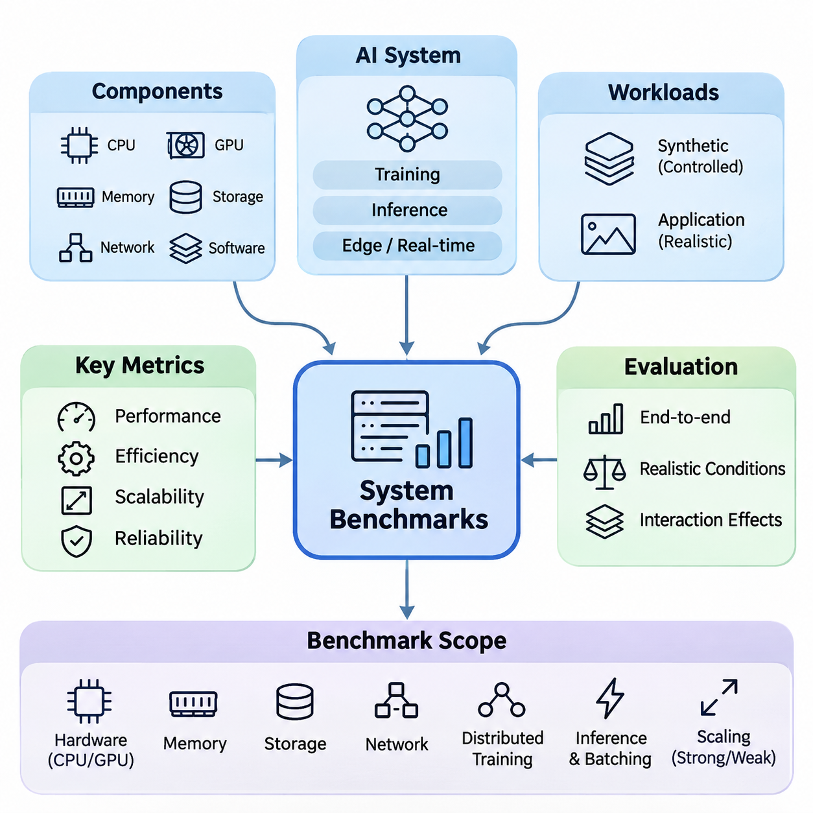
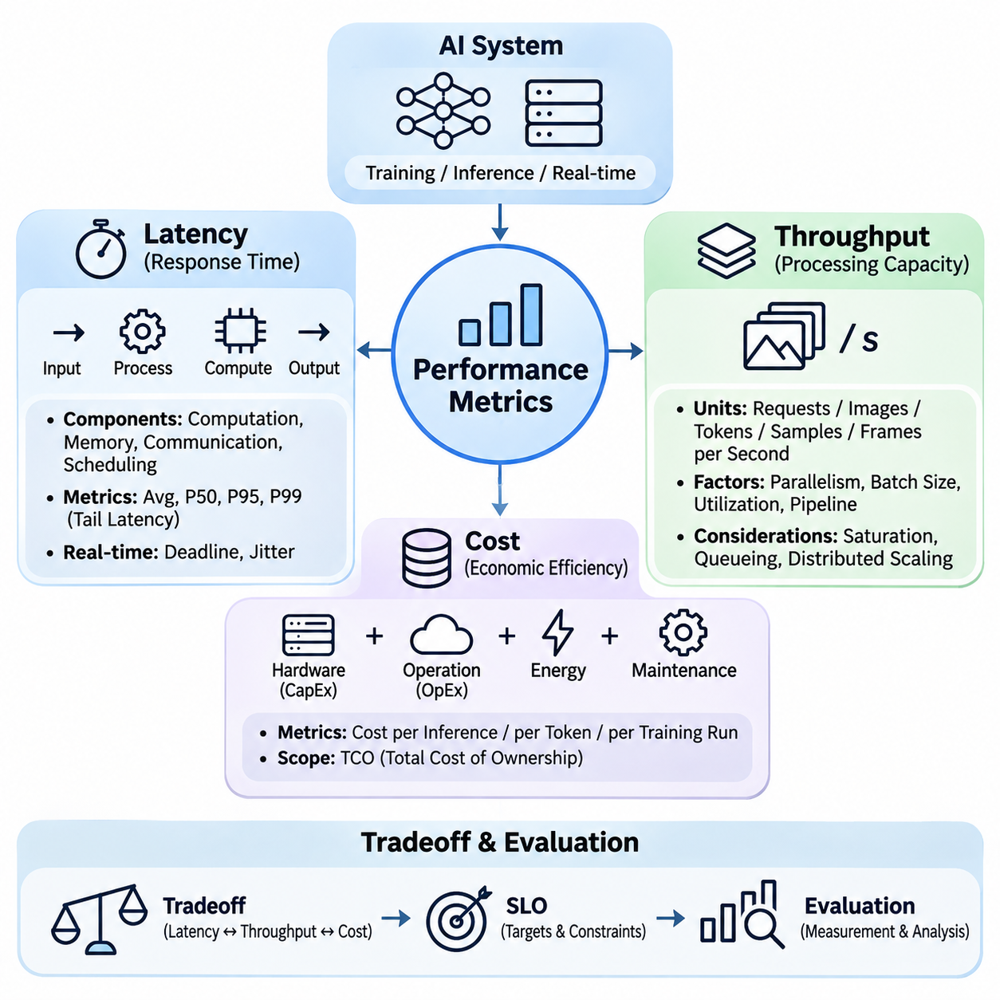
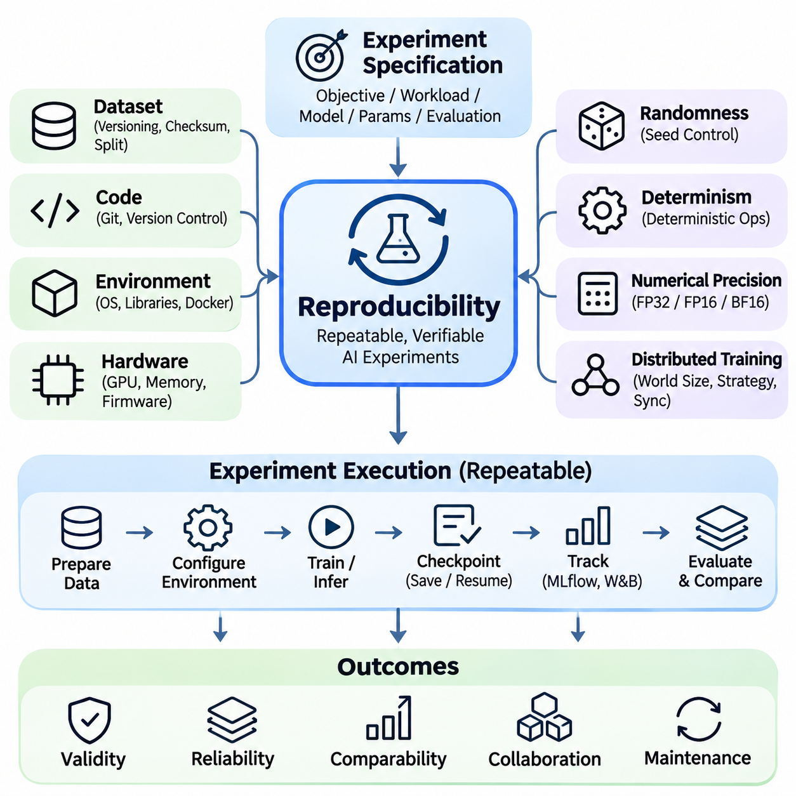
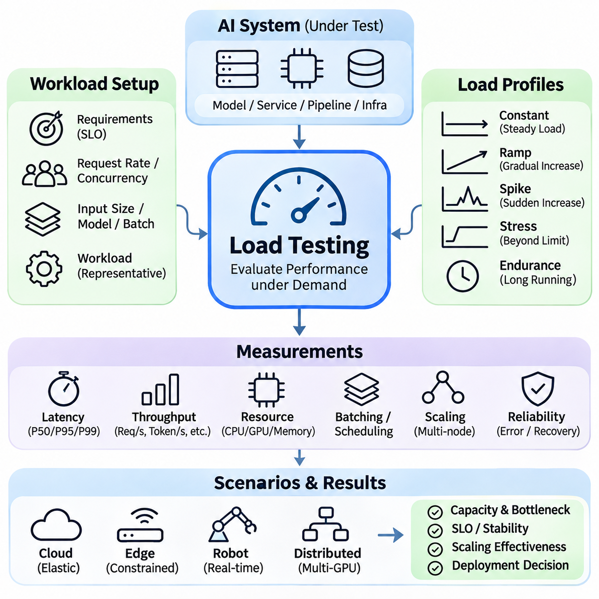
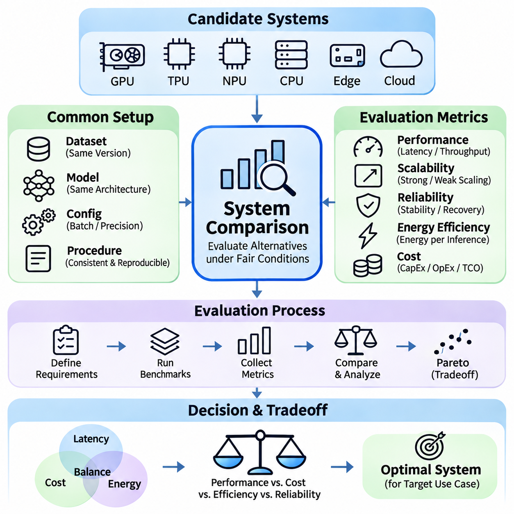

**Volume 38. AI Systems Architecture**

# 08. Experiments and Benchmarks

## 08.01 System Benchmarks

{width="7.268055555555556in" height="7.268055555555556in"}

System benchmarking is a fundamental process for evaluating the performance, efficiency, scalability, and reliability of artificial intelligence architectures under controlled and realistic operating conditions. Unlike model-level evaluation, which focuses primarily on predictive accuracy, system benchmarking examines the complete computational environment, including processors, accelerators, memory, storage, networking, software frameworks, and data pipelines.

A comprehensive benchmark evaluates how individual components interact to determine overall system behavior. An AI model may achieve excellent computational performance on a GPU while experiencing significant delays in data preprocessing, memory transfers, or network communication. Consequently, system benchmarks must measure end-to-end execution rather than relying exclusively on isolated hardware specifications or theoretical processing capabilities.

Benchmark design begins by defining the intended workload and operational requirements. Training systems, inference servers, edge devices, and real-time robotic platforms exhibit fundamentally different performance characteristics. Distributed training emphasizes computational utilization and communication efficiency, whereas inference services prioritize response time, request throughput, and predictable resource consumption under changing workloads.

Representative workloads are essential for producing meaningful benchmark results. Synthetic workloads provide controlled conditions for isolating computational bottlenecks, while application-specific workloads capture the complexity of real operational environments. A reliable evaluation strategy combines both approaches, allowing engineers to understand theoretical performance boundaries and practical limitations associated with production deployment.

Hardware benchmarking examines the computational capabilities of CPUs, GPUs, specialized accelerators, and memory subsystems. Important measurements include processing throughput, accelerator utilization, memory bandwidth, cache behavior, and power consumption. Although theoretical floating-point performance provides a useful reference, actual AI execution depends heavily on kernel efficiency, memory access patterns, and supported numerical precision.

GPU benchmarking requires particular attention to computational precision and workload structure. FP32, FP16, BF16, INT8, and lower-precision formats can produce substantially different execution characteristics. Tensor Core acceleration, operator fusion, kernel scheduling, and memory alignment influence realized throughput. Benchmark reports must therefore identify numerical formats and optimization settings to ensure meaningful interpretation.

Memory system benchmarks investigate allocation overhead, transfer latency, bandwidth utilization, and capacity constraints. Large language models and multimodal systems frequently encounter memory limitations before exhausting available arithmetic capacity. Measurements should distinguish device memory consumption, host memory usage, intermediate activation storage, and data movement between processing units, particularly when evaluating multi-GPU configurations.

Storage benchmarking becomes increasingly important for data-intensive AI workloads. Training pipelines may continuously retrieve large image collections, video sequences, or multimodal datasets from local disks and distributed storage systems. Sequential bandwidth alone cannot characterize storage performance because random access, metadata operations, caching, decompression, and concurrent requests frequently determine actual data-loading efficiency.

Network benchmarking evaluates communication bandwidth, message latency, packet behavior, and synchronization overhead across distributed computing environments. Technologies such as Ethernet, InfiniBand, and RDMA influence collective communication efficiency and data exchange between compute nodes. Effective evaluation must consider topology, congestion, message size, and communication patterns rather than measuring nominal link speed alone.

Distributed training benchmarks measure how effectively computational workloads scale across multiple accelerators and nodes. Data parallelism introduces gradient synchronization overhead, while model and pipeline parallelism require additional activation transfers and coordination. Benchmark experiments should quantify computation-to-communication ratios, synchronization delays, idle periods, and aggregate training throughput under different configurations.

Scaling efficiency is commonly assessed by comparing observed performance improvements against an ideal scaling reference. Strong scaling evaluates whether a fixed workload executes faster as computational resources increase, while weak scaling examines performance when workload size grows proportionally with available resources. Both approaches reveal architectural limitations, including communication overhead, resource contention, and load imbalance.

Inference benchmarking focuses on the complete execution path from input acquisition to final output delivery. This includes preprocessing, model execution, postprocessing, serialization, and communication. Measuring accelerator execution time alone can underestimate user-visible latency, particularly in systems involving remote services, multimodal sensor processing, or complex application orchestration.

Batch size substantially influences inference performance because larger batches can improve accelerator utilization while increasing waiting time for individual requests. Benchmarking should investigate the relationship between batch size, throughput, memory consumption, and latency distributions. Dynamic batching introduces additional scheduling behavior that must be evaluated under realistic request arrival patterns rather than idealized constant traffic.

Latency measurements should include statistical distributions rather than a single average value. Median latency characterizes typical execution, while high-percentile measurements reveal delays affecting demanding or time-sensitive applications. The 95th and 99th percentiles are particularly useful for identifying tail-latency behavior associated with scheduling contention, memory pressure, network variability, and occasional computational stalls.

Real-time AI benchmarking introduces requirements beyond conventional throughput optimization. Autonomous robots, industrial controllers, and safety-critical perception systems must complete computations within specified timing constraints. Evaluations should examine deadline satisfaction, scheduling jitter, worst-case observed execution time, and the consequences of delayed processing. Average inference speed cannot establish real-time reliability.

Edge AI benchmarks must account for constrained computational resources, thermal conditions, battery capacity, and communication availability. Embedded accelerators may initially achieve high processing rates but experience performance degradation during prolonged operation because of thermal throttling or power limitations. Sustained measurements are therefore necessary to characterize deployment behavior rather than relying exclusively on short benchmark runs.

Hybrid edge-cloud architectures require benchmarking across multiple processing locations. Local inference may minimize communication delays, whereas cloud execution can provide greater computational capacity. Evaluation should measure network transfer overhead, edge preprocessing costs, cloud processing time, and result delivery latency. Adaptive workload placement can then be assessed according to changing connectivity and resource availability.

Multimodal AI benchmarking examines concurrent processing of images, audio, text, LiDAR, radar, and other sensor streams. Individual model benchmarks may not predict integrated performance because simultaneous pipelines compete for accelerator memory, CPU scheduling, storage bandwidth, and communication resources. End-to-end tests must therefore reproduce realistic sensor frequencies, synchronization requirements, and computational concurrency.

Resource utilization measurements help explain why benchmark outcomes differ across architectures. CPU occupancy, GPU utilization, memory bandwidth, disk activity, and network traffic should be collected alongside application performance. High utilization does not necessarily indicate efficiency, since excessive synchronization, memory stalls, or repeated data transfers can consume resources without improving useful computational output.

Energy efficiency benchmarking connects computational performance with electrical power consumption. Relevant measurements include energy per inference, energy per processed sample, and total energy required to complete a training workload. Measurements should distinguish accelerator power from complete system power, including CPUs, memory, storage, networking, and cooling, because infrastructure overhead can significantly influence operational efficiency.

Reliability benchmarking evaluates whether systems maintain acceptable performance during prolonged execution and abnormal operating conditions. Extended workloads can reveal memory leaks, resource fragmentation, synchronization failures, thermal instability, and progressive performance degradation. Fault-injection experiments may additionally examine recovery behavior following accelerator failures, network interruptions, storage errors, or unexpected service termination.

Benchmark environments must be carefully controlled to reduce measurement variability. Hardware configuration, firmware, operating system, device drivers, runtime libraries, model versions, and optimization parameters should be recorded. Background processes, power management policies, thermal conditions, and cache states can influence results. Warm-up procedures and repeated trials help distinguish persistent architectural behavior from temporary fluctuations.

Statistical analysis improves confidence in benchmark conclusions. Repeated measurements allow engineers to estimate variability, confidence intervals, and the stability of observed performance differences. Comparisons should account for measurement noise and experimental conditions rather than treating small numerical differences as definitive improvements. Outliers should be investigated systematically instead of being removed without documented justification.

Benchmark automation supports consistent execution across software releases and hardware configurations. Automated pipelines can initialize workloads, collect telemetry, execute repeated trials, and generate structured performance reports. Integration with continuous integration systems enables performance regression detection, helping engineering teams identify unexpected changes introduced by model updates, runtime modifications, or infrastructure adjustments.

Application-oriented benchmarks connect technical measurements with operational objectives. For autonomous robotics, relevant outcomes include sensor-to-decision latency, perception update frequency, and deadline compliance. Smart-city platforms may emphasize concurrent video streams, event-processing throughput, and communication efficiency. Enterprise AI systems often prioritize request capacity, service responsiveness, and predictable infrastructure consumption.

Ultimately, system benchmarking provides an empirical foundation for architectural design and optimization. By combining representative workloads, controlled measurements, statistical analysis, and realistic deployment conditions, engineers can identify bottlenecks and evaluate architectural tradeoffs. The objective is not merely to maximize isolated benchmark scores, but to establish whether an integrated AI system consistently satisfies its functional, performance, and operational requirements.

## 08.02 Performance Metrics

{width="7.268055555555556in" height="7.268055555555556in"}

Performance metrics provide a quantitative foundation for evaluating the operational effectiveness of artificial intelligence systems. Among the most important dimensions are latency, throughput, and cost, which collectively determine responsiveness, processing capacity, and economic sustainability. These metrics must be examined together because improving one dimension can introduce tradeoffs in the others, particularly across distributed and heterogeneous computing architectures.

Latency represents the elapsed time required for a system to complete a specified operation, beginning with input arrival and ending with the corresponding output. In AI systems, latency may include data acquisition, preprocessing, queueing, model execution, postprocessing, and communication. End-to-end latency is especially important because isolated accelerator execution time does not necessarily reflect the response experienced by users or downstream applications.

Latency can be decomposed into computational, memory, communication, and scheduling components. Computational latency reflects the execution of mathematical operations, while memory latency arises from accessing or transferring data. Communication latency includes network transmission and protocol overhead, whereas scheduling latency represents delays before computational resources become available. This decomposition helps identify optimization opportunities.

Average latency provides a useful summary but cannot fully describe performance variability. Median latency, commonly represented as P50, indicates typical response behavior, while P95 and P99 reveal delays affecting the slowest portions of requests. Tail latency becomes particularly important in distributed systems because individual service delays can propagate through dependent components and significantly increase end-to-end response times.

Latency measurement requires clearly defined timing boundaries and consistent experimental conditions. Warm-up execution, asynchronous accelerator operations, batching policies, and network synchronization can distort measurements when ignored. GPU operations often execute asynchronously, requiring appropriate synchronization before recording completion times. Repeated measurements and statistical distributions provide more reliable results than isolated timing observations.

Real-time AI systems impose additional latency constraints because computational results must arrive before operational deadlines. Autonomous robots, industrial controllers, and sensor-driven applications may require deterministic or bounded response behavior. Deadline misses can reduce control stability or compromise operational safety, making worst-case execution analysis, scheduling jitter, and deadline satisfaction more relevant than average latency alone.

Throughput measures the quantity of useful work completed within a defined time interval. Depending on the application, throughput may be expressed as requests per second, images per second, tokens per second, training samples per second, or processed sensor frames per second. Unlike latency, which describes individual operation duration, throughput characterizes the aggregate processing capacity of a system under sustained workloads.

Throughput depends on computational parallelism, batch size, resource utilization, and pipeline efficiency. Modern accelerators achieve high throughput by processing multiple operations concurrently, but performance improvements depend on sufficient workload availability. Small batches may underutilize GPU resources, whereas excessively large batches can increase memory consumption and queueing delays, potentially reducing responsiveness despite higher aggregate processing rates.

The relationship between latency and throughput is influenced by workload intensity and system capacity. Increasing request arrival rates can improve resource utilization until the system approaches saturation. Beyond this point, queue lengths and response times may increase rapidly without proportional throughput gains. Performance evaluation should therefore identify the sustainable operating region rather than relying exclusively on maximum observed throughput.

Queueing theory provides a mathematical framework for understanding system behavior under concurrent workloads. Little\'s Law relates the average number of requests in a stable system to throughput and average response time. This relationship illustrates how growing concurrency can increase processing capacity while also producing longer waiting times. Its interpretation requires stable operating conditions and consistent measurement boundaries.

Distributed AI systems introduce additional throughput considerations involving communication, synchronization, and load balancing. Multiple GPUs or compute nodes may increase aggregate processing capacity, but network contention and synchronization overhead can limit scaling efficiency. Throughput measurements should distinguish useful completed operations from internal computational activity, particularly when comparing data parallelism, model parallelism, and pipeline parallelism.

Training throughput is commonly measured using processed samples or tokens per second, while inference throughput focuses on completed requests or generated outputs. These measurements should be interpreted alongside model accuracy, sequence length, batch configuration, and numerical precision. A higher throughput value does not necessarily indicate a better system when workload characteristics, output quality, or computational requirements differ substantially.

Streaming AI applications require throughput measurements that reflect continuous data arrival. Video analytics, industrial monitoring, and robotic perception systems must process sensor streams without accumulating unbounded backlogs. Frame processing rates should be evaluated alongside frame drops, buffer occupancy, and end-to-end delay. A system may achieve high average throughput while failing to maintain the temporal consistency required by its application.

Cost represents the economic resources required to develop, deploy, operate, and maintain an AI system. Performance evaluation should consider capital expenditure, operational expenditure, computational infrastructure, energy consumption, networking, storage, and maintenance. Hardware acquisition cost alone provides an incomplete assessment because operational requirements and resource utilization can substantially influence total expenditure throughout the system lifecycle.

Capital expenditure includes investments in servers, GPUs, networking equipment, storage infrastructure, and supporting facilities. Operational expenditure covers electricity, cooling, cloud services, software licensing, maintenance, and engineering operations. Total cost of ownership integrates these dimensions over a defined evaluation period, enabling comparisons between on-premises infrastructure, cloud computing, and hybrid deployment architectures.

Cloud computing introduces usage-based pricing models that connect expenditure to allocated resources and execution duration. GPU instance charges, storage capacity, data transfer, and managed services contribute to overall costs. Although cloud infrastructure offers flexibility and rapid provisioning, inefficient resource allocation or persistent high utilization may produce substantial recurring expenses. Cost analysis must therefore account for workload patterns and service requirements.

On-premises AI infrastructure typically requires larger initial investments but can provide predictable capacity for sustained workloads. Economic evaluation should include hardware depreciation, utilization rates, electricity, cooling, maintenance, and infrastructure administration. Comparisons with cloud alternatives must use equivalent workloads, performance requirements, availability assumptions, and evaluation periods to avoid misleading conclusions.

Cost efficiency can be expressed through normalized indicators such as cost per inference, cost per million tokens, cost per training sample, or cost per completed training run. These metrics connect financial expenditure with useful computational output. However, meaningful comparisons require consistent workload definitions, model quality requirements, and accounting boundaries, particularly when comparing architectures with different hardware capabilities.

Energy consumption contributes directly to operational costs and infrastructure sustainability. Power-efficient accelerators may reduce electricity and cooling requirements, but overall efficiency depends on workload utilization and execution time. Energy per inference or energy per processed token provides a useful complement to monetary cost metrics, especially when evaluating embedded devices, large-scale inference clusters, and continuously operating AI services.

Latency, throughput, and cost form an interconnected optimization space rather than independent performance objectives. Increasing batch size may improve throughput and reduce unit processing cost while increasing individual response latency. Deploying additional accelerators may reduce queueing delays but increase infrastructure expenditure. Selecting an appropriate configuration requires balancing these competing effects against application-specific service requirements.

Performance-cost optimization frequently involves identifying a Pareto frontier, where improving one objective requires sacrificing another. Engineers can compare configurations using latency constraints, throughput targets, and financial budgets to identify feasible architectural alternatives. Such analysis is more informative than ranking systems by a single benchmark score because practical deployment decisions involve multiple objectives and operational limitations.

Service-level objectives translate performance metrics into measurable operational commitments. A production inference service might specify a maximum P99 latency under a defined request rate, while an industrial perception system may require a minimum sustained frame rate. Cost constraints can be incorporated through resource budgets and maximum allowable processing expenditure. These objectives should be evaluated under representative workload conditions.

Benchmark experiments should systematically vary workload intensity, concurrency, batch size, model configuration, and allocated resources. Each experiment should record latency distributions, sustainable throughput, resource utilization, and corresponding costs. Repeated trials help distinguish genuine architectural improvements from measurement variability, while consistent hardware and software configurations support reproducible comparisons across candidate systems.

Ultimately, performance metrics provide the evidence required to design AI systems that are responsive, scalable, and economically practical. Latency characterizes the time required to deliver results, throughput measures sustainable processing capacity, and cost quantifies the resources consumed to achieve those outcomes. Their integrated evaluation enables engineers to select architectures that satisfy operational requirements without unnecessary computational or financial overhead.

## 08.03 Reproducibility [w/Code]

{width="7.268055555555556in" height="7.268055555555556in"}

Reproducibility is a fundamental requirement in artificial intelligence system engineering because experimental results must remain verifiable across repeated executions, computing environments, and development teams. A reproducible experiment allows researchers and engineers to reconstruct the conditions under which a model was trained, evaluated, or deployed. This capability strengthens scientific validity, operational reliability, and confidence in architectural decisions.

Reproducibility extends beyond obtaining similar model accuracy from repeated training runs. It includes consistent datasets, software dependencies, hardware configurations, numerical precision, random initialization, and execution procedures. In complex AI architectures, seemingly minor differences in these factors can produce measurable variations in latency, throughput, resource utilization, and model behavior, making systematic control essential.

A reproducible experiment begins with a clearly defined experimental specification. This specification identifies the research objective, workload characteristics, model architecture, training parameters, evaluation methodology, and expected outputs. Explicit documentation prevents ambiguity when experiments are repeated by different engineers or executed on alternative infrastructure, enabling meaningful comparisons between architectural configurations.

Dataset versioning is essential because changes in training or evaluation data can alter experimental outcomes. Each dataset should have a persistent identifier, documented preprocessing procedures, and verifiable integrity information. Dataset manifests and cryptographic checksums help confirm that identical input files are used across experiments. Data splitting strategies must also be preserved to prevent unintended differences in evaluation conditions.

Software environment reproducibility requires precise management of operating systems, programming languages, frameworks, libraries, and accelerator drivers. Package versions should be recorded through dependency lockfiles or equivalent mechanisms. Container technologies such as Docker can package application dependencies into portable execution environments, although kernel behavior, device drivers, and underlying hardware characteristics may still introduce differences.

Hardware configuration is another important source of experimental variability. GPU architecture, memory capacity, processor topology, storage performance, and network interconnects influence computational behavior. Benchmark reports should document accelerator models, device counts, memory configurations, and relevant firmware versions. Without this information, performance differences may be incorrectly attributed to algorithmic improvements rather than infrastructure changes.

Randomness must be controlled wherever practical because neural network initialization, data shuffling, augmentation, and stochastic optimization can influence experimental results. Random seeds should be recorded for Python, NumPy, machine learning frameworks, and data-loading processes. However, fixed seeds alone do not guarantee identical outcomes, particularly when parallel execution or nondeterministic accelerator operations are involved.

Deterministic execution attempts to ensure that identical inputs and configurations produce identical computational outputs. Frameworks such as PyTorch provide mechanisms for requesting deterministic algorithms and controlling backend behavior. Nevertheless, certain operations may remain nondeterministic or unavailable in deterministic form. Enforcing determinism can also reduce performance, requiring explicit documentation of reproducibility and efficiency tradeoffs.

Numerical precision introduces additional reproducibility challenges in modern AI systems. Floating-point operations are sensitive to execution order, rounding behavior, and hardware implementation. Mixed-precision training using FP16 or BF16 may produce different numerical trajectories across accelerator generations. Even mathematically equivalent operations can generate slightly different results when parallel reduction orders or optimized computational kernels change.

Distributed training increases reproducibility complexity because multiple processes coordinate gradient computation, communication, and parameter updates. Differences in process scheduling, collective communication, gradient accumulation, and synchronization timing can influence execution behavior. Reproducible distributed experiments should document world size, parallelism strategy, communication backend, checkpoint configuration, and relevant synchronization policies.

Checkpoint management enables experiments to be resumed, inspected, and compared without restarting entire training procedures. A complete training checkpoint should preserve model parameters, optimizer states, learning-rate scheduler information, and relevant random number generator states. Checkpoint integrity and compatibility must be verified because incomplete restoration can alter subsequent optimization behavior even when model weights appear identical.

Experiment tracking systems provide structured records of configurations, execution histories, metrics, and generated artifacts. Platforms such as MLflow and Weights & Biases can associate model versions with datasets, hyperparameters, software environments, and performance results. Centralized tracking reduces reliance on manually maintained notes and supports systematic comparisons across training runs, inference optimizations, and infrastructure experiments.

Version control connects experimental outcomes to specific implementations. Git commit identifiers can establish the exact source-code revision used for a benchmark, while tagged releases identify stable configurations. Configuration files should remain under version control whenever practical. Changes to preprocessing logic, model definitions, inference runtimes, or evaluation scripts must be traceable to prevent misleading comparisons between experimental results.

Benchmark reproducibility requires consistent workload generation and measurement procedures. Input dimensions, batch sizes, request arrival patterns, concurrency levels, and warm-up durations should be standardized. Timing boundaries must remain identical across experiments, especially when measuring asynchronous GPU execution. Otherwise, reported performance improvements may reflect differences in measurement methodology rather than genuine system optimization.

Performance measurements are also affected by environmental conditions that cannot always be eliminated. Background processes, thermal throttling, power limits, operating system scheduling, and shared network congestion introduce variability. Benchmark procedures should monitor these conditions and execute repeated trials. Reporting distributions and confidence intervals provides a more reliable characterization than selecting a single favorable measurement.

Reproducibility in edge AI systems requires attention to deployment-specific constraints. Embedded accelerators may operate under different power modes, thermal conditions, and memory limitations. Firmware versions, inference engines, quantization settings, and sensor configurations should be recorded. For robotic applications, sensor calibration, timestamp synchronization, and operating conditions must also be documented to support meaningful repeated evaluations.

Cloud-based experiments introduce variability associated with virtualized infrastructure, shared resources, instance placement, and managed service updates. Even when identical instance types are selected, underlying hardware revisions or network conditions may differ. Reproducibility therefore requires recording instance specifications, deployment regions, container images, storage configurations, and relevant service versions alongside experimental results.

Automated experiment pipelines improve reproducibility by reducing manual intervention and procedural inconsistencies. Workflow orchestration tools can execute data preparation, model training, evaluation, and artifact generation through predefined stages. Continuous integration systems can validate configuration integrity and run regression benchmarks after software changes, ensuring that experimental procedures remain consistent throughout the development lifecycle.

Reproducibility should distinguish exact replication from statistical consistency. Exact replication seeks identical outputs under identical conditions, while statistical reproducibility accepts controlled variation when repeated experiments produce comparable distributions. For stochastic machine learning systems, multiple independent runs may be necessary to establish whether observed improvements are robust rather than consequences of favorable random initialization.

Experimental reporting must preserve sufficient information for independent verification. Reports should describe dataset versions, hardware specifications, software dependencies, random seeds, model configurations, measurement procedures, and statistical summaries. Known limitations and nondeterministic components should be disclosed. Providing executable configurations and accessible artifacts further strengthens the transparency and credibility of reported findings.

Ultimately, reproducibility transforms AI experimentation from isolated performance demonstrations into a reliable engineering process. By combining version-controlled code, immutable datasets, documented environments, deterministic controls, automated workflows, and statistical validation, organizations can compare architectures with greater confidence. Reproducible experiments support trustworthy optimization, regression detection, collaborative development, and long-term maintenance of complex AI systems.

## 08.04 Load Testing [w/Code]

{width="7.268055555555556in" height="7.268055555555556in"}

Load testing is a systematic method for evaluating how artificial intelligence systems behave under increasing, sustained, and variable computational demand. Unlike isolated model benchmarks, load testing examines the complete execution environment, including inference services, data pipelines, accelerators, memory, networking, and orchestration components. Its primary objective is to determine whether an integrated system can maintain acceptable performance under realistic operating conditions.

Effective load testing begins with defining expected workload characteristics and operational requirements. Engineers must identify request arrival rates, concurrent users, input dimensions, model complexity, batch sizes, and service-level objectives. These parameters establish the conditions under which system performance will be evaluated. Representative workloads are essential because artificial traffic patterns may conceal bottlenecks that emerge during production deployment.

Load profiles describe how computational demand changes over time. Constant-load testing evaluates behavior under stable traffic, while ramp testing gradually increases request rates to identify capacity boundaries. Spike testing introduces sudden demand increases, and stress testing deliberately exceeds expected operating limits. Each profile reveals different aspects of system stability, resource allocation, and recovery behavior.

Concurrency is a central consideration because AI services frequently process multiple requests simultaneously. Increasing concurrent requests can improve accelerator utilization, but excessive concurrency may create queueing delays and memory pressure. Load tests should distinguish active execution from requests waiting for resources. Measuring both concurrency and completed throughput helps identify when additional requests stop producing meaningful performance gains.

Latency analysis must consider the complete request lifecycle, including input transmission, preprocessing, queueing, model execution, postprocessing, and response delivery. Average latency alone cannot characterize service responsiveness under heavy load. Percentile measurements such as P50, P95, and P99 reveal performance variability and tail latency. These measurements are especially important when occasional delays affect downstream applications or operational deadlines.

Throughput represents the amount of useful work completed per unit time and provides a measure of sustainable processing capacity. AI workloads may express throughput as requests, images, tokens, or sensor frames processed per second. During load testing, throughput should be compared against offered load to identify saturation. When incoming demand exceeds service capacity, queue lengths may increase even if completed throughput remains nearly constant.

Resource monitoring explains the underlying causes of performance degradation. CPU utilization, GPU occupancy, accelerator memory consumption, memory bandwidth, storage activity, and network traffic should be recorded throughout each test. High utilization may indicate efficient processing or resource contention, depending on workload behavior. Correlating telemetry with latency and throughput helps distinguish computational bottlenecks from scheduling and communication overhead.

GPU-based inference services require careful evaluation of batching and scheduling policies. Larger batches can increase computational efficiency by improving accelerator utilization, but they may also increase waiting time and memory consumption. Dynamic batching introduces additional scheduling decisions based on request arrival patterns. Load tests should evaluate these policies under variable traffic rather than assuming that maximum batch throughput guarantees acceptable response latency.

Memory pressure becomes particularly important when serving large language models and multimodal architectures. Model parameters, intermediate activations, attention caches, and concurrent execution contexts compete for limited accelerator memory. Increasing request concurrency may trigger allocation failures, memory fragmentation, or expensive data transfers. Load testing should identify safe operating limits before memory exhaustion causes unstable service behavior.

Large language model serving introduces workload characteristics that differ from conventional classification inference. Prompt length, generated token count, context-window utilization, and concurrent decoding sessions influence performance. Time to first token and inter-token latency provide additional insight beyond total request duration. Load generators should reproduce realistic distributions of input and output lengths to avoid misleading capacity estimates.

Distributed AI systems require load testing across compute nodes, communication networks, and orchestration layers. Additional accelerators may improve processing capacity, but synchronization overhead, network congestion, and uneven workload distribution can limit scaling. Tests should measure aggregate throughput, per-node utilization, communication delays, and load-balancing effectiveness to determine whether additional infrastructure produces proportional benefits.

Endurance testing examines whether an AI service can sustain acceptable performance over extended operating periods. Long-running workloads may reveal memory leaks, resource fragmentation, thermal throttling, logging overhead, and gradual performance degradation. Short benchmark runs often fail to expose these problems. Sustained testing should therefore monitor resource consumption, error rates, and performance trends across representative operating durations.

Failure-oriented load testing evaluates how systems respond when components become unavailable under demand. Network interruptions, accelerator failures, storage delays, and service restarts can be introduced to examine fault tolerance and recovery mechanisms. Important observations include request loss, retry behavior, failover latency, and recovery time. Controlled fault injection helps determine whether resilience mechanisms remain effective during resource saturation.

Autoscaling introduces additional complexity because infrastructure capacity changes dynamically in response to demand. Scaling policies may use CPU utilization, GPU metrics, queue length, or request rates as triggering signals. Load tests should measure scaling delay, resource provisioning time, and service behavior during transitions. Aggressive scaling can increase costs, while delayed scaling may produce unacceptable latency or request failures.

Edge AI load testing must consider constrained computing resources and continuous sensor input. Embedded platforms may process camera, LiDAR, radar, and control workloads simultaneously, creating competition for memory and processing capacity. Thermal conditions and power modes can influence sustained performance. Tests should reproduce realistic sensor frequencies and concurrent tasks rather than evaluating individual inference models in isolation.

Real-time robotic systems require load testing that emphasizes deadline compliance rather than maximum throughput alone. Perception, localization, planning, and control tasks often execute concurrently with different timing requirements. Increasing computational demand can introduce scheduling jitter and delayed decisions. Evaluation should measure deadline misses, worst-case observed latency, and the ability of critical processes to maintain predictable execution.

Hybrid edge-cloud architectures require load testing across local devices, communication links, and remote services. Network bandwidth fluctuations and intermittent connectivity may alter processing latency and workload placement decisions. Tests should evaluate local fallback behavior, data buffering, remote inference delays, and recovery after reconnection. These measurements help determine whether distributed processing remains dependable under changing communication conditions.

Load generation tools should produce controlled and repeatable request patterns while collecting reliable performance measurements. Frameworks such as Locust, JMeter, and custom asynchronous clients can simulate concurrent service requests. However, the load generator itself must have sufficient capacity to avoid becoming the limiting component. Accurate experiments require synchronized measurements, consistent input datasets, and documented execution configurations.

Statistical analysis improves the interpretation of load testing results. Repeated experiments should report latency distributions, sustainable throughput, error rates, and resource utilization under equivalent conditions. Confidence intervals help distinguish meaningful improvements from measurement variability. Test reports should identify workload definitions, hardware configurations, software versions, and environmental factors so that results can be independently reproduced.

Ultimately, load testing connects theoretical computational capacity with practical operational reliability. By evaluating increasing demand, sustained execution, concurrency, failures, and resource constraints, engineers can identify performance limits before production deployment. The resulting evidence supports capacity planning, infrastructure optimization, service-level validation, and architectural decisions that balance responsiveness, scalability, resilience, and cost.

## 08.05 System Comparison

{width="7.268055555555556in" height="7.268055555555556in"}

System comparison is a fundamental process for evaluating alternative artificial intelligence architectures under consistent technical and operational conditions. Its purpose is to identify how different hardware platforms, software frameworks, deployment strategies, and optimization methods influence overall system effectiveness. A meaningful comparison examines not only computational performance but also scalability, reliability, energy efficiency, and operational cost.

Comparative evaluation begins by defining the intended application and its performance requirements. Training clusters, inference servers, embedded devices, and autonomous robotic platforms operate under different constraints. A configuration optimized for maximum throughput may be unsuitable for applications requiring predictable latency or limited power consumption. Therefore, comparison criteria must reflect actual deployment objectives rather than isolated benchmark rankings.

Fair system comparison requires equivalent workloads and clearly documented experimental conditions. Input datasets, model architectures, batch sizes, numerical precision, and evaluation procedures should remain consistent whenever possible. Differences in hardware capabilities may require alternative optimization strategies, but these deviations must be disclosed. Without workload equivalence, apparent performance advantages may result from inconsistent experimental configurations.

Hardware comparison evaluates CPUs, GPUs, tensor processing units, neural processing units, and specialized accelerators according to their computational capabilities and operational characteristics. Peak arithmetic performance provides an initial reference, but practical execution depends on memory bandwidth, kernel efficiency, software support, and thermal limitations. Real application benchmarks are therefore more informative than theoretical performance specifications alone.

GPU-based systems can be compared using training throughput, inference latency, accelerator utilization, and memory capacity. Differences in architectural generations, tensor acceleration, supported precision formats, and interconnect bandwidth influence observed results. Multi-GPU configurations introduce additional considerations involving communication overhead and synchronization efficiency. Performance comparisons should distinguish single-device capability from aggregate system scalability.

Memory architecture is another important comparison dimension because AI workloads frequently encounter data movement limitations. Systems with similar computational capacity may exhibit different performance because of memory bandwidth, cache hierarchy, memory capacity, or host-device transfer overhead. Large language models and multimodal applications are particularly sensitive to these characteristics, making memory utilization and transfer efficiency essential evaluation criteria.

Software framework comparison examines how execution environments translate model operations into hardware instructions. PyTorch, TensorFlow, ONNX Runtime, and specialized inference engines may produce different performance characteristics on identical hardware. Compiler optimizations, operator fusion, graph execution, kernel selection, and numerical precision influence efficiency. Comparisons should record framework versions and optimization settings to maintain reproducibility.

Training architecture comparison focuses on computational throughput, scaling efficiency, memory utilization, and communication overhead. Data parallelism can increase processing capacity through replicated models, while model and pipeline parallelism distribute computation across devices. Each approach introduces different synchronization and scheduling requirements. Evaluation should consider convergence behavior and total training time rather than processing speed alone.

Inference architecture comparison emphasizes response latency, sustainable throughput, memory requirements, and service reliability. Batch processing can improve accelerator utilization but may increase individual request latency. Dynamic batching, request scheduling, quantization, and model compilation can alter these relationships. System selection should therefore reflect expected traffic patterns and service-level objectives rather than maximum throughput under ideal conditions.

Edge and cloud architectures present distinct operational advantages and limitations. Edge systems reduce dependence on remote connectivity and can support local real-time processing, but computational resources and thermal budgets are constrained. Cloud platforms offer elastic capacity and centralized management, although communication latency and recurring service costs may become significant. Hybrid architectures distribute workloads according to these competing requirements.

Distributed system comparison must consider scaling behavior as additional accelerators or compute nodes are introduced. Strong scaling measures performance improvement for fixed workloads, while weak scaling evaluates behavior when workload size grows with available resources. Network topology, collective communication efficiency, and load balancing influence results. Linear scaling should not be assumed because coordination overhead generally increases with system size.

Real-time AI systems require comparison criteria beyond conventional throughput measurements. Autonomous robots and industrial controllers depend on predictable execution, scheduling stability, and deadline compliance. Average latency may conceal occasional delays that disrupt control processes. Evaluations should therefore examine high-percentile latency, scheduling jitter, deadline misses, and recovery behavior under concurrent workloads and abnormal operating conditions.

Energy efficiency provides an additional basis for comparing AI architectures. Measurements such as energy per inference, energy per processed sample, and total training energy connect computational output with electrical consumption. Accelerator power alone may underestimate actual requirements because CPUs, memory, networking, storage, and cooling also consume energy. Complete system measurements are necessary for meaningful operational comparisons.

Economic comparison examines capital expenditure, operational expenditure, infrastructure utilization, and total cost of ownership. On-premises deployments require hardware investment and maintenance, while cloud services introduce usage-based charges and resource allocation flexibility. Cost per inference or cost per training run can normalize expenditure against useful output. Financial comparisons must use equivalent workload assumptions and evaluation periods.

Reliability and maintainability influence long-term system suitability. Architectures should be compared according to failure recovery, software compatibility, monitoring capabilities, upgrade complexity, and operational support. A configuration with superior benchmark performance may introduce excessive maintenance requirements or vendor dependencies. Long-duration testing and controlled fault injection help reveal differences that short performance experiments cannot identify.

Reproducibility is essential for establishing confidence in comparative results. Hardware configurations, operating systems, driver versions, model checkpoints, datasets, and measurement procedures should be documented. Repeated trials and statistical analysis help distinguish meaningful performance differences from experimental variability. Comparisons should report uncertainty and avoid presenting small numerical advantages as definitive architectural superiority.

Multi-objective evaluation integrates latency, throughput, accuracy, energy consumption, reliability, and cost into a unified decision process. These objectives often conflict, making a universally optimal architecture unlikely. Pareto analysis identifies configurations where improving one metric requires sacrificing another. Weighted evaluation methods can support decisions when application priorities are explicit, although weighting assumptions must remain transparent.

Ultimately, system comparison provides an empirical foundation for selecting AI architectures that satisfy practical deployment requirements. By combining controlled benchmarks, representative workloads, operational measurements, and economic analysis, engineers can identify meaningful tradeoffs between competing configurations. The preferred system is not necessarily the one achieving the highest isolated benchmark score, but the one delivering dependable performance within defined resource and operational constraints.
