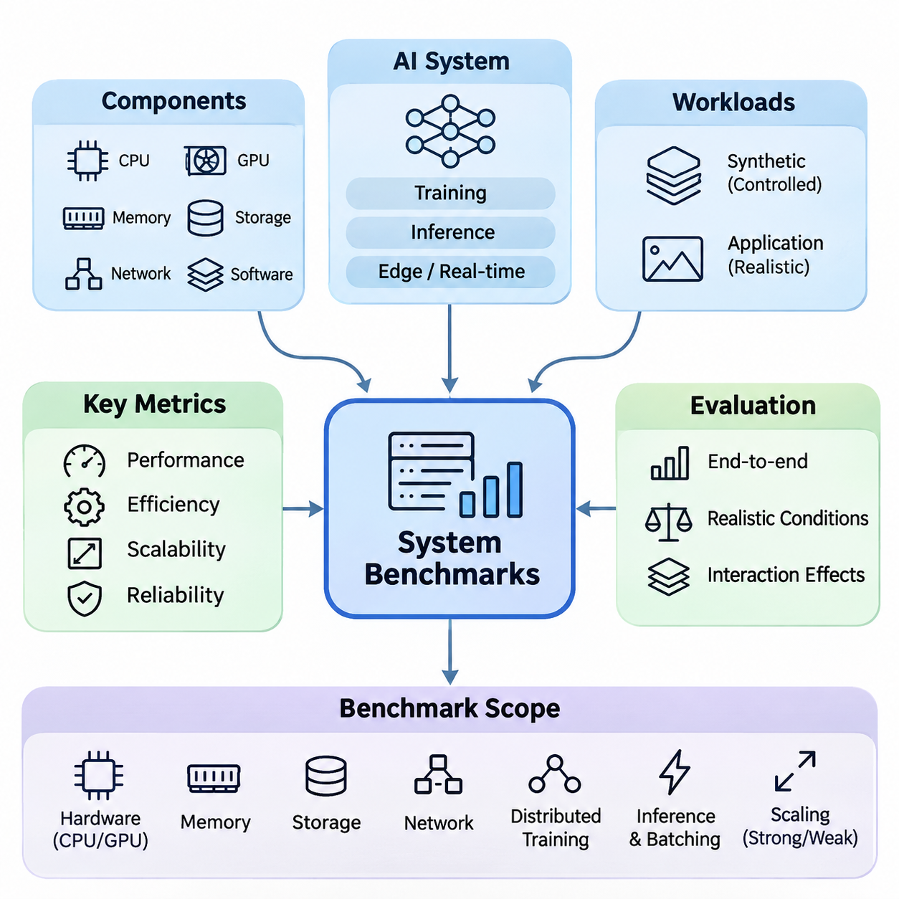
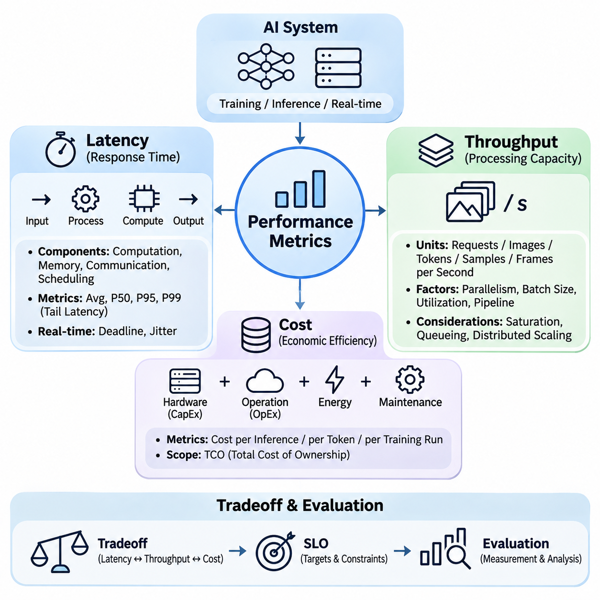
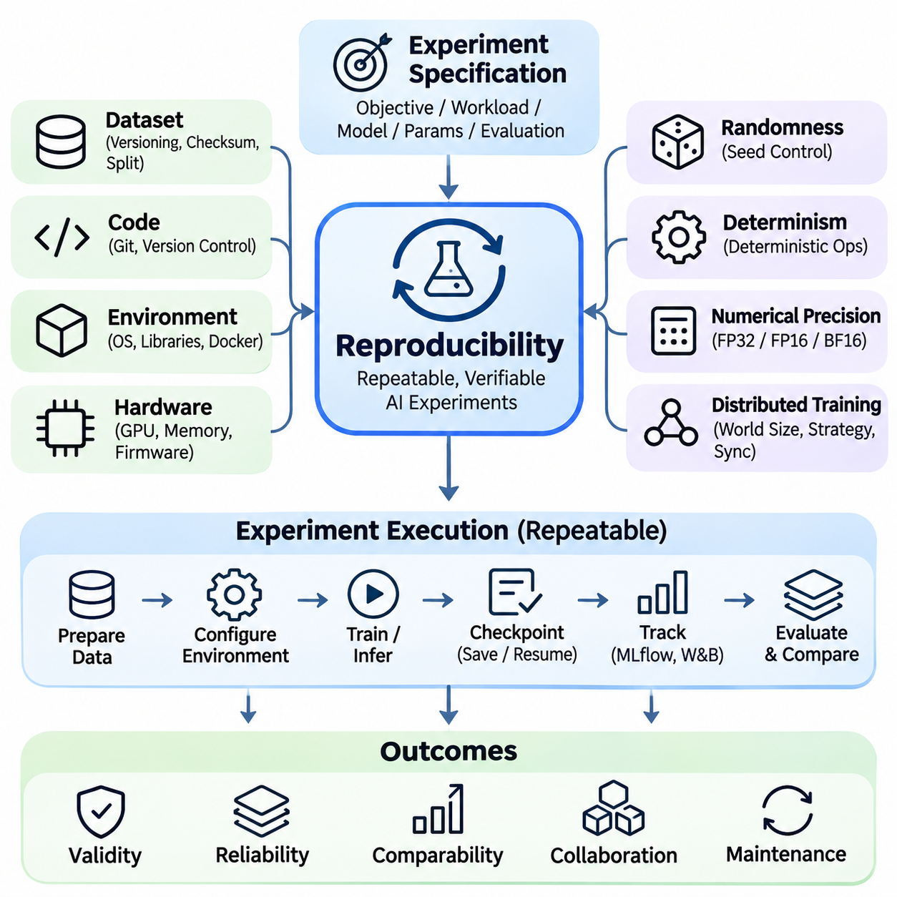
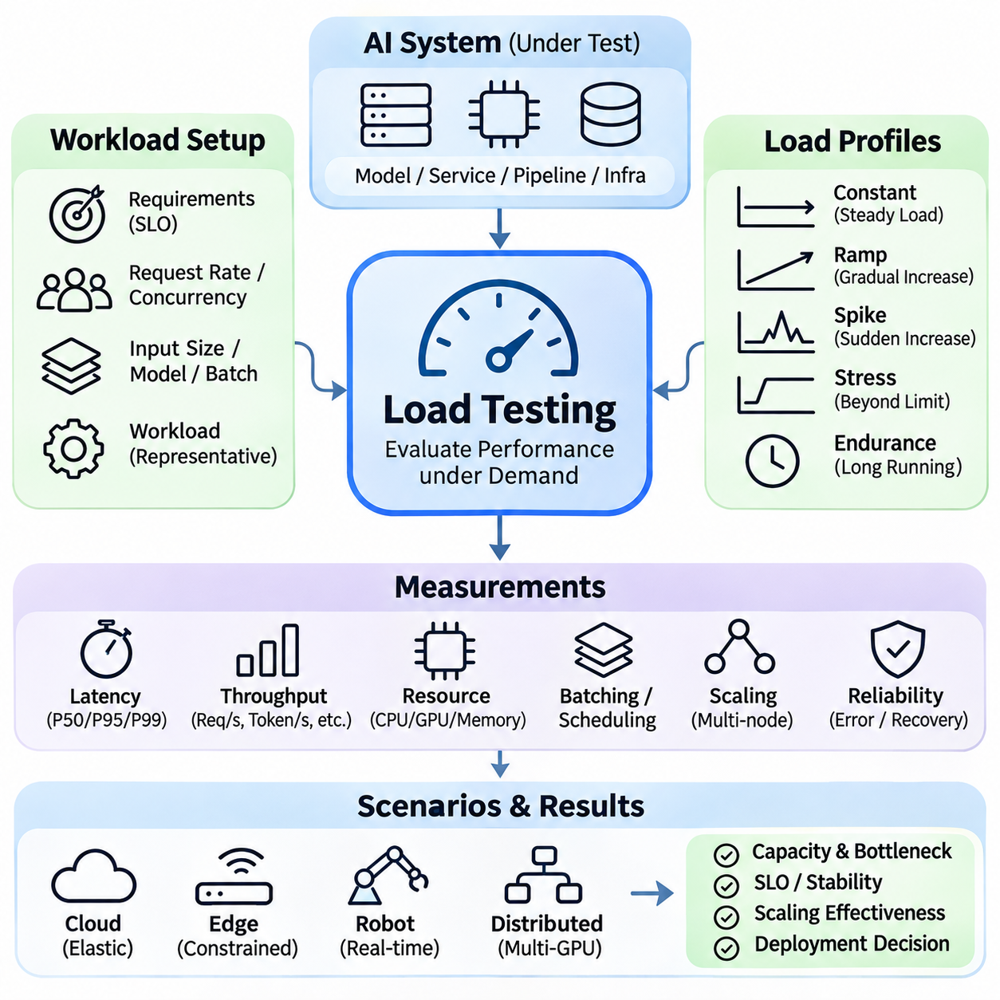
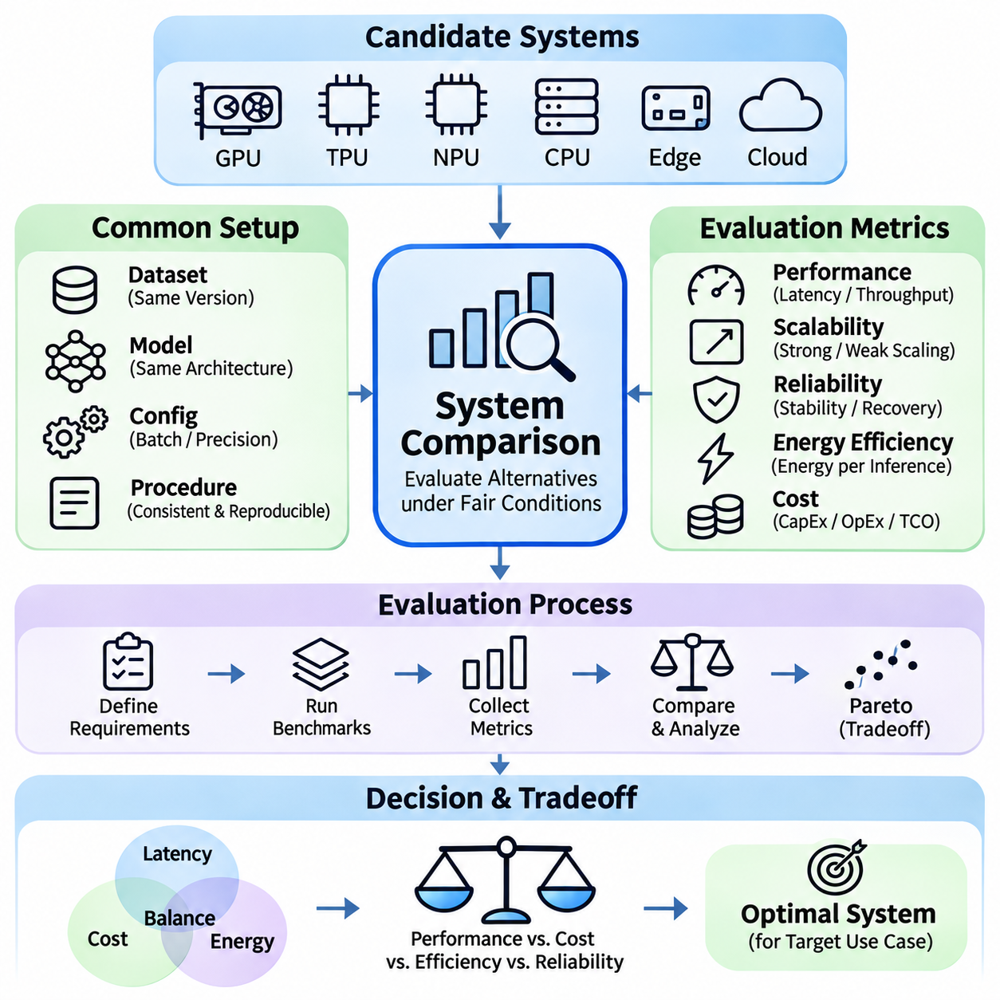

**Volume 38. AI Systems Architecture**

# 08. Experiments and Benchmarks

## 08.01 System Benchmarks

{width="7.268055555555556in" height="7.268055555555556in"}

시스템 벤치마킹(System Benchmarking)은 통제된 환경과 실제 운영 조건에서 인공지능 아키텍처(Artificial Intelligence Architecture)의 성능(Performance), 효율성(Efficiency), 확장성(Scalability), 신뢰성(Reliability)을 평가하는 핵심적인 과정이다. 주로 예측 정확도(Predictive Accuracy)에 초점을 맞추는 모델 수준 평가(Model-Level Evaluation)와 달리, 시스템 벤치마킹은 프로세서(Processor), 가속기(Accelerator), 메모리(Memory), 저장장치(Storage), 네트워크(Network), 소프트웨어 프레임워크(Software Framework), 데이터 파이프라인(Data Pipeline)을 포함한 전체 컴퓨팅 환경을 평가한다.

포괄적인 벤치마크(Comprehensive Benchmark)는 개별 구성요소들이 상호작용하여 전체 시스템의 동작 특성을 결정하는 방식을 분석한다. 인공지능 모델(AI Model)은 GPU에서 우수한 연산 성능을 달성하더라도 데이터 전처리(Data Preprocessing), 메모리 전송(Memory Transfer), 네트워크 통신(Network Communication) 과정에서 상당한 지연이 발생할 수 있다. 따라서 시스템 벤치마크는 하드웨어 사양이나 이론적인 처리 능력에만 의존하지 않고 전체 처리 과정의 종단 간 실행(End-to-End Execution)을 측정해야 한다.

벤치마크 설계(Benchmark Design)는 대상 작업 부하(Workload)와 운영 요구사항(Operational Requirements)을 정의하는 것에서 시작한다. 학습 시스템(Training System), 추론 서버(Inference Server), 엣지 장치(Edge Device), 실시간 로봇 플랫폼(Real-Time Robotic Platform)은 서로 다른 성능 특성을 가진다. 분산 학습(Distributed Training)은 연산 자원 활용률(Computational Utilization)과 통신 효율성(Communication Efficiency)을 중시하지만, 추론 서비스(Inference Service)는 응답 시간(Response Time), 요청 처리량(Request Throughput), 변화하는 작업 부하에서의 예측 가능한 자원 소비(Resource Consumption)를 우선한다.

대표성 있는 작업 부하(Representative Workload)는 의미 있는 벤치마크 결과를 얻기 위한 필수 조건이다. 합성 작업 부하(Synthetic Workload)는 연산 병목(Computational Bottleneck)을 분리하여 분석할 수 있는 통제된 조건을 제공하며, 응용 분야별 작업 부하(Application-Specific Workload)는 실제 운영 환경의 복잡성을 반영한다. 신뢰할 수 있는 평가 전략은 두 가지 접근법을 결합하여 이론적인 성능 한계(Performance Boundary)와 실제 운영 환경에서 발생하는 제약사항을 함께 파악하도록 한다.

하드웨어 벤치마킹(Hardware Benchmarking)은 CPU, GPU, 특수 목적 가속기(Specialized Accelerator), 메모리 하위 시스템(Memory Subsystem)의 연산 능력을 평가한다. 주요 측정 항목에는 연산 처리량(Processing Throughput), 가속기 활용률(Accelerator Utilization), 메모리 대역폭(Memory Bandwidth), 캐시 동작(Cache Behavior), 전력 소비(Power Consumption)가 포함된다. 이론적인 부동소수점 연산 성능(Floating-Point Performance)은 유용한 기준이지만, 실제 인공지능 실행 성능은 커널 효율성(Kernel Efficiency), 메모리 접근 패턴(Memory Access Pattern), 지원되는 수치 정밀도(Numerical Precision)에 크게 좌우된다.

GPU 벤치마킹(GPU Benchmarking)에서는 연산 정밀도(Computational Precision)와 작업 부하 구조(Workload Structure)를 특별히 고려해야 한다. FP32, FP16, BF16, INT8 및 더 낮은 정밀도 형식은 서로 다른 실행 특성을 나타낼 수 있다. 텐서 코어 가속(Tensor Core Acceleration), 연산자 융합(Operator Fusion), 커널 스케줄링(Kernel Scheduling), 메모리 정렬(Memory Alignment)은 실제 처리량에 영향을 준다. 따라서 벤치마크 보고서에는 수치 형식과 최적화 설정을 명시하여 결과를 정확하게 해석할 수 있도록 해야 한다.

메모리 시스템 벤치마크(Memory System Benchmark)는 메모리 할당 오버헤드(Allocation Overhead), 전송 지연(Transfer Latency), 대역폭 활용률(Bandwidth Utilization), 용량 제약(Capacity Constraint)을 분석한다. 대규모 언어 모델(Large Language Model)과 멀티모달 시스템(Multimodal System)은 연산 능력을 모두 활용하기 전에 메모리 한계에 도달하는 경우가 많다. 따라서 장치 메모리(Device Memory), 호스트 메모리(Host Memory), 중간 활성화 저장 공간(Intermediate Activation Storage), 처리 장치 간 데이터 이동(Data Movement)을 구분하여 측정해야 하며, 특히 다중 GPU 구성(Multi-GPU Configuration)에서 중요하다.

저장장치 벤치마킹(Storage Benchmarking)은 데이터 집약적인 인공지능 작업 부하(Data-Intensive AI Workload)에서 더욱 중요해진다. 학습 파이프라인(Training Pipeline)은 로컬 디스크(Local Disk)와 분산 저장 시스템(Distributed Storage System)에서 대규모 이미지, 비디오, 멀티모달 데이터셋(Multimodal Dataset)을 지속적으로 읽어 들일 수 있다. 순차 대역폭(Sequential Bandwidth)만으로는 저장장치 성능을 충분히 설명할 수 없으며, 임의 접근(Random Access), 메타데이터 연산(Metadata Operation), 캐싱(Caching), 압축 해제(Decompression), 동시 요청(Concurrent Request)이 실제 데이터 로딩 효율성을 결정하는 경우가 많다.

네트워크 벤치마킹(Network Benchmarking)은 분산 컴퓨팅 환경(Distributed Computing Environment)에서 통신 대역폭(Communication Bandwidth), 메시지 지연(Message Latency), 패킷 동작(Packet Behavior), 동기화 오버헤드(Synchronization Overhead)를 평가한다. 이더넷(Ethernet), 인피니밴드(InfiniBand), 원격 직접 메모리 접근(RDMA, Remote Direct Memory Access)과 같은 기술은 집합 통신(Collective Communication)과 컴퓨팅 노드(Compute Node) 간 데이터 교환 효율성에 영향을 준다. 효과적인 평가는 명목상 링크 속도뿐 아니라 네트워크 토폴로지(Network Topology), 혼잡(Congestion), 메시지 크기(Message Size), 통신 패턴(Communication Pattern)을 함께 고려해야 한다.

분산 학습 벤치마크(Distributed Training Benchmark)는 여러 가속기와 노드에 걸쳐 연산 작업이 얼마나 효과적으로 확장되는지 측정한다. 데이터 병렬화(Data Parallelism)는 기울기 동기화(Gradient Synchronization) 오버헤드를 발생시키며, 모델 병렬화(Model Parallelism)와 파이프라인 병렬화(Pipeline Parallelism)는 추가적인 활성화 데이터 전송(Activation Transfer)과 조정 작업을 요구한다. 벤치마크 실험에서는 연산 대비 통신 비율(Computation-to-Communication Ratio), 동기화 지연(Synchronization Delay), 유휴 시간(Idle Period), 전체 학습 처리량(Aggregate Training Throughput)을 정량적으로 분석해야 한다.

확장 효율성(Scaling Efficiency)은 일반적으로 실제 성능 향상과 이상적인 확장 기준(Ideal Scaling Reference)을 비교하여 평가한다. 강한 확장성(Strong Scaling)은 고정된 작업 부하에 더 많은 연산 자원을 투입했을 때 실행 시간이 얼마나 단축되는지를 평가하며, 약한 확장성(Weak Scaling)은 자원 증가에 비례하여 작업 부하를 확대했을 때 성능이 유지되는지를 분석한다. 두 접근법 모두 통신 오버헤드(Communication Overhead), 자원 경합(Resource Contention), 부하 불균형(Load Imbalance)과 같은 아키텍처의 제약을 드러낸다.

추론 벤치마킹(Inference Benchmarking)은 입력 데이터 수집(Input Acquisition)부터 최종 결과 전달(Output Delivery)까지 전체 실행 경로를 평가한다. 여기에는 전처리(Preprocessing), 모델 실행(Model Execution), 후처리(Postprocessing), 직렬화(Serialization), 통신(Communication)이 포함된다. 가속기의 실행 시간만 측정하면 사용자가 실제로 경험하는 지연 시간(User-Visible Latency)을 과소평가할 수 있으며, 원격 서비스(Remote Service), 멀티모달 센서 처리(Multimodal Sensor Processing), 복잡한 응용 프로그램 조정(Application Orchestration)이 포함된 시스템에서는 이러한 차이가 더욱 커질 수 있다.

배치 크기(Batch Size)는 추론 성능에 큰 영향을 미친다. 큰 배치는 가속기 활용률(Accelerator Utilization)을 높일 수 있지만 개별 요청의 대기 시간(Waiting Time)을 증가시킬 수 있다. 따라서 벤치마킹에서는 배치 크기, 처리량(Throughput), 메모리 소비(Memory Consumption), 지연 시간 분포(Latency Distribution)의 관계를 분석해야 한다. 동적 배칭(Dynamic Batching)은 추가적인 스케줄링 동작(Scheduling Behavior)을 발생시키므로 일정한 요청 트래픽(Constant Traffic)보다는 실제 요청 도착 패턴(Request Arrival Pattern)을 반영하여 평가해야 한다.

지연 시간(Latency)은 단일 평균값(Average Value)이 아니라 통계적 분포(Statistical Distribution)를 통해 측정해야 한다. 중앙값 지연 시간(Median Latency)은 일반적인 실행 특성을 나타내며, 높은 백분위 지연 시간(High-Percentile Latency)은 시간 제약이 엄격한 응용 분야에 영향을 미치는 지연을 보여준다. 특히 95백분위수(P95)와 99백분위수(P99)는 스케줄링 경합(Scheduling Contention), 메모리 압박(Memory Pressure), 네트워크 변동성(Network Variability), 일시적인 연산 정체(Computational Stall)로 발생하는 꼬리 지연(Tail Latency)을 분석하는 데 유용하다.

실시간 인공지능 벤치마킹(Real-Time AI Benchmarking)은 일반적인 처리량 최적화(Throughput Optimization)를 넘어서는 요구사항을 가진다. 자율주행 로봇(Autonomous Robot), 산업용 제어기(Industrial Controller), 안전 필수 인지 시스템(Safety-Critical Perception System)은 정해진 시간 제약 내에서 연산을 완료해야 한다. 따라서 마감 시간 충족률(Deadline Satisfaction), 스케줄링 지터(Scheduling Jitter), 관측된 최악 실행 시간(Worst-Case Observed Execution Time), 처리 지연의 영향을 평가해야 하며, 평균 추론 속도만으로는 실시간 신뢰성을 입증할 수 없다.

엣지 인공지능 벤치마크(Edge AI Benchmark)는 제한된 연산 자원(Computational Resource), 열적 조건(Thermal Condition), 배터리 용량(Battery Capacity), 통신 가용성(Communication Availability)을 고려해야 한다. 임베디드 가속기(Embedded Accelerator)는 초기에는 높은 처리 속도를 달성하더라도 장시간 운용 시 열 스로틀링(Thermal Throttling)이나 전력 제한(Power Limitation)으로 성능이 저하될 수 있다. 따라서 짧은 벤치마크 실행에만 의존하지 않고 지속 성능 측정(Sustained Performance Measurement)을 수행해야 한다.

하이브리드 엣지-클라우드 아키텍처(Hybrid Edge-Cloud Architecture)는 여러 처리 위치에 걸친 벤치마킹이 필요하다. 로컬 추론(Local Inference)은 통신 지연을 최소화할 수 있지만, 클라우드 실행(Cloud Execution)은 더 큰 연산 능력을 제공할 수 있다. 평가에서는 네트워크 전송 오버헤드(Network Transfer Overhead), 엣지 전처리 비용(Edge Preprocessing Cost), 클라우드 처리 시간(Cloud Processing Time), 결과 전달 지연(Result Delivery Latency)을 측정해야 한다. 이를 통해 연결 상태와 자원 가용성 변화에 따른 적응형 작업 배치(Adaptive Workload Placement)를 평가할 수 있다.

멀티모달 인공지능 벤치마킹(Multimodal AI Benchmarking)은 이미지(Image), 오디오(Audio), 텍스트(Text), 라이다(LiDAR), 레이더(Radar), 기타 센서 스트림(Sensor Stream)의 동시 처리를 평가한다. 개별 모델 벤치마크는 통합 시스템 성능을 정확하게 예측하지 못할 수 있다. 여러 파이프라인이 가속기 메모리, CPU 스케줄링, 저장장치 대역폭, 통신 자원을 공유하기 때문이다. 따라서 종단 간 시험(End-to-End Test)은 실제 센서 주파수(Sensor Frequency), 동기화 요구사항(Synchronization Requirement), 동시 연산(Computational Concurrency)을 재현해야 한다.

자원 활용률 측정(Resource Utilization Measurement)은 아키텍처별 벤치마크 결과가 달라지는 원인을 설명하는 데 도움이 된다. CPU 점유율(CPU Occupancy), GPU 활용률(GPU Utilization), 메모리 대역폭(Memory Bandwidth), 디스크 활동(Disk Activity), 네트워크 트래픽(Network Traffic)을 응용 프로그램 성능과 함께 수집해야 한다. 높은 활용률이 반드시 높은 효율성을 의미하지는 않으며, 과도한 동기화, 메모리 정체(Memory Stall), 반복적인 데이터 전송은 유효한 연산 결과를 증가시키지 않으면서 자원을 소비할 수 있다.

에너지 효율성 벤치마킹(Energy Efficiency Benchmarking)은 연산 성능과 전력 소비(Electrical Power Consumption)를 연결한다. 주요 측정 항목에는 추론당 에너지(Energy per Inference), 처리 샘플당 에너지(Energy per Processed Sample), 학습 작업 완료에 필요한 총에너지(Total Training Energy)가 포함된다. 가속기 전력(Accelerator Power)과 CPU, 메모리, 저장장치, 네트워크, 냉각 장치를 포함한 전체 시스템 전력(System Power)을 구분해야 하며, 인프라 오버헤드(Infrastructure Overhead)는 운영 효율성에 상당한 영향을 미칠 수 있다.

신뢰성 벤치마킹(Reliability Benchmarking)은 장시간 실행과 비정상적인 운영 조건에서도 시스템이 허용 가능한 성능을 유지하는지를 평가한다. 장기 작업 부하(Extended Workload)는 메모리 누수(Memory Leak), 자원 단편화(Resource Fragmentation), 동기화 실패(Synchronization Failure), 열적 불안정성(Thermal Instability), 점진적인 성능 저하(Progressive Performance Degradation)를 드러낼 수 있다. 또한 결함 주입 실험(Fault-Injection Experiment)을 통해 가속기 고장, 네트워크 중단, 저장장치 오류, 예기치 않은 서비스 종료 이후의 복구 동작(Recovery Behavior)을 평가할 수 있다.

벤치마크 환경(Benchmark Environment)은 측정 변동성(Measurement Variability)을 줄이기 위해 신중하게 통제해야 한다. 하드웨어 구성(Hardware Configuration), 펌웨어(Firmware), 운영체제(Operating System), 장치 드라이버(Device Driver), 런타임 라이브러리(Runtime Library), 모델 버전(Model Version), 최적화 매개변수(Optimization Parameter)를 기록해야 한다. 백그라운드 프로세스(Background Process), 전력 관리 정책(Power Management Policy), 열적 조건, 캐시 상태(Cache State)도 결과에 영향을 준다. 워밍업 절차(Warm-Up Procedure)와 반복 시험(Repeated Trial)은 지속적인 아키텍처 특성과 일시적인 성능 변동을 구분하는 데 도움이 된다.

통계 분석(Statistical Analysis)은 벤치마크 결론의 신뢰도를 높인다. 반복 측정(Repeated Measurement)을 통해 변동성(Variability), 신뢰구간(Confidence Interval), 관측된 성능 차이의 안정성(Stability)을 추정할 수 있다. 비교 과정에서는 작은 수치 차이를 확정적인 개선으로 판단하기보다 측정 잡음(Measurement Noise)과 실험 조건(Experimental Condition)을 고려해야 한다. 이상치(Outlier)는 명확한 근거 없이 제거하지 않고 체계적으로 조사해야 한다.

벤치마크 자동화(Benchmark Automation)는 소프트웨어 릴리스(Software Release)와 하드웨어 구성 전반에서 일관된 시험 실행을 지원한다. 자동화 파이프라인(Automated Pipeline)은 작업 부하 초기화(Workload Initialization), 원격 측정 데이터 수집(Telemetry Collection), 반복 시험 실행, 구조화된 성능 보고서(Structured Performance Report) 생성을 수행할 수 있다. 지속적 통합(Continuous Integration) 시스템과 연계하면 성능 회귀(Performance Regression)를 탐지하여 모델 업데이트, 런타임 변경, 인프라 조정으로 발생한 예상치 못한 성능 변화를 식별할 수 있다.

응용 분야 중심 벤치마크(Application-Oriented Benchmark)는 기술적 측정 결과를 운영 목표(Operational Objective)와 연결한다. 자율주행 로봇에서는 센서 입력부터 의사결정까지의 지연(Sensor-to-Decision Latency), 인지 갱신 주파수(Perception Update Frequency), 마감 시간 준수(Deadline Compliance)가 중요하다. 스마트시티 플랫폼(Smart-City Platform)은 동시 비디오 스트림(Concurrent Video Stream), 이벤트 처리량(Event-Processing Throughput), 통신 효율성(Communication Efficiency)을 강조할 수 있다. 기업용 인공지능 시스템(Enterprise AI System)은 요청 처리 용량(Request Capacity), 서비스 응답성(Service Responsiveness), 예측 가능한 인프라 자원 소비를 우선하는 경우가 많다.

궁극적으로 시스템 벤치마킹(System Benchmarking)은 아키텍처 설계(Architectural Design)와 최적화(Optimization)를 위한 실증적 기반(Empirical Foundation)을 제공한다. 대표성 있는 작업 부하, 통제된 측정, 통계 분석, 실제 배포 환경(Deployment Environment)을 결합하면 엔지니어는 병목(Bottleneck)을 식별하고 아키텍처의 상충관계(Architectural Tradeoff)를 평가할 수 있다. 최종 목표는 개별 벤치마크 점수를 극대화하는 것이 아니라 통합 인공지능 시스템(Integrated AI System)이 기능적 요구사항(Functional Requirements), 성능 요구사항(Performance Requirements), 운영 요구사항(Operational Requirements)을 일관되게 충족하는지 확인하는 것이다.

## 08.02 Performance Metrics

{width="7.268055555555556in" height="7.268055555555556in"}

성능 지표(Performance Metrics)는 인공지능 시스템(Artificial Intelligence System)의 운영 효율성(Operational Effectiveness)을 정량적으로 평가하기 위한 기반을 제공한다. 가장 중요한 평가 차원에는 지연 시간(Latency), 처리량(Throughput), 비용(Cost)이 있으며, 이들은 시스템의 응답성(Responsiveness), 처리 용량(Processing Capacity), 경제적 지속 가능성(Economic Sustainability)을 결정한다. 특히 분산 및 이기종 컴퓨팅 아키텍처(Distributed and Heterogeneous Computing Architecture)에서는 하나의 지표를 개선하면 다른 지표에서 상충관계(Tradeoff)가 발생할 수 있으므로 세 가지 지표를 통합적으로 분석해야 한다.

지연 시간(Latency)은 시스템이 특정 작업을 완료하는 데 필요한 경과 시간(Elapsed Time)을 의미하며, 입력이 도착한 시점부터 해당 출력이 생성되는 시점까지 측정한다. 인공지능 시스템에서 지연 시간에는 데이터 수집(Data Acquisition), 전처리(Preprocessing), 대기열 처리(Queueing), 모델 실행(Model Execution), 후처리(Postprocessing), 통신(Communication)이 포함될 수 있다. 종단 간 지연 시간(End-to-End Latency)은 특히 중요하며, 가속기(Accelerator)의 개별 실행 시간만으로는 사용자나 후속 응용 프로그램(Downstream Application)이 실제로 경험하는 응답 시간을 정확하게 반영하기 어렵다.

지연 시간은 연산 지연(Computational Latency), 메모리 지연(Memory Latency), 통신 지연(Communication Latency), 스케줄링 지연(Scheduling Latency)으로 분해할 수 있다. 연산 지연은 수학적 연산(Mathematical Operation)의 실행 시간을 나타내며, 메모리 지연은 데이터 접근(Data Access)이나 전송 과정에서 발생한다. 통신 지연에는 네트워크 전송(Network Transmission)과 프로토콜 오버헤드(Protocol Overhead)가 포함되고, 스케줄링 지연은 연산 자원(Computational Resource)을 사용할 수 있을 때까지 발생하는 대기 시간을 의미한다. 이러한 분해는 최적화 기회(Optimization Opportunity)를 식별하는 데 도움이 된다.

평균 지연 시간(Average Latency)은 유용한 요약 지표이지만 성능 변동성(Performance Variability)을 완전히 설명하지는 못한다. 일반적으로 P50으로 표현하는 중앙값 지연 시간(Median Latency)은 전형적인 응답 특성을 나타내며, P95와 P99는 가장 느린 요청 구간에서 발생하는 지연을 보여준다. 꼬리 지연(Tail Latency)은 분산 시스템(Distributed System)에서 특히 중요하다. 개별 서비스의 지연이 종속된 구성요소(Dependent Component)로 전파되어 전체 종단 간 응답 시간(End-to-End Response Time)을 크게 증가시킬 수 있기 때문이다.

지연 시간 측정(Latency Measurement)에는 명확하게 정의된 측정 시작 및 종료 시점(Timing Boundary)과 일관된 실험 조건(Experimental Condition)이 필요하다. 워밍업 실행(Warm-Up Execution), 비동기 가속기 연산(Asynchronous Accelerator Operation), 배칭 정책(Batching Policy), 네트워크 동기화(Network Synchronization)를 고려하지 않으면 측정 결과가 왜곡될 수 있다. GPU 연산은 비동기적으로 실행되는 경우가 많으므로 완료 시간을 기록하기 전에 적절한 동기화(Synchronization)가 필요하다. 반복 측정(Repeated Measurement)과 통계적 분포(Statistical Distribution)는 단일 측정값보다 신뢰할 수 있는 결과를 제공한다.

실시간 인공지능 시스템(Real-Time AI System)은 연산 결과가 운영 마감 시간(Operational Deadline) 이전에 도착해야 하므로 추가적인 지연 시간 제약(Latency Constraint)을 가진다. 자율주행 로봇(Autonomous Robot), 산업용 제어기(Industrial Controller), 센서 기반 응용 프로그램(Sensor-Driven Application)은 결정적이거나 제한된 응답 특성(Deterministic or Bounded Response Behavior)을 요구할 수 있다. 마감 시간 초과(Deadline Miss)는 제어 안정성(Control Stability)을 저하시키거나 운영 안전성(Operational Safety)을 위협할 수 있으므로 최악 실행 시간 분석(Worst-Case Execution Analysis), 스케줄링 지터(Scheduling Jitter), 마감 시간 충족률(Deadline Satisfaction)이 평균 지연 시간보다 중요할 수 있다.

처리량(Throughput)은 정의된 시간 간격(Time Interval) 동안 완료한 유효 작업(Useful Work)의 양을 의미한다. 응용 분야에 따라 초당 요청 수(Requests per Second), 초당 이미지 수(Images per Second), 초당 토큰 수(Tokens per Second), 초당 학습 샘플 수(Training Samples per Second), 초당 처리된 센서 프레임 수(Processed Sensor Frames per Second)로 표현할 수 있다. 개별 작업의 수행 시간을 나타내는 지연 시간과 달리, 처리량은 지속적인 작업 부하(Sustained Workload)에서 시스템의 전체 처리 능력(Aggregate Processing Capacity)을 나타낸다.

처리량은 연산 병렬성(Computational Parallelism), 배치 크기(Batch Size), 자원 활용률(Resource Utilization), 파이프라인 효율성(Pipeline Efficiency)에 따라 달라진다. 현대적인 가속기(Modern Accelerator)는 여러 연산을 동시에 처리하여 높은 처리량을 달성하지만, 성능 향상에는 충분한 작업 부하가 필요하다. 작은 배치는 GPU 자원을 충분히 활용하지 못할 수 있으며, 지나치게 큰 배치는 메모리 소비(Memory Consumption)와 대기열 지연(Queueing Delay)을 증가시켜 전체 처리율이 높아지더라도 응답성(Responsiveness)을 저하시킬 수 있다.

지연 시간과 처리량의 관계는 작업 부하 강도(Workload Intensity)와 시스템 용량(System Capacity)에 영향을 받는다. 요청 도착률(Request Arrival Rate)이 증가하면 시스템이 포화 상태(Saturation)에 접근하기 전까지 자원 활용률이 향상될 수 있다. 그러나 포화 지점을 초과하면 처리량이 비례하여 증가하지 않는 상태에서 대기열 길이(Queue Length)와 응답 시간(Response Time)이 급격히 증가할 수 있다. 따라서 성능 평가에서는 최대 관측 처리량(Maximum Observed Throughput)에만 의존하지 않고 지속 가능한 운영 구간(Sustainable Operating Region)을 식별해야 한다.

대기행렬 이론(Queueing Theory)은 동시 작업 부하(Concurrent Workload)에서 시스템 동작을 이해하기 위한 수학적 프레임워크(Mathematical Framework)를 제공한다. 리틀의 법칙(Little\'s Law)은 안정적인 시스템(Stable System)에서 평균 요청 수(Average Number of Requests), 처리량(Throughput), 평균 응답 시간(Average Response Time)의 관계를 설명한다. 이 관계는 동시성(Concurrency)의 증가가 처리 능력을 높이는 동시에 대기 시간을 증가시킬 수 있음을 보여준다. 이를 해석하려면 안정적인 운영 조건과 일관된 측정 경계(Measurement Boundary)가 필요하다.

분산 인공지능 시스템(Distributed AI System)은 통신(Communication), 동기화(Synchronization), 부하 분산(Load Balancing)과 관련된 추가적인 처리량 요소를 가진다. 여러 GPU 또는 컴퓨팅 노드(Compute Node)는 전체 처리 용량을 증가시킬 수 있지만, 네트워크 경합(Network Contention)과 동기화 오버헤드(Synchronization Overhead)가 확장 효율성(Scaling Efficiency)을 제한할 수 있다. 특히 데이터 병렬화(Data Parallelism), 모델 병렬화(Model Parallelism), 파이프라인 병렬화(Pipeline Parallelism)를 비교할 때는 내부 연산 활동(Internal Computational Activity)과 실제 완료된 유효 작업을 구분하여 처리량을 측정해야 한다.

학습 처리량(Training Throughput)은 일반적으로 초당 처리된 샘플 또는 토큰 수로 측정하며, 추론 처리량(Inference Throughput)은 완료된 요청이나 생성된 출력에 초점을 맞춘다. 이러한 측정값은 모델 정확도(Model Accuracy), 시퀀스 길이(Sequence Length), 배치 구성(Batch Configuration), 수치 정밀도(Numerical Precision)와 함께 해석해야 한다. 작업 부하 특성, 출력 품질(Output Quality), 연산 요구사항(Computational Requirement)이 크게 다르다면 높은 처리량이 반드시 우수한 시스템을 의미하지는 않는다.

스트리밍 인공지능 응용 프로그램(Streaming AI Application)은 지속적인 데이터 도착(Continuous Data Arrival)을 반영하는 처리량 측정이 필요하다. 비디오 분석(Video Analytics), 산업 모니터링(Industrial Monitoring), 로봇 인지 시스템(Robotic Perception System)은 처리되지 않은 데이터가 무제한으로 누적되지 않도록 센서 스트림(Sensor Stream)을 처리해야 한다. 프레임 처리율(Frame Processing Rate)은 프레임 손실(Frame Drop), 버퍼 점유율(Buffer Occupancy), 종단 간 지연(End-to-End Delay)과 함께 평가해야 한다. 평균 처리량이 높더라도 응용 분야에서 요구하는 시간적 일관성(Temporal Consistency)을 유지하지 못할 수 있다.

비용(Cost)은 인공지능 시스템을 개발(Development), 배포(Deployment), 운영(Operation), 유지보수(Maintenance)하는 데 필요한 경제적 자원(Economic Resource)을 의미한다. 성능 평가에서는 자본적 지출(Capital Expenditure), 운영비용(Operational Expenditure), 컴퓨팅 인프라(Computational Infrastructure), 에너지 소비(Energy Consumption), 네트워크(Networking), 저장장치(Storage), 유지보수 비용을 고려해야 한다. 하드웨어 구매 비용(Hardware Acquisition Cost)만으로는 전체 비용을 정확하게 평가하기 어려우며, 운영 요구사항과 자원 활용률이 시스템 수명주기(System Lifecycle) 전반의 총지출에 상당한 영향을 미칠 수 있다.

자본적 지출(Capital Expenditure)은 서버(Server), GPU, 네트워크 장비(Networking Equipment), 저장장치 인프라(Storage Infrastructure), 지원 시설(Supporting Facility)에 대한 투자를 포함한다. 운영비용(Operational Expenditure)은 전기(Electricity), 냉각(Cooling), 클라우드 서비스(Cloud Service), 소프트웨어 라이선스(Software Licensing), 유지보수(Maintenance), 엔지니어링 운영(Engineering Operations)을 포함한다. 총소유비용(TCO, Total Cost of Ownership)은 이러한 요소를 정의된 평가 기간(Evaluation Period)에 걸쳐 통합하여 온프레미스 인프라(On-Premises Infrastructure), 클라우드 컴퓨팅(Cloud Computing), 하이브리드 배포 아키텍처(Hybrid Deployment Architecture)를 비교할 수 있도록 한다.

클라우드 컴퓨팅(Cloud Computing)은 할당된 자원과 실행 시간에 따라 지출이 결정되는 사용량 기반 가격 모델(Usage-Based Pricing Model)을 제공한다. GPU 인스턴스 요금(GPU Instance Charge), 저장 용량(Storage Capacity), 데이터 전송(Data Transfer), 관리형 서비스(Managed Service)가 전체 비용에 영향을 준다. 클라우드 인프라는 유연성(Flexibility)과 신속한 자원 할당(Rapid Provisioning)을 제공하지만, 비효율적인 자원 배분(Inefficient Resource Allocation)이나 지속적으로 높은 사용률은 상당한 반복 비용(Recurring Expense)을 발생시킬 수 있다. 따라서 비용 분석에서는 작업 부하 패턴(Workload Pattern)과 서비스 요구사항(Service Requirement)을 고려해야 한다.

온프레미스 인공지능 인프라(On-Premises AI Infrastructure)는 일반적으로 초기 투자 비용이 크지만 지속적인 작업 부하에 대해 예측 가능한 처리 용량(Predictable Capacity)을 제공할 수 있다. 경제성 평가(Economic Evaluation)에는 하드웨어 감가상각(Hardware Depreciation), 활용률(Utilization Rate), 전력(Electricity), 냉각(Cooling), 유지보수(Maintenance), 인프라 관리(Infrastructure Administration)가 포함되어야 한다. 클라우드 대안(Cloud Alternative)과 비교할 때는 동일한 작업 부하, 성능 요구사항, 가용성 가정(Availability Assumption), 평가 기간을 적용해야 잘못된 결론을 방지할 수 있다.

비용 효율성(Cost Efficiency)은 추론당 비용(Cost per Inference), 백만 토큰당 비용(Cost per Million Tokens), 학습 샘플당 비용(Cost per Training Sample), 학습 실행 완료당 비용(Cost per Completed Training Run)과 같은 정규화 지표(Normalized Indicator)로 표현할 수 있다. 이러한 지표는 재무적 지출(Financial Expenditure)과 유효한 연산 결과(Useful Computational Output)를 연결한다. 그러나 의미 있는 비교를 위해서는 일관된 작업 부하 정의(Workload Definition), 모델 품질 요구사항(Model Quality Requirement), 비용 산정 범위(Accounting Boundary)가 필요하며, 특히 하드웨어 성능이 서로 다른 아키텍처를 비교할 때 중요하다.

에너지 소비(Energy Consumption)는 운영비용(Operational Cost)과 인프라 지속 가능성(Infrastructure Sustainability)에 직접적으로 영향을 미친다. 전력 효율이 높은 가속기(Power-Efficient Accelerator)는 전기 및 냉각 요구사항을 줄일 수 있지만, 전체 효율성은 작업 부하 활용률(Workload Utilization)과 실행 시간(Execution Time)에 따라 달라진다. 추론당 에너지(Energy per Inference)와 처리 토큰당 에너지(Energy per Processed Token)는 비용 지표를 보완하며, 특히 임베디드 장치(Embedded Device), 대규모 추론 클러스터(Large-Scale Inference Cluster), 상시 운영 인공지능 서비스(Continuously Operating AI Service)를 평가할 때 유용하다.

지연 시간(Latency), 처리량(Throughput), 비용(Cost)은 독립적인 성능 목표가 아니라 서로 연결된 최적화 공간(Optimization Space)을 형성한다. 배치 크기(Batch Size)를 늘리면 처리량을 높이고 단위 처리 비용(Unit Processing Cost)을 줄일 수 있지만, 개별 응답 지연 시간(Individual Response Latency)이 증가할 수 있다. 추가 가속기(Additional Accelerator)를 배포하면 대기열 지연(Queueing Delay)을 줄일 수 있지만 인프라 지출(Infrastructure Expenditure)이 증가한다. 따라서 적절한 시스템 구성(Configuration)을 선택하려면 응용 분야별 서비스 요구사항(Application-Specific Service Requirement)에 따라 이러한 상충관계를 균형 있게 고려해야 한다.

성능-비용 최적화(Performance-Cost Optimization)는 하나의 목표를 개선하려면 다른 목표를 희생해야 하는 파레토 전선(Pareto Frontier)을 식별하는 과정을 포함하는 경우가 많다. 엔지니어는 지연 시간 제약(Latency Constraint), 처리량 목표(Throughput Target), 재무 예산(Financial Budget)을 기준으로 여러 시스템 구성을 비교하여 실현 가능한 아키텍처 대안(Feasible Architectural Alternative)을 식별할 수 있다. 이러한 분석은 단일 벤치마크 점수(Benchmark Score)로 시스템의 순위를 결정하는 것보다 유용하다. 실제 배포 결정에는 여러 목표와 운영상 제약사항(Operational Limitation)이 동시에 작용하기 때문이다.

서비스 수준 목표(SLO, Service-Level Objective)는 성능 지표를 측정 가능한 운영 약속(Operational Commitment)으로 변환한다. 운영 중인 추론 서비스(Production Inference Service)는 정의된 요청률(Request Rate)에서 최대 P99 지연 시간을 지정할 수 있으며, 산업용 인지 시스템(Industrial Perception System)은 최소 지속 프레임 처리율(Minimum Sustained Frame Rate)을 요구할 수 있다. 비용 제약(Cost Constraint)은 자원 예산(Resource Budget)과 허용 가능한 최대 처리 비용(Maximum Allowable Processing Expenditure)을 통해 반영할 수 있다. 이러한 목표는 대표성 있는 작업 부하 조건(Representative Workload Condition)에서 평가해야 한다.

벤치마크 실험(Benchmark Experiment)은 작업 부하 강도(Workload Intensity), 동시성(Concurrency), 배치 크기(Batch Size), 모델 구성(Model Configuration), 할당된 자원(Allocated Resource)을 체계적으로 변화시키면서 수행해야 한다. 각 실험에서는 지연 시간 분포(Latency Distribution), 지속 가능한 처리량(Sustainable Throughput), 자원 활용률(Resource Utilization), 해당 비용(Corresponding Cost)을 기록해야 한다. 반복 시험(Repeated Trial)은 실제 아키텍처 개선(Architectural Improvement)과 측정 변동성(Measurement Variability)을 구분하는 데 도움이 되며, 일관된 하드웨어 및 소프트웨어 구성은 후보 시스템 간 재현 가능한 비교(Reproducible Comparison)를 지원한다.

궁극적으로 성능 지표(Performance Metrics)는 응답성이 높고 확장 가능하며 경제적으로 실용적인 인공지능 시스템을 설계하는 데 필요한 근거를 제공한다. 지연 시간(Latency)은 결과를 전달하는 데 필요한 시간을 나타내고, 처리량(Throughput)은 지속 가능한 처리 용량(Sustainable Processing Capacity)을 측정하며, 비용(Cost)은 이러한 성능을 달성하는 데 소비되는 자원을 정량화한다. 세 가지 지표를 통합적으로 평가하면 엔지니어는 불필요한 연산 오버헤드(Computational Overhead)나 재무적 부담(Financial Overhead) 없이 운영 요구사항(Operational Requirement)을 충족하는 아키텍처를 선택할 수 있다.

## 08.03 Reproducibility [w/Code]

{width="7.268055555555556in" height="7.268055555555556in"}

재현성(Reproducibility)은 인공지능 시스템 엔지니어링(Artificial Intelligence System Engineering)의 기본적인 요구사항이다. 실험 결과(Experimental Results)는 반복 실행(Repeated Execution), 컴퓨팅 환경(Computing Environment), 개발팀(Development Team)이 달라지더라도 검증할 수 있어야 하기 때문이다. 재현 가능한 실험(Reproducible Experiment)은 연구자와 엔지니어가 모델의 학습(Training), 평가(Evaluation), 배포(Deployment)가 수행된 조건을 재구성할 수 있도록 한다. 이러한 능력은 과학적 타당성(Scientific Validity), 운영 신뢰성(Operational Reliability), 아키텍처 의사결정(Architectural Decision)에 대한 신뢰도를 높인다.

재현성(Reproducibility)은 반복 학습에서 유사한 모델 정확도(Model Accuracy)를 얻는 것 이상의 의미를 가진다. 여기에는 일관된 데이터셋(Dataset), 소프트웨어 의존성(Software Dependency), 하드웨어 구성(Hardware Configuration), 수치 정밀도(Numerical Precision), 무작위 초기화(Random Initialization), 실행 절차(Execution Procedure)가 포함된다. 복잡한 인공지능 아키텍처(AI Architecture)에서는 이러한 요소의 사소한 차이도 지연 시간(Latency), 처리량(Throughput), 자원 활용률(Resource Utilization), 모델 동작(Model Behavior)에 측정 가능한 변화를 발생시킬 수 있으므로 체계적인 통제가 필수적이다.

재현 가능한 실험(Reproducible Experiment)은 명확하게 정의된 실험 명세(Experimental Specification)에서 시작한다. 실험 명세에는 연구 목표(Research Objective), 작업 부하 특성(Workload Characteristics), 모델 아키텍처(Model Architecture), 학습 매개변수(Training Parameters), 평가 방법론(Evaluation Methodology), 예상 출력(Expected Outputs)이 포함된다. 명시적인 문서화(Explicit Documentation)는 서로 다른 엔지니어가 실험을 반복하거나 다른 인프라에서 실행할 때 발생할 수 있는 모호성을 방지하며, 아키텍처 구성(Architectural Configuration) 간 의미 있는 비교를 가능하게 한다.

데이터셋 버전 관리(Dataset Versioning)는 학습 데이터(Training Data)나 평가 데이터(Evaluation Data)의 변경이 실험 결과에 영향을 줄 수 있으므로 필수적이다. 각 데이터셋에는 지속적인 식별자(Persistent Identifier), 문서화된 전처리 절차(Preprocessing Procedure), 검증 가능한 무결성 정보(Integrity Information)가 있어야 한다. 데이터셋 매니페스트(Dataset Manifest)와 암호학적 체크섬(Cryptographic Checksum)은 실험 전반에서 동일한 입력 파일이 사용되었는지 확인하는 데 도움이 된다. 평가 조건의 의도하지 않은 차이를 방지하기 위해 데이터 분할 전략(Data Splitting Strategy)도 보존해야 한다.

소프트웨어 환경 재현성(Software Environment Reproducibility)을 확보하려면 운영체제(Operating System), 프로그래밍 언어(Programming Language), 프레임워크(Framework), 라이브러리(Library), 가속기 드라이버(Accelerator Driver)를 정확하게 관리해야 한다. 패키지 버전(Package Version)은 의존성 잠금 파일(Dependency Lockfile)이나 이에 상응하는 방법으로 기록해야 한다. 도커(Docker)와 같은 컨테이너 기술(Container Technology)은 응용 프로그램 의존성을 이식 가능한 실행 환경(Portable Execution Environment)으로 패키징할 수 있지만, 커널 동작(Kernel Behavior), 장치 드라이버(Device Driver), 기반 하드웨어 특성(Underlying Hardware Characteristics)에 따른 차이는 여전히 발생할 수 있다.

하드웨어 구성(Hardware Configuration)은 실험 변동성(Experimental Variability)의 또 다른 중요한 원인이다. GPU 아키텍처(GPU Architecture), 메모리 용량(Memory Capacity), 프로세서 토폴로지(Processor Topology), 저장장치 성능(Storage Performance), 네트워크 인터커넥트(Network Interconnect)는 연산 동작(Computational Behavior)에 영향을 준다. 벤치마크 보고서(Benchmark Report)에는 가속기 모델(Accelerator Model), 장치 수(Device Count), 메모리 구성(Memory Configuration), 관련 펌웨어 버전(Firmware Version)을 기록해야 한다. 이러한 정보가 없으면 인프라 변경(Infrastructure Change)으로 발생한 성능 차이를 알고리즘 개선(Algorithmic Improvement)의 결과로 잘못 해석할 수 있다.

무작위성(Randomness)은 신경망 초기화(Neural Network Initialization), 데이터 셔플링(Data Shuffling), 데이터 증강(Data Augmentation), 확률적 최적화(Stochastic Optimization)가 실험 결과에 영향을 줄 수 있으므로 가능한 범위에서 통제해야 한다. 파이썬(Python), 넘파이(NumPy), 머신러닝 프레임워크(Machine Learning Framework), 데이터 로딩 프로세스(Data-Loading Process)에 사용되는 난수 시드(Random Seed)를 기록해야 한다. 그러나 고정된 시드(Fixed Seed)만으로 동일한 결과가 보장되는 것은 아니며, 특히 병렬 실행(Parallel Execution)이나 비결정적 가속기 연산(Nondeterministic Accelerator Operation)이 포함된 경우 더욱 그렇다.

결정적 실행(Deterministic Execution)은 동일한 입력과 구성이 동일한 연산 출력을 생성하도록 하는 것을 목표로 한다. 파이토치(PyTorch)와 같은 프레임워크는 결정적 알고리즘(Deterministic Algorithm)을 요청하고 백엔드 동작(Backend Behavior)을 제어하는 기능을 제공한다. 그러나 일부 연산은 여전히 비결정적(Nondeterministic)이거나 결정적 형태로 제공되지 않을 수 있다. 또한 결정성을 강제하면 성능이 저하될 수 있으므로 재현성과 효율성 사이의 상충관계(Reproducibility-Efficiency Tradeoff)를 명확하게 문서화해야 한다.

수치 정밀도(Numerical Precision)는 현대적인 인공지능 시스템에서 추가적인 재현성 문제(Reproducibility Challenge)를 발생시킨다. 부동소수점 연산(Floating-Point Operation)은 실행 순서(Execution Order), 반올림 동작(Rounding Behavior), 하드웨어 구현(Hardware Implementation)에 민감하다. FP16 또는 BF16을 사용하는 혼합 정밀도 학습(Mixed-Precision Training)은 가속기 세대(Accelerator Generation)에 따라 서로 다른 수치적 학습 경로(Numerical Trajectory)를 생성할 수 있다. 수학적으로 동등한 연산이라도 병렬 축약 순서(Parallel Reduction Order)나 최적화된 연산 커널(Optimized Computational Kernel)이 변경되면 약간 다른 결과가 발생할 수 있다.

분산 학습(Distributed Training)은 여러 프로세스(Process)가 기울기 계산(Gradient Computation), 통신(Communication), 매개변수 갱신(Parameter Update)을 조정하므로 재현성의 복잡성을 증가시킨다. 프로세스 스케줄링(Process Scheduling), 집합 통신(Collective Communication), 기울기 누적(Gradient Accumulation), 동기화 시점(Synchronization Timing)의 차이는 실행 동작에 영향을 줄 수 있다. 재현 가능한 분산 실험에서는 전체 프로세스 수(World Size), 병렬화 전략(Parallelism Strategy), 통신 백엔드(Communication Backend), 체크포인트 구성(Checkpoint Configuration), 관련 동기화 정책(Synchronization Policy)을 문서화해야 한다.

체크포인트 관리(Checkpoint Management)는 전체 학습 절차를 다시 시작하지 않고도 실험을 재개(Resume), 검사(Inspect), 비교(Compare)할 수 있도록 한다. 완전한 학습 체크포인트(Training Checkpoint)는 모델 매개변수(Model Parameters), 옵티마이저 상태(Optimizer State), 학습률 스케줄러 정보(Learning-Rate Scheduler Information), 관련 난수 생성기 상태(Random Number Generator State)를 보존해야 한다. 모델 가중치(Model Weight)가 동일하게 보이더라도 불완전한 상태 복원(Incomplete Restoration)은 이후 최적화 동작(Optimization Behavior)을 변경할 수 있으므로 체크포인트 무결성(Checkpoint Integrity)과 호환성(Compatibility)을 검증해야 한다.

실험 추적 시스템(Experiment Tracking System)은 실험 구성(Configuration), 실행 이력(Execution History), 성능 지표(Metrics), 생성된 산출물(Generated Artifact)을 구조화하여 기록한다. 엠엘플로우(MLflow)와 웨이츠 앤 바이어시스(Weights & Biases) 같은 플랫폼은 모델 버전(Model Version)을 데이터셋, 하이퍼파라미터(Hyperparameter), 소프트웨어 환경(Software Environment), 성능 결과(Performance Result)와 연결할 수 있다. 중앙 집중식 추적(Centralized Tracking)은 수동으로 관리하는 기록에 대한 의존성을 줄이고 학습 실행(Training Run), 추론 최적화(Inference Optimization), 인프라 실험(Infrastructure Experiment) 간 체계적인 비교를 지원한다.

버전 관리(Version Control)는 실험 결과를 특정 구현(Implementation)과 연결한다. 깃 커밋 식별자(Git Commit Identifier)는 벤치마크에 사용된 정확한 소스 코드 개정판(Source-Code Revision)을 식별할 수 있으며, 태그가 지정된 릴리스(Tagged Release)는 안정적인 구성을 나타낸다. 가능한 경우 구성 파일(Configuration File)도 버전 관리 대상에 포함해야 한다. 전처리 로직(Preprocessing Logic), 모델 정의(Model Definition), 추론 런타임(Inference Runtime), 평가 스크립트(Evaluation Script)의 변경 사항을 추적할 수 있어야 실험 결과 간 잘못된 비교를 방지할 수 있다.

벤치마크 재현성(Benchmark Reproducibility)을 확보하려면 일관된 작업 부하 생성(Workload Generation)과 측정 절차(Measurement Procedure)가 필요하다. 입력 차원(Input Dimension), 배치 크기(Batch Size), 요청 도착 패턴(Request Arrival Pattern), 동시성 수준(Concurrency Level), 워밍업 시간(Warm-Up Duration)을 표준화해야 한다. 특히 비동기 GPU 실행(Asynchronous GPU Execution)을 측정할 때는 실험 간 측정 시작 및 종료 시점(Timing Boundary)이 동일해야 한다. 그렇지 않으면 보고된 성능 향상(Performance Improvement)이 실제 시스템 최적화(System Optimization)가 아니라 측정 방법론(Measurement Methodology)의 차이에서 발생했을 수 있다.

성능 측정(Performance Measurement)은 항상 제거할 수 있는 것은 아닌 환경 조건(Environmental Condition)의 영향을 받는다. 백그라운드 프로세스(Background Process), 열 스로틀링(Thermal Throttling), 전력 제한(Power Limit), 운영체제 스케줄링(Operating System Scheduling), 공유 네트워크 혼잡(Shared Network Congestion)은 변동성을 발생시킨다. 벤치마크 절차(Benchmark Procedure)는 이러한 조건을 모니터링하고 반복 시험(Repeated Trial)을 수행해야 한다. 단일한 유리한 측정값을 선택하는 것보다 분포(Distribution)와 신뢰구간(Confidence Interval)을 보고하는 것이 더욱 신뢰할 수 있는 성능 특성을 제공한다.

엣지 인공지능 시스템(Edge AI System)의 재현성은 배포 환경에 특화된 제약사항(Deployment-Specific Constraint)을 고려해야 한다. 임베디드 가속기(Embedded Accelerator)는 서로 다른 전력 모드(Power Mode), 열적 조건(Thermal Condition), 메모리 제한(Memory Limitation)에서 동작할 수 있다. 펌웨어 버전(Firmware Version), 추론 엔진(Inference Engine), 양자화 설정(Quantization Setting), 센서 구성(Sensor Configuration)을 기록해야 한다. 로봇 응용 분야(Robotic Application)에서는 의미 있는 반복 평가를 지원하기 위해 센서 보정(Sensor Calibration), 타임스탬프 동기화(Timestamp Synchronization), 운영 조건(Operating Condition)도 문서화해야 한다.

클라우드 기반 실험(Cloud-Based Experiment)은 가상화 인프라(Virtualized Infrastructure), 공유 자원(Shared Resource), 인스턴스 배치(Instance Placement), 관리형 서비스 업데이트(Managed Service Update)와 관련된 변동성을 발생시킨다. 동일한 인스턴스 유형(Instance Type)을 선택하더라도 기반 하드웨어 개정판(Hardware Revision)이나 네트워크 조건(Network Condition)이 다를 수 있다. 따라서 재현성을 확보하려면 인스턴스 사양(Instance Specification), 배포 리전(Deployment Region), 컨테이너 이미지(Container Image), 저장장치 구성(Storage Configuration), 관련 서비스 버전(Service Version)을 실험 결과와 함께 기록해야 한다.

자동화된 실험 파이프라인(Automated Experiment Pipeline)은 수동 개입(Manual Intervention)과 절차적 불일치(Procedural Inconsistency)를 줄여 재현성을 향상시킨다. 워크플로 오케스트레이션 도구(Workflow Orchestration Tool)는 사전에 정의된 단계(Predefined Stage)를 통해 데이터 준비(Data Preparation), 모델 학습(Model Training), 평가(Evaluation), 산출물 생성(Artifact Generation)을 실행할 수 있다. 지속적 통합 시스템(Continuous Integration System)은 소프트웨어 변경 이후 구성 무결성(Configuration Integrity)을 검증하고 회귀 벤치마크(Regression Benchmark)를 실행하여 개발 수명주기(Development Lifecycle) 전반에서 실험 절차의 일관성을 유지할 수 있도록 한다.

재현성(Reproducibility)은 정확한 복제(Exact Replication)와 통계적 일관성(Statistical Consistency)을 구분해야 한다. 정확한 복제는 동일한 조건에서 동일한 출력을 얻는 것을 목표로 하며, 통계적 재현성(Statistical Reproducibility)은 반복 실험에서 비교 가능한 분포(Comparable Distribution)가 나타난다면 통제된 변동(Control­led Variation)을 허용한다. 확률적 머신러닝 시스템(Stochastic Machine Learning System)에서는 관측된 개선이 유리한 무작위 초기화(Favorable Random Initialization)의 결과가 아니라 견고한 성능 향상(Robust Improvement)인지 확인하기 위해 여러 번의 독립적인 실행(Independent Run)이 필요할 수 있다.

실험 보고(Experimental Reporting)는 독립적인 검증(Independent Verification)에 충분한 정보를 보존해야 한다. 보고서에는 데이터셋 버전(Dataset Version), 하드웨어 사양(Hardware Specification), 소프트웨어 의존성(Software Dependency), 난수 시드(Random Seed), 모델 구성(Model Configuration), 측정 절차(Measurement Procedure), 통계적 요약(Statistical Summary)을 기술해야 한다. 알려진 한계(Known Limitation)와 비결정적 구성요소(Nondeterministic Component)도 공개해야 한다. 실행 가능한 구성(Executable Configuration)과 접근 가능한 산출물(Accessible Artifact)을 제공하면 보고된 연구 결과의 투명성(Transparency)과 신뢰성(Credibility)을 더욱 높일 수 있다.

궁극적으로 재현성(Reproducibility)은 인공지능 실험(AI Experimentation)을 일회성 성능 시연(Isolated Performance Demonstration)에서 신뢰할 수 있는 엔지니어링 프로세스(Reliable Engineering Process)로 전환한다. 버전 관리된 코드(Version-Controlled Code), 변경 불가능한 데이터셋(Immutable Dataset), 문서화된 환경(Documented Environment), 결정성 제어(Deterministic Control), 자동화된 워크플로(Automated Workflow), 통계적 검증(Statistical Validation)을 결합하면 조직은 더 높은 신뢰도로 아키텍처를 비교할 수 있다. 재현 가능한 실험은 신뢰할 수 있는 최적화(Trustworthy Optimization), 회귀 탐지(Regression Detection), 협업 개발(Collaborative Development), 복잡한 인공지능 시스템의 장기 유지보수(Long-Term Maintenance)를 지원한다.

## 08.04 Load Testing [w/Code]

{width="7.268055555555556in" height="7.268055555555556in"}

부하 테스트(Load Testing)는 증가하거나 지속되거나 변동하는 연산 수요(Computational Demand)에서 인공지능 시스템(Artificial Intelligence System)이 어떻게 동작하는지를 평가하는 체계적인 방법이다. 개별 모델 벤치마크(Model Benchmark)와 달리 부하 테스트는 추론 서비스(Inference Service), 데이터 파이프라인(Data Pipeline), 가속기(Accelerator), 메모리(Memory), 네트워크(Network), 오케스트레이션 구성요소(Orchestration Component)를 포함한 전체 실행 환경(Execution Environment)을 평가한다. 주요 목적은 통합 시스템(Integrated System)이 실제 운영 조건에서 허용 가능한 성능을 유지할 수 있는지 확인하는 것이다.

효과적인 부하 테스트는 예상 작업 부하 특성(Workload Characteristics)과 운영 요구사항(Operational Requirements)을 정의하는 것에서 시작한다. 엔지니어는 요청 도착률(Request Arrival Rate), 동시 사용자 수(Concurrent Users), 입력 차원(Input Dimensions), 모델 복잡도(Model Complexity), 배치 크기(Batch Size), 서비스 수준 목표(Service-Level Objectives)를 식별해야 한다. 이러한 매개변수는 시스템 성능을 평가할 조건을 설정한다. 인위적인 트래픽 패턴(Artificial Traffic Pattern)은 실제 운영 환경(Production Deployment)에서 발생하는 병목(Bottleneck)을 감출 수 있으므로 대표성 있는 작업 부하(Representative Workload)가 필수적이다.

부하 프로파일(Load Profile)은 시간에 따라 연산 수요가 어떻게 변화하는지를 설명한다. 일정 부하 테스트(Constant-Load Testing)는 안정적인 트래픽에서 시스템 동작을 평가하며, 점진적 증가 테스트(Ramp Testing)는 요청률을 단계적으로 높여 처리 용량의 한계(Capacity Boundary)를 식별한다. 급증 부하 테스트(Spike Testing)는 갑작스러운 수요 증가를 발생시키고, 스트레스 테스트(Stress Testing)는 예상 운영 한계를 의도적으로 초과한다. 각 프로파일은 시스템 안정성(System Stability), 자원 할당(Resource Allocation), 복구 동작(Recovery Behavior)의 서로 다른 측면을 보여준다.

동시성(Concurrency)은 인공지능 서비스가 여러 요청을 동시에 처리하는 경우가 많기 때문에 핵심적인 고려사항이다. 동시 요청(Concurrent Request)이 증가하면 가속기 활용률(Accelerator Utilization)이 향상될 수 있지만, 과도한 동시성은 대기열 지연(Queueing Delay)과 메모리 압박(Memory Pressure)을 발생시킬 수 있다. 부하 테스트에서는 실제 실행 중인 요청(Active Execution)과 자원을 기다리는 요청(Waiting Request)을 구분해야 한다. 동시성과 완료된 처리량(Completed Throughput)을 함께 측정하면 추가 요청이 더 이상 의미 있는 성능 향상을 제공하지 못하는 시점을 식별할 수 있다.

지연 시간 분석(Latency Analysis)은 입력 전송(Input Transmission), 전처리(Preprocessing), 대기열 처리(Queueing), 모델 실행(Model Execution), 후처리(Postprocessing), 응답 전달(Response Delivery)을 포함한 전체 요청 수명주기(Request Lifecycle)를 고려해야 한다. 평균 지연 시간(Average Latency)만으로는 높은 부하에서 서비스 응답성(Service Responsiveness)을 충분히 설명할 수 없다. P50, P95, P99와 같은 백분위수 측정(Percentile Measurement)은 성능 변동성(Performance Variability)과 꼬리 지연(Tail Latency)을 보여준다. 이러한 측정은 간헐적인 지연이 후속 응용 프로그램(Downstream Application)이나 운영 마감 시간(Operational Deadline)에 영향을 미치는 경우 특히 중요하다.

처리량(Throughput)은 단위 시간당 완료된 유효 작업(Useful Work)의 양을 나타내며, 지속 가능한 처리 용량(Sustainable Processing Capacity)을 측정하는 지표이다. 인공지능 작업 부하(AI Workload)에서는 초당 처리된 요청(Request), 이미지(Image), 토큰(Token), 센서 프레임(Sensor Frame)으로 처리량을 표현할 수 있다. 부하 테스트에서는 처리량을 제공 부하(Offered Load)와 비교하여 포화 상태(Saturation)를 식별해야 한다. 유입되는 수요가 서비스 처리 용량(Service Capacity)을 초과하면 완료된 처리량이 거의 일정하게 유지되더라도 대기열 길이(Queue Length)는 계속 증가할 수 있다.

자원 모니터링(Resource Monitoring)은 성능 저하(Performance Degradation)의 근본적인 원인을 설명한다. CPU 활용률(CPU Utilization), GPU 점유율(GPU Occupancy), 가속기 메모리 소비(Accelerator Memory Consumption), 메모리 대역폭(Memory Bandwidth), 저장장치 활동(Storage Activity), 네트워크 트래픽(Network Traffic)을 각 테스트 전반에서 기록해야 한다. 높은 자원 활용률은 작업 부하의 특성에 따라 효율적인 처리(Efficient Processing)를 의미할 수도 있고 자원 경합(Resource Contention)을 나타낼 수도 있다. 원격 측정 데이터(Telemetry)를 지연 시간 및 처리량과 연관 지어 분석하면 연산 병목(Computational Bottleneck)을 스케줄링 및 통신 오버헤드(Scheduling and Communication Overhead)와 구분할 수 있다.

GPU 기반 추론 서비스(GPU-Based Inference Service)는 배칭 정책(Batching Policy)과 스케줄링 정책(Scheduling Policy)을 신중하게 평가해야 한다. 큰 배치(Larger Batch)는 가속기 활용률을 높여 연산 효율성(Computational Efficiency)을 향상시킬 수 있지만, 대기 시간(Waiting Time)과 메모리 소비(Memory Consumption)도 증가시킬 수 있다. 동적 배칭(Dynamic Batching)은 요청 도착 패턴(Request Arrival Pattern)에 따라 추가적인 스케줄링 결정(Scheduling Decision)을 수행한다. 따라서 최대 배치 처리량(Maximum Batch Throughput)이 허용 가능한 응답 지연 시간을 보장한다고 가정하지 않고, 변동하는 트래픽(Variable Traffic)에서 이러한 정책을 평가해야 한다.

메모리 압박(Memory Pressure)은 대규모 언어 모델(Large Language Model)과 멀티모달 아키텍처(Multimodal Architecture)를 서비스할 때 특히 중요하다. 모델 매개변수(Model Parameters), 중간 활성화 값(Intermediate Activations), 어텐션 캐시(Attention Cache), 동시 실행 컨텍스트(Concurrent Execution Context)는 제한된 가속기 메모리(Accelerator Memory)를 공유한다. 요청 동시성이 증가하면 메모리 할당 실패(Allocation Failure), 메모리 단편화(Memory Fragmentation), 비용이 큰 데이터 전송(Expensive Data Transfer)이 발생할 수 있다. 부하 테스트에서는 메모리 고갈(Memory Exhaustion)이 불안정한 서비스 동작을 초래하기 전에 안전한 운영 한계(Safe Operating Limit)를 식별해야 한다.

대규모 언어 모델 서비스(Large Language Model Serving)는 기존 분류 추론(Classification Inference)과 다른 작업 부하 특성을 가진다. 프롬프트 길이(Prompt Length), 생성 토큰 수(Generated Token Count), 컨텍스트 윈도 활용률(Context-Window Utilization), 동시 디코딩 세션(Concurrent Decoding Session)이 성능에 영향을 미친다. 첫 토큰 생성 시간(Time to First Token)과 토큰 간 지연 시간(Inter-Token Latency)은 전체 요청 시간(Total Request Duration)만으로는 파악하기 어려운 추가적인 정보를 제공한다. 부하 생성기(Load Generator)는 잘못된 처리 용량 추정(Capacity Estimate)을 방지하기 위해 실제 입력 및 출력 길이의 분포를 재현해야 한다.

분산 인공지능 시스템(Distributed AI System)은 컴퓨팅 노드(Compute Node), 통신 네트워크(Communication Network), 오케스트레이션 계층(Orchestration Layer) 전반에 걸친 부하 테스트가 필요하다. 가속기를 추가하면 처리 용량이 향상될 수 있지만, 동기화 오버헤드(Synchronization Overhead), 네트워크 혼잡(Network Congestion), 불균등한 작업 부하 분산(Uneven Workload Distribution)이 확장성을 제한할 수 있다. 테스트에서는 전체 처리량(Aggregate Throughput), 노드별 활용률(Per-Node Utilization), 통신 지연(Communication Delay), 부하 분산 효율성(Load-Balancing Effectiveness)을 측정하여 추가 인프라가 비례적인 성능 향상을 제공하는지 판단해야 한다.

내구성 테스트(Endurance Testing)는 인공지능 서비스가 장시간 운영되는 동안 허용 가능한 성능을 유지할 수 있는지 평가한다. 장기 실행 작업 부하(Long-Running Workload)는 메모리 누수(Memory Leak), 자원 단편화(Resource Fragmentation), 열 스로틀링(Thermal Throttling), 로깅 오버헤드(Logging Overhead), 점진적인 성능 저하(Gradual Performance Degradation)를 드러낼 수 있다. 짧은 벤치마크 실행(Short Benchmark Run)에서는 이러한 문제가 나타나지 않는 경우가 많다. 따라서 지속적인 테스트(Sustained Testing)는 대표적인 운영 시간 동안 자원 소비(Resource Consumption), 오류율(Error Rate), 성능 추세(Performance Trend)를 모니터링해야 한다.

장애 중심 부하 테스트(Failure-Oriented Load Testing)는 시스템이 부하를 처리하는 동안 구성요소를 사용할 수 없게 되었을 때 어떻게 대응하는지 평가한다. 네트워크 중단(Network Interruption), 가속기 장애(Accelerator Failure), 저장장치 지연(Storage Delay), 서비스 재시작(Service Restart)을 발생시켜 장애 허용성(Fault Tolerance)과 복구 메커니즘(Recovery Mechanism)을 검사할 수 있다. 중요한 관측 항목에는 요청 손실(Request Loss), 재시도 동작(Retry Behavior), 장애 조치 지연(Failover Latency), 복구 시간(Recovery Time)이 포함된다. 통제된 장애 주입(Controlled Fault Injection)은 자원 포화(Resource Saturation) 상태에서도 복원력 메커니즘(Resilience Mechanism)이 효과적으로 작동하는지 판단하는 데 도움이 된다.

자동 확장(Autoscaling)은 수요에 따라 인프라 용량(Infrastructure Capacity)이 동적으로 변화하므로 추가적인 복잡성을 발생시킨다. 확장 정책(Scaling Policy)은 CPU 활용률, GPU 지표(GPU Metrics), 대기열 길이(Queue Length), 요청률(Request Rate)을 확장 트리거(Scaling Trigger)로 사용할 수 있다. 부하 테스트에서는 확장 지연(Scaling Delay), 자원 프로비저닝 시간(Resource Provisioning Time), 전환 과정의 서비스 동작(Service Behavior)을 측정해야 한다. 지나치게 공격적인 확장(Aggressive Scaling)은 비용을 증가시키며, 확장이 지연되면 허용할 수 없는 지연 시간이나 요청 실패(Request Failure)가 발생할 수 있다.

엣지 인공지능 부하 테스트(Edge AI Load Testing)는 제한된 컴퓨팅 자원(Constrained Computing Resource)과 지속적인 센서 입력(Continuous Sensor Input)을 고려해야 한다. 임베디드 플랫폼(Embedded Platform)은 카메라(Camera), 라이다(LiDAR), 레이더(Radar), 제어 작업 부하(Control Workload)를 동시에 처리할 수 있으며, 이 과정에서 메모리와 처리 용량에 대한 자원 경합이 발생한다. 열적 조건(Thermal Condition)과 전력 모드(Power Mode)는 지속 성능(Sustained Performance)에 영향을 줄 수 있다. 따라서 개별 추론 모델만 독립적으로 평가하기보다 실제 센서 주파수(Sensor Frequency)와 동시 작업(Concurrent Task)을 재현해야 한다.

실시간 로봇 시스템(Real-Time Robotic System)은 최대 처리량보다 마감 시간 준수(Deadline Compliance)를 강조하는 부하 테스트가 필요하다. 인지(Perception), 위치 추정(Localization), 경로 계획(Planning), 제어(Control) 작업은 서로 다른 시간 요구사항(Timing Requirement)을 가지면서 동시에 실행되는 경우가 많다. 연산 수요가 증가하면 스케줄링 지터(Scheduling Jitter)와 의사결정 지연(Delayed Decision)이 발생할 수 있다. 따라서 마감 시간 초과(Deadline Miss), 관측된 최악 지연 시간(Worst-Case Observed Latency), 핵심 프로세스(Critical Process)의 예측 가능한 실행 유지 능력을 측정해야 한다.

하이브리드 엣지-클라우드 아키텍처(Hybrid Edge-Cloud Architecture)는 로컬 장치(Local Device), 통신 링크(Communication Link), 원격 서비스(Remote Service) 전반에 걸친 부하 테스트가 필요하다. 네트워크 대역폭 변동(Network Bandwidth Fluctuation)과 간헐적인 연결(Intermittent Connectivity)은 처리 지연(Processing Latency)과 작업 부하 배치 결정(Workload Placement Decision)을 변화시킬 수 있다. 테스트에서는 로컬 대체 처리 동작(Local Fallback Behavior), 데이터 버퍼링(Data Buffering), 원격 추론 지연(Remote Inference Delay), 재연결 이후 복구(Recovery After Reconnection)를 평가해야 한다. 이러한 측정은 통신 조건이 변하더라도 분산 처리가 안정적으로 유지되는지 판단하는 데 도움이 된다.

부하 생성 도구(Load Generation Tool)는 통제되고 반복 가능한 요청 패턴(Request Pattern)을 생성하면서 신뢰할 수 있는 성능 측정값을 수집해야 한다. 로커스트(Locust), 제이미터(JMeter), 사용자 정의 비동기 클라이언트(Custom Asynchronous Client)와 같은 프레임워크는 동시 서비스 요청(Concurrent Service Request)을 시뮬레이션할 수 있다. 그러나 부하 생성기 자체가 성능 제한 요소(Limiting Component)가 되지 않도록 충분한 처리 용량을 확보해야 한다. 정확한 실험을 위해서는 동기화된 측정(Synchronized Measurement), 일관된 입력 데이터셋(Consistent Input Dataset), 문서화된 실행 구성(Documented Execution Configuration)이 필요하다.

통계 분석(Statistical Analysis)은 부하 테스트 결과의 해석을 개선한다. 반복 실험(Repeated Experiment)에서는 동등한 조건에서 지연 시간 분포(Latency Distribution), 지속 가능한 처리량(Sustainable Throughput), 오류율(Error Rate), 자원 활용률(Resource Utilization)을 보고해야 한다. 신뢰구간(Confidence Interval)은 의미 있는 개선(Meaningful Improvement)과 측정 변동성(Measurement Variability)을 구분하는 데 도움이 된다. 테스트 보고서(Test Report)에는 작업 부하 정의(Workload Definition), 하드웨어 구성(Hardware Configuration), 소프트웨어 버전(Software Version), 환경 요인(Environmental Factor)을 명시하여 결과를 독립적으로 재현할 수 있도록 해야 한다.

궁극적으로 부하 테스트(Load Testing)는 이론적인 연산 용량(Theoretical Computational Capacity)을 실제 운영 신뢰성(Practical Operational Reliability)과 연결한다. 증가하는 수요(Increasing Demand), 지속적인 실행(Sustained Execution), 동시성(Concurrency), 장애(Failure), 자원 제약(Resource Constraint)을 평가함으로써 엔지니어는 실제 운영 환경에 배포하기 전에 성능 한계(Performance Limit)를 식별할 수 있다. 이러한 실증적 근거(Empirical Evidence)는 용량 계획(Capacity Planning), 인프라 최적화(Infrastructure Optimization), 서비스 수준 검증(Service-Level Validation), 응답성(Responsiveness), 확장성(Scalability), 복원력(Resilience), 비용(Cost)의 균형을 고려한 아키텍처 의사결정(Architectural Decision)을 지원한다.

## 08.05 System Comparison

{width="7.268055555555556in" height="7.268055555555556in"}

시스템 비교(System Comparison)는 일관된 기술적 및 운영적 조건(Technical and Operational Conditions)에서 서로 다른 인공지능 아키텍처(Artificial Intelligence Architecture)를 평가하는 핵심적인 과정이다. 주요 목적은 하드웨어 플랫폼(Hardware Platform), 소프트웨어 프레임워크(Software Framework), 배포 전략(Deployment Strategy), 최적화 방법(Optimization Method)의 차이가 전체 시스템 효율성(System Effectiveness)에 어떤 영향을 미치는지 식별하는 것이다. 의미 있는 비교를 위해서는 연산 성능(Computational Performance)뿐만 아니라 확장성(Scalability), 신뢰성(Reliability), 에너지 효율성(Energy Efficiency), 운영비용(Operational Cost)을 함께 평가해야 한다.

비교 평가(Comparative Evaluation)는 대상 응용 프로그램(Application)과 성능 요구사항(Performance Requirements)을 정의하는 것에서 시작한다. 학습 클러스터(Training Cluster), 추론 서버(Inference Server), 임베디드 장치(Embedded Device), 자율 로봇 플랫폼(Autonomous Robotic Platform)은 서로 다른 제약 조건(Constraints)에서 동작한다. 최대 처리량(Maximum Throughput)에 최적화된 구성은 예측 가능한 지연 시간(Predictable Latency)이나 제한된 전력 소비(Limited Power Consumption)가 필요한 응용 분야에 적합하지 않을 수 있다. 따라서 비교 기준(Comparison Criteria)은 개별 벤치마크 순위(Benchmark Ranking)가 아니라 실제 배포 목표(Deployment Objectives)를 반영해야 한다.

공정한 시스템 비교(Fair System Comparison)를 위해서는 동등한 작업 부하(Equivalent Workload)와 명확하게 문서화된 실험 조건(Experimental Conditions)이 필요하다. 입력 데이터셋(Input Dataset), 모델 아키텍처(Model Architecture), 배치 크기(Batch Size), 수치 정밀도(Numerical Precision), 평가 절차(Evaluation Procedure)는 가능한 한 동일하게 유지해야 한다. 하드웨어 성능 차이로 인해 서로 다른 최적화 전략(Optimization Strategy)이 필요할 수 있지만, 이러한 차이는 명확하게 공개해야 한다. 작업 부하의 동등성(Workload Equivalence)이 확보되지 않으면 관측된 성능 우위(Performance Advantage)가 실제 시스템 성능이 아니라 일관되지 않은 실험 구성에서 비롯될 수 있다.

하드웨어 비교(Hardware Comparison)는 CPU, GPU, 텐서 처리 장치(TPU, Tensor Processing Unit), 신경망 처리 장치(NPU, Neural Processing Unit), 특수 목적 가속기(Specialized Accelerator)의 연산 능력(Computational Capability)과 운영 특성(Operational Characteristics)을 평가한다. 최대 산술 연산 성능(Peak Arithmetic Performance)은 초기 비교 기준을 제공하지만, 실제 실행 성능은 메모리 대역폭(Memory Bandwidth), 커널 효율성(Kernel Efficiency), 소프트웨어 지원(Software Support), 열적 제약(Thermal Limitation)에 따라 달라진다. 따라서 실제 응용 프로그램 벤치마크(Real Application Benchmark)는 이론적인 성능 사양(Theoretical Performance Specification)보다 더 유용한 정보를 제공한다.

GPU 기반 시스템(GPU-Based System)은 학습 처리량(Training Throughput), 추론 지연 시간(Inference Latency), 가속기 활용률(Accelerator Utilization), 메모리 용량(Memory Capacity)을 기준으로 비교할 수 있다. 아키텍처 세대(Architectural Generation), 텐서 가속(Tensor Acceleration), 지원되는 정밀도 형식(Precision Format), 인터커넥트 대역폭(Interconnect Bandwidth)의 차이는 관측된 결과에 영향을 미친다. 다중 GPU 구성(Multi-GPU Configuration)에서는 통신 오버헤드(Communication Overhead)와 동기화 효율성(Synchronization Efficiency)을 추가로 고려해야 한다. 성능 비교에서는 단일 장치 성능(Single-Device Capability)과 전체 시스템 확장성(Aggregate System Scalability)을 구분해야 한다.

메모리 아키텍처(Memory Architecture)는 인공지능 작업 부하(AI Workload)가 데이터 이동 제약(Data Movement Limitation)에 자주 직면하므로 중요한 비교 차원이다. 연산 능력이 유사한 시스템이라도 메모리 대역폭(Memory Bandwidth), 캐시 계층 구조(Cache Hierarchy), 메모리 용량(Memory Capacity), 호스트-장치 전송 오버헤드(Host-Device Transfer Overhead)의 차이로 인해 서로 다른 성능을 나타낼 수 있다. 대규모 언어 모델(Large Language Model)과 멀티모달 응용 프로그램(Multimodal Application)은 이러한 특성에 특히 민감하므로 메모리 활용률(Memory Utilization)과 전송 효율성(Transfer Efficiency)을 필수 평가 기준으로 고려해야 한다.

소프트웨어 프레임워크 비교(Software Framework Comparison)는 실행 환경(Execution Environment)이 모델 연산(Model Operation)을 하드웨어 명령어(Hardware Instruction)로 변환하는 방식을 분석한다. 파이토치(PyTorch), 텐서플로(TensorFlow), ONNX 런타임(ONNX Runtime), 특수 목적 추론 엔진(Specialized Inference Engine)은 동일한 하드웨어에서도 서로 다른 성능 특성을 나타낼 수 있다. 컴파일러 최적화(Compiler Optimization), 연산자 융합(Operator Fusion), 그래프 실행(Graph Execution), 커널 선택(Kernel Selection), 수치 정밀도(Numerical Precision)는 실행 효율성에 영향을 미친다. 재현성(Reproducibility)을 유지하려면 프레임워크 버전(Framework Version)과 최적화 설정(Optimization Setting)을 기록해야 한다.

학습 아키텍처 비교(Training Architecture Comparison)는 연산 처리량(Computational Throughput), 확장 효율성(Scaling Efficiency), 메모리 활용률(Memory Utilization), 통신 오버헤드(Communication Overhead)에 초점을 맞춘다. 데이터 병렬화(Data Parallelism)는 복제된 모델(Replicated Model)을 통해 처리 용량을 증가시킬 수 있으며, 모델 병렬화(Model Parallelism)와 파이프라인 병렬화(Pipeline Parallelism)는 여러 장치에 연산을 분산한다. 각 접근법은 서로 다른 동기화 및 스케줄링 요구사항(Synchronization and Scheduling Requirements)을 발생시킨다. 따라서 평가는 처리 속도뿐만 아니라 수렴 동작(Convergence Behavior)과 전체 학습 시간(Total Training Time)을 고려해야 한다.

추론 아키텍처 비교(Inference Architecture Comparison)는 응답 지연 시간(Response Latency), 지속 가능한 처리량(Sustainable Throughput), 메모리 요구사항(Memory Requirements), 서비스 신뢰성(Service Reliability)을 강조한다. 배치 처리(Batch Processing)는 가속기 활용률(Accelerator Utilization)을 높일 수 있지만 개별 요청의 지연 시간을 증가시킬 수 있다. 동적 배칭(Dynamic Batching), 요청 스케줄링(Request Scheduling), 양자화(Quantization), 모델 컴파일(Model Compilation)은 이러한 관계를 변화시킬 수 있다. 따라서 시스템 선택(System Selection)은 이상적인 조건에서의 최대 처리량보다 예상 트래픽 패턴(Expected Traffic Pattern)과 서비스 수준 목표(SLO, Service-Level Objective)를 반영해야 한다.

엣지 아키텍처(Edge Architecture)와 클라우드 아키텍처(Cloud Architecture)는 서로 다른 운영상 장점과 한계를 가진다. 엣지 시스템(Edge System)은 원격 연결(Remote Connectivity)에 대한 의존성을 줄이고 로컬 실시간 처리(Local Real-Time Processing)를 지원할 수 있지만, 연산 자원(Computational Resource)과 열 설계 예산(Thermal Budget)에 제약이 있다. 클라우드 플랫폼(Cloud Platform)은 탄력적인 처리 용량(Elastic Capacity)과 중앙 집중식 관리(Centralized Management)를 제공하지만, 통신 지연(Communication Latency)과 반복적인 서비스 비용(Recurring Service Cost)이 중요해질 수 있다. 하이브리드 아키텍처(Hybrid Architecture)는 이러한 상충되는 요구사항에 따라 작업 부하를 분산한다.

분산 시스템 비교(Distributed System Comparison)는 가속기(Accelerator)나 컴퓨팅 노드(Compute Node)를 추가할 때 나타나는 확장 동작(Scaling Behavior)을 고려해야 한다. 강한 확장성(Strong Scaling)은 고정된 작업 부하(Fixed Workload)에 대한 성능 향상을 측정하며, 약한 확장성(Weak Scaling)은 사용 가능한 자원 증가에 비례하여 작업 부하가 증가할 때의 동작을 평가한다. 네트워크 토폴로지(Network Topology), 집합 통신 효율성(Collective Communication Efficiency), 부하 분산(Load Balancing)은 결과에 영향을 미친다. 시스템 규모가 커질수록 조정 오버헤드(Coordination Overhead)가 일반적으로 증가하므로 선형 확장성(Linear Scaling)을 당연하게 가정해서는 안 된다.

실시간 인공지능 시스템(Real-Time AI System)은 일반적인 처리량 측정(Throughput Measurement)을 넘어서는 비교 기준이 필요하다. 자율 로봇(Autonomous Robot)과 산업용 제어기(Industrial Controller)는 예측 가능한 실행(Predictable Execution), 스케줄링 안정성(Scheduling Stability), 마감 시간 준수(Deadline Compliance)에 의존한다. 평균 지연 시간(Average Latency)은 제어 프로세스(Control Process)를 방해하는 간헐적인 지연을 감출 수 있다. 따라서 동시 작업 부하(Concurrent Workload)와 비정상적인 운영 조건(Abnormal Operating Condition)에서 높은 백분위수 지연 시간(High-Percentile Latency), 스케줄링 지터(Scheduling Jitter), 마감 시간 초과(Deadline Miss), 복구 동작(Recovery Behavior)을 평가해야 한다.

에너지 효율성(Energy Efficiency)은 인공지능 아키텍처(AI Architecture)를 비교하기 위한 추가적인 기준을 제공한다. 추론당 에너지(Energy per Inference), 처리 샘플당 에너지(Energy per Processed Sample), 총학습 에너지(Total Training Energy)와 같은 측정값은 연산 결과(Computational Output)와 전력 소비(Electrical Consumption)를 연결한다. 가속기 전력(Accelerator Power)만 측정하면 CPU, 메모리(Memory), 네트워크(Networking), 저장장치(Storage), 냉각 장치(Cooling)의 에너지 소비가 제외되어 실제 요구량을 과소평가할 수 있다. 따라서 의미 있는 운영 비교(Operational Comparison)를 위해서는 전체 시스템 수준의 측정(Complete System Measurement)이 필요하다.

경제성 비교(Economic Comparison)는 자본적 지출(Capital Expenditure), 운영비용(Operational Expenditure), 인프라 활용률(Infrastructure Utilization), 총소유비용(TCO, Total Cost of Ownership)을 평가한다. 온프레미스 배포(On-Premises Deployment)는 하드웨어 투자(Hardware Investment)와 유지보수(Maintenance)가 필요하지만, 클라우드 서비스(Cloud Service)는 사용량 기반 요금(Usage-Based Charge)과 유연한 자원 할당(Resource Allocation Flexibility)을 제공한다. 추론당 비용(Cost per Inference)이나 학습 실행당 비용(Cost per Training Run)은 지출을 유효한 출력(Useful Output)에 따라 정규화할 수 있다. 재무적 비교(Financial Comparison)에는 동등한 작업 부하 가정(Workload Assumption)과 평가 기간(Evaluation Period)을 적용해야 한다.

신뢰성(Reliability)과 유지보수성(Maintainability)은 시스템의 장기적인 적합성(Long-Term System Suitability)에 영향을 미친다. 아키텍처는 장애 복구(Failure Recovery), 소프트웨어 호환성(Software Compatibility), 모니터링 기능(Monitoring Capability), 업그레이드 복잡도(Upgrade Complexity), 운영 지원(Operational Support)을 기준으로 비교해야 한다. 벤치마크 성능이 우수한 구성이라도 과도한 유지보수 요구사항(Maintenance Requirements)이나 공급업체 종속성(Vendor Dependency)을 발생시킬 수 있다. 장시간 테스트(Long-Duration Testing)와 통제된 장애 주입(Controlled Fault Injection)은 짧은 성능 실험에서 확인하기 어려운 차이를 드러내는 데 도움이 된다.

재현성(Reproducibility)은 비교 결과(Comparative Results)에 대한 신뢰를 확보하는 데 필수적이다. 하드웨어 구성(Hardware Configuration), 운영체제(Operating System), 드라이버 버전(Driver Version), 모델 체크포인트(Model Checkpoint), 데이터셋(Dataset), 측정 절차(Measurement Procedure)를 문서화해야 한다. 반복 시험(Repeated Trial)과 통계 분석(Statistical Analysis)은 의미 있는 성능 차이(Meaningful Performance Difference)를 실험 변동성(Experimental Variability)과 구분하는 데 도움이 된다. 비교 결과에는 불확실성(Uncertainty)을 보고해야 하며, 작은 수치적 우위(Numerical Advantage)를 아키텍처의 확정적인 우수성(Architectural Superiority)으로 제시해서는 안 된다.

다목적 평가(Multi-Objective Evaluation)는 지연 시간(Latency), 처리량(Throughput), 정확도(Accuracy), 에너지 소비(Energy Consumption), 신뢰성(Reliability), 비용(Cost)을 통합된 의사결정 과정(Unified Decision Process)으로 결합한다. 이러한 목표는 서로 충돌하는 경우가 많으므로 모든 조건에서 최적인 단일 아키텍처(Universally Optimal Architecture)가 존재하기는 어렵다. 파레토 분석(Pareto Analysis)은 하나의 지표를 개선하려면 다른 지표를 희생해야 하는 구성을 식별한다. 가중치 기반 평가 방법(Weighted Evaluation Method)은 응용 분야의 우선순위(Application Priority)가 명확할 때 의사결정을 지원할 수 있지만, 가중치 가정(Weighting Assumption)은 투명하게 공개해야 한다.

궁극적으로 시스템 비교(System Comparison)는 실제 배포 요구사항(Practical Deployment Requirements)을 충족하는 인공지능 아키텍처를 선택하기 위한 실증적 기반(Empirical Foundation)을 제공한다. 통제된 벤치마크(Controlled Benchmark), 대표성 있는 작업 부하(Representative Workload), 운영 측정(Operational Measurement), 경제성 분석(Economic Analysis)을 결합하면 엔지니어는 경쟁하는 시스템 구성 사이의 의미 있는 상충관계(Tradeoff)를 식별할 수 있다. 가장 적합한 시스템(Preferred System)은 반드시 개별 벤치마크에서 최고 점수를 달성하는 시스템이 아니라, 정의된 자원 및 운영 제약(Resource and Operational Constraints) 내에서 신뢰할 수 있는 성능(Dependable Performance)을 제공하는 시스템이다.
